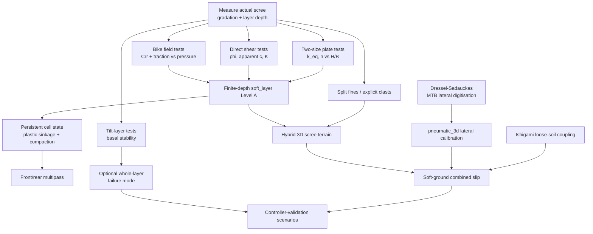
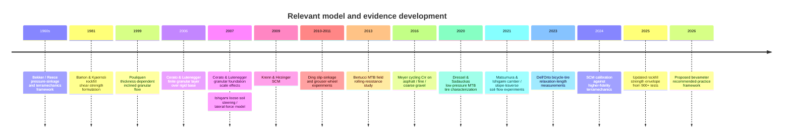

# Deep Research: Tire × Terrain × Loose Scree Physics for BikeSim

## Executive summary

The research target is now well specified by the uploaded brief: a real-time e-MTB simulator with a calibrated pneumatic radial-element tire, moving from rigid-surface friction curves toward a physically meaningful treatment of thin alpine scree over rock, while simultaneously adding 3D tire behavior, side-slope dynamics, shoulder impacts, and controller-relevant effects. The existing implementation and the exclusions in the brief materially constrain the answer: the objective is **not** to replace the tire with Pacejka/Fiala/TMeasy, nor to run DEM/FEA in the tick path, but to determine the smallest defensible extension of the existing model. fileciteturn0file0

The strongest conclusion from this research round is that the proposed “finite-thickness Bekker layer” is directionally sensible but **should not be treated as a normal semi-infinite Bekker soil with sinkage merely clamped at the bedrock depth**. Experiments on granular layers over rigid bases show that the hard substrate changes load-bearing behavior while the soil layer is still several footing widths thick: Cerato and Lutenegger tested \(H/B=0.5,1,2,3,4\) and concluded that finite-layer corrections remained relevant up to approximately \(H/B=3\), rather than only when the footing is about to touch the base. citeturn18search0turn18search3 For a roughly 50–60 mm-wide MTB contact region and a 30–100 mm scree layer, \(H/B\approx0.5–2\). **The entire BikeSim scree range therefore lies inside the regime where the rock substrate can matter**, even before geometric bottom-out. That is an extrapolation from foundation tests, not a measured bicycle result, but it is one of the most important design findings.

A second major conclusion is more disruptive: **a continuum-only scree representation is not defensible across the whole stated particle range of 10–100 mm**. Granular mechanics is scale-dependent; even homogeneous sand footing tests over widths from 25 to 914 mm show significant scale effects, and granular assemblies become increasingly sensitive to the ratio between specimen/contact dimensions and particle dimensions. citeturn18search4turn13search0 With a 50–60 mm tire width and 10–100 mm stones, BikeSim ranges from several particles across the footprint to individual stones larger than the tread width. In the latter regime, “pressure–sinkage of a continuum” ceases to be a convincing local picture. The recommended architecture is consequently **hybrid**: fine matrix/fines represented by a finite-depth continuum state; sufficiently large clasts represented explicitly by the existing multi-contact radial tire and 3D terrain geometry. This directly answers angle N: **continuum for fine scree, explicit stones for coarse scree, hybrid for realistic graded talus**.

The third important result is that the existing authored rolling-resistance expectation of \(C_{rr}=0.02–0.04\) should **not yet be pinned as a generic “gravel” value**. A controlled outdoor cycling study measured \(C_{rr}=0.01221\), 0.01468, and 0.01832 on asphalt, fine gravel, and coarse gravel respectively. citeturn19search0turn19search10 Those surfaces were sufficiently consolidated to behave unlike loose scree, so the result does **not** falsify \(0.02–0.04\) for mobile alpine debris. It does falsify using \(0.02–0.04\) as a general coarse-gravel reference. A separate mountain-bike field study found that tire construction, surface, and pressure all affected rolling resistance; smooth tires had \(21\pm15\%\) less resistance than knobby tires across road, hard sand, and grass. citeturn19search2turn19search6 The literature reviewed here still does not provide a suitably controlled \(C_{rr}\) dataset for a 1.2–2.0 bar, 2.4-inch MTB tire on a 3–10 cm mobile angular scree layer.

The fourth result changes the lateral-tire literature assessment. Dressel and Sadauckas published **actual low-pressure MTB lateral and camber measurements** for 29×2.3, 27.5×2.8, 29×3, and 26×4 knobby tires. Their tests include the project-relevant 29×2.3 format and pressure around 25 psi/1.7 bar, and their pressure sweep extends to 10 psi for some tires. They report normalized lateral force versus slip angle, camber force, aligning torque, twisting torque, tread-removal effects, rim-width effects, and pressure dependence. citeturn19search9 Therefore, the previous statement that Dell'Orto is the only open lateral bicycle-tire dataset needs qualification: Dell'Orto may remain the only readily reusable **machine-readable/raw** open dataset found, but Dressel–Sadauckas is an open primary publication containing MTB-specific lateral measurements. Their exact \(C_\alpha/F_z\) and \(C_\gamma/F_z\) values should still be marked `unpinned` until values are taken from the source plots/tables with explicit `digitised` provenance rather than silently estimated.

The fifth result is that loose-ground 3D behavior cannot safely be implemented by applying rigid-road lateral tire force and loose-ground longitudinal traction independently. Ishigami's single-wheel experiments establish lateral force as a soil-mechanics output dependent on slip angle and longitudinal slip; subsequent slope-traverse experiments show that soil failure and accumulation change force and sinkage across the wheel width, and that lateral force can **decrease as longitudinal slip increases**. citeturn14search0turn14search2turn14search14 This gives BikeSim a concrete minimum combined-slip requirement for `soft_layer`: at least a degradation/coupling term between longitudinal slip-induced soil failure and the available lateral granular shear force.

A sixth result concerns slope failure. The \(h_{\text{stop}}(\theta)\) family of granular-flow experiments establishes that a thin granular layer on an inclined rough substrate has a thickness-dependent transition between arrest and sustained flow. citeturn10search0 But an adversarial comparison is important: the classic collapse works substantially better for some sands and glass beads than for angular materials, and later avalanche experiments identify cases where the simple constitutive friction law is quantitatively inadequate. citeturn10search2turn10search6 Therefore, “whole-layer sliding” should become a **separate failure mode in the design**, but Pouliquen parameters must not be copied into `SurfaceSpec.soft` as MTB scree parameters. A small on-site tilt/thickness experiment would be more useful.

Finally, the literature strongly supports the brief's plan to calibrate locally rather than seek universal constants. A 2026 Journal of Terramechanics paper explicitly proposes a recommended-practice framework for bevameter testing. citeturn23search2turn23search3 Recent rockfill research based on more than 900 large-scale triaxial tests likewise emphasizes strongly nonlinear, stress-dependent strength and recommends site-specific testing. citeturn23search0turn23search1 This means the highest-value next step is **not another search for a magic `kc/kphi/n/K` parameter set**; it is a deliberately small field campaign designed around the exact scree used in the simulator.

### Decision summary

| Question | Research conclusion | Confidence | Design action |
|---|---|---:|---|
| Is a deformable scree model necessary for 3–10 cm layers? | Yes for mobile material; rigid-base influence is expected throughout much of \(H/B=0.5–2\), not only at bottom-out. | High for finite-layer effect; medium for bicycle extrapolation | Keep `soft_layer`; add finite-depth strengthening rather than only `z <= H`. |
| Can standard semi-infinite Bekker parameters simply be used? | No. | High | Treat published soil parameters as priors only; calibrate the actual material. |
| Continuum, explicit stones, or hybrid? | **Hybrid.** | High conceptually | Fine fraction → continuum; coarse clasts → terrain geometry/radial contact. |
| Pin \(C_{rr}=0.02–0.04\)? | No. | High | Leave as authored hypothesis until loose-scree coast/power tests. |
| Is lower pressure known to lower \(C_{rr}\) on scree? | Not established for the project regime. | High | Do not encode monotonic pressure rule. Measure 1.2/1.6/2.0 bar. |
| Are low-pressure MTB lateral data available? | Yes, in Dressel–Sadauckas 2020. | High | Use as the primary MTB lateral reference; digitize explicitly if necessary. |
| Can loose-ground longitudinal and lateral models be separated? | Not safely. | High | Add combined-slip degradation on `soft_layer`. |
| Should whole-layer sliding be modeled? | Yes as a possible second failure mode, but needs local calibration. | Medium-high | Add optional basal-slip/`layer_mobility` state after basic sinkage model. |
| Is multipass potentially relevant for front/rear wheels? | Yes; much compaction can occur on the first pass in soil studies. | Medium; poor scree-specific evidence | Make rear wheel read previous terrain state, but postpone sophisticated rut transport. |
| Is deterministic real-time SCM-like implementation feasible? | Yes. | High | Sparse height/state grid plus deterministic reductions is the appropriate reference architecture. |

## Scope, methodology, and prioritized research questions

The brief defines fourteen angles, with A/B/H/K as calibration blockers, C/L/F as near-term 3D requirements, D/E/M/N as architectural decisions, and G/I/J as supporting methodology. fileciteturn0file0 This pass therefore concentrated evidence collection on **A, B, C, H, K, L, N**, then used primary references to establish decision-level findings for **D, E, F, G, I, J, M** rather than pretending that every angle reached equal source saturation.

The questions were prioritized as follows:

| Priority | Research question | Why it dominates |
|---|---|---|
| Highest | Does finite layer depth change the pressure–sinkage law before actual bedrock contact? | Determines the basic mathematical form of `soft_layer`. |
| Highest | Is scree meaningfully a continuum at tire scale? | Can invalidate the entire Bekker premise if the answer is no. |
| Highest | Which quantities can be measured cheaply enough to replace authored parameters? | Direct route from literature uncertainty to calibrated simulation. |
| Highest | What is the actual rolling/traction envelope on loose gravel? | Needed to distinguish casing loss, compaction resistance, and shear failure. |
| High | What low-pressure MTB lateral data exist? | Direct input to spatial-3D tire calibration. |
| High | How does side force behave when the terrain itself yields? | Necessary on ±15° side slopes. |
| Medium | What persistent state is required for front-to-rear multipass? | Determines whether terrain must remember wheel history. |
| Medium | How should the implementation remain deterministic at 0.5 ms? | Architectural constraint on every added law. |

Evidence was classified using the brief's requested provenance vocabulary. **`measured`** means a value is reported by the experiment rather than inferred here; **`digitised`** is reserved for a value extracted from a figure; **`authored`** denotes a model assumption or author-proposed coefficient; **`extrapolated`** marks a transfer from a materially different experiment to BikeSim. No values below are silently converted from plots into “measurements.”

Primary sources were preferred: original Journal of Terramechanics, Journal of Field Robotics, ASCE geotechnical papers, the MTB tire paper itself, official Project Chrono documentation/source, peer-reviewed cycling experiments, and patents for controller logic. Reviews were used chiefly to locate literature or assess consensus. The most recent methodological developments checked include the January 2026 bevameter recommended-practice paper, a September 2026 tire–soil traction experiment, and the 2025 update to rockfill strength envelopes. citeturn23search2turn23search9turn23search1

The central limitation is important: **I did not find a primary dataset that directly matches all of the BikeSim dimensions simultaneously**—a 27.5/29×2.4 knobby bicycle tire, 1.2–2.0 bar, 300–1200 N wheel load, 10–100 mm angular mobile rock fragments, 30–100 mm layer thickness, rigid rock underneath, and climbing/slipping conditions. The consequence is not “choose the nearest soil table”; it is to use literature for model structure and experimental design, and local measurements for parameter pinning.

## Scree physics, finite depth, traction, and continuum validity

### Finite depth is a first-order effect

The classical Bekker relation,

\[
p=\left(\frac{k_c}{b}+k_\phi\right)z^n,
\]

is the relevant baseline in terramechanics and remains the pressure–sinkage law implemented in SCM-family terrain models. The 2026 bevameter review still treats it as a core terrain-characterization relation and emphasizes that multiple plate dimensions are needed if \(k_c\) and \(k_\phi\) are to be distinguished rather than lumped into one equivalent coefficient. citeturn23search2

The problem is that classical Bekker fitting implicitly represents a terrain volume deep enough for its deformation field. Cerato and Lutenegger's controlled granular-layer experiments put well-graded sand over a rigid base at relative densities of 24%, 57%, and 87%, testing \(H/B=0.5,1,2,3,4\). Their conclusion was that the rigid-base correction to granular bearing capacity remains significant up to approximately \(H/B=3\). citeturn18search0turn18search3

For BikeSim:

\[
H/B =
\begin{cases}
30/60 = 0.50\\
100/50 = 2.00
\end{cases}
\]

for representative layer depths and tire/contact widths. Thus the whole intended 3–10 cm scree layer lies inside the hard-base-sensitive region of the footing experiments.

This does **not** mean the footing bearing-capacity equation should be inserted into the tire code. A rolling pneumatic contact, repeated shearing, coarse clasts, and a narrow elongated footprint are materially different. The defensible inference is structural:

> **Do not make the bedrock correction activate only at \(z\approx H_s\). Make the equivalent pressure–sinkage response progressively harden as \(H_s/B_{\mathrm{eff}}\) decreases.**

A useful implementation form is therefore something like

\[
p(z,H_s,B)=
p_\infty(z)\,G\!\left(\frac{z}{H_s},\frac{H_s}{B}\right),
\qquad G\ge 1,
\]

with \(G\rightarrow1\) for deep layers and with a calibrated increase for thin layers. The exact \(G\) is **authored/extrapolated** until BikeSim-specific plate data exist. Clamping \(z\) to \(H_s\) remains necessary for geometry, but is insufficient as the entire finite-layer treatment.

A second independent concern is scale. Cerato and Lutenegger's subsequent tests used footing widths from 25 mm to 914 mm and showed that granular bearing-capacity behavior depends on absolute footing scale and cannot be universally corrected by a simple grain-size normalization. citeturn18search4turn13search1 This is strong evidence against taking \(k_c,k_\phi,n\) from a large agricultural bevameter and assuming that a 50–60 mm bicycle footprint will reproduce them.

### The coarse end of “scree” is not a continuum

The project specifies particles as large as roughly 10 cm. At a 60 mm tire width:

| Representative particle diameter | \(B/d\) for 60 mm tire | Interpretation |
|---:|---:|---|
| 2 mm | 30 | Many grains across contact; continuum assumption comparatively plausible |
| 5 mm | 12 | Still continuum-like with adequate gradation |
| 10 mm | 6 | Borderline enough that scale effects deserve testing |
| 30 mm | 2 | Only a handful of load-bearing particles |
| 60 mm | 1 | Individual-stone contact dominates |
| 100 mm | 0.6 | Stone is larger than tire width |

The numerical ratios are geometric calculations from the project dimensions; the interpretation is an inference supported by experimental evidence that granular response changes with specimen/particle scale and particle-scale force-chain structure. citeturn13search0turn13search8

This points to a clean split that aligns unusually well with the tire code that already exists:

**Fine fraction:** material whose representative grain scale is much smaller than the contact width can be represented as a deformable continuum cell with pressure–sinkage, shear displacement, compaction resistance, and history.

**Coarse fraction:** stones comparable to the tire width/contact length should remain explicit heightfield/mesh features. The existing radial tire already has the mechanism the continuum approximation lacks: discrete contacts, enveloping around rocks, simultaneous patches, and eventual 3D shoulder contacts. fileciteturn0file0

The hybrid is not merely a computational compromise. It maps the actual two physical scales onto the two model mechanisms best suited to them.

A practical threshold should therefore be **measured, not decreed**, but an initial engineering classifier can be based on \(B/d_{90}\) or \(L_{\text{patch}}/d_{90}\). Do not bake a universal number such as “continuum valid at \(B/d>5\)” into the specification: the literature reviewed here does not establish such a universal transition for angular scree.

### Scree shear strength is nonlinear and stress-dependent

Rockfill is the closest geotechnical analogue to very coarse angular scree, but it too warns against a single universal \(\phi\). Barton and Kjærnsli found peak drained friction to depend on stress level, particle/sample size, roughness, particle strength, porosity, and roundedness, with particularly high apparent friction at low stress. citeturn15search2

The 2025 update of the Leps rockfill strength envelopes assembled more than 900 large-scale triaxial tests and again found that rockfill strength should be represented by a nonlinear envelope rather than one context-free friction angle. The authors specifically warn that low-stress data can miscalibrate extrapolation to higher stress and recommend site-specific testing. citeturn23search0turn23search1

This is directly relevant to the BikeSim range. The pressure underneath a bicycle tire is low compared with dam-rockfill testing, while local force-chain stresses at individual clasts can be much larger than average contact pressure. A single `tan(phi)` cap can therefore remain useful as a **control-oriented model**, but it should be interpreted as an **effective low-stress parameter for the chosen material and footprint**, not a mineral constant.

For dry uncemented scree, I would retain `c = 0` initially as an explicit **authored model assumption**, then allow a fitted apparent intercept only if multi-normal-load direct-shear measurements require one. The reason is methodological: with coarse angular particles and a nonlinear strength envelope, fitting two or three points to a straight Mohr–Coulomb line can create an apparent “cohesion” that is not physical bonding. The recent rockfill literature is precisely a warning against overinterpreting such a linear fit. citeturn23search0

### Whole-layer motion is physically distinct from local tire shear

Pouliquen's inclined-plane experiments established \(h_{\text{stop}}(\theta)\): for a given incline and basal roughness, there is a thickness below which a granular layer arrests and above which steady flow can occur. citeturn10search0 This is conceptually important because BikeSim climbs of 25–35° can fail in two very different ways:

1. the tire shears locally through otherwise stable material; or
2. the tire perturbs a layer that is near a global/basal instability and the whole layer moves downslope.

Those mechanisms should not share a single tire–ground \(\mu\).

However, the transfer must be conservative. Tests on different particle shapes show that the classic flow-rule collapse is material-dependent; angular particle systems are not necessarily captured as well as spherical glass-bead or sand systems. citeturn10search2 Pouliquen–Forterre avalanche modeling also shows cases where the friction law does not quantitatively reproduce avalanches propagating over a static layer. citeturn10search6

Therefore the design implication for scree §4.3/§8 is:

\[
\tau_{\text{available}}
=
\min(
\tau_{\text{local shear}},
\tau_{\text{basal/layer stability}}
),
\]

but the second term should initially be a simple calibrated threshold or state flag, not a copied \(h_{\text{stop}}\) law.

Natural talus slope angle should also **not** be used naively as an internal friction measurement. Experiments on crushed rock established decades ago that angle of repose and internal friction are related but are not generally equal. citeturn15search3 Geomorphological studies further show that observed scree profiles are shaped by deposition, sorting, roughness and transport processes, rather than simply sitting everywhere at one material angle of repose. citeturn9search3turn9search12

### Rolling resistance and traction evidence

The cleanest field \(C_{rr}\) numbers found are from Meyer, Kloss and Senner:

| Surface | \(C_{rr}\) | Provenance | Applicability |
|---|---:|---|---|
| Asphalt | 0.01221 | `measured/fitted from field runs` | Rigid-road reference |
| Fine gravel | 0.01468 | `measured/fitted from field runs` | Consolidated gravel proxy |
| Coarse gravel | 0.01832 | `measured/fitted from field runs` | Best cycling gravel number found, but not loose scree |

The study derived resistance from outdoor cycling measurements and fitted rolling/aerodynamic terms, finding significant differences among the three surfaces. citeturn19search0turn19search10

This table should **not** be copied into `scree_soft`. It does provide a useful falsification test: a simulated “coarse but firm gravel road” returning \(C_{rr}=0.04\) would be suspect unless the extra loss is deliberately attributed to very different tire/terrain conditions.

Bertucci, Rogier and Reiser tested smooth and knobby MTB tires on road, hard sand and grass at 200 and 400 kPa. The smooth tire had \(21\pm15\%\) lower rolling resistance overall, and surface and inflation pressure both affected the result. citeturn19search2turn19search6 Crucially for BikeSim, this does **not** establish a simple “higher pressure → lower off-road resistance” rule. The behavior depends on deformation of both tire and terrain.

A useful recent proxy comes from a September 2026 agricultural tire experiment. For a 6.00-14 bias-ply tire, the tested combination with low pressure, low load and high speed produced the largest Mohr–Coulomb-based traction-related index among their tested operating points; the authors found inflation pressure had a stronger effect on tractive performance than load and forward speed. citeturn23search9 This is far from an MTB tire, but it independently reinforces that pressure can act on deformable-soil traction in ways that rigid-road intuition misses.

**Not closed:** I did not locate a primary MTB/e-MTB study reporting a usable peak traction or braking ratio \(F_x/F_z\) for a mobile angular 1–10 cm scree layer with stated layer thickness and tire pressure. Miller et al. did perform 100 bicycle braking trials across paved and gravel surfaces, showing that controlled gravel bicycle braking experiments are practical, but the source reviewed here does not expose a suitable surface-specific peak-\(\mu\) value for pinning BikeSim's scree model. citeturn15search6

### Slip–sinkage

Slip-induced digging is too large to ignore once the controller deliberately explores traction limits. Ding and co-authors measured lugged rover wheels over slip ratios from 0 to 0.6 and reported sinkage at 0.6 slip reaching **three to seven times static sinkage**, depending on wheel. citeturn22search9 This is lunar-soil/rigid-wheel evidence, not an MTB calibration, so the magnitude is not transferable. The existence and possible size of the effect are nevertheless strong enough to reject a model in which sinkage depends only on instantaneous \(F_z\).

A useful implementation order is therefore:

\[
z =
z_\text{static}(F_z)
+
z_\text{slip}(|s|,j,\text{terrain state}),
\]

with `z_slip` initially bounded and calibrated empirically. Do not import Ding's three-to-seven multiplier as an MTB coefficient.

## MTB lateral behavior, obstacles, side slopes, and multipass state

### Low-pressure MTB lateral data exist

Dressel and Sadauckas's 2020 work is considerably more useful to BikeSim than a road-tire proxy. The study tested several MTB sizes and directly measured normalized lateral force versus sideslip, lateral force versus camber, self-aligning moment, twisting torque, static radial/lateral properties, pressure dependence and tread effects. citeturn19search9

Several design-relevant observations are directly reported:

| Observation | Provenance | Implication |
|---|---|---|
| 29×2.3 knobby had the lowest normalized cornering stiffness among tested tire sizes at the nominal comparison point. | `measured/fitted` | Do not infer MTB \(C_\alpha/F_z\) from road/cargo tires. |
| 26×4 fat tire had nearly twice the normalized cornering stiffness of the baseline 29×2.3 in the plotted comparison. | `measured/fitted` | Width/structure strongly affect normalized stiffness. |
| Removing knobs from the 29×2.3 produced a large increase in cornering stiffness. | `measured` | Knob compliance belongs in the lateral calibration. |
| Less-treaded variants had higher camber stiffness. | `measured` | A casing-only camber model will overpredict knobby tires unless tread compliance is represented. |
| Knobby-tire camber stiffness falls markedly over part of the low-pressure range. | `measured` | Pressure exponents are tire-specific, not universal. |
| 29×2.3 knobby at the reported higher-pressure end remained below roughly 1 rad\(^{-1}\) in the normalized camber-stiffness discussion. | `reported from plotted result` | Useful order-of-magnitude check, not enough for a pinned JSON value. |

citeturn19search9

Dell'Orto's later road-racing work remains valuable for dynamics rather than absolute MTB stiffness. VeTyT measurements define lateral relaxation length from cornering and lateral stiffness, show flat-track values on average around 15% above the 2.6 m drum for otherwise equal conditions, and show strong inflation-pressure dependence. citeturn19search3turn19search13 Because those tires are 26–28 mm and pressures are far above the e-MTB range, a direct \(\sigma_y\) transfer is unjustified.

The safest current `tyre_lateral_reference.json` state is therefore not a fake numerical band but an explicit partially pinned record:

```json
{
  "family": "mtb_29x2.3_knobby",
  "reference": {
    "source": "Dressel_Sadauckas_2020",
    "status": "primary_open_publication",
    "surface": "non-skid-coated treadmill",
    "nominal_pressure_bar": 1.72,
    "width_in": 2.3
  },
  "cornering_stiffness_per_Fz_1_per_rad": {
    "value": null,
    "status": "unpinned",
    "next_action": "digitise source figure/table with uncertainty"
  },
  "camber_stiffness_per_Fz_1_per_rad": {
    "value": null,
    "status": "unpinned",
    "constraint": "knobby baseline lower than less-treaded variants; pressure dependent"
  },
  "lateral_relaxation_length_m": {
    "value": null,
    "status": "unpinned",
    "proxy_source": "DellOrto_2023_road_racing_only"
  },
  "pressure_exponent_cornering": {
    "value": null,
    "status": "disputed_or_tire_specific"
  }
}
```

This is a better calibration artifact than filling the nulls with an average from road, cargo and MTB tires measured at incompatible pressures.

### Lateral force on deformable ground needs combined-slip coupling

Ishigami et al.'s steering model was experimentally validated on a single-wheel loose-soil test bed and treats side force as a terramechanical output under wheel slip rather than as rigid-road friction acting independently in the lateral direction. citeturn14search0turn14search10 Earlier experiments by Yoshida and Ishigami explicitly found lateral force increasing with slip angle but decreasing as longitudinal slip ratio increases. citeturn14search14

Matsumura and Ishigami's cambered-wheel/slope experiments go further: an in-wheel camera showed that slope failure and soil accumulation affect force and sinkage across the wheel width; side force during slope traversal decreased as slip increased because the sheared soil could no longer sustain the same downslope shear stress. citeturn14search2turn14search5

For BikeSim §10.3 this argues for a two-part lateral force:

\[
F_y =
F_{y,\text{tire deformation}}
+
F_{y,\text{soil}},
\]

where the rigid-surface tire term can use the emerging MTB lateral calibration, while the soil term is limited by the same yielding state that produces longitudinal traction. A simple first implementation could use

\[
F_{y,\text{soil}} =
F_{y0}(\alpha,\gamma,z,\theta)
\,D_s(|s_x|),
\qquad
0\le D_s\le1,
\]

with \(D_s\) decreasing once longitudinal slip has substantially mobilized/failed the local granular material. The particular function is **authored**; the required sign of the coupling is supported experimentally.

This is especially important because the user scenario includes ±15° side slope. A rigid-road brush model could otherwise produce strong lateral tire force at the same time that the loose layer is being violently churned longitudinally—an energetically and mechanically inconsistent combination.

### Obstacle enveloping: strong automotive validation route, weak MTB force-time data

A direct MTB force-time cleat dataset satisfying the brief was not found in the sources reviewed here. Automotive tire literature does, however, provide a mature test methodology. Alkan et al. measured vertical and horizontal tire forces while tires traversed multiple cleat types at low speed and varied load and inflation pressure, explicitly studying tire-enveloping characteristics. citeturn14search9 Dorfi's SAE work compared measured cleat-impact forces against FTIRE over varying speed, cleat geometry, tire construction and load. citeturn14search16

The useful transfer is the **validation protocol**, not tire constants:

1. defined cleat/step geometry;
2. prescribed load and inflation;
3. low-speed quasi-static tests to isolate geometric enveloping;
4. dynamic sweeps to test damping/inertia;
5. compare vertical force, fore–aft force and moment histories separately.

For the forthcoming toroidal 3D tire, add controlled lateral offsets so a cleat transitions from center tread to shoulder. That test would directly exercise the phenomenon the present 2D/radial model cannot validate.

### Multipass: the terrain should remember the front wheel

Agricultural multipass literature consistently shows irreversible compaction under repeated wheel loading. citeturn22search1 A Virginia Tech multipass study estimated that roughly 80–90% of its modeled residual volumetric strain occurred on the first pass, with subsequent increments diminishing substantially. citeturn22search13 This percentage is **not transferable** to coarse dry scree—it came from a soil/vehicle model—but it strongly supports an architecture in which the front wheel leaves terrain state behind for the rear wheel rather than each contact querying a stateless virgin surface.

Repeated shear tests similarly show cumulative densification approaching a limiting density rather than indefinitely accumulating at a fixed rate. citeturn22search12

For an e-MTB wheelbase around 1.2 m, the time between front and rear traversal is approximately:

\[
0.17\ \text{s at }25\,\mathrm{km/h}
\quad\text{to}\quad
1.44\ \text{s at }3\,\mathrm{km/h}.
\]

Those are direct kinematic calculations from the project speed and wheelbase, not literature values. On dry angular scree, there is no reason to assume the disturbed packing fully recovers in that interval.

The minimum Level-B terrain state therefore needs only a few variables per touched cell:

```text
surface_height
max_or_plastic_sinkage
compaction_state
accumulated_shear_x
accumulated_shear_y   # once spatial 3D is enabled
optional basal_mobility/damaged flag
```

A sophisticated rut-flow solver can wait. **State persistence cannot.**

## Real-time architecture, open-source reference implementations, and determinism

### Chrono SCM is the closest implementation reference, not a drop-in model

Project Chrono's current official terrain documentation describes SCM as an implicit regular Cartesian grid whose nodes move vertically; only deformed nodes need be stored, and the lightweight formulation is intended to provide close-to-real-time deformable-terrain interaction. citeturn22search4 This matches BikeSim's Level-B needs far better than particle-resolved terrain.

The original DLR SCM work is Krenn and Hirzinger's 2009 Soil Contact Model for multibody simulation. citeturn22search0 More recent Chrono work characterizes SCM as a generalized Bekker–Wong / Janosi–Hanamoto approach for arbitrary 3D shapes and contact patches, and reports real-time capability in the low-to-medium-slip regime. citeturn22search2turn22search3

Direct code inspection confirms that the current Chrono implementation still computes Bekker normal stress with a power law of sinkage:

```cpp
nr.sigma =
    (contact_patches[patch_id].oob * Bekker_Kc + Bekker_Kphi)
    * std::pow(nr.sinkage, Bekker_n);
```

in `src/chrono_vehicle/terrain/SCMTerrain.cpp` at repository revision `1a330296508cd8c942d37148ca258a1b4b899d52`; the source also stores \(K_\phi\), \(K_c\), and related SCM parameters in `SCMTerrain.h`. fileciteturn6file0

That is useful as an **external equation/code oracle**, but not as a model to copy wholesale. Standard SCM does not solve the special BikeSim problem of a 30–100 mm loose layer over rigid rock with 10–100 mm explicit clasts. The BikeSim extension should therefore be “SCM-like state and shear bookkeeping plus finite-depth/hybrid corrections,” not “embed SCMTerrain.”

### Suggested real-time update

At each tire/terrain contact sample:

```text
1. Query hard terrain height and explicit rock geometry.
2. Query soft-layer thickness H and persistent cell state.
3. Compute radial/toroidal tire penetration and candidate load.
4. Solve quasi-static soft sinkage z with fixed-iteration bracket/bisection.
5. Apply finite-depth strengthening G(H/B, z/H).
6. Update plastic/compaction state.
7. Integrate local shear displacement j from relative contact motion.
8. Evaluate granular shear capacity.
9. Couple longitudinal and lateral soil shear.
10. Accumulate compaction resistance / bulldozing contribution.
11. Deterministically reduce all contact-sample forces and moments.
12. Update touched terrain cells in a fixed canonical order.
```

The expensive part need not run over the complete terrain. Chrono's own sparse-grid/active-domain strategy demonstrates the basic computational principle: operate only on terrain nodes that are relevant to current contact and preserve sparse state elsewhere. citeturn22search4

### Determinism needs stricter rules than “fixed dt”

Bitwise determinism is threatened by both parallel reductions and apparently innocuous math expressions. Demmel, Ahrens and Nguyen define reproducible floating-point summation precisely as obtaining bitwise-identical results despite changes in order or computing resources, and provide order-independent accumulator strategies for reductions. citeturn16search4turn16search5

Box2D is a useful modern physics-engine case study because it explicitly targets cross-platform determinism. Its documented strategy includes deterministic creation/event ordering, precise compiler behavior, disabling floating-point contraction on Clang/GCC, and custom implementations of trigonometric functions instead of relying on potentially different platform libraries. citeturn16search0turn16search14

Clang's own documentation matters here: even its default “precise” floating-point model permits FP contraction; the stricter mode disables contractions and restricts transformations that can change observable FP behavior. citeturn16search10

For `soft_layer`, that leads to a concrete checklist:

| Risk | Required policy |
|---|---|
| Contact samples visited in different thread orders | Generate stable IDs; sort/canonicalize before terrain-state updates. |
| `sum(F_i)` across 64/256 rays | Fixed tree order or reproducible accumulator; never an unordered atomic reduction if bitwise invariance is required. |
| FMA vs separate multiply/add | Fix compiler contract/FMA policy across supported builds. |
| Newton solver exits on tolerance | Prefer fixed iteration count; bisection is particularly attractive. |
| `pow(z,n)` with noninteger \(n\) | Potential cross-libm source of last-bit differences; test supported platforms explicitly. |
| `exp`, `tanh` in Janosi/Stribeck variants | Same concern; either accept platform-specific bitwise scope or provide controlled implementation/table. |
| Cell hash-map iteration | Never let container iteration order determine force or state update order. |
| Parallel terrain writes | Gather contributions, stable-sort by cell ID, then deterministic reduction/update. |

This is one reason a fixed-step bisection solver for sinkage is preferable to a convergence-dependent Newton scheme in this particular project: it makes the operation count and branching history deterministic while remaining robust to strong finite-depth hardening.

### Open-source implementation status

At present, Chrono SCM is the strongest open implementation oracle found for the relevant semi-empirical class. The current open research literature also uses Chrono SCM as the fast model against which higher-fidelity CRM/DEM models are calibrated. Hu et al. describe SCM as suitable where simulation speed matters and validate a workflow that fits SCM parameters against higher-fidelity virtual bevameter output. citeturn22search3

A 2024/2025 research line similarly reports SCM as two to three orders of magnitude faster than DEM in the studied calibration workflow. citeturn15academia48 That supports the brief's prior decision not to make DEM the tick-path solution.

No additional open implementation found in this pass displaced Chrono SCM as the most useful code-level reference. PINNeAPPle remains useful as a Wong/Reece formulation reference, but according to the project brief it was already reviewed and should not consume another full survey round. fileciteturn0file0

## Parameter package and field calibration plan

The central outcome of angles A, B, H and K is that literature can constrain **model form and plausible sanity checks**, but it cannot honestly deliver a complete ready-to-paste parameter vector for BikeSim's scree. The correct parameter artifact is therefore a mix of source-backed constraints and deliberately unpinned values.

### Proposed `SurfaceSpec.soft` state

```json
{
  "name": "scree_soft",
  "provenance": {
    "status": "needs_site_calibration",
    "material": "dry angular alpine scree over rigid rock"
  },

  "layer_thickness_m": {
    "range": [0.03, 0.10],
    "provenance": "authored_project_scenario",
    "status": "pinned_scenario"
  },

  "pressure_sinkage": {
    "form": "finite_depth_bekker_equivalent",
    "k_eq": {
      "value": null,
      "units": "Pa / m^n",
      "status": "unpinned",
      "measurement": "plate penetration"
    },
    "n": {
      "value": null,
      "status": "unpinned",
      "measurement": "log-fit pressure versus sinkage"
    },
    "k_c": {
      "value": null,
      "status": "optional_unpinned",
      "note": "requires >=2 plate widths to separate from k_phi"
    },
    "k_phi": {
      "value": null,
      "status": "optional_unpinned",
      "note": "requires >=2 plate widths to separate from k_c"
    },
    "finite_depth": {
      "enabled": true,
      "H_over_B_effect_onset": {
        "constraint": "effect observed in granular footing tests through H/B ~3",
        "provenance": "extrapolated_from_Cerato_Lutenegger_2006",
        "status": "model_structure_only"
      }
    }
  },

  "shear": {
    "cohesion_Pa": {
      "value": 0,
      "provenance": "authored_dry_uncemented_initial_assumption",
      "status": "unpinned"
    },
    "phi_deg": {
      "value": null,
      "status": "unpinned",
      "measurement": "direct shear at multiple normal loads"
    },
    "janosi_K_m": {
      "value": null,
      "status": "unpinned",
      "measurement": "shear force versus displacement"
    },
    "combined_slip_degradation": {
      "enabled": true,
      "status": "structure_supported_parameters_unpinned"
    }
  },

  "slip_sinkage": {
    "enabled": true,
    "coefficient": null,
    "status": "unpinned"
  },

  "rolling": {
    "target_Crr_loose_scree": {
      "range": null,
      "status": "unpinned"
    },
    "reference_Crr_coarse_firm_gravel": {
      "value": 0.01832,
      "provenance": "measured_fitted_Meyer_Kloss_Senner_2016",
      "status": "reference_not_scree_calibration"
    }
  },

  "basal_layer_failure": {
    "enabled": false,
    "status": "phase_2_after_tilt_test",
    "critical_state": null
  },

  "granularity": {
    "mode": "hybrid",
    "continuum_fraction": "fines/small clasts",
    "explicit_fraction": "clasts comparable with tire footprint",
    "transition": null,
    "status": "needs_particle_distribution_measurement"
  }
}
```

The 0.01832 coarse-gravel reference is directly reported by Meyer et al. and is included only as a **firm-gravel regression test**, not as a `scree_soft` target. citeturn19search0 The finite-depth constraint comes from the granular-layer footing experiments. citeturn18search3 The requirement for multiple plate sizes follows classical parameter identifiability and current bevameter recommended practice. citeturn23search2

### DIY pressure–sinkage protocol

This is the highest-value first experiment.

Use two rigid plates whose characteristic widths bracket the tire's loaded width—for example, approximately 40 and 70 mm rather than a single plate. A current bevameter methodological review emphasizes plate-based pressure–sinkage characterization, while conventional Bekker separation of \(k_c\) and \(k_\phi\) requires geometry variation; without it, fit a single \(k_\mathrm{eq}\) and do not pretend the two terms are separately identified. citeturn23search2

Prepare the actual scree on an actual rigid slab at several known thicknesses, ideally 30, 50, 70 and 100 mm. For each thickness and plate, apply incremental loads spanning the project pressure range. Record plate displacement after a fixed dwell time. Use at least five independent repacks per condition; granular-bed preparation itself is a significant source of parameter variation, and recent bevameter research shows testing method and contact-area assumptions can materially alter inferred shear response. citeturn13search13turn23search2

Fit first:

\[
p = k_\text{eq}z^n
\]

separately for each \(H/B\).

The most useful output is **not merely \(k_\text{eq},n\)**. Plot

\[
k_\text{eq}(H/B),\qquad n(H/B)
\]

and compare each finite layer against the deepest available layer. That directly identifies the BikeSim finite-depth correction without importing a geotechnical footing formula.

Expected uncertainties should be reported from repack-to-repack scatter, load-cell/scale error, plate-area uncertainty, and displacement reading. Do not combine them into false precision. If a kitchen/bathroom scale is used, calibrate it with known masses before and after the session.

### Direct-shear protocol for \(\phi\), apparent \(c\), and \(K\)

Build a shear box substantially larger than the upper particle size retained for the continuum fraction. This is critical: a small box containing only a few stones will measure boundary geometry as much as bulk material. Scale effects in granular shear and bearing tests are well documented. citeturn13search0turn18search4

Run at least three normal-load levels spanning the approximate tire contact-pressure regime. For each, record shear force continuously against horizontal displacement.

From the peak points, fit

\[
\tau_\text{peak} = c + \sigma_n\tan\phi
\]

only as an **effective local model**. Also retain the raw \((\sigma_n,\tau)\) points, because rockfill evidence says the true failure envelope can be nonlinear and stress dependent. citeturn23search0turn15search2

To calibrate a Janosi-type shear-displacement law,

\[
\tau(j)=\tau_{\max}\left(1-e^{-j/K}\right),
\]

fit the complete force–displacement curve rather than only peak force. If the actual curve has a clear peak followed by softening because angular stones rearrange, the basic monotonic Janosi law is structurally incomplete; record that as a finding rather than forcing a misleading \(K\).

A simple low-cost direct shear apparatus is feasible; recent work explicitly demonstrates construction of low-cost shear-box equipment. citeturn15search0 But the major accuracy constraint for BikeSim will likely be box-to-particle scale, not sensor sophistication.

### Layer-stability protocol

Angle of repose is useful as a **screening measurement**, not as direct \(\phi\). Experiments on crushed rock show the two are not generally identical. citeturn15search3

A more project-specific test is:

1. put a rigid slab on an adjustable incline;
2. use the same bedrock roughness intended in the scenario;
3. prepare 30/50/70/100 mm layers with repeatable packing;
4. increase slope slowly;
5. record first local grain motion and first sustained whole-layer slip;
6. repeat after one wheel/plate disturbance.

This empirically builds the BikeSim analogue of \(h_{\text{stop}}(\theta)\) without assuming that glass-bead flow laws apply to angular scree. Pouliquen's work provides the physical rationale for thickness-dependent arrest, while later studies provide the reason to calibrate it rather than copy it. citeturn10search0turn10search2

### Rolling-resistance protocol

The cleanest home method is repeated constant-speed power or coast-down tests on a short, uniform section, with matched runs in both directions to suppress slope and wind bias. Meyer et al. demonstrate that outdoor power/speed measurements can recover surface-specific rolling coefficients. citeturn19search0

For BikeSim specifically, the more valuable output than one \(C_{rr}\) number is a matrix:

| Pressure | Virgin scree | Front-wheel track | Firm reference |
|---|---:|---:|---:|
| 1.2 bar | measure | measure | measure |
| 1.6 bar | measure | measure | measure |
| 2.0 bar | measure | measure | measure |

Keep speed in a range where aerodynamic power is either small or well modeled, repeat both directions, and report the confidence interval of each condition. Do not infer the entire pressure curve from two noisy points.

This test simultaneously informs B and D: if rolling resistance in the front-wheel track differs materially from virgin scree, multipass memory is controller-relevant.

### Fixed-slip traction protocol

A stationary “spin until failure” test measures something different from rolling traction, so it should be treated as a separate high-slip calibration. A better low-cost protocol is a controlled uphill pull or driven-wheel test with wheel angular speed and vehicle ground speed recorded independently.

Measure:

\[
s = \frac{R\omega-v}{\max(R\omega,v_\epsilon)}
\]

and drive force from a force sensor/load cell or from a motor torque signal whose drivetrain losses have been independently calibrated. Sample sinkage/rut depth after each run.

The resulting primary calibration object should be

\[
F_x/F_z = f(s, F_z,p,H,\text{packing state})
\]

rather than one universal `mu_scree`.

Ding's experiments establish why sinkage should be logged simultaneously: large longitudinal slip can increase sinkage far beyond the static value. citeturn22search9

## Gaps, controversies, recommendations, and implementation roadmap

### What is now consensus-level

Several conclusions have enough independent support to be treated as design constraints rather than speculative ideas.

**Finite layer depth matters before geometric bottoming.** Granular layers over rigid bases show substrate effects through multiple footing widths. citeturn18search0turn18search3

**Granular strength is state-, stress-, geometry-, and particle-dependent.** Large rockfill databases and classic experiments both reject a universal friction angle detached from stress, gradation and roughness. citeturn23search0turn15search2

**Slip changes sinkage.** Controlled wheel–soil experiments show substantial dynamic slip–sinkage, even though the numerical magnitude cannot be transferred from rover wheels to MTB tires. citeturn22search9

**Loose-soil lateral and longitudinal behavior are coupled.** Single-wheel steering and slope-traverse experiments show that longitudinal slip and soil failure alter lateral force. citeturn14search0turn14search2

**Terrain history matters.** Repeated loading and shear compact granular soil, with diminishing increments as state evolves. citeturn22search1turn22search12

**Real-time semi-empirical deformable terrain is practical.** SCM provides an established sparse-grid, pressure–sinkage/shear framework specifically intended for near-real-time multibody simulation. citeturn22search0turn22search4

### What remains controversial or unpinned

There is still **no source-backed BikeSim-ready band for \(k_c,k_\phi,n,K\)** for 1–10 cm dry angular scree over bedrock. Publishing one would create exactly the false provenance the brief forbids.

There is no defensible universal numerical threshold separating “continuum” and “explicit stone” behavior. The hybrid conclusion is strong; the exact grain-size threshold is not.

The authored \(C_{rr}=0.02–0.04\) interval remains plausible for actively deforming loose debris but is **not literature-pinned**. Firm coarse-gravel cycling data are lower, around 0.018 in the Meyer experiment. citeturn19search0

A low-pressure MTB \(C_\alpha/F_z\) and \(C_\gamma/F_z\) dataset exists in published graphical form, but exact machine-ready values have not been extracted here because doing so without explicit digitization would violate the provenance rule. citeturn19search9

No transferable MTB knob-to-`tan(phi_eff)` multiplier was identified. Ding's grouser work validates that lugs materially alter rigid-wheel sandy-soil dynamics, but a rigid rover grouser is not a 4–6 mm compliant MTB knob acting among 10–100 mm stones. citeturn22search5turn22search6 A universal multiplier would be unjustified.

No suitably matched MTB force-time obstacle dataset was located; automotive cleat measurements remain the best validation-method proxy found. citeturn14search9turn14search16

### Refuted or narrowed claims

| Prior assumption | Result |
|---|---|
| “Bedrock matters only when sinkage reaches layer depth.” | **Refuted as a general model assumption.** Granular rigid-base influence appears substantially earlier in \(H/B\). citeturn18search3 |
| “One Bekker parameter set from gravel literature can characterize 3–10 cm scree.” | **Refuted.** Scale, layer thickness, packing, particle geometry and stress all matter. citeturn18search4turn23search0 |
| “Scree can be represented entirely as a homogeneous continuum.” | **Refuted for the coarse end of the stated 10–100 mm distribution.** This is an inference from contact/particle scale, not a direct MTB experiment. |
| “\(C_{rr}=0.02–0.04\) is a literature-backed generic gravel range.” | **Refuted/narrowed.** Measured firm gravel cycling results include 0.0147–0.0183. citeturn19search0 |
| “Higher pressure should lower rolling loss off-road, as on smooth pavement.” | **Not established.** MTB field data show pressure effects but do not support a universal rule transferable to loose scree. citeturn19search2 |
| “Dell'Orto is the only open source of bicycle lateral measurements.” | **Needs qualification.** Dressel–Sadauckas openly publish MTB lateral/camber measurements; Dell'Orto remains distinctive for reusable VeTyT data and relaxation-length work. citeturn19search9turn19search3 |
| “Rigid-road lateral tire forces can simply coexist with granular longitudinal traction.” | **Refuted as a soft-ground assumption.** Loose-soil experiments show longitudinal slip degrades lateral response. citeturn14search14turn14search2 |
| “Angle of natural scree slope equals \(\phi\).” | **Refuted as a measurement rule.** Angle of repose and internal friction are not generally identical. citeturn15search3 |
| “Use Pouliquen \(h_{\text{stop}}\) parameters directly for angular scree.” | **Refuted.** The physical mode transfers; coefficients do not. citeturn10search2turn10search6 |

### Recommended specification changes

For **soft-scree §4.1**, replace “Bekker with maximum sinkage at layer depth” by “finite-depth pressure–sinkage law whose equivalent stiffness depends on \(H/B_\mathrm{eff}\), with hard geometric bottoming as a separate limit.” The exact correction remains calibration-driven.

For **§4.3**, split traction failure into local granular shear and optional whole-layer/basal failure. Add combined longitudinal/lateral mobilization rather than independent friction ceilings.

For **§4.4**, add a persistent compaction state from the start, even if Level A initially uses it only to alter `k_eq` and surface height. This prevents a later Level-B redesign of all terrain interfaces.

For **§8**, remove any `measured` implication from the 0.02–0.04 \(C_{rr}\) expectation. Keep it as an authored acceptance band until field tests. Add 0.01832 as a firm/coarse-gravel literature regression reference, explicitly **not** as the loose-scree target. citeturn19search0

For **spatial-3D §10.3**, add a deformable-ground lateral term and longitudinal-slip degradation. The model can remain low dimensional; a full terramechanics steering solver is unnecessary initially.

For **§10.4**, promote Dressel–Sadauckas 2020 to the primary low-pressure MTB lateral reference. Dell'Orto 2023/2024 should be the dynamic/road-bicycle cross-check rather than the absolute MTB stiffness source. citeturn19search9turn19search3

For the **terrain generator**, distinguish `matrix_fraction` from `explicit_clasts`; do not make the “scree” surface merely a random friction coefficient plus visual stones. The continuum–explicit partition should be generated from an actual measured sieve/photogrammetric size distribution where possible.

### Suggested development sequence



The chronological literature landmarks motivating that path are:



citeturn15search2turn10search0turn18search0turn18search4turn14search0turn22search0turn22search9turn19search2turn19search0turn19search9turn14search2turn19search3turn22search3turn23search1turn23search2

### Overall recommendation

The research does **not** support replacing the proposed soft-scree design. It supports tightening its abstraction boundary.

The most defensible BikeSim model is:

\[
\boxed{
\text{pneumatic radial/3D tire}
+
\text{explicit coarse stones}
+
\text{finite-depth deformable fine matrix}
+
\text{persistent compaction/shear state}
}
\]

with the fine matrix using Bekker-like pressure–sinkage and Janosi-like shear laws only as **locally calibrated constitutive forms**, not as universal scree physics. Finite-depth strengthening should begin before literal bedrock contact; high slip should increase sinkage; longitudinal soil failure should reduce available lateral support; and a separate basal-layer instability can be introduced once a simple incline test demonstrates that it matters.

The literature is now strong enough to choose that architecture. It is **not** strong enough to pin the decisive scree constants without measuring the actual material. That gap is not a research failure: it is itself the principal result of the review. The 2025–2026 literature has moved in the same direction—toward terrain-specific bevameter calibration and stress-/gradation-aware rockfill strength rather than universal parameter tables. citeturn23search0turn23search2

Accordingly, the highest-value next milestone is to close the P0 round with four small experiments on the project's actual scree: two-width plate penetration at several layer depths, direct shear at several normal loads, pressure-swept bicycle rolling/traction runs, and a thickness-versus-incline stability test. Those measurements would convert the presently `unpinned` fields in `SurfaceSpec.soft` into defensible bands while preserving the real-time, deterministic architecture required by the simulator.