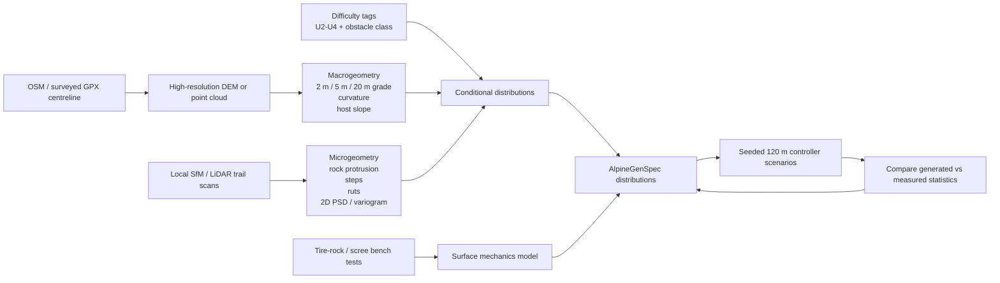

# Reality-Calibrating a High-Alpine “Martian” e‑MTB Track Generator

## Executive summary

The topic implied by the supplied brief is not a literal Mars-terrain study. It is a **statistical calibration problem for a procedural, barren high-alpine technical trail generator**, intended to stress an e‑MTB motor controller against front-wheel lift on steep, rocky climbs. The desired output is a generator whose longitudinal grade, rock/step geometry, scree, cross-profile, roughness and traction are sampled from defensible distributions rather than from hand-authored constants. The present generator uses a 120 m profile with 15–25% ramps, 2–6% shelves, a 26–32% “wall,” several short scree sections, 5–15 cm-high “boulders,” Gaussian-style roughness and, in the proposed 3D version, ±15% cross-slope, 40–150 mm rocks and shallow ruts; the brief explicitly states that none of these numbers has yet been reality-checked. fileciteturn0file0

The most important conclusion is that **the generator is directionally plausible but structurally mis-parameterized in several places**. The strongest available uphill-specific numerical source is OpenStreetMap's `mtb:scale:uphill`: level 2 describes average inclines below 20% and maxima below 25%; level 3, averages below 25% and maxima below 30%; level 4, averages below 30% and maxima below 40%, with even strong riders expected to push parts of the route. citeturn17search5 This makes the present 15–25% ramps reasonable for an expert technical-uphill test and places its 26–32% wall exactly at the transition between “very difficult but rideable” and “often push.” It does **not**, however, establish the current 15–30 m ramp lengths, 4–8 m shelf lengths, or one-wall-per-120-m rhythm; I found no measured high-alpine trail dataset publishing those segment-length distributions.

The largest design corrections are these:

| Finding | Verdict for the current generator |
|---|---|
| `wall_grade = 26–32%` | **Mostly defensible.** It straddles OSM uphill levels 3–4; use 25–30% for nominal expert tests and 30–40% as stress cases, rather than treating 32% as a natural upper limit. citeturn17search5 |
| `ramp_grade = 15–25%` | **Plausible as an expert-biased distribution, not as a generic alpine distribution.** Mountain trail measurements are generally much less steep overall, while bike-uphill standards put 20–30% in the technically difficult tail. citeturn19search0turn17search5 |
| `scree_ramp_bias = 0.7` | **Remove until measured.** Talus itself commonly lies around 28–36°, often with an upper 33–37° segment, but a path through it need not follow the fall line; sustainable trail construction explicitly favors contouring and grade reversals. Scree should therefore be conditioned on *host-slope and traverse geometry*, not automatically on high longitudinal grade. citeturn21search9turn21search1turn17search0 |
| `side_slope = ±15%` | **Conceptually conflated.** A built tread is typically outsloped about 5%, whereas the hillside/talus underneath can be tens of degrees steep. Introduce separate `tread_crossfall` and `host_slope` fields. citeturn17search0turn21search9 |
| Gaussian roughness with one amplitude/correlation length | **Poor default model for realism.** Natural/off-road surfaces are usefully characterized spectrally and scree morphology by directional variograms; explicit rocks, steps and ruts should sit on top of a multiscale PSD/variogram background. citeturn23academia48turn20search0 |
| `boulder_height = 5–15 cm`, 2–5 per 120 m | **Too mild to stand in for a strongly blocked S3/S4-like trail.** The STS definition of S3/S4 emphasizes many large boulders, high steps and loose scree; fixed counts should be replaced by rock coverage plus a size/protrusion model. citeturn18search0turn18search2 |
| Automotive/Burckhardt-derived `μ` for rock/scree | **Wrong provenance for calibration.** Direct climbing-rubber/granite tests give dry coefficients around `μ_static = 0.97–1.21` and `μ_dynamic = 0.76–1.14` under their laboratory conditions, but that is only an analogue for an MTB knob/rock contact. Scree needs a separate substrate-failure model rather than an artificially low rubber coefficient. citeturn15view0turn13view0 |
| “0.5 m DEM” ⇒ accurate 2–5 m alpine grade | **False in some important areas.** `swissALTI3D` is available on a 0.5 m grid, but some >2,000 m stereocorrelation terrain has 1–3 m one-sigma accuracy and the 0.5 m grid can be oversampled. citeturn22search10 |
| `ly/lx = 0.5–1.0`, rock offset ±0.12 m, rut 20–60 × 60–120 mm | **Still authored.** I found no trail-specific primary measurement that validates those numerical distributions. |

A second major conclusion is methodological. **Do not try to calibrate every field from standards.** Standards and difficulty scales are valuable for *bounds* and *conditioning classes*; actual probability distributions need to come from measured geometry. The best next version of `AlpineGenSpec` should therefore carry provenance and uncertainty explicitly: `measured`, `digitised`, `standard`, `analogue`, or `authored`.

For difficulty presets, I would abandon the working idea of directly naming uphill presets `S2/S3/S4`. Singletrail-Skala is explicitly a scale for level/downhill technical difficulty under ideal dry conditions, and S3–S4 routinely permits gradients over 70% on descent; it is not an uphill feasibility scale. citeturn18search3turn18search0turn18search2 Use **`U2`, `U3`, `U4`** from `mtb:scale:uphill` for climb geometry, optionally adding an independent `obstacle_class = S2/S3/S4-like` for morphology.

## Research framing and evidence base

The research question is best formulated as:

> **What joint statistical model of longitudinal grade, cross-profile, rock/step geometry, scree, roughness and tire–substrate interaction produces short procedural sections that are statistically consistent with barren, high-alpine, technically rideable MTB/e‑MTB climbs?**

That formulation matters because there are three superficially similar but materially different evidence classes. First are **measured trails**—the preferred evidence for width, grade, incision and alignment. Second are **construction standards and difficulty scales**, which describe permitted, designed or categorical bounds rather than natural frequency distributions. Third are **terrain analogues**, such as talus geomorphology, rover rock-size models and rubber-on-granite tribology, which can supply physical model forms but must not be passed off as MTB-trail measurements. The brief itself asks for exactly that provenance distinction. fileciteturn0file0

The target is also narrower than “mountain bike trail.” The desired trail is above or near treeline, primarily mineral—rock slab, fractured rock, scree and coarse detritus—with little or no root/soil/mud contribution. That makes generic purpose-built flow-trail standards a weak descriptive source. USFS guidance, for example, strongly favors rolling contour trails, grade reversals, full-bench construction and approximately 5% outslope; these are excellent references for what a designed tread *does*, but they should not be mistaken for an empirical description of a spontaneous alpine footpath. citeturn17search0

The main sources differ substantially in evidential strength:

| Source | Evidence / method | What it can legitimately calibrate | Main limitation | Provenance |
|---|---|---|---|---|
| OSM `mtb:scale:uphill` | Operational tagging specification with explicit average/max incline bands | Uphill grade envelopes and obstacle-class conditioning | Not a sampled distribution of actual trails | `standard/schema` citeturn17search5 |
| Singletrail-Skala | Official difficulty definitions based on trail characteristics | Qualitative obstacle density, loose scree, steps, hairpins; downhill grade classes | Primarily level/downhill difficulty, not uphill rideability | `standard` citeturn18search3turn18search0 |
| USFS Trail Construction Notebook | Trail engineering guidance | Built tread crossfall, contouring logic, grade reversals | Designed trails ≠ spontaneous alpine paths | `standard` citeturn17search0 |
| Tomczyk & Ewertowski, Poprad | Field/GIS survey of 43.4 km mountain recreational trails | Width, grade, alignment, incision sanity checks | 86.6% forested; only part bike-accessible; not barren alpine | `measured` citeturn19search0 |
| Trevisani et al., Eastern Italian Alps | Airborne LiDAR and directional variograms of scree | Appropriate statistical representation of scree morphology | Scree slope, not trail tread | `measured/analogue` citeturn20search0 |
| Alpine talus research | Topography, rock size/shape, GPR/LiDAR | Host-slope geometry, sorting, bulk talus structure | Does not measure path-specific mobile layer | `measured/analogue` citeturn20search4turn21search1 |
| Golombek rock SFD | Measured terrestrial/Martian rocky surfaces; exponential SFD model | Useful model form for rock-field coverage and size | Diameter/coverage, not protrusion height on bike trails | `measured/analogue` citeturn24view1 |
| Reina et al. | Natural-terrain profile PSD measured by rover sensing | Roughness representation/methodology | Vehicle terrain rather than MTB tread | `measured/analogue` citeturn23academia48 |
| Rauter et al. 2023 | Six experienced riders, e‑MTB and conventional MTB over several terrain types | e‑MTB speed/power context | Small sample; not a steep rock-crawl study | `measured` citeturn23search8 |
| Elkington et al. 2024 | Tribometer: five climbing rubbers against granite | Dry rubber/rock friction analogue and testing methodology | Climbing rubber; smooth coupon geometry; very low slip velocity | `measured/analogue` citeturn13view0turn15view0 |
| swisstopo / IGN elevation products | Official production metadata | Macrogeometry extraction feasibility and error model | Cannot resolve rocks/tread microtopography | `official dataset` citeturn22search10turn24view2 |

The Poprad study is particularly useful as a warning against confusing a hand-designed “rhythm” with a measured mountain-trail distribution. In its 43.4 km sample, trail grades extended to 35°, but roughly 93% of trail length was at or below 15°; grades above 20° represented only a little over 2%. Width ranged from 0.3 to 25 m, only about 11% of length was 0.6 m or narrower, and 42% of trail length was aligned near the contour while another 42% had intermediate side-hill alignment. citeturn19search0 This is emphatically **not** the target distribution—most of the sample was forested and included roads—but it demonstrates how exceptional the proposed generator's near-continuous 15–25% climbing would be if interpreted as a generic mountain trail. It is better interpreted as a *conditioned difficult-uphill test segment*.

The distinction between standards and measurements also resolves an apparent conflict. USFS guidance promotes contour alignment, grade reversals and about 5% tread outslope. citeturn17search0 Natural talus, meanwhile, commonly lies around the low-to-mid 30-degree range: one multi-site Alps/Reunion study measured mean talus-cone slopes of 28–36°, while classic alpine talus work places a characteristic break in mature profiles around 33–34°. citeturn21search9turn21search0 Both can be true because **host slope and tread slope are different variables**.

## What real technical alpine geometry implies for the generator

For longitudinal grade, `mtb:scale:uphill` is substantially better suited to the anti-wheelie use case than generic trail construction guidance or downhill scales. Its definitions are unusually explicit:

| Uphill class | Average incline | Maximum incline | Obstacle description | Generator interpretation |
|---|---:|---:|---|---|
| U0 | <10% | <15% | Hardened/gravel, no obstacles | Control/baseline |
| U1 | <15% | <20% | Some avoidable loose material | Easy technical |
| U2 | <20% | <25% | Fist-sized loose rocks / rocky ground | Lower technical-climb preset |
| U3 | <25% | <30% | Rocky variable surface, tight corners, small steps | **Primary anti-wheelie calibration class** |
| U4 | <30% | <40% | Big loose rocks, steps, tight corners; pushing expected in parts | **Stress / near-limit class** |
| U5 | — | — | Too steep/difficult to ride uphill | Outside nominal rideable envelope |

Source: OpenStreetMap's uphill MTB tagging specification. citeturn17search5

This suggests a much cleaner `AlpineGenSpec` architecture than the present “ramp 15–25%, one 26–32% wall.” The generator should take an uphill class and then sample grades **conditional on that class**. Until high-resolution DEM+trail samples provide empirical quantiles, I would not fabricate a beta/lognormal distribution. Instead, use standards as hard or soft truncation limits and label the interior distribution `authored_pending_measurement`.

For a U3 controller-test preset, a defensible interim engineering prior is to place the majority of sustained positive grade between roughly 10% and 25%, with short excursions into 25–30%. U4 stress tests can add 30–40% short ramps. Those are not measured quantiles; they are **standard-bounded priors**. The present 26–32% wall is therefore useful, but it should become a difficulty-conditioned tail rather than a once-per-track invariant. citeturn17search5

Singletrail-Skala helps with *obstacle character* instead. S2 expects larger rocks, loose/unconsolidated tread, steps and tight turns; S3 describes heavily blocked singletrack with many larger boulders, high steps, awkward off-camber sections and loose scree; S4 is very steep, strongly blocked, has large boulders, loose scree, extreme ramps and high steps, and requires trial techniques. citeturn18search1turn18search0turn18search2 Crucially, STS states that it evaluates dry-condition technical difficulty and is primarily a scale for level/downhill trail; S3–S4 may exceed 70% downhill gradient. citeturn18search3turn18search0 Therefore a preset called `S4` should **not** mean “40% uphill.” Use two axes:

`uphill_class = U2/U3/U4`

and

`obstacle_class = S2_like/S3_like/S4_like`.

That separation also makes scenario generation more useful for control research: a 27% smooth slab, a 27% loose scree traverse and a 27% blocked step sequence can be produced as distinct cases rather than collapsed into one scalar “difficulty.”

Cross-sectional geometry needs a similar decomposition. The current planned ±15% “side slope” can mean at least three different things: transverse tread crossfall, local rock/slab tilt, or the large-scale hillside slope on which the track sits. USFS built-trail guidance puts intentional tread outslope at about 5%. citeturn17search0 By contrast, measured talus cone inclinations in the Alps and comparable mountain environments commonly occupy 28–36°, and mature alpine talus may show an upper segment around 33–37°. citeturn21search9turn21search1 These quantities should not share one field.

A better 3D schema is:

```text
host_slope_deg          # terrain slope under / beside trail
tread_crossfall_pct     # local transverse slope of rideable tread
local_surface_tilt      # rock slab / individual obstacle orientation
tread_width_m           # actual rideable tread
corridor_half_width_m   # simulation/mesh extent, not trail width
```

The present `corridor_half_width_m = 1.5` is perfectly reasonable as a **computational envelope**, but it must not imply a 3 m-wide trail. Field trail surveys show that width varies enormously with trail type and degradation; Poprad widths ranged from 0.3 to 25 m, while a separate Rocky Mountain National Park trail survey reported a mean width of about 0.89 m. citeturn19search0turn7search11 For the intended natural singletrack, an interim `tread_width_m` prior around **0.6–1.2 m**, with occasional narrower/wider sections, is a reasonable synthesis of measured mountain-trail widths—but it should be marked **inferred, low-to-moderate confidence**, not measured specifically above treeline.

There is even stronger evidence that “rut” and “trail incision” must be separate concepts. In Poprad, incision greater than 0.1 m occurred over 44% of surveyed trail length; 24% had 0.1–0.5 m incision and 11% had 0.5–1 m. citeturn19search0 Those are geomorphic trail troughs, not bicycle tire ruts. Therefore the proposed 20–60 mm deep, 60–120 mm wide rut element can remain as an authored *wheel/channel-scale feature*, but the model should add an independent, much larger-scale `incision` or `erosion_channel` feature if degraded natural trail is in scope.

For drainage, the strongest finding is negative: I found no primary evidence supporting **1–3 water bars per 120 m with 8–15 cm depth and 1–1.5 m longitudinal length** as a statistical property of barren natural alpine paths. USFS guidance treats grade reversals as a fundamental drainage device and waterbars as one class of engineered surface-water control. citeturn17search4turn17search0 Consequently, water bars should be optional in a `built_or_maintained` trail mode, not silently mixed into the “spontaneous alpine Martian” baseline.

## Rocks, scree, roughness and tire–rock mechanics

The present rock model is probably the part most in need of a change of parameterization. A fixed count such as “2–5 smooth boulders over 120 m” does not naturally express a blocked high-alpine surface. STS S3 explicitly describes trails with *many* larger boulders and high steps, and S4 describes strongly blocked trails with large boulders and very difficult steps. citeturn18search0turn18search2 Fixed count should therefore give way to something more like **coverage + size-frequency + protrusion + shape + clustering**.

A useful mathematical analogue already exists in planetary-terrain work. Golombek and colleagues model cumulative fractional area covered by rocks of diameter \(D\) or larger as

\[
F_k(D)=k\,e^{-q(k)D},
\qquad
q(k)=1.79+\frac{0.152}{k},
\]

where \(k\) is total rock area fraction; the model family spans roughly 5–40% total rock abundance and was developed from Martian and terrestrial rocky surfaces. citeturn24view1 This should **not** be copied as “the alpine trail distribution.” What it does provide is a much better generator architecture: expose `rock_cover_fraction` and a size-frequency model, then condition or learn its parameters from trail scans.

That architecture also forces an important distinction requested by the brief: **rock diameter is not rock protrusion height**. A 300 mm clast may be almost buried, while a 150 mm slab edge can present a 150 mm vertical obstacle. Trail scans need to yield at least `(height_above_local_tread, longitudinal_extent, transverse_extent, orientation, angularity)`. Until those scans exist, the current `boulder_height_m`, `boulder_len_m` and superellipsoid dimensions are authored parameters irrespective of how realistic they look.

The 40–150 mm rock-size band planned for 3D is not absurd, but it primarily samples modest technical features. An S3/S4-like stress generator needs a **long tail into decimetre-scale obstacles**, rather than simply increasing the number of 40–150 mm objects. STS's own S3/S4 descriptions—larger boulders, high steps and strongly blocked lines—support that qualitative conclusion, although they do not provide a probability distribution in centimetres. citeturn18search0turn18search2 A numeric obstacle-height distribution therefore remains a P0 measurement gap.

Scree is even more important to model as a *process* rather than a texture. Alpine talus studies show that morphology and clast population depend on age, rockwall structure and secondary transport. Recent 2026 work reports mature talus with bi-segmented profiles and clast size increasing away from the rockwall, while the youngest talus lacked this sorting. citeturn21search1 A 2021 multi-site study found mean talus-cone inclinations between 28° and 36°. citeturn21search9 Eastern Alps work also shows snow-avalanche modification and a clast-supported surface veneer after melt, emphasizing that “scree” is not one homogeneous particle bed. citeturn21search4

This directly weakens `scree_ramp_bias = 0.7`. Talus is indeed steep terrain, but the fact that the *host slope* is steep does not imply that the path's *longitudinal axis* follows the steepest direction. USFS contour-trail guidance gives the opposite designed solution: cross the sideslope while keeping longitudinal grade lower. citeturn17search0 For natural paths the correct relationship has to be measured, but until then `scree_ramp_bias` should be replaced by a conditional model:

```text
P(scree | host_slope, trail_alignment, geomorphic_unit)
```

not simply

```text
P(scree | longitudinal_grade_is_ramp) = 0.7
```

The proposed “3–10 cm mobile layer” also remains unverified. Alpine GPR studies have measured the internal structure and total thickness of more than 20–30 talus slopes, but those studies concern the **bulk talus deposit**, not the mechanically active top few centimetres beneath an MTB tire. citeturn20search4turn20search5 They therefore cannot be cited to justify a 30–100 mm mobile layer. That number should stay explicitly `authored` until trail-specific excavation, GPR at much higher frequency, or controlled penetration/shear measurements are available.

For roughness, the evidence favors changing the model form before arguing about amplitudes. Natural-terrain rover work found that a surface-profile power spectral density carries useful information about both roughness magnitude and its distribution across wavelengths and can function as a terrain “fingerprint.” citeturn23academia48 On actual Eastern Italian Alpine scree, Trevisani and colleagues used LiDAR-derived **variogram maps** to distinguish surface morphology and spatial continuity. citeturn20search0 Rubber-friction theory likewise depends on the substrate roughness spectrum across a broad band of spatial scales, rather than a single correlation length. citeturn16view1

The current Gaussian random field can therefore be retained only as a deliberately simplified narrow-band approximation. A higher-fidelity structure would be:

\[
z(x,y)=z_{\rm macro}+z_{\rm spectral}+z_{\rm rocks}+z_{\rm steps}
       +z_{\rm ruts}+z_{\rm drainage},
\]

where `z_spectral` is fitted using a directional PSD or variogram and the remaining terms are discrete processes. This avoids asking one Gaussian amplitude/correlation pair to reproduce both gravel-scale irregularity and metre-scale undulation.

I found **no defensible published trail-specific value** for the proposed `ℓ_y / ℓ_x = 0.5–1.0`. Directional variograms are the right measurement tool, but the ratio itself remains authored. The same applies to the current 5–10 mm background amplitude, 10–20 mm scree amplitude and 30–60 mm “rock-field” amplitude. They may survive calibration; presently they have no strong empirical provenance.

Tire–rock friction provides one of the clearest warnings against false precision. Elkington et al. tested five commercial climbing-shoe rubbers against granite in 2024. At 0.1 mm/s sliding speed and contact pressures corresponding to 30 and 60 N normal loads, their measured dry coefficients spanned approximately **0.97–1.21 static** and **0.76–1.14 dynamic**, depending on compound and load. citeturn13view0turn15view0

Those values are useful because they prove that dry “sticky rubber–granite” friction can be of order unity. They are **not** a calibrated MTB-tire coefficient: a knobby tire has different rubber, pressure, geometry, contamination and deformation. The appropriate interim approach is therefore to expose a deliberately broad, low-confidence rock prior such as roughly `μ_peak ≈ 0.8–1.2`, `μ_slide ≈ 0.7–1.1`, tag it `analogue`, and replace it as soon as MTB compound tests exist. The current automotive/Burckhardt provenance should not be treated as validation.

Wetness cannot safely be represented by a universal multiplier either. Persson et al. report that wet rough substrates at low velocities are typically 20–30% below corresponding dry friction in the tire/road regime, while the same paper notes that at very low velocities below about 1 m/s the observed dry–wet difference can become small. citeturn16view0turn16view1 That is precisely why MTB-specific tests at realistic knob pressures, temperatures and micro-slip speeds are needed.

For loose scree, lowering the rubber coefficient to `0.45/0.38` is particularly misleading. The limiting mechanism can be **clast rearrangement, rolling and shear of the granular layer**, not slip at the rubber–stone interface. The simulator should represent at least two mechanisms:

\[
\text{traction limit}
=
\min(
\text{rubber–clast contact limit},
\text{granular-bed shear / rearrangement limit}
).
\]

That is a much more defensible route than giving “scree” an artificially low road-tire friction curve.

## Generator calibration and contradictions

The following table is the most direct translation into `AlpineGenSpec` / the planned 3D specification. “Proposed” means either a sourced bound or an explicit decision to leave a number uncalibrated rather than manufacture precision.

| Generator parameter | Current | Proposed calibration | Provenance / confidence |
|---|---:|---|---|
| `length_m` | 120 m | **Keep 120 m as a controller episode**, but do not treat it as a statistically representative trail length. Derive macro distributions from much longer real tracks, then sample 120 m windows. | Engineering decision; `authored` |
| `ramp_grade` | 15–25% | Condition on uphill class. **U2:** <20% average, <25% max; **U3:** <25% average, <30% max; **U4:** <30% average, <40% max. Learn interior quantiles from DEM. citeturn17search5 | `standard`, high confidence as bounds |
| `ramp_len_m` | 15–30 m | **Unresolved. Keep authored temporarily.** Derive run-length distribution after smoothing real profiles at 2/5/20 m windows. | No adequate source found |
| `shelf_grade` | 2–6% | Plausible but unmeasured. Retain only as provisional. | `authored` |
| `shelf_len_m` | 4–8 m | No defensible empirical distribution found. | `authored` |
| `counter_grade` | −3…−8% | Existence of grade reversals is well-supported in trail design, but magnitude distribution is not. citeturn17search0 | `standard` existence; magnitude `authored` |
| `counter_len_m` | 3–6 m | Unresolved. | `authored` |
| `wall_grade` | 26–32% | U3 tail ≈25–30%; U4 stress ≈30–40%. Do not fix one wall per track. citeturn17search5 | `standard`, high confidence as envelope |
| `n_walls` | 1 | Learn event rate per 100 m from profiles; current one/120 m unsupported. | `authored` |
| `n_scree` | 2–3 | **No reliable frequency distribution found.** Do not change to another invented count. | `authored` |
| `scree_len_m` | 6–15 m | No trail-specific run-length distribution found. Needs mapped geomorphic segments. | `authored` |
| `scree_ramp_bias` | 0.7 | **Remove / replace with host-slope + alignment conditioning.** Talus is commonly ~28–36° while trails can traverse slopes rather than follow fall line. citeturn21search9turn17search0 | Current value contradicted conceptually |
| `scree_amp_m`, `corr` | 10–20 mm; 0.15–0.20 m | Replace with fitted directional variogram/PSD bands; no validated numerical trail values yet. citeturn20search0 | `measured` model form; numbers unresolved |
| scree mobile depth | implied thin layer | **3–10 cm remains unverified.** Bulk-talus GPR cannot validate active-layer depth. citeturn20search4 | `authored`, low confidence |
| `n_boulders` | 2–5 | Replace with `rock_cover_fraction + size_frequency + clustering`, plus explicit obstacle-event process. | Model redesign |
| `boulder_height_m` | 0.05–0.15 | Retain only for easy/intermediate objects; add a larger decimetre-scale tail for S3/S4-like stress. Exact distribution requires trail scans. citeturn18search0turn18search2 | `standard` morphology; distribution unresolved |
| `boulder_len_m` | 0.6–1.2 | No trail-specific evidence. Measure axes directly from SfM/LiDAR. | `authored` |
| rock-field density | implicit 1–2 fields | Introduce `rock_cover_fraction`; Golombek's 5–40% family is a useful **analogue model form**, not a trail calibration. citeturn24view1 | `analogue` |
| `rock_amp`, `corr` | 3–6 cm; 0.30–0.45 m | Do not model coherent rocks as Gaussian roughness. Use explicit rock geometry plus residual PSD. | Evidence-backed model redesign |
| `n_sharp_edges` | optional | Keep as independent event process; learn event rate from scans/video. | `authored` |
| `sharp_edge_height_m` | 3–8 cm | Suitable only as small-step class; expert blocked presets need a higher tail. Exact probabilities unresolved. citeturn18search0turn18search2 | `standard` qualitative |
| `n_water_bars` | 1–3 | Set near zero for `natural_alpine`; enable in `maintained/built` mode. No measured 1–3/120 m support found. citeturn17search4 | Current rate unsupported |
| `water_bar_depth/len` | 8–15 cm / 1–1.5 m | Leave authored until an engineering manual dimension is explicitly tied to the intended structure. | `authored` |
| `background_amp/corr` | 5–10 mm / 0.20–0.30 m | Replace one-scale Gaussian with multiscale PSD/variogram fitted by substrate class. citeturn23academia48turn20search0 | Model form supported; numbers unresolved |
| `corridor_half_width_m` | 1.5 m | **Keep as mesh extent**, but add a separate tread-width field. | Engineering choice |
| `tread_width_m` | absent | Add explicitly. ~0.6–1.2 m is a reasonable interim natural-singletrack prior, but only moderate/low-confidence inference from mountain-trail surveys. citeturn19search0turn7search11 | `measured → inferred` |
| `tread_crossfall` | folded into ±15% | Split from host slope. Built-trail baseline ≈5% outslope; natural trail requires measured distribution. citeturn17search0 | `standard` baseline |
| `host_slope` | absent | Add. Talus analogues commonly around 28–36°, with mature upper segments around 33–37°. citeturn21search9turn21search1 | `measured/analogue` |
| `2D roughness amp` | 5–30 mm | No high-alpine MTB-tread distribution found. Estimate band RMS from scans, not one amplitude. | unresolved |
| `ly/lx` | 0.5–1.0 | **Do not freeze this ratio.** Fit directional 2D variogram/PSD. citeturn20search0 | current number `authored` |
| rock size | 40–150 mm | Keep as one object class, not entire distribution; add larger stress-tail obstacles. | partly plausible, not calibrated |
| rock lateral offset | ±0.12 m | Model-specific and unsourced; sample relative to actual wheel line rather than fixed shoulder offset during realism calibration. | `authored` |
| rut depth/width/length | 20–60 / 60–120 mm / 2–8 m | Retain as a shallow rut process only; add a separate large-scale `incision` process. citeturn19search0 | current dimensions unvalidated |
| `MIN_CONTACT_RADIUS_M` | unspecified brief concern | Must be determined by collision/contact numerics and measured rock curvature, not difficulty scales. | physics/model parameter |
| dry `rock μ_peak/μ_slide` | no dedicated rock surface | Temporary analogue bracket ≈0.8–1.2 / 0.7–1.1, explicitly low confidence; obtain MTB-tire measurements before claiming calibration. citeturn15view0 | `analogue` |
| `scree μ` | 0.45/0.38 | **Do not represent scree solely via low contact μ.** Separate rubber–clast friction from granular substrate yield. | current physical interpretation contradicted |

The strongest **contradictions**, as opposed to merely missing data, are therefore:

**Difficulty semantics.** Treating S2/S3/S4 as uphill presets is wrong. STS is primarily a level/downhill technical scale; use the dedicated uphill scale for grade and STS-like classes for obstacles. citeturn18search3turn17search5

**Tread cross-slope semantics.** One `side_slope` variable cannot simultaneously represent designed tread outslope and the steep mountainside underneath it. A ~5% built tread can sit on a ~30° talus slope. citeturn17search0turn21search9

**Scree placement.** A 70% prior toward steep longitudinal ramps has no measured support and is inconsistent with the distinction between steep talus host slope and paths that traverse it. This should be treated as falsified as a *general rule*, though not as proof that scree never occurs on steep ramps. citeturn17search0turn21search1

**Roughness model.** A single Gaussian correlation length is not a defensible general model of natural trail terrain over 2 cm–5 m wavelengths. PSD and variogram evidence points to multiscale structure; explicit obstacles further break Gaussianity. citeturn23academia48turn20search0

**Friction provenance.** Automotive road friction curves cannot validate MTB rubber on granite or a yielding scree bed. Direct rubber–granite measurements show a different physical regime and scree introduces substrate motion. citeturn15view0turn16view1

**DEM semantics.** Raster spacing is not measurement accuracy. In particular, a 0.5 m `swissALTI3D` grid may be oversampled, and legacy/stereocorrelation high-alpine source data can have 1–3 m one-sigma accuracy. citeturn22search10

## Real-terrain pipeline and recent developments

A practical calibration system should stop trying to make one data source resolve every spatial scale. Public DEMs are appropriate for **macrogeometry**; local scans are required for rocks and roughness.



Switzerland is particularly attractive for this pipeline, but with a critical qualification. `swissALTI3D` is distributed on 0.5 m and 2 m grids; swisstopo warns that the 0.5 m grid can be oversampled where source density is inadequate. Accuracy depends on source generation: newer LiDAR is around 0.3 m one sigma, older LiDAR below 2,000 m around 0.5 m, and stereocorrelation above 2,000 m can be 1–3 m. citeturn22search6turn22search10 That means a blind 2 m finite-difference grade calculated from the 0.5 m raster may be dominated by elevation error on precisely the high-alpine terrain of interest.

The more promising Swiss source for selected sites is `swissSURFACE3D`: current point clouds are reported at at least 15 points/m² and typically around 25–40 points/m² in newer coverage, with roughly ±20 cm planimetric and ±10 cm altimetric one-sigma accuracy. citeturn22search9 It is a surface rather than bare-earth model, which is often undesirable in forest, but that is much less of a problem on the deliberately barren target terrain. This makes barren Swiss alpine sites an unusually good place to test whether decimetre-scale macro/meso geometry can be extracted without field SfM everywhere.

France's official RGE ALTI is available on 1 m and 5 m grids under the Open Licence. It is assembled from heterogeneous sources, predominantly LiDAR acquired since 2010; IGN reports that updates to that product stopped in 2024 pending a replacement based on new high-density LiDAR acquisitions. citeturn24view2 Again, it is useful for macrogeometry and route-level longitudinal profiling, not for 5–15 cm rocks.

A sensible split is therefore:

| Spatial scale | Recommended source | Extract |
|---|---|---|
| ~2–100 m | GPX/OSM + quality-controlled DEM / point cloud | Longitudinal grades, grade runs, switchback curvature, host side-slope |
| ~0.2–5 m | Dense LiDAR or SfM | Steps, large rocks, eroded troughs, cross-profile, mesoroughness |
| ~0.02–0.5 m | Ground/phone SfM, structured scan, close-range LiDAR | Rock protrusion, small steps, directional PSD |
| Contact scale | Bench experiment | `μ_peak`, `μ_slide`, pressure/slip/temperature dependence, scree shear behavior |

This also gives a principled answer to the brief's P3 question: **GPX + DEM can calibrate A and part of E; it cannot calibrate B, C, most of D, or H.**

There have been several particularly relevant developments in the last five years:

| Date | Development | Relevance |
|---|---|---|
| 2021 | Multi-site rockfall/talus analysis reported mean talus-cone slopes of 28–36°. citeturn21search9 | Stronger host-slope prior for scree terrain |
| 2023 | Rauter et al. compared e‑MTB and MTB performance across uphill, downhill, flat and technically demanding terrain. citeturn23search8 | Confirms e-assist changes uphill performance, but does not yet provide the required steep rock-crawl envelope |
| 2024 | Elkington et al. published controlled static/dynamic friction measurements for five climbing rubbers on granite. citeturn13view0turn15view0 | Best directly measured rubber–natural-rock analogue located in this review |
| 2025 | High-resolution imagery/deep-learning work demonstrated regional-scale talus mapping, with mapped terrain concentrated across a broad 10–35° slope band in its Tibetan Plateau study area. citeturn20search11 | Shows an emerging route to automatic geomorphic-unit classification |
| 2026 | Alpine rockwall–talus research quantified topography, clast size/shape and age, finding mature sorted versus young unsorted talus behavior. citeturn21search1 | Supports conditioning scree texture on geomorphic age/process rather than a universal particle distribution |
| 2026 | BLM expanded Class 1 e-bike access across nearly 200 miles of Moab MTB trails, including Amasa Back. citeturn23search16 | Creates accessible rocky, largely unvegetated **non-alpine** e-MTB analogue sites |
| 2026 | Official French elevation metadata now explicitly describes the 1/5 m RGE ALTI product and its transition toward newer HD-LiDAR data. citeturn24view2 | Improves reproducibility of the GPX+DEM calibration pipeline |

The e‑MTB riding-envelope evidence is still surprisingly weak for the exact use case. Rauter et al.'s 2023 experiment involved six experienced riders and showed a clear electric-assist advantage on uphill terrain, but technically demanding terrain did not simply receive the same large speed benefit as ordinary climbing. citeturn23search8 The study is valuable physiology/performance evidence but should **not** be used to validate a 3–8 km/h speed assumption on a 30% boulder-strewn climb. That exact regime remains an experimental data gap.

The uphill difficulty scale is currently the more defensible rideability envelope. A 26–30% rocky climb is near the upper edge of U3; 30–40% belongs to U4, where even strong riders are expected to dismount for parts. citeturn17search5 Thus the proposed 26–32% wall is a good *stress stimulus*, but the generator should not assume that a random expert e‑MTB rider will continuously clean every realization.

Reference-trail selection remains one of the least complete parts of the evidence base. I could not verify three to five sites that simultaneously satisfy all of the brief's requirements—barren high alpine, demonstrably ridden **uphill** by e‑MTB, open GPX/centerline, high-resolution DEM, and scalable imagery—from primary sources alone. Inventing such a list would violate the brief's “no pretty routes without data” requirement.

Two useful but deliberately imperfect benchmarks are nevertheless well documented. The **Pinnell Mountain National Recreation Trail** in Alaska is 44 km and entirely above timberline; BLM reports that most of it has at least an 8% grade and many sections exceed 25%, and provides a georeferenced map. However, it is non-motorized, e-bikes are not permitted, and BLM explicitly says several steep portions are not rideable by bicycle. citeturn23search2turn23search7 It is therefore a valuable *negative/high-alpine macrogeometry benchmark*, not an e‑MTB reference.

Conversely, Utah's **Slickrock/Amasa Back** area gives an excellent dry rock-slab analogue but is not alpine. BLM describes Slickrock as a 10.5-mile route over rugged Navajo Sandstone and lists Class 1 e-biking as an activity; Amasa Back is explicitly the uphill access for its trail system, and as of 2026 Amasa Back is included among BLM's Class 1 e-bike-accessible systems. citeturn23search9turn23search0turn23search16 These sites could be used for rock/tire and slab-obstacle calibration without pretending that their geomorphology represents the Alps.

## Evidence quality, open questions and prioritized next steps

The central evidence-quality problem is **domain transfer**. Almost every convenient published number answers a neighboring question rather than the exact one the simulator asks. Difficulty scales specify categorical limits, not occurrence probabilities. Construction manuals describe intended geometry, not old alpine footpaths. Talus studies measure an entire landform, not the 70 cm-wide path worn into it. Mars rock models describe area coverage and diameter, not bike-wheel obstacle protrusion. Climbing-rubber tests measure a chemically and geometrically different rubber contact. DEMs capture metre-scale form but not the rocks that trigger wheelie events. These sources are still useful when their provenance remains visible. citeturn17search0turn24view1turn15view0turn22search10

There are also two competing modeling viewpoints. One is the current **feature-library model**—ramps, shelves, scree patches, rock fields and water bars placed as discrete elements. Its virtue is controllability and scenario interpretability. The other is a **statistical field model** derived from scans and spectra. Its virtue is realism, but it can become difficult to control for targeted controller tests. The evidence favors neither pure extreme. Natural terrain roughness has meaningful spectral structure, while real trails also contain discrete steps, boulders and ruts. citeturn23academia48turn20search0 The best model is therefore hierarchical: macroprofile + stochastic spectral background + discrete geomorphic/obstacle processes.

A practical revised generator can be expressed as:

\[
P(T)=
P(G_{\rm macro}\mid U)\,
P(X_{\rm cross}\mid{\rm geomorphology})\,
P(R_{\rm background}\mid{\rm substrate})\,
P(O_{\rm discrete}\mid S,{\rm substrate})\,
P(M_{\rm surface}\mid{\rm material,state}),
\]

where \(U\) is uphill difficulty, \(S\) is obstacle class, \(G_{\rm macro}\) is longitudinal geometry, \(X_{\rm cross}\) is cross-section/host slope, \(R\) is the continuous roughness field, \(O\) is the discrete obstacle process and \(M\) is traction/substrate mechanics. That factorization is an engineering synthesis of the evidence rather than a published trail model.

The highest-priority next steps are:

| Priority | Work package | Minimum deliverable | Why it comes first |
|---:|---|---|---|
| **P0** | Real longitudinal profiles | 20–50 barren/alpine track sections; grade quantiles at 2, 5 and 20 m; run-length and grade-reversal distributions | Replaces authored ramp/shelf/wall rhythm |
| **P0** | Local 3D trail scans | 10–20 representative 20–50 m scans with labelled slab, talus and blocky trail | Resolves protrusion height, rock coverage, steps, tread width, crossfall and directional roughness simultaneously |
| **P0** | Scree association analysis | For every mapped scree crossing: length, longitudinal grade, host slope and alignment angle | Directly tests/falsifies `scree_ramp_bias` |
| **P0** | Generator schema split | `uphill_class`, `obstacle_class`, `host_slope`, `tread_crossfall`, `tread_width`, `rock_cover_fraction`, `incision` | Cheap to change before the 3D implementation hardens |
| **P1** | Directional PSD/variogram | PSD/variogram by hardpack, fractured rock, slab and scree over 0.02–5 m wavelengths | Decides Gaussian vs spectral background and measures anisotropy |
| **P1** | MTB tire–rock bench test | At least granite/limestone/gneiss; dry/wet/dust; two compounds; realistic pressure and slip speed | Removes the weakest physical provenance in the surface model |
| **P1** | Scree shear experiment | Tire over known clast beds at controlled grade/depth/grading | Separates rubber friction from substrate yield |
| **P2** | Instrumented e‑MTB uphill campaign | Grade, speed, motor torque, wheel speeds, IMU pitch, front normal-load proxy / lift events | Gives the actual wheelie/traction event distributions needed by `WheelieTruth` |
| **P2** | Named benchmark sites | ≥3 sites satisfying GPX + quality DEM + imagery/scan + legal/observed e‑MTB uphill use | Closes the current weakest validation angle |

The longitudinal-profile study should report **distributions rather than a new set of handpicked ranges**. For each path, resample centerline position by arc length, sample the best available elevation source, propagate DEM vertical error, calculate grade using 2, 5 and 20 m robust windows, classify same-sign/similar-grade runs, and report empirical CDFs and quantiles separately for natural alpine paths and built MTB trails. The source-resolution problem is important enough that samples with 1–3 m vertical uncertainty should not be used to claim precise 2 m slope statistics. citeturn22search10

The rock scan should similarly avoid “diameter only.” For every obstacle intersecting plausible wheel lines, derive protrusion height relative to a locally fitted tread plane, longitudinal and transverse axes, maximum local slope, edge radius/angularity and fractional areal coverage. The planetary exponential rock SFD can then be fitted or rejected against actual trail data rather than assumed. citeturn24view1

The friction experiment is small enough to be disproportionately valuable. The 2024 granite study demonstrates a reproducible methodology and also shows that compound and load materially change static/dynamic friction. citeturn13view0turn15view0 A bicycle-specific fixture should use actual tread blocks or tire sections, several normal loads/contact pressures, controlled rock roughness and temperature, and dry/wet/dust states. Scree should then be tested separately as a deformable bed. This would turn angle H from a collection of analogues into actual simulator calibration data.

For anti-wheelie development, the most important new field dataset is not a generic ride log but a synchronized **grade × obstacle × drive-torque × wheel-load** log. No source located in this review provides an empirical frequency distribution of front-wheel lift on natural technical e‑MTB climbs. The appropriate output is therefore not to guess one. A controlled campaign should deliberately span U2, U3 and short U4 sections, record actual speed and motor torque, and tag the geometric obstacle under each wheel at incipient lift.

The current 120 m generator can meanwhile remain operational, provided every unvalidated field carries provenance. A useful representation is conceptually:

```text
ramp_grade:
    source: "OSM mtb:scale:uphill"
    provenance: standard
    confidence: medium
    calibration_state: bounded_not_distributed

ramp_len_m:
    provenance: authored
    confidence: low
    calibration_state: needs_dem_measurement

rock_mu_dry:
    source: "Elkington et al. 2024 analogue"
    provenance: analogue
    confidence: low
    calibration_state: needs_mtb_bench_test
```

That is preferable to replacing today's authored numbers with more authoritative-looking but equally unsupported ones.

The following primary/official sources should be consulted first when implementing the next calibration round:

| Rank | Primary source | Why it is high priority |
|---:|---|---|
| **1** | [OpenStreetMap `mtb:scale` / uphill definitions](https://wiki.openstreetmap.org/wiki/Key:mtb:scale) | Best explicit uphill numerical grade envelope currently found. citeturn17search5 |
| **2** | [swisstopo swissALTI3D](https://www.swisstopo.admin.ch/en/height-model-swissalti3d) and [swissSURFACE3D](https://www.swisstopo.admin.ch/en/height-model-swisssurface3d) | Macrogeometry source plus essential accuracy metadata; surface point cloud may be much more useful on barren terrain. citeturn22search10turn22search9 |
| **3** | [Singletrail-Skala official definitions](https://www.singletrail-skala.de/overview) | Best source for S2/S3/S4 obstacle character; use separately from uphill grade. citeturn18search3 |
| **4** | [USFS Trail Construction and Maintenance Notebook](https://www.fs.usda.gov/t-d/pubs/htmlpubs/htm07232806/page08.htm) | Separates tread geometry from host slope; documents ~5% outslope and contour/grade-reversal logic. citeturn17search0 |
| **5** | [Tomczyk & Ewertowski mountain-trail survey](https://doi.org/10.1080/17445647.2015.1088751) | Large measured trail sample for width, grade, incision and alignment sanity checks. citeturn19search0 |
| **6** | [Trevisani, Cavalli & Marchi scree variograms](https://doi.org/10.5194/nhess-9-129-2009) | Direct Alpine evidence that directional geostatistics are appropriate for scree morphology. citeturn20search0 |
| **7** | [2026 alpine talus evolution study](https://doi.org/10.1002/esp.70331) | Current evidence connecting talus age, profile, clast size and sorting. citeturn21search1 |
| **8** | [NASA Golombek rock-size model](https://ntrs.nasa.gov/citations/20030111177) | Strong mathematical analogue for replacing fixed rock counts with coverage + SFD. citeturn24view1 |
| **9** | [Elkington et al., “Sticky feet”](https://doi.org/10.1007/s12283-024-00474-4) | Direct dry rubber–granite static/dynamic friction measurements and a reusable test methodology. citeturn13view0turn15view0 |
| **10** | [Rauter et al. e‑MTB terrain study](https://doi.org/10.3390/app132111677) | Best recent experimental e‑MTB terrain/performance source located, while illustrating the need for a much more technical climb dataset. citeturn23search8 |
| **11** | [IGN RGE ALTI](https://www.data.gouv.fr/datasets/rge-alti-r) | 1/5 m official French terrain data for expanding macrogeometry samples beyond Switzerland. citeturn24view2 |
| **12** | [Persson et al., wet/dry rubber friction](https://arxiv.org/abs/cond-mat/0502495) | Physical framework for why wetness, roughness spectrum, velocity and temperature cannot be collapsed into a constant friction multiplier. citeturn16view0turn16view1 |

The highest-value design decision is therefore not a particular replacement number. It is to change the next `AlpineGenSpec` from a collection of universal hand-authored constants into a **conditional, provenance-bearing statistical model**. The evidence is already strong enough to bound uphill grades, separate tread geometry from mountainside geometry, reject a single-scale Gaussian as the sole roughness model, stop using automotive friction as MTB rock calibration, and stop treating scree as simply “rough hardpack with lower μ.” What remains genuinely unknown—ramp/shelf run lengths, scree-crossing frequency and mobile depth, rock protrusion distributions, anisotropy ratios, rut distributions and wheelie-event frequency—should remain visibly unknown until the proposed DEM, scan and instrumented-ride measurements replace authorship with data.