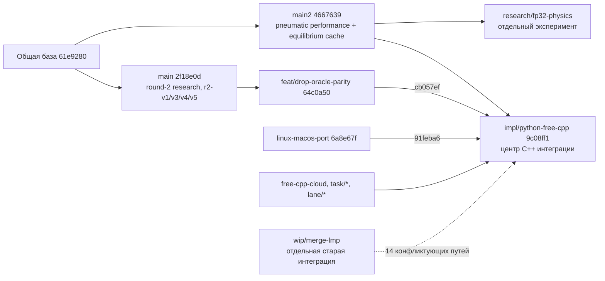

# Аудит веток и worktree — 22 октября 2026

Главная интеграционная ветка сейчас — **`impl/python-free-cpp` (`9c08ff1`)**. Она содержит текущие `main2`, `main`, round-2 research, Linux/macOS port и все закоммиченные `task/*` и `lane/*`. Продолжать следует со сбора оставшихся **незакоммиченных** работ в эту ветку и её квалификации. Повторные merge старых task-веток эту работу не перенесут.

## Область и достоверность

- Проверены 39 локальных веток и 27 зарегистрированных worktree; 26 каталогов существуют, один отсутствует. У пяти существующих worktree чистый Git status, у 21 есть tracked или untracked изменения. Ignored-файлы в эти счётчики не входят.
- Основной снимок worktree: **2026-10-22 14:40:59 UTC / 17:40:59 Europe/Istanbul**. Во время аудита продолжалась разработка: число tracked-изменений в PFC менялось с 79 до 88. Таблицы — снимки, а не гарантия неизменности состояния к моменту чтения.
- Аудит исследует историю, содержимое изменений, планы и риски интеграции. Это не полный review тысяч файлов C++-миграции и не повторная квалификация физики.
- Сборки, тесты и долгие gates не запускались; исходники, refs, index и пользовательские изменения аудитом не менялись. Созданы только этот отчёт и приложения с результатами аудита.
- Три независимых направления исследовали субагенты `gpt-6-luna`, reasoning `high`; ключевое родство и конфликтность дополнительно проверены главным агентом.
- `git ls-remote --heads origin` не смог разрешить `github.com`, в том числе при повторе вне sandbox. Поэтому remote-состояние **не подтверждено**. Локальные remote-tracking refs: `origin/main2=4667639`, `origin/impl/python-free-cpp=ca02163`; локальная PFC на 6 коммитов впереди последнего. Это не доказательство, что эти коммиты отсутствуют на сервере сейчас.
- Репозиторий не shallow. Stash отсутствуют. В сохранённой инвентаризации не обнаружены незавершённые merge/rebase/cherry-pick/revert/bisect.

Приложения: [все ветки](2026-10-22-branches-worktrees/branches.json), [worktree и полный список dirty-файлов](2026-10-22-branches-worktrees/worktrees.json), [пробы merge](2026-10-22-branches-worktrees/merge-simulations.json), [сравнение dirty-файлов с PFC HEAD](2026-10-22-branches-worktrees/dirty-comparison.json), [пересечение текущих правок lane/b и PFC](2026-10-22-branches-worktrees/live-overlap.json). JSON содержит пути и метаданные, **не резервные копии содержимого** пользовательских файлов.

## Как устроена история



Стрелки показывают включение истории, промежуточные коммиты опущены. У `main2` и `main` соответственно **5 и 10** коммитов, недостижимых из другой ветки. Ни одна не является потомком другой. PFC уже объединяет обе линии: **138** дополнительных достижимых коммитов относительно `main2`, **133** относительно `main`. Числа включают merge-коммиты и не измеряют объём функций.

### Что уже интегрировано

В `main2` и затем PFC входят:

- `feat/alpine-scree-track`: Alpine/scree terrain; tip `71f3aee` исправляет длины на сантиметровой сетке и ограничивает redraw.
- `feat/native-distributed-tire`, `feat/native-pneumatic-tire`: нативные backend шин; эти ветки повторно сливать не нужно.
- `fix/native-viewer-mjcb-time`, `implementation/seated-plant-v2`: изменения runtime/viewer и seated plant.
- `impl/cpp-port-p2`, `impl/native-recording-encoder`: C++ port и native recording encoder.
- `impl/parallel-batch`: batch seed-sweep, playback и async close; затем в общей линии исправлены deferred periods и per-job directories (`61e9280`).
- `perf/road-samples-cache`: cache дорожных samples и benchmark throughput mode.
- `research/pneumatic-perf`: параметры tolerance/max steps equilibrium solver; `main2` поверх этого добавляет equilibrium cache (`4667639`).
- `3d`: **11 документов** — спецификация и планы P0–P8. Наличие ветки в истории не означает реализованную spatial 3D физику.

В PFC также уже интегрированы:

- `main`, `feat/r2-v1/v3/v4/v5`, `feat/drop-oracle-parity`: статистика Alpine-трасс, независимая digitisation Dressel, adjudication и compiler spike, ADR; merge истории — `cb057ef`.
- `free-cpp-cloud`: native startup, prepared-state boundary.
- `linux-macos-port`: перенос build/tooling, numerics, platform runtime, packaging; merge — `91feba6`.
- `task/t09,t10,t11`: owned native runtime/bootstrap, native research records, samples/column encoding.
- `task/t13,t14,t15`: TOML/JSON и asset resolution, geometry/Horst linkage, mass/rider/suspension setup.
- `task/t19,t20`: seeded RNG/distribution transforms и интеграция terrain-работ.
- `lane/a`: recording columns и period buffer, merge в PFC `9c08ff1`; `lane/b` и `lane/c` указывают на **один SHA `a4d4cfd`** с baseline/oracle fixes.

Это вывод о достижимости коммитов. Он не означает, что последующая работа сохранила каждую старую реализацию без изменений или закрыла все критерии её приёмки.

## Где находится ещё не сохранённая работа

### PFC и lane/b — приоритет 1

**`.worktrees/python-free-cpp` / `impl/python-free-cpp`: 88 tracked-изменений** в основном снимке. Затронуты C++ source, Python counterpart, config projection, tests и evidence. Среди работ — static brake hold при скорости около нуля: latch, spring–damper, hysteresis, отдельный force component и energy accounting. Это mirrored physics/runtime изменение, его нельзя считать частью `9c08ff1`.

В рабочем evidence-файле есть заявления о focused pytest/regression результатах. Аудит их не воспроизводил и не приравнивает к зелёной итоговой квалификации всей ветки.

**`.worktrees/pfc-lane-b` / `lane/b`: 47 tracked + 122 untracked**. Есть native numeric-completion port, изменения C++/migration ledgers и новые fixture/golden payloads. Побайтовое сравнение с закоммиченным PFC HEAD показало: 45 dirty-файлов отличаются, 2 совпадают, 122 пути отсутствуют в дереве PFC HEAD. Различие не доказывает необходимость перенести весь файл: часть может быть более старой версией.

Дополнительное сравнение двух живых worktree сначала выявило 21 общий dirty-путь, а при сохранении приложения — **23 общих dirty-пути, все с разным содержимым**. Среди них `io/value.hpp`, `writer_config.hpp`, policy/state codecs, golden capture/episode, validation и reference tests. Это реальная зона совместного редактирования; копировать файлы поверх PFC или считать `lane/b` пустой после merge нельзя. Сначала сохранить обе работы, затем переносить отдельные проверенные изменения с учётом общей базы `a4d4cfd` и последующих коммитов PFC.

### Другие незавершённые работы

- **`.worktrees/par-t20` / `task/t20`: 5 tracked + 66 untracked.** Помимо крупных reserialization diff в migration JSON есть terrain sources/tests/fixtures/helpers. Слияние tip `186856e` в PFC не перенесло эти рабочие файлы. Нужна отдельная сверка с более поздним terrain-кодом PFC.
- **Корневой `main2`: 1 tracked + 41 untracked.** В tracked изменении удалено правило «one native gate per machine» из `AGENTS.md`. Untracked: perf-roadmap, восемь старых audit/plan документов, pose NPZ, offline packaging/install tools и Repomix archives. Восемь untracked packaging/tool файлов имеют одноимённые, но побайтово отличающиеся версии в PFC HEAD; `AGENTS.md` также отличается. Один pose и `tools/diag_run.py` совпадают с PFC HEAD. Перед fast-forward корневого checkout нужно разобрать эти файлы.
- **`.worktrees/native-viewer-mjcb-time` фактически на `feat/native-pneumatic-tire`, 431 untracked.** Имя каталога устарело. Там находится **незакоммиченный `docs/adr/0002-spatial-3d-correctness-method.md`** со статусом `proposed`, копии 3D plans/spec, tire research, MuJoCo notes, benchmark artifacts и skills. 360 файлов побайтово совпадают с PFC HEAD, 64 пути отсутствуют в нём, 7 отличаются. Нельзя удалить весь каталог, основываясь только на слитом tip.
- **`.worktrees/mujoco_clean-3d` фактически на `feat/drop-oracle-parity`: 1 tracked + 221 untracked.** Research scratch, logs и archives; внутри находятся ещё четыре зарегистрированных `r2` worktree. Этот каталог не является отдельной готовой 3D реализацией.
- **Вложенные `r2-v1/v3/v4/v5`:** у каждого есть правка `AGENTS.md`; у `r2-v5` ещё 465 untracked файлов `native/build-gcc`. Родительский worktree нельзя убирать без обработки четырёх детей.
- **Alpine worktree рядом с основным репозиторием: 21 untracked output-файл**, включая generated track `output/tracks/alpine_7.toml` и episode artifacts. Код tip уже слит.
- **`cpp-port-p2`: 1 tracked + 473 untracked** — skills, документы, acceptance/recording outputs, Repomix и proto artifacts.
- **`pneumatic-perf`: 62 untracked** под `output/` — traces/logs/scripts/results.
- **`recording-native-encoder`: 1 tracked + 6 untracked** — `AGENTS.md` и prototype benchmark assets/scripts.
- **`par-t10/t11/t13/t14`, вложенные `par-t15/t19`:** untracked `.deps`. Это зависимость/ссылка, а не автоматически потерянный feature commit; перед удалением выяснить владельца и назначение ссылки.
- **`reference-oracle`: detached HEAD `4667639`, 1 untracked pose.** Есть тег `reference/python-oracle`, обозначенный как immutable reference T00. Worktree и тег выполняют разные роли; не перемещать тег в ходе уборки.

## Что осталось вне основной интеграции

### `wip/merge-lmp` — разбирать выборочно

Tip `a5a33f1`; относительно PFC: **29 коммитов только здесь, 50 только в PFC**, merge-base `0c245f6`. `git cherry` показывает 28 non-merge патчей без точного patch-id эквивалента в PFC. Это не доказывает отсутствие их функциональности: часть переработана другой реализацией.

Назначение — старый WIP Linux/macOS integration, root CMake, numerics/provider identity, LAPACK ABI, Python-free root configure. Пробное слияние выявило **14 конфликтующих путей**, включая оба CMakeLists, `BikeNumerics.cmake`, numerics lock, provenance/provider images, root-configure/provider tests и dependency tooling. Нельзя слить целиком ради «добрать всё»: следует сравнить нужные требования с уже работающей линией PFC и перенести только отсутствующие исправления.

### `research/fp32-physics` — оставить экспериментом

Tip `f7baf50`, **22** дополнительных достижимых коммита относительно `main2`; не входит в PFC. Diff относительно базы: 94 файла, значительный объём benchmark/capture data. Verdict находится в `docs/superpowers/audits/2026-10-15-fp32-verdict.md` самого FP32 worktree.

По записанному verdict CPU speedup не получен: median FP32 приблизительно на 1.4% медленнее, есть event-boundary drift и незакрытый хвост worst episode после 2 секунд. Вывод допускает продолжение GPU/Colab исследования, но не перевод production path на FP32. Это исторические результаты эксперимента, не новые замеры аудита. Проба merge в PFC дала **17 конфликтующих путей**. Рекомендуется сохранить ветку отдельно, переносить полезную инфраструктуру только как отдельную обоснованную задачу.

### `wip/pedaling-rhythm` — старый функциональный прототип

Один уникальный commit `5379910` от 3 октября: rhythm, cadence/wheel EMA, foot reach и delivery compensation, 11 файлов. Точного patch-id эквивалента в PFC нет. При этом часть тем позже реализована иначе, например filtered coast/cadence (`6865cb7`) и последующий C++ pedaling policy. Нельзя считать весь WIP ни потерянным, ни обязательным к переносу. Сначала сформулировать, какое конкретно поведение ещё требуется, затем сравнить с актуальной реализацией. Пробный merge в PFC: **8 конфликтующих путей**.

### `proto/native-microbench` — архивный throwaway spike

Один уникальный commit `10522dc`, в сообщении прямо `PROTOTYPE (throwaway)`. Benchmark sources и закоммиченные binary/state artifacts. Не нужен как обязательный feature merge; сохранить как исследовательский reference, переносить отдельные полезные инструменты при необходимости.

### `antiwheelie-refocus`, `mujoco_clean`, `pedals` — другая корневая история

У этих трёх веток **нет merge-base с `main2` и PFC**. Это не эффект shallow clone. Их root — `c79e1a1`, root современной линии — `074a281`. `mujoco_clean` (`f1857f2`) продолжает `antiwheelie-refocus` (`84621d3`); `pedals` (`b8fdb66`) — более ранняя ветка старой линии.

Темы старой линии: antiwheelie/physical research, finite-contact/reference evidence, rider plant и pedaling. В современной линии есть импорты/переработки, но доказательства полной эквивалентности всех старых функций нет. Прямой merge с `--allow-unrelated-histories` не рекомендуется. Сохранить как архив; если нужна конкретная старая возможность, сравнить дерево/тесты и перенести ограниченный патч. Счётчик «все коммиты уникальны» здесь не означает столько же потерянных функций.

## Готовность и документы, которые нельзя читать как окончательный статус

1. **PFC — центр интеграции, но не подтверждённый готовый релиз.** В активном `docs/releases/python-free-qualification.md` обязательные lane rows не закрыты; это более подходящий release checklist, чем старый portability report.
2. `migration/cpp-linux-phase3-source-status.json` фиксирует snapshot 21 октября: `phase_complete:false`, 13 source-implemented, 6 needs-execution, 11 partial, 23 not-implemented; 2105/2381 test-map records ещё `planned`. После него есть compile fixes (`fe93e63`), reference fixes (`a4d4cfd`, `f6ee364`), recording port (`152aa0d`) и текущие dirty работы. Поэтому эти числа показывают незавершённый handoff, **а не точный пересчитанный backlog на 22 октября**. Следующий шаг — обновить статусы по фактическим tests/evidence, не объявлять всю Phase 3 ни выполненной, ни по-прежнему полностью source-only.
3. Старый `2026-10-14-linux-macos-acceptance.md`, агрегированный 18 октября, говорит BLOCKED / 19 missing gates и включает Linux x86_64. Активный Python-free checklist уже квалифицирует Linux **aarch64**; x86_64 вне required lanes. Старый отчёт не следует механически превращать в текущие 19 обязательств. Критерий — актуальный план и checklist, результаты финального source state.
4. Исходный `feat/drop-oracle-parity` отменял немедленный live parity, но **актуальный PFC ADR-0003 уже изменил это решение**: live bitwise oracle остаётся до capture на обеих платформах и C++ port конкретного файла; Python удаляется только на T63. Нельзя применять старый текст ADR-0002 в отрыве от ADR-0003 или молча ослаблять требования текущего AGENTS.md.
5. Пространственный 3D master ссылается на отсутствующий в tracked tree `0002-spatial-3d-correctness-method.md`; документ найден untracked в другом worktree и остаётся `proposed`. Его номер 0002 уже занят drop-oracle ADR, а плановый GPU ADR 0003 пересекается с актуальным migration ADR-0003. Перед 3D P0 нужно сохранить spatial ADR, согласовать нумерацию/ссылки и привести старые Python/frontend assumptions плана в соответствие с текущей C++ migration architecture.
6. `3d` — планы, не реализация. `round-2-integration-master` — план с ожидаемым утверждением, не доказательство внесения всех результатов research в physics. В Alpine плане остаются незакрытые final-validation шаги. Наличие merged SHA не закрывает эти пункты.
7. Distributed tire port имеет исторические parity/performance evidence, но материал помечен `experimental_unvalidated`; port parity не означает физическую калибровку и взаимозаменяемость с другими backend.

## Рекомендуемый порядок дальнейшей работы

1. **Сохранить текущее рабочее состояние PFC, lane/b и par-t20 отдельными понятными фиксациями/снимками**, включая untracked sources и fixture payloads. Сначала отделить осмысленный код/данные от build/output и скопированных skills. Из текущего аудита резервных копий не возникло.
2. **Собрать незавершённые изменения в `impl/python-free-cpp`.** Разобрать пересекающиеся dirty-файлы lane/b ↔ PFC (23 в последнем сравнении); проверить новые numeric fixtures и terrain-работы par-t20 против актуального HEAD. Учитывать текущую параллельную разработку; не заменять файлы массовым копированием.
3. **Разобрать `wip/merge-lmp` по требованиям/исправлениям.** Сам Linux/macOS port уже в PFC. Отдельные оставшиеся патчи должны иметь конкретную пользу, регрессию и интеграцию в текущий build graph.
4. **Согласовать и актуализировать qualification evidence.** Для физики/runtime и tooling действуют native-engineering rules и профиль test entry point соответствующего итогового checkout; `full` не считать заменой native preflight без чтения launcher. Проверять affected behavior в малом цикле, затем обязательные итоговые gates. Release/package/offline/GUI и обе платформы закрывать только реальными доказательствами, не наличием кода тестов.
5. **После готовности выбранного объёма — продвигать `main2` до проверенного PFC commit.** На проверенных SHA это технически `git merge --ff-only impl/python-free-cpp`, без merge-конфликтов истории. Это ещё не команда для текущего грязного корневого worktree: до неё нужно сохранить и сверить его untracked packaging/tool файлы и AGENTS.md. Также заново проверить refs, рабочее дерево и remote.
6. **`main` пока не превращать во второй активный trunk.** Если нужно сохранить Python/reference линию `main2` до завершения migration, можно отдельно слить в неё research `main` (проба чистая). Но для самой PFC это необязательный промежуточный шаг: весь `main` уже внутри неё. После выбора единого trunk решить судьбу исторического имени `main` и default branch на сервере.
7. **FP32, pedaling WIP и unrelated legacy не включать в обязательную очередь merge.** Это отдельные исследовательские/архивные источники. 3D начинать отдельной веткой от согласованного интеграционного состояния после приведения P0/ADR к актуальной архитектуре.

## Как сокращать число worktree

- Сначала сохранность dirty-работ, затем физическая уборка. Удаление worktree и удаление branch ref — разные операции.
- Первые кандидаты на удаление **только worktree**: чистые `parallel-batch`, `pfc-lane-a`, `pfc-lane-c`. Их tips уже в PFC; `parallel-batch` также в `main2`. Перед действием повторить status и проверить ignored assets.
- Чистый `linux-macos-port` можно освободить как каталог после проверки local-only окружения: его история уже в PFC. Ветку не удалять по одному лишь сравнению с `main2`.
- Чистый FP32 worktree можно при желании убрать, сохранив исследовательскую ветку и нужные ignored результаты; это не означает интеграцию FP32.
- `/private/tmp/bikesim-wt-14` отсутствует, Git помечает запись как `prunable`. Это кандидат на удаление устаревшей регистрации; коммиты `perf/road-samples-cache` уже в `main2` и PFC. Аудит не делал prune и не восстанавливал отсутствующие файлы.
- `mujoco_clean-3d` содержит четыре вложенных зарегистрированных worktree: сначала рассматривать детей. Не удалять внешний каталог рекурсивно.
- Суммарный `du -sh .worktrees` во время аудита: **54G**, `.git`: около **74M**. Это размер каталогов, не оценка гарантированно освобождаемого места: есть shared dependencies, ignored builds и nested worktrees.
- В нескольких branch config остался `vscode-merge-base=origin/main`, хотя локального `origin/main` нет. Это устаревшие подсказки редактора, не реальные зависимости/merge bases Git; исправить при выборе единого trunk.

## Проверка пробных слияний

Выполнено `git merge-tree --write-tree --name-only` в **отдельном временном bare clone** с общими read-only исходными объектами и собственной записью новых объектов. Ни реальных merge, ни checkout, ни записи в refs/index исходного репозитория не было. Проверяются committed trees; dirty и ignored-файлы не участвуют. Отсутствие текстовых конфликтов не доказывает корректность программы.

| Цель ← источник | Результат на проверенных SHA |
| --- | --- |
| `main2` ← `main` | Чистое пробное слияние; ветки разошлись |
| `main2` ← `feat/drop-oracle-parity` | Чистое пробное слияние; актуальный migration contract всё равно смотреть в PFC ADR-0003 |
| `main2` ← `impl/python-free-cpp` | Чисто; ancestry отдельно подтверждает возможность fast-forward |
| PFC ← `wip/merge-lmp` | 14 конфликтующих путей |
| PFC ← `research/fp32-physics` | 17 конфликтующих путей |
| PFC ← `wip/pedaling-rhythm` | 8 конфликтующих путей |

Полные пути конфликтов и сообщения Git сохранены в `merge-simulations.json`.


## Полная карта 39 веток

Числа `−/+` — коммиты только в `main2` / только в данной ветке. Для разных root числа не приводятся: сравнение по общему предку неприменимо. «В PFC» означает достижимость tip из `9c08ff1`, без учёта dirty-файлов.

| Ветка | Tip | К main2 −/+ | В PFC |
| --- | --- | --- | --- |
| `3d` | `14f9ce1` | 76/0 | да |
| `antiwheelie-refocus` | `84621d3` | разные root | нет |
| `feat/alpine-scree-track` | `71f3aee` | 109/0 | да |
| `feat/drop-oracle-parity` | `64c0a50` | 5/11 | да |
| `feat/native-distributed-tire` | `e1676ae` | 88/0 | да |
| `feat/native-pneumatic-tire` | `f1147d8` | 58/0 | да |
| `feat/r2-v1` | `83dda51` | 5/3 | да |
| `feat/r2-v3` | `9225271` | 5/2 | да |
| `feat/r2-v4` | `8030aca` | 5/2 | да |
| `feat/r2-v5` | `56be04d` | 5/2 | да |
| `fix/native-viewer-mjcb-time` | `7f96589` | 130/0 | да |
| `free-cpp-cloud` | `9c940c9` | 0/44 | да |
| `impl/cpp-port-p2` | `4e47dd8` | 86/0 | да |
| `impl/native-recording-encoder` | `27bce52` | 77/0 | да |
| `impl/parallel-batch` | `411f6a9` | 195/0 | да |
| `impl/python-free-cpp` | `9c08ff1` | 0/138 | да |
| `implementation/seated-plant-v2` | `bfdd095` | 224/0 | да |
| `lane/a` | `152aa0d` | 0/136 | да |
| `lane/b` | `a4d4cfd` | 0/135 | да |
| `lane/c` | `a4d4cfd` | 0/135 | да |
| `linux-macos-port` | `6a8e67f` | 0/41 | да |
| `main` | `2f18e0d` | 5/10 | да |
| `main2` | `4667639` | 0/0 | да |
| `mujoco_clean` | `f1857f2` | разные root | нет |
| `pedals` | `b8fdb66` | разные root | нет |
| `perf/road-samples-cache` | `f3635fb` | 94/0 | да |
| `proto/native-microbench` | `10522dc` | 234/1 | нет |
| `research/fp32-physics` | `f7baf50` | 0/22 | нет |
| `research/pneumatic-perf` | `e3eb965` | 60/0 | да |
| `task/t09` | `cbe9b8d` | 0/19 | да |
| `task/t10` | `c936665` | 0/28 | да |
| `task/t11` | `d663a7c` | 0/37 | да |
| `task/t13` | `b991cd2` | 0/26 | да |
| `task/t14` | `6aaf094` | 0/26 | да |
| `task/t15` | `b997039` | 0/33 | да |
| `task/t19` | `2b65bf8` | 0/33 | да |
| `task/t20` | `186856e` | 0/36 | да |
| `wip/merge-lmp` | `a5a33f1` | 0/117 | нет |
| `wip/pedaling-rhythm` | `5379910` | 291/1 | нет |

## Все 27 зарегистрированных worktree

Снимок 2026-10-22T14:40:59+00:00. Пути относительно корня проекта, кроме отдельно указанных абсолютных. Tracked/untracked — число путей, ignored не учитываются. Полные filenames, diff stats и nesting сохранены в `worktrees.json`.

| Каталог | Ветка / HEAD | Tracked | Untracked |
| --- | --- | ---: | ---: |
| `корень проекта` | `main2` | 1 | 41 |
| `/private/tmp/bikesim-wt-14` **отсутствует/prunable** | `perf/road-samples-cache` | — | — |
| `/Users/vladislav.molchanov/Desktop/tmp/mujoco_clean-alpine-scree-track` | `feat/alpine-scree-track` | 0 | 21 |
| `.worktrees/.worktrees/par-t15` | `task/t15` | 0 | 1 |
| `.worktrees/.worktrees/par-t19` | `task/t19` | 0 | 1 |
| `.worktrees/cpp-port-p2` | `impl/cpp-port-p2` | 1 | 473 |
| `.worktrees/fp32-physics` | `research/fp32-physics` | 0 | 0 |
| `.worktrees/linux-macos-port` | `linux-macos-port` | 0 | 0 |
| `.worktrees/mujoco_clean-3d` | `feat/drop-oracle-parity` | 1 | 221 |
| `.worktrees/mujoco_clean-3d/.worktrees/r2-v1` | `feat/r2-v1` | 1 | 0 |
| `.worktrees/mujoco_clean-3d/.worktrees/r2-v3` | `feat/r2-v3` | 1 | 0 |
| `.worktrees/mujoco_clean-3d/.worktrees/r2-v4` | `feat/r2-v4` | 1 | 0 |
| `.worktrees/mujoco_clean-3d/.worktrees/r2-v5` | `feat/r2-v5` | 1 | 465 |
| `.worktrees/native-viewer-mjcb-time` | `feat/native-pneumatic-tire` | 0 | 431 |
| `.worktrees/par-t10` | `task/t10` | 0 | 1 |
| `.worktrees/par-t11` | `task/t11` | 0 | 1 |
| `.worktrees/par-t13` | `task/t13` | 0 | 1 |
| `.worktrees/par-t14` | `task/t14` | 0 | 1 |
| `.worktrees/par-t20` | `task/t20` | 5 | 66 |
| `.worktrees/parallel-batch` | `impl/parallel-batch` | 0 | 0 |
| `.worktrees/pfc-lane-a` | `lane/a` | 0 | 0 |
| `.worktrees/pfc-lane-b` | `lane/b` | 47 | 122 |
| `.worktrees/pfc-lane-c` | `lane/c` | 0 | 0 |
| `.worktrees/pneumatic-perf` | `research/pneumatic-perf` | 0 | 62 |
| `.worktrees/python-free-cpp` | `impl/python-free-cpp` | 88 | 0 |
| `.worktrees/recording-native-encoder` | `impl/native-recording-encoder` | 1 | 6 |
| `.worktrees/reference-oracle` | `detached 4667639` | 0 | 1 |

### Воспроизводимые read-only команды

```sh
git --no-optional-locks worktree list --porcelain
git --no-optional-locks for-each-ref --format='%(refname:short) %(objectname) %(upstream:short)' refs/heads
git --no-optional-locks rev-list --left-right --count main2...impl/python-free-cpp
git --no-optional-locks merge-base --is-ancestor main2 impl/python-free-cpp
git --no-optional-locks log --oneline main2..impl/python-free-cpp
git --no-optional-locks cherry impl/python-free-cpp wip/merge-lmp
git --no-optional-locks -C .worktrees/pfc-lane-b status --porcelain=v1 --untracked-files=all
git --no-optional-locks -C .worktrees/python-free-cpp diff --stat
```

Для воспроизведения merge-проб нужен отдельный временный репозиторий: `merge-tree --write-tree` создаёт объекты. Не запускать его в общем `.git`, если требуется сохранить исходный object store неизменным.

