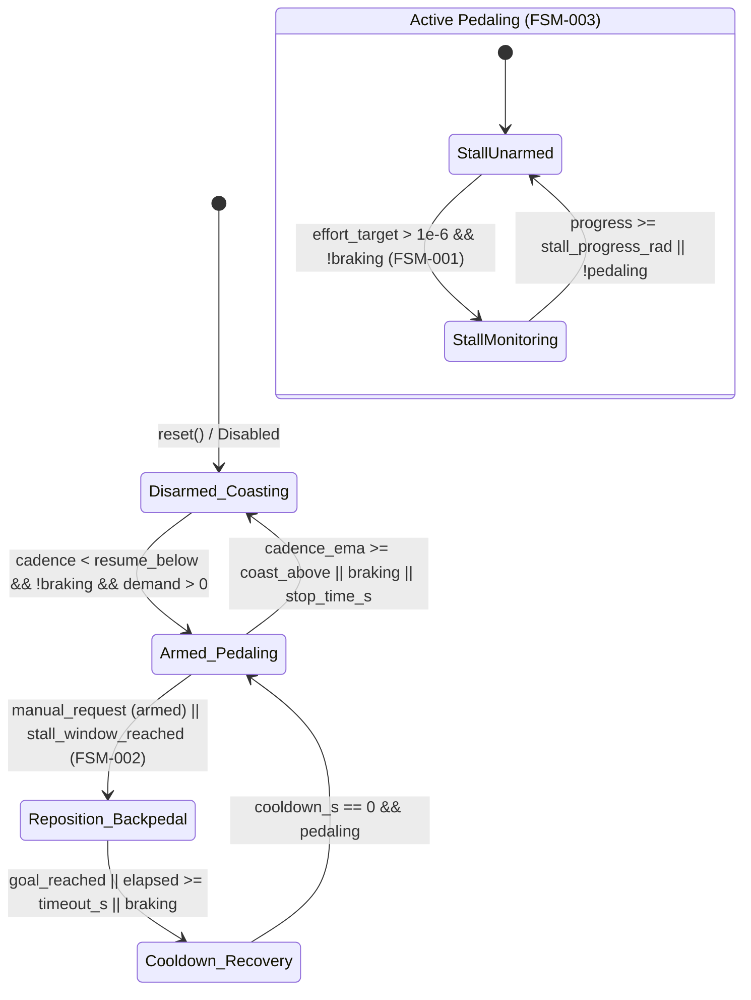
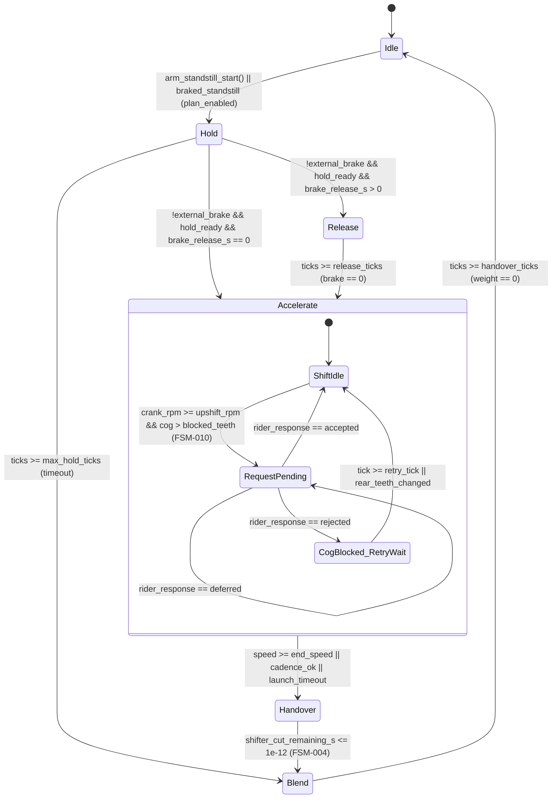
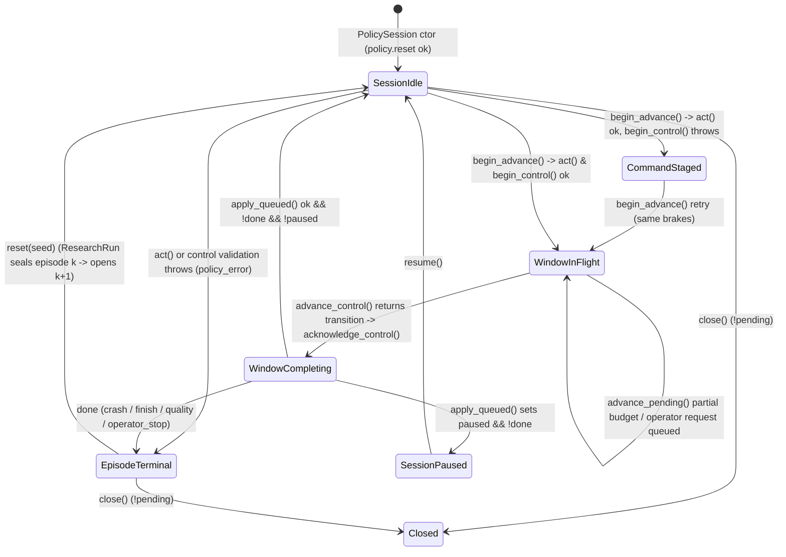
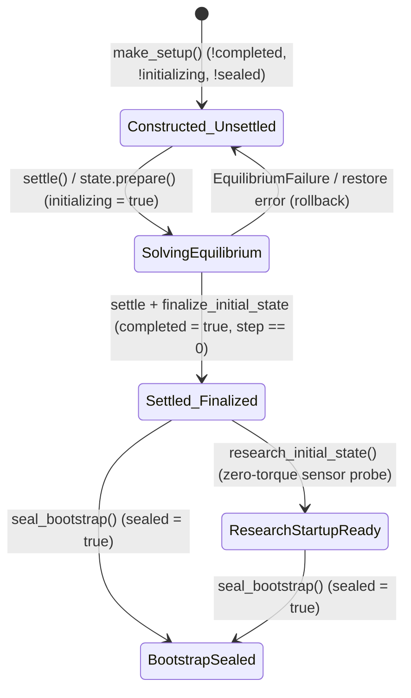
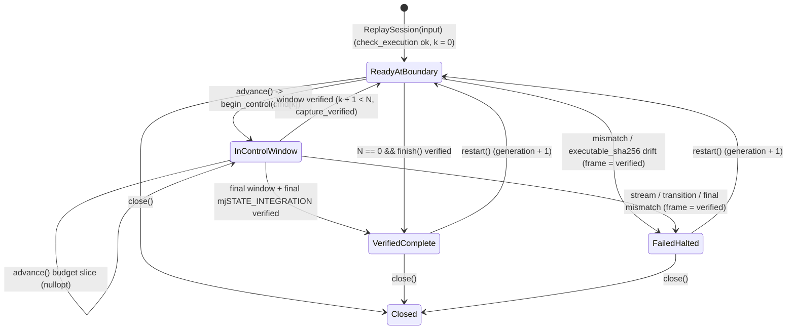
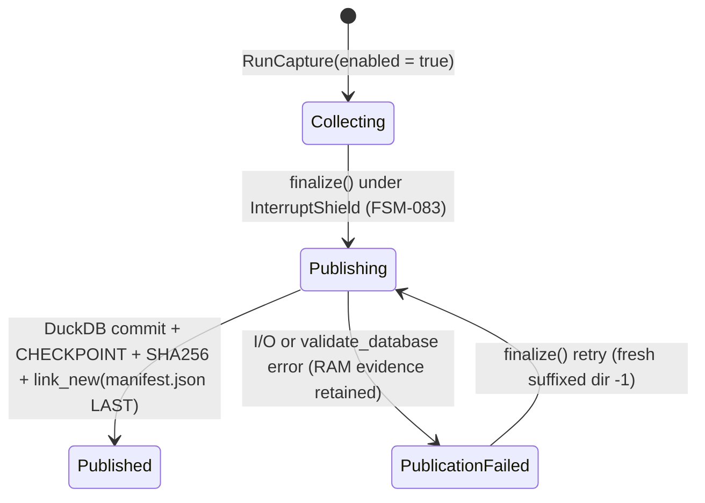

# Repository-Wide Implicit & Explicit Finite-State Machine Map (`fsm-map.md`)

> **Immutable Stage 1 Audit Artifact (`implicit-fsm`)**
> - **Target Repository:** `/Users/vladislav.molchanov/Desktop/tmp/mujoco_clean`
> - **Inspected Clean Snapshot Worktree:** `/Users/vladislav.molchanov/Desktop/tmp/mujoco_clean/.worktrees/implicit-fsm-2026-11-17` (branch `feat/implicit-fsm-2026-11-17`)
> - **Inspected Git Commit (`HEAD`):** `0502660dd14bd1021b3da90a61e20dcb1d5805a1`
> - **Tracked Tree Manifest SHA-256:** `5a2eff8616214fb64ec1300f3d59f401170318e2af4c4adb63026b72b73ba1f6` (`9,832` tracked paths; `0` tracked modifications)
> - **First-Party Code Coverage:** **`906 / 906` (`100.0%`)** of inventoried first-party C++/CUDA/ObjC++, CMake, shell, and Python source, tooling, and test files inspected line-by-line across 16 disjoint discovery slices (`D01`..`D16`).
> - **Mapped Stateful Machines & Protocols:** **`123` (`FSM-001` .. `FSM-123`)** — `12` explicit FSMs, `9` hybrid explicit/implicit FSMs, and `102` implicit FSM candidates / stateful protocols.

---

## 1. Scope, Product Goals, Epistemic Sources & Coverage Accounting

### 1.1 Product Goals & Confirmed External Contracts vs. Hypotheses

Per `implicit-fsm` Stage 1 rules, current implementation is treated as **evidence, not the specification**. Sources are partitioned strictly by epistemic authority:

1. **Confirmed Normative Specifications & Engineering Contracts (External Requirements):**
   - [`AGENTS.md`](file:///Users/vladislav.molchanov/Desktop/tmp/mujoco_clean/.worktrees/implicit-fsm-2026-11-17/AGENTS.md): Rider/motor/transmission/damping physical model boundaries (100% mechanical efficiency, unilateral platform pedals & saddle, unilateral motor overrunning clutch, zero joint passive damping, planar scope boundaries) and verification gate rules.
   - [`docs/agents/simulation-decisions.md`](file:///Users/vladislav.molchanov/Desktop/tmp/mujoco_clean/.worktrees/implicit-fsm-2026-11-17/docs/agents/simulation-decisions.md):
     - *«Действует» (Items 1–46)*: Active simulation physics, rider posture/launch/front-lift/seated-climb rules, energy balance (`<= 5%` numerical residual on measured steps), strict vs diagnostic `ReferenceMonitor`, standstill grace re-arm, crank reposition, and tire/contact models.
     - *«Решено — не сделано» & «Не решено»*: Explicitly deferred or open user product decisions (e.g., Item 11 static brake `200+200=400 N·m` combined ceiling, Item 9 default 30%/30% sag constants, Linux golden regeneration from `5f23a658`) — tracked separately and never silently altered without user product authorization.
   - [`docs/agents/native-engineering.md`](file:///Users/vladislav.molchanov/Desktop/tmp/mujoco_clean/.worktrees/implicit-fsm-2026-11-17/docs/agents/native-engineering.md): Fail-closed validation, transactional stage-before-commit atomicity, single-thread MuJoCo owner confinement, `-ffp-contract=off` binary64 determinism (`ADR-0003`), and RTSan `BIKE_NONBLOCKING` step rules.
   - [`docs/RIDE.md`](file:///Users/vladislav.molchanov/Desktop/tmp/mujoco_clean/.worktrees/implicit-fsm-2026-11-17/docs/RIDE.md), [`docs/RECORDING.md`](file:///Users/vladislav.molchanov/Desktop/tmp/mujoco_clean/.worktrees/implicit-fsm-2026-11-17/docs/RECORDING.md), [`docs/NATIVE_POLICIES.md`](file:///Users/vladislav.molchanov/Desktop/tmp/mujoco_clean/.worktrees/implicit-fsm-2026-11-17/docs/NATIVE_POLICIES.md), [`docs/TESTING.md`](file:///Users/vladislav.molchanov/Desktop/tmp/mujoco_clean/.worktrees/implicit-fsm-2026-11-17/docs/TESTING.md): User-facing CLI, viewer, checked-replay, sealed DuckDB recording, deferred-`SIGINT` (`exit 130` & `operator_stop_deferred`), C ABI v1 policy, and qualification-sweep contracts.
2. **Implementation Guarantees:** Invariants enforced unconditionally by current constructors, transitions, and RAII/atomic guards on commit `0502660dd14bd1021b3da90a61e20dcb1d5805a1`.
3. **Sampled Observations & Located Test Assertions:** Properties exercised on finite input traces in `native/tests/*` and `tools/colab_gpu/test_*.py` (reconciled across domain slices and the dedicated 106-file test index in [`reports/discovery/D16.md`](file:///Users/vladislav.molchanov/Desktop/tmp/mujoco_clean/.work/implicit-fsm-audit-2026-11-17/reports/discovery/D16.md)).
4. **Inferred Intentions & Audit Hypotheses:** Candidate state invariants, probe non-interference rules, and cross-layer symmetries inferred from code structure and comments — subjected to independent fresh-context research (`R1`) and adversarial challenge (`R2`) before adjudication (`Rfinal`).

### 1.2 Snapshot & Exclusion Accounting (`9,832` Tracked Paths -> `906` First-Party Code Files)

| Category | File Count | Audit Treatment & Rationale |
|---|---:|---|
| First-party production source, headers, CMake, shell & GPU tooling (`native/include`, `native/src`, `native/cmake`, `CMakeLists.txt`, `CMakePresets.json`, `mise.toml`, `examples/policies`, `examples/research`, `tools/**`) | `602` | **100% inspected** across Slices `D01`..`D15` |
| First-party native test suites, test harnesses, fixtures CMake & fault injectors (`native/tests/**`) | `304` | **100% inspected** across Slices `D01`..`D16` (with cross-slice production FSM test index in `D16`) |
| **Total First-Party Code, Build, Tooling & Test Files** | **`906`** | **`906 / 906` (`100.0%`) inspected** |
| Passive golden/fixture data, static example configs, docs & third-party agent skills (`tests/fixtures/**` `.npz`/`.json`/`.duckdb`, Markdown docs, `.agents/skills/**`, licenses/locks) | `8,926` | Excluded as non-executable data/documentation/third-party skill text; all schema loaders, validators, codecs, and shipped research profiles (`examples/research/*.toml`) consuming them **were** inspected in `D05`, `D06`, `D08`, `D11`, `D12`, `D15`. |
| Pinned third-party binary/header archives (`.deps` / `/opt/bike-deps`) & untracked root pre-T63 Python leftovers | Untracked | Vendor libraries (`mujoco`, `duckdb`, `eigen`, `openblas`, `glfw`, `cairo`, `rapidjson`, `tomlplusplus`) and untracked legacy leftovers excluded; clean worktree `.worktrees/implicit-fsm-2026-11-17` isolates exact tracked `HEAD`. |

> **Discovery Completeness Disclaimer:** Actual discovery coverage is `906 / 906` (`100%`) of inventoried first-party code, build, script, and test files at `0502660dd14bd1021b3da90a61e20dcb1d5805a1`. Consistent with `implicit-fsm` principles, full static inspection establishes inventory coverage and mapped transitions, **not** an unbounded claim that no hidden emergent state interactions exist.

### 1.3 Discovery Slice Partition (`D01` .. `D16`)

| Slice | Assigned Files | Mapped FSMs | Canonical ID Range | Archived Slice Report | Scope Summary |
|---|---:|---:|---|---|---|

| `D01` | `32` | `8` | `FSM-001`..`FSM-008` | [`D01.md`](file:///Users/vladislav.molchanov/Desktop/tmp/mujoco_clean/.work/implicit-fsm-audit-2026-11-17/reports/discovery/D01.md) | Drivetrain Policies, Clutches, Shifting, Stall Detector & State Codecs |
| `D02` | `27` | `8` | `FSM-009`..`FSM-016` | [`D02.md`](file:///Users/vladislav.molchanov/Desktop/tmp/mujoco_clean/.work/implicit-fsm-audit-2026-11-17/reports/discovery/D02.md) | Rider Launch Plan, Front-Lift Reaction, Intent, Perception & Senses |
| `D03` | `55` | `5` | `FSM-017`..`FSM-021` | [`D03.md`](file:///Users/vladislav.molchanov/Desktop/tmp/mujoco_clean/.work/implicit-fsm-audit-2026-11-17/reports/discovery/D03.md) | Rider Spindle/Legacy Controllers, Force Allocation, Support & Contact Mechanics |
| `D04` | `49` | `15` | `FSM-022`..`FSM-036` | [`D04.md`](file:///Users/vladislav.molchanov/Desktop/tmp/mujoco_clean/.work/implicit-fsm-audit-2026-11-17/reports/discovery/D04.md) | Core Runtime Stepper, Engine Guard/Poison, Balance/Model Status, Static Brake, Accounting, Async Close & Clocks |
| `D05` | `45` | `6` | `FSM-037`..`FSM-042` | [`D05.md`](file:///Users/vladislav.molchanov/Desktop/tmp/mujoco_clean/.work/implicit-fsm-audit-2026-11-17/reports/discovery/D05.md) | Runtime Bootstrap, Research Runtime, Realtime Measurement & Provider/Build Provenance |
| `D06` | `39` | `5` | `FSM-043`..`FSM-047` | [`D06.md`](file:///Users/vladislav.molchanov/Desktop/tmp/mujoco_clean/.work/implicit-fsm-audit-2026-11-17/reports/discovery/D06.md) | Initialization, Equilibrium Settle, Cache, Launch Prep, Sag Fit & App Session |
| `D07` | `29` | `6` | `FSM-048`..`FSM-053` | [`D07.md`](file:///Users/vladislav.molchanov/Desktop/tmp/mujoco_clean/.work/implicit-fsm-audit-2026-11-17/reports/discovery/D07.md) | Research Environment, Policy ABI v1, Plugin/Builtin Policies, PolicySession & ResearchRun |
| `D08` | `78` | `9` | `FSM-054`..`FSM-062` | [`D08.md`](file:///Users/vladislav.molchanov/Desktop/tmp/mujoco_clean/.work/implicit-fsm-audit-2026-11-17/reports/discovery/D08.md) | Run Recording Capture, DuckDB Transaction/Publication, Deferred Interrupts, Reader & Golden Capture |
| `D09` | `54` | `8` | `FSM-063`..`FSM-070` | [`D09.md`](file:///Users/vladislav.molchanov/Desktop/tmp/mujoco_clean/.work/implicit-fsm-audit-2026-11-17/reports/discovery/D09.md) | Checked Replay Session, Unverified Playback, GLFW Viewer, Pacer, Input, Render Owner & Viz |
| `D10` | `63` | `12` | `FSM-071`..`FSM-082` | [`D10.md`](file:///Users/vladislav.molchanov/Desktop/tmp/mujoco_clean/.work/implicit-fsm-audit-2026-11-17/reports/discovery/D10.md) | CLI Frontends, Batch Process Pool, Sweeps & Validation Stands |
| `D11` | `56` | `12` | `FSM-083`..`FSM-094` | [`D11.md`](file:///Users/vladislav.molchanov/Desktop/tmp/mujoco_clean/.work/implicit-fsm-audit-2026-11-17/reports/discovery/D11.md) | Platform OS Boundary, Lossless JSON/NPZ IO, Seeded Random & Numerics |
| `D12` | `74` | `3` | `FSM-095`..`FSM-097` | [`D12.md`](file:///Users/vladislav.molchanov/Desktop/tmp/mujoco_clean/.work/implicit-fsm-audit-2026-11-17/reports/discovery/D12.md) | Configuration Schema/Validators, MJCF Model Builder & Research Profiles |
| `D13` | `40` | `1` | `FSM-098` | [`D13.md`](file:///Users/vladislav.molchanov/Desktop/tmp/mujoco_clean/.work/implicit-fsm-audit-2026-11-17/reports/discovery/D13.md) | Geometry, Horst-Link Kinematics & Terrain/Obstacle Generators |
| `D14` | `75` | `12` | `FSM-099`..`FSM-110` | [`D14.md`](file:///Users/vladislav.molchanov/Desktop/tmp/mujoco_clean/.work/implicit-fsm-audit-2026-11-17/reports/discovery/D14.md) | Force Writers, Tyre, Pneumatic Carcass/Brush Models, Contact Laws & GPU Batch Runners |
| `D15` | `84` | `9` | `FSM-111`..`FSM-119` | [`D15.md`](file:///Users/vladislav.molchanov/Desktop/tmp/mujoco_clean/.work/implicit-fsm-audit-2026-11-17/reports/discovery/D15.md) | Native Check Orchestrator (`bike-native-checks`), CMake, Packaging & Tooling Scripts |
| `D16` | `106` | `4` | `FSM-120`..`FSM-123` | [`D16.md`](file:///Users/vladislav.molchanov/Desktop/tmp/mujoco_clean/.work/implicit-fsm-audit-2026-11-17/reports/discovery/D16.md) | Native Test Harnesses, Fault Injection & Production FSM Transition-Test Index |

---

## 2. Master Canonical FSM Registry Index (`FSM-001` .. `FSM-123`)

| Canonical ID | Slice ID | Slice | Machine / Stateful Protocol Name | Classification | Preliminary Disposition |
|---|---|---|---|---|---|

| `FSM-001` | [`FSM-D01-01`](file:///Users/vladislav.molchanov/Desktop/tmp/mujoco_clean/.work/implicit-fsm-audit-2026-11-17/reports/discovery/D01.md) | `D01` | Progress Stall Detector (`StallDetectorState` / `stall_update`) | `implicit` | `convert to explicit FSM` (small 2-state `Unarmed` / `Monitoring{crank_rad, wheel_rad, elapsed_s}` sum type... |
| `FSM-002` | [`FSM-D01-02`](file:///Users/vladislav.molchanov/Desktop/tmp/mujoco_clean/.work/implicit-fsm-audit-2026-11-17/reports/discovery/D01.md) | `D01` | Crank Reposition Manoeuvre & Trigger-Arming Lifecycle (`PedalingPolicy` / `RepositionSnapshot`) | `hybrid` (projects onto explicit output enums `PedalMode::coasting` and `CoastReason::{repos... | `convert to explicit FSM` (replace `goal_rad`/`reason`/`cooldown_s` cluster inside `RepositionSnapshot` wit... |
| `FSM-003` | [`FSM-D01-03`](file:///Users/vladislav.molchanov/Desktop/tmp/mujoco_clean/.work/implicit-fsm-audit-2026-11-17/reports/discovery/D01.md) | `D01` | Pedaling / Coasting Hysteresis & Spin-Down Trajectory Machine (`PedalingPolicy` / `PedalingSnapshot`) | `hybrid` (emits explicit `PedalMode` and `CoastReason` enums in `PedalingState`, while persi... | `tighten/formalize explicit FSM` (separate cadence-cutoff hysteresis latch from spin-down coasting state — ... |
| `FSM-004` | [`FSM-D01-04`](file:///Users/vladislav.molchanov/Desktop/tmp/mujoco_clean/.work/implicit-fsm-audit-2026-11-17/reports/discovery/D01.md) | `D01` | Gear-Shifting Cooldown, Torque-Cut & Rider-Request Automaton (`CadenceShifter` / `ShiftingSnapshot`) | `hybrid` (internal `update()` dispatches on closed `ShiftDirection` and `SlipMode` enums, wh... | `tighten/formalize explicit FSM` (store closed enums `ShiftDirection` and `ShiftResponse` on `ShiftingSnaps... |
| `FSM-005` | [`FSM-D01-05`](file:///Users/vladislav.molchanov/Desktop/tmp/mujoco_clean/.work/implicit-fsm-audit-2026-11-17/reports/discovery/D01.md) | `D01` | Motor Assist Release-Hold / Run-On Latch Machine (`AssistController` / `AssistSnapshot`) | `implicit` | `convert to explicit FSM` (represent release-hold state explicitly as `{Disengaged, Active{power_w, torque_... |
| `FSM-006` | [`FSM-D01-06`](file:///Users/vladislav.molchanov/Desktop/tmp/mujoco_clean/.work/implicit-fsm-audit-2026-11-17/reports/discovery/D01.md) | `D01` | Standalone Freehub Ratchet Machine (`Freehub` / `FreehubSnapshot` & GPU Parity Twin) | `implicit` | `retain` (minimal test-oracle reference class; optionally add `if (!s.boundary && (s.energy_j != 0. \|\| s.to... |
| `FSM-007` | [`FSM-D01-07`](file:///Users/vladislav.molchanov/Desktop/tmp/mujoco_clean/.work/implicit-fsm-audit-2026-11-17/reports/discovery/D01.md) | `D01` | MuJoCo Tendon Transmission Ratchet, Linearization-Readiness & Shift-Work Machine (`Transmission` / `TransmissionSnapshot`) | `implicit` | `simplify/derive` / `tighten` (retain zero-allocation `prepared_storage_` pattern, but enforce `range[1]` c... |
| `FSM-008` | [`FSM-D01-08`](file:///Users/vladislav.molchanov/Desktop/tmp/mujoco_clean/.work/implicit-fsm-audit-2026-11-17/reports/discovery/D01.md) | `D01` | Drivetrain State Codec & Interval-Settlement Lifecycle Boundary (`DriveSnapshot` / `PolicySet` in `state_codec.*` & `policy_set.hpp`) | `implicit` (wire/snapshot protocol boundary owned in D01 by `state_codec.{hpp,cpp}` and `pol... | `simplify/derive` & `tighten` (push snapshot domain/relational invariants into shared `validate(PedalingSna... |
| `FSM-009` | [`FSM-D02-01`](file:///Users/vladislav.molchanov/Desktop/tmp/mujoco_clean/.work/implicit-fsm-audit-2026-11-17/reports/discovery/D02.md) | `D02` | `LaunchPlan` Primary Standstill-Launch Lifecycle (`LaunchPhase` & Hold/Stationary-Gear Sub-States) | `hybrid` — Explicit 7-state `LaunchPhase` enum ([native/src/rider/launch_plan.hpp:18](file:/... | 1. **Bug/Gap (`LaunchPlan::restore` ignores `!config_.plan_enabled`):** Reject `s != State{}` in `LaunchPla... |
| `FSM-010` | [`FSM-D02-02`](file:///Users/vladislav.molchanov/Desktop/tmp/mujoco_clean/.work/implicit-fsm-audit-2026-11-17/reports/discovery/D02.md) | `D02` | `LaunchPlan` Upshift Request, Cog-Block & Retry Sub-Machine | `implicit` — Encoded without an enum across five fields of `LaunchPlan::State` (`bool shift_... | - Cleanly designed protocol; minor `restore()` tightening possible (`request_teeth == 0 \|\| request_teeth >=... |
| `FSM-011` | [`FSM-D02-03`](file:///Users/vladislav.molchanov/Desktop/tmp/mujoco_clean/.work/implicit-fsm-audit-2026-11-17/reports/discovery/D02.md) | `D02` | `LaunchPlan` Effort-Ceiling Rise-Clock Latch | `implicit` — Encoded via sentinel counter `std::int64_t rise_ticks` (`-1` vs `>= 0`) coupled... | - `RiderIntent::restore()` ([native/src/rider/intent.cpp:680-683](file:///Users/vladislav.molchanov/Desktop... |
| `FSM-012` | [`FSM-D02-04`](file:///Users/vladislav.molchanov/Desktop/tmp/mujoco_clean/.work/implicit-fsm-audit-2026-11-17/reports/discovery/D02.md) | `D02` | `FrontLiftReaction` Lifecycle & Criterion-B Lagged Hand-Unload Detector | `hybrid` — Explicit 4-state `ReactionPhase` enum (`idle`, `deciding`, `acting`, `releasing` ... | - Either enforce/document the monotonic percept-delivery precondition (`!percepts` rejected once `percepts_... |
| `FSM-013` | [`FSM-D02-05`](file:///Users/vladislav.molchanov/Desktop/tmp/mujoco_clean/.work/implicit-fsm-audit-2026-11-17/reports/discovery/D02.md) | `D02` | `Perception` Delayed Senses Queue & Vestibular Pitch Integrator | `implicit` — Integer-tick FIFO delay line with pre-delivery / steady-delivery phases and ove... | Well-tested and sound (`keep as-is`; only missing a dedicated `tick == INT64_MAX` overflow unit test in `te... |
| `FSM-014` | [`FSM-D02-06`](file:///Users/vladislav.molchanov/Desktop/tmp/mujoco_clean/.work/implicit-fsm-audit-2026-11-17/reports/discovery/D02.md) | `D02` | `RiderIntent` Acquisition Clock, Transactional Stage/Commit & Ownership Arbitrator | `implicit` — Encoded via `config_.enabled`, `last_tick_step` (`-1` vs `k * period_steps_`), ... | 1. **Probe `commands()` asymmetry:** On `resolve_full(..., advance=false)` when `due == true`, `probe.comma... |
| `FSM-015` | [`FSM-D02-07`](file:///Users/vladislav.molchanov/Desktop/tmp/mujoco_clean/.work/implicit-fsm-audit-2026-11-17/reports/discovery/D02.md) | `D02` | `SeatedClimbPolicy` Surge Power Budget & Norm-Gated Delayed Inclination/Effort Pipeline | `implicit` — Encoded across `surge_budget_s_left_`, `time_s_`, `samples_` queue, `delayed_` ... | 1. **Float-clock drift vs `Perception`:** `SeatedClimbPolicy` accumulates `time_s_ += dt` (`intent.cpp:370`... |
| `FSM-016` | [`FSM-D02-08`](file:///Users/vladislav.molchanov/Desktop/tmp/mujoco_clean/.work/implicit-fsm-audit-2026-11-17/reports/discovery/D02.md) | `D02` | `SeatedPostureProgram` Delayed Load-Share Trim, Launch Blend & Scheduled Pulse Lifecycle | `implicit` — Encoded across `lean_rad_`, `trim_rad_`, `load_samples_` queue, `delayed_load_s... | 1. **Poisonable state via `decode_intent_program` + `restore()`:** `decode_intent_program` ([native/src/rid... |
| `FSM-017` | [`FSM-D03-01`](file:///Users/vladislav.molchanov/Desktop/tmp/mujoco_clean/.work/implicit-fsm-audit-2026-11-17/reports/discovery/D03.md) | `D03` | `SpindleController` Lifecycle, Crank-Law / Weld-Press Servo (`coast_hold_nm_`) & Effort-Observation Machine | Composite Implicit FSM (construction-locked topology mode $\times$ runtime activation gate $... | Retain design, fix `advance=false` isolation bugs** (`populate_leg_torques(ps, advance)` and stage/rollback... |
| `FSM-018` | [`FSM-D03-02`](file:///Users/vladislav.molchanov/Desktop/tmp/mujoco_clean/.work/implicit-fsm-audit-2026-11-17/reports/discovery/D03.md) | `D03` | Flat-Pedal Foot-Slip Recovery FSM (`PedalRecoveryState`) | Explicit 5-State FSM (string-encoded state variable `stage`; two independent per-leg instanc... | Convert `stage` to `enum class`**, tighten `decode_pedal_recovery` & `validate_state` (`direction` $\in \{-... |
| `FSM-019` | [`FSM-D03-03`](file:///Users/vladislav.molchanov/Desktop/tmp/mujoco_clean/.work/implicit-fsm-audit-2026-11-17/reports/discovery/D03.md) | `D03` | Grip Pull/Press Branch Hysteresis, Warm-Start Memory & Effort-Scale Ladder (`AllocationMemory`) | Implicit Hysteretic Mode-Selection & Warm-Start FSM (persisted across ticks in `SpindleContr... | Retain intentional branch hysteresis**, but snapshot/restore `c_.allocation_memory_` when `!advance` in `Le... |
| `FSM-020` | [`FSM-D03-04`](file:///Users/vladislav.molchanov/Desktop/tmp/mujoco_clean/.work/implicit-fsm-audit-2026-11-17/reports/discovery/D03.md) | `D03` | Soft-Constraint Active-Set & Contact/Limit Mode-Search Automaton (`ConstraintDynamics` / `search_constraint_modes`) | Per-Call Discrete Active-Set & Graph-Search Automaton (stateless across simulation ticks; ow... | Well-structured per-call discrete search**; optionally guard the `linearize(candidate.torque)` heuristic ju... |
| `FSM-021` | [`FSM-D03-05`](file:///Users/vladislav.molchanov/Desktop/tmp/mujoco_clean/.work/implicit-fsm-audit-2026-11-17/reports/discovery/D03.md) | `D03` | Test-Only Thread-Local Allocation Fault-Injection & Activity-Counter Machine (`allocation_faults`) | Explicit Test-Only Thread-Local FSM (3-state `Budget` fault-injector $\times$ orthogonal alw... | Clean test utility**; ignore `ptr == nullptr` in `release()` (`if (!ptr) return;`) and `assert(!budget.arme... |
| `FSM-022` | [`FSM-D04-01`](file:///Users/vladislav.molchanov/Desktop/tmp/mujoco_clean/.work/implicit-fsm-audit-2026-11-17/reports/discovery/D04.md) | `D04` | Thread-Local Engine Error-Interceptor Stack & Callback Provenance (`engine_call.*`) | Implicit TLS stack-disciplined protocol FSM + process-global callback provenance classifier | - *Process-global callback race:* `mjcb_*` slots are plain C globals read without synchronization (`engine_... |
| `FSM-023` | [`FSM-D04-02`](file:///Users/vladislav.molchanov/Desktop/tmp/mujoco_clean/.work/implicit-fsm-audit-2026-11-17/reports/discovery/D04.md) | `D04` | `Stepper` Health/Poison, Pos/Vel Stage-Freshness & Time-Callback Policy Cache (`stepper.*`) | Implicit 3-axis product FSM (`Health × StageFreshness × TimeCallbackCache`) | - *Asymmetric writer reset in `set_state`:* `set_state` resets writers iff `poisoned_ == true` (`stepper.cp... |
| `FSM-024` | [`FSM-D04-03`](file:///Users/vladislav.molchanov/Desktop/tmp/mujoco_clean/.work/implicit-fsm-audit-2026-11-17/reports/discovery/D04.md) | `D04` | `NativeRideRuntime` Lifecycle, Reentrancy Guard, Terminal Outcome Latch & Warning Relay (`runtime.*`) | Implicit composite lifecycle & concurrency-exclusion FSM | - *Guard ordering inconsistency:* `advance()` (`763, 779-780`) and `probe_step_inputs()` (`819, 824-825`) c... |
| `FSM-025` | [`FSM-D04-04`](file:///Users/vladislav.molchanov/Desktop/tmp/mujoco_clean/.work/implicit-fsm-audit-2026-11-17/reports/discovery/D04.md) | `D04` | `PhysicalStep` Execution Mode, Acc-Input Skip Cache & Crank-Reposition One-Shot (`step.*`) | Implicit multi-variable step-execution & cache-coherency FSM | - **Defect Candidate D04-G1 (`probe_step_inputs` mutates live `mjModel::dof_frictionloss` without restore):... |
| `FSM-026` | [`FSM-D04-05`](file:///Users/vladislav.molchanov/Desktop/tmp/mujoco_clean/.work/implicit-fsm-audit-2026-11-17/reports/discovery/D04.md) | `D04` | Hill-Hold Rollback Brake Reflex (`rollback_hold_`) & `BrakeResolution` (`step.*`) | Implicit 2-state speed-hysteresis latch (`Disengaged` / `Holding`) + 4-predicate brake merge... | - **Defect Candidate D04-G3 (`probe_step_inputs` omits `rollback_demand`):** `advance_body` computes `hold ... |
| `FSM-027` | [`FSM-D04-06`](file:///Users/vladislav.molchanov/Desktop/tmp/mujoco_clean/.work/implicit-fsm-audit-2026-11-17/reports/discovery/D04.md) | `D04` | `StaticBrake` Per-Wheel Standstill Pad-Bite Latch (`static_brake.*`, `brake_latch_codec.*`) | Implicit 2-wheel independent hysteresis & slip-reseat latch FSM (`FrontLatch × RearLatch`) | - **Known Physics Specification Deviation (`simulation-decisions.md:606-613`, «Решено — не сделано» item 11... |
| `FSM-028` | [`FSM-D04-07`](file:///Users/vladislav.molchanov/Desktop/tmp/mujoco_clean/.work/implicit-fsm-audit-2026-11-17/reports/discovery/D04.md) | `D04` | `ControlClock` Tick Cadence & Held-Command Latch (`control.*`) | Implicit 2-state initialization latch (`Empty` vs `Holding`) + modular step divider | - If a bootstrap `state.json` is crafted with `step % steps_per_period != 0`, `initializing == false`, and ... |
| `FSM-029` | [`FSM-D04-08`](file:///Users/vladislav.molchanov/Desktop/tmp/mujoco_clean/.work/implicit-fsm-audit-2026-11-17/reports/discovery/D04.md) | `D04` | Wheel Contact Filtering — `GroundedFilter` & `BridgedLoad` (`control.*`, `native_contacts.cpp`, `step.cpp`) | Coupled implicit monotone-clock hold filter (`GroundedFilter`) + discrete step-dropout count... | - *Same-timestamp `GroundedFilter::update` ignores `raw_grounded`:* At `step.cpp:1544` (`apply_forces_body`... |
| `FSM-030` | [`FSM-D04-09`](file:///Users/vladislav.molchanov/Desktop/tmp/mujoco_clean/.work/implicit-fsm-audit-2026-11-17/reports/discovery/D04.md) | `D04` | `BalanceMonitor` Launch-Grace, Standstill Re-Arm & Low-Speed Dwell (`control.*`, `step.cpp`) | Implicit 6-phase temporal hysteresis & dual-latch FSM (implements Simulation Decision 14 & 2... | - *Mid-grace rolling standstill edge:* In `PhysicalStep::balance_channel` (`step.cpp:2801-2809`), `stop` is... |
| `FSM-031` | [`FSM-D04-10`](file:///Users/vladislav.molchanov/Desktop/tmp/mujoco_clean/.work/implicit-fsm-audit-2026-11-17/reports/discovery/D04.md) | `D04` | `CrashDetector` & Physical Contact Crash Terminal Latch (`control.*`, `step.cpp`, `runtime.cpp`) | Implicit monotone first-cause terminal latch (`Upright` -> `Crashed(cause)`) | - *Start-vs-end timestamp/pose inconsistency across crash causes:* `catch_plane_contact` and `rider_ground_... |
| `FSM-032` | [`FSM-D04-11`](file:///Users/vladislav.molchanov/Desktop/tmp/mujoco_clean/.work/implicit-fsm-audit-2026-11-17/reports/discovery/D04.md) | `D04` | `ModelStatus` Sticky Tri-State Numerical Verdict & Applicability Ledger (`status.*`) | Implicit monotone interval ledger + sticky tri-state validity machine (`not_evaluated` -> `t... | - **Validation Gap D04-G4 (`ModelStatus::from_wire` permits split `counts` vs `first` state):** `ModelStatu... |
| `FSM-033` | [`FSM-D04-12`](file:///Users/vladislav.molchanov/Desktop/tmp/mujoco_clean/.work/implicit-fsm-audit-2026-11-17/reports/discovery/D04.md) | `D04` | `ReferenceMonitor` First-Rejection Latch & Warn-Once Protocol (`status.*`, `accounting.cpp`) | Implicit 3-state diagnostic warn-once / strict-rejection latch FSM (Simulation Decision 30) | Sound; async merge (`staged.monitor.warning_pending \|\| state_.monitor.warning_pending`, `accounting.cpp:495... |
| `FSM-034` | [`FSM-D04-13`](file:///Users/vladislav.molchanov/Desktop/tmp/mujoco_clean/.work/implicit-fsm-audit-2026-11-17/reports/discovery/D04.md) | `D04` | `PeriodBuffer` & `PeriodAccounting` Transactional Period-Close & Sync/Async Fallback (`period_buffer.*`, `accounting.*`) | Implicit multi-stage transactional buffer/donor/commit pipeline + transport-mode degradation... | - *Subtle `AsyncPublicationError` vs `AsyncWorkerLost` behavior:* In `PeriodAccounting::collect` (`accounti... |
| `FSM-035` | [`FSM-D04-14`](file:///Users/vladislav.molchanov/Desktop/tmp/mujoco_clean/.work/implicit-fsm-audit-2026-11-17/reports/discovery/D04.md) | `D04` | `AsyncCloseRunner` Off-Path Worker Thread & Ordered Result Queue (`async_close.*`) | Explicit-mutex concurrent worker lifecycle & FIFO sequence-matching protocol FSM | Clean, deadlock-free, strong exception guarantees (`submit` rollback at `31-32`, `detach_pending` reserve-b... |
| `FSM-036` | [`FSM-D04-15`](file:///Users/vladislav.molchanov/Desktop/tmp/mujoco_clean/.work/implicit-fsm-audit-2026-11-17/reports/discovery/D04.md) | `D04` | `SensorPipeline` Startup-Latch, Latency Queue & Finite Noise-Tape (`sensors.*`) | Implicit 3-phase (`Uninitialized` -> `Active` -> `TapeExhausted`) monotone-clock delay queue... | - Strong invariant validation in `import_state` (`sensors.cpp:90-121`) and exception-atomic `reset`/`push`/... |
| `FSM-037` | [`FSM-D05-01`](file:///Users/vladislav.molchanov/Desktop/tmp/mujoco_clean/.work/implicit-fsm-audit-2026-11-17/reports/discovery/D05.md) | `D05` | `NativeResearchRuntime` Owner Lifecycle, Reentrancy & External Control-Window / Episode Outcome Machine | Implicit Hierarchical FSM (atomic owner/reentrancy envelope + boolean/optional control-windo... | - **Missing located tests: |
| `FSM-038` | [`FSM-D05-02`](file:///Users/vladislav.molchanov/Desktop/tmp/mujoco_clean/.work/implicit-fsm-audit-2026-11-17/reports/discovery/D05.md) | `D05` | `ResearchEpisode` Delayed-Actuation Staging, Sample-Consumption Cursor & Capture-Mode-Dependent Command Journals | Implicit Coupled Cursor / Queue FSM (operating inside `ResearchEpisode`, driven by `NativeRe... | - **Missing located tests (in D05):** No D05 test exercises `verify` or `off` capture modes, nor `prepare_a... |
| `FSM-039` | [`FSM-D05-03`](file:///Users/vladislav.molchanov/Desktop/tmp/mujoco_clean/.work/implicit-fsm-audit-2026-11-17/reports/discovery/D05.md) | `D05` | `ResearchRecorder` Monotonic Decimated Interval Recorder | Implicit Append-Only Monotonic-Cursor FSM (`runtime::ResearchRecorder`) | - **Missing located tests:** Direct unit tests on `ResearchRecorder` for `decimation_ < 1`, null `SamplePtr... |
| `FSM-040` | [`FSM-D05-04`](file:///Users/vladislav.molchanov/Desktop/tmp/mujoco_clean/.work/implicit-fsm-audit-2026-11-17/reports/discovery/D05.md) | `D05` | `WheelieTracker` Hysteresis & Persistence Contact-State / Episode Machine | Explicit/Hybrid FSM (explicit string state field `state_` over 10 labels coupled with contin... | - **Missing located tests (in D05):** Direct synthetic transitions for `CandidateUnconfirmed` hysteresis re... |
| `FSM-041` | [`FSM-D05-05`](file:///Users/vladislav.molchanov/Desktop/tmp/mujoco_clean/.work/implicit-fsm-audit-2026-11-17/reports/discovery/D05.md) | `D05` | `measurement::Driver` / `NativeDriver` & `measure_run` Single-Run Whole-Boundary Measurement Lifecycle | Implicit Protocol + Concrete Driver FSM (`runtime::measurement::Driver`, `NativeDriver`, `me... | - **Missing located tests:** `flush()` throwing an exception (`stage: "flush"`), `execution_identity()` thr... |
| `FSM-042` | [`FSM-D05-06`](file:///Users/vladislav.molchanov/Desktop/tmp/mujoco_clean/.work/implicit-fsm-audit-2026-11-17/reports/discovery/D05.md) | `D05` | `measure_realtime_command` Multi-Run Campaign & Gate-Verdict Orchestration Pipeline | Implicit Sequential Phase Orchestrator ([realtime_command.cpp](file:///Users/vladislav.molch... | - **Missing located tests:** CLI exit code `1` (`!all_measured` when a run fails with `measured_ok == false... |
| `FSM-043` | [`FSM-D06-01`](file:///Users/vladislav.molchanov/Desktop/tmp/mujoco_clean/.work/implicit-fsm-audit-2026-11-17/reports/discovery/D06.md) | `D06` | `SetupOwner` & `SetupContext` Multi-Stage Initialization and Bootstrap-Seal Lifecycle | Implicit FSM** (object lifecycle + multi-stage pipeline spread across three coupled structs ... | Candidate for explicit `SetupPhase` enum on `SetupOwner::Impl` / `SetupContext`** (`Constructed`, `SolvingE... |
| `FSM-044` | [`FSM-D06-02`](file:///Users/vladislav.molchanov/Desktop/tmp/mujoco_clean/.work/implicit-fsm-audit-2026-11-17/reports/discovery/D06.md) | `D06` | `app` Preparation-to-Session Handoff & `bike-native-ride` Bounded Session Protocol | Implicit Ownership-Handoff & CLI Session Protocol** (spanning `app/prepare.*`, `app/physical... | See entry |
| `FSM-045` | [`FSM-D06-03`](file:///Users/vladislav.molchanov/Desktop/tmp/mujoco_clean/.work/implicit-fsm-audit-2026-11-17/reports/discovery/D06.md) | `D06` | Equilibrium Settle Loop, Relaxation Schedule (`cycle` vs `kinetic`), TRF Refinement & Setup-Only Crank-Hold Machine | Implicit Multi-Phase Solver & Force-Attachment FSM | Keep solver loop localized in `equilibrium.cpp`/`refine.cpp`, add regression test for auto-cache `restore_e... |
| `FSM-046` | [`FSM-D06-04`](file:///Users/vladislav.molchanov/Desktop/tmp/mujoco_clean/.work/implicit-fsm-audit-2026-11-17/reports/discovery/D06.md) | `D06` | Equilibrium State-File & Auto-Cache Resolution, Transactional Material Restore, and Atomic Publication Lifecycle | Implicit Two-Phase Staging & Atomic Filesystem Publication FSM | Preserve transactional staging and atomic temp-rename protocol; consider unifying the post-restore `apply_i... |
| `FSM-047` | [`FSM-D06-05`](file:///Users/vladislav.molchanov/Desktop/tmp/mujoco_clean/.work/implicit-fsm-audit-2026-11-17/reports/discovery/D06.md) | `D06` | Polymorphic `initial_state_file` Resolution & `PhysicalInitialState` Schema-2 Transfer Lifecycle | Implicit Artifact Dispatch & Two-Stage State-Transfer Protocol | See entry |
| `FSM-048` | [`FSM-D07-01`](file:///Users/vladislav.molchanov/Desktop/tmp/mujoco_clean/.work/implicit-fsm-audit-2026-11-17/reports/discovery/D07.md) | `D07` | `PolicySession` Control-Window, Operator-Queue, Reset & Close Lifecycle | Implicit product FSM with an explicit internal operator-command tag (`enum class Action : st... | Refactor to explicit session-phase state enum** (`Idle`, `CommandStaged`, `WindowActive`, `WindowCompleting... |
| `FSM-049` | [`FSM-D07-02`](file:///Users/vladislav.molchanov/Desktop/tmp/mujoco_clean/.work/implicit-fsm-audit-2026-11-17/reports/discovery/D07.md) | `D07` | `PlaybackClock` Wall-Time Pacing & Step-Debt Machine | Implicit FSM (mode flags `initialized_`, `paused_`, discrete `scale_ ∈ {1,2,4,8}`, monotone ... | Keep as compact value helper**; document `rebase()` requirement on episode reset regardless of `paused_` |
| `FSM-050` | [`FSM-D07-03`](file:///Users/vladislav.molchanov/Desktop/tmp/mujoco_clean/.work/implicit-fsm-audit-2026-11-17/reports/discovery/D07.md) | `D07` | `ResearchRun` Multi-Episode Capture, Seal, Interrupt-Shielded Finalize & Publication Retry Lifecycle | Implicit FSM (8 boolean/optional coordination latches + monotone `episode_id_` + `FailureRep... | Formalize `ResearchRun` phase enum** (`ActiveEpisode`, `Finalizing`, `FailedRetryable`, `Finished` — replac... |
| `FSM-051` | [`FSM-D07-04`](file:///Users/vladislav.molchanov/Desktop/tmp/mujoco_clean/.work/implicit-fsm-audit-2026-11-17/reports/discovery/D07.md) | `D07` | `PluginPolicy` & Policy ABI v1 Host-Module Lifecycle | Implicit RAII + pointer-latch FSM (`Library` + `Instance` + `PluginPolicy`) | Keep implementation; document `create -> act` vs `create -> reset -> act` contract explicitly in `bike/poli... |
| `FSM-052` | [`FSM-D07-05`](file:///Users/vladislav.molchanov/Desktop/tmp/mujoco_clean/.work/implicit-fsm-audit-2026-11-17/reports/discovery/D07.md) | `D07` | `TractionControlPolicy` Slip-Limit & Standstill-Release Hybrid Controller (Builtin & Example Plugin) | Implicit Hybrid FSM (3 coupled sub-states: time-base tracker + slip-cap engagement/recovery ... | Keep parity behavior; add differential test between `examples/policies/traction_control.cpp` and `builtin:t... |
| `FSM-053` | [`FSM-D07-06`](file:///Users/vladislav.molchanov/Desktop/tmp/mujoco_clean/.work/implicit-fsm-audit-2026-11-17/reports/discovery/D07.md) | `D07` | `PhysicalLiveCsv` Preview Stream, Schema-Lock, Cadence & Error-Latch Lifecycle | Implicit FSM (`closed_`, `failed_`, `columns_.empty()`, `generation_`, `next_time_s_`, `rows... | Fix `write_marker` on `columns_.empty()` (either reject before first data row or do not lock `columns_` unt... |
| `FSM-054` | [`FSM-D08-01`](file:///Users/vladislav.molchanov/Desktop/tmp/mujoco_clean/.work/implicit-fsm-audit-2026-11-17/reports/discovery/D08.md) | `D08` | `RunCapture` Launch Evidence & Finalization State Machine | Explicit FSM with Implicit Sub-States** (`RunCapture::State` enum coupled with immutable `en... | Retain Explicit FSM**; tighten `RunCapture` invariants so RAM-level event/episode acceptance aligns with `v... |
| `FSM-055` | [`FSM-D08-02`](file:///Users/vladislav.molchanov/Desktop/tmp/mujoco_clean/.work/implicit-fsm-audit-2026-11-17/reports/discovery/D08.md) | `D08` | `EpisodeJournal` Per-Episode Cursor & Event Monotonicity Machine | Implicit FSM Candidate** (monotone per-episode counter `next_id_` coupled with `RunCapture::... | Keep lightweight cursor design; consider pre-validating `emit_all` spans if Python loop-order parity on inv... |
| `FSM-056` | [`FSM-D08-03`](file:///Users/vladislav.molchanov/Desktop/tmp/mujoco_clean/.work/implicit-fsm-audit-2026-11-17/reports/discovery/D08.md) | `D08` | `ResearchRecording` (`ResearchPublication` Adapter) One-Shot Adaptation Latch | Implicit FSM Candidate** (`std::unique_ptr<RunCapture> capture_` acting as `{Unadapted, Adap... | Refactor candidate** — latch `capture_` only after `finalize()` succeeds (or rebuild `staged` when `capture... |
| `FSM-057` | [`FSM-D08-04`](file:///Users/vladislav.molchanov/Desktop/tmp/mujoco_clean/.work/implicit-fsm-audit-2026-11-17/reports/discovery/D08.md) | `D08` | Two-Level Exclusive Publication, DuckDB Transaction/Appender & Sealing Protocol | Implicit FSM Candidate** (procedural multi-stage filesystem + DuckDB transaction/appender/ch... | Well-tested transactional protocol; retain as structured transaction pipeline (no class-level enum needed b... |
| `FSM-058` | [`FSM-D08-05`](file:///Users/vladislav.molchanov/Desktop/tmp/mujoco_clean/.work/implicit-fsm-audit-2026-11-17/reports/discovery/D08.md) | `D08` | Deferred-`SIGINT` Shielding & `finalize_guarded` Protocol | Implicit FSM Candidate** (`platform::InterruptShield` signal-handler slot + `deferred_` coun... | See entry |
| `FSM-059` | [`FSM-D08-06`](file:///Users/vladislav.molchanov/Desktop/tmp/mujoco_clean/.work/implicit-fsm-audit-2026-11-17/reports/discovery/D08.md) | `D08` | `Database`, `Connection` & `Cursor` Handle/Streaming Lifecycle | Implicit FSM Candidate** (RAII mode-dependent `Database` + streaming `Cursor::Impl` chunk st... | See entry |
| `FSM-060` | [`FSM-D08-07`](file:///Users/vladislav.molchanov/Desktop/tmp/mujoco_clean/.work/implicit-fsm-audit-2026-11-17/reports/discovery/D08.md) | `D08` | `Recording` Sealed Container Reader Lifecycle | Implicit FSM Candidate** (`{Open (database_ != nullptr), Closed (database_ == nullptr)}` gat... | Creating secondary read-only `Connection`s from `Database::database_` in `compare_streams` would avoid redu... |
| `FSM-061` | [`FSM-D08-08`](file:///Users/vladislav.molchanov/Desktop/tmp/mujoco_clean/.work/implicit-fsm-audit-2026-11-17/reports/discovery/D08.md) | `D08` | Golden Episode Capture & Replay Privileged Seam (`bike::golden::RuntimeAccess`) | Implicit FSM Candidate** (dual `std::atomic<bool>` reentrancy guard + runtime state precondi... | See entry |
| `FSM-062` | [`FSM-D08-09`](file:///Users/vladislav.molchanov/Desktop/tmp/mujoco_clean/.work/implicit-fsm-audit-2026-11-17/reports/discovery/D08.md) | `D08` | `bt::oracle::Node` Ordered Golden-Entry Cursor & Record-Mode Machine (Test Support) | Implicit FSM Candidate (Test Support Infrastructure) | See entry |
| `FSM-063` | [`FSM-D09-01`](file:///Users/vladislav.molchanov/Desktop/tmp/mujoco_clean/.work/implicit-fsm-audit-2026-11-17/reports/discovery/D09.md) | `D09` | `ReplaySession` Checked Replay Verification & Lifecycle Machine | Implicit FSM** (multi-field boolean/optional/cursor/generation product state coordinated wit... | Candidate for explicit `Phase` enum (`Active`, `Verified`, `Mismatch`, `Closed`) + fixing ctor `capture_ver... |
| `FSM-064` | [`FSM-D09-02`](file:///Users/vladislav.molchanov/Desktop/tmp/mujoco_clean/.work/implicit-fsm-audit-2026-11-17/reports/discovery/D09.md) | `D09` | `Pacer` Cooperative Playback Pacing & Debt-Rebase Machine | Implicit FSM** (3 boolean flags `paused`, `initialized`, `rebase_pending` + discrete `scale`... | Well-structured small implicit FSM; keep encapsulated in `Pacer::Impl`, add unit tests for `max_offer` cap ... |
| `FSM-065` | [`FSM-D09-03`](file:///Users/vladislav.molchanov/Desktop/tmp/mujoco_clean/.work/implicit-fsm-audit-2026-11-17/reports/discovery/D09.md) | `D09` | `AchievedRate` Windowed RTF Estimator | Implicit 2-State Estimator** (`std::optional<double> value_` + monotone clock/sim-time basel... | See entry |
| `FSM-066` | [`FSM-D09-04`](file:///Users/vladislav.molchanov/Desktop/tmp/mujoco_clean/.work/implicit-fsm-audit-2026-11-17/reports/discovery/D09.md) | `D09` | `InputState` Mode-Dependent Operator Latch & Speed-Scale Machine | Hybrid Explicit/Implicit FSM** (explicit `Mode` and `Action` enums + discrete `{1, 2, 4, 8}`... | Clean value-type controller; add minor unit assertions for remaining key/mode matrix cells |
| `FSM-067` | [`FSM-D09-05`](file:///Users/vladislav.molchanov/Desktop/tmp/mujoco_clean/.work/implicit-fsm-audit-2026-11-17/reports/discovery/D09.md) | `D09` | Interactive Viewer Session Loop (`viewer::run`) | Implicit Orchestration FSM** (loop control state distributed across local flags `request_fra... | See entry |
| `FSM-068` | [`FSM-D09-06`](file:///Users/vladislav.molchanov/Desktop/tmp/mujoco_clean/.work/implicit-fsm-audit-2026-11-17/reports/discovery/D09.md) | `D09` | `RenderOwner` Replica Lifecycle, Lazy GPU Context & Poisoning Machine (with `Camera` Sub-Machine) | Implicit FSM** (`is_closed`, `poisoned`, `frame.has_value()`, `graphics` + monotone `(genera... | Exemplary exception-staging and thread/poison safety; add a `BIKE_BUILD_GUI=ON` hidden-window render test a... |
| `FSM-069` | [`FSM-D09-07`](file:///Users/vladislav.molchanov/Desktop/tmp/mujoco_clean/.work/implicit-fsm-audit-2026-11-17/reports/discovery/D09.md) | `D09` | `GlfwContext` Main-Thread Window, Process-Global GLFW Refcount & Callback-Fault Latch | Implicit Resource & Fault-Latch FSM** (process-global `context_count` + per-instance `regist... | See entry |
| `FSM-070` | [`FSM-D09-08`](file:///Users/vladislav.molchanov/Desktop/tmp/mujoco_clean/.work/implicit-fsm-audit-2026-11-17/reports/discovery/D09.md) | `D09` | `viz::plotly_override` Process-Global Resource Resolution Latch | Implicit 2-State Irreversible Global Latch** (mutex-guarded `std::optional<std::filesystem::... | See entry |
| `FSM-071` | [`FSM-D10-01`](file:///Users/vladislav.molchanov/Desktop/tmp/mujoco_clean/.work/implicit-fsm-audit-2026-11-17/reports/discovery/D10.md) | `D10` | Batch TOML Wide-Integer Pushdown Scanner & Marker-Collision Rewriter | Explicit FSM** (pushdown automaton with explicit `Container` and `Position` enums on `stack`... | Keep as local explicit scanner FSM; no refactoring needed |
| `FSM-072` | [`FSM-D10-02`](file:///Users/vladislav.molchanov/Desktop/tmp/mujoco_clean/.work/implicit-fsm-audit-2026-11-17/reports/discovery/D10.md) | `D10` | Batch Worker Pool, Per-Job Execution & Cancellation/Fatal Lifecycle | Implicit FSM** (concurrent parent-coordinator + worker-pool + per-job lifecycle coordinated ... | Harden `sweep.cpp` input validation (`--jobs >= 1`, non-empty `seeds`) and keep `process_pool.cpp` concurre... |
| `FSM-073` | [`FSM-D10-03`](file:///Users/vladislav.molchanov/Desktop/tmp/mujoco_clean/.work/implicit-fsm-audit-2026-11-17/reports/discovery/D10.md) | `D10` | CLI Option Parser & Cross-Option Execution-Mode Resolution Machine | Implicit FSM / Constrained Mode-Resolution Machine** (token-stream parser with `--` option-t... | Add explicit fail-closed cross-option guards (especially `bike-replay` inspection-only flags without `--vie... |
| `FSM-074` | [`FSM-D10-04`](file:///Users/vladislav.molchanov/Desktop/tmp/mujoco_clean/.work/implicit-fsm-audit-2026-11-17/reports/discovery/D10.md) | `D10` | Physical Ride Episode, Viewer Reset, Retry-Once Seal & Publication Lifecycle | Implicit FSM** (multi-episode physical simulation driver with `sealed` latch, `reason` latch... | Fix `interrupt.deferred()` check at `ride.cpp:183` (and `settle.cpp:52`), unify `episode_started` payload/d... |
| `FSM-075` | [`FSM-D10-05`](file:///Users/vladislav.molchanov/Desktop/tmp/mujoco_clean/.work/implicit-fsm-audit-2026-11-17/reports/discovery/D10.md) | `D10` | Research CLI Launch, Control-Window Drain, Publication & Cleanup Lifecycle | Implicit FSM** (two-phase `ResearchRun` owner swap + external-control-boundary stepping/drai... | Prune or document the `interactive && !session` C++-only path in `research.cpp:84-112` |
| `FSM-076` | [`FSM-D10-06`](file:///Users/vladislav.molchanov/Desktop/tmp/mujoco_clean/.work/implicit-fsm-audit-2026-11-17/reports/discovery/D10.md) | `D10` | Replay CLI Inspection Cursor & Checked-Replay Verification Lifecycle | Implicit FSM** (two sub-machines in `cli/replay.cpp`: (A) `inspect` presentation cursor/gene... | Fix `hooks.terminal` / `hooks.advance` to check `static_cast<bool>(failure)` and report `failure`'s message... |
| `FSM-077` | [`FSM-D10-07`](file:///Users/vladislav.molchanov/Desktop/tmp/mujoco_clean/.work/implicit-fsm-audit-2026-11-17/reports/discovery/D10.md) | `D10` | Validation Sample Interval-Continuity Verifier (`IntervalCoverage`) | Implicit FSM** (stream protocol verifier over drained `PhysicalSampleData` intervals) | Keep as-is |
| `FSM-078` | [`FSM-D10-08`](file:///Users/vladislav.molchanov/Desktop/tmp/mujoco_clean/.work/implicit-fsm-audit-2026-11-17/reports/discovery/D10.md) | `D10` | Immutable Plant Valid-Prefix Latch & Tri-State Learning-Validity Fold | Implicit FSM** (absorbing valid-prefix latch in `ValidPrefix` + tri-state `{true, false, nul... | Sound; keep as-is |
| `FSM-079` | [`FSM-D10-09`](file:///Users/vladislav.molchanov/Desktop/tmp/mujoco_clean/.work/implicit-fsm-audit-2026-11-17/reports/discovery/D10.md) | `D10` | Dwell-Confirmed Contact, Outcome & Coast-Resume Temporal Classifiers | Implicit FSMs** (three temporal dwell/sequence classifiers over interval histories: `persist... | Add interval contiguity/monotonicity checks to `persistent_events` and `classify_outcome` or document calle... |
| `FSM-080` | [`FSM-D10-10`](file:///Users/vladislav.molchanov/Desktop/tmp/mujoco_clean/.work/implicit-fsm-audit-2026-11-17/reports/discovery/D10.md) | `D10` | Validation Runtime Non-Reentrancy & Initial-Boundary Gate (`RuntimeRigAccess`) | Implicit FSM** (RAII `std::atomic<bool>` compare-exchange lock `Guard` + runtime lifecycle/s... | Align `:100` guard with `:53` |
| `FSM-081` | [`FSM-D10-11`](file:///Users/vladislav.molchanov/Desktop/tmp/mujoco_clean/.work/implicit-fsm-audit-2026-11-17/reports/discovery/D10.md) | `D10` | Validation CLI Option Grammar & Alias-Deduplication Tracker (`CliOptions`) | Implicit FSM** (case-scoped option acceptor with monotone `seen_` canonical-field set) | Remove dead `"chain_locked_rig"` entry |
| `FSM-082` | [`FSM-D10-12`](file:///Users/vladislav.molchanov/Desktop/tmp/mujoco_clean/.work/implicit-fsm-audit-2026-11-17/reports/discovery/D10.md) | `D10` | Validation Suite Incremental Checkpointing, Source-Immutability & Calibration/Release Promotion Lattice | Implicit FSM** (atomic staging-rename checkpoint lifecycle + pre/post source-tree SHA-256 im... | Include `.inc` in `source_fingerprint` (`evidence.cpp:96`); keep intentional `"preview path removed"` error... |
| `FSM-083` | [`FSM-D11-01`](file:///Users/vladislav.molchanov/Desktop/tmp/mujoco_clean/.work/implicit-fsm-audit-2026-11-17/reports/discovery/D11.md) | `D11` | Deferred-SIGINT Shield & Global Slot Registry (`InterruptShield`) | Implicit FSM Candidate (RAII scope object coupled to a process-global 16-slot lock-free regi... | 1. **Non-LIFO destruction UB (`CorruptedNonLifoChain`):** Unenforced LIFO caller precondition; either enfor... |
| `FSM-084` | [`FSM-D11-02`](file:///Users/vladislav.molchanov/Desktop/tmp/mujoco_clean/.work/implicit-fsm-audit-2026-11-17/reports/discovery/D11.md) | `D11` | Bounded Subprocess Group & Concurrent Pipe-Drain Lifecycle (`platform::run`) | Implicit FSM Candidate (multi-variable OS subprocess, process-group signaling, and dual-pipe... | 1. **Missing located tests for cooperative `cancellation` transitions:** Neither pre-requested `stop_token`... |
| `FSM-085` | [`FSM-D11-03`](file:///Users/vladislav.molchanov/Desktop/tmp/mujoco_clean/.work/implicit-fsm-audit-2026-11-17/reports/discovery/D11.md) | `D11` | RAII POSIX File Descriptor Ownership (`FileHandle` & Exclusive Write Boundary) | Implicit FSM Candidate (move-only OS handle lifecycle with distinct silent-destructor vs thr... | 1. **Missing located tests for `FileHandle` methods:** `release()`, move-assignment (closing displaced fd),... |
| `FSM-086` | [`FSM-D11-04`](file:///Users/vladislav.molchanov/Desktop/tmp/mujoco_clean/.work/implicit-fsm-audit-2026-11-17/reports/discovery/D11.md) | `D11` | Streaming SHA-256 Digest Lifecycle (`Sha256`) | Implicit FSM Candidate (streaming 64-byte block buffer + destructive finalizer **missing a `... | - All current D11 call sites (`io::sha256`, `file_sha256`) instantiate a fresh local `Sha256` and call `fin... |
| `FSM-087` | [`FSM-D11-05`](file:///Users/vladislav.molchanov/Desktop/tmp/mujoco_clean/.work/implicit-fsm-audit-2026-11-17/reports/discovery/D11.md) | `D11` | Lossless JSON SAX Pushdown Builder (`SaxHandler` in `parse_json`) | Implicit FSM Candidate (bounded-depth pushdown transducer over RapidJSON's SAX token stream) | - Minor test gap: unpaired surrogate inside an **object key** ([native/src/io/json.cpp:248-250](file:///Use... |
| `FSM-088` | [`FSM-D11-06`](file:///Users/vladislav.molchanov/Desktop/tmp/mujoco_clean/.work/implicit-fsm-audit-2026-11-17/reports/discovery/D11.md) | `D11` | Strict Base64 Quad/Padding Scanner (`b64_decode_strict`) | Explicit State Machine (`switch (quad_pos)` coupled with `pads` padding counter) | - **Serializer/Parser Asymmetry (`emit_tagged` vs `b64_decode_strict`):** In [native/src/io/json.cpp:1613-1... |
| `FSM-089` | [`FSM-D11-07`](file:///Users/vladislav.molchanov/Desktop/tmp/mujoco_clean/.work/implicit-fsm-audit-2026-11-17/reports/discovery/D11.md) | `D11` | NPZ DEFLATE Block-Stream Decoder & NPY Header Checklist Parser (`inflate` / `Header`) | Implicit FSM Candidate (transient format-decoding state machines) | - Dedicated adversarial unit coverage for `npz.cpp` (`type == 3`, symbol `16` on empty `all`, missing EOB `... |
| `FSM-090` | [`FSM-D11-08`](file:///Users/vladislav.molchanov/Desktop/tmp/mujoco_clean/.work/implicit-fsm-audit-2026-11-17/reports/discovery/D11.md) | `D11` | PCG64 Buffered 32-Bit Half-Word Lane & `NumpyRng` Ownership (`NumpyRng` + `detail::Bitgen`) | Implicit FSM Candidate (persistent PRNG state machine combining move-only PIMPL ownership wi... | 1. Direct `NumpyRng::raw32()` ([native/src/random/numpy_compat.cpp:169](file:///Users/vladislav.molchanov/D... |
| `FSM-091` | [`FSM-D11-09`](file:///Users/vladislav.molchanov/Desktop/tmp/mujoco_clean/.work/implicit-fsm-audit-2026-11-17/reports/discovery/D11.md) | `D11` | `SeedSequence` Monotonic Child-Spawn Key Allocator (`SeedSequence`) | Implicit FSM Candidate (monotonic child-index counter producing disjoint hierarchical spawn ... | - Guard `n_children > UINT32_MAX - n_children_spawned_` in `SeedSequence::spawn` (throw `std::overflow_erro... |
| `FSM-092` | [`FSM-D11-10`](file:///Users/vladislav.molchanov/Desktop/tmp/mujoco_clean/.work/implicit-fsm-audit-2026-11-17/reports/discovery/D11.md) | `D11` | Synchronous Dense SQP-BFGS Mode, Restoration & Status Machine (`slsqp`) | Implicit FSM Candidate (synchronous closed-call solver mode/status machine; explicitly `bike... | - **High-priority fix candidate:** Gate both `status = 0; converged = true;` transitions ([native/src/numer... |
| `FSM-093` | [`FSM-D11-11`](file:///Users/vladislav.molchanov/Desktop/tmp/mujoco_clean/.work/implicit-fsm-audit-2026-11-17/reports/discovery/D11.md) | `D11` | Trust-Region Reflective Solver & Residual-Width Latch (`bounded_least_squares`) | Implicit FSM Candidate (synchronous TRF solver status machine + stateful `Evaluator` residua... | 1. **Wasted Jacobian evaluation on `ftol`/`xtol` convergence:** At [native/src/numerics/least_squares.cpp:3... |
| `FSM-094` | [`FSM-D11-12`](file:///Users/vladislav.molchanov/Desktop/tmp/mujoco_clean/.work/implicit-fsm-audit-2026-11-17/reports/discovery/D11.md) | `D11` | Three-Valued Epistemic Linear Feasibility Pipeline (`linear_feasibility`) | Explicit State Machine (`FeasibilityStatus` enum pipeline: `proven_infeasible`, `feasible`, ... | - Sound design: notably, because line 86 ignores `SlsqpResult::converged` and re-checks `valid(result.x)`, ... |
| `FSM-095` | [`FSM-D12-01`](file:///Users/vladislav.molchanov/Desktop/tmp/mujoco_clean/.work/implicit-fsm-audit-2026-11-17/reports/discovery/D12.md) | `D12` | `BikeSuspensionSystem` & `SuperDeluxeDamper` Preset / Click / Lockout State Machine | Explicit 5-valued preset enum (`DamperPreset`) + 2-state pedal-platform lockout toggle (`Sup... | See entry |
| `FSM-096` | [`FSM-D12-02`](file:///Users/vladislav.molchanov/Desktop/tmp/mujoco_clean/.work/implicit-fsm-audit-2026-11-17/reports/discovery/D12.md) | `D12` | `XmlBodyElement` Write-Once Inertial Slot & `MassRegistry` / `ComponentRegistry` Unique-Registration Seal Lifecycle | Implicit two-phase builder/accumulator protocol (**Phase 1: Monotonic Unique-Key Registratio... | See entry |
| `FSM-097` | [`FSM-D12-03`](file:///Users/vladislav.molchanov/Desktop/tmp/mujoco_clean/.work/implicit-fsm-audit-2026-11-17/reports/discovery/D12.md) | `D12` | `JointEnvelope` Two-Phase Initialization Lifecycle (`NaN`-Guarded Unbound Asset → Pose-Bound Validated Envelope) | Implicit 2-state initialization protocol encoded via a floating-point `quiet_NaN()` sentinel... | See entry |
| `FSM-098` | [`FSM-D13-01`](file:///Users/vladislav.molchanov/Desktop/tmp/mujoco_clean/.work/implicit-fsm-audit-2026-11-17/reports/discovery/D13.md) | `D13` | `HorstLinkageSolver` Lazy Stroke-Table Memoization Lifecycle | Implicit FSM | See entry |
| `FSM-099` | [`FSM-D14-01`](file:///Users/vladislav.molchanov/Desktop/tmp/mujoco_clean/.work/implicit-fsm-audit-2026-11-17/reports/discovery/D14.md) | `D14` | Pneumatic Carcass Material History & Airborne Relaxation Lifecycle | Implicit FSM (4-mode lifecycle encoded across `bool initialized_`, array zero-ness predicate... | - **Wire invariant gap:** `PneumaticTireWriter::prepare_state` ([native/src/writers/pneumatic_tire.cpp:542-... |
| `FSM-100` | [`FSM-D14-02`](file:///Users/vladislav.molchanov/Desktop/tmp/mujoco_clean/.work/implicit-fsm-audit-2026-11-17/reports/discovery/D14.md) | `D14` | Pneumatic Rim-Strike Event Tracker | Explicit 2-state FSM (explicitly documented as `// the rim-strike FSM` in [native/src/pneuma... | - Direct transition `Active -> Idle` on an **instantaneous jump from rim-strike straight to `hits.airborne ... |
| `FSM-101` | [`FSM-D14-03`](file:///Users/vladislav.molchanov/Desktop/tmp/mujoco_clean/.work/implicit-fsm-audit-2026-11-17/reports/discovery/D14.md) | `D14` | Pneumatic Contact-Patch Pool Migration & Discretised Bristle Stick/Slide FSM | Implicit dynamic multi-slot & per-bristle FSM | 1. **Defect / Unreachable Dead Code in `migrate_patch_states` vs `evaluate_impl` ([native/src/pneumatic/mod... |
| `FSM-102` | [`FSM-D14-04`](file:///Users/vladislav.molchanov/Desktop/tmp/mujoco_clean/.work/implicit-fsm-audit-2026-11-17/reports/discovery/D14.md) | `D14` | Compliant 2D Tire Contact-Branch Continuity & Single-Bristle FSM | Implicit FSM (`BrushState` optional-group presence + geometric branch-continuity classifier ... | - **Missing located test in D14 for `!adjacent && !coincident && !continuous` branch-jump reset (`tire.cpp:... |
| `FSM-103` | [`FSM-D14-05`](file:///Users/vladislav.molchanov/Desktop/tmp/mujoco_clean/.work/implicit-fsm-audit-2026-11-17/reports/discovery/D14.md) | `D14` | Distributed 2D Reference Tire Per-Station Engagement & Bristle FSM | Implicit per-station 2-mode + stick/slide FSM (`StationState` array of width `N ∈ [16, 512]`... | - **Subtle geometric discrepancy on overhang/steep segments (`distributed_tire.cpp:464` vs `694`):** Statio... |
| `FSM-104` | [`FSM-D14-06`](file:///Users/vladislav.molchanov/Desktop/tmp/mujoco_clean/.work/implicit-fsm-audit-2026-11-17/reports/discovery/D14.md) | `D14` | Tyre Writer Shared Clock, Publication, Two-Phase Restore & Probe Protocol | Implicit 4-aspect protocol FSM duplicated identically across `TireWriter` (`compliant_2d`), ... | - **Parked runtime probe test:** `test_pneumatic_probe_and_clock` in [native/tests/reference/test_native_pn... |
| `FSM-105` | [`FSM-D14-07`](file:///Users/vladislav.molchanov/Desktop/tmp/mujoco_clean/.work/implicit-fsm-audit-2026-11-17/reports/discovery/D14.md) | `D14` | Cruise Speed PI Controller Engagement & Anti-Windup Machine | Implicit 3-regime controller FSM (`CruiseState::engaged` + anti-windup saturation/traction h... | - Note that when `gain_scale` is reduced via `set_assist_compensation` (`106-112`), `ki` shrinks so `ceilin... |
| `FSM-106` | [`FSM-D14-08`](file:///Users/vladislav.molchanov/Desktop/tmp/mujoco_clean/.work/implicit-fsm-audit-2026-11-17/reports/discovery/D14.md) | `D14` | Drivetrain Writer Interval/Settlement Lifecycle, Double-Buffered Transaction Machine & Telemetry Presence Container | Hybrid Explicit/Implicit FSM (`DrivetrainWriter` orchestrates inner policy FSMs in `native/s... | 1. **State-Invariant Violation in `restart_clock()` ([native/src/writers/drivetrain.cpp:464-471](file:///Us... |
| `FSM-107` | [`FSM-D14-09`](file:///Users/vladislav.molchanov/Desktop/tmp/mujoco_clean/.work/implicit-fsm-audit-2026-11-17/reports/discovery/D14.md) | `D14` | Rider Contact Lifecycle, Releasable Spring-Grip Capture/Overload, Pad Face-Switch & Weld-Settle Latch | Implicit multi-aspect FSM (`RiderContactWriter`) | 1. **Left-vs-Right Hand In-Loop Mutation Asymmetry in Spring Grip ([native/src/writers/rider_contacts.cpp:7... |
| `FSM-108` | [`FSM-D14-10`](file:///Users/vladislav.molchanov/Desktop/tmp/mujoco_clean/.work/implicit-fsm-audit-2026-11-17/reports/discovery/D14.md) | `D14` | GPU Per-World Tire Station Bristle & Freehub Ratchet FSMs | Implicit per-world FSM (`GpuWorldState` stepped in-place on CPU/CUDA/Metal) | Keep as zero-overhead POD device struct (`MSL`/`CUDA` ABI requires flat POD without virtuals/exceptions) |
| `FSM-109` | [`FSM-D14-11`](file:///Users/vladislav.molchanov/Desktop/tmp/mujoco_clean/.work/implicit-fsm-audit-2026-11-17/reports/discovery/D14.md) | `D14` | CPU/Metal Batch Worker Pool & Unified-Memory Ping-Pong Pipeline (`cpu_batch_runner.cpp`, `metal_batch_runner.mm`) | Implicit concurrent coordination & double-buffered pipeline FSM | Keep as-is; well-bounded lock-free epoch barrier with deterministic join before stack teardown (`1950-1955`) |
| `FSM-110` | [`FSM-D14-12`](file:///Users/vladislav.molchanov/Desktop/tmp/mujoco_clean/.work/implicit-fsm-audit-2026-11-17/reports/discovery/D14.md) | `D14` | Iterative JSON Pushdown Validator (`detail::scan_value` in `native/src/gpu/model_assets.hpp`) | Explicit 5-state pushdown automaton (`enum class Phase : std::uint8_t`, `model_assets.hpp:26... | Retain explicit pushdown FSM as-is (exemplary zero-heap explicit automaton) |
| `FSM-111` | [`FSM-D15-01`](file:///Users/vladislav.molchanov/Desktop/tmp/mujoco_clean/.work/implicit-fsm-audit-2026-11-17/reports/discovery/D15.md) | `D15` | `bike-native-checks` Bounded Worker Pool (`for_each_index`) | Implicit concurrent coordination FSM | Keep concise implicit implementation; add targeted fixture test if mid-sweep `CheckError` summary persisten... |
| `FSM-112` | [`FSM-D15-02`](file:///Users/vladislav.molchanov/Desktop/tmp/mujoco_clean/.work/implicit-fsm-audit-2026-11-17/reports/discovery/D15.md) | `D15` | `bike-native-checks` Sweep Lifecycle & Dual-Axis Outcome Machine (`tool_health` × `finding_status` -> `status`) | Implicit multi-phase orchestration & monotone-latch outcome FSM | Candidate for unifying `write_summary` onto atomic `.tmp` + `rename` and harmonizing `tool_health` semantic... |
| `FSM-113` | [`FSM-D15-03`](file:///Users/vladislav.molchanov/Desktop/tmp/mujoco_clean/.work/implicit-fsm-audit-2026-11-17/reports/discovery/D15.md) | `D15` | Explicit Lexical Quote/Comment Scanner Mini-FSMs (`shlex_split` & `python_code_view`) | Explicit character-stream lexer FSMs (`enum class Quote`) | See entry |
| `FSM-114` | [`FSM-D15-04`](file:///Users/vladislav.molchanov/Desktop/tmp/mujoco_clean/.work/implicit-fsm-audit-2026-11-17/reports/discovery/D15.md) | `D15` | Qualification Gate Stage Sequencer, `--from` Partial Latch & Multi-Process Active-Gate Registry (`tools/run_tests.sh` & `tools/run_native_checks.sh`) | Implicit pipeline/latch FSM + filesystem-backed multi-process coordination FSM | See entry |
| `FSM-115` | [`FSM-D15-05`](file:///Users/vladislav.molchanov/Desktop/tmp/mujoco_clean/.work/implicit-fsm-audit-2026-11-17/reports/discovery/D15.md) | `D15` | Linux Container Lifecycle & Plan-Change Circuit Breaker (`tools/linux/container.sh`) | Implicit resource lifecycle FSM gated by an unconditional top-level circuit breaker | See entry |
| `FSM-116` | [`FSM-D15-06`](file:///Users/vladislav.molchanov/Desktop/tmp/mujoco_clean/.work/implicit-fsm-audit-2026-11-17/reports/discovery/D15.md) | `D15` | Transactional Multi-Operand Container `pull` Staging, Publication & Rollback Machine (`tools/linux/container.sh`) | Implicit two-phase commit / filesystem rollback transaction FSM | See entry |
| `FSM-117` | [`FSM-D15-07`](file:///Users/vladislav.molchanov/Desktop/tmp/mujoco_clean/.work/implicit-fsm-audit-2026-11-17/reports/discovery/D15.md) | `D15` | Shared Dependency Cache & Checkout `.deps` Symlink Lifecycle (`tools/link_deps.sh`, `acquire_deps.sh`, `extract_deps.sh`) | Implicit persistent cache + staged-directory / marker-file FSM | See entry |
| `FSM-118` | [`FSM-D15-08`](file:///Users/vladislav.molchanov/Desktop/tmp/mujoco_clean/.work/implicit-fsm-audit-2026-11-17/reports/discovery/D15.md) | `D15` | CMake Configure-Time Capability Probing & Toolchain-Signature Cache Invalidation (`BikeAppleSDK.cmake`, `BikeCompilerPolicy.cmake`, `CoverageTools.cmake`) | Implicit configure-time fail-closed qualification pipeline with persistent `CMakeCache.txt` ... | See entry |
| `FSM-119` | [`FSM-D15-09`](file:///Users/vladislav.molchanov/Desktop/tmp/mujoco_clean/.work/implicit-fsm-audit-2026-11-17/reports/discovery/D15.md) | `D15` | Artifact Relocation, Code-Signing & Staged Report Publication (`BikeDarwinRewriteInstallName.cmake`, `BikeDarwinRelocateInstall.cmake`, `RunCoverage.cmake`, `StageSource.cmake`) | Idempotent artifact-state transformation & staged-publication mini-machines | See entry |
| `FSM-120` | [`FSM-D16-01`](file:///Users/vladislav.molchanov/Desktop/tmp/mujoco_clean/.work/implicit-fsm-audit-2026-11-17/reports/discovery/D16.md) | `D16` | `bt::run` / `bt::require` Thread-Local Vacuous-Pass Scoreboard & Record-Mode Gate (Implicit Harness Gate) | Implicit FSM | See entry |
| `FSM-121` | [`FSM-D16-02`](file:///Users/vladislav.molchanov/Desktop/tmp/mujoco_clean/.work/implicit-fsm-audit-2026-11-17/reports/discovery/D16.md) | `D16` | `LateAllocationState` MuJoCo Callback Fault-Injection Allocator & Slot Tracker (Implicit Harness FSM) | Implicit FSM | See entry |
| `FSM-122` | [`FSM-D16-03`](file:///Users/vladislav.molchanov/Desktop/tmp/mujoco_clean/.work/implicit-fsm-audit-2026-11-17/reports/discovery/D16.md) | `D16` | `MeasuredDriver` & `FailingDriver` (`runtime::measurement::Driver` Protocol Doubles) | Implicit FSM | See entry |
| `FSM-123` | [`FSM-D16-04`](file:///Users/vladislav.molchanov/Desktop/tmp/mujoco_clean/.work/implicit-fsm-audit-2026-11-17/reports/discovery/D16.md) | `D16` | `Publication` (`bike::research::ResearchPublication` Retry & Mid-Publish SIGINT Double) | Implicit FSM | See entry |

---

## 3. Structural Interaction & Lifecycle Diagrams (Documentation Views)

> **Important Note on Diagrams:** Each `stateDiagram-v2` below is a structural documentation view tied to the authoritative transition tables in Section 4 and [`reports/discovery/D01.md`](file:///Users/vladislav.molchanov/Desktop/tmp/mujoco_clean/.work/implicit-fsm-audit-2026-11-17/reports/discovery/D01.md)–[`D16.md`](file:///Users/vladislav.molchanov/Desktop/tmp/mujoco_clean/.work/implicit-fsm-audit-2026-11-17/reports/discovery/D16.md). Continuous accumulators, orthogonal sub-counters, and exact floating-point tolerances omitted from node labels are noted explicitly beneath each diagram. **A diagram is not a formally checkable specification.**

### 3.1 Crank Reposition, Stall Detector & Pedaling/Coasting Hysteresis (`FSM-001`, `FSM-002`, `FSM-003`)

- **Abstractions & Omissions:** Collapses `reason ∈ {requested(1), stall(2)}` into `Reposition_Backpedal`; omits continuous `effort` slew (`300 N·m/s`), `target_phase_rad` coast spin-down trajectory, and the discovered unguarded deserialization states (`goal_rad.has_value() && reason == 0`, `!stall_elapsed_s && crank_rad != 0`, `goal_rad && cooldown_s > 0`).

### 3.2 Standstill Launch Lifecycle, Upshift Sub-Machine & Cadence Shifter Handshake (`FSM-009`, `FSM-010`, `FSM-004`)

- **Abstractions & Omissions:** Omits `Hold` -> `Hold` re-entry from `Release`/`Accelerate`/`Handover`/`Blend` on re-braking at standstill, stationary start-cog command during `Hold` (`stationary_rear_teeth`), `FSM-011` (`rise_ticks`), and the discovered `restore()` defect when `plan_enabled == false` while `phase != idle`.

### 3.3 Research Runtime Control Window, `PolicySession` Queue & `ResearchRun` Publication (`FSM-037`, `FSM-048`, `FSM-050`)

- **Abstractions & Omissions:** Highlights the coupled control-window protocol across `PolicySession` (`FSM-048`) and `NativeResearchRuntime` (`FSM-037`). Note discovered defect in `WindowCompleting`: if `apply_queued()` throws, `completed` is not cleared (`pending() == true` wedge). `ResearchRun` (`FSM-050`) wraps episode seal (`EpisodeOpen -> EpisodeSealed`) and finalization (`DrainingForFinalize -> FinalizingShielded -> Published | FinalizeFailed_Retryable`).

### 3.4 Multi-Stage Initialization & Bootstrap Seal (`FSM-043`)

- **Abstractions & Omissions:** Abstracts inner `"cycle"` vs `"kinetic"` settle segments and TRF `refine_equilibrium` pauses (`FSM-045`) and equilibrium cache hit/miss staging (`FSM-046`).

### 3.5 Checked Replay Verification & Rollback Lifecycle (`FSM-063`)

- **Abstractions & Omissions:** Omits inner applied-command and rider-command cursor acknowledgements (`FSM-038`). Note discovered high-severity defect at construction (`ReadyAtBoundary`, `k = 0`): `verified` is copied before `frame = environment->render_frame()`, leaving `verified` default-empty on a command-0 mismatch rollback.

### 3.6 Recording Capture, Deferred `SIGINT` & Atomic Manifest Sealing (`FSM-054`, `FSM-056`, `FSM-058`, `FSM-083`)

- **Abstractions & Omissions:** Omits `Disabled` pass-through mode (`!enabled`), `summary.md` graceful degradation (`report_status ∈ {"complete", "failed"}`), `ResearchRecording` wrapper latch (`FSM-056`, which prematurely latches `capture_` before `finalize()` succeeds), and the `cli/ride.cpp` post-seal sidecar/exit-130 boundary gaps (`FSM-074`).

---

## 4. Authoritative Catalog of Mapped Machines (`FSM-001` .. `FSM-123`)

Each entry below preserves the verified `file:line` transition evidence, state-space factorization, writer/caller trace, reconciled transition-test coverage (combining domain slice tests with the repository-wide test index in [`D16.md`](file:///Users/vladislav.molchanov/Desktop/tmp/mujoco_clean/.work/implicit-fsm-audit-2026-11-17/reports/discovery/D16.md)), and preliminary disposition.

---

### Slice `D01` — Drivetrain Policies, Clutches, Shifting, Stall Detector & State Codecs ([`D01.md`](file:///Users/vladislav.molchanov/Desktop/tmp/mujoco_clean/.work/implicit-fsm-audit-2026-11-17/reports/discovery/D01.md))

#### `FSM-001` (`FSM-D01-01`): Progress Stall Detector (`StallDetectorState` / `stall_update`)

- **Classification**: `implicit`
- **Purpose**: Detects when a loaded rider commands pedaling effort without achieving forward angular progress exceeding `crank_progress_rad` or `wheel_progress_rad` within `window_s`, distinguishing dead-spot rocking/rollback from a slow forward grind and emitting a single one-shot reflex pulse per window.
- **Owner Struct & Function**: `drivetrain::StallDetectorState` and `drivetrain::stall_update` ([native/src/drivetrain/stall_detector.hpp:13-31](file:///Users/vladislav.molchanov/Desktop/tmp/mujoco_clean/.worktrees/implicit-fsm-2026-11-17/native/src/drivetrain/stall_detector.hpp#L13-L31)), persisted inside `drivetrain::RepositionSnapshot` ([native/src/config_types.hpp:66-68](file:///Users/vladislav.molchanov/Desktop/tmp/mujoco_clean/.worktrees/implicit-fsm-2026-11-17/native/src/config_types.hpp#L66-L68)).
- **State Fields & Types**:
  - `double crank_rad = 0.` ([stall_detector.hpp:14](file:///Users/vladislav.molchanov/Desktop/tmp/mujoco_clean/.worktrees/implicit-fsm-2026-11-17/native/src/drivetrain/stall_detector.hpp#L14); persisted as `RepositionSnapshot::crank_rad` at [config_types.hpp:67](file:///Users/vladislav.molchanov/Desktop/tmp/mujoco_clean/.worktrees/implicit-fsm-2026-11-17/native/src/config_types.hpp#L67))
  - `double wheel_rad = 0.` ([stall_detector.hpp:14](file:///Users/vladislav.molchanov/Desktop/tmp/mujoco_clean/.worktrees/implicit-fsm-2026-11-17/native/src/drivetrain/stall_detector.hpp#L14); persisted as `RepositionSnapshot::wheel_rad` at [config_types.hpp:67](file:///Users/vladislav.molchanov/Desktop/tmp/mujoco_clean/.worktrees/implicit-fsm-2026-11-17/native/src/config_types.hpp#L67))
  - `std::optional<double> elapsed_s` ([stall_detector.hpp:15](file:///Users/vladislav.molchanov/Desktop/tmp/mujoco_clean/.worktrees/implicit-fsm-2026-11-17/native/src/drivetrain/stall_detector.hpp#L15); persisted as `RepositionSnapshot::stall_elapsed_s` at [config_types.hpp:68](file:///Users/vladislav.molchanov/Desktop/tmp/mujoco_clean/.worktrees/implicit-fsm-2026-11-17/native/src/config_types.hpp#L68))
- **Writers**:
  - `drivetrain::stall_update` ([stall_detector.hpp:21-29](file:///Users/vladislav.molchanov/Desktop/tmp/mujoco_clean/.worktrees/implicit-fsm-2026-11-17/native/src/drivetrain/stall_detector.hpp#L21-L29))
  - `PedalingPolicy::update` copy-in/copy-out ([pedaling.cpp:93-99](file:///Users/vladislav.molchanov/Desktop/tmp/mujoco_clean/.worktrees/implicit-fsm-2026-11-17/native/src/drivetrain/pedaling.cpp#L93-L99)), `PedalingPolicy::reset` ([pedaling.hpp:108](file:///Users/vladislav.molchanov/Desktop/tmp/mujoco_clean/.worktrees/implicit-fsm-2026-11-17/native/src/drivetrain/pedaling.hpp#L108)), `PedalingPolicy::set_state` ([pedaling.cpp:30-43](file:///Users/vladislav.molchanov/Desktop/tmp/mujoco_clean/.worktrees/implicit-fsm-2026-11-17/native/src/drivetrain/pedaling.cpp#L30-L43))
  - `decode_policies` ([state_codec.cpp:294-296](file:///Users/vladislav.molchanov/Desktop/tmp/mujoco_clean/.worktrees/implicit-fsm-2026-11-17/native/src/drivetrain/state_codec.cpp#L294-L296))
- **Callers / Consumers**:
  - `PedalingPolicy::update` ([pedaling.cpp:94-98](file:///Users/vladislav.molchanov/Desktop/tmp/mujoco_clean/.worktrees/implicit-fsm-2026-11-17/native/src/drivetrain/pedaling.cpp#L94-L98)) consumes the boolean `reflex_edge` return to trigger `FSM-D01-02`.
  - Direct unit test caller: `test_stall_detector` ([test_pedaling_policy.cpp:32-57](file:///Users/vladislav.molchanov/Desktop/tmp/mujoco_clean/.worktrees/implicit-fsm-2026-11-17/native/tests/reference/test_pedaling_policy.cpp#L32-L57)).

#### State Space Analysis
- **Representable State Space**: $\mathbb{R}_{\text{float64}} \times \mathbb{R}_{\text{float64}} \times (\{\text{nullopt}\} \cup \mathbb{R}_{\text{float64}})$. Factored by discrete optional engagement and progress/time bounds:
  - Discrete engagement: `elapsed_s == nullopt` vs `elapsed_s == 0.` vs `elapsed_s > 0.`.
  - Continuous accumulators: `(crank_rad, wheel_rad)` in $(-\infty, +\infty)^2$ and `*elapsed_s` in $[0, +\infty)$.
- **Evidenced Reachable States** (from default `{}` under finite inputs and positive limits):
  1. `Unarmed`: `elapsed_s == nullopt && crank_rad == 0. && wheel_rad == 0.` (initial, after `!loaded`, or immediately after emitting `true`).
  2. `Anchored`: `elapsed_s == 0. && crank_rad == 0. && wheel_rad == 0.` (after 1st `loaded` tick from `Unarmed`, or after forward progress reset).
  3. `Accumulating`: `0. < *elapsed_s < window_s && crank_rad <= crank_progress_rad && wheel_rad <= wheel_progress_rad` (negative `crank_rad`/`wheel_rad` reachable during rollback/rocking).
- **Representable-but-Invalid Combinations (Admitted by `set_state` & `state_codec`)**:
  - `elapsed_s == nullopt` with `crank_rad != 0.` or `wheel_rad != 0.`: **admitted** by both `decode_policies` ([state_codec.cpp:294-308](file:///Users/vladislav.molchanov/Desktop/tmp/mujoco_clean/.worktrees/implicit-fsm-2026-11-17/native/src/drivetrain/state_codec.cpp#L294-L308)) and `PedalingPolicy::set_state` ([pedaling.cpp:32-36](file:///Users/vladislav.molchanov/Desktop/tmp/mujoco_clean/.worktrees/implicit-fsm-2026-11-17/native/src/drivetrain/pedaling.cpp#L32-L36))! Worse, `stall_update` line 22 (`if (!s.elapsed_s) { s.elapsed_s = 0.; return false; }`) **does not clear `crank_rad` or `wheel_rad` when arming**, so a restored `{crank_rad = -50., stall_elapsed_s = nullopt}` corrupts the next window and causes a false stall trigger even while pedaling forward rapidly.
  - `*elapsed_s >= window_s` or `crank_rad > crank_progress_rad` or `wheel_rad > wheel_progress_rad`: admitted by `set_state`/`state_codec` (unreachable post-tick because lines 25 and 29 immediately reset).

#### Transition Table
| Source | Destination | Event | Guard (`file:line`) | Effects & Mutations (`file:line`) |
|---|---|---|---|---|
| `Any` | `Unarmed` | `stall_update` | `!loaded` (`stall_detector.hpp:21`) | `s = {}`, returns `false` (`stall_detector.hpp:21`) |
| `Unarmed` | `Anchored` | `stall_update` | `loaded && !s.elapsed_s` (`stall_detector.hpp:22`) | `s.elapsed_s = 0.` (leaves `crank_rad`/`wheel_rad` untouched!), returns `false` (`stall_detector.hpp:22`) |
| `Anchored` / `Accumulating` | `Anchored` | `stall_update` | `loaded && s.elapsed_s && (next_crank > l.crank_progress_rad \|\| next_wheel > l.wheel_progress_rad)` (`stall_detector.hpp:23-25`) | Updates `crank_rad`, `wheel_rad`, then resets `s = {}; s.elapsed_s = 0.`, returns `false` (`stall_detector.hpp:23-26`) |
| `Anchored` / `Accumulating` | `Accumulating` | `stall_update` | `loaded && s.elapsed_s && progress_within_bounds && *s.elapsed_s + dt < l.window_s` (`stall_detector.hpp:25-29`) | `s.crank_rad += r.crank_rad_s * dt; s.wheel_rad += r.wheel_rad_s * dt; *s.elapsed_s += dt`, returns `false` (`stall_detector.hpp:23-30`) |
| `Anchored` / `Accumulating` | `Unarmed` | `stall_update` | `loaded && s.elapsed_s && progress_within_bounds && *s.elapsed_s + dt >= l.window_s` (`stall_detector.hpp:28-29`) | `s = {}`, returns `true` (one-shot stall pulse) (`stall_detector.hpp:29`) |

#### Existing Transition Tests & Assertions
- Located in `D01`:
  - [test_pedaling_policy.cpp:36-41](file:///Users/vladislav.molchanov/Desktop/tmp/mujoco_clean/.worktrees/implicit-fsm-2026-11-17/native/tests/reference/test_pedaling_policy.cpp#L36-L41): `Anchored/Accumulating -> Anchored` via wheel progress (`!fired` over 2400 steps).
  - [test_pedaling_policy.cpp:42-47](file:///Users/vladislav.molchanov/Desktop/tmp/mujoco_clean/.worktrees/implicit-fsm-2026-11-17/native/tests/reference/test_pedaling_policy.cpp#L42-L47): `Unarmed -> Anchored -> Accumulating -> Unarmed (fired == 1)` under backward motion over 880 steps.
  - [test_pedaling_policy.cpp:48-56](file:///Users/vladislav.molchanov/Desktop/tmp/mujoco_clean/.worktrees/implicit-fsm-2026-11-17/native/tests/reference/test_pedaling_policy.cpp#L48-L56): `Accumulating -> Unarmed` on `loaded = false` at step 720 restarts the full window.
- Missing located tests in `D01`:
  - Restoration of `stall_elapsed_s == nullopt` with non-zero `crank_rad`/`wheel_rad` (untested bug).
  - Exact boundary step count (`1` anchor tick + `window_s / dt` accumulation ticks vs re-anchor after progress taking `window_s / dt` ticks).

#### Gaps, Edge Cases & Preliminary Disposition
1. **Stale accumulator bug on arming**: `stall_detector.hpp:22` should assign `s = {.elapsed_s = 0.};` instead of `s.elapsed_s = 0.;`, and `PedalingPolicy::set_state` / `state_codec` should reject `!r.stall_elapsed_s && (r.crank_rad != 0. || r.wheel_rad != 0.)`.
2. **1-tick anchor asymmetry**: Entering from `Unarmed` (`!s.elapsed_s`) skips integration on the first `loaded` tick (`window_s + dt` total), whereas re-anchoring after progress (`line 26`) sets `s.elapsed_s = 0.` directly (`window_s` total).
3. **Preliminary Disposition**: `convert to explicit FSM` (small 2-state `Unarmed` / `Monitoring{crank_rad, wheel_rad, elapsed_s}` sum type or tightened struct invariant eliminating independent `crank_rad`/`wheel_rad` when unarmed).

---

#### `FSM-002` (`FSM-D01-02`): Crank Reposition Manoeuvre & Trigger-Arming Lifecycle (`PedalingPolicy` / `RepositionSnapshot`)

- **Classification**: `hybrid` (projects onto explicit output enums `PedalMode::coasting` and `CoastReason::{reposition_requested, reposition_stall}`, while internal state uses an implicit optional/flag/timer/raw-integer cluster: `std::optional<RepositionSnapshot>`, `std::optional<double> goal_rad`, `std::uint8_t reason` in `{0, 1, 2}`, `double elapsed_s`, `double cooldown_s`, `bool armed`).
- **Purpose**: Backpedals a stalled or operator-commanded crank at a bounded negative rate (`-reposition_back_rate_rad_s` with `0.05 s` approach taper) to the nearest lower horizontal power phase (`kPowerPhaseOffsetRad + k*pi`), enforcing rising-edge request consumption, a no-op deadband (`reposition_noop_rad`), a `reposition_timeout_s` bound, braking abort, and a post-manoeuvre `reposition_cooldown_s`.
- **Owner Class**: `drivetrain::PedalingPolicy` ([native/src/drivetrain/pedaling.hpp:102-127](file:///Users/vladislav.molchanov/Desktop/tmp/mujoco_clean/.worktrees/implicit-fsm-2026-11-17/native/src/drivetrain/pedaling.hpp#L102-L127), [native/src/drivetrain/pedaling.cpp:64-125](file:///Users/vladislav.molchanov/Desktop/tmp/mujoco_clean/.worktrees/implicit-fsm-2026-11-17/native/src/drivetrain/pedaling.cpp#L64-L125)).
- **State Fields & Types** ([native/src/config_types.hpp:66-82](file:///Users/vladislav.molchanov/Desktop/tmp/mujoco_clean/.worktrees/implicit-fsm-2026-11-17/native/src/config_types.hpp#L66-L82)):
  - `std::optional<RepositionSnapshot> PedalingSnapshot::reposition` (`line 81`)
  - `std::optional<double> RepositionSnapshot::goal_rad` (`line 69`)
  - `double RepositionSnapshot::elapsed_s = 0.` (`line 70`)
  - `double RepositionSnapshot::cooldown_s = 0.` (`line 70`)
  - `bool RepositionSnapshot::armed = true` (`line 71` — rising-edge detector for `reposition_request`)
  - `std::uint8_t RepositionSnapshot::reason = 0` (`line 72` — raw integer: `0` = idle, `1` = `reposition_requested`, `2` = `reposition_stall`)
  - Cross-queue transient edge input in cross-slice caller: `bool PhysicalStep::pending_reposition_ = false` ([native/src/runtime/step.hpp:639](file:///Users/vladislav.molchanov/Desktop/tmp/mujoco_clean/.worktrees/implicit-fsm-2026-11-17/native/src/runtime/step.hpp#L639)) -> `bool RideControl::crank_reposition = false` ([native/src/writers/drivetrain.hpp:42](file:///Users/vladislav.molchanov/Desktop/tmp/mujoco_clean/.worktrees/implicit-fsm-2026-11-17/native/src/writers/drivetrain.hpp#L42)).
- **Writers**:
  - `PedalingPolicy::reset` ([pedaling.hpp:108](file:///Users/vladislav.molchanov/Desktop/tmp/mujoco_clean/.worktrees/implicit-fsm-2026-11-17/native/src/drivetrain/pedaling.hpp#L108))
  - `PedalingPolicy::set_state` ([pedaling.cpp:20-44](file:///Users/vladislav.molchanov/Desktop/tmp/mujoco_clean/.worktrees/implicit-fsm-2026-11-17/native/src/drivetrain/pedaling.cpp#L20-L44))
  - `PedalingPolicy::update` ([pedaling.cpp:65-72, 84-125](file:///Users/vladislav.molchanov/Desktop/tmp/mujoco_clean/.worktrees/implicit-fsm-2026-11-17/native/src/drivetrain/pedaling.cpp#L65-L125))
  - `decode_policies` ([state_codec.cpp:286-314](file:///Users/vladislav.molchanov/Desktop/tmp/mujoco_clean/.worktrees/implicit-fsm-2026-11-17/native/src/drivetrain/state_codec.cpp#L286-L314))
- **Callers / Consumers**:
  - Cross-slice producers: `NativeRideRuntime::request_crank_reposition` ([runtime/runtime.cpp:830-858](file:///Users/vladislav.molchanov/Desktop/tmp/mujoco_clean/.worktrees/implicit-fsm-2026-11-17/native/src/runtime/runtime.cpp#L830-L858)), `PhysicalStep::request_crank_reposition` ([runtime/step.hpp:377](file:///Users/vladislav.molchanov/Desktop/tmp/mujoco_clean/.worktrees/implicit-fsm-2026-11-17/native/src/runtime/step.hpp#L377)), `PhysicalStep::apply_forces_body` ([runtime/step.cpp:1347-1371](file:///Users/vladislav.molchanov/Desktop/tmp/mujoco_clean/.worktrees/implicit-fsm-2026-11-17/native/src/runtime/step.cpp#L1347-L1371)), `DrivetrainWriter::stage_pedal_advance` ([writers/drivetrain.cpp:753-759](file:///Users/vladislav.molchanov/Desktop/tmp/mujoco_clean/.worktrees/implicit-fsm-2026-11-17/native/src/writers/drivetrain.cpp#L753-L759)).
  - Cross-slice consumers: `PhysicalStep::apply_forces_body` ([runtime/step.cpp:1486-1493](file:///Users/vladislav.molchanov/Desktop/tmp/mujoco_clean/.worktrees/implicit-fsm-2026-11-17/native/src/runtime/step.cpp#L1486-L1493)) calls `drivetrain::is_reposition(pedaling.reason)` and forwards negative `target_rate_rad_s` + `command.crank_reposition = true` to `rider::SpindleController::compute` ([rider/spindle_controller.cpp:1711-1725](file:///Users/vladislav.molchanov/Desktop/tmp/mujoco_clean/.worktrees/implicit-fsm-2026-11-17/native/src/rider/spindle_controller.cpp#L1711-L1725)); `DrivetrainWriter::stage_components_metrics` ([writers/drivetrain.cpp:854](file:///Users/vladislav.molchanov/Desktop/tmp/mujoco_clean/.worktrees/implicit-fsm-2026-11-17/native/src/writers/drivetrain.cpp#L854)) zeros `assist_sensor` because `ps.mode != PedalMode::pedaling`; telemetry emits `coasting_reason` ([writers/drivetrain.cpp:929-936](file:///Users/vladislav.molchanov/Desktop/tmp/mujoco_clean/.worktrees/implicit-fsm-2026-11-17/native/src/writers/drivetrain.cpp#L929-L936)).

#### State Space Analysis
- **Representable Discrete Skeleton** (factoring continuous `goal_rad`, `elapsed_s >= 0`, `cooldown_s >= 0`):
  - `reposition == nullopt` (1 state) $\cup$ (`goal_rad` $\in \{\text{nullopt}, \text{Some}\}$ $\times$ `cooldown_s` $\in \{0, >0\}$ $\times$ `armed` $\in \{0, 1\}$ $\times$ `reason` $\in \{0, 1, 2\}$ = 24 discrete combinations) = **25 discrete state-skeleton combinations** (excluding `FSM-D01-01` sub-states).
- **Evidenced Reachable States**:
  1. `Disengaged` (`reposition == nullopt`): wire-compatible quiescent state when `!config_.reposition_on_stall`, no request held, no goal, no cooldown.
  2. `DisabledLatch` (`reposition.has_value()`, `goal_rad == nullopt`, `cooldown_s == 0`, `armed == false`, `reason == 0`): entered on `!enabled && reposition_request`.
  3. `Monitoring` (`reposition.has_value()`, `goal_rad == nullopt`, `cooldown_s == 0`, `armed` $\in \{0, 1\}$, `reason == 0`): idle tracking when `reposition_on_stall == true` or while `reposition_request` stays held (`armed == false`) after a no-op/completed manoeuvre.
  4. `ActiveBackpedal` (`reposition.has_value()`, `goal_rad.has_value()`, `cooldown_s == 0`, `armed` $\in \{0, 1\}$, `reason` $\in \{1, 2\}$, `0 <= elapsed_s <= reposition_timeout_s`, parent `state_.effort == 0 && state_.coasting == false`).
  5. `CoolingDown` (`reposition.has_value()`, `goal_rad == nullopt`, `cooldown_s > 0`, `armed` $\in \{0, 1\}$, `reason == 0`; note `elapsed_s` retains stale value from previous run).
- **Representable-but-Invalid Combinations (Admitted by `set_state` & `state_codec`)**:
  - `goal_rad.has_value() && reason == 0`: **admitted** by `pedaling.cpp:37-41` and `state_codec.cpp:297-311`! At `pedaling.cpp:119`, `r.reason == 1 ? CoastReason::reposition_requested : CoastReason::reposition_stall` silently misreports `reason == 0` as `CoastReason::reposition_stall`!
  - `!goal_rad.has_value() && (reason == 1 || reason == 2)`: admitted by both `set_state` and `state_codec`.
  - `goal_rad.has_value() && cooldown_s > 0.`: admitted by both `set_state` and `state_codec`; on the next tick `cooldown_s` decrements concurrently while the manoeuvre runs (`pedaling.cpp:87, 110`).
  - `goal_rad.has_value() && (s.coasting == true || s.effort > 0.)`: admitted by both `set_state` and `state_codec`, violating entry invariant `state_.effort = 0.; state_.coasting = false;` (`pedaling.cpp:107`).

#### Transition Table
| Source | Destination | Event | Guard (`file:line`) | Effects & Mutations (`file:line`) |
|---|---|---|---|---|
| `Any` | `Disengaged` / `DisabledLatch` | `update(enabled=false)` | `!enabled` (`pedaling.cpp:64`) | `reset()`; if `reposition_request`, `state_.reposition.emplace(); armed = false`; returns `{PedalMode::disabled, CoastReason::disabled}` (`pedaling.cpp:65-77`) |
| `Disengaged` | `Monitoring` | `update(enabled=true)` | `config_.reposition_on_stall \|\| reposition_request` (`pedaling.cpp:82-84`) | `state_.reposition.emplace()` (`pedaling.cpp:84`) |
| `Monitoring` / `ActiveBackpedal` / `CoolingDown` | `CoolingDown` (fallthrough) | `update(braking=true)` | `state_.reposition && braking` (`pedaling.cpp:85, 88`) | `r.goal_rad.reset(); r.reason = 0; r.cooldown_s = config_.reposition_cooldown_s`; updates `armed`; resets stall detector (`loaded=false`); falls through to braking coast (`pedaling.cpp:88-99, 138`) |
| `Monitoring` (`armed=true` or `reflex_edge`) | `Monitoring` (no-op) | `request_edge \|\| reflex_edge` | `!braking && edge && !r.goal_rad && r.cooldown_s <= 0. && min(turn, pi - turn) <= reposition_noop_rad` (`pedaling.cpp:101-105`) | Consumes edge (`armed = false` if request; stall detector reset if reflex); no goal set; falls through to normal pedaling/coasting (`pedaling.cpp:90, 105`) |
| `Monitoring` | `ActiveBackpedal` | `request_edge` (prio 1) or `reflex_edge` (prio 2) | `!braking && edge && !r.goal_rad && r.cooldown_s <= 0. && min(turn, pi - turn) > reposition_noop_rad` (`pedaling.cpp:100-105`) | `r.goal_rad = phase - turn; r.reason = why; r.elapsed_s = 0.0 + dt; state_.effort = 0.; state_.coasting = false;` returns early `{PedalMode::coasting, reposition_requested\|reposition_stall, effort=0, target_rate < 0}` (`pedaling.cpp:106-122`) |
| `ActiveBackpedal` | `ActiveBackpedal` | `update` | `!braking && phase - *r.goal_rad > reposition_phase_tolerance_rad && r.elapsed_s + dt <= reposition_timeout_s` (`pedaling.cpp:110-116`) | `r.elapsed_s += dt`; returns early `{PedalMode::coasting, reason, effort=0, target_phase = phase + target_rate*dt, target_rate}` (`pedaling.cpp:112, 116-122`) |
| `ActiveBackpedal` | `CoolingDown` or `Disengaged` (fallthrough) | `update` (arrival or timeout) | `!braking && (phase - *r.goal_rad <= reposition_phase_tolerance_rad \|\| r.elapsed_s + dt > reposition_timeout_s)` (`pedaling.cpp:113`) | `r.elapsed_s += dt; r.goal_rad.reset(); r.reason = 0; r.cooldown_s = config_.reposition_cooldown_s;` (if `reposition_cooldown_s == 0 && !reposition_on_stall && r.armed`, `state_.reposition.reset()`); falls through to normal pedaling/coasting in same tick (`pedaling.cpp:114-115, 124, 129-214`) |
| `CoolingDown` | `Monitoring` or `Disengaged` | `update` (cooldown expiry) | `!braking && !r.goal_rad && max(0., r.cooldown_s - dt) <= 0.` (`pedaling.cpp:87, 124`) | `r.cooldown_s = 0.`; if `!config_.reposition_on_stall && r.armed`, `state_.reposition.reset()` (`pedaling.cpp:87, 124`) |

#### Existing Transition Tests & Assertions
- Located in `D01`:
  - [test_pedaling_policy.cpp:75-131](file:///Users/vladislav.molchanov/Desktop/tmp/mujoco_clean/.worktrees/implicit-fsm-2026-11-17/native/tests/reference/test_pedaling_policy.cpp#L75-L131): rocking & static dead-spot stall reflex entry (`reason == reposition_stall`), negative `target_rate_rad_s` despite high `required_cadence_rpm` and `shaft_rad_s`, slow forward grind non-trigger, no-op band rejection (`line 118`), and braking abort + cooldown + held-request non-retrigger (`lines 121-130`).
  - [test_pedaling_policy.cpp:135-251](file:///Users/vladislav.molchanov/Desktop/tmp/mujoco_clean/.worktrees/implicit-fsm-2026-11-17/native/tests/reference/test_pedaling_policy.cpp#L135-L251): arrival completion + effort slewing from zero (`lines 137-162`), 3 s timeout exit + cooldown (`lines 163-177`), press-during-cooldown consumption + fresh press after expiry (`lines 178-206`), disengagement to `std::nullopt` when `reposition_on_stall == false` (`lines 207-224`), held request across `!enabled -> enabled` toggle (`lines 225-238`), negative phase `fmod` wrapping (`lines 239-250`).
  - [test_crank_reposition.cpp:158-581](file:///Users/vladislav.molchanov/Desktop/tmp/mujoco_clean/.worktrees/implicit-fsm-2026-11-17/native/tests/reference/test_crank_reposition.cpp#L158-L581): full welded-plant execution (R3 arrival inside `0.05 rad`, R5 clutch open & wheel backward drift $\le 0.02\text{ rad}$, S3 foot weld normal $\ge -20\text{ N}$, one-shot queuing across non-tick steps & `probe_step_inputs`, `reset()` clearing pending request, `spindle` + `motor_clutch` rejection gates).
- Missing located tests in `D01`:
  - Simultaneous `request_edge && reflex_edge` priority (`reason == 1` wins over `reason == 2`).
  - Deserialization / `set_state` rejection of `goal_rad.has_value() != (reason != 0)` (currently unguarded!).
  - Braking-induced cooldown asymmetry between `reposition_on_stall == false` and `reposition_on_stall == true`.

#### Gaps, Edge Cases & Preliminary Disposition
1. **Raw `uint8_t reason` `{0,1,2}` & unguarded `goal_rad` coupling**: `goal_rad` + `reason` can desynchronize via `set_state`/`state_codec`, causing `reason == 0` to emit `CoastReason::reposition_stall` (`pedaling.cpp:119`).
2. **Braking cooldown depends on whether `state_.reposition` happens to be engaged (`pedaling.cpp:82-88`)**: Braking always imposes `reposition_cooldown_s` when `reposition_on_stall == true`, but imposes **zero** cooldown when `reposition_on_stall == false` and `reposition == nullopt`.
3. **Frozen `cadence_ema` during reposition**: Early return at `pedaling.cpp:118` skips updating `state_.cadence_ema` for the duration of the manoeuvre.
4. **Preliminary Disposition**: `convert to explicit FSM` (replace `goal_rad`/`reason`/`cooldown_s` cluster inside `RepositionSnapshot` with a typed variant/enum `{Monitoring, Active{goal_rad, elapsed_s, source_enum}, Cooldown{remaining_s}}` plus orthogonal `armed` latch, while preserving exact JSON wire shape in `state_codec.cpp` and rejecting mismatched `goal_rad`/`reason` on decode/`set_state`).

---

#### `FSM-003` (`FSM-D01-03`): Pedaling / Coasting Hysteresis & Spin-Down Trajectory Machine (`PedalingPolicy` / `PedalingSnapshot`)

- **Classification**: `hybrid` (emits explicit `PedalMode` and `CoastReason` enums in `PedalingState`, while persistent state in `PedalingSnapshot` uses `bool coasting`, `std::optional<double> target_phase_rad`, `double target_rate_rad_s`, `double deceleration_rad_s2`, `double effort`, `std::optional<double> cadence_ema`).
- **Purpose**: Governs transitions between disabled, active pedaling (with mash boost, shift torque cut, effort ceiling, slew-rate limiting, and open-clutch shaft cadence floor), and coasting (with EMA-smoothed `[resume_below_rpm, coast_above_rpm]` Schmitt-trigger hysteresis and trapezoidal crank spin-down reference generation).
- **Owner Class**: `drivetrain::PedalingPolicy` ([native/src/drivetrain/pedaling.hpp:12-127](file:///Users/vladislav.molchanov/Desktop/tmp/mujoco_clean/.worktrees/implicit-fsm-2026-11-17/native/src/drivetrain/pedaling.hpp#L12-L127), [native/src/drivetrain/pedaling.cpp:20-215](file:///Users/vladislav.molchanov/Desktop/tmp/mujoco_clean/.worktrees/implicit-fsm-2026-11-17/native/src/drivetrain/pedaling.cpp#L20-L215)).
- **State Fields & Types** ([native/src/config_types.hpp:76-82](file:///Users/vladislav.molchanov/Desktop/tmp/mujoco_clean/.worktrees/implicit-fsm-2026-11-17/native/src/config_types.hpp#L76-L82)):
  - `bool coasting{}` (`line 77`)
  - `std::optional<double> target_phase_rad` (`line 78`)
  - `double target_rate_rad_s{}` (`line 79`)
  - `double deceleration_rad_s2{}` (`line 79`)
  - `double effort{}` (`line 79`, wire key `"_effort"`)
  - `std::optional<double> cadence_ema` (`line 80`, wire key `"_cadence_ema"`)
- **Writers**:
  - `PedalingPolicy::reset` ([pedaling.hpp:108](file:///Users/vladislav.molchanov/Desktop/tmp/mujoco_clean/.worktrees/implicit-fsm-2026-11-17/native/src/drivetrain/pedaling.hpp#L108))
  - `PedalingPolicy::set_state` ([pedaling.cpp:20-44](file:///Users/vladislav.molchanov/Desktop/tmp/mujoco_clean/.worktrees/implicit-fsm-2026-11-17/native/src/drivetrain/pedaling.cpp#L20-L44))
  - `PedalingPolicy::update` ([pedaling.cpp:64-78, 107, 132-214](file:///Users/vladislav.molchanov/Desktop/tmp/mujoco_clean/.worktrees/implicit-fsm-2026-11-17/native/src/drivetrain/pedaling.cpp#L64-L214))
  - `decode_policies` ([state_codec.cpp:315-322](file:///Users/vladislav.molchanov/Desktop/tmp/mujoco_clean/.worktrees/implicit-fsm-2026-11-17/native/src/drivetrain/state_codec.cpp#L315-L322))
- **Callers / Consumers**:
  - `DrivetrainWriter::stage_pedal_advance` ([writers/drivetrain.cpp:753-760](file:///Users/vladislav.molchanov/Desktop/tmp/mujoco_clean/.worktrees/implicit-fsm-2026-11-17/native/src/writers/drivetrain.cpp#L753-L760)), `stage_components_metrics` ([writers/drivetrain.cpp:818-854](file:///Users/vladislav.molchanov/Desktop/tmp/mujoco_clean/.worktrees/implicit-fsm-2026-11-17/native/src/writers/drivetrain.cpp#L818-L854)), `stage_components_telemetry` ([writers/drivetrain.cpp:924-936](file:///Users/vladislav.molchanov/Desktop/tmp/mujoco_clean/.worktrees/implicit-fsm-2026-11-17/native/src/writers/drivetrain.cpp#L924-L936)), `restart_clock` ([writers/drivetrain.cpp:470](file:///Users/vladislav.molchanov/Desktop/tmp/mujoco_clean/.worktrees/implicit-fsm-2026-11-17/native/src/writers/drivetrain.cpp#L470)).
  - Cross-slice consumers: `PhysicalStep::apply_forces_body` ([runtime/step.cpp:1363-1371, 1472-1493](file:///Users/vladislav.molchanov/Desktop/tmp/mujoco_clean/.worktrees/implicit-fsm-2026-11-17/native/src/runtime/step.cpp#L1363-L1493)) feeds `PedalingState` into `DrivetrainWriter::stage_components` and `rider::SpindleController::compute` ([rider/spindle_controller.cpp:1682-1733](file:///Users/vladislav.molchanov/Desktop/tmp/mujoco_clean/.worktrees/implicit-fsm-2026-11-17/native/src/rider/spindle_controller.cpp#L1682-L1733)) / `LegacyController::compute` ([rider/legacy_controller.cpp:335-344](file:///Users/vladislav.molchanov/Desktop/tmp/mujoco_clean/.worktrees/implicit-fsm-2026-11-17/native/src/rider/legacy_controller.cpp#L335-L344)).

#### State Space Analysis
- **Representable Discrete Skeleton**: `coasting` $\in \{0, 1\} \times$ `target_phase_rad` $\in \{\text{nullopt}, \text{Some}\} \times$ `cadence_ema` $\in \{\text{nullopt}, \text{Some}\} \times$ (`effort == 0` vs `> 0`) = **16 discrete combinations** (excluding `reposition`).
- **Evidenced Reachable States** (from `reset()`):
  1. `Reset / Disabled`: `coasting == false, target_phase_rad == nullopt, cadence_ema == nullopt, effort == 0., target_rate_rad_s == 0., deceleration_rad_s2 == 0.`.
  2. `Pedaling`: `coasting == false, target_phase_rad == nullopt, cadence_ema.has_value() (>= 0), effort >= 0., target_rate_rad_s == 0., deceleration_rad_s2 == 0.`.
  3. `Coasting`: `coasting == true, target_phase_rad.has_value(), cadence_ema.has_value() (>= 0), effort == 0., deceleration_rad_s2 >= 0.`.
- **Permitted Test-Injected States vs Reachable**:
  - `cadence_ema < 0.` (`cadence_ema = -3.`) is unreachable from `reset()` (since `actual = |rate| * 60 / (2*pi) >= 0`), **but is explicitly injected and tested as valid** in [test_native_drivetrain.cpp:327](file:///Users/vladislav.molchanov/Desktop/tmp/mujoco_clean/.worktrees/implicit-fsm-2026-11-17/native/tests/reference/test_native_drivetrain.cpp#L327).
- **Representable-but-Invalid Combinations**:
  - `coasting == true && !target_phase_rad.has_value()`: rejected by `PedalingPolicy::set_state` ([pedaling.cpp:26](file:///Users/vladislav.molchanov/Desktop/tmp/mujoco_clean/.worktrees/implicit-fsm-2026-11-17/native/src/drivetrain/pedaling.cpp#L26)), **but admitted** by standalone `decode_policy_snapshot` / `decode_drive_snapshot` ([state_codec.cpp:315-322](file:///Users/vladislav.molchanov/Desktop/tmp/mujoco_clean/.worktrees/implicit-fsm-2026-11-17/native/src/drivetrain/state_codec.cpp#L315-L322))!
  - `!coasting && target_phase_rad.has_value()`, `coasting && effort > 0.`, `coasting && !cadence_ema.has_value()`: **admitted** by both `state_codec` and `PedalingPolicy::set_state`.

#### Transition Table
| Source | Destination | Event | Guard (`file:line`) | Effects & Mutations (`file:line`) |
|---|---|---|---|---|
| `Any` | `Reset / Disabled` | `update(enabled=false)` | `!enabled` (`pedaling.cpp:64`) | `reset()` (plus `FSM-D01-02` `armed=false` if `reposition_request`); emits `{PedalMode::disabled, CoastReason::disabled, effort=0}` (`pedaling.cpp:65-77`) |
| `Reset` / `Pedaling` / `Coasting` | `Pedaling` | `update(enabled=true)` | No active reposition return && `!braking && effort > 0. && !(config_.enabled && *cadence_ema >= (coasting ? resume_below_rpm : coast_above_rpm))` (`pedaling.cpp:135-142`) | Updates `cadence_ema`; clears `coasting`, `target_phase_rad`, `target_rate_rad_s`, `deceleration_rad_s2`; slews `state_.effort` toward `target`; emits `{PedalMode::pedaling, CoastReason::none, effort, target_rate = max(wish, shaft_if_faster)}` (`pedaling.cpp:132-197`) |
| `Reset` / `Pedaling` | `Coasting` | `update(enabled=true)` | No active reposition return && `(braking \|\| effort == 0. \|\| (config_.enabled && *cadence_ema >= coast_above_rpm))` (`pedaling.cpp:135-141, 199`) | Seeds `target_phase_rad = phase`, `target_rate_rad_s = rate`, `deceleration_rad_s2 = |rate|/stop_time_s`; sets `coasting = true`; steps trapezoidal spin-down; **zeros `state_.effort = 0.` in 1 step**; emits `{PedalMode::coasting, reason}` (`pedaling.cpp:199-214`) |
| `Coasting` | `Coasting` | `update(enabled=true)` | No active reposition return && `(braking \|\| effort == 0. \|\| (config_.enabled && *cadence_ema >= resume_below_rpm))` (`pedaling.cpp:135-141, 199`) | Keeps `deceleration_rad_s2`; decays `|target_rate_rad_s|` toward `0.` and integrates `target_phase_rad`; `state_.effort = 0.`; emits `{PedalMode::coasting, reason}` (`pedaling.cpp:205-214`) |

#### Existing Transition Tests & Assertions
- Located in `D01`:
  - [test_pedaling_policy.cpp:275-352](file:///Users/vladislav.molchanov/Desktop/tmp/mujoco_clean/.worktrees/implicit-fsm-2026-11-17/native/tests/reference/test_pedaling_policy.cpp#L275-L352): EMA filtering of 50 ms cadence spike, sustained `160 rpm -> CoastReason::cadence`, `95 rpm -> PedalMode::pedaling`, zero-tau raw hysteresis, wheel-implied cadence non-cutoff, stopped-crank resume on open freehub, open-clutch `target_rate_rad_s >= shaft` floor in pedaling vs decaying target in coasting.
  - [test_pedaling_cut_order.cpp:21-41](file:///Users/vladislav.molchanov/Desktop/tmp/mujoco_clean/.worktrees/implicit-fsm-2026-11-17/native/tests/reference/test_pedaling_cut_order.cpp#L21-L41): `cut_after_ceiling` ordering inside `Pedaling`.
  - [test_seated_pedaling_cycle.cpp:135-286](file:///Users/vladislav.molchanov/Desktop/tmp/mujoco_clean/.worktrees/implicit-fsm-2026-11-17/native/tests/reference/test_seated_pedaling_cycle.cpp#L135-L286): effort slew on first start & post-coast restart (`effort == 0` drops effort to 0 immediately, then slews back up), shift-cut drop/return slewing, falling `ceiling_nm` slewing.
- Missing located tests in `D01`:
  - Interaction between `braking`/`no_effort` coasting and `[resume_below_rpm, coast_above_rpm)` cadence band!

#### Gaps, Edge Cases & Preliminary Disposition
1. **Conflated `bool coasting` latches cadence hysteresis on braking or zero-effort (`pedaling.cpp:135, 205`)**: Because a single `bool coasting` controls both spin-down trajectory seeding AND the Schmitt-trigger cadence threshold (`resume_below_rpm` vs `coast_above_rpm`), tapping a brake or passing `effort == 0` for one step while pedaling at e.g. `110 rpm` (`105 <= 110 < 120`) sets `state_.coasting = true`. When braking releases or `effort > 0` returns on the next step, `excessive` checks `110 >= 105` (`true`) and traps the rider in `CoastReason::cadence` without ever having exceeded `coast_above_rpm`!
2. **Dead trajectory integration in `spindle` mode**: `target_phase_rad`/`target_rate_rad_s`/`deceleration_rad_s2` are integrated on every coast step (`pedaling.cpp:199-209`) even though active `spindle` rider control (`spindle_controller.cpp:1725-1733`) ignores them per `simulation-decisions.md` item 9 ("Накат").
3. **Preliminary Disposition**: `tighten/formalize explicit FSM` (separate cadence-cutoff hysteresis latch from spin-down coasting state — after confirming whether golden traces depend on the conflation — and tighten `set_state` / `state_codec` invariants).

---

#### `FSM-004` (`FSM-D01-04`): Gear-Shifting Cooldown, Torque-Cut & Rider-Request Automaton (`CadenceShifter` / `ShiftingSnapshot`)

- **Classification**: `hybrid` (internal `update()` dispatches on closed `ShiftDirection` and `SlipMode` enums, while `ShiftingSnapshot` stores `std::string direction`, `std::string rider_response`, `int shift_count`, `int rear_teeth`, `int from_teeth`, `double cooldown_s`, `double cut_remaining_s`, and paired `std::optional<double> cadence_ema, required_ema`).
- **Purpose**: Selects cassette cogs either automatically (nearest in-band cog from chainring/shaft cadence EMA) or under rider ownership (`RiderShift`: adjacent-cog request while moving, or direct `stationary_target_teeth` downshift at standstill), gating admission on cooldown/braking/contact/pedaling/slip/landing-band and managing the `shift_cut_duration_s` rider effort reduction window (`torque_factor`).
- **Owner Class**: `drivetrain::CadenceShifter` ([native/src/drivetrain/shifting.hpp:116-180](file:///Users/vladislav.molchanov/Desktop/tmp/mujoco_clean/.worktrees/implicit-fsm-2026-11-17/native/src/drivetrain/shifting.hpp#L116-L180), [native/src/drivetrain/shifting.cpp:8-208](file:///Users/vladislav.molchanov/Desktop/tmp/mujoco_clean/.worktrees/implicit-fsm-2026-11-17/native/src/drivetrain/shifting.cpp#L8-L208)).
- **State Fields & Types** ([native/src/config_types.hpp:84-93](file:///Users/vladislav.molchanov/Desktop/tmp/mujoco_clean/.worktrees/implicit-fsm-2026-11-17/native/src/config_types.hpp#L84-L93)):
  - `int rear_teeth{}`, `int from_teeth{}`, `int shift_count{}` (`line 85`)
  - `double cooldown_s{}`, `double cut_remaining_s{}` (`line 86`)
  - `std::string direction = "none"` (`line 87` — `"none" | "up" | "down"`)
  - `std::optional<double> cadence_ema, required_ema` (`line 88` — coupled optional pair)
  - `std::string rider_response = "none"` (`line 92` — per-tick outcome `"none" | "accepted" | "deferred" | "rejected"`)
  - Construction-resolved config enum: `SlipMode slip_mode_` ([shifting.hpp:179](file:///Users/vladislav.molchanov/Desktop/tmp/mujoco_clean/.worktrees/implicit-fsm-2026-11-17/native/src/drivetrain/shifting.hpp#L179)).
- **Writers**:
  - `CadenceShifter::reset` ([shifting.hpp:140-144](file:///Users/vladislav.molchanov/Desktop/tmp/mujoco_clean/.worktrees/implicit-fsm-2026-11-17/native/src/drivetrain/shifting.hpp#L140-L144))
  - `CadenceShifter::set_state` ([shifting.cpp:8-23](file:///Users/vladislav.molchanov/Desktop/tmp/mujoco_clean/.worktrees/implicit-fsm-2026-11-17/native/src/drivetrain/shifting.cpp#L8-L23))
  - `CadenceShifter::update` ([shifting.cpp:43-207](file:///Users/vladislav.molchanov/Desktop/tmp/mujoco_clean/.worktrees/implicit-fsm-2026-11-17/native/src/drivetrain/shifting.cpp#L43-L207))
  - `decode_policies` ([state_codec.cpp:323-332](file:///Users/vladislav.molchanov/Desktop/tmp/mujoco_clean/.worktrees/implicit-fsm-2026-11-17/native/src/drivetrain/state_codec.cpp#L323-L332))
- **Callers / Consumers**:
  - `DrivetrainWriter::stage_pedal_advance` ([writers/drivetrain.cpp:681-752](file:///Users/vladislav.molchanov/Desktop/tmp/mujoco_clean/.worktrees/implicit-fsm-2026-11-17/native/src/writers/drivetrain.cpp#L681-L752)): steps `shifting_scratch_.update`, sweeps `ideal_hub_` ratio over `cut_remaining_s`, passes `torque_factor()` to `PedalingPolicy::update`, sets `shift_time_s = data_->time` on `shifted`.
  - `DrivetrainWriter::shifts` ([writers/drivetrain.cpp:191-223](file:///Users/vladislav.molchanov/Desktop/tmp/mujoco_clean/.worktrees/implicit-fsm-2026-11-17/native/src/writers/drivetrain.cpp#L191-L223)): emits shift telemetry lanes.
  - Cross-slice consumer & producer: `PhysicalStep::apply_forces_body` ([runtime/step.cpp:1277-1287, 1354-1371](file:///Users/vladislav.molchanov/Desktop/tmp/mujoco_clean/.worktrees/implicit-fsm-2026-11-17/native/src/runtime/step.cpp#L1277-L1371)) reads `shifting.rider_response`, `shift_count`, and `cut_remaining_s > 1e-12` into `rider::LaunchContext` for `RiderIntent` (`LaunchPlan` shift retry FSM), and maps `rider_commands()` back into `RiderShift`.
  - `PolicySet::validate_state` ([policy_set.hpp:46-57](file:///Users/vladislav.molchanov/Desktop/tmp/mujoco_clean/.worktrees/implicit-fsm-2026-11-17/native/src/drivetrain/policy_set.hpp#L46-L57)) and `drivetrain::validate(DriveSnapshot, ...)` ([writers/drivetrain.cpp:38-84](file:///Users/vladislav.molchanov/Desktop/tmp/mujoco_clean/.worktrees/implicit-fsm-2026-11-17/native/src/writers/drivetrain.cpp#L38-L84)).

#### State Space Analysis
- **Representable Discrete Skeleton**:
  - `shift_count` $\in \{0, >0\} \times$ `direction` $\in \{\text{"none"}, \text{"up"}, \text{"down"}\} \times$ `cooldown_s` $\in \{0, >0\} \times$ `cut_remaining_s` $\in \{0, >0\} \times$ `(cadence_ema, required_ema)` $\in \{(\text{null},\text{null}), (\text{Some},\text{Some}), \text{mixed}\} \times$ `rider_response` $\in \{\text{"none"}, \text{"accepted"}, \text{"deferred"}, \text{"rejected"}\}$.
- **Evidenced Reachable States** (when `config_.enabled == true`):
  1. `Unseeded`: `shift_count == 0, direction == "none", rear_teeth == from_teeth == gearing_.rear_teeth ∈ cassette, cooldown_s == 0, cut_remaining_s == 0, !cadence_ema && !required_ema, rider_response == "none"`.
  2. `SeededNeverShifted`: same as `Unseeded` except `cadence_ema.has_value() && required_ema.has_value()` (`rider_response` $\in \{\text{"none"}, \text{"deferred"}, \text{"rejected"}\}$).
  3. `InCutAndCooldown`: `shift_count > 0, direction ∈ {"up","down"}, rear_teeth ∈ cassette, from_teeth ∈ cassette, 0 < cut_remaining_s <= cooldown_s, cadence_ema && required_ema, rider_response ∈ {"none","accepted","deferred"}`.
  4. `CooldownPostCut` (or post-stationary shift): `shift_count > 0, direction ∈ {"up","down"}, cut_remaining_s == 0, cooldown_s > 0, cadence_ema && required_ema`.
  5. `ShiftedReady`: `shift_count > 0, direction ∈ {"up","down"}` (sticky from last shift), `cut_remaining_s == 0, cooldown_s == 0, cadence_ema && required_ema`.
- **Representable-but-Invalid Combinations**:
  - **Direct `CadenceShifter::set_state` bypass** ([shifting.cpp:8-23](file:///Users/vladislav.molchanov/Desktop/tmp/mujoco_clean/.worktrees/implicit-fsm-2026-11-17/native/src/drivetrain/shifting.cpp#L8-L23)): admits `shift_count == 0 && direction == "up" && cut_remaining_s > 0`, AND admits `rear_teeth` outside `config_.cassette` (which later triggers `throw std::logic_error("CadenceShifter.rear_teeth")` at `shifting.cpp:77, 122`)! Only `PolicySet::restore` and `DrivetrainWriter::restore` block these.
  - **Admitted even by `PolicySet::restore` & `DrivetrainWriter::restore`**:
    - `shift_count > 0 && !cadence_ema.has_value()` (impossible from `reset()`).
    - `cut_remaining_s > cooldown_s` (impossible from `reset()` because `config_validation.hpp:161` requires `shift_cut_duration_s <= shift_cooldown_s`).
    - `direction == "up" && rear_teeth >= from_teeth` or `direction == "down" && rear_teeth <= from_teeth`.
  - **Admitted by standalone `decode_policy_snapshot` / `decode_drive_snapshot`** ([state_codec.cpp:323-332](file:///Users/vladislav.molchanov/Desktop/tmp/mujoco_clean/.worktrees/implicit-fsm-2026-11-17/native/src/drivetrain/state_codec.cpp#L323-L332)): arbitrary strings for `direction`/`rider_response`, negative `shift_count`/`cooldown_s`/`cut_remaining_s`, and mismatched `cadence_ema`/`required_ema` nullness until `restore()` is called.

#### Transition Table
| Source | Destination | Event | Guard (`file:line`) | Effects & Mutations (`file:line`) |
|---|---|---|---|---|
| `Any` | `Unseeded` | `reset()` | Unconditional (`shifting.hpp:140`) | `state_ = {}; rear_teeth = from_teeth = gearing_.rear_teeth` (`shifting.hpp:141-143`) |
| `Any` (pre-step) | (staged `next`) | `update(...)` entry | Valid inputs & valid `RiderShift` (`shifting.cpp:29-42`) | `next.rider_response = "none"`; seeds or EMA-updates `cadence_ema`/`required_ema`; `cooldown_s = max(0, cooldown_s - dt)`; `cut_remaining_s = max(0, cut_remaining_s - dt)` (`shifting.cpp:44-59`) |
| `Any` | Same cog (`Deferred` / `Rejected` / `NoOp`) | `update` (`rider.owns && stationary_target_teeth`) | `!config_.enabled` (`deferred`, `70`), target $\notin$ cassette (`rejected`, `78`), `rear_teeth >= target` (`none`, `85`), or `cut_remaining_s > 1e-12` (`deferred`, `87`) (`shifting.cpp:69-90`) | Commits updated EMAs/timers and `rider_response`; returns `false` (`shifting.cpp:71-90`) |
| `Any` (`cut_remaining_s <= 1e-12`) | `CooldownPostCut` (`cut=0`) | `update` (`rider.owns && stationary_target_teeth`) | `config_.enabled && target ∈ cassette && rear_teeth < target && cut_remaining_s <= 1e-12` (ignores `admitted` & `cooldown_s`!) (`shifting.cpp:69-93`) | `from_teeth = rear_teeth; rear_teeth = target; required_ema = landing; direction = "down"; ++shift_count; cooldown_s = shift_cooldown_s; cut_remaining_s = 0.; rider_response = "accepted"`; returns `true` (`shifting.cpp:98-106`) |
| `Any` | Same cog | `update` (`rider.owns && !request && !stationary`) | `rider.owns && !rider.request` (`shifting.cpp:108`) | Suppresses automatic band; `rider_response = "none"`; returns `false` (`shifting.cpp:108-111`) |
| `Any` | Same cog (`Deferred`) | `update` (`rider.owns && request`) | `!admitted \|\| next.cut_remaining_s > 1e-12` (`shifting.cpp:112`) | `rider_response = "deferred"`; returns `false` (`shifting.cpp:113-114`) |
| `Admitted` | Same cog (`Rejected`) | `update` (`rider.owns && request`) | At cassette boundary (`125, 132`), or upshift slip $> \text{limit}$ (`188`), or landing cadence outside `[min, max]` (`193-194`) | `rider_response = "rejected"`; returns `false` (`shifting.cpp:126-134, 188-196`) |
| `Admitted` | Same cog | `update` (`!rider.owns`) | `!admitted` (`138`), or `cadence_ema` in `[min, max]` (`178`), or at cassette end (`179`), or slip/landing veto (`188-196`) | `rider_response = "none"`; returns `false` (`shifting.cpp:138, 178-196`) |
| `Admitted` | `InCutAndCooldown` (or `ShiftedReady` if durations 0) | `update` (auto or `rider.owns && request`) | Candidate cog passes slip & landing gates (`shifting.cpp:187-198`) | `from_teeth = rear_teeth; rear_teeth = selected; required_ema = landing; direction = "up"\|"down"; ++shift_count; cooldown_s = shift_cooldown_s; cut_remaining_s = shift_cut_duration_s; rider_response = rider.owns ? "accepted" : "none"`; returns `true` (`shifting.cpp:199-207`) |

#### Existing Transition Tests & Assertions
- Located in `D01`:
  - [test_transmission.cpp:86-93](file:///Users/vladislav.molchanov/Desktop/tmp/mujoco_clean/.worktrees/implicit-fsm-2026-11-17/native/tests/drivetrain/test_transmission.cpp#L86-L93): rejects `malformed->shifting.shift_count = 1` without direction/shift clock on `DrivetrainWriter::restore`.
  - [test_native_drivetrain.cpp:132-153](file:///Users/vladislav.molchanov/Desktop/tmp/mujoco_clean/.worktrees/implicit-fsm-2026-11-17/native/tests/reference/test_native_drivetrain.cpp#L132-L153): automatic shifting across `contact`, `airborne`, `slip-positive`, `slip-negative` over 4 steps + `restart_clock` + `reset`.
  - [test_native_drivetrain.cpp:159-203](file:///Users/vladislav.molchanov/Desktop/tmp/mujoco_clean/.worktrees/implicit-fsm-2026-11-17/native/tests/reference/test_native_drivetrain.cpp#L159-L203): chainring (`drive_shaft_spin`) cadence upshifts `24 -> 21` when clutch is open.
  - [test_native_drivetrain.cpp:290-292, 328-329](file:///Users/vladislav.molchanov/Desktop/tmp/mujoco_clean/.worktrees/implicit-fsm-2026-11-17/native/tests/reference/test_native_drivetrain.cpp#L290-L329): rejects invalid `"direction": "bad"` and `shift_count` overflow; replays valid mid-cut/mid-cooldown injected state.
- Coverage Not Established Outside `D01` vs Missing in `D01`:
  - **Coverage not established outside `D01`**: Rider-owned `RiderShift` (`owns = true`, `request`, `stationary_target_teeth`, `"accepted"|"deferred"|"rejected"`) and `SlipMode::magnitude` are not directly unit-tested in the 11 `D01` test files (helper `policy_reference::node` at `policy_reference_support.hpp:139` indicates a separate `native_drive_policies` / rider-launch test slice outside `D01`).

#### Gaps, Edge Cases & Preliminary Disposition
1. **Cut-active threshold inconsistency (`1e-12` vs `0.`)**: `CadenceShifter::update` (`shifting.cpp:87, 112`) and `PhysicalStep` (`runtime/step.cpp:1285`) test `cut_remaining_s > 1e-12`, while `shift_torque_factor` (`shifting.hpp:103`), `DrivetrainWriter::shifts` (`writers/drivetrain.cpp:203`), ratio sweep (`writers/drivetrain.cpp:726`), and `validate(DriveSnapshot)` (`writers/drivetrain.cpp:63`) test `cut_remaining_s > 0.`. A residual `0 < cut_remaining_s <= 1e-12` allows a stationary shift (or new shift if `cooldown_s <= 1e-12`) to commit while `torque_factor()` and `DrivetrainWriter` still see an active cut.
2. **Stringly-typed `direction` & `rider_response` on `ShiftingSnapshot`**: Keeps heap-capable `std::string` inside `ShiftingSnapshot`, preventing `CadenceShifter::reset()` from being `noexcept` (`shifting.hpp:137-140`).
3. **Split relational validation**: `CadenceShifter::set_state` lacks the `shift_count <-> direction/timers` and `cassette` checks duplicated in `PolicySet::validate_state` and `writers/drivetrain.cpp:38-48`.
4. **Stationary shift ignores `cooldown_s`** (`shifting.cpp:69-90`): Only `cut_remaining_s > 1e-12` blocks stationary shifts, not `cooldown_s > 1e-12` (hypothesis: intentional for standstill `LaunchPhase::hold`, but undocumented on `CadenceShifter`).
5. **Preliminary Disposition**: `tighten/formalize explicit FSM` (store closed enums `ShiftDirection` and `ShiftResponse` on `ShiftingSnapshot` translating strings only in `state_codec`, unify the `0.` vs `1e-12` cut predicate, and consolidate relational checks into `CadenceShifter::set_state`).

---

#### `FSM-005` (`FSM-D01-05`): Motor Assist Release-Hold / Run-On Latch Machine (`AssistController` / `AssistSnapshot`)

- **Classification**: `implicit`
- **Purpose**: Computes motor assist upper torque limit from sensed rider pedal torque (Bosch CX Gen 4 modes + cadence torque curve + max power + road-speed taper), implementing a `release_hold_s` (0.3 s) constant-power/torque-capped run-on hold ("Extended Boost" / dead-spot smoothing per `simulation-decisions.md` item 16) when rider torque drops, without re-arming until rider target rises again, and cutting immediately on braking.
- **Owner Class**: `drivetrain::AssistController` ([native/src/drivetrain/motor.hpp:62-103](file:///Users/vladislav.molchanov/Desktop/tmp/mujoco_clean/.worktrees/implicit-fsm-2026-11-17/native/src/drivetrain/motor.hpp#L62-L103), [native/src/drivetrain/motor.cpp:28-113](file:///Users/vladislav.molchanov/Desktop/tmp/mujoco_clean/.worktrees/implicit-fsm-2026-11-17/native/src/drivetrain/motor.cpp#L28-L113)).
- **State Fields & Types** ([native/src/config_types.hpp:95-103](file:///Users/vladislav.molchanov/Desktop/tmp/mujoco_clean/.worktrees/implicit-fsm-2026-11-17/native/src/config_types.hpp#L95-L103)):
  - `double torque{}` (`line 96`)
  - `double last_gain{}` (`line 96`)
  - `double hold_power_w{}` (`line 101` — doubles as the "hold armed or spent" latch!)
  - `double hold_torque_nm{}` (`line 101`)
  - `double release_hold_left_s{}` (`line 101`)
  - `bool pedaling{}` (`line 102`)
  - Construction-resolved config enum: `std::optional<ProfileMode> profile_mode_` ([motor.hpp:102](file:///Users/vladislav.molchanov/Desktop/tmp/mujoco_clean/.worktrees/implicit-fsm-2026-11-17/native/src/drivetrain/motor.hpp#L102)).
- **Writers**:
  - `AssistController::reset` ([motor.hpp:77](file:///Users/vladislav.molchanov/Desktop/tmp/mujoco_clean/.worktrees/implicit-fsm-2026-11-17/native/src/drivetrain/motor.hpp#L77)), `set_state` ([motor.cpp:28-35](file:///Users/vladislav.molchanov/Desktop/tmp/mujoco_clean/.worktrees/implicit-fsm-2026-11-17/native/src/drivetrain/motor.cpp#L28-L35)), `publish` ([motor.hpp:95](file:///Users/vladislav.molchanov/Desktop/tmp/mujoco_clean/.worktrees/implicit-fsm-2026-11-17/native/src/drivetrain/motor.hpp#L95)), `step` ([motor.cpp:59-112](file:///Users/vladislav.molchanov/Desktop/tmp/mujoco_clean/.worktrees/implicit-fsm-2026-11-17/native/src/drivetrain/motor.cpp#L59-L112)).
  - **External writers mutating `AssistSnapshot::torque` directly**: `DrivetrainWriter::stage_components_telemetry` ([writers/drivetrain.cpp:895](file:///Users/vladislav.molchanov/Desktop/tmp/mujoco_clean/.worktrees/implicit-fsm-2026-11-17/native/src/writers/drivetrain.cpp#L895)) and `DrivetrainWriter::stage_settle` ([writers/drivetrain.cpp:1064-1067](file:///Users/vladislav.molchanov/Desktop/tmp/mujoco_clean/.worktrees/implicit-fsm-2026-11-17/native/src/writers/drivetrain.cpp#L1064-L1067))!
  - `decode_policies` ([state_codec.cpp:333-339](file:///Users/vladislav.molchanov/Desktop/tmp/mujoco_clean/.worktrees/implicit-fsm-2026-11-17/native/src/drivetrain/state_codec.cpp#L333-L339)).
- **Callers / Consumers**:
  - `DrivetrainWriter::stage_components_metrics` ([writers/drivetrain.cpp:862-867](file:///Users/vladislav.molchanov/Desktop/tmp/mujoco_clean/.worktrees/implicit-fsm-2026-11-17/native/src/writers/drivetrain.cpp#L862-L867)), `stage_components_telemetry` ([writers/drivetrain.cpp:919-922, 954](file:///Users/vladislav.molchanov/Desktop/tmp/mujoco_clean/.worktrees/implicit-fsm-2026-11-17/native/src/writers/drivetrain.cpp#L919-L954)), `assist_pedaling()` ([writers/drivetrain.hpp:392](file:///Users/vladislav.molchanov/Desktop/tmp/mujoco_clean/.worktrees/implicit-fsm-2026-11-17/native/src/writers/drivetrain.hpp#L392)), `restart_clock` ([writers/drivetrain.cpp:469](file:///Users/vladislav.molchanov/Desktop/tmp/mujoco_clean/.worktrees/implicit-fsm-2026-11-17/native/src/writers/drivetrain.cpp#L469)).

#### State Space Analysis
- **Representable Discrete Skeleton** (positivity pattern of `(torque, hold_power_w, hold_torque_nm, release_hold_left_s)` $\in \{0, >0\}^4 \times$ `pedaling` $\in \{0, 1\}$): $2^5 = \mathbf{32}$ discrete sign/boolean combinations.
- **Evidenced Reachable Implicit States** (4 lifecycle states):
  1. `Idle`: `torque == 0, pedaling == false, hold_power_w == 0, hold_torque_nm == 0, release_hold_left_s == 0`.
  2. `Tracking`: `torque > 0, pedaling == true, hold_power_w == 0, hold_torque_nm == 0, release_hold_left_s == 0` (`target >= prev_torque`, or `target < prev_torque` with `omega <= 0`).
  3. `HoldActive`: `hold_power_w > 0, hold_torque_nm > 0, 0 < release_hold_left_s <= config_.release_hold_s` (running down window; note on the final step where `release_hold_left_s - dt == 0`, transitions at end of step to `HoldSpent`).
  4. `HoldSpent`: `hold_power_w > 0, hold_torque_nm > 0, release_hold_left_s == 0` (`hold_power_w > 0` blocks re-arming while `target < state_.torque` decays via `tau`/`slew`; also entered immediately on `target < state_.torque && omega > 0` when `config_.release_hold_s == 0.`).
  - *Plus an externally-induced anomaly state*: `torque == 0 && pedaling == true`, reachable when `AssistController::step` returns `request > 0` (`pedaling = true`) and `DrivetrainWriter` clamps `torque = 0` via `motor_limit_nm = 0` (`writers/drivetrain.cpp:868-875, 895`) or `settle()` (`line 1065`)!
- **Representable-but-Invalid Combinations (Admitted by `set_state`, `PolicySet::restore`, `DrivetrainWriter::restore`, & `state_codec`)**:
  - `release_hold_left_s > 0. && hold_power_w == 0.`: **admitted everywhere**! Causes `step()` (`motor.cpp:104-106`) to force `delivery = 0.` for the entire remaining window even when `target > 0` is below `state_.torque`!
  - `(hold_power_w > 0.) != (hold_torque_nm > 0.)`: admitted everywhere.
  - `release_hold_left_s > config_.release_hold_s`: admitted everywhere.
  - `torque > 0. && pedaling == false`: admitted everywhere.

#### Transition Table
| Source | Destination | Event | Guard (`file:line`) | Effects & Mutations (`file:line`) |
|---|---|---|---|---|
| `Any` | `Idle` | `reset()` or `step(braking=true)` | `braking` (`motor.cpp:59`) | `state_ = {}`; returns `0.` (`motor.cpp:60-61`) |
| `Idle` / `Tracking` / `HoldActive` / `HoldSpent` | `Idle` or `Tracking` | `step(braking=false)` | `target >= state_.torque` (`motor.cpp:81, 87`) | Clears `hold_power_w = 0, hold_torque_nm = 0, release_hold_left_s = 0`; filters/slews `candidate` toward `target`; `torque = clamp(candidate, 0, min(limit, cap))`; `pedaling = torque > 0` (`motor.cpp:88-112`) |
| `Tracking` | `HoldActive` (or `HoldSpent` if `release_hold_s == 0` or `dt >= release_hold_s`) | `step(braking=false)` | `target < state_.torque && state_.hold_power_w <= 0. && omega > 0.` (`motor.cpp:81-82`) | Latches `hold_power_w = state_.torque * omega`, `hold_torque_nm = state_.torque`, `release_hold_left_s = config_.release_hold_s`; if `release_hold_left_s > 0`, decrements by `dt` and overrides `delivery = min({hold_power_w/omega, hold_torque_nm, limit})` (`motor.cpp:83-86, 104-112`) |
| `Tracking` | `Idle` or `Tracking` (unarmed decay) | `step(braking=false)` | `target < state_.torque && state_.hold_power_w <= 0. && omega <= 0.` (`motor.cpp:81-82`) | Cannot arm hold at `omega <= 0`; decays via `tau`/`slew` `candidate` (`motor.cpp:92-112`) |
| `HoldActive` | `HoldActive` or `HoldSpent` | `step(braking=false)` | `target < state_.torque && state_.release_hold_left_s > 0.` (`motor.cpp:81, 104`) | `release_hold_left_s = max(0., release_hold_left_s - dt)`; `delivery = omega > 0 ? min({hold_power_w/omega, hold_torque_nm, limit}) : 0.`; transitions to `HoldSpent` when `release_hold_left_s == 0.` (`motor.cpp:105-112`) |
| `HoldSpent` | `HoldSpent` | `step(braking=false)` | `target < state_.torque && state_.hold_power_w > 0. && state_.release_hold_left_s <= 0.` (`motor.cpp:81-82, 104`) | Does **not** re-arm; decays `torque` toward `target` via `tau`/`slew` while retaining `hold_power_w > 0` latch (`motor.cpp:82, 92-112`) |

#### Existing Transition Tests & Assertions
- Located in `D01`:
  - [test_drivetrain_policy_clone.cpp:33, 43-44](file:///Users/vladislav.molchanov/Desktop/tmp/mujoco_clean/.worktrees/implicit-fsm-2026-11-17/native/tests/reference/test_drivetrain_policy_clone.cpp#L33-L44): `AssistController::step` copy continuation independence.
  - [test_native_drivetrain.cpp:40-54, 206-219, 323-350](file:///Users/vladislav.molchanov/Desktop/tmp/mujoco_clean/.worktrees/implicit-fsm-2026-11-17/native/tests/reference/test_native_drivetrain.cpp#L206-L350): golden interval stepping, `motor_limit_nm` + half-actuator settlement (`assist.torque = pending_torque`), and atomic NaN restore rejection (`line 64`).
- Coverage Not Established Outside `D01` vs Missing in `D01`:
  - **Coverage not established outside `D01`**: Direct unit tests of `HoldActive -> HoldSpent -> Tracking` re-arm gating, shaft stopping during `HoldActive` (`omega <= 0`), and `braking` mid-hold are not in `D01` test files (`drive_reference::run_assist` / `turbo_config` in `drive_reference_support.hpp:74-94` indicate a dedicated assist policy reference test in another slice).
  - **Missing located tests**: `set_state` rejection of contradictory `(hold_power_w, hold_torque_nm, release_hold_left_s)` triples; `assist.pedaling` consistency after `motor_limit_nm = 0` or `settle()`.

#### Gaps, Edge Cases & Preliminary Disposition
1. **Implicit 3-float encoding of `HoldActive` vs `HoldSpent` vs `Tracking`**: `hold_power_w > 0` is overloaded as both a physical watt ceiling and a boolean state-machine latch (`HoldSpent`). When `config_.release_hold_s == 0.`, `hold_power_w` and `hold_torque_nm` still latch non-zero values on every torque drop (`motor.cpp:82-85`).
2. **External `torque` overwrite leaves `pedaling` stale**: `writers/drivetrain.cpp:895` and `1065` mutate `AssistSnapshot::torque` without updating `AssistSnapshot::pedaling`, allowing `torque == 0. && pedaling == true`.
3. **Unguarded `set_state` hold invariants**: `release_hold_left_s > 0 && hold_power_w == 0` is accepted and silently zeroes motor delivery.
4. **Preliminary Disposition**: `convert to explicit FSM` (represent release-hold state explicitly as `{Disengaged, Active{power_w, torque_nm, left_s}, Spent{power_w, torque_nm}}` or add explicit state enum + enforce invariants in `set_state`/`state_codec` while keeping wire fields identical; derive `pedaling` from `torque > 0.`).

---

#### `FSM-006` (`FSM-D01-06`): Standalone Freehub Ratchet Machine (`Freehub` / `FreehubSnapshot` & GPU Parity Twin)

- **Classification**: `implicit`
- **Purpose**: Reference unilateral spring-damper ratchet (`relative = phi_c - phi_w`, monotonically non-increasing `boundary`) retained in CPU code solely as the parity oracle for the allocation-free GPU drivetrain kernel (`bike::gpu::GpuDrivetrainState`).
- **Owner Class**: `drivetrain::Freehub` ([native/src/drivetrain/freehub.hpp:5-29](file:///Users/vladislav.molchanov/Desktop/tmp/mujoco_clean/.worktrees/implicit-fsm-2026-11-17/native/src/drivetrain/freehub.hpp#L5-L29), [native/src/drivetrain/freehub.cpp:6-25](file:///Users/vladislav.molchanov/Desktop/tmp/mujoco_clean/.worktrees/implicit-fsm-2026-11-17/native/src/drivetrain/freehub.cpp#L6-L25)); GPU twin `bike::gpu::GpuDrivetrainState` ([native/src/gpu/drivetrain_resistance_kernel.hpp:38-42, 110-137, 221-240](file:///Users/vladislav.molchanov/Desktop/tmp/mujoco_clean/.worktrees/implicit-fsm-2026-11-17/native/src/gpu/drivetrain_resistance_kernel.hpp#L38-L240)).
- **State Fields & Types** ([native/src/config_types.hpp:107-110](file:///Users/vladislav.molchanov/Desktop/tmp/mujoco_clean/.worktrees/implicit-fsm-2026-11-17/native/src/config_types.hpp#L107-L110)):
  - `std::optional<double> boundary` (`line 108`)
  - `double energy_j{}` (`line 109`)
  - `double torque_nm{}` (`line 109`)
- **Writers**: `Freehub::reset` ([freehub.hpp:12](file:///Users/vladislav.molchanov/Desktop/tmp/mujoco_clean/.worktrees/implicit-fsm-2026-11-17/native/src/drivetrain/freehub.hpp#L12)), `Freehub::set_state` ([freehub.cpp:6-11](file:///Users/vladislav.molchanov/Desktop/tmp/mujoco_clean/.worktrees/implicit-fsm-2026-11-17/native/src/drivetrain/freehub.cpp#L6-L11)), `Freehub::update` ([freehub.cpp:13-25](file:///Users/vladislav.molchanov/Desktop/tmp/mujoco_clean/.worktrees/implicit-fsm-2026-11-17/native/src/drivetrain/freehub.cpp#L13-L25)).
- **Callers / Consumers**: Only [native/tests/gpu/test_gpu_drivetrain_resistance.cpp:243-360](file:///Users/vladislav.molchanov/Desktop/tmp/mujoco_clean/.worktrees/implicit-fsm-2026-11-17/native/tests/gpu/test_gpu_drivetrain_resistance.cpp#L243-L360) (`config_types.hpp:105-106` confirms CPU drivetrain no longer owns a `Freehub`).

#### State Space Analysis
- **Evidenced Reachable States**:
  1. `Unseeded`: `boundary == nullopt, energy_j == 0., torque_nm == 0.`.
  2. `Overrunning / Slack`: `boundary.has_value(), energy_j == 0., torque_nm == 0.` (`relative <= *prev_boundary`; `boundary` ratchets down to `relative`).
  3. `Engaged`: `boundary.has_value(), energy_j > 0., torque_nm >= 0.` (`relative > *prev_boundary`; `boundary` holds).
- **Representable-but-Invalid Combinations**: `Freehub::set_state` ([freehub.cpp:6-11](file:///Users/vladislav.molchanov/Desktop/tmp/mujoco_clean/.worktrees/implicit-fsm-2026-11-17/native/src/drivetrain/freehub.cpp#L6-L11)) admits `boundary == nullopt` with `energy_j > 0.` or `torque_nm > 0.`.

#### Transition Table
| Source | Destination | Event | Guard (`file:line`) | Effects & Mutations (`file:line`) |
|---|---|---|---|---|
| `Any` | `Unseeded` | `reset()` | Unconditional (`freehub.hpp:12`) | `state_ = {}` (`freehub.hpp:12`) |
| `Unseeded` | `Overrunning / Slack` | `update(pc, pw, wc, ww)` | `!state_.boundary` (`freehub.cpp:19`) | `boundary = relative; deflection = 0.; energy_j = 0.; torque_nm = max(0., c_*(wc - ww))` — note if `c_ > 0 && wc > ww`, `torque_nm > 0` even at zero deflection! (`freehub.cpp:19-24`) |
| `Overrunning` / `Engaged` | `Overrunning / Slack` | `update(pc, pw, wc, ww)` | `state_.boundary && relative <= *state_.boundary` (`freehub.cpp:19-20`) | Ratchets `boundary = relative; deflection = 0.; energy_j = 0.; torque_nm = max(0., c_*(wc - ww))` (`freehub.cpp:19-24`) |
| `Overrunning` / `Engaged` | `Engaged` | `update(pc, pw, wc, ww)` | `state_.boundary && relative > *state_.boundary` (`freehub.cpp:19-20`) | Holds `boundary = *state_.boundary; deflection = relative - boundary > 0; energy_j = 0.5*k_*deflection^2; torque_nm = max(0., k_*deflection + c_*(wc - ww))` (`freehub.cpp:19-24`) |

#### Existing Transition Tests & Assertions
- Located in `D01`: [test_gpu_drivetrain_resistance.cpp:175-361](file:///Users/vladislav.molchanov/Desktop/tmp/mujoco_clean/.worktrees/implicit-fsm-2026-11-17/native/tests/gpu/test_gpu_drivetrain_resistance.cpp#L175-L361) tests coasting ratchet-down, engagement hold, and 225-point sweep parity against `gpu_compute_drivetrain_and_resistance` (with `c_ = 0.0` and pre-seeded `boundary = 0.0` via `set_state`).
- Missing located tests in `D01`: `Unseeded -> Overrunning` first-call seeding of `Freehub` (`test_authoritative_freehub_parity` calls `set_state` at `line 247` instead of starting from `Unseeded`), and `set_state` validation rejections.

#### Gaps, Edge Cases & Preliminary Disposition
- **Preliminary Disposition**: `retain` (minimal test-oracle reference class; optionally add `if (!s.boundary && (s.energy_j != 0. || s.torque_nm != 0.))` guard in `set_state` or move header under test-support if no production TU needs it).

---

#### `FSM-007` (`FSM-D01-07`): MuJoCo Tendon Transmission Ratchet, Linearization-Readiness & Shift-Work Machine (`Transmission` / `TransmissionSnapshot`)

- **Classification**: `implicit`
- **Purpose**: Manages unilateral MuJoCo fixed-tendon upper-bound ratcheting (`tendon_range[1]`), ratio updates (`wrap_prm` + `mj_setConst`), staging/commit model-mutation atomicity, and post-step `mjCNSTR_LIMIT_TENDON` reaction/work extraction. Instantiated in `DrivetrainWriter` for **both** the rear wheel freehub (`ideal_hub_`: `"ideal_mid_drive_freehub"` or `"geometric_mid_drive_freehub"`) and the 1:1 motor crank freewheel (`clutch_`: `"crank_clutch"` when `motor_clutch == true`).
- **Owner Class**: `drivetrain::Transmission` ([native/src/drivetrain/transmission.hpp:92-289](file:///Users/vladislav.molchanov/Desktop/tmp/mujoco_clean/.worktrees/implicit-fsm-2026-11-17/native/src/drivetrain/transmission.hpp#L92-L289), [native/src/drivetrain/transmission.cpp:68-657](file:///Users/vladislav.molchanov/Desktop/tmp/mujoco_clean/.worktrees/implicit-fsm-2026-11-17/native/src/drivetrain/transmission.cpp#L68-L657)).
- **State Fields & Types**:
  - Immutable mode flag: `bool geometric_` ([transmission.hpp:213](file:///Users/vladislav.molchanov/Desktop/tmp/mujoco_clean/.worktrees/implicit-fsm-2026-11-17/native/src/drivetrain/transmission.hpp#L213))
  - `TransmissionSnapshot state_` ([transmission.hpp:47-60, 231](file:///Users/vladislav.molchanov/Desktop/tmp/mujoco_clean/.worktrees/implicit-fsm-2026-11-17/native/src/drivetrain/transmission.hpp#L47-L60)): `double ratio`, `int rear_teeth`, `std::optional<double> boundary`, `std::optional<PreparedTransmission> prepared` (**invariantly `std::nullopt` on live `state_`**, engaged only on staged/exported snapshots!), `DriveTelemetry diagnostics`, `bool shift_pending`, `double shift_parameter_work_j`, `double shift_constraint_work_j`, `double last_tension_n`, `std::array<double, 2> range`, `std::vector<double> coefficients`.
  - Split readiness state: `PreparedTransmission prepared_storage_` + `bool prepared_valid_{}` ([transmission.hpp:232-233](file:///Users/vladislav.molchanov/Desktop/tmp/mujoco_clean/.worktrees/implicit-fsm-2026-11-17/native/src/drivetrain/transmission.hpp#L232-L233)), plus live MuJoCo model arrays `model_->wrap_prm` and `model_->tendon_range`.
- **Writers**:
  - `Transmission::Transmission` ctor ([transmission.cpp:103-104](file:///Users/vladislav.molchanov/Desktop/tmp/mujoco_clean/.worktrees/implicit-fsm-2026-11-17/native/src/drivetrain/transmission.cpp#L103-L104))
  - Staging writers (mutate `TransmissionUpdate` / `SolvedTransmission`): `make_update_into` (`221-253`), `linearize_candidate` (`192-208`), `stage_reset_into` (`303-320`), `stage_prepare_into` (`328-344`), `stage_ratio_into` (`365-402`), `stage_solved_into` (`472-553`).
  - Live writers: `commit(TransmissionUpdate&)` (`404-447`), `commit(SolvedTransmission&)` (`555-565`), `restore` (`642-657`).
  - Codec reader: `decode_transmission` ([state_codec.cpp:341-376](file:///Users/vladislav.molchanov/Desktop/tmp/mujoco_clean/.worktrees/implicit-fsm-2026-11-17/native/src/drivetrain/state_codec.cpp#L341-L376)).
- **Callers / Consumers**:
  - `DrivetrainWriter` ([writers/drivetrain.cpp:150-162, 281-324, 699-741, 795-806, 995-1000, 1096-1143, 1168-1171, 1208-1209, 1248-1251](file:///Users/vladislav.molchanov/Desktop/tmp/mujoco_clean/.worktrees/implicit-fsm-2026-11-17/native/src/writers/drivetrain.cpp#L150-L1251)): owns `ideal_hub_` and `clutch_`, drains `take_model_dirty()` into `PhysicalStep::posvel_fresh()` ([runtime/step.cpp:1146-1151](file:///Users/vladislav.molchanov/Desktop/tmp/mujoco_clean/.worktrees/implicit-fsm-2026-11-17/native/src/runtime/step.cpp#L1146-L1151)), and records `freehub_engaged` / `crank_clutch_engaged` (`torque > 1e-8`, `writers/drivetrain.cpp:1126, 1132`).

#### State Space Analysis
- **Discrete Lifecycle Skeleton** (factored by `geometric_`):
  - **Ideal mode (`geometric_ == false`)**: `boundary` $\in \{\text{nullopt}, \text{Some}\}$ (`prepared_valid_` is always `false`, `shift_pending` is always `false`).
    1. `IdealUnseeded`: `boundary == nullopt` (post-ctor before first `reset`/`prepare`/`set_ratio`, or restored with `boundary == nullopt`).
    2. `IdealSeeded`: `boundary.has_value()` (ratchets `boundary = min(*boundary, phi)` on `prepare`, shifts `boundary += current - previous` on `set_ratio`).
  - **Geometric mode (`geometric_ == true`)**: `(boundary, prepared_valid_, shift_pending)` $\in \{\text{nullopt},\text{Some}\} \times \{0,1\} \times \{0,1\}$ (8 discrete combinations):
    1. `GeomUnprepared` (`boundary == nullopt || Some`, `prepared_valid_ == false`, `shift_pending == false`): post-ctor, or after `restore()` with `prepared == nullopt` (`test_native_drivetrain.cpp:583`). Calling `stage_solved_into` throws `std::runtime_error("prepare the geometric transmission before solving")` (`transmission.cpp:510`).
    2. `GeomPrepared` (`boundary.has_value()`, `prepared_valid_ == true`, `shift_pending == false`): after `reset()`, `prepare()`, `commit(SolvedTransmission&)`, or `restore()` with `prepared` & `!shift_pending`.
    3. `GeomShiftPending` (`boundary.has_value()`, `prepared_valid_ == true`, `shift_pending == true`): after `stage_ratio_into` (`ratio != state.ratio`) + `commit(TransmissionUpdate&)`; next `stage_solved_into` + `commit(SolvedTransmission&)` charges `work` into `shift_constraint_work_j` and transitions to `GeomPrepared`.
- **Representable-but-Invalid Combinations**:
  - Properly rejected by `validate_state` ([transmission.cpp:626-633](file:///Users/vladislav.molchanov/Desktop/tmp/mujoco_clean/.worktrees/implicit-fsm-2026-11-17/native/src/drivetrain/transmission.cpp#L626-L633)): `shift_pending && (!geometric_ || !prepared)`, `prepared && (!geometric_ || !boundary || wrong_width)`.
  - **Admitted by `restore()` & `validate()` (`transmission.cpp:603-657`)**:
    - Ideal mode (`!geometric_`): `s.boundary.has_value()` with `s.range[1] != *s.boundary` (or `s.boundary == nullopt` after `reset` with arbitrary `s.range[1]`)! `restore()` writes `s.range` straight into `model_->tendon_range` (`line 423`), desynchronizing the live MuJoCo unilateral tendon limit from `state_.boundary`!
    - Geometric mode (`geometric_ && s.prepared`): `s.range[1] != *s.boundary - p.phi + dot(p.jacobian, p.qpos)` is **not checked**, similarly allowing `tendon_range[1]` to diverge from the linearized upper bound!

#### Transition Table
| Source | Destination | Event | Guard (`file:line`) | Effects & Mutations (`file:line`) |
|---|---|---|---|---|
| (construction) | `IdealUnseeded` / `GeomUnprepared` | `Transmission(...)` | Valid model/joints/tendon (`transmission.cpp:85-139`) | `state_.ratio = front/rear; state_.rear_teeth = rear; boundary = nullopt; prepared_valid_ = false; shift_pending = false` (`transmission.cpp:103-104`) |
| `Any` | `IdealSeeded` / `GeomPrepared` | `stage_reset_into` + `commit` | Valid kinematics/coefficients (`transmission.cpp:279-300`) | Ideal: `boundary = relative(d); range[1] = *boundary`. Geom: `boundary = phi; diagnostics.clear(); shift_pending = false; work/tension = 0; linearize_candidate` (`prepared_valid_ = true`); writes live `wrap_prm`/`tendon_range` (`transmission.cpp:306-320, 408-446`) |
| `Any` | `IdealSeeded` / `GeomPrepared` (preserves `shift_pending`!) | `stage_prepare_into` + `commit` | Valid kinematics/coefficients (`transmission.cpp:328-344`) | `boundary = boundary ? min(*boundary, phi) : phi`; updates `range[1]` (and `linearize_candidate` if `geometric_`); writes live `tendon_range`/`wrap_prm` (`transmission.cpp:330-343, 408-446`) |
| `Any` | Same (`ratio == state.ratio`) or `IdealSeeded` / `GeomShiftPending` | `stage_ratio_into` + `commit` | `ratio > 0.` (`367`); if `ratio != state.ratio` (`368`) and (if `geometric_`) integer rear teeth (`261-268`) | Ideal: updates `coefficients[0] = ratio`, shifts `boundary` by `current - previous`, sets `range[1]`. Geom: updates `rear_teeth`, shifts `boundary` preserving `old_gap`, adds `last_tension_n*(new_gap - old_gap)` to `shift_parameter_work_j`, sets `shift_pending = true`, runs `linearize_candidate`; commits `wrap_prm` + `mj_setConst` + `tendon_range` (`transmission.cpp:373-446`) |
| `GeomUnprepared` | (throws) | `stage_solved_into` | `geometric_ && !prepared_valid_` (`transmission.cpp:509`) | Throws `std::runtime_error("prepare the geometric transmission before solving")`; live `state_` unchanged (`transmission.cpp:510`) |
| `Ideal*` | `Ideal*` (unchanged) | `stage_solved_into` + `commit` | `!geometric_` (`transmission.cpp:507`) | Extracts `mjCNSTR_LIMIT_TENDON` reaction into `force_`; `state_` unchanged (`transmission.cpp:482-508, 555-565`) |
| `GeomPrepared` / `GeomShiftPending` | `GeomPrepared` | `stage_solved_into` + `commit` | `geometric_ && prepared_valid_` (`transmission.cpp:507-510`) | Extracts `force_`; if `shift_pending`, `shift_constraint_work_j += work`; populates 11 telemetry fields; `last_tension_n = tension; shift_pending = false` (`transmission.cpp:511-565`) |
| `Any` | Validated target state | `restore(s)` | `validate(s)` passes (`transmission.cpp:603-640, 643`) | Stages `s`, runs `mj_setConst` rehearsal if coefficients changed, commits `wrap_prm`/`tendon_range` and `prepared_valid_ = s.prepared.has_value()` (`transmission.cpp:642-657`) |

#### Existing Transition Tests & Assertions
- Located in `D01`:
  - [test_transmission.cpp:32-102](file:///Users/vladislav.molchanov/Desktop/tmp/mujoco_clean/.worktrees/implicit-fsm-2026-11-17/native/tests/drivetrain/test_transmission.cpp#L32-L102): all 4 `(ideal, geometric) x (rigid, clutch)` topologies, reset, non-publishing probe, restore round-trip.
  - [test_motor_clutch_topology.cpp:66-85](file:///Users/vladislav.molchanov/Desktop/tmp/mujoco_clean/.worktrees/implicit-fsm-2026-11-17/native/tests/reference/test_motor_clutch_topology.cpp#L66-L85): rigid vs `crank_clutch` topology & `state().clutch` presence.
  - [test_native_drivetrain.cpp:89-112, 400-404, 496-513, 536-595](file:///Users/vladislav.molchanov/Desktop/tmp/mujoco_clean/.worktrees/implicit-fsm-2026-11-17/native/tests/reference/test_native_drivetrain.cpp#L89-L595): `reset`/`prepare`/`set_ratio`, `prepared` requires `boundary` (`line 400`), overrun produces zero `freehub_torque_nm` (`line 508`), buffer generation reuse, and `GeomPrepared -> GeomUnprepared` via `prepared.reset()` restore causing `settle()` to throw `"before solving"` (`line 586`).
  - [test_seated_pedaling_cycle.cpp:748-789](file:///Users/vladislav.molchanov/Desktop/tmp/mujoco_clean/.worktrees/implicit-fsm-2026-11-17/native/tests/reference/test_seated_pedaling_cycle.cpp#L748-L789): clutch/freehub engagement work lands in elastic `closure_absolute_j`, never in losses.
- Missing located tests in `D01`:
  - `restore()` rejection when `s.range[1]` disagrees with `s.boundary` (ideal) or linearized upper bound (geometric).

#### Gaps, Edge Cases & Preliminary Disposition
1. **Unchecked `range[1]` <-> `boundary` invariant on `restore()`**: Allows deserialized `TransmissionSnapshot` to write a `model_->tendon_range[1]` inconsistent with `state_.boundary`.
2. **Intricate dual-`swap` invariant keeping `state_.prepared == std::nullopt` while `prepared_valid_ == true`**: Performance-motivated (avoids heap allocations in RTSan regions, `transmission.cpp:215-251, 433-445`), well-tested in `test_native_drivetrain.cpp:536-595`, but fragile if new staging methods are added.
3. **Preliminary Disposition**: `simplify/derive` / `tighten` (retain zero-allocation `prepared_storage_` pattern, but enforce `range[1]` consistency with `boundary`/`prepared` inside `Transmission::validate()`).

---

#### `FSM-008` (`FSM-D01-08`): Drivetrain State Codec & Interval-Settlement Lifecycle Boundary (`DriveSnapshot` / `PolicySet` in `state_codec.*` & `policy_set.hpp`)

- **Classification**: `implicit` (wire/snapshot protocol boundary owned in D01 by `state_codec.{hpp,cpp}` and `policy_set.hpp` over `DriveSnapshot` / `PolicySnapshot`, whose live step/settle owner `DrivetrainWriter` resides cross-slice in `native/src/writers/drivetrain.{hpp,cpp}`).
- **Purpose**: Serializes, deserializes, and validates the composite drivetrain state across `PolicySnapshot` (`pedaling`, `shifting`, `assist`) and `DriveSnapshot` (`shift_time_s`, `last_time_s`, `angles`, `last`, `probe_last`, `pending_actuation`, `ideal_hub`, `clutch`), encoding the two-phase `stage_components -> mj_step -> settle` interval lifecycle and monotonic timestamp guard.
- **Owner Files in D01**: [native/src/drivetrain/state_codec.hpp:29-46](file:///Users/vladislav.molchanov/Desktop/tmp/mujoco_clean/.worktrees/implicit-fsm-2026-11-17/native/src/drivetrain/state_codec.hpp#L29-L46), [native/src/drivetrain/state_codec.cpp:268-613](file:///Users/vladislav.molchanov/Desktop/tmp/mujoco_clean/.worktrees/implicit-fsm-2026-11-17/native/src/drivetrain/state_codec.cpp#L268-L613), [native/src/drivetrain/policy_set.hpp:14-65](file:///Users/vladislav.molchanov/Desktop/tmp/mujoco_clean/.worktrees/implicit-fsm-2026-11-17/native/src/drivetrain/policy_set.hpp#L14-L65) (with cross-slice live owner `DrivetrainWriter` at [native/src/writers/drivetrain.hpp:58-78, 302-406](file:///Users/vladislav.molchanov/Desktop/tmp/mujoco_clean/.worktrees/implicit-fsm-2026-11-17/native/src/writers/drivetrain.hpp#L58-L406)).
- **State Fields & Types** ([native/src/writers/drivetrain.hpp:45-72](file:///Users/vladislav.molchanov/Desktop/tmp/mujoco_clean/.worktrees/implicit-fsm-2026-11-17/native/src/writers/drivetrain.hpp#L45-L72)):
  - `PedalingSnapshot pedaling`, `ShiftingSnapshot shifting`, `AssistSnapshot assist` (`lines 59-61`)
  - `std::optional<double> shift_time_s, last_time_s` (`line 62`)
  - `std::optional<DriveAngles> angles` (`line 63` — `nullopt` = `Uninitialized` writer sentinel)
  - `DriveTelemetry last`, `std::optional<DriveTelemetry> probe_last` (`lines 68-69`)
  - `std::optional<PendingActuation> pending_actuation` (`line 70` — `Some` = `ActuationPending` awaiting `settle()`)
  - `std::optional<TransmissionSnapshot> ideal_hub, clutch` (`line 71`)
- **Callers / Consumers**:
  - Production bootstrap capture & decode: `bike::initialization::capture_initialized` ([initialization/capture.cpp:212](file:///Users/vladislav.molchanov/Desktop/tmp/mujoco_clean/.worktrees/implicit-fsm-2026-11-17/native/src/initialization/capture.cpp#L212)), `runtime::decode_bootstrap_state` ([runtime/bootstrap.cpp:376-377](file:///Users/vladislav.molchanov/Desktop/tmp/mujoco_clean/.worktrees/implicit-fsm-2026-11-17/native/src/runtime/bootstrap.cpp#L376-L377)), `NativeRideRuntime::apply_bootstrap` ([runtime/runtime.cpp:527](file:///Users/vladislav.molchanov/Desktop/tmp/mujoco_clean/.worktrees/implicit-fsm-2026-11-17/native/src/runtime/runtime.cpp#L527)).
  - Reference test suites: `test_transmission.cpp`, `drivetrain_reference_support.hpp`, `policy_reference_support.hpp`, `test_drivetrain_policy_clone.cpp`, `test_native_drivetrain.cpp`.

#### State Space Analysis & Codec Deserialization Audit
- **Evidenced Lifecycle Modes of `DriveSnapshot`** (cross-slice `DrivetrainWriter`):
  1. `Uninitialized`: `angles == nullopt, last_time_s == nullopt, pending_actuation == nullopt` (`stage_components` throws `"initialize the drivetrain before applying forces"`, `writers/drivetrain.cpp:770-771`).
  2. `Reset / ClockRestarted`: `angles.has_value() (count == 1), last_time_s == nullopt, pending_actuation == nullopt`.
  3. `IntervalComputed_PendingSettle`: `angles.has_value() (count == 1), last_time_s.has_value(), pending_actuation.has_value()` (`stage_components(active=true, advance=true)` throws `"previous motor interval was not settled"`, `writers/drivetrain.cpp:792-793`, until `settle()` consumes `pending_actuation`).
  4. `IntervalSettled` (or `active == false` interval): `angles.has_value() (count == 1), last_time_s.has_value(), pending_actuation == nullopt` (next `advance=true` requires `data->time > *last_time_s`, `writers/drivetrain.cpp:600, 772`).
- **Codec-vs-Restore Validation Gap (`state_codec.cpp` vs `PolicySet::restore` / `DrivetrainWriter::restore`)**:
  - `decode_policy_snapshot` ([state_codec.cpp:531-535](file:///Users/vladislav.molchanov/Desktop/tmp/mujoco_clean/.worktrees/implicit-fsm-2026-11-17/native/src/drivetrain/state_codec.cpp#L531-L535)) and `decode_drive_snapshot` ([state_codec.cpp:544-577](file:///Users/vladislav.molchanov/Desktop/tmp/mujoco_clean/.worktrees/implicit-fsm-2026-11-17/native/src/drivetrain/state_codec.cpp#L544-L577)) perform schema-key and JSON-type checks, plus `_reposition` nonnegativity/reason bounds and `pending_actuation.dt > 0.`, **but do NOT enforce**:
    - `pedaling`: `deceleration_rad_s2 >= 0`, `_effort >= 0`, `coasting ==> target_phase_rad.has_value()`
    - `shifting`: `rear_teeth >= 3`, `from_teeth >= 3`, `shift_count >= 0`, `direction` closed domain, `rider_response` closed domain, `cooldown_s >= 0`, `cut_remaining_s >= 0`, `cadence_ema.has_value() == required_ema.has_value()`, `(direction != "none") == (shift_count > 0)`, `shift_time_s.has_value() == (shift_count > 0)`
    - `assist`: nonnegativity of `torque`, `last_gain`, `hold_power_w`, `hold_torque_nm`, `release_hold_left_s`
    - `angles`: `count == 1` (`decode_drive_snapshot` accepts `0`, `1`, or `2` elements at `lines 554-559`, whereas `DrivetrainWriter::restore` rejects `count != 1` at `writers/drivetrain.cpp:1224`!)
    - `pending_actuation`: `requested >= 0` and `pending_actuation ==> last_time_s.has_value()`.
  - All of those checks are deferred until `PolicySet::restore` or `DrivetrainWriter::restore`.

#### Transition Table (Codec & Restore Boundary)
| Source | Destination | Event | Guard (`file:line`) | Effects & Mutations (`file:line`) |
|---|---|---|---|---|
| `bike::io::Value` | `PolicySnapshot` (partially validated) | `decode_policy_snapshot` | Exact keys + finite scalars + `_reposition` bounds (`state_codec.cpp:268-339, 531-535`) | Pure staging construction of `PolicySnapshot` (`state_codec.cpp:532-534`) |
| `PolicySnapshot` | `PolicySet` (committed) | `PolicySet::restore` | `pedaling.set_state` + `shifting.set_state` + `assist.set_state` + `validate_state()` (`policy_set.hpp:36-39`) | Atomic copy-and-move swap `*this = std::move(next)` (`policy_set.hpp:35-41`) |
| `bike::io::Value` | `DriveSnapshot` (partially validated) | `decode_drive_snapshot` | Exact 9 keys + telemetry spec + `angles.size() <= 2` + `pending.dt > 0` (`state_codec.cpp:544-576`) | Pure staging construction of `DriveSnapshot` (`state_codec.cpp:549-576`) |
| `DriveSnapshot` | `DrivetrainWriter` (committed) | `DrivetrainWriter::restore` | `validate(s, config_, *model_)` + policy `set_state` + `angles->count == 1` + `pending.requested >= 0` + transmission `validate` (`writers/drivetrain.cpp:1214-1242`) | Commits transmissions, policies, `live_`, and increments `commit_epoch_` (`writers/drivetrain.cpp:1248-1261`) |

#### Existing Transition Tests & Assertions
- Located in `D01`:
  - [test_transmission.cpp:73-96](file:///Users/vladislav.molchanov/Desktop/tmp/mujoco_clean/.worktrees/implicit-fsm-2026-11-17/native/tests/drivetrain/test_transmission.cpp#L73-L96): `encode_drive_snapshot` round-trip and atomic `restore` failure on `shift_count = 1`.
  - [test_native_drivetrain.cpp:56-70, 282-302, 323-369, 387-404, 482-491](file:///Users/vladislav.molchanov/Desktop/tmp/mujoco_clean/.worktrees/implicit-fsm-2026-11-17/native/tests/reference/test_native_drivetrain.cpp#L56-L491): atomic rejection of 10 malformed `DriveSnapshot` restores (`angles-width`, `time-infinite`, `ratio-zero`, `count-overflow`, `direction`, `assist-nan`, etc.), 9 invalid telemetry restores, pending/duplicate settlement guards (`"not settled"` at `line 358`, idempotent second `settle()` at `lines 364-366`), and `ArithmeticError` when solved motor effort exceeds `pending->requested + 1e-8` (`line 411`).
- Missing located tests in `D01`:
  - Standalone `PolicySet::restore` rejection tests in `D01` (coverage not established outside `D01` — `policy_reference::restore` in `policy_reference_support.hpp:59` suggests tests in `native_drive_policies`).

#### Gaps, Edge Cases & Preliminary Disposition
- **Preliminary Disposition**: `simplify/derive` & `tighten` (push snapshot domain/relational invariants into shared `validate(PedalingSnapshot)`, `validate(ShiftingSnapshot)`, `validate(AssistSnapshot)` helpers called by **both** `state_codec` decode and `set_state`/`restore`, eliminating duplicated checks between `PolicySet::validate_state` and `writers/drivetrain.cpp:validate`).

---

---

### Slice `D02` — Rider Launch Plan, Front-Lift Reaction, Intent, Perception & Senses ([`D02.md`](file:///Users/vladislav.molchanov/Desktop/tmp/mujoco_clean/.work/implicit-fsm-audit-2026-11-17/reports/discovery/D02.md))

#### `FSM-009` (`FSM-D02-01`): `LaunchPlan` Primary Standstill-Launch Lifecycle (`LaunchPhase` & Hold/Stationary-Gear Sub-States)

- **Classification:** `hybrid` — Explicit 7-state `LaunchPhase` enum ([native/src/rider/launch_plan.hpp:18](file:///Users/vladislav.molchanov/Desktop/tmp/mujoco_clean/.worktrees/implicit-fsm-2026-11-17/native/src/rider/launch_plan.hpp#L18)) combined with implicit sub-states: static `config_.plan_enabled` gate, `hold` frozen-vs-pressing sub-mode (`!percepts || external_brake`), zero-duration phase-skip transitions (`release_ticks_ == 0`, `handover_ticks_ == 0`), sticky `preload_missed` flag, and derived `stationary_rear_teeth` output sub-state in `RiderIntent::commands_of` ([native/src/rider/intent.cpp:412-417](file:///Users/vladislav.molchanov/Desktop/tmp/mujoco_clean/.worktrees/implicit-fsm-2026-11-17/native/src/rider/intent.cpp#L412-L417)).
- **Purpose:**
  - *Confirmed external requirements* ([docs/agents/simulation-decisions.md:296-333, 394-440](file:///Users/vladislav.molchanov/Desktop/tmp/mujoco_clean/.worktrees/implicit-fsm-2026-11-17/docs/agents/simulation-decisions.md#L394-L440)): Standstill start with both brakes held; preload pedal effort and release brakes when felt crank torque reaches `release_torque_nm(grade_ahead)` (or after `max_hold_s`); accelerate with rider-owned upshifts (`FSM-D02-02`) and grade/surface effort ceiling (`FSM-D02-03`); hand shifting, effort, and lean smoothly back to the ordinary seated-climb policy once `speed >= end_speed_mps && crank_rpm >= end_crank_rpm` holds for `end_hold_s` (or at `max_launch_s`); re-arm after a mid-ride full stop, selecting `launch_teeth(grade_ahead)` while stationary in `hold` when `grade_ahead > 0 && rear_teeth < target`.
- **State Representation:**
  - Primary phase: `LaunchPhase s_.phase` (`idle`, `hold`, `release`, `accelerate`, `handover`, `blend`, `done`) at [native/src/rider/launch_plan.hpp:18, 56](file:///Users/vladislav.molchanov/Desktop/tmp/mujoco_clean/.worktrees/implicit-fsm-2026-11-17/native/src/rider/launch_plan.hpp#L56).
  - Phase/progress counters (`std::int64_t`): `phase_ticks` (`line 57`), `launch_ticks` (`line 58`), `end_ok_ticks` (`line 59`), `blend_ticks` (`line 60`).
  - Continuous/boolean outputs in state: `effort_nm` (`line 61`), `brake` (`line 62`), `lean_target_rad` (`line 63`), `preload_missed` (`line 68`).
  - Coupled sub-machine fields in `LaunchPlan::State`: `shift_up`, `request_count`, `request_teeth`, `blocked_teeth`, `retry_tick` (`FSM-D02-02`, `lines 64-67, 74`); `rise_ticks` (`FSM-D02-03`, `line 71`).
  - Immutable construction-computed grid bounds: `config_` (`line 101`), `period_s_` (`line 102`), `release_ticks_`, `max_hold_ticks_`, `end_hold_ticks_`, `max_launch_ticks_`, `handover_ticks_`, `retry_ticks_` (`lines 103-104`, computed at [native/src/rider/launch_plan.cpp:64-69](file:///Users/vladislav.molchanov/Desktop/tmp/mujoco_clean/.worktrees/implicit-fsm-2026-11-17/native/src/rider/launch_plan.cpp#L64-L69)).
- **Ownership / Writers / Callers / Consumers:**
  - *Owner:* `RiderIntent::Core::launch` (`std::optional<LaunchPlan>`, engaged iff `IntentConfig::enabled` at [native/src/rider/intent.hpp:323](file:///Users/vladislav.molchanov/Desktop/tmp/mujoco_clean/.worktrees/implicit-fsm-2026-11-17/native/src/rider/intent.hpp#L323), [native/src/rider/intent.cpp:464](file:///Users/vladislav.molchanov/Desktop/tmp/mujoco_clean/.worktrees/implicit-fsm-2026-11-17/native/src/rider/intent.cpp#L464)).
  - *Writers/Mutators:* `LaunchPlan::reset()` ([native/src/rider/launch_plan.cpp:71](file:///Users/vladislav.molchanov/Desktop/tmp/mujoco_clean/.worktrees/implicit-fsm-2026-11-17/native/src/rider/launch_plan.cpp#L71)), `LaunchPlan::arm_start()` (`lines 73-80`), `LaunchPlan::update()` (`lines 155-226` via helpers `arm`, `to_release`, `ramp`, `shifting`), `LaunchPlan::restore()` (`lines 257-311`).
  - *Callers:* `RiderIntent::reset()` ([native/src/rider/intent.cpp:498](file:///Users/vladislav.molchanov/Desktop/tmp/mujoco_clean/.worktrees/implicit-fsm-2026-11-17/native/src/rider/intent.cpp#L498)), `RiderIntent::arm_standstill_start()` (`line 510`, called from `bike::initialization::finalize_initial_state` at [native/src/initialization/finalize.cpp:75-76](file:///Users/vladislav.molchanov/Desktop/tmp/mujoco_clean/.worktrees/implicit-fsm-2026-11-17/native/src/initialization/finalize.cpp#L75-L76)), `RiderIntent::tick()` ([native/src/rider/intent.cpp:549-552](file:///Users/vladislav.molchanov/Desktop/tmp/mujoco_clean/.worktrees/implicit-fsm-2026-11-17/native/src/rider/intent.cpp#L549-L552)), `RiderIntent::restore()` (`line 693`).
  - *Consumers:* `RiderIntent::tick()` (`plan.weight`, `plan.lean_target_rad`, `plan.effort_nm` -> surge hold, posture `LeanOverride`, blended `effort_ceiling_nm`, `commands_of` at `lines 553-570`); `RiderIntent::output()` (`effort_limited = true` while `weight > 0` at `line 592`); `PhysicalStep::apply_forces_body()` (`RiderShift` to `CadenceShifter` at [native/src/runtime/step.cpp:1354-1371](file:///Users/vladislav.molchanov/Desktop/tmp/mujoco_clean/.worktrees/implicit-fsm-2026-11-17/native/src/runtime/step.cpp#L1354-L1371)); `PhysicalStep::resolve_brakes()` (`front_brake`, `rear_brake` at [native/src/runtime/step.cpp:2395-2417](file:///Users/vladislav.molchanov/Desktop/tmp/mujoco_clean/.worktrees/implicit-fsm-2026-11-17/native/src/runtime/step.cpp#L2395-L2417)); `PhysicalStep::balance_channel()` (`launch().phase == LaunchPhase::hold` -> `BalanceStop::braked` at [native/src/runtime/step.cpp:2803-2809](file:///Users/vladislav.molchanov/Desktop/tmp/mujoco_clean/.worktrees/implicit-fsm-2026-11-17/native/src/runtime/step.cpp#L2803-L2809)); telemetry channels `rider_launch` and `rider_commands` ([native/src/runtime/step.cpp:2111-2153](file:///Users/vladislav.molchanov/Desktop/tmp/mujoco_clean/.worktrees/implicit-fsm-2026-11-17/native/src/runtime/step.cpp#L2111-L2153)).
- **State Space Factorization (Representable vs Wire-Decodable vs `restore()`-Permitted vs Evidenced Reachable):**
  - *C++ Representable:* `uint8_t` phase (256 raw byte values) × six `int64_t` counters × three `double`s × two `int`s × two `bool`s.
  - *Wire-Decodable (`decode_launch_state` at [native/src/rider/senses_codec.cpp:549-575](file:///Users/vladislav.molchanov/Desktop/tmp/mujoco_clean/.worktrees/implicit-fsm-2026-11-17/native/src/rider/senses_codec.cpp#L549-L575)):* Exact 15-key dict, `phase` in the 7 named enum values, `int64`/`int32` integers (allows negative counters), finite reals (allows out-of-range `brake` or `effort_nm`), booleans.
  - *`LaunchPlan::restore()`-Permitted ([native/src/rider/launch_plan.cpp:257-311](file:///Users/vladislav.molchanov/Desktop/tmp/mujoco_clean/.worktrees/implicit-fsm-2026-11-17/native/src/rider/launch_plan.cpp#L257-L311)) + `RiderIntent::restore()` ([native/src/rider/intent.cpp:680-683](file:///Users/vladislav.molchanov/Desktop/tmp/mujoco_clean/.worktrees/implicit-fsm-2026-11-17/native/src/rider/intent.cpp#L680-L683)):*
    - `idle` / `done`: exact `State{.phase = idle/done}` (all other fields default/zero, `rise_ticks == -1`, `retry_tick == -1`). Note: `idle` vs `done` have identical runtime transitions (`lines 171-174`) and identical `command()` outputs (`lines 233-235`); they differ only in phase label (`"idle"` before first completed launch or after cancellation; `"done"` after completing `handover`/`blend`).
    - `hold`: `brake == 1.`, `0 <= phase_ticks < max_hold_ticks_` (and `<= delivered` via `RiderIntent::restore`), `launch_ticks == end_ok_ticks == blend_ticks == request_count == request_teeth == blocked_teeth == 0`, `!preload_missed`, `!shift_up`, `retry_tick == -1`, `effort_nm in [0, max_cap]`.
    - `release`: `release_ticks_ > 0` (unreachable if `brake_release_s == 0`), `0 <= phase_ticks == launch_ticks < release_ticks_`, `brake == 1. - phase_ticks / release_ticks_`, `end_ok_ticks == blend_ticks == 0`, `!shift_up`, `retry_tick == -1`.
    - `accelerate`: `brake == 0.`, `release_ticks_ <= launch_ticks < max_launch_ticks_`, `0 <= end_ok_ticks <= end_hold_ticks_`, `blend_ticks == 0`.
    - `handover`: `brake == 0.`, `launch_ticks >= release_ticks_`, `blend_ticks == 0`, `!shift_up`.
    - `blend`: `handover_ticks_ > 0` (unreachable if `handover_s == 0`), `brake == 0.`, `launch_ticks >= release_ticks_`, `0 <= blend_ticks < handover_ticks_`, `!shift_up`.
  - *`restore()`-Permitted BUT Unreachable from `update()` (Identified Gaps):*
    1. **Non-`idle` state when `config_.plan_enabled == false`:** `LaunchPlan::restore()` never checks `config_.plan_enabled` ([native/src/rider/launch_plan.cpp:257-311](file:///Users/vladislav.molchanov/Desktop/tmp/mujoco_clean/.worktrees/implicit-fsm-2026-11-17/native/src/rider/launch_plan.cpp#L257-L311)). Restoring `hold`/`release`/`accelerate`/`handover`/`blend`/`done` when `!plan_enabled` succeeds and **permanently wedges** the plan in that state because `update()` early-returns `command()` at `line 157`!
    2. **Nonzero shift-memory fields in `release`:** `restore()` (`lines 289-296`) allows `request_count > 0`, `request_teeth > 0`, `blocked_teeth > 0` in `release`, though `update()` only mutates them in `accelerate`; a restored `blocked_teeth` in `release` survives into `accelerate` and suppresses upshifts on that cog.
    3. **Nonzero `phase_ticks` in `accelerate`/`handover`/`blend`:** `update()` zeroes `phase_ticks` on exit from `release` (`line 193`) and never increments it again, whereas `restore()` (`line 262`) permits any `phase_ticks >= 0` (benign; unread after `release`).
    4. **`lean_target_rad` out of table/posture bounds:** `restore()` (`line 267`) permits any finite `double`, whereas `arm()` sets it from `prepare_launch` and `arm_start()` accepts any finite `double` (subsequently clamped by `SeatedPostureProgram::update` to `[backward_limit, forward_limit]`).

- **Complete Transition Table (`FSM-D02-01`):**

| Source | Dest | Event / Call | Guard (`file:line`) | Effects & Mutations (`file:line`) |
|---|---|---|---|---|
| `Any` | `idle` | `reset()` | Unconditional ([native/src/rider/launch_plan.cpp:71](file:///Users/vladislav.molchanov/Desktop/tmp/mujoco_clean/.worktrees/implicit-fsm-2026-11-17/native/src/rider/launch_plan.cpp#L71)) | `s_ = State{}` (`phase=idle`, `brake=0`, `weight=0`, `owns_shifting=false`) |
| `Any` | `Same` (no-op) | `arm_start(lean)` | `!config_.plan_enabled` (`launch_plan.cpp:74`) | Returns `false`; `s_` unchanged |
| `Any` | `Same` (throws) | `arm_start(lean)` | `config_.plan_enabled && !std::isfinite(lean)` (`launch_plan.cpp:75`) | Throws `std::invalid_argument`; `s_` unchanged |
| `Any` | `hold` | `arm_start(lean)` | `config_.plan_enabled && std::isfinite(lean)` (`launch_plan.cpp:74-79`) | `s_ = State{.phase=hold, .brake=1., .lean_target_rad=lean}`; returns `true` (`RiderIntent` sets `commands={front=1, rear=1, owns_shifting=true}`, `stationary_rear_teeth=nullopt` at `intent.cpp:511`) |
| `Any` | `Same` (throws) | `update(in)` | Nonfinite percept field or `in.shift.shift_count < 0` (`launch_plan.cpp:82-90, 156`) | Throws `std::invalid_argument`; `s_` unchanged |
| `Any` | `Same` (no-op) | `update(in)` | `!config_.plan_enabled` (`launch_plan.cpp:157`) | Returns `command()`; `s_` unchanged |
| `Any` | `idle` | `update(in)` | `config_.plan_enabled && !in.eligible` (`launch_plan.cpp:158-161`) | `s_ = State{}` (cancels active launch on caller `human_torque_nm`, `!rider_enabled`, or non-effort drive mode; `intent.cpp:551`) |
| `idle` / `done` | `idle` / `done` | `update(in)` | `eligible && !(in.percepts && standstill(*p))` (`launch_plan.cpp:171-174`) | Stays in `idle` or `done` |
| `idle` / `done` | `hold` | `update(in)` | `eligible && in.percepts && |speed_mps| <= standstill_speed_mps && crank_rpm <= standstill_crank_rpm` (`launch_plan.cpp:117-120, 173`) | `arm(n, prepare_launch(config_, p->senses.grade_ahead).lean_rad)` (`brake=1.`, `phase=hold`, counters reset; if `grade_ahead > 0 && rear_teeth < launch_teeth`, `commands_of` sets `stationary_rear_teeth = target` at `intent.cpp:412-417`) |
| `hold` | `hold` (frozen) | `update(in)` | `eligible && (!in.percepts \|\| in.external_brake)` (`launch_plan.cpp:176`) | `phase_ticks` and `effort_nm` frozen (note: `rise_ticks` still increments if `>= 0` at `line 167`); `commands_of` still emits `stationary_rear_teeth` if `percepts` engaged (`intent.cpp:412-417`) |
| `hold` | `hold` (pressing) | `update(in)` | `eligible && p && !external_brake && p->human_crank_torque_nm < release_torque_nm(grade_ahead) && phase_ticks + 1 < max_hold_ticks_` (`launch_plan.cpp:177-184`) | `++phase_ticks`; `effort_nm = ramp(...)`; `brake = 1.` |
| `hold` | `release` | `update(in)` | `eligible && p && !external_brake && p->human_crank_torque_nm >= release_torque_nm(grade_ahead) && release_ticks_ > 0` (`launch_plan.cpp:130-136, 179-180`) | `++phase_ticks` then `to_release`: `phase = release`, `phase_ticks = 0`, `effort_nm = ramp(...)`, `brake` remains `1.` on entry tick; `preload_missed = false`; `stationary_rear_teeth` cleared (`intent.cpp:412`) |
| `hold` | `accelerate` | `update(in)` | Same felt-torque guard with `release_ticks_ == 0` (`launch_plan.cpp:132-135, 179-180`) | Instant skip over `release`: `phase = accelerate`, `phase_ticks = 0`, `brake = 0.`, `effort_nm = ramp(...)` |
| `hold` | `release` | `update(in)` | `eligible && p && !external_brake && torque < release_torque && phase_ticks + 1 >= max_hold_ticks_ && release_ticks_ > 0` (`launch_plan.cpp:181-184`) | `preload_missed = true`; `phase = release`, `phase_ticks = 0`, `effort_nm = ramp(...)` |
| `hold` | `accelerate` | `update(in)` | Same hold-timeout guard with `release_ticks_ == 0` (`launch_plan.cpp:132-135, 181-184`) | `preload_missed = true`; `phase = accelerate`, `phase_ticks = 0`, `brake = 0.` |
| `release` | `release` | `update(in)` | `eligible && phase_ticks + 1 < release_ticks_` (`launch_plan.cpp:186-195`) | `++phase_ticks`; `++launch_ticks`; if `p` `effort_nm = ramp(...)`; `brake = 1. - phase_ticks / release_ticks_ > 0.` |
| `release` | `accelerate` | `update(in)` | `eligible && phase_ticks + 1 >= release_ticks_` (`launch_plan.cpp:190-194`) | `++phase_ticks`; `++launch_ticks`; if `p` `effort_nm = ramp(...)`; `brake = 0.`; `phase = accelerate`; `phase_ticks = 0` |
| `accelerate` | `accelerate` | `update(in)` | `eligible && end_ok_ticks_next <= end_hold_ticks_ && launch_ticks + 1 < max_launch_ticks_` (`launch_plan.cpp:196-209`) | `++launch_ticks`; if `p`: `effort_nm = ramp(...)`, `shifting(...)`, `end_ok_ticks = (speed >= end_speed && rpm >= end_rpm) ? min(end_ok_ticks+1, end_hold_ticks_+1) : 0` |
| `accelerate` | `handover` | `update(in)` | `eligible && (end_ok_ticks_next > end_hold_ticks_ \|\| launch_ticks + 1 >= max_launch_ticks_)` (`launch_plan.cpp:205-208`) | `++launch_ticks`; if `p` updates `effort_nm`, `shifting`, `end_ok_ticks`; then `phase = handover`, `shift_up = false` (`owns_shifting` remains `true`, `weight = 1.`) |
| `handover` | `handover` | `update(in)` | `eligible && in.shift.cut_active` (`launch_plan.cpp:210-217`) | If `p` `effort_nm = ramp(...)`; waits for active shift torque-cut to finish while keeping `owns_shifting = true, weight = 1.` |
| `handover` | `blend` | `update(in)` | `eligible && !in.shift.cut_active && handover_ticks_ > 0` (`launch_plan.cpp:212-216`) | If `p` `effort_nm = ramp(...)`; `phase = blend`, `blend_ticks = 0` (`owns_shifting` becomes `false`, `weight = 1.` on entry tick; `launch_plan.cpp:238`) |
| `handover` | `done` | `update(in)` | `eligible && !in.shift.cut_active && handover_ticks_ == 0` (`launch_plan.cpp:212-215`) | Instant skip over `blend`: `s_ = State{.phase = done}` (`weight = 0.`, `owns_shifting = false`, all counters/latches reset) |
| `blend` | `blend` | `update(in)` | `eligible && blend_ticks + 1 < handover_ticks_` (`launch_plan.cpp:218-222`) | If `p` `effort_nm = ramp(...)`; `++blend_ticks`; `weight = 1. - blend_ticks / handover_ticks_` |
| `blend` | `done` | `update(in)` | `eligible && blend_ticks + 1 >= handover_ticks_` (`launch_plan.cpp:220-221`) | `s_ = State{.phase = done}` (`weight = 0.`, all counters/latches reset) |

- **Existing Transition Tests (`file:line`):**
  - `idle -> hold`, surface cap ramp: [native/tests/reference/test_launch_plan.cpp:111-125](file:///Users/vladislav.molchanov/Desktop/tmp/mujoco_clean/.worktrees/implicit-fsm-2026-11-17/native/tests/reference/test_launch_plan.cpp#L111-L125).
  - `arm_start` + `!percepts` freeze + `external_brake` freeze in `hold`: [native/tests/reference/test_launch_plan.cpp:129-144](file:///Users/vladislav.molchanov/Desktop/tmp/mujoco_clean/.worktrees/implicit-fsm-2026-11-17/native/tests/reference/test_launch_plan.cpp#L129-L144), [native/tests/reference/test_launch_intent.cpp:149-173](file:///Users/vladislav.molchanov/Desktop/tmp/mujoco_clean/.worktrees/implicit-fsm-2026-11-17/native/tests/reference/test_launch_intent.cpp#L149-L173).
  - `hold -> release -> accelerate` (felt torque & linear brake ramp) and `hold -> release` timeout (`preload_missed`): [native/tests/reference/test_launch_plan.cpp:148-170](file:///Users/vladislav.molchanov/Desktop/tmp/mujoco_clean/.worktrees/implicit-fsm-2026-11-17/native/tests/reference/test_launch_plan.cpp#L148-L170).
  - `accelerate -> handover -> blend -> done` (`cut_active` wait & linear `weight` blend): [native/tests/reference/test_launch_plan.cpp:301-326](file:///Users/vladislav.molchanov/Desktop/tmp/mujoco_clean/.worktrees/implicit-fsm-2026-11-17/native/tests/reference/test_launch_plan.cpp#L301-L326), [native/tests/reference/test_launch_intent.cpp:178-205](file:///Users/vladislav.molchanov/Desktop/tmp/mujoco_clean/.worktrees/implicit-fsm-2026-11-17/native/tests/reference/test_launch_intent.cpp#L178-L205).
  - `done -> hold` mid-ride restart & backward roll rejection (`speed = -0.5` stays `done`): [native/tests/reference/test_launch_plan.cpp:330-343](file:///Users/vladislav.molchanov/Desktop/tmp/mujoco_clean/.worktrees/implicit-fsm-2026-11-17/native/tests/reference/test_launch_plan.cpp#L330-L343), stationary gear in `hold` at [native/tests/reference/test_launch_intent.cpp:285-398](file:///Users/vladislav.molchanov/Desktop/tmp/mujoco_clean/.worktrees/implicit-fsm-2026-11-17/native/tests/reference/test_launch_intent.cpp#L285-L398), and full closed-loop restarts at [native/tests/reference/test_rider_launch_rides_normal.cpp:24-128](file:///Users/vladislav.molchanov/Desktop/tmp/mujoco_clean/.worktrees/implicit-fsm-2026-11-17/native/tests/reference/test_rider_launch_rides_normal.cpp#L24-L128), [native/tests/reference/test_rider_launch_rides_careful.cpp:25-28](file:///Users/vladislav.molchanov/Desktop/tmp/mujoco_clean/.worktrees/implicit-fsm-2026-11-17/native/tests/reference/test_rider_launch_rides_careful.cpp#L25-L28), [native/tests/reference/test_rider_launch_rides_aggressive.cpp:28-31](file:///Users/vladislav.molchanov/Desktop/tmp/mujoco_clean/.worktrees/implicit-fsm-2026-11-17/native/tests/reference/test_rider_launch_rides_aggressive.cpp#L28-L31).
  - `!eligible` cancel & `!plan_enabled` idle lock: [native/tests/reference/test_launch_plan.cpp:347-362](file:///Users/vladislav.molchanov/Desktop/tmp/mujoco_clean/.worktrees/implicit-fsm-2026-11-17/native/tests/reference/test_launch_plan.cpp#L347-L362), [native/tests/reference/test_launch_intent.cpp:125-144, 209-233](file:///Users/vladislav.molchanov/Desktop/tmp/mujoco_clean/.worktrees/implicit-fsm-2026-11-17/native/tests/reference/test_launch_intent.cpp#L209-L233).
  - Codec round-trip & rejected restores: [native/tests/reference/test_launch_plan.cpp:366-415](file:///Users/vladislav.molchanov/Desktop/tmp/mujoco_clean/.worktrees/implicit-fsm-2026-11-17/native/tests/reference/test_launch_plan.cpp#L366-L415), [native/tests/reference/test_launch_intent.cpp:238-277](file:///Users/vladislav.molchanov/Desktop/tmp/mujoco_clean/.worktrees/implicit-fsm-2026-11-17/native/tests/reference/test_launch_intent.cpp#L238-L277).
  - *Missing located unit tests in D02:*
    1. Zero-duration instant skip transitions `hold -> accelerate` (`brake_release_s == 0`, used by careful/aggressive profiles in `ride_restart` comment at [native/tests/reference/launch_ride_metrics.hpp:638-639](file:///Users/vladislav.molchanov/Desktop/tmp/mujoco_clean/.worktrees/implicit-fsm-2026-11-17/native/tests/reference/launch_ride_metrics.hpp#L638-L639), so exercised in slow rides, but **missing dedicated unit test** in `test_launch_plan.cpp`, and `handover -> done` with `handover_s == 0` has **no located test** in D02).
    2. `accelerate -> handover` via `max_launch_s` timeout (missing dedicated unit assertion in `test_launch_plan.cpp`).
    3. `restore()` into a `plan_enabled == false` `LaunchPlan` (untested; currently broken — see Gaps).
    4. Mid-launch caller braking (`external_brake == true` while in `release`/`accelerate`/`handover`/`blend`) — untested.
- **Gaps & Preliminary Disposition:**
  1. **Bug/Gap (`LaunchPlan::restore` ignores `!config_.plan_enabled`):** Reject `s != State{}` in `LaunchPlan::restore()` when `!config_.plan_enabled` so a disabled plan cannot be wedged in `hold` with locked brakes.
  2. **Spec/Design Gap (Braked stop during `release`/`accelerate`/`handover`/`blend`):** `standstill(*p)` is only checked in `{idle, done}` and `external_brake` is only checked in `hold`. A caller-braked stop before `done` leaves `LaunchPlan` in `accelerate` for up to `max_launch_s + handover_s` (6.9 s), suppressing stationary downshift, ramping `effort_nm` behind the caller's brake, and failing to trigger `BalanceStop::braked` if `grace_left_s > 0` ([native/src/runtime/step.cpp:2803-2809](file:///Users/vladislav.molchanov/Desktop/tmp/mujoco_clean/.worktrees/implicit-fsm-2026-11-17/native/src/runtime/step.cpp#L2803-L2809)). *Disposition:* Flag for user/spec review (whether braked standstill during `release..blend` should re-arm `hold`).
  3. **Tighten `LaunchPlan::restore` in `release`:** Require `request_count == 0 && request_teeth == 0 && blocked_teeth == 0` in `LaunchPhase::release` (matching `hold`).
  4. **Stale header comment:** Update [native/src/rider/senses_codec.hpp:54-57](file:///Users/vladislav.molchanov/Desktop/tmp/mujoco_clean/.worktrees/implicit-fsm-2026-11-17/native/src/rider/senses_codec.hpp#L54-L57) to list `"rise_ticks"` and `"retry_tick"` (15 keys, matching `senses_codec.cpp:551-553`).

---

#### `FSM-010` (`FSM-D02-02`): `LaunchPlan` Upshift Request, Cog-Block & Retry Sub-Machine

- **Classification:** `implicit` — Encoded without an enum across five fields of `LaunchPlan::State` (`bool shift_up`, `int64_t request_count`, `int request_teeth`, `int blocked_teeth`, `int64_t retry_tick`) active during `LaunchPhase::accelerate` ([native/src/rider/launch_plan.cpp:138-153, 200, 207](file:///Users/vladislav.molchanov/Desktop/tmp/mujoco_clean/.worktrees/implicit-fsm-2026-11-17/native/src/rider/launch_plan.cpp#L138-L153)).
- **Purpose:**
  - *Confirmed external requirement* ([docs/agents/simulation-decisions.md:406](file:///Users/vladislav.molchanov/Desktop/tmp/mujoco_clean/.worktrees/implicit-fsm-2026-11-17/docs/agents/simulation-decisions.md#L406)): During launch acceleration, the rider owns shifting, requests an upshift at `upshift_crank_rpm`, avoids duplicate requests across the 0.15 s perception delay after a committed shift until the felt cog changes, and retries a shifter-rejected upshift on the same cog after `shift_retry_s` (0.25 s).
- **State Representation ([native/src/rider/launch_plan.hpp:64-67, 74](file:///Users/vladislav.molchanov/Desktop/tmp/mujoco_clean/.worktrees/implicit-fsm-2026-11-17/native/src/rider/launch_plan.hpp#L64-L74)):**
  - `bool shift_up = false` (`line 64`)
  - `std::int64_t request_count = 0` (`line 65`: `fb.shift_count` when pending request was issued)
  - `int request_teeth = 0` (`line 66`: felt `rear_teeth` when pending request was issued)
  - `int blocked_teeth = 0` (`line 67`: felt `rear_teeth` of last retired request; `0` = none)
  - `std::int64_t retry_tick = -1` (`line 74`: `launch_ticks` deadline for same-cog retry after rejection; `-1` = blocked until felt cog changes)
- **Ownership / Writers / Callers / Consumers:**
  - *Owner & Writers:* `LaunchPlan::shifting()` (`launch_plan.cpp:138-153`), retired at `accelerate -> handover` (`line 207`: `n.shift_up = false`), cleared by `arm()`, `reset()`, `!in.eligible`, and `handover/blend -> done`.
  - *Inputs:* Delayed `Percepts` (`crank_rpm`, `senses.rear_teeth`) + non-delayed mechanical `ShiftFeedback` (`response`, `shift_count`, `cut_active`) read from `stepper_->drive().state().shifting` at [native/src/runtime/step.cpp:1277-1285](file:///Users/vladislav.molchanov/Desktop/tmp/mujoco_clean/.worktrees/implicit-fsm-2026-11-17/native/src/runtime/step.cpp#L1277-L1285).
  - *Consumers:* `RiderIntent::commands_of` -> `RiderCommands::shift_request = ShiftRequest::up` ([native/src/rider/intent.cpp:410](file:///Users/vladislav.molchanov/Desktop/tmp/mujoco_clean/.worktrees/implicit-fsm-2026-11-17/native/src/rider/intent.cpp#L410)) -> `CadenceShifter::update` ([native/src/drivetrain/shifting.cpp:108-207](file:///Users/vladislav.molchanov/Desktop/tmp/mujoco_clean/.worktrees/implicit-fsm-2026-11-17/native/src/drivetrain/shifting.cpp#L108-L207)).
- **Factored Implicit States (within `LaunchPhase::accelerate`):**
  1. **`Unblocked` (`!shift_up && blocked_teeth == 0 && retry_tick == -1`)**: Initial sub-state on entering `accelerate`.
  2. **`Pending` (`shift_up && request_teeth >= 3 && retry_tick == -1`)**: Request asserted; held while `fb.shift_count <= request_count && fb.response != rejected`.
  3. **`Blocked_Committed` (`!shift_up && blocked_teeth >= 3 && retry_tick == -1`)**: Entered when `fb.shift_count > request_count` (and `fb.response != rejected`). Blocks new requests while `p.senses.rear_teeth == blocked_teeth` (bridging perception delay until the new cog is felt).
  4. **`Blocked_Rejected_Cooldown` (`!shift_up && blocked_teeth >= 3 && retry_tick > launch_ticks`)**: Entered when `fb.response == rejected`. Blocks same-cog requests until `launch_ticks >= retry_tick` (unless felt cog changes earlier).
  5. **`Retry_Eligible` (`!shift_up && blocked_teeth >= 3 && 0 <= retry_tick <= launch_ticks`)**: Cooldown expired; next tick with `!cut_active && crank_rpm >= upshift_crank_rpm` re-issues on the same cog and clears `retry_tick = -1`.
  - *(Dead residue in `handover`/`blend`: `shift_up` is forced `false` at `line 207`, leaving `request_count`, `request_teeth`, `blocked_teeth`, `retry_tick` unread until `done` zeroes `State{}`.)*
  - *`restore()` Gaps:* `LaunchPlan::restore()` (`launch_plan.cpp:268-275`) permits `request_teeth in {1, 2}` when `!shift_up` and `blocked_teeth in {1, 2}` when `retry_tick == -1` (unreachable since `Perception` enforces `rear_teeth >= 3`), and permits `blocked_teeth >= 3 && request_teeth == 0` (unreachable).

- **Complete Transition Table (`FSM-D02-02`, evaluated sequentially inside `LaunchPlan::shifting()` during `accelerate`):**

| Source | Dest | Event | Guard (`file:line`) | Effects & Mutations (`file:line`) |
|---|---|---|---|---|
| `Unblocked` | `Pending` | `shifting()` | `!cut_active && crank_rpm >= upshift_crank_rpm` (`launch_plan.cpp:146-147`; `rear_teeth >= 3 != 0` always true) | `shift_up = true; request_count = fb.shift_count; request_teeth = p.senses.rear_teeth; retry_tick = -1` (`148-151`) |
| `Pending` | `Pending` | `shifting()` | `fb.shift_count <= request_count && fb.response != rejected` (`none` or `deferred`; `139`) | Request remains asserted (`shift_up = true`) |
| `Pending` | `Blocked_Committed` | `shifting()` | `fb.shift_count > request_count && fb.response != rejected` (and same-tick re-issue guard `146-147` false, e.g., `cut_active` or `rear_teeth == request_teeth`) (`139-145`) | `shift_up = false; blocked_teeth = request_teeth; retry_tick = -1` |
| `Pending` | `Pending` (next cog, same tick) | `shifting()` | `fb.shift_count > request_count && fb.response != rejected && !fb.cut_active && crank_rpm >= upshift_crank_rpm && p.senses.rear_teeth != request_teeth` (`139-152`) | Retires old request (`140-144`), then immediately issues new request on `p.senses.rear_teeth` (`148-151`) in the same `shifting()` call (reachable if `shift_cut_duration_s == 0` and felt cog already changed) |
| `Pending` | `Blocked_Rejected_Cooldown` | `shifting()` | `fb.response == ShiftResponse::rejected` (`139, 144`; `retry_ticks_ >= 1` guaranteed by `launch_config.cpp:189`) | `shift_up = false; blocked_teeth = request_teeth; retry_tick = launch_ticks + retry_ticks_` (`140-144`) |
| `Pending` | `Blocked_Rejected_Cooldown` -> `Pending` (different cog, same tick) | `shifting()` | `fb.response == rejected && !fb.cut_active && crank_rpm >= upshift_crank_rpm && p.senses.rear_teeth != request_teeth` (`139-152`) | Retires rejected request, then immediately issues on newly felt `rear_teeth != blocked_teeth` (`retry_tick = -1`) |
| `Blocked_Committed` | `Pending` | `shifting()` | `!cut_active && crank_rpm >= upshift_crank_rpm && p.senses.rear_teeth != blocked_teeth` (`146-147`) | `shift_up = true; request_count = fb.shift_count; request_teeth = p.senses.rear_teeth; retry_tick = -1` |
| `Blocked_Rejected_Cooldown` | `Retry_Eligible` | `accelerate` tick | `launch_ticks` increments to `>= retry_tick` without re-issue guard firing (`197, 146-147`) | `launch_ticks >= retry_tick` becomes true |
| `Blocked_Rejected_Cooldown` / `Retry_Eligible` | `Pending` | `shifting()` | `!cut_active && crank_rpm >= upshift_crank_rpm && (p.senses.rear_teeth != blocked_teeth \|\| launch_ticks >= retry_tick)` (`146-147`) | `shift_up = true; request_count = fb.shift_count; request_teeth = p.senses.rear_teeth; retry_tick = -1` |
| `Pending` | Retired (`!shift_up`) | `accelerate -> handover` | `end_ok_ticks > end_hold_ticks_ \|\| launch_ticks >= max_launch_ticks_` (`205-208`) | `shift_up = false` (`request_count`, `request_teeth`, `blocked_teeth`, `retry_tick` left inert until `done`) |

- **Existing Transition Tests (`file:line`):**
  - Request at `upshift_crank_rpm`, `deferred` hold, retire on `shift_count` increment, `blocked_teeth` across delayed cadence, unblock on new felt cog, rejection block, `cut_active` suppression: [native/tests/reference/test_launch_plan.cpp:175-205](file:///Users/vladislav.molchanov/Desktop/tmp/mujoco_clean/.worktrees/implicit-fsm-2026-11-17/native/tests/reference/test_launch_plan.cpp#L175-L205).
  - Same-cog retry after `shift_retry_s` and no retry after committed shift: [native/tests/reference/test_launch_plan.cpp:271-297](file:///Users/vladislav.molchanov/Desktop/tmp/mujoco_clean/.worktrees/implicit-fsm-2026-11-17/native/tests/reference/test_launch_plan.cpp#L271-L297).
  - Retirement on `accelerate -> handover` entry & counter bounds in `restore()`: [native/tests/reference/test_launch_plan.cpp:301-314, 447-462](file:///Users/vladislav.molchanov/Desktop/tmp/mujoco_clean/.worktrees/implicit-fsm-2026-11-17/native/tests/reference/test_launch_plan.cpp#L447-L462).
- **Gaps & Preliminary Disposition:**
  - Cleanly designed protocol; minor `restore()` tightening possible (`request_teeth == 0 || request_teeth >= 3`, `blocked_teeth == 0 || blocked_teeth >= 3`).

---

#### `FSM-011` (`FSM-D02-03`): `LaunchPlan` Effort-Ceiling Rise-Clock Latch

- **Classification:** `implicit` — Encoded via sentinel counter `std::int64_t rise_ticks` (`-1` vs `>= 0`) coupled with instantaneous `p.senses.speed_mps >= config_.effort_rise_speed_mps` ([native/src/rider/launch_plan.cpp:103-115, 164-168](file:///Users/vladislav.molchanov/Desktop/tmp/mujoco_clean/.worktrees/implicit-fsm-2026-11-17/native/src/rider/launch_plan.cpp#L103-L115)).
- **Purpose:**
  - *Confirmed external requirement* ([docs/agents/simulation-decisions.md:402-405](file:///Users/vladislav.molchanov/Desktop/tmp/mujoco_clean/.worktrees/implicit-fsm-2026-11-17/docs/agents/simulation-decisions.md#L402-L405)): Cap launch effort at `min(surface_cap, grade_cap(grade_ahead))` until felt speed reaches `effort_rise_speed_mps` (2.5 m/s), then raise the grade cap toward `surface_cap` at `effort_rate_nm_s`; if speed drops back below `effort_rise_speed_mps`, revert ceiling to `min(surface_cap, grade_cap)`.
- **State Representation:** `std::int64_t rise_ticks = -1` ([native/src/rider/launch_plan.hpp:71](file:///Users/vladislav.molchanov/Desktop/tmp/mujoco_clean/.worktrees/implicit-fsm-2026-11-17/native/src/rider/launch_plan.hpp#L71)) + `double effort_nm = 0.` (`line 61`).
- **Factored Implicit States:**
  1. **`Below_Rise_Unarmed` (`rise_ticks == -1`)**: Ceiling is `min(surface, grade)`.
  2. **`Rising_Active` (`rise_ticks >= 0` with `p && p->senses.speed_mps >= effort_rise_speed_mps`)**: Latched on first tick reaching `effort_rise_speed_mps` (`rise_ticks = 0` at `line 111`); `rise_ticks` increments every eligible `update()` tick (`lines 164-168`); ceiling is `min(surface, grade + effort_rate_nm_s * rise_ticks * period_s_)`.
  3. **`Rising_Suppressed_Clock_Running` (`rise_ticks >= 0` with `p && p->senses.speed_mps < effort_rise_speed_mps`, or `!p`)**: Ceiling drops immediately to `min(surface, grade)` (`lines 109-114`), **while `rise_ticks` continues incrementing every tick** (`lines 164-168`)! Re-crossing `effort_rise_speed_mps` jumps the ceiling to `min(surface, grade + effort_rate_nm_s * rise_ticks * period_s_)` (including elapsed suppressed ticks; `effort_nm` itself still ramps by `+effort_rate_nm_s * period_s_` per tick from its dropped value!).
  4. **`Overflow_Refused` (`rise_ticks == INT64_MAX`)**: Next eligible `update()` throws `std::invalid_argument` without mutating (`lines 165-166`).
- **Complete Transition Table (`FSM-D02-03`):**

| Source | Dest | Event | Guard (`file:line`) | Effects & Mutations (`file:line`) |
|---|---|---|---|---|
| `Below_Rise_Unarmed` | `Rising_Active` | `ramp()` in `hold..blend` | `p && p->senses.speed_mps >= effort_rise_speed_mps` (`launch_plan.cpp:110-112`) | `rise_ticks = 0`; `ceiling = min(surface, grade)`; `effort_nm = min(effort + rate*period, ceiling)` |
| `Rising_Active` | `Rising_Active` | `update()` + `ramp()` | `rise_ticks >= 0 && rise_ticks < INT64_MAX && p && speed_mps >= effort_rise_speed_mps` (`164-168, 110-113`) | `++rise_ticks`; `ceiling = min(surface, grade + rate * rise_ticks * period)` |
| `Rising_Active` | `Rising_Suppressed_Clock_Running` | `update()` + `ramp()` | `rise_ticks >= 0 && rise_ticks < INT64_MAX && (!p \|\| speed_mps < effort_rise_speed_mps)` (`164-168, 109-114`) | `++rise_ticks`; if `p`, `ceiling = min(surface, grade)` and `effort_nm` clamps down to `ceiling` |
| `Rising_Suppressed_Clock_Running` | `Rising_Active` | `update()` + `ramp()` | `rise_ticks >= 0 && rise_ticks < INT64_MAX && p && speed_mps >= effort_rise_speed_mps` (`164-168, 110-113`) | `++rise_ticks`; `ceiling` jumps back to `min(surface, grade + rate * rise_ticks * period)`; `effort_nm` ramps upward from lowered value at `rate * period` per tick |
| `Any (rise_ticks == INT64_MAX)` | `Same` (throws) | `update()` | `eligible && rise_ticks == INT64_MAX` (`165-166`) | Throws `std::invalid_argument("launch plan rise tick counter overflowed")`; `s_` unchanged |
| `Any` | `Below_Rise_Unarmed` | `reset()`, `arm()`, `!eligible`, `-> done` | Reset / re-arm / cancel / finish (`71, 123, 159, 215, 221`) | `rise_ticks = -1; effort_nm = 0.` |

- **Existing Transition Tests (`file:line`):**
  - Grade cap vs surface cap: [native/tests/reference/test_launch_plan.cpp:209-231](file:///Users/vladislav.molchanov/Desktop/tmp/mujoco_clean/.worktrees/implicit-fsm-2026-11-17/native/tests/reference/test_launch_plan.cpp#L209-L231).
  - Unarmed -> `Rising_Active` -> `Rising_Suppressed_Clock_Running` -> `Rising_Active` -> surface cap saturation: [native/tests/reference/test_launch_plan.cpp:237-266](file:///Users/vladislav.molchanov/Desktop/tmp/mujoco_clean/.worktrees/implicit-fsm-2026-11-17/native/tests/reference/test_launch_plan.cpp#L237-L266).
  - `INT64_MAX` overflow guard & `restore` rejection of `rise_ticks < -1`: [native/tests/reference/test_launch_plan.cpp:401-403, 432-446](file:///Users/vladislav.molchanov/Desktop/tmp/mujoco_clean/.worktrees/implicit-fsm-2026-11-17/native/tests/reference/test_launch_plan.cpp#L432-L446).
- **Gaps & Preliminary Disposition:**
  - `RiderIntent::restore()` ([native/src/rider/intent.cpp:680-683](file:///Users/vladislav.molchanov/Desktop/tmp/mujoco_clean/.worktrees/implicit-fsm-2026-11-17/native/src/rider/intent.cpp#L680-L683)) bounds `launch_ticks <= delivered` and `hold.phase_ticks <= delivered`, but does **not** bound `plan.rise_ticks < delivered` (in `update()`, `rise_ticks` can only start on a delivered percept and therefore satisfies `rise_ticks < delivered`). *Disposition:* Tighten joint restore check `plan.rise_ticks >= delivered` when `plan.rise_ticks >= 0`.

---

#### `FSM-012` (`FSM-D02-04`): `FrontLiftReaction` Lifecycle & Criterion-B Lagged Hand-Unload Detector

- **Classification:** `hybrid` — Explicit 4-state `ReactionPhase` enum (`idle`, `deciding`, `acting`, `releasing` at [native/src/rider/front_lift_reaction.hpp:53](file:///Users/vladislav.molchanov/Desktop/tmp/mujoco_clean/.worktrees/implicit-fsm-2026-11-17/native/src/rider/front_lift_reaction.hpp#L53)) coupled with an implicit 3-stage Criterion-B sliding-window/lagged-reference warm-up pipeline (`hand_n`, `crank_angle_rad`, `hand_average_n`, `percepts_seen`), independent `ease_enabled`/`lean_enabled` output switches, and **two same-tick phase cascades** (`idle -> deciding -> acting` when `decision_ticks_ == 0`, and `acting -> releasing -> idle` when outputs are already neutral or finish returning in one step).
- **Purpose:**
  - *Confirmed external requirements* ([docs/agents/simulation-decisions.md:407-415, 532-540, 791-799](file:///Users/vladislav.molchanov/Desktop/tmp/mujoco_clean/.worktrees/implicit-fsm-2026-11-17/docs/agents/simulation-decisions.md#L407-L415)): Detect incipient front-wheel lift across the entire ride using delayed percepts via Criterion B (hand press averaged over the last half crank revolution, capped at `hand_window_s` = 0.5 s, drops below `hand_drop_ratio` = 0.7 of the same average `hand_lag_s` = 0.5 s earlier with positive reference) AND pitch trigger (`pitch_rate_up_rad_s > threshold || pitch_rad > threshold`). After `decision_s`, reduce effort ceiling (`ease_enabled`) and/or lean forward (`lean_enabled`); `rear_brake_tap_enabled` is rejected (`false`). Recover once the predicate has been absent beyond `clear_s`. Note: sustained step-unloading of hands self-extinguishes after `hand_lag_s` once the lagged reference catches up.
- **State Representation ([native/src/rider/front_lift_reaction.hpp:66-85, 107-111](file:///Users/vladislav.molchanov/Desktop/tmp/mujoco_clean/.worktrees/implicit-fsm-2026-11-17/native/src/rider/front_lift_reaction.hpp#L66-L85)):**
  - `ReactionPhase phase = ReactionPhase::idle` (`line 67`)
  - `bool predicate = false` (`line 68`)
  - `std::int64_t decision_ticks = 0` (`line 69`: `< decision_ticks_` while `deciding`, else `0`)
  - `std::int64_t clear_ticks = 0` (`line 70`: `0..clear_ticks_` while `acting`, else `0`)
  - `double effort_factor = 1.` (`line 71`: in `[1 - ease_fraction, 1]` if `ease_enabled`, else `1.`)
  - `double lean_add_rad = 0.` (`line 72`: in `[0, config_.lean_add_rad]` if `lean_enabled`, else `0.`)
  - `std::int64_t percepts_seen = 0` (`line 75`: saturates at `percepts_cap() = lag_ticks_ + 1 + decision_ticks_ + clear_ticks_ + 1`)
  - Criterion-B history deques: `hand_n` (`<= window_ticks_ + 1`), `crank_angle_rad` (`<= window_ticks_ + 1`), `hand_average_n` (`<= lag_ticks_ + 1`), `crank_angle_total_rad` (`lines 80-83`).
  - Immutable construction parameters: `config_`, `period_s_`, `window_ticks_ >= 1`, `lag_ticks_ >= 1`, `decision_ticks_ >= 0`, `clear_ticks_ >= 0` (`lines 107-109`).
- **Ownership / Writers / Callers / Consumers:**
  - *Owner:* `RiderIntent::Core::reaction` (`std::optional<FrontLiftReaction>`, engaged iff `IntentConfig::enabled` at [native/src/rider/intent.hpp:319](file:///Users/vladislav.molchanov/Desktop/tmp/mujoco_clean/.worktrees/implicit-fsm-2026-11-17/native/src/rider/intent.hpp#L319), [native/src/rider/intent.cpp:459](file:///Users/vladislav.molchanov/Desktop/tmp/mujoco_clean/.worktrees/implicit-fsm-2026-11-17/native/src/rider/intent.cpp#L459)).
  - *Writers:* `FrontLiftReaction::reset()` ([native/src/rider/front_lift_reaction.cpp:108](file:///Users/vladislav.molchanov/Desktop/tmp/mujoco_clean/.worktrees/implicit-fsm-2026-11-17/native/src/rider/front_lift_reaction.cpp#L108)), `update()` (`lines 147-190`), `restore()` (`lines 208-284`).
  - *Callers:* `RiderIntent::reset()` ([native/src/rider/intent.cpp:497](file:///Users/vladislav.molchanov/Desktop/tmp/mujoco_clean/.worktrees/implicit-fsm-2026-11-17/native/src/rider/intent.cpp#L497)), `RiderIntent::tick()` (`line 544`), `RiderIntent::restore()` (`line 691`).
  - *Consumers:* `RiderIntent::tick()` passes `lean_add_rad` as `extra_lean_rad` into `SeatedClimbPolicy::update` -> `SeatedPostureProgram::update` (`intent.cpp:544, 556-557`); `RiderIntent::output()` multiplies `effort_ceiling_nm * effort_factor` when `factor != 1.` and sets `effort_limited = true` (`intent.cpp:584-588`); telemetry channel `rider_reaction` ([native/src/runtime/step.cpp:2100-2106](file:///Users/vladislav.molchanov/Desktop/tmp/mujoco_clean/.worktrees/implicit-fsm-2026-11-17/native/src/runtime/step.cpp#L2100-L2106)) consumed by `controller_window` acceptance metric ([native/tests/reference/launch_ride_metrics.hpp:443-456](file:///Users/vladislav.molchanov/Desktop/tmp/mujoco_clean/.worktrees/implicit-fsm-2026-11-17/native/tests/reference/launch_ride_metrics.hpp#L443-L456)).
- **State Space Factorization (Wire-Decodable vs `restore()`-Permitted vs Evidenced Reachable):**
  - *Wire-Decodable (`decode_reaction_state` at [native/src/rider/senses_codec.cpp:457-483](file:///Users/vladislav.molchanov/Desktop/tmp/mujoco_clean/.worktrees/implicit-fsm-2026-11-17/native/src/rider/senses_codec.cpp#L457-L483)):* Exact 11-key dict, `phase` in 4 enum names, `bool predicate`, `int64` counters, finite reals/arrays.
  - *`FrontLiftReaction::restore()`-Permitted ([native/src/rider/front_lift_reaction.cpp:208-284](file:///Users/vladislav.molchanov/Desktop/tmp/mujoco_clean/.worktrees/implicit-fsm-2026-11-17/native/src/rider/front_lift_reaction.cpp#L208-L284)):* Enforces necessary reachability conditions: history lengths matching `percepts_seen` (`hand_n.size() == crank_angle_rad.size()`, `hand_average_n.size() == min(percepts_seen, lag_ticks_ + 1)`), `crank_angle_total_rad` matching newest angle, `predicate => full reference && reference > 0 && drop`, switch-gated output bounds, earliest `percepts_seen` per phase (`deciding >= lag+1+decision_ticks`, `acting >= min(lag+1+decision_ticks_+clear_ticks, cap)`, `releasing == cap`), counter/predicate invariants (`acting`: `predicate == (clear_ticks == 0)`), `deciding` unreachable when `decision_ticks_ == 0`, `releasing` unreachable when `neutral`, and `acting` moving every enabled output whose first step is nonzero.
  - *Intentional Over-Approximations in `restore()`:* Outputs in `(1 - ease_fraction, 1)` / `(0, lean_add_rad)` are not quantized to the rate-step grid (`front_lift_reaction.cpp:205-207`); `crank_angle_rad` monotonicity and exact recomputation of `hand_average_n` from `hand_n` are not checked.
  - **CRITICAL DISCOVERED MISMATCH (`update(std::nullopt)` vs `restore()`):** If `FrontLiftReaction::update(std::nullopt)` is called directly while in `acting` or `releasing` with `percepts_seen < percepts_cap()`, `update()` (`lines 150-152, 167-170`) sets `predicate = false` and increments `clear_ticks` (or enters `releasing`) **without incrementing `percepts_seen`**, producing a `State` that `FrontLiftReaction::restore()` **rejects** at `line 263` (`s.percepts_seen < std::min(acting_from + s.clear_ticks, percepts_cap())`) or `line 280` (`s.percepts_seen != percepts_cap()`)! Inside `RiderIntent`, `Perception` never emits `std::nullopt` once `tick >= delay_ticks_`, so this is unreachable through `RiderIntent`, but violates `FrontLiftReaction`'s standalone contract (especially since [native/tests/reference/test_front_lift_reaction.cpp:128-130](file:///Users/vladislav.molchanov/Desktop/tmp/mujoco_clean/.worktrees/implicit-fsm-2026-11-17/native/tests/reference/test_front_lift_reaction.cpp#L128-L130) feeds mid-stream `std::nullopt`).

- **Complete Transition Table (`FSM-D02-04`):**

| Source | Dest | Event | Guard (`file:line`) | Effects & Mutations (`file:line`) |
|---|---|---|---|---|
| `Any` | `idle` | `reset()` | Unconditional (`front_lift_reaction.cpp:108`) | `s_ = {}` (all queues cleared, `effort_factor=1`, `lean_add_rad=0`) |
| `Any` | `Same` (throws) | `update(p)` | `p` has nonfinite `hand_press_n`, `crank_rpm`, `pitch_rate_up_rad_s`, or `pitch_rad` (`110-114, 148`) | Throws `std::invalid_argument`; `s_` unchanged |
| `idle` | `idle` | `update(p)` | `!p` OR `!predicate` (`percepts_seen <= lag_ticks_` OR `ref <= 0` OR `avg >= drop_ratio*ref` OR `(pitch_rate <= thr && pitch <= thr)`) (`150-162`) | If `p`: advances `percepts_seen` & Criterion-B deques (`121-145`); stays `idle`, neutral outputs |
| `idle` | `deciding` | `update(p)` | `p && predicate && decision_ticks_ > 0` (`160-161, 175`) | Advances Criterion-B history; `phase = deciding; decision_ticks = 0`; outputs stay `(1., 0.)` |
| `idle` | `acting` (same-tick cascade) | `update(p)` | `p && predicate && decision_ticks_ == 0` (`160-161, 175-185`) | `idle -> deciding -> acting` in one `update()`: `decision_ticks = 0; clear_ticks = 0`; steps enabled outputs one rate step toward target (`181-185`) |
| `deciding` | `idle` | `update(p)` | `!p \|\| !predicate` (`163-164`) | `phase = idle; decision_ticks = 0`; outputs stay `(1., 0.)` |
| `deciding` | `deciding` | `update(p)` | `p && predicate && decision_ticks + 1 < decision_ticks_` (`165, 175`) | `++decision_ticks`; outputs stay `(1., 0.)` |
| `deciding` | `acting` | `update(p)` | `p && predicate && decision_ticks + 1 >= decision_ticks_` (`165, 175-185`; fires on `(decision_ticks_ + 1)`-th consecutive `predicate` tick) | `phase = acting; decision_ticks = 0; clear_ticks = 0`; steps enabled outputs one rate step toward target (`181-185`) |
| `acting` | `acting` (active) | `update(p)` | `p && predicate` (`167-169`) | `clear_ticks = 0`; steps enabled outputs toward `(1 - ease_fraction, lean_add_rad)` (`181-185`) |
| `acting` | `acting` (clearing) | `update(p)` | `(!p \|\| !predicate) && clear_ticks + 1 <= clear_ticks_` (`168-169`) | `++clear_ticks`; continues stepping enabled outputs toward active target (`acting == true` at `180-185`) |
| `acting` | `releasing` | `update(p)` | `(!p \|\| !predicate) && clear_ticks + 1 > clear_ticks_` and post-step `(effort_factor != 1. \|\| lean_add_rad != 0.)` (`168-169, 180-187`; fires on `(clear_ticks_ + 1)`-th `!predicate` tick) | `phase = releasing; clear_ticks = 0`; steps outputs one step back toward `(1., 0.)` |
| `acting` | `idle` (same-tick cascade) | `update(p)` | `(!p \|\| !predicate) && clear_ticks + 1 > clear_ticks_` and post-step `effort_factor == 1. && lean_add_rad == 0.` (e.g., both switches off, or 1-step recovery) (`168-169, 180-187`) | `acting -> releasing -> idle` in one `update()`; `clear_ticks = 0` |
| `releasing` | `acting` | `update(p)` | `p && predicate` (`171-173, 180-185`) | Immediate re-entry without `decision_s`: `phase = acting` (`clear_ticks` stays `0`); steps outputs back toward active target |
| `releasing` | `releasing` | `update(p)` | `(!p \|\| !predicate)` and post-step `(effort_factor != 1. \|\| lean_add_rad != 0.)` (`171-173, 181-187`) | Steps `effort_factor` toward `1.` and `lean_add_rad` toward `0.` |
| `releasing` | `idle` | `update(p)` | `(!p \|\| !predicate)` and post-step `effort_factor == 1. && lean_add_rad == 0.` (`186-187`) | `phase = idle` |

- **Existing Transition Tests (`file:line`):**
  - Criterion-B bounded history vs unbounded probe replay: [native/tests/reference/test_front_lift_reaction.cpp:117-139](file:///Users/vladislav.molchanov/Desktop/tmp/mujoco_clean/.worktrees/implicit-fsm-2026-11-17/native/tests/reference/test_front_lift_reaction.cpp#L117-L139).
  - `idle -> deciding -> acting` timing & first-tick output step: [native/tests/reference/test_front_lift_reaction.cpp:145-163](file:///Users/vladislav.molchanov/Desktop/tmp/mujoco_clean/.worktrees/implicit-fsm-2026-11-17/native/tests/reference/test_front_lift_reaction.cpp#L145-L163).
  - Step-unloading self-extinguishment (`k = 13..78`): [native/tests/reference/test_front_lift_reaction.cpp:167-175](file:///Users/vladislav.molchanov/Desktop/tmp/mujoco_clean/.worktrees/implicit-fsm-2026-11-17/native/tests/reference/test_front_lift_reaction.cpp#L167-L175).
  - Pitch-rate vs held-pitch triggers, negative/zero reference guard, `!percepts` idle: [native/tests/reference/test_front_lift_reaction.cpp:181-202](file:///Users/vladislav.molchanov/Desktop/tmp/mujoco_clean/.worktrees/implicit-fsm-2026-11-17/native/tests/reference/test_front_lift_reaction.cpp#L181-L202).
  - `deciding -> idle` abort on short predicate: [native/tests/reference/test_front_lift_reaction.cpp:206-215](file:///Users/vladislav.molchanov/Desktop/tmp/mujoco_clean/.worktrees/implicit-fsm-2026-11-17/native/tests/reference/test_front_lift_reaction.cpp#L206-L215).
  - Independent `ease_enabled` / `lean_enabled` switches (including `{false, false}`): [native/tests/reference/test_front_lift_reaction.cpp:219-234](file:///Users/vladislav.molchanov/Desktop/tmp/mujoco_clean/.worktrees/implicit-fsm-2026-11-17/native/tests/reference/test_front_lift_reaction.cpp#L219-L234).
  - `acting -> releasing -> idle` after `clear_s`: [native/tests/reference/test_front_lift_reaction.cpp:238-253](file:///Users/vladislav.molchanov/Desktop/tmp/mujoco_clean/.worktrees/implicit-fsm-2026-11-17/native/tests/reference/test_front_lift_reaction.cpp#L238-L253).
  - Codec round-trip mid-`deciding` and mid-`releasing` + `restore()` rejections: [native/tests/reference/test_front_lift_reaction.cpp:259-373](file:///Users/vladislav.molchanov/Desktop/tmp/mujoco_clean/.worktrees/implicit-fsm-2026-11-17/native/tests/reference/test_front_lift_reaction.cpp#L259-L373).
  - *Missing located unit tests in D02:*
    1. **`releasing -> acting` re-trigger transition** (`front_lift_reaction.cpp:171-173`): No unit test in `test_front_lift_reaction.cpp` exercises predicate re-assertion mid-`releasing` (verifying immediate return to `acting` without `decision_s`).
    2. **`acting -> releasing -> idle` same-tick collapse** when both `ease_enabled == false && lean_enabled == false` (lines `219-234` stop in `acting` and do not test clearing back to `idle` skipping `releasing`).
- **Gaps & Preliminary Disposition:**
  - Either enforce/document the monotonic percept-delivery precondition (`!percepts` rejected once `percepts_seen > 0`) or handle `!percepts` consistently with `restore()` (`front_lift_reaction.cpp:150-152, 263, 280`), and add a unit test for `releasing -> acting`.

---

#### `FSM-013` (`FSM-D02-05`): `Perception` Delayed Senses Queue & Vestibular Pitch Integrator

- **Classification:** `implicit` — Integer-tick FIFO delay line with pre-delivery / steady-delivery phases and overflow guards ([native/src/rider/perception.hpp:54-83](file:///Users/vladislav.molchanov/Desktop/tmp/mujoco_clean/.worktrees/implicit-fsm-2026-11-17/native/src/rider/perception.hpp#L54-L83), [native/src/rider/perception.cpp:83-163](file:///Users/vladislav.molchanov/Desktop/tmp/mujoco_clean/.worktrees/implicit-fsm-2026-11-17/native/src/rider/perception.cpp#L83-L163)).
- **Purpose:**
  - *Confirmed external requirements* ([docs/agents/simulation-decisions.md:147-153, 614-640](file:///Users/vladislav.molchanov/Desktop/tmp/mujoco_clean/.worktrees/implicit-fsm-2026-11-17/docs/agents/simulation-decisions.md#L614-L640)): Apply an exact on-grid `reaction_delay_s` (0.15 s = 120 ticks at 1.25 ms) uniformly to all rider sensations (`hand_press_n`, `speed_mps`, `rear_teeth`, `surface_front`, `surface_ahead`, `grade_ahead`, `crank_rpm`, `human_crank_torque_nm`, `pitch_rate_up_rad_s`) and integrate `pitch_rad` from the delayed pitch rate without floating-point clock drift.
- **State Representation ([native/src/rider/perception.hpp:56-61, 80-82](file:///Users/vladislav.molchanov/Desktop/tmp/mujoco_clean/.worktrees/implicit-fsm-2026-11-17/native/src/rider/perception.hpp#L56-L61)):**
  - `std::int64_t tick = 0` (`line 57`: updates since `reset()`)
  - `std::deque<std::pair<std::int64_t, SenseSample>> samples` (`line 58`: undelivered tail of size `min(tick, delay_ticks_)`, stamped `tick - size .. tick - 1`)
  - `std::optional<SenseSample> delayed` (`line 59`: engaged iff `tick > delay_ticks_`)
  - `double pitch_rad = 0.` (`line 60`: Euler integral of delivered `pitch_rate_up_rad_s * period_s_`)
  - Immutable config: `delay_ticks_ >= 0`, `period_s_ > 0` (`lines 80-81`).
- **Ownership / Writers / Callers / Consumers:**
  - *Owner:* `RiderIntent::Core::perception` (`std::optional<Perception>`, engaged iff `IntentConfig::enabled` at [native/src/rider/intent.hpp:318](file:///Users/vladislav.molchanov/Desktop/tmp/mujoco_clean/.worktrees/implicit-fsm-2026-11-17/native/src/rider/intent.hpp#L318), [native/src/rider/intent.cpp:458](file:///Users/vladislav.molchanov/Desktop/tmp/mujoco_clean/.worktrees/implicit-fsm-2026-11-17/native/src/rider/intent.cpp#L458)).
  - *Writers:* `Perception::reset()` (`perception.cpp:81`), `update()` (`lines 83-125`), `restore()` (`lines 129-163`).
  - *Consumers:* `FrontLiftReaction::update`, `LaunchPlan::update`, `compute_climb_cap_nm`, and `RiderIntent::commands_of` (reads `perception->state().delayed` on `restore()` at [native/src/rider/intent.cpp:694-701](file:///Users/vladislav.molchanov/Desktop/tmp/mujoco_clean/.worktrees/implicit-fsm-2026-11-17/native/src/rider/intent.cpp#L694-L701)).
- **Factored Implicit States & `restore()` Domain:**
  - For `delay_ticks_ > 0`:
    1. **`Warming_Queue` (`0 <= tick < delay_ticks_`, `samples.size() == tick`, `!delayed.has_value()`)**: `update()` enqueues `(tick, sample)` and returns `std::nullopt`.
    2. **`Queue_Full_First_Due_Next` (`tick == delay_ticks_`, `samples.size() == delay_ticks_`, `!delayed.has_value()`)**: Next `update()` delivers `samples.front()` (stamp `0`), pops it into `delayed`, and pushes `(delay_ticks_, sample)`.
    3. **`Steady_Delivering` (`delay_ticks_ < tick < INT64_MAX`, `samples.size() == delay_ticks_`, `delayed.has_value()`)**: Every `update()` delivers `samples.front()` (stamp `tick - delay_ticks_`), integrates `pitch_rad`, pops into `delayed`, pushes `(tick, sample)`.
    4. **`Tick_Saturated` (`tick == INT64_MAX`)**: `update()` throws `std::invalid_argument` atomically (`lines 84-85`).
  - For `delay_ticks_ == 0`: `Zero_Delay_Init` (`tick == 0, samples.empty(), !delayed`) -> `Zero_Delay_Steady` (`tick >= 1, samples.empty(), delayed.has_value()`), delivering `&sample` immediately on every tick (`line 92`).
  - *Minor `restore()` Over-Approximation:* `Perception::restore()` (`perception.cpp:129-163`) enforces exact queue length, contiguous timestamps, `delayed.has_value() == (tick > delay_ticks_)`, and `check_sample` on every element, but permits nonzero `pitch_rad` when `tick <= delay_ticks_` (`line 156`, whereas `update()` from `reset()` keeps `pitch_rad == 0.` until `tick > delay_ticks_`, exploited intentionally by overflow unit test at [native/tests/reference/test_rider_perception.cpp:318-321, 341-348](file:///Users/vladislav.molchanov/Desktop/tmp/mujoco_clean/.worktrees/implicit-fsm-2026-11-17/native/tests/reference/test_rider_perception.cpp#L341-L348)).

- **Complete Transition Table (`FSM-D02-05`):**

| Source | Dest | Event | Guard (`file:line`) | Effects & Mutations (`file:line`) |
|---|---|---|---|---|
| `Any` | `Warming_Queue` / `Zero_Delay_Init` | `reset()` | Unconditional (`perception.cpp:81`) | `s_ = {}` (`tick = 0`, `samples` empty, `delayed = nullopt`, `pitch_rad = 0.`) |
| `Any` | `Same` (throws) | `update(sample)` | `tick == INT64_MAX` OR invalid `sample` (`check_sample`) OR nonfinite `pitch` / `crank_rpm` (`84-105`) | Throws `std::invalid_argument` before mutating `s_` |
| `Warming_Queue` (`tick < delay_ticks_ - 1`) | `Warming_Queue` | `update(sample)` | `delay_ticks_ > 0 && tick + 1 < delay_ticks_` (`88-124`) | Pushes `(tick, sample)`; `++tick`; `delayed` stays `nullopt`; returns `nullopt` |
| `Warming_Queue` (`tick == delay_ticks_ - 1`) | `Queue_Full_First_Due_Next` | `update(sample)` | `delay_ticks_ > 0 && tick + 1 == delay_ticks_` (`88-124`) | Pushes `(tick, sample)`; `++tick` (`== delay_ticks_`); `delayed` stays `nullopt`; returns `nullopt` |
| `Queue_Full_First_Due_Next` / `Zero_Delay_Init` | `Steady_Delivering` / `Zero_Delay_Steady` | `update(sample)` | `tick == delay_ticks_` (`90-92, 95-124`) | Computes `Percepts` from `samples.front()` (or `&sample` if `delay_ticks_==0`); `pitch_rad += rate * period_s_`; pushes `(tick, sample)`; pops due into `delayed`; `++tick`; returns `Percepts` |
| `Steady_Delivering` / `Zero_Delay_Steady` | `Steady_Delivering` / `Zero_Delay_Steady` (or `Tick_Saturated`) | `update(sample)` | `delay_ticks_ < tick < INT64_MAX` (`90-124`) | Delivers `samples.front()` (or `&sample`), integrates `pitch_rad`, rotates queue into `delayed`, `++tick`, returns `Percepts` |

- **Existing Transition Tests (`file:line`):**
  - Pre-delivery `nullopt`, boundary delivery at `delay_ticks`, delayed pitch integration, `delay_ticks == 0` immediate delivery, `reset()`: [native/tests/reference/test_rider_perception.cpp:131-160, 373-398](file:///Users/vladislav.molchanov/Desktop/tmp/mujoco_clean/.worktrees/implicit-fsm-2026-11-17/native/tests/reference/test_rider_perception.cpp#L131-L160).
  - Codec round-trip, unreachable queue rejections, poisoned sample & pitch/crank overflow atomic rollbacks, 200k-tick continuation + float-queue parity, O(queue) huge-tick check: [native/tests/reference/test_rider_perception.cpp:165-370, 404-558](file:///Users/vladislav.molchanov/Desktop/tmp/mujoco_clean/.worktrees/implicit-fsm-2026-11-17/native/tests/reference/test_rider_perception.cpp#L404-L558).
- **Gaps & Preliminary Disposition:** Well-tested and sound (`keep as-is`; only missing a dedicated `tick == INT64_MAX` overflow unit test in `test_rider_perception.cpp`).

---

#### `FSM-014` (`FSM-D02-06`): `RiderIntent` Acquisition Clock, Transactional Stage/Commit & Ownership Arbitrator

- **Classification:** `implicit` — Encoded via `config_.enabled`, `last_tick_step` (`-1` vs `k * period_steps_`), `Core` double-buffer (`core_` / `staged_`), `commands`, and per-call mode flags (`active`, `advance`, `control.rider_enabled`, `control.human_torque_nm.has_value()`, `control.posture.has_value()`) ([native/src/rider/intent.hpp:227-348](file:///Users/vladislav.molchanov/Desktop/tmp/mujoco_clean/.worktrees/implicit-fsm-2026-11-17/native/src/rider/intent.hpp#L227-L348), [native/src/rider/intent.cpp:423-715](file:///Users/vladislav.molchanov/Desktop/tmp/mujoco_clean/.worktrees/implicit-fsm-2026-11-17/native/src/rider/intent.cpp#L423-L715)).
- **Purpose:**
  - Own the integer physics-step acquisition schedule (`step == 0, period_steps_, 2*period_steps_, ...`), enforce strict rewind/skip rejection, provide all-or-nothing exception/allocation atomicity via pointer-swapped `Core` staging ([docs/agents/native-engineering.md:38-42](file:///Users/vladislav.molchanov/Desktop/tmp/mujoco_clean/.worktrees/implicit-fsm-2026-11-17/docs/agents/native-engineering.md#L38-L42)), support side-effect-free `advance=false` probes, and arbitrate between caller-explicit overrides, `LaunchPlan`, `SeatedClimbPolicy` + `climb_cap`, and `FrontLiftReaction`.
- **State Representation ([native/src/rider/intent.hpp:230-238, 315-347](file:///Users/vladislav.molchanov/Desktop/tmp/mujoco_clean/.worktrees/implicit-fsm-2026-11-17/native/src/rider/intent.hpp#L315-L347)):**
  - `Core`: `policy` (`SeatedClimbPolicy`), `perception` (`optional<Perception>`), `reaction` (`optional<FrontLiftReaction>`), `launch` (`optional<LaunchPlan>`), `commands` (`RiderCommands`), `last_tick_step` (`int64_t`, `-1` before step 0), `intent` (`Intent`).
  - Owned pointers: `core_`, `staged_` (`std::unique_ptr<Core>`, committed via `noexcept` `std::swap(core_, staged_)` at `intent.cpp:627, 705`).
- **Ownership / Writers / Callers / Consumers:**
  - *Owner:* `runtime::PhysicalStep::rider_intent_` ([native/src/runtime/step.hpp:611](file:///Users/vladislav.molchanov/Desktop/tmp/mujoco_clean/.worktrees/implicit-fsm-2026-11-17/native/src/runtime/step.hpp#L611)).
  - *Callers:* `finalize_initial_state` (`reset`, `seed_lean`, `arm_standstill_start` at [native/src/initialization/finalize.cpp:70-76](file:///Users/vladislav.molchanov/Desktop/tmp/mujoco_clean/.worktrees/implicit-fsm-2026-11-17/native/src/initialization/finalize.cpp#L70-L76)), `PhysicalStep::apply_forces_body` (`resolve_full` at [native/src/runtime/step.cpp:1288-1295](file:///Users/vladislav.molchanov/Desktop/tmp/mujoco_clean/.worktrees/implicit-fsm-2026-11-17/native/src/runtime/step.cpp#L1288-L1295)), `PhysicalStep::restore` (`restore` at [native/src/runtime/step.cpp:3074](file:///Users/vladislav.molchanov/Desktop/tmp/mujoco_clean/.worktrees/implicit-fsm-2026-11-17/native/src/runtime/step.cpp#L3074)).
- **Factored Implicit States:**
  1. **`Disabled` (`!config_.enabled`)**: `perception`, `reaction`, `launch` are `nullopt`; `resolve_full` is a stateless passthrough (`intent.cpp:606-607`).
  2. **`Enabled_PreTick_Unarmed` (`config_.enabled && last_tick_step == -1 && launch->phase == idle`)**: Initial/post-`reset()` state (with optional `seed_lean`); `due` is true only at `step == 0`.
  3. **`Enabled_PreTick_Armed` (`config_.enabled && last_tick_step == -1 && launch->phase == hold`)**: Entered via `arm_standstill_start(lean_rad)`; `commands` pre-populated with `{front_brake=1, rear_brake=1, owns_shifting=true}` before `step == 0`.
  4. **`Enabled_Running` (`config_.enabled && last_tick_step == k * period_steps_`, `k >= 0`)**:
     - On `step == last_tick_step` or non-multiple `step` with `last_tick_step <= step < last_tick_step + period_steps_`: `due == false`, returns `output(*core_, control)` using held `core_->intent` and `core_->reaction` without ticking.
     - On `step == last_tick_step + period_steps_`: `due == true`, runs `tick()` (on `probe` copy if `!advance`, or on `*staged_` + `swap` if `advance`).
     - On `step > last_tick_step + period_steps_` (or `step % period_steps_ == 0` skipping a multiple, or `step > 0` when `last_tick_step == -1`): throws `"rider intention clock skipped an acquisition"` (`intent.cpp:532-535`).
     - On `0 <= step < last_tick_step`: throws `"reset rider intention before rewinding physics"` (`intent.cpp:610-611`).

- **Complete Transition Table (`FSM-D02-06`):**

| Source | Dest | Event | Guard (`file:line`) | Effects & Mutations (`file:line`) |
|---|---|---|---|---|
| `Enabled_*` | `Enabled_PreTick_Unarmed` | `reset()` | `config_.enabled` (`intent.cpp:494-502`) | Resets `policy`, `perception`, `reaction`, `launch`; `commands = {}`, `last_tick_step = -1`, `intent = {}` |
| `Enabled_PreTick_Unarmed` | `Enabled_PreTick_Unarmed` | `seed_lean(lean)` | `lean in [-max_backward_lean_rad, max_forward_lean_rad]` (`143-148, 504-507`) | Seeds `policy.lean_rad`, `program.lean_rad`, and `core_->intent.posture.torso_lean_rad` |
| `Enabled_PreTick_Unarmed` | `Enabled_PreTick_Armed` | `arm_standstill_start(lean)` | `core_->launch && launch->arm_start(lean)` (`509-513`) | `launch` enters `hold`; `core_->commands = {front=1, rear=1, owns_shifting=true}`; returns `true` |
| `Any` | `Same` (passthrough) | `resolve_full(...)` | `!config_.enabled \|\| !active` (`606-607`) | Returns `{control, false}`; no state mutation |
| `Enabled_*` | `Same` (throws) | `resolve_full(...)` | `active && step < 0` (`608-609`) or `step < last_tick_step` (`610-611`) | Throws `std::invalid_argument`; no state mutation |
| `Enabled_*` | `Same` (held output) | `resolve_full(...)` | `active && step >= last_tick_step && !(step % period_steps_ == 0 && step != last_tick_step)` (`612, 616, 629`) | No tick; merges held `core_->intent` and `core_->reaction->effort_factor` into unset `control` fields (`574-595`) |
| `Enabled_*` | `Same` (probe) | `resolve_full(..., advance=false)` | `active && due && on_schedule` (`614-620, 532-535`) | Copies `Core probe = *core_`; runs `tick(probe, ...)`; returns `output(probe, control)`; **`core_` (including `core_->commands`) untouched** |
| `Enabled_*` | `Same` (throws) | `resolve_full(...)` | `active && due && !on_schedule` (`532-535`), or downstream `tick()` validation/allocation throws (`625-626`) | `*core_` untouched (`staged_` absorbs partial work); strong exception guarantee |
| `Enabled_PreTick_*` / `Enabled_Running` | `Enabled_Running` | `resolve_full(..., advance=true)` | `active && due && (last_tick_step < 0 ? step == 0 : step - last_tick_step == period_steps_)` (`532-572, 621-628`) | `*staged_ = *core_`; updates `perception` -> `reaction` -> `launch` -> `policy` -> `climb_cap` -> `launch` blend -> `commands_of` -> `last_tick_step = step`; commits `std::swap(core_, staged_)` |

- **Existing Transition Tests (`file:line`):**
  - Schedule, skipped acquisition, rewind rejection, `active=false`, `rider_enabled=false`, `advance=false` probe, partial/full control merge: [native/tests/reference/test_native_rider_intent.cpp:375-504](file:///Users/vladislav.molchanov/Desktop/tmp/mujoco_clean/.worktrees/implicit-fsm-2026-11-17/native/tests/reference/test_native_rider_intent.cpp#L375-L504).
  - Exception & allocation-fault atomicity on `staged_`, joint clock/percept `restore()` checks: [native/tests/reference/test_front_lift_reaction.cpp:676-744, 775-818](file:///Users/vladislav.molchanov/Desktop/tmp/mujoco_clean/.worktrees/implicit-fsm-2026-11-17/native/tests/reference/test_front_lift_reaction.cpp#L676-L744), [native/tests/reference/test_launch_intent.cpp:238-277](file:///Users/vladislav.molchanov/Desktop/tmp/mujoco_clean/.worktrees/implicit-fsm-2026-11-17/native/tests/reference/test_launch_intent.cpp#L238-L277).
- **Gaps & Preliminary Disposition:**
  1. **Probe `commands()` asymmetry:** On `resolve_full(..., advance=false)` when `due == true`, `probe.commands` is discarded (`intent.cpp:617-619`), so `PhysicalStep::probe_step_inputs` ([native/src/runtime/step.cpp:1354, 2962](file:///Users/vladislav.molchanov/Desktop/tmp/mujoco_clean/.worktrees/implicit-fsm-2026-11-17/native/src/runtime/step.cpp#L1354)) sees updated probed `control` (`human_torque_nm`, `posture`) but stale `core_->commands` (`owns_shifting`, `shift_request`, `stationary_rear_teeth`).
  2. **Joint `restore()` gaps:** `RiderIntent::restore()` (`intent.cpp:653-706`) checks `perception->tick == ticks`, `reaction->percepts_seen == min(delivered, cap)`, and `launch_ticks / hold.phase_ticks <= delivered`, but does **not** check `validate_posture(state.intent.posture)` (checked only on wire decode in `decode_rider_posture`), `policy.time_s` consistency with `ticks * period_s`, or `policy.lean_rad == program.lean_rad`.

---

#### `FSM-015` (`FSM-D02-07`): `SeatedClimbPolicy` Surge Power Budget & Norm-Gated Delayed Inclination/Effort Pipeline

- **Classification:** `implicit` — Encoded across `surge_budget_s_left_`, `time_s_`, `samples_` queue, `delayed_` optional, `inclination_rad_`, and `effort_nm_` ([native/src/rider/intent.hpp:176-224](file:///Users/vladislav.molchanov/Desktop/tmp/mujoco_clean/.worktrees/implicit-fsm-2026-11-17/native/src/rider/intent.hpp#L176-L224), [native/src/rider/intent.cpp:270-396](file:///Users/vladislav.molchanov/Desktop/tmp/mujoco_clean/.worktrees/implicit-fsm-2026-11-17/native/src/rider/intent.cpp#L270-L396)).
- **Purpose:**
  - *Confirmed external requirements* ([docs/agents/simulation-decisions.md:141-143](file:///Users/vladislav.molchanov/Desktop/tmp/mujoco_clean/.worktrees/implicit-fsm-2026-11-17/docs/agents/simulation-decisions.md#L141-L143)): Base rider crank power 250 W (`target_crank_power_w`), surging to 400 W (`surge_power_w`) for up to 15 s (`surge_budget_s`) when preview grade >= 20% (`surge_grade`), up to 60 N·m (`max_crank_torque_nm`); hold surge budget while `LaunchPlan` owns effort (`!spend_surge`). Track delayed body inclination via gyro integration + specific-force norm-gated (`[0.8g, 1.2g]`) complementary filter (diagnostic telemetry; not used for torso lean per §12).
- **State Representation ([native/src/rider/intent.hpp:179-188, 215-223](file:///Users/vladislav.molchanov/Desktop/tmp/mujoco_clean/.worktrees/implicit-fsm-2026-11-17/native/src/rider/intent.hpp#L179-L188)):**
  - `double time_s_ = 0.`, `double inclination_rad_ = 0.`, `double lean_rad_ = 0.`, `double effort_nm_ = 0.`, `std::deque<std::pair<double, IntentSignals>> samples_`, `std::optional<IntentSignals> delayed_`, `double surge_budget_s_left_ = config_.surge_budget_s`.
- **Factored Implicit Sub-States:**
  - *Surge Budget Sub-Machine (`power_target_w` at `intent.cpp:299-317`):*
    1. `Surge_Held_By_Launch` (`!spend_surge`): returns `target_crank_power_w`, budget unchanged.
    2. `Surge_Spending` (`spend_surge && preview >= surge_grade && surge_budget_s_left_ + 1e-12 >= dt`): decrements `surge_budget_s_left_ = max(0., surge_budget_s_left_ - dt)`, returns `surge_power_w`.
    3. `Surge_Depleted` (`spend_surge && preview >= surge_grade && surge_budget_s_left_ + 1e-12 < dt`): returns `target_crank_power_w`; **residual `< dt` sliver is preserved, not zeroed**.
    4. `Surge_Recovering_Or_Full` (`spend_surge && preview < surge_grade`): increments `surge_budget_s_left_ = min(surge_budget_s, surge_budget_s_left_ + surge_recovery_rate * dt)`, returns `target_crank_power_w`.
  - *Signal Queue & Inclination Sub-Machine (`update` at `intent.cpp:337-365`):*
    1. `Pre_Delivery` (`!delayed_.has_value()`, `time_s_ < reaction_delay_s - 1e-12`): `effort_nm_` stays `0.`, `inclination_rad_` stays `0.`.
    2. `Delivering_Gyro_Only` (`delayed_.has_value()` and `||specific_force||` outside `[0.8*9.81, 1.2*9.81]`): integrates gyro rate only (`346, 360`), updates `effort_nm_`.
    3. `Delivering_Complementary_Fused` (`delayed_.has_value()` and `0.8*9.81 <= ||specific_force|| <= 1.2*9.81`): fuses `atan2(forward, upward)` with time constant `orientation_tau_s` (`352-360`), updates `effort_nm_`.
- **Complete Transition Table (`FSM-D02-07`):**

| Source | Dest | Event | Guard (`file:line`) | Effects & Mutations (`file:line`) |
|---|---|---|---|---|
| `Any` | Initial (`Pre_Delivery`, `Surge_Full`) | `reset()` | Unconditional (`intent.cpp:282-291`) | Zeroes `time_s_`, `inclination_rad_`, `lean_rad_`, `effort_nm_`; clears `samples_`, `delayed_`; `surge_budget_s_left_ = surge_budget_s`; resets `program_` |
| `Any` | `Same` (no-op) | `update(...)` | Valid `dt_s > 0`, finite grades, `!config_.enabled` (`328-335`) | Returns `Intent{}` without mutating |
| `Surge_*` | `Surge_Held_By_Launch` | `power_target_w` | `!spend_surge` (`303`) | Returns `target_crank_power_w`; `surge_budget_s_left_` unchanged |
| `Surge_*` | `Surge_Spending` | `power_target_w` | `spend_surge && grade >= surge_grade && surge_budget_s_left_ + 1e-12 >= dt` (`304-309`) | `surge_budget_s_left_ = max(0., surge_budget_s_left_ - dt)`; returns `surge_power_w` |
| `Surge_*` | `Surge_Depleted` | `power_target_w` | `spend_surge && grade >= surge_grade && surge_budget_s_left_ + 1e-12 < dt` (`304-305, 316`) | `surge_budget_s_left_` unchanged; returns `target_crank_power_w` |
| `Surge_*` | `Surge_Recovering_Or_Full` | `power_target_w` | `spend_surge && grade < surge_grade` (`304, 310-316`) | `surge_budget_s_left_ = min(surge_budget_s, surge_budget_s_left_ + surge_recovery_rate * dt)`; returns `target_crank_power_w` |
| `Pre_Delivery` | `Pre_Delivery` | `update(...)` | `config_.enabled && time_s_ - reaction_delay_s + 1e-12 < samples_.front().first` (`337-344, 370`) | Pushes `(time_s_, signals)`; `effort_nm_` stays `0.`; updates `program_`; `time_s_ += dt` |
| `Pre_Delivery` / `Delivering_*` | `Delivering_Gyro_Only` / `Delivering_Complementary_Fused` | `update(...)` | `config_.enabled` and `delayed_` engaged (`339-365`) | Pops due samples (`<= time_s_ - reaction_delay_s + 1e-12`); integrates `inclination_rad_` (+ norm-gated accel fusion at `352-359`); computes `effort_nm_`; updates `program_`; validates `RiderPosture` (`374`); `time_s_ += dt` |

- **Existing Transition Tests (`file:line`):**
  - Surge spend, depletion, recovery, and hold during `LaunchPlan`: [native/tests/reference/test_native_rider_intent.cpp:603-612](file:///Users/vladislav.molchanov/Desktop/tmp/mujoco_clean/.worktrees/implicit-fsm-2026-11-17/native/tests/reference/test_native_rider_intent.cpp#L603-L612), [native/tests/reference/test_launch_intent.cpp:178-205](file:///Users/vladislav.molchanov/Desktop/tmp/mujoco_clean/.worktrees/implicit-fsm-2026-11-17/native/tests/reference/test_launch_intent.cpp#L178-L205).
  - Delayed signal queue parity & inclination norm gate: [native/tests/reference/test_native_rider_intent.cpp:554-563, 590-601](file:///Users/vladislav.molchanov/Desktop/tmp/mujoco_clean/.worktrees/implicit-fsm-2026-11-17/native/tests/reference/test_native_rider_intent.cpp#L590-L601).
- **Gaps & Preliminary Disposition:**
  1. **Float-clock drift vs `Perception`:** `SeatedClimbPolicy` accumulates `time_s_ += dt` (`intent.cpp:370`), whereas `Perception` counts exact integer ticks (`perception.cpp:122`); beyond ~300 s, `SeatedClimbPolicy::delayed_` and `Perception` can diverge by 1 tick ([native/tests/reference/test_rider_perception.cpp:467-472](file:///Users/vladislav.molchanov/Desktop/tmp/mujoco_clean/.worktrees/implicit-fsm-2026-11-17/native/tests/reference/test_rider_perception.cpp#L467-L472)). Retained intentionally for legacy Python-oracle golden parity.
  2. **Unvalidated `SeatedClimbPolicy::restore` (`intent.cpp:388-396`) & `decode_intent_policy` (`state_codec.cpp:1026-1051`):** Accepts negative `time_s`, `surge_budget_s_left` outside `[0, surge_budget_s]`, negative `effort_nm`, and unsorted/future `samples`.

---

#### `FSM-016` (`FSM-D02-08`): `SeatedPostureProgram` Delayed Load-Share Trim, Launch Blend & Scheduled Pulse Lifecycle

- **Classification:** `implicit` — Encoded across `lean_rad_`, `trim_rad_`, `load_samples_` queue, `delayed_load_share_` (`optional<double>`), `pulses_` vector, and per-tick `launch` (`optional<LeanOverride>`) + `min_lean_rad` inputs ([native/src/rider/intent.hpp:134-173](file:///Users/vladislav.molchanov/Desktop/tmp/mujoco_clean/.worktrees/implicit-fsm-2026-11-17/native/src/rider/intent.hpp#L134-L173), [native/src/rider/intent.cpp:125-266](file:///Users/vladislav.molchanov/Desktop/tmp/mujoco_clean/.worktrees/implicit-fsm-2026-11-17/native/src/rider/intent.cpp#L125-L266)).
- **Purpose:**
  - *Confirmed external requirements* ([docs/agents/simulation-decisions.md:147-157, 456-470](file:///Users/vladislav.molchanov/Desktop/tmp/mujoco_clean/.worktrees/implicit-fsm-2026-11-17/docs/agents/simulation-decisions.md#L147-L157)): Drive torso lean on every physics step from preview road grade + delayed (`trim_dead_time_s` = 0.2 s) front-wheel load-share integral trim + `FrontLiftReaction` lean add, bounded by `min(max_forward_lean_rad, *rider_control_->lean_limit_rad())` forward and 15° minimum elbow flexion (`min_lean_rad`) backward, rate-limited at `lean_rate_rad_s`, and seamlessly overridden/blended by `LaunchPlan`.
- **State Representation ([native/src/rider/intent.hpp:137-145, 167-172](file:///Users/vladislav.molchanov/Desktop/tmp/mujoco_clean/.worktrees/implicit-fsm-2026-11-17/native/src/rider/intent.hpp#L137-L145)):**
  - `double lean_rad_ = 0.`, `double trim_rad_ = 0.`, `std::deque<std::pair<double, std::optional<double>>> load_samples_`, `std::optional<double> delayed_load_share_`, `std::vector<std::array<double, 3>> pulses_`.
- **Factored Implicit Modes:**
  1. **Trim Integrator Gate (`intent.cpp:221, 226-240`):**
     - `Trim_Frozen_Plan_Owns` (`launch && launch->weight == 1.`): `base = launch->target_rad`, `trim_rad_` not integrated (prevents integral windup while stopped/launching), effective `trim = 0.`.
     - `Trim_Frozen_No_Load_Sample` (`!plan_owns && !delayed_load_share_.has_value()`, either before `trim_dead_time_s` or during airborne intervals where total tire load `<= 1 N` at [native/src/runtime/step.cpp:2939-2942](file:///Users/vladislav.molchanov/Desktop/tmp/mujoco_clean/.worktrees/implicit-fsm-2026-11-17/native/src/runtime/step.cpp#L2939-L2942)): `trim_rad_` held constant, effective `trim` uses held `trim_rad_` (scaled by `1 - weight` if `launch` blending).
     - `Trim_Integrating_Normal_Or_Blending` (`!plan_owns && delayed_load_share_.has_value()`): integrates `trim_rad_` clamped to `[min_trim, lean_trim_limit_rad]`; effective `trim = launch ? (1 - launch->weight) * trim_rad_ : trim_rad_`.
  2. **Backward Elbow-Flexion Hard Clamp (`intent.cpp:244-248`):** Rate-limited slew toward `target`, then if `min_lean_rad.has_value() && lean_rad_ < backward_limit`, **snaps `lean_rad_ = backward_limit`**, overriding `lean_rate_rad_s` to preserve the 15° elbow-flexion margin.
  3. **Scheduled Body Pulses (`pulses_`, `intent.cpp:109-121, 150-161, 211-213`):** Each `[start_s, duration_s, amplitude_rad]` passes through `Pending` (`time_s <= start_s`) -> `Active` (`0 < phase < 1`) -> `Expired` (`time_s >= start_s + duration_s`); entries remain in `pulses_` until `reset()`.

- **Complete Transition Table (`FSM-D02-08`):**

| Source | Dest | Event | Guard (`file:line`) | Effects & Mutations (`file:line`) |
|---|---|---|---|---|
| `Any` | Clean (`lean=0, trim=0`, empty queues) | `reset()` | Unconditional (`intent.cpp:135-141`) | Zeroes `lean_rad_`, `trim_rad_`; clears `load_samples_`, `delayed_load_share_`, `pulses_` |
| `Any` | Seeded | `seed_lean(lean)` | `lean in [-max_backward_lean_rad, max_forward_lean_rad]` (`143-148`) | `lean_rad_ = lean` |
| `Any` | Pulse appended | `schedule_pulse(s, d, a)` | Finite `s, d, a` and `d > 0` (`150-161`) | Appends `{s, d, a}` to `pulses_` |
| `Any` | `Same` (throws) | `update(...)` | Invalid/nonfinite args, `front_load_share` outside `[0, 1]`, `extra_target_rad < 0`, or `launch->weight` outside `(0, 1]` (`173-197`) | Throws `std::invalid_argument` before mutating `load_samples_` or `lean_rad_` |
| `Any` | `Trim_Frozen_Plan_Owns` | `update(...)` | Valid inputs && `launch && launch->weight == 1.` (`198-226, 240-249`) | Updates `load_samples_` / `delayed_load_share_`; `trim_rad_` frozen; slews `lean_rad_` toward `clamp(launch->target_rad + extra, backward_limit, forward_limit)` + `min_lean_rad` floor |
| `Any` | `Trim_Frozen_No_Load_Sample` | `update(...)` | Valid inputs && `!plan_owns && !delayed_load_share_.has_value()` (`198-226, 240-249`) | `trim_rad_` held; slews `lean_rad_` using held `(1 - weight)*trim_rad_` |
| `Any` | `Trim_Integrating_Normal_Or_Blending` | `update(...)` | Valid inputs && `!plan_owns && delayed_load_share_.has_value()` (`226-249`) | Integrates & clamps `trim_rad_`; slews `lean_rad_` toward clamped `grade_and_pulse + trim` + `min_lean_rad` floor |

- **Existing Transition Tests (`file:line`):**
  - `delayed_load_share == nullopt` trim freeze & re-arm, `program.update` parity, input validation, `schedule_pulse` & `reset()`, `seed_lean`, `extra_target_rad` domain: [native/tests/reference/test_native_rider_intent.cpp:565-588, 614-650](file:///Users/vladislav.molchanov/Desktop/tmp/mujoco_clean/.worktrees/implicit-fsm-2026-11-17/native/tests/reference/test_native_rider_intent.cpp#L565-L588), [native/tests/reference/test_launch_preparation.cpp:436-451](file:///Users/vladislav.molchanov/Desktop/tmp/mujoco_clean/.worktrees/implicit-fsm-2026-11-17/native/tests/reference/test_launch_preparation.cpp#L436-L451), [native/tests/reference/test_front_lift_reaction.cpp:750-767](file:///Users/vladislav.molchanov/Desktop/tmp/mujoco_clean/.worktrees/implicit-fsm-2026-11-17/native/tests/reference/test_front_lift_reaction.cpp#L750-L767).
  - *Missing located unit tests in D02:* Direct unit test in `test_launch_intent.cpp` asserting that `trim_rad_` stays frozen (`0.`) while `LaunchPlan` has `weight == 1.` even under non-target `front_load_share`, then resumes integrating during `blend`.
- **Gaps & Preliminary Disposition:**
  1. **Poisonable state via `decode_intent_program` + `restore()`:** `decode_intent_program` ([native/src/rider/state_codec.cpp:1004-1011, 1067-1073](file:///Users/vladislav.molchanov/Desktop/tmp/mujoco_clean/.worktrees/implicit-fsm-2026-11-17/native/src/rider/state_codec.cpp#L1067-L1073)) and `SeatedPostureProgram::restore` ([native/src/rider/intent.cpp:260-266](file:///Users/vladislav.molchanov/Desktop/tmp/mujoco_clean/.worktrees/implicit-fsm-2026-11-17/native/src/rider/intent.cpp#L260-L266)) accept `pulses` with `duration_s <= 0.` (which causes `body_pulse()` at `intent.cpp:114` to throw on **every** subsequent tick!) and `load_samples` / `delayed_load_share` outside `[0, 1]`. *Disposition:* Validate `duration_s > 0.` and `share in [0, 1]` on decode/restore unless blocked by a recorded malformed-state golden in `test_native_rider_intent.cpp`.
  2. **Unbounded `pulses_` growth:** Expired pulses are never pruned before `reset()` (benign in practice since `schedule_pulse` is only test/programmatic, not called per step).

---

---

### Slice `D03` — Rider Spindle/Legacy Controllers, Force Allocation, Support & Contact Mechanics ([`D03.md`](file:///Users/vladislav.molchanov/Desktop/tmp/mujoco_clean/.work/implicit-fsm-audit-2026-11-17/reports/discovery/D03.md))

#### `FSM-017` (`FSM-D03-01`): `SpindleController` Lifecycle, Crank-Law / Weld-Press Servo (`coast_hold_nm_`) & Effort-Observation Machine

- **Classification**: Composite Implicit FSM (construction-locked topology mode $\times$ runtime activation gate $\times$ 3-way crank-law sub-mode $\times$ bounded continuous integrator `coast_hold_nm_` $\times$ 3-phase `EffortDiagnostics` observation lifecycle, plus a per-call stateful Newton-Armijo fixed-point sub-machine).
- **Purpose**: Computes posture + pedaling/reposition/coasting joint actuator torques for the articulated rider, learns a bounded anti-pull weld-press offset (`coast_hold_nm_`) from one-step-stale pedal weld reactions ([simulation-decisions.md:107-118](file:///Users/vladislav.molchanov/Desktop/tmp/mujoco_clean/.worktrees/implicit-fsm-2026-11-17/docs/agents/simulation-decisions.md#L107-L118), item 9), holds and velocity-clips actuator commands across sub-steps via `write()`, and advances effort telemetry from incoming request to post-step solved actuator force.
- **State Fields & Ownership** ([native/src/rider/spindle_controller.hpp:470-496](file:///Users/vladislav.molchanov/Desktop/tmp/mujoco_clean/.worktrees/implicit-fsm-2026-11-17/native/src/rider/spindle_controller.hpp#L470-L496)):
  - **Immutable Topology Discriminator (set once in ctor)**:
    - `legacy_: std::unique_ptr<LegacyController>` ([spindle_controller.hpp:491](file:///Users/vladislav.molchanov/Desktop/tmp/mujoco_clean/.worktrees/implicit-fsm-2026-11-17/native/src/rider/spindle_controller.hpp#L491), initialized at [spindle_controller.cpp:440-441](file:///Users/vladislav.molchanov/Desktop/tmp/mujoco_clean/.worktrees/implicit-fsm-2026-11-17/native/src/rider/spindle_controller.cpp#L440-L441)): `nullptr` $\iff$ `spindle()` (`360`); non-null $\iff$ `config_.legacy.has_value() && config_.legacy->pedal_attachment != "spindle"`; `welded()` (`361-363`) discriminates welded vs flat/spring legacy supports.
  - **Control-Affecting Persistent State**:
    - `enabled_: bool` ([spindle_controller.hpp:472](file:///Users/vladislav.molchanov/Desktop/tmp/mujoco_clean/.worktrees/implicit-fsm-2026-11-17/native/src/rider/spindle_controller.hpp#L472)): master controller enable flag (init `config_.enabled`).
    - `command_enabled_: bool` ([spindle_controller.hpp:473](file:///Users/vladislav.molchanov/Desktop/tmp/mujoco_clean/.worktrees/implicit-fsm-2026-11-17/native/src/rider/spindle_controller.hpp#L473)): latched `enabled_ && command.enabled`; **consumed by `write()` on every sub-step** ([spindle_controller.cpp:2047](file:///Users/vladislav.molchanov/Desktop/tmp/mujoco_clean/.worktrees/implicit-fsm-2026-11-17/native/src/rider/spindle_controller.cpp#L2047)) to zero `d->ctrl[actuator_id]` when `false`.
    - `coast_hold_nm_: double` ([spindle_controller.hpp:483](file:///Users/vladislav.molchanov/Desktop/tmp/mujoco_clean/.worktrees/implicit-fsm-2026-11-17/native/src/rider/spindle_controller.hpp#L483)): spindle-mode learned weld-press servo offset in `[-weld_servo_limit_nm, +weld_servo_limit_nm]` (always `0.0` in legacy mode).
    - (`pedal_recovery_` at `480` and `allocation_memory_` at `490` are factored as `FSM-D03-02` and `FSM-D03-03` below.)
  - **Two-Stage Accounting & Observational State**:
    - `effort_diagnostics_: EffortDiagnostics` ([spindle_controller.hpp:484](file:///Users/vladislav.molchanov/Desktop/tmp/mujoco_clean/.worktrees/implicit-fsm-2026-11-17/native/src/rider/spindle_controller.hpp#L484)): phase-tagged via `present: bool` (`163`) and `observation: std::string` (`180`, `""` vs `"incoming_request"` vs `"solved_actuator_force_at_incoming_interval"`), with Phase-2 optional fields `joint_positive_power_w`, `joint_power_violations`, `joint_speed_violations`, `positive_work_step_j`, `strength_violations` (`168-177`).
    - `last_terms_: NamedEntries<JointTerms>` ([spindle_controller.hpp:474](file:///Users/vladislav.molchanov/Desktop/tmp/mujoco_clean/.worktrees/implicit-fsm-2026-11-17/native/src/rider/spindle_controller.hpp#L474)): per-joint breakdown; `solved_force_nm` and `solved_active_nm` (`157-158`) are `nullopt` in Phase 1 and engaged in Phase 2.
    - Diagnostic mirrors: `pd_split_` (`475`), `saturated_ik_` (`476`), `ik_reach_limited_` (`477`), `joint_torques_nm_` (`478`), `joint_capacity_nm_` (`479`), `allocation_diagnostics_` (`485`), `support_diagnostics_` (`486`), `sole_goal_diagnostics_` (`487`), `sole_targets_` (`488`, transient/unserialized).
  - **Owned MuJoCo Scratch Buffers**: `target_data_`, `previous_target_data_`, `coasting_target_data_` ([spindle_controller.hpp:493-495](file:///Users/vladislav.molchanov/Desktop/tmp/mujoco_clean/.worktrees/implicit-fsm-2026-11-17/native/src/rider/spindle_controller.hpp#L493-L495)).
  - **Per-Call Local Sub-Machine State (inside `SpindleController::compute`)**:
    - `PressState ps{F_f, F_r}` ([spindle_controller.cpp:1592-1595](file:///Users/vladislav.molchanov/Desktop/tmp/mujoco_clean/.worktrees/implicit-fsm-2026-11-17/native/src/rider/spindle_controller.cpp#L1592-L1595)), `first_fwd: bool` (`1814`), and single-slot evaluation cache `has_cached_eval: bool`, `cached_fp: PressState`, `cached_req`, `cached_prio`, `cached_P` (`1815-1820`).
- **Writers & Callers**:
  - Internal writers: `SpindleController::SpindleController` ([spindle_controller.cpp:345-625](file:///Users/vladislav.molchanov/Desktop/tmp/mujoco_clean/.worktrees/implicit-fsm-2026-11-17/native/src/rider/spindle_controller.cpp#L345-L625)), `reset_activation` (`627-634`), `initialize` (`889-921`), `finalize_effort` (`1151-1222`), `compute` (`1276-2012`), `LegacyController::compute` ([legacy_controller.cpp:287-389](file:///Users/vladislav.molchanov/Desktop/tmp/mujoco_clean/.worktrees/implicit-fsm-2026-11-17/native/src/rider/legacy_controller.cpp#L287-L389)), `solved_effort` ([spindle_controller.cpp:2051-2114](file:///Users/vladislav.molchanov/Desktop/tmp/mujoco_clean/.worktrees/implicit-fsm-2026-11-17/native/src/rider/spindle_controller.cpp#L2051-L2114)), `publish_accounted_effort` ([spindle_controller.hpp:396-402](file:///Users/vladislav.molchanov/Desktop/tmp/mujoco_clean/.worktrees/implicit-fsm-2026-11-17/native/src/rider/spindle_controller.hpp#L396-L402)), `set_enabled` (`405`), `restore`/`commit_state` ([spindle_controller.cpp:2143-2189](file:///Users/vladislav.molchanov/Desktop/tmp/mujoco_clean/.worktrees/implicit-fsm-2026-11-17/native/src/rider/spindle_controller.cpp#L2143-L2189)).
  - Runtime callers: `runtime::PhysicalStep::apply_forces` ([native/src/runtime/step.cpp:1512-1537](file:///Users/vladislav.molchanov/Desktop/tmp/mujoco_clean/.worktrees/implicit-fsm-2026-11-17/native/src/runtime/step.cpp#L1512-L1537)), `PhysicalStep::probe_step_inputs` (`2962`), `PhysicalStep::state`/`restore` (`3040-3041`, `3072-3073`), `runtime::PeriodAccounting::apply_diagnostics` ([native/src/runtime/accounting.cpp:473-474](file:///Users/vladislav.molchanov/Desktop/tmp/mujoco_clean/.worktrees/implicit-fsm-2026-11-17/native/src/runtime/accounting.cpp#L473-L474)).
- **State Space Factorization**:
  - **Representable**:
    `Topology` $\in \{\text{Spindle}, \text{LegacySpring}, \text{LegacyWelded}\}$ $\times$ `enabled_` $\in \{0,1\}$ $\times$ `command_enabled_` $\in \{0,1\}$ $\times$ `coast_hold_nm_` $\in \mathbb{R}$ $\times$ `EffortPhase` (`present` $\times$ `observation` string $\times$ $2^5$ optional Phase-2 fields $\times$ `last_terms_[*].solved_*`).
  - **Evidenced Reachable (Implementation Guarantees)**:
    - `Spindle`: `legacy_ == nullptr`, `pd_split_.empty()`, `support_diagnostics_ == nullopt`, `sole_goal_diagnostics_.empty()`, `coast_hold_nm_ \in [-weld_servo_limit_nm, +weld_servo_limit_nm]`.
    - `LegacySpring` / `LegacyWelded`: `legacy_ != nullptr`, `coast_hold_nm_ == 0.0`, `pd_split_.size() == joints_.size()`.
    - `EffortPhase` reaches exactly 3 states:
      1. `E0_Cleared`: `!effort_diagnostics_.present && last_terms_.empty()` (post-ctor, post-`initialize`, or disabled `compute`).
      2. `E1_IncomingRequest`: `present && observation == "incoming_request"` and all 5 Phase-2 optionals + `solved_force_nm`/`solved_active_nm` are `nullopt` (post-enabled `compute`).
      3. `E2_SolvedInterval`: `present && observation == "solved_actuator_force_at_incoming_interval"` and all 5 Phase-2 optionals + `solved_force_nm`/`solved_active_nm` are engaged (post-`solved_effort` or `publish_accounted_effort`).
  - **Permitted by `restore()` / Wire Codec vs Invalid**:
    - `validate_state` ([spindle_controller.cpp:2148-2169](file:///Users/vladislav.molchanov/Desktop/tmp/mujoco_clean/.worktrees/implicit-fsm-2026-11-17/native/src/rider/spindle_controller.cpp#L2148-L2169)) rejects non-empty `pd_split`, `allocation_diagnostics`, `support_diagnostics`, `sole_goal_diagnostics`, `last_branch`, or `last_solution` when `spindle()`, and rejects `coast_hold_nm != 0.` when `!spindle()`.
    - **Permitted-but-unreached under normal stepping**: `validate_state` does NOT forbid `abs(coast_hold_nm) > config_.weld_servo_limit_nm` on `restore()`, nor does it reject `command_enabled == true` while `enabled == false`.
    - **Invalid / Rejected**: Non-finite scalars, unknown joint keys, mismatched Phase-1/Phase-2 `EffortDiagnostics` keys ([state_codec.cpp:650-715](file:///Users/vladislav.molchanov/Desktop/tmp/mujoco_clean/.worktrees/implicit-fsm-2026-11-17/native/src/rider/state_codec.cpp#L650-L715), `1690-1738`).
- **Transition Table**:

| Source -> Dest | Event | Guard (`path:line`) | Effects & Mutations (`path:line`) |
|---|---|---|---|
| `(Uninit) -> (Topology, Enabled=cfg.enabled, Hold=0, E0_Cleared)` | `SpindleController(...)` | Valid `SpindleConfig` & model joints ([spindle_controller.cpp:354-618](file:///Users/vladislav.molchanov/Desktop/tmp/mujoco_clean/.worktrees/implicit-fsm-2026-11-17/native/src/rider/spindle_controller.cpp#L354-L618)) | Sets `legacy_` (`440-441`), allocates scratch `mjData` (`442-444`), calls `reset_activation()` (`620`, zeroing `coast_hold_nm_`, `effort_diagnostics_`, `last_terms_`, `pedal_recovery_`, `allocation_memory_`). |
| `Any -> (Enabled, CmdEnabled=enabled_, Hold=0, E0_Cleared)` | `initialize(d, posture)` | Valid `d`, `posture` ([spindle_controller.cpp:889-892](file:///Users/vladislav.molchanov/Desktop/tmp/mujoco_clean/.worktrees/implicit-fsm-2026-11-17/native/src/rider/spindle_controller.cpp#L889-L892)) | Solves initial rider `qpos`/`qvel`, zeroes `d->ctrl[actuator_id]`, calls `reset_activation()` (`914` / [legacy_controller.cpp:280](file:///Users/vladislav.molchanov/Desktop/tmp/mujoco_clean/.worktrees/implicit-fsm-2026-11-17/native/src/rider/legacy_controller.cpp#L280)), runs `mj_forward`. |
| `Any -> (CmdEnabled=false, Hold=0, E0_Cleared)` | `compute(..., advance=true)` | `!(enabled_ && command.enabled)` ([spindle_controller.cpp:1294-1295](file:///Users/vladislav.molchanov/Desktop/tmp/mujoco_clean/.worktrees/implicit-fsm-2026-11-17/native/src/rider/spindle_controller.cpp#L1294-L1295), [legacy_controller.cpp:296-297](file:///Users/vladislav.molchanov/Desktop/tmp/mujoco_clean/.worktrees/implicit-fsm-2026-11-17/native/src/rider/legacy_controller.cpp#L296-L297)) | Calls `reset_activation()` (`1300` / `302`), returns all-zero joint torques. |
| `(Hold=h) -> (CmdEnabled=false, Hold=h, E0_Cleared)` | `compute(..., advance=false)` | `!(enabled_ && command.enabled)` ([spindle_controller.cpp:1295-1300](file:///Users/vladislav.molchanov/Desktop/tmp/mujoco_clean/.worktrees/implicit-fsm-2026-11-17/native/src/rider/spindle_controller.cpp#L1295-L1300)) | Preserves `coast_hold_nm_`, `pedal_recovery_`, `allocation_memory_`, **but mutates live `command_enabled_ = false` and clears `last_terms_`, `effort_diagnostics_`, `joint_torques_nm_`, `joint_capacity_nm_` in place** (`1294-1305`). |
| `Spindle (Hold=h) -> Spindle (Hold=h', E1_IncomingRequest)` [Pedaling] | `compute(..., advance, dt, ...)` | `enabled_ && command.enabled && command.mean_crank_torque_nm > 0.` ([spindle_controller.cpp:1682](file:///Users/vladislav.molchanov/Desktop/tmp/mujoco_clean/.worktrees/implicit-fsm-2026-11-17/native/src/rider/spindle_controller.cpp#L1682)) | Runs 6-iter Newton-Armijo `PressState` loop (`1886-1952`). On final commit (`1953`): if `advance && weld_crank_torque_nm.has_value() && weld_servo_gain_per_s > 0. && weld_servo_limit_nm > 0. && !(rate < crank_target_rate_rad_s || *weld_crank_torque_nm > raw_task + weld_servo_limit_nm)` (`1691-1701`), integrates `err = raw_task - *weld_crank_torque_nm`; freezes positive growth when `at_press_limit` (`raw_task + max(0., h) >= crank_press_ceiling_nm`, `1688-1695`); clamps `coast_hold_nm_` to `[-limit, +limit]` (`1697-1700`); clamps `applied_hold` to `[-task, min(task, ceiling - task)]` (`1703-1706`); calls `finalize_effort` (`2000`). |
| `Spindle (Hold=h) -> Spindle (Hold=h, E1_IncomingRequest)` [Reposition] | `compute(...)` | `enabled_ && command.enabled && command.mean_crank_torque_nm <= 0. && command.crank_reposition` ([spindle_controller.cpp:1711-1712](file:///Users/vladislav.molchanov/Desktop/tmp/mujoco_clean/.worktrees/implicit-fsm-2026-11-17/native/src/rider/spindle_controller.cpp#L1711-L1712)) | Preserves `coast_hold_nm_ = incoming_coast_hold_nm` (`1710`); drives crank via rate damper `clamp(reposition_damping_nms_rad * (crank_target_rate_rad_s - rate), -reposition_torque_limit_nm, +reposition_torque_limit_nm)` (`1716-1720`); runs Newton-Armijo loop and `finalize_effort` (`1886-2000`). |
| `Spindle (Hold=h) -> Spindle (Hold=0, E1_IncomingRequest)` [Coasting] | `compute(..., advance=true OR false)` | `enabled_ && command.enabled && command.mean_crank_torque_nm <= 0. && !command.crank_reposition` ([spindle_controller.cpp:1725](file:///Users/vladislav.molchanov/Desktop/tmp/mujoco_clean/.worktrees/implicit-fsm-2026-11-17/native/src/rider/spindle_controller.cpp#L1725)) | Sets `hold_nm = 0.; total = 0.` (`1731-1732`), adds active leg joint damping (`1749-1767`) against `coasting_target_data_` (`1653-1679`). **DEFECT**: Line `1953` calls `populate_leg_torques(ps, true)` unconditionally, committing `coast_hold_nm_ = 0.` even when `advance == false` (`1735`, `1953`)! |
| `NewtonSubState(k) -> NewtonSubState(k+1)` or `Converged`/`Aborted` | Inner loop of `SpindleController::compute` | `step < 6` ([spindle_controller.cpp:1886](file:///Users/vladislav.molchanov/Desktop/tmp/mujoco_clean/.worktrees/implicit-fsm-2026-11-17/native/src/rider/spindle_controller.cpp#L1886)); exit on `err <= 1e-6` (`1892`) or `abs(det) < 1e-12` (`1925`) | First `eval_full` runs full `mj_forward` (`first_fwd = false`, `1855-1860`), subsequent calls run `mj_fwdActuation`+`mj_fwdAcceleration` (`1861-1863`); 1-slot cache (`1823-1837`, `1873-1883`) avoids duplicate solves; up to 5 Armijo halvings (`1933-1948`) update `ps`. |
| `E1_IncomingRequest -> E2_SolvedInterval` | `solved_effort(d, dt)` or `publish_accounted_effort(e, t)` | `d != nullptr && dt > 0.` ([spindle_controller.cpp:2053-2055](file:///Users/vladislav.molchanov/Desktop/tmp/mujoco_clean/.worktrees/implicit-fsm-2026-11-17/native/src/rider/spindle_controller.cpp#L2053-L2055)) and `last_terms_` contains all joint names (`2073`) | Computes delivered positive power, work, speed/power/strength violations, sets `observation = "solved_actuator_force_at_incoming_interval"` (`2109` / [accounting.cpp:354](file:///Users/vladislav.molchanov/Desktop/tmp/mujoco_clean/.worktrees/implicit-fsm-2026-11-17/native/src/runtime/accounting.cpp#L354)), populates `last_terms_[*].solved_force_nm` & `solved_active_nm` (`2074-2075`). |
| `Any -> RestoredState` | `restore(state)` | `validate_state(state)` passes ([spindle_controller.cpp:2143-2169](file:///Users/vladislav.molchanov/Desktop/tmp/mujoco_clean/.worktrees/implicit-fsm-2026-11-17/native/src/rider/spindle_controller.cpp#L2143-L2169)) | Atomically commits all serialized fields via `commit_state` (`2171-2189`) and clears `sole_targets_` (`2188`). |
| `Any -> RollbackOnThrow` | Exception during `compute(...)` | `SpindleComputeRollback` destructor when `!committed` ([spindle_controller.cpp:1280-1290](file:///Users/vladislav.molchanov/Desktop/tmp/mujoco_clean/.worktrees/implicit-fsm-2026-11-17/native/src/rider/spindle_controller.cpp#L1280-L1290)) | Restores `State` snapshot captured at `compute()` entry (`1281`, `1293`). |

- **Consumers of `write()`**: `SpindleController::write(d, torques)` ([spindle_controller.cpp:2014-2049](file:///Users/vladislav.molchanov/Desktop/tmp/mujoco_clean/.worktrees/implicit-fsm-2026-11-17/native/src/rider/spindle_controller.cpp#L2014-L2049)) reads `command_enabled_` (`2047`) on every sub-step (including held non-tick sub-steps at [step.cpp:1534-1536](file:///Users/vladislav.molchanov/Desktop/tmp/mujoco_clean/.worktrees/implicit-fsm-2026-11-17/native/src/runtime/step.cpp#L1534-L1536)), re-clipping held torques against live joint speed (`limit_positive_power`, `2025-2027`) and live Hill strength (`strength_clip_joint`, `2037-2045`).
- **Existing Transition Tests**:
  - `coast_hold_nm` learning & ceiling freeze: [test_rider_welds.cpp:430-500](file:///Users/vladislav.molchanov/Desktop/tmp/mujoco_clean/.worktrees/implicit-fsm-2026-11-17/native/tests/integration/test_rider_welds.cpp#L430-L500), [test_native_spindle_controller.cpp:540-668](file:///Users/vladislav.molchanov/Desktop/tmp/mujoco_clean/.worktrees/implicit-fsm-2026-11-17/native/tests/reference/test_native_spindle_controller.cpp#L540-L668).
  - Crank reposition backpedal & preservation of `coast_hold_nm`: [test_native_spindle_controller.cpp:670-810](file:///Users/vladislav.molchanov/Desktop/tmp/mujoco_clean/.worktrees/implicit-fsm-2026-11-17/native/tests/reference/test_native_spindle_controller.cpp#L670-L810).
  - Active leg joint damping & coasting reset: [test_native_spindle_controller.cpp:812-890](file:///Users/vladislav.molchanov/Desktop/tmp/mujoco_clean/.worktrees/implicit-fsm-2026-11-17/native/tests/reference/test_native_spindle_controller.cpp#L812-L890), [test_rider_welds.cpp:502-558](file:///Users/vladislav.molchanov/Desktop/tmp/mujoco_clean/.worktrees/implicit-fsm-2026-11-17/native/tests/integration/test_rider_welds.cpp#L502-L558).
  - `solved_effort` Phase 1 -> Phase 2 & `state()`/`restore()` transactionality: [test_native_spindle_controller.cpp:290-538](file:///Users/vladislav.molchanov/Desktop/tmp/mujoco_clean/.worktrees/implicit-fsm-2026-11-17/native/tests/reference/test_native_spindle_controller.cpp#L290-L538), [test_gpu_rider.cpp:419-468](file:///Users/vladislav.molchanov/Desktop/tmp/mujoco_clean/.worktrees/implicit-fsm-2026-11-17/native/tests/gpu/test_gpu_rider.cpp#L419-L468).
- **Gaps & Defects**:
  1. **High-Confidence Probe (`advance=false`) Side-Effect Defect on `coast_hold_nm_`**: At [spindle_controller.cpp:1953](file:///Users/vladislav.molchanov/Desktop/tmp/mujoco_clean/.worktrees/implicit-fsm-2026-11-17/native/src/rider/spindle_controller.cpp#L1953), `populate_leg_torques(ps, true)` passes `commit_hold = true` unconditionally instead of `advance`. In the coasting branch (`1731-1735`), `hold_nm` is unconditionally set to `0.` and written to `coast_hold_nm_` whenever `commit_hold` is true. Thus, calling `PhysicalStep::probe_step_inputs` ([step.cpp:2953-2963](file:///Users/vladislav.molchanov/Desktop/tmp/mujoco_clean/.worktrees/implicit-fsm-2026-11-17/native/src/runtime/step.cpp#L2953-L2963)) with a coasting command (e.g., probing with nonzero caller brake demand while `coast_hold_nm_ != 0.`) **silently wipes the live `coast_hold_nm_` to `0.0`**! **Missing located test** for `advance=false` coasting probe after `coast_hold_nm_ != 0.`.
  2. **Probe (`advance=false`) Mutates `command_enabled_` and Live Diagnostic Mirrors**: Calling `compute(..., advance=false)` mutates `command_enabled_` ([spindle_controller.cpp:1294](file:///Users/vladislav.molchanov/Desktop/tmp/mujoco_clean/.worktrees/implicit-fsm-2026-11-17/native/src/rider/spindle_controller.cpp#L1294), [legacy_controller.cpp:296](file:///Users/vladislav.molchanov/Desktop/tmp/mujoco_clean/.worktrees/implicit-fsm-2026-11-17/native/src/rider/legacy_controller.cpp#L296)) — which `write()` subsequently reads on non-tick sub-steps ([spindle_controller.cpp:2047](file:///Users/vladislav.molchanov/Desktop/tmp/mujoco_clean/.worktrees/implicit-fsm-2026-11-17/native/src/rider/spindle_controller.cpp#L2047)) — and overwrites `last_terms_`, `effort_diagnostics_`, `saturated_ik_`, `ik_reach_limited_`, `joint_torques_nm_`, `joint_capacity_nm_`, `allocation_diagnostics_`, `support_diagnostics_`, and `sole_goal_diagnostics_` without staging (`state()` after a probe reflects the probe rather than the last committed step, unlike `RiderContactWriter::probe_`).
  3. **Unchecked Ordering Precondition in `solved_effort()`**: `solved_effort()` calls `named_at(last_terms_, joint.name)` ([spindle_controller.cpp:2073](file:///Users/vladislav.molchanov/Desktop/tmp/mujoco_clean/.worktrees/implicit-fsm-2026-11-17/native/src/rider/spindle_controller.cpp#L2073)), throwing `std::out_of_range` if invoked in `E0_Cleared` (before an enabled `compute()` or after a disabled `compute()`).
  4. **Direct C++ `RiderCommand` Mode Precedence vs Wire Validation**: Wire decoding ([state_codec.cpp:2038-2044](file:///Users/vladislav.molchanov/Desktop/tmp/mujoco_clean/.worktrees/implicit-fsm-2026-11-17/native/src/rider/state_codec.cpp#L2038-L2044)) enforces mutual exclusion between `mean_crank_torque_nm > 0`, `crank_target_phase_rad.has_value()`, and `crank_reposition` (plus `crank_target_rate_rad_s < 0` when `crank_reposition`), whereas `SpindleController::compute` ([spindle_controller.cpp:1276](file:///Users/vladislav.molchanov/Desktop/tmp/mujoco_clean/.worktrees/implicit-fsm-2026-11-17/native/src/rider/spindle_controller.cpp#L1276)) does not validate these invariants for direct C++ callers (`mean_crank_torque_nm > 0` silently shadows `crank_reposition` at `1682`).
  5. **Silent Newton Non-Convergence / Singular Jacobian Exit**: If `abs(det) < 1e-12` (`1925`), Armijo backtracking exhausts 5 halvings (`1933`), or 6 Newton steps finish with `err > 1e-6` (`1886`), the solver silently commits the last iterate `ps` with no diagnostic flag.
- **Preliminary Disposition**: **Retain design, fix `advance=false` isolation bugs** (`populate_leg_torques(ps, advance)` and stage/rollback `State` on `!advance` or separate probe output), add explicit `RiderCommand` invariant check at `compute()` entry, and make `EffortPhase` / crank-law mode explicit enums internally.

---

#### `FSM-018` (`FSM-D03-02`): Flat-Pedal Foot-Slip Recovery FSM (`PedalRecoveryState`)

- **Classification**: Explicit 5-State FSM (string-encoded state variable `stage`; two independent per-leg instances `"front"` and `"rear"`).
- **Purpose**: When flat/spring-pedal contact lets a foot slip beneath the pedal box and push upward against the pedal underside (`force_z < -1 N`), steers the sole target through a 4-stage geometric clearance trajectory (`release` downward $\to$ `escape` laterally $\to$ `raise` above pedal top $\to$ `return` horizontally over center $\to$ `none`) while zeroing that leg's pedaling/stance force requests.
- **State Fields & Ownership**:
  - `PedalRecoveryState` ([native/src/rider/spindle_controller.hpp:41-45](file:///Users/vladislav.molchanov/Desktop/tmp/mujoco_clean/.worktrees/implicit-fsm-2026-11-17/native/src/rider/spindle_controller.hpp#L41-L45)):
    - `stage: std::string` (`"none"`, `"release"`, `"escape"`, `"raise"`, `"return"`, default `"none"`).
    - `direction: double` (`-1.` or `+1.`, default `1.`).
    - `release_offset_x_m: double` (fore-aft sole offset at slip detection, default `0.`).
  - Owned in `SpindleController::pedal_recovery_: NamedEntries<PedalRecoveryState>` ([spindle_controller.hpp:480](file:///Users/vladislav.molchanov/Desktop/tmp/mujoco_clean/.worktrees/implicit-fsm-2026-11-17/native/src/rider/spindle_controller.hpp#L480)), mutated via `LegacyController::c_` ([legacy_controller.hpp:27](file:///Users/vladislav.molchanov/Desktop/tmp/mujoco_clean/.worktrees/implicit-fsm-2026-11-17/native/src/rider/legacy_controller.hpp#L27)).
  - Scratch mirror: `LegacyController::target_diagnostics_` ([legacy_controller.hpp:33](file:///Users/vladislav.molchanov/Desktop/tmp/mujoco_clean/.worktrees/implicit-fsm-2026-11-17/native/src/rider/legacy_controller.hpp#L33)) records `recovery_stage` (`FootTargetDiagnostics::recovery_stage`, [legacy_diagnostics.hpp:12](file:///Users/vladislav.molchanov/Desktop/tmp/mujoco_clean/.worktrees/implicit-fsm-2026-11-17/native/src/rider/legacy_diagnostics.hpp#L12)).
- **Writers & Callers**:
  - Writers: `observe_recovery` ([legacy_controller.cpp:99-108](file:///Users/vladislav.molchanov/Desktop/tmp/mujoco_clean/.worktrees/implicit-fsm-2026-11-17/native/src/rider/legacy_controller.cpp#L99-L108)) called from `LegacyController::compute` (`318-320` when `!c_.welded() && pedal_recovery`), `LegacyController::LegacyController` (`169-170`), `SpindleController::reset_activation` ([spindle_controller.cpp:632-633](file:///Users/vladislav.molchanov/Desktop/tmp/mujoco_clean/.worktrees/implicit-fsm-2026-11-17/native/src/rider/spindle_controller.cpp#L632-L633)), `!advance` rollback ([legacy_controller.cpp:307](file:///Users/vladislav.molchanov/Desktop/tmp/mujoco_clean/.worktrees/implicit-fsm-2026-11-17/native/src/rider/legacy_controller.cpp#L307), `380`), `SpindleController::commit_state` ([spindle_controller.cpp:2182](file:///Users/vladislav.molchanov/Desktop/tmp/mujoco_clean/.worktrees/implicit-fsm-2026-11-17/native/src/rider/spindle_controller.cpp#L2182)).
  - Consumers: `recovery_goal` ([legacy_controller.cpp:109-115](file:///Users/vladislav.molchanov/Desktop/tmp/mujoco_clean/.worktrees/implicit-fsm-2026-11-17/native/src/rider/legacy_controller.cpp#L109-L115), called in `LegacyController::targets` at `183`), `LegacyController::compute` (`321`, `327-328`, `334` suppressing pedal force/preload/stance), `LegacyController::allocate_uncoupled` ([legacy_allocation.cpp:97](file:///Users/vladislav.molchanov/Desktop/tmp/mujoco_clean/.worktrees/implicit-fsm-2026-11-17/native/src/rider/legacy_allocation.cpp#L97), `102` relaxing `pedal_min_normal_n` to `0.`).
- **State Space Factorization**:
  - **Representable**: Per leg, arbitrary `std::string` $\times$ `double` $\times$ `double`.
  - **Evidenced Reachable (via `observe_recovery` + `reset_activation`)**:
    - `("none", 1.0, 0.0)` (always invariant in `spindle()` and `welded()` modes, and whenever `stage == "none"`).
    - `(s, d, dx)` with `s` $\in \{\text{"release"}, \text{"escape"}, \text{"raise"}, \text{"return"}\}$, `d` $\in \{-1.0, +1.0\}$, finite `dx` (`dx < 0. => d == -1.`, `dx >= 0. => d == +1.`), reachable only when `legacy_ != nullptr && !welded() && pedal_recovery == true`.
  - **Permitted by Codec / `restore()` (Over-Permissive)**:
    - `decode_pedal_recovery` ([state_codec.cpp:473-485](file:///Users/vladislav.molchanov/Desktop/tmp/mujoco_clean/.worktrees/implicit-fsm-2026-11-17/native/src/rider/state_codec.cpp#L473-L485)) checks `stage` $\in \{\text{"none"}, \text{"release"}, \text{"escape"}, \text{"raise"}, \text{"return"}\}$ and finiteness, **but permits arbitrary finite `direction` (including `0.0` or `100.0`), nonzero `release_offset_x_m` when `stage == "none"`, and active recovery stages when `spindle()` or `welded()`**! `validate_state` ([spindle_controller.cpp:2148-2169](file:///Users/vladislav.molchanov/Desktop/tmp/mujoco_clean/.worktrees/implicit-fsm-2026-11-17/native/src/rider/spindle_controller.cpp#L2148-L2169)) checks only key set `{"front", "rear"}`.
- **Transition Table** (`clearance = 0.01` m at [legacy_controller.cpp:8](file:///Users/vladislav.molchanov/Desktop/tmp/mujoco_clean/.worktrees/implicit-fsm-2026-11-17/native/src/rider/legacy_controller.cpp#L8)):

| Source -> Dest | Event | Guard (`path:line`) | Effects & Mutations (`path:line`) |
|---|---|---|---|
| `"none" -> "release"` | `observe_recovery` in `LegacyController::compute` | `!c_.welded() && pedal_recovery && force_z < -1. && sole[2] + radius < origin[2]` ([legacy_controller.cpp:103](file:///Users/vladislav.molchanov/Desktop/tmp/mujoco_clean/.worktrees/implicit-fsm-2026-11-17/native/src/rider/legacy_controller.cpp#L103), `318`) | `release_offset_x_m = sole[0] - origin[0]`; `direction = release_offset_x_m < 0. ? -1. : 1.`; `stage = "release"`. Sole goal overridden to `(origin[0] + release_offset_x_m, origin[2] - ext[2] - 2*radius - clearance)` (`112`). |
| `"release" -> "escape"` | `observe_recovery` | `sole[2] + 2.*radius < origin[2] - ext[2] - .5*clearance` ([legacy_controller.cpp:104](file:///Users/vladislav.molchanov/Desktop/tmp/mujoco_clean/.worktrees/implicit-fsm-2026-11-17/native/src/rider/legacy_controller.cpp#L104)) | `stage = "escape"`. Sole goal moves laterally to `origin[0] + direction * (ext[0] + pad_half + radius + clearance)` (`113`). |
| `"escape" -> "raise"` | `observe_recovery` | `direction * (sole[0] - origin[0]) > ext[0] + pad_half + radius` ([legacy_controller.cpp:105](file:///Users/vladislav.molchanov/Desktop/tmp/mujoco_clean/.worktrees/implicit-fsm-2026-11-17/native/src/rider/legacy_controller.cpp#L105)) | `stage = "raise"`. Sole goal rises to `origin[2] + ext[2] + clearance` at lateral escape X (`114`). |
| `"raise" -> "return"` | `observe_recovery` | `sole[2] > origin[2] + ext[2] + .5*clearance` ([legacy_controller.cpp:106](file:///Users/vladislav.molchanov/Desktop/tmp/mujoco_clean/.worktrees/implicit-fsm-2026-11-17/native/src/rider/legacy_controller.cpp#L106)) | `stage = "return"`. Sole goal centers horizontally at `(origin[0], origin[2] + ext[2] + clearance)` (`115`). |
| `"return" -> "none"` | `observe_recovery` | `std::abs(sole[0] - origin[0]) < clearance && sole[2] > origin[2] + ext[2]` ([legacy_controller.cpp:107](file:///Users/vladislav.molchanov/Desktop/tmp/mujoco_clean/.worktrees/implicit-fsm-2026-11-17/native/src/rider/legacy_controller.cpp#L107)) | Resets `state = {}` (`stage = "none", direction = 1., release_offset_x_m = 0.`). |
| `Any -> ("none", 1., 0.)` | `reset_activation()` | Ctor, `initialize()`, or disabled `compute(..., advance=true)` ([spindle_controller.cpp:632-633](file:///Users/vladislav.molchanov/Desktop/tmp/mujoco_clean/.worktrees/implicit-fsm-2026-11-17/native/src/rider/spindle_controller.cpp#L632-L633)) | Resets both `"front"` and `"rear"` entries to default `PedalRecoveryState{}`. |
| `Staged -> SavedRecovery` | `LegacyController::compute(..., advance=false)` | `!advance` ([legacy_controller.cpp:307](file:///Users/vladislav.molchanov/Desktop/tmp/mujoco_clean/.worktrees/implicit-fsm-2026-11-17/native/src/rider/legacy_controller.cpp#L307), `380`) | Restores `c_.pedal_recovery_ = saved_recovery` after computing probe outputs (`380`). |

- **Existing Transition Tests**:
  - Wire round-trip only: [test_constraints.cpp:58](file:///Users/vladislav.molchanov/Desktop/tmp/mujoco_clean/.worktrees/implicit-fsm-2026-11-17/native/tests/rider/test_constraints.cpp#L58), [test_contacts.cpp:111](file:///Users/vladislav.molchanov/Desktop/tmp/mujoco_clean/.worktrees/implicit-fsm-2026-11-17/native/tests/rider/test_contacts.cpp#L111), [test_native_rider_allocation.cpp:985-1010](file:///Users/vladislav.molchanov/Desktop/tmp/mujoco_clean/.worktrees/implicit-fsm-2026-11-17/native/tests/reference/test_native_rider_allocation.cpp#L985-L1010).
  - **Missing located tests** in D03 for any dynamic transition (`none -> release -> escape -> raise -> return -> none`) of `observe_recovery` / `recovery_goal` (coverage outside D03 not established).
- **Gaps & Defects**:
  1. **Stringly-Typed Explicit State**: `stage` is a `std::string` compared sequentially at runtime instead of a closed `enum class PedalRecoveryStage`.
  2. **Wire/Restore Absorbing-Trap Bug**: If `restore()` loads `stage == "escape"` with `direction == 0.0` (permitted by [state_codec.cpp:473-485](file:///Users/vladislav.molchanov/Desktop/tmp/mujoco_clean/.worktrees/implicit-fsm-2026-11-17/native/src/rider/state_codec.cpp#L473-L485)), the guard `direction * (sole[0] - origin[0]) > ext[0] + pad_half + radius > 0` ([legacy_controller.cpp:105](file:///Users/vladislav.molchanov/Desktop/tmp/mujoco_clean/.worktrees/implicit-fsm-2026-11-17/native/src/rider/legacy_controller.cpp#L105)) is `0.0 > positive` — **permanently false**, trapping the leg in `"escape"` forever!
  3. **Liveness / Anatomical-ROM Deadlock Risk**: There is no step-count timeout or crank-phase escape transition out of `"release"`/`"escape"`/`"raise"`/`"return"`; if hip/knee/ankle ROM saturation (`saturated_ik_`) prevents reaching `origin[2] - ext[2] - 2*radius - 0.005`, that leg remains permanently disabled (`recovered[s] == true`).
- **Preliminary Disposition**: **Convert `stage` to `enum class`**, tighten `decode_pedal_recovery` & `validate_state` (`direction` $\in \{-1., +1.\}$, `stage == "none"` when `spindle()` or `welded()`, `stage == "none" => direction == 1. && release_offset_x_m == 0.`), and add unit tests for the 5-stage recovery cycle.

---

#### `FSM-019` (`FSM-D03-03`): Grip Pull/Press Branch Hysteresis, Warm-Start Memory & Effort-Scale Ladder (`AllocationMemory`)

- **Classification**: Implicit Hysteretic Mode-Selection & Warm-Start FSM (persisted across ticks in `SpindleController::allocation_memory_`, coupled with a per-call 3-rung effort-fallback ladder).
- **Purpose**: Selects discrete `(front_hand_pull, rear_hand_pull)` grip attachment constraint branches and warm-starts the SQP force allocator (`numerics::slsqp`) in legacy controller mode, falling back across effort scales `{1.0, 0.5, 0.25}` when full pedaling demand violates support/grip bounds.
- **State Fields & Ownership**:
  - `AllocationMemory` ([native/src/rider/response_allocation.hpp:12-15](file:///Users/vladislav.molchanov/Desktop/tmp/mujoco_clean/.worktrees/implicit-fsm-2026-11-17/native/src/rider/response_allocation.hpp#L12-L15)):
    - `branch: std::optional<std::array<bool, 2>>` (`branch[0]` = front grip pull vs press, `branch[1]` = rear grip pull vs press; `true` = circular norm pull limit `limit_n`, `false` = unilateral press floor `support_force_guard_n`, [allocation.cpp:150-169](file:///Users/vladislav.molchanov/Desktop/tmp/mujoco_clean/.worktrees/implicit-fsm-2026-11-17/native/src/rider/allocation.cpp#L150-L169)).
    - `solution: std::optional<std::vector<double>>` (previous primal vector `x`: length `nv + 12` in coupled mode or `12` in uncoupled mode).
  - Owned in `SpindleController::allocation_memory_` ([spindle_controller.hpp:490](file:///Users/vladislav.molchanov/Desktop/tmp/mujoco_clean/.worktrees/implicit-fsm-2026-11-17/native/src/rider/spindle_controller.hpp#L490)); serialized as `last_branch` and `last_solution` in `SpindleController::State` (`309-310`, [state_codec.cpp:929-937](file:///Users/vladislav.molchanov/Desktop/tmp/mujoco_clean/.worktrees/implicit-fsm-2026-11-17/native/src/rider/state_codec.cpp#L929-L937), `2128-2132`).
- **Writers & Callers**:
  - Writers: `select_allocation_branch` ([response_allocation.cpp:41-61](file:///Users/vladislav.molchanov/Desktop/tmp/mujoco_clean/.worktrees/implicit-fsm-2026-11-17/native/src/rider/response_allocation.cpp#L41-L61)), committed by `allocate_response` (`239`) and `LegacyController::allocate_uncoupled` ([legacy_allocation.cpp:135](file:///Users/vladislav.molchanov/Desktop/tmp/mujoco_clean/.worktrees/implicit-fsm-2026-11-17/native/src/rider/legacy_allocation.cpp#L135)); cleared by `SpindleController::reset_activation` ([spindle_controller.cpp:631](file:///Users/vladislav.molchanov/Desktop/tmp/mujoco_clean/.worktrees/implicit-fsm-2026-11-17/native/src/rider/spindle_controller.cpp#L631)); restored by `commit_state` (`2186-2187`).
  - Caller: `LegacyController::compute` effort-scale loop (`for (double scale : {1., .5, .25})`, [legacy_controller.cpp:367-371](file:///Users/vladislav.molchanov/Desktop/tmp/mujoco_clean/.worktrees/implicit-fsm-2026-11-17/native/src/rider/legacy_controller.cpp#L367-L371)).
- **State Space Factorization**:
  - **Representable**: `branch` $\in \{\text{nullopt}\} \cup \{0,1\}^2$ (5 discrete modes) $\times$ `solution` $\in \{\text{nullopt}\} \cup \mathbb{R}^*$.
  - **Evidenced Reachable**:
    - `Cold`: `(nullopt, nullopt)` (always in `spindle()` mode, post-ctor/reset, or before first feasible legacy solve).
    - `Warm(b, x)`: `b` $\in \{\{0,0\},\{0,1\},\{1,0\},\{1,1\}\}$ and `x.size() == nv + 12` (`coupled_contacts == true`) or `x.size() == 12` (`coupled_contacts == false`), always co-engaged (`branch.has_value() == solution.has_value()`).
  - **Permitted by Codec / `restore()`**: Permits `last_branch` engaged without `last_solution` (or vice versa) and arbitrary `last_solution` vector length (`select_allocation_branch` safely resets `start` if `start->size() != target.size()` at [response_allocation.cpp:48](file:///Users/vladislav.molchanov/Desktop/tmp/mujoco_clean/.worktrees/implicit-fsm-2026-11-17/native/src/rider/response_allocation.cpp#L48)).
- **Transition Table**:

| Source -> Dest | Event | Guard (`path:line`) | Effects & Mutations (`path:line`) |
|---|---|---|---|
| `Cold -> Warm(b*, x*)` | `select_allocation_branch` via `allocate_response` / `allocate_uncoupled` | `!memory.branch.has_value()` & $\ge 1$ branch feasible ([response_allocation.cpp:44-59](file:///Users/vladislav.molchanov/Desktop/tmp/mujoco_clean/.worktrees/implicit-fsm-2026-11-17/native/src/rider/response_allocation.cpp#L44-L59)) | Evaluates all 4 branches `{ {0,0}, {0,1}, {1,0}, {1,1} }`, picks lowest objective among feasible candidates (`52-55`), commits `memory = {best.branch, best.allocation.solution}` (`59`, `239` / [legacy_allocation.cpp:135](file:///Users/vladislav.molchanov/Desktop/tmp/mujoco_clean/.worktrees/implicit-fsm-2026-11-17/native/src/rider/legacy_allocation.cpp#L135)). |
| `Warm(b0, x0) -> Warm(b0, x1)` [Hysteretic Short-Circuit] | `select_allocation_branch` | `memory.branch == b0` & `b0` is feasible ([response_allocation.cpp:44-46](file:///Users/vladislav.molchanov/Desktop/tmp/mujoco_clean/.worktrees/implicit-fsm-2026-11-17/native/src/rider/response_allocation.cpp#L44-L46), `57`) | Moves `b0` to index 0, warm-starts SQP from `x0` (if `x0.size() == target.size()`, `48`), and **breaks immediately at line `57` without testing the other 3 grip branches**, updating `memory.solution = x1`. |
| `Warm(b0, x0) -> Warm(b*, x*)` [Branch Switch] | `select_allocation_branch` | `b0` infeasible & some $b^* \neq b_0$ feasible ([response_allocation.cpp:51-59](file:///Users/vladislav.molchanov/Desktop/tmp/mujoco_clean/.worktrees/implicit-fsm-2026-11-17/native/src/rider/response_allocation.cpp#L51-L59)) | Evaluates remaining 3 branches (also seeded with `x0` if same size), commits best feasible `(b*, x*)`. |
| `Warm(b0, x0) -> Warm(b0, x0)` [All Infeasible] | `select_allocation_branch` | All 4 branches infeasible at current `scale` ([response_allocation.cpp:59](file:///Users/vladislav.molchanov/Desktop/tmp/mujoco_clean/.worktrees/implicit-fsm-2026-11-17/native/src/rider/response_allocation.cpp#L59)) | Leaves `memory` untouched (`59`); `LegacyController::compute` advances `scale` down `{1., .5, .25}` ([legacy_controller.cpp:367-371](file:///Users/vladislav.molchanov/Desktop/tmp/mujoco_clean/.worktrees/implicit-fsm-2026-11-17/native/src/rider/legacy_controller.cpp#L367-L371)). |
| `Any -> Cold` | `reset_activation()` | Ctor, `initialize()`, disabled `compute(..., advance=true)` ([spindle_controller.cpp:631](file:///Users/vladislav.molchanov/Desktop/tmp/mujoco_clean/.worktrees/implicit-fsm-2026-11-17/native/src/rider/spindle_controller.cpp#L631)) | Resets `allocation_memory_ = {}`. |

- **Behavioral Significance**: Because line `57` (`if (best.allocation.feasible && memory.branch && branch == *memory.branch) break;`) skips lower-objective alternative branches whenever `*memory.branch` remains feasible, **`AllocationMemory` is a genuine behavioral hysteresis register, not a transparent speed cache**.
- **Existing Transition Tests**:
  - Cold evaluation, remembered-branch short-circuit, infeasible fallback switch, and mismatched-solution-size reset: [test_native_rider_allocation.cpp:312-405](file:///Users/vladislav.molchanov/Desktop/tmp/mujoco_clean/.worktrees/implicit-fsm-2026-11-17/native/tests/reference/test_native_rider_allocation.cpp#L312-L405).
  - Effort-scale fallback ladder `{1., .5, .25}`: [test_native_spindle_controller.cpp:1120-1260](file:///Users/vladislav.molchanov/Desktop/tmp/mujoco_clean/.worktrees/implicit-fsm-2026-11-17/native/tests/reference/test_native_spindle_controller.cpp#L1120-L1260).
- **Gaps & Defects**:
  1. **High-Confidence Probe (`advance=false`) Mutation Defect**: `LegacyController::compute` ([legacy_controller.cpp:307](file:///Users/vladislav.molchanov/Desktop/tmp/mujoco_clean/.worktrees/implicit-fsm-2026-11-17/native/src/rider/legacy_controller.cpp#L307), `370`, `380`) snapshots and restores `c_.pedal_recovery_` when `!advance`, **but passes `c_.allocation_memory_` directly by mutable reference (`370`) and NEVER restores it at `380`**! A non-advancing probe (`advance == false`) can therefore switch `c_.allocation_memory_.branch` and alter subsequent advancing trajectory steps via short-circuit hysteresis! **Missing located test** for `advance=false` probe non-mutation of `allocation_memory_`.
- **Preliminary Disposition**: **Retain intentional branch hysteresis**, but snapshot/restore `c_.allocation_memory_` when `!advance` in `LegacyController::compute` and enforce `last_branch.has_value() == last_solution.has_value()` in `validate_state`.

---

#### `FSM-020` (`FSM-D03-04`): Soft-Constraint Active-Set & Contact/Limit Mode-Search Automaton (`ConstraintDynamics` / `search_constraint_modes`)

- **Classification**: Per-Call Discrete Active-Set & Graph-Search Automaton (stateless across simulation ticks; owns an immutable per-call MuJoCo constraint snapshot and evolves a bounded priority-jump + BFS frontier over discrete `ConstraintMode` states).
- **Purpose**: Finds a discrete MuJoCo soft-constraint mode (active unilateral joint/tendon limits, contacts, and saturating scalar friction rows) under which the linearized affine acceleration/force response `response_for_mode(mode)` admits a feasible rider force/torque allocation.
- **State Fields & Ownership**:
  - `ConstraintMode = std::vector<std::pair<int, double>>` ([constraint_dynamics.hpp:7](file:///Users/vladislav.molchanov/Desktop/tmp/mujoco_clean/.worktrees/implicit-fsm-2026-11-17/native/src/rider/constraint_dynamics.hpp#L7)): sorted unique `(row_index, clamped_force_bound)` pairs.
  - `ConstraintDynamics` ([constraint_dynamics.hpp:23-36](file:///Users/vladislav.molchanov/Desktop/tmp/mujoco_clean/.worktrees/implicit-fsm-2026-11-17/native/src/rider/constraint_dynamics.hpp#L23-L36), [constraint_dynamics.cpp:81-117](file:///Users/vladislav.molchanov/Desktop/tmp/mujoco_clean/.worktrees/implicit-fsm-2026-11-17/native/src/rider/constraint_dynamics.cpp#L81-L117)): immutable per-call `system_`, Cholesky factor `a_base_chol_`, `r_diag_`, `bias_base_`, and per-row allowed bound table `allowed_` (`35`).
  - Search frontier locals in `search_constraint_modes` ([mode_search.cpp:13-16](file:///Users/vladislav.molchanov/Desktop/tmp/mujoco_clean/.worktrees/implicit-fsm-2026-11-17/native/src/rider/mode_search.cpp#L13-L16)): `pending: std::deque<ConstraintMode>`, `seen: std::set<ConstraintMode>`, `best: ModeCandidate`, `have_best: bool`.
  - Inner active-set locals in `ConstraintDynamics::linearize` ([constraint_dynamics.cpp:122-123](file:///Users/vladislav.molchanov/Desktop/tmp/mujoco_clean/.worktrees/implicit-fsm-2026-11-17/native/src/rider/constraint_dynamics.cpp#L122-L123)): `state: std::vector<std::optional<double>>` of length `nefc`, bounded by `step < 4 * n + 1`.
- **Writers & Callers**:
  - Called by `allocate_response` ([response_allocation.cpp:128-145](file:///Users/vladislav.molchanov/Desktop/tmp/mujoco_clean/.worktrees/implicit-fsm-2026-11-17/native/src/rider/response_allocation.cpp#L128-L145)) when `coupled == true` (invoked from `LegacyController::compute` at [legacy_controller.cpp:369](file:///Users/vladislav.molchanov/Desktop/tmp/mujoco_clean/.worktrees/implicit-fsm-2026-11-17/native/src/rider/legacy_controller.cpp#L369)).
- **State Space Factorization**:
  - Per EFC row $i \in [0, n_{\text{efc}})$ ([constraint_dynamics.cpp:110-116](file:///Users/vladislav.molchanov/Desktop/tmp/mujoco_clean/.worktrees/implicit-fsm-2026-11-17/native/src/rider/constraint_dynamics.cpp#L110-L116)):
    - Equality (`mjCNSTR_EQUALITY`): 1 state (`free`, `allowed_[i]` empty).
    - Scalar friction (`mjCNSTR_FRICTION_DOF` / `mjCNSTR_FRICTION_TENDON` with `f = frictionloss[i] > 0`): 3 states (`free`, `clamped(-f)`, `clamped(+f)`).
    - Unilateral limit / frictionless or pyramidal contact: 2 states (`free`, `clamped(0.0)`).
    - Unsupported elliptic contact (`condim > 1` with `cone != mjCONE_PYRAMIDAL`): rejected at snapshot (`36-38`).
  - **Permitted Combinatorial Space**: $\prod_{i=0}^{n_{\text{efc}}-1} (1 + |\text{allowed}_i|) = 2^{n_{\text{uni}}} \cdot 3^{n_{\text{fric}}}$; validated by `validate_mode` (`59-66`, sorted strictly increasing row indices, value within `1e-12` of `allowed_[idx]`).
  - **Evidenced Reachable per Call**: At most `budget = max(1, max_candidates)` (default `256`, [constraint_dynamics.hpp:53](file:///Users/vladislav.molchanov/Desktop/tmp/mujoco_clean/.worktrees/implicit-fsm-2026-11-17/native/src/rider/constraint_dynamics.hpp#L53)) modes inserted into `seen`.
- **Transition Table**:

| Source -> Dest | Event | Guard (`path:line`) | Effects & Mutations (`path:line`) |
|---|---|---|---|
| `Start -> Seeded(pending=[m0])` | `search_constraint_modes` entry | `max_candidates >= 1` ([mode_search.cpp:12-13](file:///Users/vladislav.molchanov/Desktop/tmp/mujoco_clean/.worktrees/implicit-fsm-2026-11-17/native/src/rider/mode_search.cpp#L12-L13)) | Solves `m0 = dynamics.linearize(wish).mode` via complementary pivoting (`constraint_dynamics.cpp:119-154`) and pushes `m0` into `pending`. |
| `(pending=[m, ...], seen) -> FeasibleHalt` | Pop `m`, run `solve(response_for_mode(m))` | `candidate.feasible == true` ([mode_search.cpp:22-25](file:///Users/vladislav.molchanov/Desktop/tmp/mujoco_clean/.worktrees/implicit-fsm-2026-11-17/native/src/rider/mode_search.cpp#L22-L25)) | Inserts `m` into `seen`, sets `best = candidate`, returns `{best, evaluated = seen.size(), complete = true}` (`25`, `33`). |
| `(pending=[m, ...], seen) -> Expand(pending', seen+{m})` | Pop `m`, `solve(...)` infeasible | `!candidate.feasible && seen.size() < budget` ([mode_search.cpp:17-32](file:///Users/vladislav.molchanov/Desktop/tmp/mujoco_clean/.worktrees/implicit-fsm-2026-11-17/native/src/rider/mode_search.cpp#L17-L32)) | Updates `best` if `!have_best \|\| candidate.violation < best.violation` (`22-24`); computes realized mode `actual = dynamics.linearize(candidate.torque).mode` (`27`); if `!seen.contains(actual)`, removes any duplicate from `pending` and **pushes `actual` to front** (`28-29`); appends unseen/unqueued 1-Hamming-step `neighboring_modes(m)` to **back** of `pending` (`30-31`). |
| `Expand -> ExhaustedOrBudgetHalt` | Loop termination | `pending.empty() \|\| seen.size() >= budget` ([mode_search.cpp:17](file:///Users/vladislav.molchanov/Desktop/tmp/mujoco_clean/.worktrees/implicit-fsm-2026-11-17/native/src/rider/mode_search.cpp#L17), `33`) | Returns `{best, seen.size(), complete = pending.empty()}` (`33`). |

- **Existing Transition Tests**:
  - Active-set pivoting, friction clamping, `neighboring_modes`, priority-jump + BFS expansion, and `max_candidates` truncation (`complete == false`): [test_native_rider_dynamics.cpp:85-256](file:///Users/vladislav.molchanov/Desktop/tmp/mujoco_clean/.worktrees/implicit-fsm-2026-11-17/native/tests/reference/test_native_rider_dynamics.cpp#L85-L256), [test_constraints.cpp:27-47](file:///Users/vladislav.molchanov/Desktop/tmp/mujoco_clean/.worktrees/implicit-fsm-2026-11-17/native/tests/rider/test_constraints.cpp#L27-L47).
- **Gaps & Defects**:
  1. **Hard Exception on Inner Active-Set Cycling**: If `ConstraintDynamics::linearize` cycles past `4 * n + 1` pivots on a degenerate trial torque (`actual = dynamics.linearize(candidate.torque)` at [mode_search.cpp:27](file:///Users/vladislav.molchanov/Desktop/tmp/mujoco_clean/.worktrees/implicit-fsm-2026-11-17/native/src/rider/mode_search.cpp#L27)), it throws `std::runtime_error("constraint model active set did not converge")` ([constraint_dynamics.cpp:153](file:///Users/vladislav.molchanov/Desktop/tmp/mujoco_clean/.worktrees/implicit-fsm-2026-11-17/native/src/rider/constraint_dynamics.cpp#L153)), aborting the entire mode search instead of skipping the priority jump and continuing 1-step BFS.
- **Preliminary Disposition**: **Well-structured per-call discrete search**; optionally guard the `linearize(candidate.torque)` heuristic jump against cycling failure so BFS fallback remains available.

---

#### `FSM-021` (`FSM-D03-05`): Test-Only Thread-Local Allocation Fault-Injection & Activity-Counter Machine (`allocation_faults`)

- **Classification**: Explicit Test-Only Thread-Local FSM (3-state `Budget` fault-injector $\times$ orthogonal always-on monotonic `Activity` counter, intercepting process-wide `operator new`/`delete`).
- **Purpose**: Deterministically injects `std::bad_alloc` / `nullptr` after `succeed_count` heap allocations on the current thread to verify strong exception-safety/rollback guarantees, and counts thread-local heap `new`/`delete` calls for zero-allocation steady-state hot-path gates.
- **State Fields & Ownership** ([native/tests/allocation_faults.cpp:21-38](file:///Users/vladislav.molchanov/Desktop/tmp/mujoco_clean/.worktrees/implicit-fsm-2026-11-17/native/tests/allocation_faults.cpp#L21-L38)):
  - `thread_local Budget budget` (`28`):
    - `armed: bool = false` (`23`)
    - `remaining: std::size_t = 0` (`24`)
    - `performed: std::size_t = 0` (`25`)
  - `thread_local Activity activity` (`37`):
    - `allocated: std::size_t = 0` (`33`)
    - `freed: std::size_t = 0` (`34`)
  - Scoped RAII owner: `allocation_faults::Guard` ([native/tests/allocation_faults.hpp:36-46](file:///Users/vladislav.molchanov/Desktop/tmp/mujoco_clean/.worktrees/implicit-fsm-2026-11-17/native/tests/allocation_faults.hpp#L36-L46), non-copyable/non-movable).
- **Writers & Callers**:
  - Writers: `arm` ([allocation_faults.cpp:89](file:///Users/vladislav.molchanov/Desktop/tmp/mujoco_clean/.worktrees/implicit-fsm-2026-11-17/native/tests/allocation_faults.cpp#L89)), `disarm` (`90`), `allocate` (`47-67`, called by all 6 `operator new` overloads at `99-119`), `allocate_nothrow` (`69-75`), `release` (`80-83`, called by all 8 `operator delete` overloads at `121-139`), `allocation_counter::reset` (`94`).
  - Readers: `allocated()` (`92`), `allocation_counter::allocated()` (`95`), `allocation_counter::freed()` (`96`), `allocation_counter::live()` (`61-64` in `.hpp`, saturating `allocated > freed ? allocated - freed : 0`).
- **State Space Factorization**:
  - `Budget` states:
    1. `Disarmed`: `armed == false`, `remaining` unused, `performed >= 0` (retained across `disarm()` for post-mortem inspection via `allocated()`).
    2. `ArmedCounting`: `armed == true && remaining > 0`, `performed >= 0`.
    3. `ArmedExhausted` (sticky failure state): `armed == true && remaining == 0`, `performed == initial_succeed_count`.
  - `Activity` state: monotonic `(allocated, freed)` $\in \mathbb{N}_0^2$.
- **Transition Table**:

| Source -> Dest | Event | Guard (`path:line`) | Effects & Mutations (`path:line`) |
|---|---|---|---|
| `Any -> ArmedCounting(N, 0)` or `ArmedExhausted(0, 0)` | `arm(N)` / `Guard(N)` | `N > 0` vs `N == 0` ([allocation_faults.cpp:89](file:///Users/vladislav.molchanov/Desktop/tmp/mujoco_clean/.worktrees/implicit-fsm-2026-11-17/native/tests/allocation_faults.cpp#L89), [allocation_faults.hpp:38](file:///Users/vladislav.molchanov/Desktop/tmp/mujoco_clean/.worktrees/implicit-fsm-2026-11-17/native/tests/allocation_faults.hpp#L38)) | Sets `budget = {.armed = true, .remaining = N, .performed = 0}`. |
| `ArmedCounting(r, p) -> ArmedCounting(r-1, p+1)` or `ArmedExhausted(0, p+1)` | `operator new` -> `allocate` | `budget.armed && budget.remaining > 0` ([allocation_faults.cpp:50-54](file:///Users/vladislav.molchanov/Desktop/tmp/mujoco_clean/.worktrees/implicit-fsm-2026-11-17/native/tests/allocation_faults.cpp#L50-L54)) | Increments `activity.allocated` (`49`), decrements `budget.remaining` (`53`), increments `budget.performed` (`54`), calls `std::malloc` / `std::aligned_alloc` (`56-65`). |
| `ArmedExhausted(0, p) -> ArmedExhausted(0, p)` [Sticky Throw / Null] | `operator new` / `new(nothrow)` | `budget.armed && budget.remaining == 0` ([allocation_faults.cpp:51-52](file:///Users/vladislav.molchanov/Desktop/tmp/mujoco_clean/.worktrees/implicit-fsm-2026-11-17/native/tests/allocation_faults.cpp#L51-L52), `71-74`) | Increments `activity.allocated` **before** throwing (`49`), leaves `budget.performed` unchanged, throws `std::bad_alloc` (`52`) or catches & returns `nullptr` (`73-74`). Remains armed so catch-path allocations also fail! |
| `Disarmed(r, p) -> Disarmed(r, p)` | `operator new` -> `allocate` | `!budget.armed` ([allocation_faults.cpp:50](file:///Users/vladislav.molchanov/Desktop/tmp/mujoco_clean/.worktrees/implicit-fsm-2026-11-17/native/tests/allocation_faults.cpp#L50)) | Increments `activity.allocated` (`49`), allocates via `malloc`/`aligned_alloc` (`56-65`). |
| `Any -> Disarmed(r, p)` | `disarm()` / `~Guard()` | Always ([allocation_faults.cpp:90](file:///Users/vladislav.molchanov/Desktop/tmp/mujoco_clean/.worktrees/implicit-fsm-2026-11-17/native/tests/allocation_faults.cpp#L90), [allocation_faults.hpp:42](file:///Users/vladislav.molchanov/Desktop/tmp/mujoco_clean/.worktrees/implicit-fsm-2026-11-17/native/tests/allocation_faults.hpp#L42)) | Sets `budget.armed = false` while preserving `budget.performed` for `allocation_faults::allocated()`. |
| `Activity(a, f) -> Activity(a, f+1)` | `operator delete` -> `release` | Always, **including `ptr == nullptr`** ([allocation_faults.cpp:80-83](file:///Users/vladislav.molchanov/Desktop/tmp/mujoco_clean/.worktrees/implicit-fsm-2026-11-17/native/tests/allocation_faults.cpp#L80-L83)) | Increments `activity.freed` (`81`), calls `std::free(ptr)` (`82`). |
| `Activity(a, f) -> Activity(0, 0)` | `allocation_counter::reset()` | Always ([allocation_faults.cpp:94](file:///Users/vladislav.molchanov/Desktop/tmp/mujoco_clean/.worktrees/implicit-fsm-2026-11-17/native/tests/allocation_faults.cpp#L94)) | Resets `activity = {}`. |

- **Gaps & Nuances**:
  1. **Non-Nestable `Guard` Scopes**: `Guard` does not save/restore a previous `Budget`; nesting two `Guard` instances overwrites the outer budget and disarms unconditionally when the inner `Guard` exits (`allocation_faults.hpp:38-42`).
  2. **`release(nullptr)` Skew on `live()`**: `delete nullptr` is a C++ no-op that requires no matching `new`, yet `release(nullptr)` increments `activity.freed` (`81`), which can under-report `live()` (`allocated - freed` saturates at `0`).
  3. **Test Coverage**: `allocation_faults` is linked into `bike_test_support` and exercised by test suites outside Slice D03 (coverage not established within D03's 16 `.cpp` test files, which do not directly `#include "allocation_faults.hpp"`).
- **Preliminary Disposition**: **Clean test utility**; ignore `ptr == nullptr` in `release()` (`if (!ptr) return;`) and `assert(!budget.armed)` on `Guard` construction to catch accidental nesting.

---

---

### Slice `D04` — Core Runtime Stepper, Engine Guard/Poison, Balance/Model Status, Static Brake, Accounting, Async Close & Clocks ([`D04.md`](file:///Users/vladislav.molchanov/Desktop/tmp/mujoco_clean/.work/implicit-fsm-audit-2026-11-17/reports/discovery/D04.md))

#### `FSM-022` (`FSM-D04-01`): Thread-Local Engine Error-Interceptor Stack & Callback Provenance (`engine_call.*`)

- **Classification:** Implicit TLS stack-disciplined protocol FSM + process-global callback provenance classifier.
- **Purpose:** Contain fatal MuJoCo C errors (`mju_error` / `mjLOG_ERROR`) via `setjmp`/`longjmp` without unwinding C frames with C++ exceptions, prevent warning-handler recursion across nested frames, and reject unsupported global MuJoCo callbacks/plugins.
- **Owner & State Fields:**
  - `thread_local Frame *active_frame` (`native/src/engine_call.cpp:78`), pointing to stack `Frame{jump, previous_frame, previous_handler, forward_handler, error}` (`66-72`).
  - MuJoCo TLS log handler via `_mjPRIVATE_setTlsLogHandler` (`native/src/engine_abi_312.hpp:16`, `native/src/engine_call.cpp:182, 410`).
  - Process-global MuJoCo callback slots `mjcb_time`, `mjcb_control`, `mjcb_passive`, `mjcb_sensor`, `mjcb_contactfilter`, `mjcb_act_*`, `mju_user_*` (`native/src/engine_call.cpp:134-150, 476-480`).
  - `static const Clock::time_point epoch` inside `engine::native_time()` (`native/src/engine_call.cpp:472`).
  - Per-call output `engine::ErrorBuffer{message, kind}` (`native/src/engine_call.hpp:13-18`).
- **Writers / Callers:** `engine::invoke` (`398-434`), `restore_frame` (`180-183`), `log_handler` (`124-132`), `fatal_message` (`112-122`), `try_native_time_policy` (`482-499`), and all framed engine wrappers (`546-802`).
- **Factored State Space:**
  - *TLS Frame Stack:* `Idle` (`active_frame == nullptr`, depth 0) | `Framed(depth >= 1)` (`active_frame != nullptr`, TLS handler == `&log_handler`, `forward_handler` anchored to outermost pre-native handler) | `LongjmpUnwind` (transient inside `fatal_message` -> `setjmp != 0`).
  - *Global Callback State:* `{OtherCallbacksClean, UnsupportedOtherCallback} × TimeCallbackProvenance::{none, native, foreign}`.
  - *Invalid/Abort States:* `log_handler` or `fatal_message` called when `active_frame == nullptr` or `frame->error == nullptr` or `message == nullptr` -> hard `std::abort()` (`116-117, 126-127`).
- **Transition Table:**

| Source -> Dest | Event | Guard (`file:line`) | Effects & Mutations (`file:line`) |
|---|---|---|---|
| `Any -> Any` (rejected) | `invoke(op, ctx, err)` | `unsupported_callback() != nullptr` (`engine_call.cpp:401`) | `err.kind = unsupported_callback`; writes message; returns `false` without pushing `Frame` (`402-404`). |
| `Idle / Framed(d) -> Framed(d+1)` | `invoke(op, ctx, err)` | `unsupported_callback() == nullptr` (`401`) | Installs `&log_handler` in TLS, computes non-recursive `forward_handler`, links `active_frame = &frame`, enters `setjmp == 0` (`407-427`). |
| `Framed(d+1) -> Framed(d+1)` | `log_handler(msg)` | `msg != nullptr && msg->level != mjLOG_ERROR` (`126-130`) | Calls `frame->forward_handler(msg)` if non-null (`130-131`). |
| `Framed(d+1) -> Idle / Framed(d)` | `op(ctx)` returns normally | `setjmp == 0` completes (`426-429`) | `restore_frame(frame)` restores `active_frame` & `previous_handler`; `err.kind` stays `none`; returns `true` (`180-183, 428-429`). |
| `Framed(d+1) -> Idle / Framed(d)` | `log_handler(msg)` fatal | `msg->level == mjLOG_ERROR` (`128`) | `copy_error(msg, *frame->error)`, `std::longjmp(frame->jump, 1)` -> `restore_frame(frame)`, `err.kind = fatal`, returns `false` (`118-121, 431-433`). |
| `TimePolicy` check | `try_native_time_policy(err)` | `mjcb_time == nullptr` / `== &native_time` / other (`476-496`) | Warms `native_time()` static `epoch` if `native` (`491`); sets `unsupported_callback` ("mjcb_time") & returns `false` if `foreign` (`494-495`). |

- **Existing Transition Tests:** `native/tests/engine/test_boundaries.cpp:186-266` (provenance & callback scan), `268-336` (contained fatal & committed prefix), `338-407` (nested frames & concurrent worker fatals); `native/tests/reference/test_native_engine_errors.cpp:253-273, 429-644, 681-701`.
- **Gaps / Defects & Preliminary Disposition:**
  - *Process-global callback race:* `mjcb_*` slots are plain C globals read without synchronization (`engine_call.cpp:134-150, 230, 262, 476-480`). Documented caller precondition (no concurrent callback mutation across threads).
  - *Intentional layer split:* `engine::try_step` / `step_skip_operation` (`230, 262`) invokes `mjcb_time` directly without rejecting `foreign` timers; `foreign` `mjcb_time` rejection is enforced one layer up in `Stepper` (`FSM-D04-02`). **Disposition:** Keep as-is; well-tested.

---

#### `FSM-023` (`FSM-D04-02`): `Stepper` Health/Poison, Pos/Vel Stage-Freshness & Time-Callback Policy Cache (`stepper.*`)

- **Classification:** Implicit 3-axis product FSM (`Health × StageFreshness × TimeCallbackCache`).
- **Purpose:** Own `(mjModel*, mjData*)` and writer ensemble; enforce fail-closed poison-until-reset after any fatal engine error or half-completed reset; track whether `mj_forwardSkip(mjSTAGE_VEL)` is legal; cache `mjcb_time` provenance outside RTSan-marked `BIKE_NONBLOCKING` regions.
- **Owner & State Fields (`native/src/stepper.hpp:458-465`):**
  - `m_`, `d_` (`458-459`), `poisoned_` (`bool`, `460`), `posvel_fresh_` (`bool`, `461`), `allowed_time_callback_` (`mjfTime`, `462`), `observed_time_callback_` (`mjfTime`, `463`), `time_callback_policy_ready_` (`bool`, `464`), `unmarked_time_callback_safe_` (`bool`, `465`), plus coupled `drive_->take_model_dirty()` (`stepper.cpp:302`, `step.cpp:1148`).
- **Writers / Callers:** `Stepper` ctors (`stepper.cpp:69-173`), `refresh_time_callback_policy` (`196-238`), `require_unmarked_time_callback` (`188-194`), `mutate` (`stepper.hpp:165-174`), `try_step`/`try_forward`/`step`/`forward` (`stepper.cpp:240-282`), `reset` (`284-311`), `set_state` (`556-609`), `note_posvel_fresh`/`note_posvel_stale` (`stepper.hpp:191-192`).
- **Factored State Space:**
  - *Health:* `Healthy` (`!poisoned_`) | `Poisoned` (`poisoned_ == true`).
  - *StageFreshness:* `PosVelFresh` (`posvel_fresh_ && !(drive_ && drive_->model_dirty)`) | `PosVelStale` (otherwise).
  - *TimeCallbackCache:* `Cold` (`!time_callback_policy_ready_`) | `WarmAllowed` (`ready && unmarked_time_callback_safe_`, `allowed_time_callback_ == nullptr || mjcb_time`) | `WarmRejected` (`ready && !unmarked_time_callback_safe_`, `allowed_time_callback_ == nullptr`) | `Drifted` (`ready && mjcb_time != observed_time_callback_`).
  - *Invalid:* `PosVelFresh` while `qpos`/`qvel`/`dof_frictionloss`/transmission model fields were mutated without `note_posvel_stale()`.
- **Transition Table:**

| Source -> Dest | Event | Guard (`file:line`) | Effects & Mutations (`file:line`) |
|---|---|---|---|
| `(Uninit) -> (Healthy, PosVelFresh, WarmAllowed)` | `Stepper(...)` ctor | `unmarked_time_callback_safe_` & load/forward/writers succeed (`stepper.cpp:73-163`) | Allocates `m_`, `d_`, runs `engine::forward`, sets `posvel_fresh_ = true`, installs writers (`104-163`); cleans up `m_`/`d_` on writer throw (`164-172`). |
| `(*, *, Cold/Drifted) -> (*, *, Warm*)` | `refresh_time_callback_policy()` | `!time_callback_policy_ready_ \|\| mjcb_time != observed_time_callback_` (`198`) | Classifies `mjcb_time` (`none`/`native`/probe `foreign`), warms `native_time()`, updates `allowed_`, `observed_`, `unmarked_safe_`, `ready_ = true` (`200-238`). |
| `(Healthy, *, *) -> (Healthy, PosVelStale, *)` | `try_step(err)` / `step()` | `!poisoned_` & `mjcb_time` allowed & `engine::try_step` succeeds (`240-253`) | Advances `d_`; sets `posvel_fresh_ = false` (`252`). |
| `(Healthy, *, *) -> (Healthy, PosVelFresh, *)` | `try_forward(err)` / `forward()` | `!poisoned_` & `mjcb_time` allowed & `engine::try_forward` succeeds (`256-269`) | Runs `mj_forward`; sets `posvel_fresh_ = true` (`268`). |
| `(Healthy, *, *) -> (Healthy, unchanged, *)` | `try_step` / `try_forward` | `!poisoned_` & (`mjcb_time` disallowed or `error.kind == unsupported_callback`) (`245-251, 261-267`) | Rejects without poisoning (`poisoned_` stays `false` unless `error.kind == fatal`) (`250, 266`). |
| `(Healthy, *, *) -> (Poisoned, *, *)` | `try_step` / `try_forward` / `mutate(fn)` | `error.kind == fatal` (`250, 266`) or `EngineFailure` thrown in `mutate` (`stepper.hpp:170-172`) | Sets `poisoned_ = true` (`stepper.cpp:251, 267`, `stepper.hpp:171`). |
| `(Poisoned, *, *) -> (Poisoned, *, *)` | `try_*` / `mutate` / `require_healthy` | `poisoned_ == true` (`stepper.cpp:183, 241, 257`) | Sets `ErrorKind::poisoned` / throws `std::logic_error("Stepper is poisoned...")` (`184-185, 242, 258`). |
| `(Any, *, *) -> (Healthy, PosVelFresh/Stale, WarmAllowed)` | `reset()` | `require_unmarked_time_callback()` & resets succeed (`284-304`) | `reset_data`, `forward`, resets all writers, `if (drive_->take_model_dirty()) posvel_fresh_ = false`, `poisoned_ = false` (`288-303`). |
| `(Any, *, *) -> (Poisoned, *, *)` | `reset()` fails mid-way | `EngineFailure` (`304`) or any throw after `data_reset == true` (`307-309`) | Latches `poisoned_ = true` (`305, 308`). |
| `(Healthy, *, *) -> (Healthy, PosVelStale, WarmAllowed)` | `set_state(...)` | Valid widths/finite & `!poisoned_` (`561-595`) | `reset_data` + copies `qpos/qvel/act/warmstart/time`, `posvel_fresh_ = false`; **writers are NOT reset** (`580-608`). |
| `(Poisoned, *, *) -> (Healthy, PosVelStale, WarmAllowed)` | `set_state(...)` | Valid widths/finite & `poisoned_ == true` (`recovering`, `580, 595-608`) | `reset_data` + buffer copies + **resets all writers** (`597-602`), `poisoned_ = false` (`608`); re-poisons on writer reset throw (`603-606`). |

- **Existing Transition Tests:** `native/tests/reference/test_native_engine_errors.cpp:312-426, 446-580`, `native/tests/reference/test_native_stepper.cpp:16-49`.
- **Gaps / Defects & Preliminary Disposition:**
  - *Asymmetric writer reset in `set_state`:* `set_state` resets writers iff `poisoned_ == true` (`stepper.cpp:580, 595-607`), and unlike `reset()` (`302`), `set_state` recovery does not drain `drive_->take_model_dirty()` (harmless for `posvel_fresh_` since line `594` sets `posvel_fresh_ = false`, but leaves `model_dirty_` latent until the next `PhysicalStep::posvel_fresh()`).
  - *Inconsistent `require_healthy()` on read paths:* `qpos()`, `suspension_components()`, `brake_torques()`, `tire_state()`, `rider_contacts_stored_energy()` skip `require_healthy()`, whereas `kinetic_energy()`, `tire_stored_energy()`, `rider_equalities()` throw when poisoned (`stepper.cpp:700-721` vs `632, 696, 786`). Intentional because `kinetic_energy` invokes `engine::mul_m` on potentially corrupt `mjData`, while pure buffer/state reads stay accessible for post-crash diagnostics (`stepper.hpp:162-163`). **Disposition:** Document read-vs-engine-helper boundary; keep implementation.

---

#### `FSM-024` (`FSM-D04-03`): `NativeRideRuntime` Lifecycle, Reentrancy Guard, Terminal Outcome Latch & Warning Relay (`runtime.*`)

- **Classification:** Implicit composite lifecycle & concurrency-exclusion FSM.
- **Purpose:** Own bootstrap, `Stepper`, `PhysicalStep`, and `PeriodAccounting`; serialize all public entry points against concurrent/reentrant mutation; maintain last-committed integration/presentation snapshot boundaries across mid-step throws; latch episode outcomes (`crash:*`, `end_of_track`).
- **Owner & State Fields (`native/src/runtime/runtime.hpp:186-237`):**
  - `closed_` (`std::atomic<bool>`, `237`), `advancing_` (`mutable std::atomic<bool>`, `236`).
  - `committed_step_` (`221`), `committed_time_s_` (`222`), `committed_position_m_` (`186`), double-buffered `committed_integration_state_`/`next_integration_state_` (`218-219`) and `committed_presentation_`/`next_presentation_` (`220`).
  - `committed_outcome_` (`std::optional<std::string>`, `223`), `committed_crash_` (`187`), `committed_balance_` (`188`).
  - `finish_position_m_` (`std::optional<double>`, `224`), `pending_warning_` (`std::optional<std::string>`, `230`), `test_failure_step_` (`std::optional<std::int64_t>`, `225`).
- **Writers / Callers:** `NativeRideRuntime::init`/`apply_bootstrap`/`initialize_accounting` (`runtime.cpp:454-664`), `advance`/`advance_interval` (`701-812`), `set_finish_position` (`747-755`), `take_pending_warning` (`942-954`), `reset` (`956-990`), `close` (`992-1000`), and all guarded const/mutating accessors (`815-940`).
- **Factored State Space:**
  - *Lifecycle:* `OpenAtZero` (`!closed_`, `committed_step_ == 0`, `!committed_outcome_`) | `OpenAdvancing` (`!closed_`, `committed_step_ > 0`, `!committed_outcome_`) | `OpenTerminalOutcome` (`!closed_`, `committed_outcome_.has_value()`) | `OpenPoisoned` (`!closed_`, `stepper_->poisoned_ == true` after `EngineFailure`) | `Closed` (`closed_ == true`, `accounting_ == physical_ == stepper_ == nullptr`).
  - *Concurrency Guard:* `Idle` (`advancing_ == false`) | `InFlight` (`advancing_ == true`).
  - *Finish Gate:* `Unset` | `Armed(finish_position_m_ > start_x)` (can only be armed in `OpenAtZero`, persists across `reset()`).
  - *Warning Relay:* `NoStagedWarning` | `ResetWarningStaged` (`pending_warning_.has_value()`).
- **Transition Table:**

| Source -> Dest | Event | Guard (`file:line`) | Effects & Mutations (`file:line`) |
|---|---|---|---|
| `* (InFlight) -> * (InFlight)` | Any guarded method | `advancing_.compare_exchange_strong(false, true)` fails (`runtime.cpp:77`) | Throws `std::runtime_error("advance already in progress on this runtime")` (`78-80`). |
| `Closed -> Closed` | `close()` | `closed_ == true` (`995-999`) | Acquires `AdvancementGuard`, idempotent no-op (`995-1000`). |
| `Closed -> Closed` | Any other method | `closed_ == true` (`497`) | Throws `std::logic_error("NativeRideRuntime is closed")` (`497`). |
| `OpenAtZero -> OpenAtZero (FinishArmed)` | `set_finish_position(x)` | `committed_step_ == 0 && finite(x) && x > committed_position_m_` (`749-753`) | Sets `finish_position_m_ = x` (`754`). |
| `OpenAtZero/Advancing -> OpenAdvancing` | `advance(...)` step commits | `committed_step_ < target_step && !committed_outcome_` & within `wall_budget_s` (`792-799`) | Collects async, runs `advance_physics`, pushes `RawStep`, swaps `committed_integration_state_` & `committed_presentation_`, updates `committed_step_`/`time_s_`, closes period if `full()` (`705-734`). |
| `OpenAtZero/Advancing -> OpenTerminalOutcome` | `advance(...)` hits crash or finish | `physical_->crash()` (`721`) or `finish_position_m_ && pos >= *finish_position_m_` (`723-725`) | Latches `committed_outcome_` (`"crash:*"` or `"end_of_track"`), calls `flush_accounting()`, exits loop with `reason = "outcome"` (`721-726, 809`). |
| `OpenTerminalOutcome -> OpenTerminalOutcome` | `advance(target, ...)` | `committed_outcome_.has_value()` (`792, 809`) | Loop executes 0 iterations; returns `{committed_step_, committed_time_s_, "outcome", committed_outcome_}` (`792, 809-811`). |
| `Open* -> Open*` (strict throw) | `advance` / `flush` / `seal_episode` | `InvalidReferenceRun` thrown by `accounting_` (`706, 729, 740`) | Whole completed/flushed period is already committed & `committed_step_` updated; refreshes `committed_presentation_` accounted terms and rethrows (`706-709, 729-731, 740-742`). |
| `Open* -> OpenPoisoned` | `advance(...)` hits `EngineFailure` | `catch (const engine::EngineFailure &)` (`801`) | `committed_*` remains at prior step; best-effort `try { flush_accounting(); } catch (...) {}` (`806`); rethrows `EngineFailure` (`807`). |
| `Open* / OpenPoisoned -> OpenAtZero` | `reset()` | `generation < INT_MAX` & `flush_accounting()` succeeds (`959-970`) | Flushes outgoing period (if strict throws here, generation & old `accounting_` stay intact!), relays `accounting_->take_warning()` into `pending_warning_`, runs `stepper_->reset()` + `apply_bootstrap()`, increments `generation`, resets `committed_*` to `t=0`, keeps `finish_position_m_` (`961-990`). |
| `Open* -> Closed` | `close()` | `Idle` (`995`) | Sets `closed_ = true`, destroys `accounting_`, `physical_`, `stepper_` without flushing (`996-999`). |

- **Existing Transition Tests:** `native/tests/integration/test_async_close.cpp:449-580`, `native/tests/reference/test_native_runtime_accounting.cpp:509-614`.
- **Gaps / Defects & Preliminary Disposition:**
  - *Guard ordering inconsistency:* `advance()` (`763, 779-780`) and `probe_step_inputs()` (`819, 824-825`) check `require_open()` before `AdvancementGuard`, whereas `snapshot()`, `render_frame()`, `flush()`, `reset()`, `request_crank_reposition()` (`834-958`) acquire `AdvancementGuard` before `require_open()`. A call racing with `close()` on another thread gets `"advance already in progress"` instead of `"NativeRideRuntime is closed"` until `close()` releases the guard. Minor diagnostic-order quirk; memory-safe. **Disposition:** Keep or unify pre-check `require_open()` across all methods.

---

#### `FSM-025` (`FSM-D04-04`): `PhysicalStep` Execution Mode, Acc-Input Skip Cache & Crank-Reposition One-Shot (`step.*`)

- **Classification:** Implicit multi-variable step-execution & cache-coherency FSM.
- **Purpose:** Execute the per-interval MuJoCo force assembly and integration (`apply_forces` + `advance_physics`), manage `initializing_` vs running semantics, elide redundant `mj_forward` inside `mj_step` when acceleration-stage inputs are bitwise unchanged (`step_skip_fresh`), and deliver manual crank-reposition one-shot edges exclusively on advancing control ticks.
- **Owner & State Fields (`native/src/runtime/step.hpp:625-665`):**
  - `step_` (`int64_t`, `625`), `generation_` (`int`, `626`), `initializing_` (`bool`, `637`), `research_accounting_valid_` (`bool`, `636`).
  - `pending_reposition_` (`bool`, `641`).
  - `acc_inputs_valid_` (`bool`, `664`) + `acc_inputs_` (`std::vector<double>`, `663`).
  - `snapshots_` (`WheelSnapshots`, `654`), `last_force_sample_` (`643`), `last_constraint_snapshot_` (`644`), `rider_state_` (`642`), `held_rider_terms_` (`629-630`).
- **Writers / Callers:** `PhysicalStep::apply_forces_body` (`step.cpp:1238-1589`), `advance_body`/`solve_tail`/`publish_raw` (`1668-2272`), `probe_step_inputs` (`2953-3012`), `request_crank_reposition` (`step.hpp:377`), `restore` (`step.cpp:3046-3085`), friend startup helpers (`finalize_initial_state`, `prepare_research_startup`).
- **Factored State Space:**
  - *Execution Phase:* `Initializing` (`initializing_ == true`) | `Running` (`initializing_ == false && research_accounting_valid_`) | `AccountingBlocked` (`!research_accounting_valid_`, rejects `advance_physics`).
  - *Acc-Skip Cache:* `AccInvalid` (`!acc_inputs_valid_`) | `AccValid` (`acc_inputs_valid_ == true`, byte-snapshot of `{qfrc_applied, xfrc_applied, ctrl, act, time, qpos, qvel}`).
  - *Crank Reposition Queue:* `Idle` (`!pending_reposition_`) | `Queued` (`pending_reposition_ == true`).
  - *Wheel Snapshot Latch:* `Disengaged` (`!snapshots_[0].has_value()`) | `Published` (`snapshots_[0..1].has_value()`).
- **Transition Table:**

| Source -> Dest | Event | Guard (`file:line`) | Effects & Mutations (`file:line`) |
|---|---|---|---|
| `AccountingBlocked -> AccountingBlocked` | `advance_physics(...)` | `!research_accounting_valid_` (`step.cpp:1672`) | Throws `std::runtime_error("reset is required before physical accounting")` (`1673-1674`). |
| `Idle -> Queued` | `request_crank_reposition()` | Validated `pedal_attachment == "spindle" && motor_clutch` in `NativeRideRuntime` (`runtime.cpp:848-857`) | Sets `pending_reposition_ = true` (`step.hpp:377`). |
| `Queued -> Queued` | `apply_forces(advance=false)` or non-tick step | `!(advance && control_tick)` (`step.cpp:1347`) | Leaves `pending_reposition_ == true` untouched; passes `.crank_reposition = false` (`1347-1349`). |
| `Queued -> Idle` | `apply_forces(advance=true)` on control tick | `advance && control_tick` (`1347`) | `std::exchange(pending_reposition_, false)` -> passes `.crank_reposition = true` once to `drive().prepare(...)` (`1347-1364`). |
| `AccInvalid -> AccValid` | `apply_forces_body` force-phase forward | After `refresh_forward(m, d)` (`1541-1542`) | `snapshot_acc_inputs(m, d)` copies all 7 acc-input views & sets `acc_inputs_valid_ = true` (`1194-1203`). |
| `AccValid -> AccInvalid` | `advance_body` integration | `posvel_fresh() && acc_inputs_unchanged(m, d)` (`1760-1764`) vs mutated (`1765-1769`) | Runs `step_skip_fresh` (if unchanged, e.g., non-cruise & no post-forwardresistance change) else `step_skip` / `step`; clears `acc_inputs_valid_ = false`, `note_posvel_stale()`, `++step_` at `publish_raw` (`1763-1771, 2259`). |
| `Any -> Restored (Idle, Disengaged)` | `restore(StepState)` | Called on bootstrap/reset (`3046`) | Restores counters/sub-states, resets `brake_`, clears `snapshots_`, `last_force_sample_`, `rider_state_`, sets `pending_reposition_ = false` (`3046-3085`). |

- **Existing Transition Tests:** `native/tests/reference/test_control_clock.cpp:127-242`, `native/tests/reference/test_static_brake_latch.cpp:199-210` (plus `reference.crank_reposition` outside slice).
- **Gaps / Defects & Preliminary Disposition:**
  - **Defect Candidate D04-G1 (`probe_step_inputs` mutates live `mjModel::dof_frictionloss` without restore):** `PhysicalStep::probe_step_inputs` (`step.cpp:2953-3012`) calls `apply_forces(true, false, front_demand, rear_demand, ...)` which executes `brake_.apply(m, brakes.final_front, brakes.final_rear)` (`step.cpp:1323`), overwriting `m->dof_frictionloss` on the live `mjModel`! If a caller invokes `probe_step_inputs` with hypothetical brake demands and then calls `render_frame()` (`presentation.cpp:43, 185-187`) before the next `advance()`, `RenderFrame::presentation.model_fields["dof_frictionloss"]` observes the probed brake bounds instead of the last committed step's model fields (and `d->qfrc_applied`/`d->ctrl` on live `mjData` are also overwritten, though `RuntimeSnapshot` safely reads `committed_integration_state_`).
  - **Asymmetry D04-G2 (`StepState::brake_latch` captured & decoded, but discarded by `PhysicalStep::restore`):** `PhysicalStep::state()` populates `s.brake_latch = brake_.state()` (`step.cpp:3037`) and `decode_step_state` strictly decodes it (`runtime.cpp:314-316`), yet `PhysicalStep::restore()` (`step.cpp:3060-3061`) unconditionally calls `brake_.reset()` and ignores `s.brake_latch` (documented for `t=0` episode bootstrap at `step.hpp:203-206`, but hazardous if `restore()` is ever used mid-episode). **Disposition:** Flag D04-G1 and D04-G2 for reconciliation.

---

#### `FSM-026` (`FSM-D04-05`): Hill-Hold Rollback Brake Reflex (`rollback_hold_`) & `BrakeResolution` (`step.*`)

- **Classification:** Implicit 2-state speed-hysteresis latch (`Disengaged` / `Holding`) + 4-predicate brake merger (Simulation Decision 19).
- **Purpose:** Engage rider brakes automatically when rolling backward faster than `rollback_engage_mps` (0.25 m/s) and release once backward speed slows within `rollback_release_mps`, while keeping rollback braking invisible to `legs_coast` and `motor_braking`.
- **Owner & State Fields:** `PhysicalStep::rollback_hold_` (`bool`, `native/src/runtime/step.hpp:635`), persisted in `state.runtime.rollback_hold` (`runtime.cpp:299`, `step.cpp:3027, 3056`).
- **Writers / Callers:** `PhysicalStep::rollback_brake_demand` (`step.cpp:2367-2383`), called from `advance_body` (`1694-1696`), merged by `resolve_brakes` (`2395-2417`), restored in `restore` (`3056`).
- **Factored State Space:** `Disengaged` (`rollback_hold_ == false`, demand `0.`) | `Holding` (`rollback_hold_ == true`, demand `cfg.rollback_demand`).
- **Transition Table:**

| Source -> Dest | Event | Guard (`file:line`) | Effects & Mutations (`file:line`) |
|---|---|---|---|
| `Any -> Disengaged` | `rollback_brake_demand(v, ctrl)` | `!cfg.rollback_brake \|\| cfg.rollback_demand <= 0. \|\| mode not in {crank_effort, articulated_effort} \|\| (ctrl && !ctrl->rider_enabled)` (`step.cpp:2371-2374`) | `rollback_hold_ = false`; returns `0.` (`2375-2376`). |
| `Disengaged -> Holding` | `rollback_brake_demand(v, ctrl)` | Enabled & `v < -cfg.rollback_engage_mps` (`2381`) | `rollback_hold_ = true`; returns `cfg.rollback_demand` (`2381-2382`). |
| `Disengaged -> Disengaged` | `rollback_brake_demand(v, ctrl)` | Enabled & `v >= -cfg.rollback_engage_mps` (`2381`) | `rollback_hold_ = false`; returns `0.` (`2381-2382`). |
| `Holding -> Holding` | `rollback_brake_demand(v, ctrl)` | Enabled & `v <= -cfg.rollback_release_mps` (`2379`) | `rollback_hold_ = true`; returns `cfg.rollback_demand` (`2379, 2382`). |
| `Holding -> Disengaged` | `rollback_brake_demand(v, ctrl)` | Enabled & `v > -cfg.rollback_release_mps` (`2379`) | `rollback_hold_ = false`; returns `0.` (`2379, 2382`). |

- **Existing Transition Tests:** No dedicated unit test in D04's 13 test files (exercised indirectly in full ride/launch suites outside D04).
- **Gaps / Defects & Preliminary Disposition:**
  - **Defect Candidate D04-G3 (`probe_step_inputs` omits `rollback_demand`):** `advance_body` computes `hold = rollback_brake_demand(...)` and passes `resolved = &brakes` into `apply_forces` (`step.cpp:1694-1720`). However, `probe_step_inputs` (`step.cpp:2962-2963`) calls `apply_forces(..., resolved = nullptr)`, where `apply_forces_body` (`1308-1316`) hardcodes `.rollback_demand = 0.`! Consequently, when `rollback_hold_ == true` (or `v < -rollback_engage_mps`), `probe_step_inputs` stages zero rollback brake demand and reports wrong `front_brake_bound_nm`, `rear_brake_bound_nm`, and `brake_hold` forces compared to the real advancing step!
  - *Boundary inequality note:* Engage uses strict `<` (`v < -engage`, `2381`) while hold retention uses `<=` (`v <= -release`, `2379`). If `engage == release`, exact `-engage` stays unlatched from `Disengaged` but stays latched from `Holding`. **Disposition:** Flag D04-G3 as a probe-parity bug; add direct hysteresis unit coverage.

---

#### `FSM-027` (`FSM-D04-06`): `StaticBrake` Per-Wheel Standstill Pad-Bite Latch (`static_brake.*`, `brake_latch_codec.*`)

- **Classification:** Implicit 2-wheel independent hysteresis & slip-reseat latch FSM (`FrontLatch × RearLatch`).
- **Purpose:** Supplement regularized `dof_frictionloss` wheel braking with a latched spring-damper pad bite at near-zero wheel speed so a braked wheel pins cleanly without creeping, releasing with speed hysteresis when rolling or when the lever is freed (`docs/RIDE.md:137-150`).
- **Owner & State Fields:** `StaticBrake::latch_front_`, `latch_rear_` (`std::optional<double>`, `native/src/runtime/static_brake.hpp:102`); `m->dof_frictionloss[front_/rear_]` (`static_brake.cpp:67-68`).
- **Writers / Callers:** `StaticBrake::hold_qfrc` (`static_brake.cpp:72-127`), `reset` (`129-132`), `restore` (`134-143`), `apply` (`44-70`); called from `PhysicalStep::apply_forces_body` (`step.cpp:1323, 1335-1336`) and `PhysicalStep::restore` (`3061`).
- **Factored State Space (per wheel, symmetric for front & rear):**
  - `Disabled` (config invariant `hold_.torque_nm == 0. || hold_.stiffness_nm_rad == 0.` -> permanently `Unlatched`).
  - `Unlatched` (`latch == std::nullopt`) | `Latched(theta_anchor)` (`latch.has_value()`, finite `double`).
  - Construction invariant (`static_brake.cpp:39-41`): `0 < engage_radps <= release_radps`, `front_ != rear_`, non-negative `ceiling_nm`, `torque_nm`, `stiffness_nm_rad`, `damping_nms_rad`.
- **Transition Table (per wheel inside `hold_qfrc`):**

| Source -> Dest | Event | Guard (`file:line`) | Effects & Mutations (`file:line`) |
|---|---|---|---|
| `Any -> Any` (pure read) | `hold_qfrc(..., advance=false, *)` | `!advance` (`static_brake.cpp:97`) | Does not mutate `*latch`; evaluates clipped `-k*(theta - *latched) - c*omega` in `[-cap, +cap]` (`cap = torque_nm * clamp(demand,0,1)`) if latched (`119-124`). |
| `Unlatched -> Latched(theta)` | `hold_qfrc(..., advance=true, *)` | `u > 0. && torque_nm > 0. && stiffness_nm_rad > 0. && \|omega\| <= engage_radps` (`99-100`) | `*latch = theta`; outputs `-damping * omega` clipped to `[-cap, +cap]` (`101-103, 120-124`). |
| `Latched(t0) -> Unlatched` | `hold_qfrc(..., advance=true, *)` | `u <= 0. \|\| \|omega\| > release_radps` (`104`) | `*latch = std::nullopt`; outputs `0.` (`105-106, 119`). |
| `Latched(t0) -> Latched(theta)` | `hold_qfrc(..., advance=true, reseat=true)` | `u > 0. && \|omega\| <= engage_radps && \|-k*(theta - t0) - c*omega\| > torque_nm * u` (`107-110`) | Re-anchors slipped pad during settle (`!active`): `*latch = theta`; outputs `-damping * omega` clipped (`114-116, 120-124`). |
| `Latched(t0) -> Latched(t0)` | `hold_qfrc(..., advance=true, *)` | `u > 0. && \|omega\| <= release_radps` & reseat guard false (`104-110`) | Keeps `t0`; outputs clipped spring-damper torque (`120-124`). |
| `Any -> Unlatched` (both) | `reset()` | Unconditional (`129`) | `latch_front_ = latch_rear_ = std::nullopt` (`130-131`). |
| `Any -> State` (both, atomic) | `restore(state)` | Both present optionals are finite (`137-140`) | Validates both before committing `latch_front_` & `latch_rear_` (`137-142`). |

- **Existing Transition Tests:** `native/tests/reference/test_native_static_brake.cpp:97-191`, `native/tests/reference/test_static_brake_latch.cpp:94-252`.
- **Gaps / Defects & Preliminary Disposition:**
  - **Known Physics Specification Deviation (`simulation-decisions.md:606-613`, «Решено — не сделано» item 11):** `StaticBrake::apply` sets `dof_frictionloss = ceiling_nm_ * u` (200 N·m) and `hold_qfrc` independently adds `brake_hold` clipped to `hold_.torque_nm * u` (200 N·m), allowing up to **400 N·m** standstill holding torque instead of bounding friction + bite together by `brake_ceiling_nm * u`. Already decided by user (2026-11-05) and queued for golden-regeneration batch. **Disposition:** Track against Simulation Decision «Решено — не сделано» #11.

---

#### `FSM-028` (`FSM-D04-07`): `ControlClock` Tick Cadence & Held-Command Latch (`control.*`)

- **Classification:** Implicit 2-state initialization latch (`Empty` vs `Holding`) + modular step divider.
- **Purpose:** Enforce exact integer ratio `steps_per_period = period_s / timestep_s` (Simulation Decision 27 & «Решено — не сделано» 12) and hold actuator torque commands between control ticks while rejecting reads before the first tick.
- **Owner & State Fields:** `ControlClock::held_` (`std::optional<rider::NamedEntries<double>>`, `native/src/runtime/control.hpp:122`); immutable `timestep_s`, `period_s`, `steps_per_period` (`116-118`).
- **Writers / Callers:** `ControlClock` ctor (`control.cpp:49-71`), `is_tick` (`73-78`), `hold` (`80-82`), `held` (`84-88`), `reset` (`control.hpp:108`); driven by `PhysicalStep::apply_forces_body` (`step.cpp:1249, 1529, 1534`) and `restore` (`3051-3054`).
- **Factored State Space:** `Empty` (`!held_.has_value()`) | `Holding` (`held_.has_value()`).
- **Transition Table:**

| Source -> Dest | Event | Guard (`file:line`) | Effects & Mutations (`file:line`) |
|---|---|---|---|
| `(Uninit) -> Empty` | `ControlClock(dt, period)` | `dt > 0, period > 0`, `ratio < 2^63`, `\|steps * dt - period\| <= 1e-9` (`control.cpp:51-69`) | Sets `steps_per_period`; `held_ = std::nullopt` (`70`). |
| `Empty -> Empty` (throws) | `held()` | `!held_.has_value()` (`85`) | Throws `std::runtime_error("control clock holds no command yet")` (`86`). |
| `Empty / Holding -> Holding` | `hold(torques)` | Unconditional (`80`) | `held_ = std::move(torques)` (`81`). |
| `Holding -> Holding` | `held()` | `held_.has_value()` (`85`) | Returns const reference `*held_` (`87`). |
| `Empty / Holding -> Empty` | `reset()` | Unconditional (`control.hpp:108`) | `held_.reset()` (`108`). |

- **Existing Transition Tests:** `native/tests/reference/test_control_clock.cpp:31-242`.
- **Gaps / Defects & Preliminary Disposition:**
  - If a bootstrap `state.json` is crafted with `step % steps_per_period != 0`, `initializing == false`, and `held_control == null`, `decode_step_state` (`runtime.cpp:278-285`, though `initialize_accounting` enforces `step == 0` at `578`) would allow `PhysicalStep::restore` to enter `Holding`-required mid-period with `Empty` clock, which then fails closed on `control_clock_.held()` (`step.cpp:1534`). Clean fail-closed behavior. **Disposition:** Complete and well-tested.

---

#### `FSM-029` (`FSM-D04-08`): Wheel Contact Filtering — `GroundedFilter` & `BridgedLoad` (`control.*`, `native_contacts.cpp`, `step.cpp`)

- **Classification:** Coupled implicit monotone-clock hold filter (`GroundedFilter`) + discrete step-dropout counter (`BridgedLoad`).
- **Purpose:** Debounce brief wheel contact dropouts for drivetrain/cruise/controller grounded predicates (`GroundedFilter` over `hold_s`) and contact load reporting (`BridgedLoad` over `dropout_steps`).
- **Owner & State Fields:**
  - `GroundedFilter` (`control.hpp:149-152`): `hold_s` (config), `last_time_s` (`optional<double>`), `last_loaded_s` (`optional<double>`), `value` (`bool`). Owned in `PhysicalStep::filters_[2]` (`step.hpp:619`), `contact_query_.{front,rear}_controller`, and `probe_query_.{front,rear}_controller` (`control.hpp:247`).
  - `BridgedLoad` (`control.hpp:179-181`): `dropout_steps` (config), `held_load_n` (`double`), `unloaded_steps` (`int64_t`). Owned in `contact_query_.{front,rear}_load` and `probe_query_.{front,rear}_load` (`control.hpp:246`).
- **Writers / Callers:** `GroundedFilter::update`/`reset`/`restore` (`control.cpp:97-116`, `control.hpp:143-147`), `BridgedLoad::update`/`reset`/`restore` (`control.cpp:121-135`, `control.hpp:173-176`), `RuntimeContactQuery::query` (`native_contacts.cpp:183-195`), `PhysicalStep::refresh_contacts` (`step.cpp:2288-2296, 2348-2351`).
- **Factored State Space:**
  - *`GroundedFilter`:* `Fresh` (`!last_time_s && !last_loaded_s && !value`) | `NeverLoaded` (`last_time_s && !last_loaded_s && !value`) | `LoadedNow` (`last_time_s == last_loaded_s && value`) | `HoldingAfterLiftoff` (`0 < *last_time_s - *last_loaded_s < hold_s && value`) | `HoldExpired` (`*last_time_s - *last_loaded_s >= hold_s && !value`).
  - *`BridgedLoad`:* `Unloaded` (`held_load_n == 0., unloaded_steps >= 0`) | `Touching` (`held_load_n > 1., unloaded_steps == 0`) | `Bridging` (`held_load_n > 1., 1 <= unloaded_steps <= dropout_steps`).
- **Transition Table:**

| Source -> Dest | Event | Guard (`file:line`) | Effects & Mutations (`file:line`) |
|---|---|---|---|
| `GroundedFilter: Any -> Any` (throws) | `update(raw, t)` | `!isfinite(t)` or `last_time_s && t < *last_time_s` (`control.cpp:104-108`) | Throws `std::invalid_argument` without mutating filter (`105-108`). |
| `GroundedFilter: Any -> Same` | `update(raw, t)` | `last_time_s && t == *last_time_s` (`109`) | Idempotent early return `value` (note: ignores `raw` if `t == *last_time_s`!) (`109`). |
| `GroundedFilter: Any -> LoadedNow` | `update(true, t)` | `t > *last_time_s` (or `!last_time_s`) & `raw == true` (`110-112`) | `last_time_s = t`; `last_loaded_s = t`; `value = true` (`110-115`). |
| `GroundedFilter: LoadedNow/Holding -> Holding / HoldExpired` | `update(false, t)` | `t > *last_time_s` & `raw == false` (`110-115`) | `last_time_s = t`; `value = last_loaded_s && (t - *last_loaded_s < hold_s)` (`110-115`). |
| `BridgedLoad: Any -> Touching` | `update(load)` | `load > 1.0` (`kContactLoadThresholdN`, `122`) | `held_load_n = load`; `unloaded_steps = 0` (`123-124`). |
| `BridgedLoad: Touching/Bridging -> Bridging` | `update(load)` | `load <= 1.0 && unloaded_steps + 1 <= dropout_steps` (`125-127`) | `++unloaded_steps`; keeps `held_load_n` (`126-127`). |
| `BridgedLoad: Bridging/Unloaded -> Unloaded` | `update(load)` | `load <= 1.0 && unloaded_steps + 1 > dropout_steps` (`126-127`) | `++unloaded_steps`; `held_load_n = 0.` (`126-127`). |

- **Existing Transition Tests:** `native/tests/engine/test_contacts.cpp:38-85`.
- **Gaps / Defects & Preliminary Disposition:**
  - *Same-timestamp `GroundedFilter::update` ignores `raw_grounded`:* At `step.cpp:1544` (`apply_forces_body`), `refresh_contacts(false, nullopt, active && advance)` calls `filters_[i].update(loaded_pre_solve, d->time)` at `t`. Then after `mj_step`, `solve_tail` (`step.cpp:1897`) calls `refresh_contacts(true, t, true, v)` at the **same** start timestamp `t`! Because `last_time_s == t`, `filters_[i].update(..., t)` hits line `109` (`if (*last_time_s == time_s) return value;`) and returns the pre-solve value without inspecting the post-solve `front`/`rear` load (documented as intentional oracle parity at `step.cpp:2344-2346`).
  - *Redundant `GroundedFilter` pair in `RuntimeContactQuery` (`native_reference` mode):* `RuntimeContactQuery::query` updates `query.{front,rear}_controller` (`native_contacts.cpp:192-193`), and `PhysicalStep::refresh_contacts` immediately overwrites `result.contacts.{front,rear}_controller_grounded` with `PhysicalStep::filters_[0..1]` (`step.cpp:2293-2296`). In applied-tire modes, `query.{front,rear}_*` stays frozen at bootstrap values while `filters_[0..1]` advances. **Disposition:** Benign oracle-port artifact; document invariant.

---

#### `FSM-030` (`FSM-D04-09`): `BalanceMonitor` Launch-Grace, Standstill Re-Arm & Low-Speed Dwell (`control.*`, `step.cpp`)

- **Classification:** Implicit 6-phase temporal hysteresis & dual-latch FSM (implements Simulation Decision 14 & 2026-11-15 standstill re-arm fix).
- **Purpose:** Mark `balance_lost` when speed stays below `floor_mps` (4 km/h) for at least `dwell_s` (0.5 s) after a `grace_s` (3.0 s) launch grace window following brake release, without terminating the run; re-arm the 3 s grace on a full braked stop while only pausing dwell during rolling braking.
- **Owner & State Fields (`native/src/runtime/control.hpp:341-345`):**
  - Config: `floor_mps`, `dwell_s`, `grace_s` (`341`).
  - Mutable: `started_s` (`optional<double>`), `grace_left_s` (`double`), `low_started_s` (`optional<double>`), `low_speed_s` (`double`), `last_time_s` (`optional<double>`), `current_event` (`optional<BalanceLostEvent>`, active state), `event` (`optional<BalanceLostEvent>`, episode-sticky first latch).
- **Writers / Callers:** `BalanceMonitor::update` (`control.cpp:284-319`), `reset` (`274-282`), `restore` (`control.hpp:331-339`); called once per interval from `PhysicalStep::balance_channel` (`step.cpp:2795-2817`), where:
  - `riding = rider_present && rider_enabled && final_front < 0.5 && final_rear < 0.5 && !motor_braking` (`step.cpp:2414-2415`),
  - `stop = (motor_braking && |speed_mps| <= standstill_speed_mps && (launch.phase == hold || grace_spent)) ? BalanceStop::braked : BalanceStop::none` (`step.cpp:2803-2809`).
- **Factored State Space (orthogonal to `event` sticky episode latch `{None, FirstLatched}`):**
  1. `PreStart` (`!started_s`, `grace_left_s == grace_s`, `!low_started_s`, `low_speed_s == 0`, `!current_event`).
  2. `InGrace` (`started_s`, `grace_left_s > 1e-12`, `!low_started_s`, `low_speed_s == 0`, `!current_event`).
  3. `PausedBraking` (`started_s`, `!riding`, `stop == none`, `!low_started_s`, `low_speed_s == 0`, `!current_event`; note `grace_left_s` still ticks against `time_s - *started_s`).
  4. `Cruising` (`started_s`, `riding`, `grace_left_s <= 1e-12`, `speed_mps >= floor_mps`, `!low_started_s`, `low_speed_s == 0`, `!current_event`).
  5. `LowSpeedDwell` (`started_s`, `riding`, `grace_left_s <= 1e-12`, `speed_mps < floor_mps`, `low_started_s`, `0 <= low_speed_s < dwell_s - 1e-12`, `!current_event`).
  6. `BalanceLostActive` (`started_s`, `riding`, `grace_left_s <= 1e-12`, `speed_mps < floor_mps`, `low_started_s`, `low_speed_s >= dwell_s - 1e-12`, `current_event.has_value()`, `event.has_value()`).
- **Transition Table:**

| Source -> Dest | Event | Guard (`file:line`) | Effects & Mutations (`file:line`) |
|---|---|---|---|
| `Any -> Any` (throws) | `update(t, x, v, ...)` | `t < 0` or non-finite `(t,x,v)` or `last_time_s && t < *last_time_s` (`control.cpp:287-295`) | Throws `std::invalid_argument` before mutating state (`288-295`). |
| `Any -> PreStart` | `update(..., riding=false, braked)` | `!riding && stop == BalanceStop::braked` (`299`) | `started_s.reset()`, `grace_left_s = grace_s`, clears `low_started_s`, `low_speed_s = 0`, `current_event.reset()` (`event` stays latched if previously set!) (`299-308`). |
| `PreStart -> InGrace` | `update(..., riding=true, *)` | `riding && !started_s && grace_s > 1e-12` (`300-304`) | `started_s = t`; `grace_left_s = grace_s`; returns `nullopt` (`300-308`). |
| `InGrace / LowSpeedDwell / BalanceLostActive -> PausedBraking` | `update(..., riding=false, none)` | `!riding && stop == BalanceStop::none` (`299, 304`) | Keeps `started_s`; updates `grace_left_s`; clears `low_started_s`, `low_speed_s = 0`, `current_event.reset()` (`301-308`). |
| `InGrace / LowSpeedDwell / BalanceLostActive -> Cruising` | `update(..., riding=true, *)` | `riding && grace_left_s <= 1e-12 && v >= floor_mps` (`304`) | Clears `low_started_s`, `low_speed_s = 0`, `current_event.reset()` (HUD recovers; `event` stays latched) (`305-308`). |
| `InGrace / PausedBraking / Cruising -> LowSpeedDwell` | `update(..., riding=true, *)` | `riding && grace_left_s <= 1e-12 && v < floor_mps` & `dwell_s > 1e-12` (`310-312`) | `low_started_s = t`, `low_speed_s = 0`; returns `nullopt` (`310-318`). |
| `LowSpeedDwell -> BalanceLostActive` | `update(..., riding=true, *)` | `riding && grace_left_s <= 1e-12 && v < floor_mps && (t - *low_started_s) >= dwell_s - 1e-12` (`311-312`) | Latches `current_event = {t, x, v}`; if `!event`, latches `event = current_event` (`312-317`). |
| `Any -> PreStart (event=None)` | `reset()` | Unconditional (`274`) | Resets all fields including `event` (`275-281`). |

- **Existing Transition Tests:** Covered in rider-launch / restart suites outside D04 (`simulation-decisions.md:163-168, 431-439`); **0 direct `BalanceMonitor` tests inside D04's 13 assigned test files**.
- **Gaps / Defects & Preliminary Disposition:**
  - *Mid-grace rolling standstill edge:* In `PhysicalStep::balance_channel` (`step.cpp:2801-2809`), `stop` is `BalanceStop::braked` only when `launch.phase == hold || grace_spent`. If `launch.plan_enabled == false` (so `launch.phase == idle`) and the rider brakes to a full stop *during* the initial 3 s grace (`0 < grace_left_s < 3.0`, so `!grace_spent`), `stop` evaluates to `BalanceStop::none` — `started_s` is NOT reset while standing still on the brakes, burning through the remaining grace! Once `grace_left_s` hits `0` (`grace_spent == true`) while still stopped on the brakes, the *next* step triggers `BalanceStop::braked` and re-arms `grace_left_s = 3.0`! However, if the rider releases the brakes 0.1 s *before* `grace_left_s` hits `0`, they only get 0.1 s of grace instead of 3.0 s! Cite `step.cpp:2801-2809` & `control.cpp:299-303`.
  - *Unvalidated `restore()` / `parse_balance`:* `parse_balance` (`runtime.cpp:143-170`) does not enforce `current_event.has_value() ==> event.has_value()` or `low_speed_s >= 0`. **Disposition:** Flag the mid-grace standstill re-arm edge (`!grace_spent && launch.phase != hold`) as a subtle corner case.

---

#### `FSM-031` (`FSM-D04-10`): `CrashDetector` & Physical Contact Crash Terminal Latch (`control.*`, `step.cpp`, `runtime.cpp`)

- **Classification:** Implicit monotone first-cause terminal latch (`Upright` -> `Crashed(cause)`).
- **Purpose:** Detect terminal physical crashes (`catch_plane_contact`, `rider_ground_contact`, `pitch_over` -> `loop_out`/`endo`, `handlebar_contact`) and halt `NativeRideRuntime::advance` at the end of the step.
- **Owner & State Fields:** `CrashDetector::event_` (`std::optional<CrashEvent>`, `native/src/runtime/control.hpp:379`), mirrored into `NativeRideRuntime::committed_crash_` (`runtime.hpp:187`) and `committed_outcome_` (`223`).
- **Writers / Callers:** `physical_contact_crash` (`control.cpp:229-258`, called at `step.cpp:1843-1845`), `PhysicalStep::publish_raw` (`step.cpp:2260-2269`), `CrashDetector::check`/`reset`/`set_event` (`control.cpp:364-381`, `control.hpp:363-369`), `crash_outcome` (`runtime.cpp:63-68`).
- **Factored State Space:** `Upright` (`!event_.has_value()`) | `Crashed` (`event_.has_value()`, `cause` in `{"catch_plane_contact", "rider_ground_contact", "pitch_over", "handlebar_contact"}`, absorbing until `reset()`/`set_event(nullopt)`).
- **Transition Table:**

| Source -> Dest | Event | Guard (`file:line`) | Effects & Mutations (`file:line`) |
|---|---|---|---|
| `Upright -> Crashed("catch_plane_contact" \| "rider_ground_contact")` | `solve_tail` + `publish_raw` | Contact row with `wrench[0] > 1.0` (`catch_plane` checked before `terrain × rider_*` per row, `control.cpp:241-255`, `step.cpp:2260`) | `crash_detector_.set_event({*contact_crash, t_start, q_start[root_x], q_start[root_pitch]})` (`step.cpp:2261-2268`). |
| `Upright -> Crashed("pitch_over")` | `crash_detector_.check(d, contacts_)` | `!event_ && \|d->qpos[pitch]\| > pitch_limit_rad` (60°, `control.cpp:365-368`) | Latches `{cause="pitch_over", d->time, d->qpos[root_x], pitch_rad}`; `runtime.cpp:65-67` maps `< 0` -> `"crash:loop_out"`, `>= 0` -> `"crash:endo"`. |
| `Upright -> Crashed("handlebar_contact")` | `crash_detector_.check(d, contacts_)` | `!event_ && \|pitch\| <= limit && contacts.handlebar_load_n > 1.0` (`control.cpp:374`, `control.hpp:207`) | Latches `{cause="handlebar_contact", d->time, d->qpos[root_x], pitch_rad}` (`control.cpp:375-379`). |
| `Crashed -> Crashed` | `check` / `publish_raw` | `event_.has_value()` (`step.cpp:2260`, `control.cpp:365`) | Sticky no-op (`365`). |

- **Existing Transition Tests:** Exercised in ride/research integration tests outside D04; no standalone `CrashDetector` unit test inside D04's 13 test files.
- **Gaps / Defects & Preliminary Disposition:**
  - *Start-vs-end timestamp/pose inconsistency across crash causes:* `catch_plane_contact` and `rider_ground_contact` are evaluated on the post-`mj_step` contact arena (`step.cpp:1843`) yet stamped with **interval-start** `t` and `q` (`step.cpp:2263-2268`), whereas `pitch_over` and `handlebar_contact` are stamped with **interval-end** `d->time` and `d->qpos` (`control.cpp:371-379`)! Also in `physical_contact_crash` (`control.cpp:238-255`), precedence between `catch_plane_contact` and `rider_ground_contact` depends on MuJoCo's `data->contact` array ordering rather than scanning all `catch_plane` rows first. **Disposition:** Document timestamp convention difference (1.25 ms offset) for audit reconciliation.

---

#### `FSM-032` (`FSM-D04-11`): `ModelStatus` Sticky Tri-State Numerical Verdict & Applicability Ledger (`status.*`)

- **Classification:** Implicit monotone interval ledger + sticky tri-state validity machine (`not_evaluated` -> `true` / `false` -> `false`).
- **Purpose:** Track cumulative model-applicability violation counts (`counts`), latch the first violating interval (`first`), and maintain the sticky `numerically_valid` energy-residual verdict (`|residual_j| / scale <= 0.05`) evaluated exclusively on measured intervals (Simulation Decision 32).
- **Owner & State Fields (`native/src/runtime/status.hpp:42-48`):**
  - `numerically_valid` (`Wire`: `"not_evaluated"` | `true` | `false`, `47`), `counts` (`42`), `first` (`43`), `last_interval` (`int64_t`, init `-1`, `44`), config thresholds `maximum_compression_fraction`, `maximum_linkage_error_m`, `calibration_status` (`45-48`).
- **Writers / Callers:** `ModelStatus::observe` (`status.cpp:186-219`, called from `PeriodAccounting::flush_local` at `accounting.cpp:739-740` with `include_energy = measured`), `reset` (`status.cpp:221-227`), `from_wire` (`251-288`).
- **Factored State Space:**
  - *Applicability:* `ModelValid` (`counts.empty() && !first.has_value()`) | `ModelViolated` (`!counts.empty() && first.has_value()`, absorbing until `reset()`).
  - *Numerical Quality:* `NotEvaluated` (`"not_evaluated"`) | `NumericallyValid` (`bool(true)`) | `NumericallyInvalid` (`bool(false)`, absorbing until `reset()`).
  - *Interval Clock:* `last_interval == -1` (fresh) | `last_interval >= 0` (monotone strictly increasing).
- **Transition Table:**

| Source -> Dest | Event | Guard (`file:line`) | Effects & Mutations (`file:line`) |
|---|---|---|---|
| `Any -> Any` (throws) | `observe(id, t, ch, inc)` | `id <= last_interval \|\| !isfinite(t)` or bad channel/energy scale (`status.cpp:188-189, 166`) | Throws `std::invalid_argument` / `overflow_error` before committing staged fields (`188-214`). |
| `(ModelValid, *) -> (ModelViolated, *)` | `observe(...)` | `!channel_violations(...).empty()` (`190-208`) | Increments `counts`, latches `first = {id, t, reasons}`, updates `last_interval = id` (`195-218`). |
| `(*, NotEvaluated / Valid) -> (*, Same)` | `observe(..., include_energy=false)` | `!include_energy` or `energy` absent/empty (`209-210`) | Skips energy check; `numerically_valid` unchanged (`209-218`). |
| `(*, NotEvaluated / Valid) -> (*, Valid)` | `observe(..., include_energy=true)` | `energy` non-empty & `energy_quality_ok(energy)` (`209-213`) | `numerically_valid = Wire(true)` (`213, 217`). |
| `(*, Any) -> (*, NumericallyInvalid)` | `observe(..., include_energy=true)` | `energy` non-empty & (`!energy_quality_ok(energy)` or `was_false`) (`211-213`) | `numerically_valid = Wire(false)` (sticky) (`213, 217`). |
| `Any -> (ModelValid, NotEvaluated, last=-1)` | `reset()` | Unconditional (`221`) | Clears `counts`, `first`, sets `last_interval = -1`, `numerically_valid = "not_evaluated"` (`224-226`). |

- **Existing Transition Tests:** `native/tests/research/test_status.cpp:61-98, 112-165`.
- **Gaps / Defects & Preliminary Disposition:**
  - **Validation Gap D04-G4 (`ModelStatus::from_wire` permits split `counts` vs `first` state):** `ModelStatus::from_wire` (`status.cpp:251-288`) validates `counts` non-negativity (allowing `0` counts too, e.g. `{"reason": 0}` makes `counts.empty() == false`!) and validates `first` schema if non-null, **without** enforcing `(counts.empty() == !first.has_value())` or `count >= 1` (`status.cpp:257-276`). A malformed wire state can produce `model_valid == true` with a non-null `first_model_violation`, or `model_valid == false` with zero counts / null `first_model_violation`. **Disposition:** Tighten `ModelStatus::from_wire` invariants (`count >= 1` and `counts.empty() == !first.has_value()`).

---

#### `FSM-033` (`FSM-D04-12`): `ReferenceMonitor` First-Rejection Latch & Warn-Once Protocol (`status.*`, `accounting.cpp`)

- **Classification:** Implicit 3-state diagnostic warn-once / strict-rejection latch FSM (Simulation Decision 30).
- **Purpose:** Record the earliest physical/attachment/effort/constraint-work violation (`first_failure`), emit at most one diagnostic warning in non-strict mode, or throw `InvalidReferenceRun` after publishing the completed period in strict mode.
- **Owner & State Fields (`native/src/runtime/status.hpp:30-34`):** `strict` (`bool`), `first_failure` (`std::optional<ReferenceFailure>`), `warning_pending` (`bool`).
- **Writers / Callers:** `ReferenceMonitor::observe` (`status.cpp:68-76`), `take_warning` (`78-83`), `from_wire` (`90-107`), `PeriodAccounting::take_publication`/`apply_publication`/`flush_local` (`accounting.cpp:485, 495, 763, 792-794, 812`), `NativeRideRuntime::take_pending_warning`/`reset` (`runtime.cpp:942-954, 973-974`).
- **Factored State Space:**
  - `Clean` (`!first_failure && !warning_pending`)
  - `DiagnosticPending` (`!strict && first_failure.has_value() && warning_pending`)
  - `DiagnosticConsumed` (`!strict && first_failure.has_value() && !warning_pending`)
  - `StrictLatched` (`strict && first_failure.has_value() && !warning_pending`)
  - *Invalid:* `warning_pending && !first_failure` or `strict && warning_pending` (unreachable; `take_warning` also guards both at `status.cpp:79`).
- **Transition Table:**

| Source -> Dest | Event | Guard (`file:line`) | Effects & Mutations (`file:line`) |
|---|---|---|---|
| `Clean -> DiagnosticPending` | `observe(failure)` | `!failure.violations.empty() && finite_nonneg(time_s) && !strict` (`status.cpp:69-75`) | `first_failure = failure`; `warning_pending = true` (`73-74`). |
| `Clean -> StrictLatched` | `observe(failure)` | `!failure.violations.empty() && finite_nonneg(time_s) && strict` (`69-75`) | `first_failure = failure`; `warning_pending = false` (`73-74`); `flush_local` throws `InvalidReferenceRun` after period commit (`accounting.cpp:792, 812`). |
| `Diagnostic* / StrictLatched -> Same` | `observe(later_failure)` | `first_failure.has_value()` (`status.cpp:72`) | Preserves earliest `first_failure`; does not re-arm `warning_pending` (`72-75`). |
| `DiagnosticPending -> DiagnosticConsumed` | `take_warning()` | `warning_pending && first_failure.has_value()` (`79`) | `warning_pending = false`; returns formatted message (`80-82`). |
| `Clean / DiagnosticConsumed / StrictLatched -> Same` | `take_warning()` | `!warning_pending \|\| !first_failure` (`79`) | Returns `std::nullopt` (`79`). |

- **Existing Transition Tests:** `native/tests/research/test_status.cpp:98-101`, `native/tests/reference/test_native_runtime_accounting.cpp:509-614`, `native/tests/recording/async_close_contract.hpp:81-90`.
- **Gaps / Defects & Preliminary Disposition:** Sound; async merge (`staged.monitor.warning_pending || state_.monitor.warning_pending`, `accounting.cpp:495`) and reset relay (`runtime.cpp:973-974`) preserve warn-once across worker/reset boundaries. **Disposition:** Keep as-is.

---

#### `FSM-034` (`FSM-D04-13`): `PeriodBuffer` & `PeriodAccounting` Transactional Period-Close & Sync/Async Fallback (`period_buffer.*`, `accounting.*`)

- **Classification:** Implicit multi-stage transactional buffer/donor/commit pipeline + transport-mode degradation FSM.
- **Purpose:** Accumulate consecutive `RawStep`s per control period, evaluate attachments/effort/energy/status off-path (when `async_telemetry=true`) or inline, guarantee atomic all-or-nothing period publication (restoring donated `RawStep` buffers on any failure), and degrade irreversibly from async worker transport to synchronous replay on `AsyncWorkerLost`.
- **Owner & State Fields:**
  - `PeriodBuffer` (`period_buffer.hpp:27-30`): `capacity_`, `next_interval_`, `previous_end_`, `raws_`.
  - `PeriodAccounting` (`accounting.hpp:175-193`): `config_`, `state_`, `buffer_`, `pending_` (unacknowledged consumer queue), `retained_` (episode retention index), `latest_`, `async_` (`unique_ptr<AsyncCloseRunner>`), `detached_` (`vector<shared_ptr<const vector<RawStep>>>`), `detached_at_` (`size_t`).
- **Writers / Callers:** `PeriodBuffer::push`/`clear` (`period_buffer.cpp:21-35`, `period_buffer.hpp:25`), `PeriodAccounting::push`/`close_period`/`submit_period`/`collect`/`detach_async`/`flush`/`flush_local`/`acknowledge_samples`/`acknowledge_through` (`accounting.cpp:463-863`).
- **Factored State Space:**
  - *Buffer Fill:* `Empty` (`0`) | `Partial` (`1 .. capacity-1`) | `Full` (`capacity`), with monotone `next_interval_` & `previous_end_` surviving `clear()`.
  - *Transport Mode:* `SyncMode` (`!async_ && detached_at_ == detached_.size()`) | `AsyncActive` (`async_ != nullptr && detached_.empty()`, `async_->pending() in {0, 1, 2}`) | `DetachedReplaying` (`!async_ && detached_at_ < detached_.size()`, entered when `detach_async()` is interrupted mid-replay by `InvalidReferenceRun` or throw!).
  - *`flush_local` Transaction:* `Buffered` -> `DonatingToStagedSamples` -> (`RestoreOnThrow` -> `Buffered` | `Committed` -> optional `InvalidReferenceRun` throw).
- **Transition Table:**

| Source -> Dest | Event | Guard (`file:line`) | Effects & Mutations (`file:line`) |
|---|---|---|---|
| `Buffer: Empty/Partial -> Partial/Full` | `push(raw)` | `!full()`, `raw.interval_id == next_interval_`, `\|raw.time_s - *previous_end_\| <= 1e-10`, `end > time >= 0` (`period_buffer.cpp:22-30`) | Appends `raw`, `++next_interval_`, `previous_end_ = raw.end_time_s` (`32-34`); throws `runtime_error` if `full()` (`22`). |
| `AsyncActive -> AsyncActive` | `close_period()` / `submit_period()` | `buffer_.full()` (`accounting.cpp:578`), `async_ != nullptr` (`557`) | If `async_->pending() >= 2`, calls `collect(true)` (`560`); snapshots `buffer_` into `originals`, `async_->submit(originals)`, `buffer_.clear()` (`562-573`). |
| `AsyncActive -> DetachedReplaying -> SyncMode` | `collect` / `submit_period` / `detach_async` | `AsyncWorkerLost` caught (`550, 565`) or explicit `detach_async()` (`514`) | Moves unacknowledged periods via `async_->detach_pending()` into `detached_`, destroys `async_`, sets `config_.async_telemetry = false`, replays each period synchronously (`515-538`). |
| `DetachedReplaying -> DetachedReplaying` (strict stop) | `detach_async()` replay hits strict failure | `InvalidReferenceRun` in replayed period `k` (`530, 534`) | Applies publication for period `k`, advances `detached_at_++`, throws `InvalidReferenceRun` while preserving remaining `detached_[detached_at_..]` for subsequent `collect()`/`flush()` (`531-535`). |
| `SyncMode: NonEmpty -> SyncMode: Empty` | `flush_local()` commits | All row checks & reservations succeed (`589-795`) | Commits `state_`, `latest_`, `pending_`, `retained_`, publishes diagnostics to `contacts_`/`controller_`, `buffer_.clear()`, then throws `InvalidReferenceRun` if `strict_failure` (`800-812`). |
| `SyncMode: NonEmpty -> SyncMode: NonEmpty` | `flush_local()` throws pre-commit | Any exception inside `try` (`673-798`) | `restore()` returns moved `channels`, `constraint_snapshot`, `qpos`, `qvel`, `components` back into `buffer_` raws; `state_` untouched (`658-672, 795-797`). |
| `Pending(N) -> Pending(N-K)` | `acknowledge_samples(batch)` | `batch.generation == generation_` & exact pointer prefix of `pending_` (`821-825`) | Erases acknowledged prefix from `pending_`; `retained_` untouched (`826-827`). |

- **Existing Transition Tests:** `native/tests/integration/test_async_close.cpp:126-380`, `native/tests/recording/async_close_contract.hpp:62-109`, `native/tests/reference/test_native_runtime_accounting.cpp:152-196, 509-614`.
- **Gaps / Defects & Preliminary Disposition:**
  - *Subtle `AsyncPublicationError` vs `AsyncWorkerLost` behavior:* In `PeriodAccounting::collect` (`accounting.cpp:543-552`), `AsyncWorkerLost` triggers automatic `detach_async()` fallback, whereas `AsyncPublicationError` (a genuine arithmetic/validation exception inside the worker's `evaluator_->flush_local()`) propagates out of `collect()` **without** calling `detach_async()`, leaving `async_` in `WorkerFailed` state (so a subsequent `submit_period()` sees `AsyncWorkerLost` on `async_->submit()` at `async_close.cpp:25-26`, which *then* triggers `detach_async()` and re-raises the deterministic error synchronously on the main thread!). Verified by `test_async_close.cpp:285-334`. **Disposition:** Intentional and exception-safe.

---

#### `FSM-035` (`FSM-D04-14`): `AsyncCloseRunner` Off-Path Worker Thread & Ordered Result Queue (`async_close.*`)

- **Classification:** Explicit-mutex concurrent worker lifecycle & FIFO sequence-matching protocol FSM.
- **Purpose:** Evaluate `PeriodAccounting::flush_local()` on a dedicated background `std::thread` over model-free `RawStep` + `EffortContext` copies, preserving submission order and unacknowledged raw periods across worker errors or shutdown.
- **Owner & State Fields (`native/src/runtime/async_close.hpp:59-68`):**
  - `mutex_`, `changed_` (`condition_variable`), `jobs_` (`deque<Job>`), `pending_` (`deque<Job>`), `results_` (`deque<shared_ptr<const Result>>`), `failure_` (`exception_ptr`), `worker_lost_` (`bool`), `stopping_` (`bool`), `finished_` (`bool`), `sequence_` (`uint64_t`), `evaluator_` (`unique_ptr<PeriodAccounting>`), `worker_` (`std::thread`).
- **Writers / Callers:** Main thread: ctor/dtor (`async_close.cpp:8-20`), `submit` (`22-35`), `peek` (`37-57`), `acknowledge` (`59-66`), `detach_pending` (`78-90`), `close` (`92-99`). Worker thread: `work()` (`101-141`).
- **Factored State Space:**
  - `Running` (`!stopping_ && !finished_ && !failure_`, `worker_.joinable()`, `results_.size() <= pending_.size()`, `jobs_.size() <= pending_.size()`).
  - `FailedWithPrefix` (`!stopping_ && finished_ && failure_ != nullptr && !worker_lost_`, `results_` holds `0..K` completed periods ahead of the failed job, `pending_` holds all unacknowledged jobs).
  - `WorkerLostState` (`finished_ && worker_lost_` or `stopping_ && finished_ && !pending_.empty()`).
  - `ClosedDrained` (`stopping_ && finished_ && !worker_.joinable() && pending_.empty()`).
- **Transition Table:**

| Source -> Dest | Event | Guard (`file:line`) | Effects & Mutations (`file:line`) |
|---|---|---|---|
| `Running -> Running` | `submit(raws)` | `raws && !raws->empty()`, `!stopping_ && !finished_ && !failure_`, `sequence_ < UINT64_MAX` (`async_close.cpp:23-28`) | Pushes `Job{sequence_, raws}` to `pending_` & `jobs_` (rolls back `pending_` if `jobs_.push_back` throws), `++sequence_`, `notify_all()` (`29-34`). |
| `Failed* / Closed* -> Same` | `submit(raws)` | `stopping_ \|\| finished_ \|\| failure_` (`25`) | Throws `AsyncWorkerLost("async close worker is unavailable")` (`26`). |
| `Running -> Running` | Worker processes job | `!stopping_ && !jobs_.empty()` (`107-108`) | Pops `jobs_`, runs `evaluator_->flush_local()` (catching `InvalidReferenceRun` into `strict_error`), pushes `Result` to `results_`, `notify_all()` (`109-125`). |
| `Running -> FailedWithPrefix` | Worker throws non-strict error | `catch (...)` inside `work()` inner loop (`126`) | Captures `failure_ = current_exception()`, breaks loop, sets `finished_ = true`, `notify_all()` (`127-130, 139-140`). |
| `Running / FailedWithPrefix -> Same` | `peek(block)` + `acknowledge(seq)` | `!pending_.empty()` & `!results_.empty()` & `results_.front()->sequence == pending_.front().sequence` (`39-44, 61-62`) | `peek` returns `results_.front()`; `acknowledge` pops front of `results_` and `pending_` (`44, 64-65`). |
| `FailedWithPrefix (results empty) -> Same` | `peek(block)` | `!pending_.empty() && results_.empty() && failure_ && !worker_lost_` (`46-47`) | Rethrows `failure_` nested inside `AsyncPublicationError` (`48-53`). |
| `Any -> Closed (pending preserved)` | `close()` | Unconditional (`92`, noexcept) | Sets `stopping_ = true`, `notify_all()`, `worker_.join()` (`94-98`); `pending_` stays intact until `detach_pending()` (`78-90`). |
| `Any -> ClosedDrained` | `detach_pending()` | Unconditional (`78`) | Calls `close()`, copies `pending_` raws out, clears `pending_`, `jobs_`, `results_` (`79-89`). |

- **Existing Transition Tests:** `native/tests/integration/test_async_close.cpp:126-306`, `native/tests/recording/async_close_contract.hpp:91-103`.
- **Gaps / Defects & Preliminary Disposition:** Clean, deadlock-free, strong exception guarantees (`submit` rollback at `31-32`, `detach_pending` reserve-before-clear at `82-88`). **Disposition:** Keep as-is.

---

#### `FSM-036` (`FSM-D04-15`): `SensorPipeline` Startup-Latch, Latency Queue & Finite Noise-Tape (`sensors.*`)

- **Classification:** Implicit 3-phase (`Uninitialized` -> `Active` -> `TapeExhausted`) monotone-clock delay queue & deterministic dropout/noise tape FSM.
- **Purpose:** Apply deterministic pre-generated sensor bias, additive noise, IMU masking, packet dropout, transport latency (`latency_s`), and staleness expiration (`maximum_age_s`) for research policies without live RNG state.
- **Owner & State Fields (`SensorState`, `native/src/runtime/sensors.hpp:37-42`):**
  - `queue` (`std::deque<SensorObservation>`), `last_time` (`optional<double>`), `delivery_time` (`optional<double>`), `startup` (`optional<SensorObservation>`), `cursor` (`size_t`), `samples_attempted` (`size_t`), `samples_dropped` (`size_t`).
- **Writers / Callers:** `SensorPipeline::reset` (`sensors.cpp:81-89`), `import_state` (`90-121`), `push` (`122-145`), `read` (`146-167`).
- **Factored State Space:**
  - `Uninitialized` (`cursor == 0`, `!startup`, `!last_time`, `!delivery_time`, `queue.empty()`).
  - `Active` (`1 <= cursor <= tape_.noise.size()`, `cursor == samples_attempted`, `samples_dropped <= samples_attempted`, `queue.size() <= samples_attempted - samples_dropped`, `startup` is zero-valued invalid observation, `last_time` engaged, strictly increasing `queue` `source_time_s`).
  - `TapeExhausted` (substate of `Active` where `cursor == tape_.noise.size()`: `read()` continues to work, `push()` throws `std::runtime_error`).
- **Transition Table:**

| Source -> Dest | Event | Guard (`file:line`) | Effects & Mutations (`file:line`) |
|---|---|---|---|
| `Uninitialized -> Uninitialized` (throws) | `read(now)` | `!state_.startup` (`sensors.cpp:150`) | Throws `std::runtime_error("reset the sensor pipeline before reading it")` (`150`). |
| `Any -> Active (cursor=1)` | `reset(initial)` | `initial.validate()` & `tape_.noise.size() >= 1` (`82-88`) | Stages fresh `SensorState{}`, runs `push(initial)`; restores old `state_` on throw (`85-88`). |
| `Uninitialized / Active -> Active` | `push(raw)` | `raw.validate()`, `!last_time \|\| raw.source_time_s > *last_time`, `cursor < tape_.noise.size()` (`123-127`) | Adds bias+noise, zeroes IMU if `!imu_enabled`, pushes to `queue` if `dropout_uniform[cursor] >= dropout_probability`, latches `startup = invalid_sample(raw)` if unset, updates `last_time`, `++cursor`, `++samples_attempted`, conditional `++samples_dropped` (`128-144`). |
| `Active (TapeExhausted) -> Same` (throws) | `push(raw)` | `cursor >= tape_.noise.size()` (`126`) | Throws `std::runtime_error("sensor noise tape exhausted; research run is invalid")` (`127`). |
| `Active -> Active` | `read(now)` | `now >= 0`, `!delivery_time \|\| now >= *delivery_time`, `selected.source_time_s <= now + 1e-12` (`147-159`) | Picks latest `queue[idx]` with `source_time_s <= now - latency_s + 1e-12` (else `*startup`), pops `0 .. idx-1`, sets `delivery_time = now`, returns observation with `valid` gated on `cutoff` & `maximum_age_s` (`151-166`). |
| `Any -> Uninitialized / Active` | `import_state(next)` | Full invariant check (`91-119`) | Atomically replaces `state_ = std::move(next)` (`120`). |

- **Existing Transition Tests:** Partially exercised via `native/tests/research/test_status.cpp:228-230` and `research_delay.toml` environment runs (`test_async_close.cpp:436-441`, `test_status.cpp:117-130`); dedicated sensor-pipeline tests live outside D04.
- **Gaps / Defects & Preliminary Disposition:**
  - Strong invariant validation in `import_state` (`sensors.cpp:90-121`) and exception-atomic `reset`/`push`/`read`. Note one subtle check in `import_state` (`105-106`): checks `!next.startup->valid` and all `values == 0.`, matching `invalid_sample(raw)` (`14-18`). **Disposition:** Well-structured; keep as-is.

---

---

### Slice `D05` — Runtime Bootstrap, Research Runtime, Realtime Measurement & Provider/Build Provenance ([`D05.md`](file:///Users/vladislav.molchanov/Desktop/tmp/mujoco_clean/.work/implicit-fsm-audit-2026-11-17/reports/discovery/D05.md))

#### `FSM-037` (`FSM-D05-01`): `NativeResearchRuntime` Owner Lifecycle, Reentrancy & External Control-Window / Episode Outcome Machine

- **Classification:** Implicit Hierarchical FSM (atomic owner/reentrancy envelope + boolean/optional control-window & episode-outcome flags; no explicit control-phase enum).
- **Purpose:** Governs thread-exclusive access (`busy_`), irreversible engine/owner teardown (`closed_`), two-phase external control-window execution (`begin_control` -> repeatable yielding `advance_control` -> `acknowledge_control`), deferred vs immediate operator stop (`stop_requested`), failure/outcome latching (`terminated`, `truncated`, `numerically_valid`, `reason`, `error`), and whole-episode deterministic reset/reseed (`reset`).
- **State Fields & Ownership:**
  - Owned directly by `runtime::NativeResearchRuntime` ([native/src/runtime/research.hpp:196-203](file:///Users/vladislav.molchanov/Desktop/tmp/mujoco_clean/.worktrees/implicit-fsm-2026-11-17/native/src/runtime/research.hpp#L196-L203)):
    - `busy_`: `mutable std::atomic<bool>{false}` ([research.hpp:202](file:///Users/vladislav.molchanov/Desktop/tmp/mujoco_clean/.worktrees/implicit-fsm-2026-11-17/native/src/runtime/research.hpp#L202)) — non-reentrant call guard via RAII `ResearchGuard` ([research.cpp:14-28](file:///Users/vladislav.molchanov/Desktop/tmp/mujoco_clean/.worktrees/implicit-fsm-2026-11-17/native/src/runtime/research.cpp#L14-L28)).
    - `closed_`: `std::atomic<bool>{false}` ([research.hpp:203](file:///Users/vladislav.molchanov/Desktop/tmp/mujoco_clean/.worktrees/implicit-fsm-2026-11-17/native/src/runtime/research.hpp#L203)) — terminal closed latch.
    - `runtime_`: `std::unique_ptr<NativeRideRuntime>` ([research.hpp:196](file:///Users/vladislav.molchanov/Desktop/tmp/mujoco_clean/.worktrees/implicit-fsm-2026-11-17/native/src/runtime/research.hpp#L196)) — coupled child physical runtime (`committed_step_`, `committed_time_s_`, `committed_crash_`, `accounting_`, `test_failure_step_`).
    - `config_`, `reset_tape_`, `reset_startup_`: episode-level configuration and reset seed artifacts ([research.hpp:197-199](file:///Users/vladislav.molchanov/Desktop/tmp/mujoco_clean/.worktrees/implicit-fsm-2026-11-17/native/src/runtime/research.hpp#L197-L199)), updated atomically on reseeded `reset_unlocked` ([research.cpp:646-648](file:///Users/vladislav.molchanov/Desktop/tmp/mujoco_clean/.worktrees/implicit-fsm-2026-11-17/native/src/runtime/research.cpp#L646-L648)).
    - `episode_`: `std::unique_ptr<ResearchEpisode>` ([research.hpp:201](file:///Users/vladislav.molchanov/Desktop/tmp/mujoco_clean/.worktrees/implicit-fsm-2026-11-17/native/src/runtime/research.hpp#L201)), always non-null after ctor ([research.cpp:163](file:///Users/vladislav.molchanov/Desktop/tmp/mujoco_clean/.worktrees/implicit-fsm-2026-11-17/native/src/runtime/research.cpp#L163)), replaced wholesale on `reset_unlocked` ([research.cpp:642-645](file:///Users/vladislav.molchanov/Desktop/tmp/mujoco_clean/.worktrees/implicit-fsm-2026-11-17/native/src/runtime/research.cpp#L642-L645)).
  - Control/outcome state fields inside `runtime::ResearchEpisode` ([native/src/runtime/research.hpp:77-110](file:///Users/vladislav.molchanov/Desktop/tmp/mujoco_clean/.worktrees/implicit-fsm-2026-11-17/native/src/runtime/research.hpp#L77-L110)):
    - `window`: `std::optional<ResearchWindow>` ([research.hpp:77](file:///Users/vladislav.molchanov/Desktop/tmp/mujoco_clean/.worktrees/implicit-fsm-2026-11-17/native/src/runtime/research.hpp#L77)) — active control interval `[start_step, target_step)` + brakes + `seen_demand`. **Note:** stays engaged across `finish_window()` until `acknowledge_control()` or `handle_failure()`!
    - `delivery_pending`: `bool` ([research.hpp:78](file:///Users/vladislav.molchanov/Desktop/tmp/mujoco_clean/.worktrees/implicit-fsm-2026-11-17/native/src/runtime/research.hpp#L78)) — `true` iff a completed transition is staged awaiting acknowledgement.
    - `pending_transition`: `std::optional<ResearchTransition>` ([research.hpp:79](file:///Users/vladislav.molchanov/Desktop/tmp/mujoco_clean/.worktrees/implicit-fsm-2026-11-17/native/src/runtime/research.hpp#L79)) — staged deliverable for retry-safe delivery.
    - `stop_requested`: `bool` ([research.hpp:78](file:///Users/vladislav.molchanov/Desktop/tmp/mujoco_clean/.worktrees/implicit-fsm-2026-11-17/native/src/runtime/research.hpp#L78)) — operator stop queued while `window.has_value()`.
    - `requested_count`, `completed_count`: `std::int64_t` ([research.hpp:81](file:///Users/vladislav.molchanov/Desktop/tmp/mujoco_clean/.worktrees/implicit-fsm-2026-11-17/native/src/runtime/research.hpp#L81)).
    - `terminated`, `truncated`, `numerically_valid`: `bool` ([research.hpp:103](file:///Users/vladislav.molchanov/Desktop/tmp/mujoco_clean/.worktrees/implicit-fsm-2026-11-17/native/src/runtime/research.hpp#L103)); `done()` = `terminated || truncated` ([research.hpp:109](file:///Users/vladislav.molchanov/Desktop/tmp/mujoco_clean/.worktrees/implicit-fsm-2026-11-17/native/src/runtime/research.hpp#L109)).
    - `reason`, `error`: `std::optional<std::string>` ([research.hpp:104](file:///Users/vladislav.molchanov/Desktop/tmp/mujoco_clean/.worktrees/implicit-fsm-2026-11-17/native/src/runtime/research.hpp#L104)).
    - `cleanup_notes`: `std::vector<std::string>` ([research.hpp:105](file:///Users/vladislav.molchanov/Desktop/tmp/mujoco_clean/.worktrees/implicit-fsm-2026-11-17/native/src/runtime/research.hpp#L105)).
- **Writers & External Callers:**
  - Internal writers in [native/src/runtime/research.cpp](file:///Users/vladislav.molchanov/Desktop/tmp/mujoco_clean/.worktrees/implicit-fsm-2026-11-17/native/src/runtime/research.cpp): ctor (`104-164`), `begin_control` (`172-197`), `consume_sample` (`198-276`), `finish_window` (`293-323`), `handle_failure` (`324-340`), `advance_control` (`341-395`), `acknowledge_control` (`396-406`), `seal_episode` (`506-514`), `reset`/`reset_unlocked` (`621-653`), `stop` (`654-660`), `fail_policy` (`661-669`), `set_error_text` (`670-675`), `close` (`676-681`), `test_fail_at_step` (`682-685`), `take_pending_warning` (`687-694`).
  - Cross-slice callers:
    - Factory: `runtime::make_research` ([native/src/runtime/research_io.cpp:294-308](file:///Users/vladislav.molchanov/Desktop/tmp/mujoco_clean/.worktrees/implicit-fsm-2026-11-17/native/src/runtime/research_io.cpp#L294-L308)), `bike::research::make_environment` ([native/src/research/environment.cpp:89-99](file:///Users/vladislav.molchanov/Desktop/tmp/mujoco_clean/.worktrees/implicit-fsm-2026-11-17/native/src/research/environment.cpp#L89-L99)).
    - Session driver: `bike::research::PolicySession` ([native/src/research/policy_session.cpp:69-72,127-128,139,219,230,235,295-296,311](file:///Users/vladislav.molchanov/Desktop/tmp/mujoco_clean/.worktrees/implicit-fsm-2026-11-17/native/src/research/policy_session.cpp#L69-L311)).
    - Run lifecycle / SIGINT publication: `bike::research::drain_active` & `ResearchRun` ([native/src/research/lifecycle.cpp:47-55,88-90,137-138,150,219](file:///Users/vladislav.molchanov/Desktop/tmp/mujoco_clean/.worktrees/implicit-fsm-2026-11-17/native/src/research/lifecycle.cpp#L47-L219)).
    - Checked replay driver: `bike::replay::ReplaySession` ([native/src/replay/session.cpp:110,114-154,228-238,260,263](file:///Users/vladislav.molchanov/Desktop/tmp/mujoco_clean/.worktrees/implicit-fsm-2026-11-17/native/src/replay/session.cpp#L110-L263)).
    - Validation test seam (`friend class bike::validation::RuntimeRigAccess` at [research.hpp:184](file:///Users/vladislav.molchanov/Desktop/tmp/mujoco_clean/.worktrees/implicit-fsm-2026-11-17/native/src/runtime/research.hpp#L184)): direct `consume_sample` injection in [native/tests/research/test_status.cpp:149,157](file:///Users/vladislav.molchanov/Desktop/tmp/mujoco_clean/.worktrees/implicit-fsm-2026-11-17/native/tests/research/test_status.cpp#L149-L157).

- **State Space Analysis (Factored):**
  - **Representable combinations:** `2 (busy_) × 2 (closed_) × 2 (window.has_value()) × 2 (delivery_pending) × 2 (pending_transition.has_value()) × 2 (stop_requested) × 2 (terminated) × 2 (truncated) × 2 (numerically_valid) × 11 (reason categories + nullopt) × 2 (error.has_value())` = **22,528** discrete flag/tag combinations (before continuous counters).
  - **Evidenced Reachable Macro-States (when `busy_ == false` between calls):**
    1. `Open::IdleRunning` (`!closed_`, `!window`, `!delivery_pending`, `!pending_transition`, `!stop_requested`, `!terminated`, `!truncated`, `!reason`, `!error`): initial post-ctor and post-`reset()` state; post-`acknowledge_control()` when episode continues (`committed_step_ < max_steps` — note: if `committed_step_ == max_steps` wasn't reached, wait: `finish_window` sets `truncated = true; reason = "duration"` as soon as `committed_step_ >= max_steps`, so `IdleRunning` always satisfies `committed_step_ < max_steps`!).
    2. `Open::WindowActive` (`!closed_`, `window`, `!delivery_pending`, `!pending_transition`, `stop_requested ∈ {false, true}`, `!terminated`, `!truncated`, `!reason`, `!error`): entered on `begin_control`; preserved across pacing yields (`advance_control` returning `std::nullopt`).
    3. `Open::DeliveryPending` (`!closed_`, `window`, `delivery_pending == true`, `pending_transition.has_value()`, `stop_requested ∈ {false, true}`, `(terminated, truncated, reason)` either `(false, false, nullopt)` or a natural/quality/model outcome, `!error`): entered on `finish_window()` inside `advance_control`; idempotently re-returned by repeated `advance_control` calls until `acknowledge_control()`.
    4. `Open::EndedTruncated` (`!closed_`, `!window`, `!delivery_pending`, `!pending_transition`, `!stop_requested`, `!terminated`, `truncated == true`, `reason ∈ {"numerical_quality", "model_violation", "duration", "operator_stop"}`, `!error`).
    5. `Open::EndedTerminatedNatural` (`!closed_`, `!window`, `!delivery_pending`, `!pending_transition`, `!stop_requested`, `terminated == true`, `!truncated`, `reason ∈ {"crash:loop_out", "crash:endo", "crash:<cause>", "finish"}`, `error` normally `nullopt`, but mutable to non-null if `set_error_text()` is called!).
    6. `Open::EndedFailed` (`!closed_`, `!window`, `!delivery_pending`, `!pending_transition`, `stop_requested ∈ {false, true}` [see Anomaly A1], `terminated == true`, `truncated ∈ {false, true}` [see Anomaly A2], `reason ∈ {"invalid_controller", "simulation_error", "policy_error"}`, `error.has_value()`).
    7. `Closed` (`closed_ == true`, `busy_ == false`): entered via `close()` from ANY `Open::*` state (including `WindowActive` or `DeliveryPending`!). `episode_` retains its last state in memory, unreachable through public methods due to `require_open()`.
  - **Invalid / Prohibited States & Edge-Case Anomalies:**
    - `delivery_pending != pending_transition.has_value()`: unreachable; always mutated together in `finish_window` ([research.cpp:318-322](file:///Users/vladislav.molchanov/Desktop/tmp/mujoco_clean/.worktrees/implicit-fsm-2026-11-17/native/src/runtime/research.cpp#L318-L322)), `handle_failure` ([research.cpp:339](file:///Users/vladislav.molchanov/Desktop/tmp/mujoco_clean/.worktrees/implicit-fsm-2026-11-17/native/src/runtime/research.cpp#L339)), and `acknowledge_control` ([research.cpp:401-402](file:///Users/vladislav.molchanov/Desktop/tmp/mujoco_clean/.worktrees/implicit-fsm-2026-11-17/native/src/runtime/research.cpp#L401-L402)) (except extreme catch-all fallback at [research.cpp:388-390](file:///Users/vladislav.molchanov/Desktop/tmp/mujoco_clean/.worktrees/implicit-fsm-2026-11-17/native/src/runtime/research.cpp#L388-L390) if `handle_failure` itself throws before resetting `pending_transition`, though `delivery_pending` wasn't set yet).
    - `delivery_pending == true && !window.has_value()`: unreachable (`finish_window` requires `window` and leaves `window` engaged until `acknowledge_control`).
    - **Anomaly A1 (Lingering `stop_requested == true` in `EndedFailed`):** If `stop()` is called during `WindowActive` (`stop_requested = true` at [research.cpp:658](file:///Users/vladislav.molchanov/Desktop/tmp/mujoco_clean/.worktrees/implicit-fsm-2026-11-17/native/src/runtime/research.cpp#L658)) and `advance_control()` subsequently fails via `handle_failure()` ([research.cpp:324-340](file:///Users/vladislav.molchanov/Desktop/tmp/mujoco_clean/.worktrees/implicit-fsm-2026-11-17/native/src/runtime/research.cpp#L324-L340)), `handle_failure` resets `window` and `delivery_pending` (`338-339`) and sets `terminated = true`, **but never clears `stop_requested`**. Thus `status()` ([research.cpp:443](file:///Users/vladislav.molchanov/Desktop/tmp/mujoco_clean/.worktrees/implicit-fsm-2026-11-17/native/src/runtime/research.cpp#L443)) reports `active == false`, `terminated == true`, and `stop_requested == true` simultaneously until `reset()`.
    - **Anomaly A2 (Dual `terminated == true && truncated == true` in `EndedFailed`):** In `handle_failure()` ([research.cpp:326,335-337](file:///Users/vladislav.molchanov/Desktop/tmp/mujoco_clean/.worktrees/implicit-fsm-2026-11-17/native/src/runtime/research.cpp#L326-L337)), `e.terminated = true` is set first, and then `consume_samples(false)` (`stop_at_outcome = false`) drains trailing flushed samples. If a trailing sample fails `research_quality` or `stop_on_model_violation` ([research.cpp:253-264](file:///Users/vladislav.molchanov/Desktop/tmp/mujoco_clean/.worktrees/implicit-fsm-2026-11-17/native/src/runtime/research.cpp#L253-L264)), `e.truncated = true` is ALSO set; line `337` restores `e.reason = reason`, leaving both `terminated == true` and `truncated == true`.
    - **Anomaly A3 (`set_error_text` permitted on natural `crash:*` / `finish` termination):** `set_error_text` ([research.cpp:672-674](file:///Users/vladislav.molchanov/Desktop/tmp/mujoco_clean/.worktrees/implicit-fsm-2026-11-17/native/src/runtime/research.cpp#L672-L674)) guards only `!episode_->terminated || episode_->delivery_pending`. Because `crash:*` and `finish` set `terminated = true` (with `error = nullopt`), calling `set_error_text` on a finished/crashed episode succeeds and attaches an `error` string, which flips downstream `valid_for_learning` and `replay_eligible` to `false` ([evidence.cpp:69,90,113](file:///Users/vladislav.molchanov/Desktop/tmp/mujoco_clean/.worktrees/implicit-fsm-2026-11-17/native/src/research/evidence.cpp#L69-L113)).

- **Transition Table:**

| Source -> Dest | Event | Guard (`file:line`) | Effects & Mutations (`file:line`) |
|---|---|---|---|
| `<Unconstructed> -> Open::IdleRunning` | `NativeResearchRuntime(...)` | `!closed(runtime_)`, `committed_step_ == 0`, `committed_time_s_ == 0`, deadlines/geometry/radii/programs/seed/tape rows valid, `startup.cursor == 1` ([research.cpp:107-161](file:///Users/vladislav.molchanov/Desktop/tmp/mujoco_clean/.worktrees/implicit-fsm-2026-11-17/native/src/runtime/research.cpp#L107-L161), [92-94](file:///Users/vladislav.molchanov/Desktop/tmp/mujoco_clean/.worktrees/implicit-fsm-2026-11-17/native/src/runtime/research.cpp#L92-L94)) | Captures `initial_integration_state_`, imports `startup` sensor state, reads `t=0` observation, seeds `applied_records` (unless `off`), constructs `episode_` ([research.cpp:95-103,162-163](file:///Users/vladislav.molchanov/Desktop/tmp/mujoco_clean/.worktrees/implicit-fsm-2026-11-17/native/src/runtime/research.cpp#L95-L163)). |
| `Open::IdleRunning -> Open::WindowActive` | `begin_control(ctrl, f, r)` | `!closed_`, `!window && !delivery_pending`, `!done()`, `f,r ∈ [0,1]`, `programs.validate_control`, `control_validate_for`, `committed_step_ < max_steps` ([research.cpp:173-183](file:///Users/vladislav.molchanov/Desktop/tmp/mujoco_clean/.worktrees/implicit-fsm-2026-11-17/native/src/runtime/research.cpp#L173-L183)) | Reserves `requested` before mutation; pushes `(start + delay_steps, ctrl)` to `commands`; records `requested`/`last_requested`; `++requested_count`; engages `window` ([research.cpp:189-196](file:///Users/vladislav.molchanov/Desktop/tmp/mujoco_clean/.worktrees/implicit-fsm-2026-11-17/native/src/runtime/research.cpp#L189-L196)). |
| `Open::WindowActive -> Open::WindowActive` (Pacing Yield) | `advance_control(budget, target)` | `!closed_`, `!delivery_pending`, `window`, valid `budget`/`target`, and (`committed_step_ >= *target` or elapsed >= `*budget`) before reaching `window->target_step` or `done()` ([research.cpp:343-359](file:///Users/vladislav.molchanov/Desktop/tmp/mujoco_clean/.worktrees/implicit-fsm-2026-11-17/native/src/runtime/research.cpp#L343-L359)) | Advances 0..k physics intervals via `runtime_->advance_interval` + `consume_samples()`; does **not** flush trailing partial period or stage transition; returns `std::nullopt` ([research.cpp:357-378](file:///Users/vladislav.molchanov/Desktop/tmp/mujoco_clean/.worktrees/implicit-fsm-2026-11-17/native/src/runtime/research.cpp#L357-L378)). |
| `Open::WindowActive -> Open::DeliveryPending` | `advance_control(budget, target)` | `!closed_`, `window`, loop reaches `committed_step_ >= window->target_step` or `e.done()` without exception ([research.cpp:355,379-383](file:///Users/vladislav.molchanov/Desktop/tmp/mujoco_clean/.worktrees/implicit-fsm-2026-11-17/native/src/runtime/research.cpp#L355-L383)) | Flushes `accounting_` if `has_raws()` + `consume_samples()`; `finish_window()` checks `duration` truncation, reads `sensors.read(committed_time_s_)`, appends history (`full`/`legacy`), stages `pending_transition`, `++completed_count`, sets `delivery_pending = true` (`window` stays engaged), returns `pending_transition` ([research.cpp:293-322,379-394](file:///Users/vladislav.molchanov/Desktop/tmp/mujoco_clean/.worktrees/implicit-fsm-2026-11-17/native/src/runtime/research.cpp#L293-L394)). |
| `Open::DeliveryPending -> Open::DeliveryPending` | `advance_control(budget, target)` | `!closed_`, valid `budget`/`target`, `e.delivery_pending == true` ([research.cpp:343-350](file:///Users/vladislav.molchanov/Desktop/tmp/mujoco_clean/.worktrees/implicit-fsm-2026-11-17/native/src/runtime/research.cpp#L343-L350)) | Pure idempotent return of staged `e.pending_transition` (retry-safe for caller boxing failure) ([research.cpp:350](file:///Users/vladislav.molchanov/Desktop/tmp/mujoco_clean/.worktrees/implicit-fsm-2026-11-17/native/src/runtime/research.cpp#L350)). |
| `Open::WindowActive -> Open::EndedFailed` | `advance_control(...)` (throws) | `std::exception` thrown during `refresh_time_callback_policy`, `advance_interval`, `consume_samples`, `flush_accounting`, or `finish_window` ([research.cpp:353-393](file:///Users/vladislav.molchanov/Desktop/tmp/mujoco_clean/.worktrees/implicit-fsm-2026-11-17/native/src/runtime/research.cpp#L353-L393)) | `handle_failure`: sets `terminated = true`, `reason = "invalid_controller"` (`InvalidReferenceRun`) or `"simulation_error"`, `error = ...`; best-effort `flush_accounting()` + `consume_samples(false)` recording secondary exceptions in `cleanup_notes`; resets `window` and `delivery_pending = false`; rethrows primary exception ([research.cpp:324-340,384-393](file:///Users/vladislav.molchanov/Desktop/tmp/mujoco_clean/.worktrees/implicit-fsm-2026-11-17/native/src/runtime/research.cpp#L324-L393)). |
| `Open::DeliveryPending -> Open::IdleRunning` | `acknowledge_control()` | `!closed_`, `delivery_pending == true`, `!stop_requested`, `!done()` ([research.cpp:397-405](file:///Users/vladislav.molchanov/Desktop/tmp/mujoco_clean/.worktrees/implicit-fsm-2026-11-17/native/src/runtime/research.cpp#L397-L405)) | Resets `pending_transition`, `delivery_pending = false`, `window.reset()`, `stop_requested = false` ([research.cpp:401-405](file:///Users/vladislav.molchanov/Desktop/tmp/mujoco_clean/.worktrees/implicit-fsm-2026-11-17/native/src/runtime/research.cpp#L401-L405)). |
| `Open::DeliveryPending -> Open::EndedTruncated` / `EndedTerminatedNatural` | `acknowledge_control()` | `!closed_`, `delivery_pending == true`, and (`done()` or `stop_requested == true`) ([research.cpp:400-405](file:///Users/vladislav.molchanov/Desktop/tmp/mujoco_clean/.worktrees/implicit-fsm-2026-11-17/native/src/runtime/research.cpp#L400-L405)) | Clears `pending_transition`, `delivery_pending`, `window`; if `stop_requested && !done()`, sets `truncated = true`, `reason = "operator_stop"`; clears `stop_requested = false` ([research.cpp:401-405](file:///Users/vladislav.molchanov/Desktop/tmp/mujoco_clean/.worktrees/implicit-fsm-2026-11-17/native/src/runtime/research.cpp#L401-L405)). |
| `Open::WindowActive` or `DeliveryPending` -> same (latched stop) | `stop()` | `!closed_`, `!e.done()`, `e.window.has_value()` ([research.cpp:655-658](file:///Users/vladislav.molchanov/Desktop/tmp/mujoco_clean/.worktrees/implicit-fsm-2026-11-17/native/src/runtime/research.cpp#L655-L658)) | Sets `e.stop_requested = true`; defers truncation until `acknowledge_control()` ([research.cpp:658](file:///Users/vladislav.molchanov/Desktop/tmp/mujoco_clean/.worktrees/implicit-fsm-2026-11-17/native/src/runtime/research.cpp#L658)). |
| `Open::IdleRunning -> Open::EndedTruncated` | `stop()` | `!closed_`, `!e.done()`, `!e.window.has_value()` ([research.cpp:655-659](file:///Users/vladislav.molchanov/Desktop/tmp/mujoco_clean/.worktrees/implicit-fsm-2026-11-17/native/src/runtime/research.cpp#L655-L659)) | Immediately sets `e.truncated = true`, `e.reason = "operator_stop"` ([research.cpp:659](file:///Users/vladislav.molchanov/Desktop/tmp/mujoco_clean/.worktrees/implicit-fsm-2026-11-17/native/src/runtime/research.cpp#L659)). |
| `Open::Ended* -> Open::Ended*` (no-op) | `stop()` / `fail_policy(msg)` | `!closed_`, `e.done()` (and `!e.window` for `fail_policy`) ([research.cpp:657,663-664](file:///Users/vladislav.molchanov/Desktop/tmp/mujoco_clean/.worktrees/implicit-fsm-2026-11-17/native/src/runtime/research.cpp#L657-L664)) | Preserves original terminal/truncated outcome and `reason` unchanged ([research.cpp:657,664](file:///Users/vladislav.molchanov/Desktop/tmp/mujoco_clean/.worktrees/implicit-fsm-2026-11-17/native/src/runtime/research.cpp#L657-L664)). |
| `Open::IdleRunning -> Open::EndedFailed` | `fail_policy(msg)` | `!closed_`, `!e.window`, `!e.done()` ([research.cpp:662-664](file:///Users/vladislav.molchanov/Desktop/tmp/mujoco_clean/.worktrees/implicit-fsm-2026-11-17/native/src/runtime/research.cpp#L662-L664)) | Sets `e.terminated = true`, `e.reason = "policy_error"`, `e.error = std::move(msg)` ([research.cpp:665-667](file:///Users/vladislav.molchanov/Desktop/tmp/mujoco_clean/.worktrees/implicit-fsm-2026-11-17/native/src/runtime/research.cpp#L665-L667)). |
| `Open::EndedTerminatedNatural` / `EndedFailed -> same` | `set_error_text(msg)` | `!closed_`, `e.terminated && !e.delivery_pending` ([research.cpp:671-673](file:///Users/vladislav.molchanov/Desktop/tmp/mujoco_clean/.worktrees/implicit-fsm-2026-11-17/native/src/runtime/research.cpp#L671-L673)) | Overwrites `e.error = std::move(msg)` ([research.cpp:674](file:///Users/vladislav.molchanov/Desktop/tmp/mujoco_clean/.worktrees/implicit-fsm-2026-11-17/native/src/runtime/research.cpp#L674)). |
| `Open::IdleRunning` or `Open::Ended* -> Open::IdleRunning` | `reset(...)` / `reset()` | `!closed_`, `!e.window && !e.delivery_pending`, valid `tape` row count, decimal `seed_decimal`, valid `startup` ([research.cpp:624-635,92-94](file:///Users/vladislav.molchanov/Desktop/tmp/mujoco_clean/.worktrees/implicit-fsm-2026-11-17/native/src/runtime/research.cpp#L624-L635)) | Stages `next` `ResearchEpisode` BEFORE calling `runtime_->reset()` (which recovers any poisoned `Stepper` and increments `generation`); swaps in `episode_`, `reset_tape_`, `reset_startup_`, `config_` ([research.cpp:636-649](file:///Users/vladislav.molchanov/Desktop/tmp/mujoco_clean/.worktrees/implicit-fsm-2026-11-17/native/src/runtime/research.cpp#L636-L649)). |
| `Any Open::* -> Closed` | `close()` | `!busy_`, `!closed_` ([research.cpp:677-678](file:///Users/vladislav.molchanov/Desktop/tmp/mujoco_clean/.worktrees/implicit-fsm-2026-11-17/native/src/runtime/research.cpp#L677-L678)) | Calls `runtime_->close()`; stores `closed_ = true` (idempotent on repeat `close()`) ([research.cpp:678-680](file:///Users/vladislav.molchanov/Desktop/tmp/mujoco_clean/.worktrees/implicit-fsm-2026-11-17/native/src/runtime/research.cpp#L678-L680)). |

- **Existing Transition Tests:**
  - **Located in D05:** [native/tests/research/test_bootstrap.cpp](file:///Users/vladislav.molchanov/Desktop/tmp/mujoco_clean/.worktrees/implicit-fsm-2026-11-17/native/tests/research/test_bootstrap.cpp): startup boundary + 3 complete windows + `close()` fail-fast (`414-516`), zero-budget & `target_step=4` pacing yields + double-`acknowledge_control` rejection (`523-556`), active-window deferred `stop()` vs idle immediate `stop()` (`563-611`), deterministic `reset(tape, startup)` bitwise replay (`618-656`), `test_fail_at_step(2)` -> `simulation_error` with no fabricated transition (`663-695`), bootstrap/startup validation rejections (`702-730`).
  - **Located in Cross-Slice Tests:** [native/tests/reference/test_native_research_environment.cpp:60-140,742-779](file:///Users/vladislav.molchanov/Desktop/tmp/mujoco_clean/.worktrees/implicit-fsm-2026-11-17/native/tests/reference/test_native_research_environment.cpp#L60-L779) (invalid boundary atomicity, active-window `begin_control`/`reset` rejections, `stop()` after `duration` preserving reason, strict `InvalidReferenceRun` -> `invalid_controller`), [native/tests/reference/test_native_research_failures.cpp:19-58](file:///Users/vladislav.molchanov/Desktop/tmp/mujoco_clean/.worktrees/implicit-fsm-2026-11-17/native/tests/reference/test_native_research_failures.cpp#L19-L58) (`test_fail_at_step(3)` + `reset` recovery), [native/tests/research/test_lifecycle.cpp:152-170,211-226](file:///Users/vladislav.molchanov/Desktop/tmp/mujoco_clean/.worktrees/implicit-fsm-2026-11-17/native/tests/research/test_lifecycle.cpp#L152-L226) (`fail_policy`, failure child), [native/tests/research/test_status.cpp:112-165](file:///Users/vladislav.molchanov/Desktop/tmp/mujoco_clean/.worktrees/implicit-fsm-2026-11-17/native/tests/research/test_status.cpp#L112-L165) (measured vs unmeasured `numerical_quality` truncation).
- **Gaps & Preliminary Disposition:**
  - **Missing located tests:**
    1. `stop()` invoked specifically during `Open::DeliveryPending` (between `advance_control` returning a non-null transition and `acknowledge_control`).
    2. `set_error_text()` direct unit tests (including whether `set_error_text` on a natural `finish`/`crash:*` episode should be rejected or permitted).
    3. Reentrancy rejection (`busy_ == true` throwing `"native research operation already in progress"`).
    4. Anomaly A1 (`stop()` followed by `handle_failure()` leaving `stop_requested == true` on a failed episode) and Anomaly A2 (`handle_failure` trailing `consume_samples(false)` setting `truncated == true` alongside `terminated == true`).
    5. Mid-period `finish` / `numerical_quality` suffix desynchronization between `runtime_->committed_step_` and `episode_->sample_cursor` (detailed under `FSM-D05-02` and Section 3 `INV-D05-03`).
  - **Preliminary Disposition:** **Refactor candidate (enum-typed window state) + targeted edge-case contract tests.** Replacing the boolean/optional pair `(window, delivery_pending, pending_transition)` with an explicit `WindowPhase { Idle, Active, DeliveryPending }` and clearing `stop_requested` in `handle_failure()` would make invalid combinations unrepresentable.

---

#### `FSM-038` (`FSM-D05-02`): `ResearchEpisode` Delayed-Actuation Staging, Sample-Consumption Cursor & Capture-Mode-Dependent Command Journals

- **Classification:** Implicit Coupled Cursor / Queue FSM (operating inside `ResearchEpisode`, driven by `NativeResearchRuntime` and drained by `ReplaySession` / `OwnedResearchEpisode`).
- **Purpose:** Coordinates (a) physics-step-delayed motor actuation (`commands` -> `motor_applied` -> `applied`), (b) monotonic physical sample consumption (`sample_cursor` + `next_sensor_step`), and (c) two parallel cursor-indexed deduplicated command journals (`applied_records` and `rider_commands_journal`) whose retention/erasure semantics change based on `config_.capture_mode` (`off | full | legacy | verify`).
- **State Fields & Ownership** (`runtime::ResearchEpisode`, [native/src/runtime/research.hpp:70-100](file:///Users/vladislav.molchanov/Desktop/tmp/mujoco_clean/.worktrees/implicit-fsm-2026-11-17/native/src/runtime/research.hpp#L70-L100)):
  - `commands`: `std::deque<std::pair<std::int64_t, RideControl>>` ([research.hpp:75](file:///Users/vladislav.molchanov/Desktop/tmp/mujoco_clean/.worktrees/implicit-fsm-2026-11-17/native/src/runtime/research.hpp#L75)) — `(activation_step, control)` FIFO delay queue.
  - `motor_applied`, `applied`: `RideControl` ([research.hpp:76](file:///Users/vladislav.molchanov/Desktop/tmp/mujoco_clean/.worktrees/implicit-fsm-2026-11-17/native/src/runtime/research.hpp#L76)) — latched motor command vs merged effective command (motor + `programs.apply` rider lanes).
  - `sample_cursor`: `std::int64_t{-1}` ([research.hpp:74](file:///Users/vladislav.molchanov/Desktop/tmp/mujoco_clean/.worktrees/implicit-fsm-2026-11-17/native/src/runtime/research.hpp#L74)) — highest `interval_id` claimed from `runtime_->accounting_->pending_samples()`.
  - `next_sensor_step`: `std::int64_t` ([research.hpp:74](file:///Users/vladislav.molchanov/Desktop/tmp/mujoco_clean/.worktrees/implicit-fsm-2026-11-17/native/src/runtime/research.hpp#L74)), initialized to `c.sensor_steps` ([research.cpp:90](file:///Users/vladislav.molchanov/Desktop/tmp/mujoco_clean/.worktrees/implicit-fsm-2026-11-17/native/src/runtime/research.cpp#L90)) — next mandatory sensor acquisition step.
  - `applied_records`: `std::vector<ResearchCommand>` + `applied_base`: `std::int64_t{0}` ([research.hpp:81-82](file:///Users/vladislav.molchanov/Desktop/tmp/mujoco_clean/.worktrees/implicit-fsm-2026-11-17/native/src/runtime/research.hpp#L81-L82)).
  - `rider_commands_journal`: `std::vector<RiderCommandRow>` + `rider_commands_last`: `std::optional<WireObject>` + `rider_commands_base`: `std::int64_t{0}` ([research.hpp:96-98](file:///Users/vladislav.molchanov/Desktop/tmp/mujoco_clean/.worktrees/implicit-fsm-2026-11-17/native/src/runtime/research.hpp#L96-L98)).
  - Immutable mode selector: `config_.capture_mode`: `ResearchCaptureMode { off, full, legacy, verify }` ([research.hpp:18,29](file:///Users/vladislav.molchanov/Desktop/tmp/mujoco_clean/.worktrees/implicit-fsm-2026-11-17/native/src/runtime/research.hpp#L18-L29)).
- **Writers & Callers:**
  - Writers in [native/src/runtime/research.cpp](file:///Users/vladislav.molchanov/Desktop/tmp/mujoco_clean/.worktrees/implicit-fsm-2026-11-17/native/src/runtime/research.cpp): `ResearchEpisode` ctor (`98-100`), `begin_control` (`192`), `consume_sample` (`204-210,234-241`), `consume_samples` (`277-292`), `advance_control` (`360-377`), `acknowledge_applied` (`541-555`), `acknowledge_rider_commands` (`569-581`), `reset_unlocked` (`642-645`).
  - Readers/callers: `prepare_applied_since` (`529-540`), `prepare_rider_commands_since` (`556-568`), `commands_applied` (`588-593`), `seal_episode` (`506-514`), `evidence_snapshot` (`471-481`), `legacy_snapshot` (`515-524`), and cross-slice `ReplaySession::Impl::applied_prefix` / `rider_commands_prefix` ([native/src/replay/session.cpp:113-138](file:///Users/vladislav.molchanov/Desktop/tmp/mujoco_clean/.worktrees/implicit-fsm-2026-11-17/native/src/replay/session.cpp#L113-L138)).

- **Representable vs Reachable vs Permitted vs Invalid States:**
  - **Factored by `capture_mode`:**
    1. `Mode::Off` (`capture_mode == off`): `applied_records.empty()`, `applied_base == 0`, `rider_commands_journal.empty()`, `rider_commands_base == 0`, `!rider_commands_last`, `requested.empty()`, `observations.empty()`, `transitions.empty()`. Only `cursor == 0` is accepted by `prepare_*_since` / `acknowledge_*`.
    2. `Mode::Verify` (`capture_mode == verify`): `requested`, `observations`, `transitions` stay empty; `applied_records` and `rider_commands_journal` buffer unacknowledged suffixes starting at `applied_base >= 0` and `rider_commands_base >= 0`, respectively; `acknowledge_*` erases `[0, cursor - base)` and advances `base = cursor`, making `cursor < base` permanently invalid ("stale").
    3. `Mode::Retained` (`capture_mode ∈ {full, legacy}`): `applied_base == 0` and `rider_commands_base == 0` are invariant (`acknowledge_*` validates `0 <= cursor <= size()` and leaves vectors/bases untouched at [research.cpp:547-554,576-580](file:///Users/vladislav.molchanov/Desktop/tmp/mujoco_clean/.worktrees/implicit-fsm-2026-11-17/native/src/runtime/research.cpp#L547-L580)).
  - **Invalid / Hazard States:**
    - `source_step > next_sensor_step` in `consume_sample` ([research.cpp:206-207](file:///Users/vladislav.molchanov/Desktop/tmp/mujoco_clean/.worktrees/implicit-fsm-2026-11-17/native/src/runtime/research.cpp#L206-L207)): throws `std::runtime_error("sensor acquisition skipped a physical sample")`, AFTER `e.sample_cursor = sample->interval_id` was already claimed in `consume_samples` ([research.cpp:283,288](file:///Users/vladislav.molchanov/Desktop/tmp/mujoco_clean/.worktrees/implicit-fsm-2026-11-17/native/src/runtime/research.cpp#L283-L288))!
    - **Mid-Period Early-Break Suffix Desynchronization (`sample_cursor + 1 < runtime_->committed_step_`):** When `PeriodAccounting::close_period()` publishes a multi-step period (e.g., 4 samples `0..3` at `committed_step_ == 4`) and sample `k < 3` sets `e.done() == true` (e.g., `finish` at [research.cpp:272-275](file:///Users/vladislav.molchanov/Desktop/tmp/mujoco_clean/.worktrees/implicit-fsm-2026-11-17/native/src/runtime/research.cpp#L272-L275) or non-strict `numerical_quality` at [research.cpp:253-257](file:///Users/vladislav.molchanov/Desktop/tmp/mujoco_clean/.worktrees/implicit-fsm-2026-11-17/native/src/runtime/research.cpp#L253-L257)), `consume_samples(true)` breaks at `k` ([research.cpp:285](file:///Users/vladislav.molchanov/Desktop/tmp/mujoco_clean/.worktrees/implicit-fsm-2026-11-17/native/src/runtime/research.cpp#L285)). Samples `k+1..3` remain unconsumed in `accounting_->pending_samples()`, so `e.sensors`, `e.tracker`, `e.recorder`, and `e.rider_commands_journal` stop at `k` even though `finish_window()` stamps `physics_steps` and `sensors.read(...)` at step 4 and `seal_episode()` exports all 4 physical samples!
    - **`seal_episode()` Partial-Period Flush Without `consume_samples`:** In `seal_episode()` ([research.cpp:512-513](file:///Users/vladislav.molchanov/Desktop/tmp/mujoco_clean/.worktrees/implicit-fsm-2026-11-17/native/src/runtime/research.cpp#L512-L513)), if `runtime_->accounting_->has_raws()` is true (e.g., sealing after a pacing yield), `runtime_->flush_accounting()` publishes those raws into `accounting_`, but `consume_samples()` is NOT called, leaving `episode_->status_unlocked()` (`torque_delivered_nms`, `tracker.metrics()`, `rider_commands_journal`) behind the sealed `physical.samples`.

- **Transition Table:**

| Source -> Dest | Event | Guard (`file:line`) | Effects & Mutations (`file:line`) |
|---|---|---|---|
| `Journal[base, end) -> Journal[base, end+1)` | `advance_control` step tick | `!controls_equal(effective, e.applied)` ([research.cpp:370](file:///Users/vladislav.molchanov/Desktop/tmp/mujoco_clean/.worktrees/implicit-fsm-2026-11-17/native/src/runtime/research.cpp#L370)) | Dequeues all `commands` with `activation_step <= committed_step_` into `motor_applied` (`360-363`); merges `programs.apply(...)`; if `capture_mode != off`, appends to `applied_records`; updates `e.applied = effective` (`364-375`). |
| `SampleCursor[c] -> SampleCursor[id]` | `consume_samples(stop_at_outcome)` | `sample->interval_id > e.sample_cursor` ([research.cpp:281](file:///Users/vladislav.molchanov/Desktop/tmp/mujoco_clean/.worktrees/implicit-fsm-2026-11-17/native/src/runtime/research.cpp#L281)) | Claims `e.sample_cursor = sample->interval_id` BEFORE `consume_sample`; on `source_step == next_sensor_step`, pushes `raw_sensor_observation` & advances `next_sensor_step += sensor_steps`; if `capture_mode != off` and `rider_commands` changed (`!flat_record_equal`), appends to `rider_commands_journal` & updates `rider_commands_last`; updates `tracker` & `recorder` (`legacy`); acknowledges `accounting_->acknowledge_through(e.sample_cursor)` on both normal exit and `catch (...)` ([research.cpp:204-243,280-291](file:///Users/vladislav.molchanov/Desktop/tmp/mujoco_clean/.worktrees/implicit-fsm-2026-11-17/native/src/runtime/research.cpp#L204-L291)). |
| `Journal[base, end) -> Journal[base, end)` | `prepare_applied_since(cursor)` / `prepare_rider_commands_since(cursor)` | `!closed_`, `base <= cursor <= end` ([research.cpp:532-534,559-562](file:///Users/vladislav.molchanov/Desktop/tmp/mujoco_clean/.worktrees/implicit-fsm-2026-11-17/native/src/runtime/research.cpp#L532-L562)) | Pure read returning `{"rows": [cursor..end), "next_cursor": end}` without advancing `base` ([research.cpp:535-539,563-567](file:///Users/vladislav.molchanov/Desktop/tmp/mujoco_clean/.worktrees/implicit-fsm-2026-11-17/native/src/runtime/research.cpp#L535-L567)). |
| `VerifyJournal[base, end) -> VerifyJournal[cursor, end)` | `acknowledge_applied(cursor)` / `acknowledge_rider_commands(cursor)` | `!closed_`, `base <= cursor <= end`, `capture_mode == verify` ([research.cpp:544-547,571-576](file:///Users/vladislav.molchanov/Desktop/tmp/mujoco_clean/.worktrees/implicit-fsm-2026-11-17/native/src/runtime/research.cpp#L544-L576)) | Erases `[0, cursor - base)` from vector and sets `base = cursor` ([research.cpp:551-553,577-579](file:///Users/vladislav.molchanov/Desktop/tmp/mujoco_clean/.worktrees/implicit-fsm-2026-11-17/native/src/runtime/research.cpp#L551-L579)). (In `off`/`full`/`legacy`, validates bounds and mutates nothing.) |

- **Existing Transition Tests:**
  - **Located in D05:** [native/tests/research/test_bootstrap.cpp:428-503](file:///Users/vladislav.molchanov/Desktop/tmp/mujoco_clean/.worktrees/implicit-fsm-2026-11-17/native/tests/research/test_bootstrap.cpp#L428-L503) (`next_sensor_step` acquisitions and delayed motor delivery across 3 windows under `legacy` capture).
  - **Located in Cross-Slice Tests:** [native/tests/reference/test_native_research_capture.cpp:20-59,72-140](file:///Users/vladislav.molchanov/Desktop/tmp/mujoco_clean/.worktrees/implicit-fsm-2026-11-17/native/tests/reference/test_native_research_capture.cpp#L20-L140) (`prepare_applied_since` / `acknowledge_applied` idempotency, erasure, stale-cursor `invalid_argument` under `verify`, and `off` vs `full` history invariants); `prepare_rider_commands_since` / `acknowledge_rider_commands` exercised in cross-slice `reference.rider_brake_channel` and `ReplaySession` ([native/src/replay/session.cpp:125-138](file:///Users/vladislav.molchanov/Desktop/tmp/mujoco_clean/.worktrees/implicit-fsm-2026-11-17/native/src/replay/session.cpp#L125-L138)).
- **Gaps & Preliminary Disposition:**
  - **Missing located tests (in D05):** No D05 test exercises `verify` or `off` capture modes, nor `prepare_applied_since`/`acknowledge_applied` or `prepare_rider_commands_since`/`acknowledge_rider_commands` (covered in cross-slice `test_native_research_capture.cpp` and `test_rider_brake_channel.cpp`).
  - **Missing located tests (repo-wide):** Mid-period `done()` break (`sample_cursor + 1 < committed_step_`) when `control_period_steps > 1` and `finish` or `numerical_quality` triggers on a non-final interval of a period; partial-cursor acknowledgement (`base < cursor < end`) on `acknowledge_applied` / `acknowledge_rider_commands`.
  - **Preliminary Disposition:** **Audit/verify mid-period suffix invariant (`INV-D05-03`)** + keep cursor protocol as-is (well-factored two-phase prepare/ack).

---

#### `FSM-039` (`FSM-D05-03`): `ResearchRecorder` Monotonic Decimated Interval Recorder

- **Classification:** Implicit Append-Only Monotonic-Cursor FSM (`runtime::ResearchRecorder`).
- **Purpose:** Retains immutable `SamplePtr` intervals in `legacy` research capture mode when `interval_id % decimation_ == 0`, enforcing monotonic non-decreasing `interval_id` across an episode and deduplicating repeated `interval_id` deliveries.
- **State Fields & Ownership** ([native/src/runtime/recording.hpp:5-18](file:///Users/vladislav.molchanov/Desktop/tmp/mujoco_clean/.worktrees/implicit-fsm-2026-11-17/native/src/runtime/recording.hpp#L5-L18)):
  - `decimation_`: `int` ([recording.hpp:14](file:///Users/vladislav.molchanov/Desktop/tmp/mujoco_clean/.worktrees/implicit-fsm-2026-11-17/native/src/runtime/recording.hpp#L14)) — immutable positive divisor (`>= 1`, checked at [recording.cpp:16](file:///Users/vladislav.molchanov/Desktop/tmp/mujoco_clean/.worktrees/implicit-fsm-2026-11-17/native/src/runtime/recording.cpp#L16)).
  - `layout_`: `ColumnLayout` ([recording.hpp:15](file:///Users/vladislav.molchanov/Desktop/tmp/mujoco_clean/.worktrees/implicit-fsm-2026-11-17/native/src/runtime/recording.hpp#L15)) — immutable root coordinate indices.
  - `last_id_`: `std::optional<std::int64_t>` ([recording.hpp:16](file:///Users/vladislav.molchanov/Desktop/tmp/mujoco_clean/.worktrees/implicit-fsm-2026-11-17/native/src/runtime/recording.hpp#L16)) — high-water mark of seen `interval_id`s.
  - `samples_`: `std::vector<SamplePtr>` ([recording.hpp:17](file:///Users/vladislav.molchanov/Desktop/tmp/mujoco_clean/.worktrees/implicit-fsm-2026-11-17/native/src/runtime/recording.hpp#L17)) — retained decimated samples.
- **Writers & Callers:**
  - Writers: `ResearchRecorder::ResearchRecorder` ([recording.cpp:14-17](file:///Users/vladislav.molchanov/Desktop/tmp/mujoco_clean/.worktrees/implicit-fsm-2026-11-17/native/src/runtime/recording.cpp#L14-L17)), `ResearchRecorder::append` ([recording.cpp:18-30](file:///Users/vladislav.molchanov/Desktop/tmp/mujoco_clean/.worktrees/implicit-fsm-2026-11-17/native/src/runtime/recording.cpp#L18-L30)).
  - Owner & callers: `ResearchEpisode::recorder` ([research.hpp:73](file:///Users/vladislav.molchanov/Desktop/tmp/mujoco_clean/.worktrees/implicit-fsm-2026-11-17/native/src/runtime/research.hpp#L73)), appended in `NativeResearchRuntime::consume_sample` when `capture_mode == ResearchCaptureMode::legacy` ([research.cpp:243](file:///Users/vladislav.molchanov/Desktop/tmp/mujoco_clean/.worktrees/implicit-fsm-2026-11-17/native/src/runtime/research.cpp#L243)), read via `rows()`, `seal()`, `columns()`, `intervals()` ([research.cpp:448,479,523,610,619](file:///Users/vladislav.molchanov/Desktop/tmp/mujoco_clean/.worktrees/implicit-fsm-2026-11-17/native/src/runtime/research.cpp#L448-L619)).
- **Representable vs Reachable vs Permitted vs Invalid States:**
  - **Reachable States:**
    1. `Empty` (`!last_id_.has_value() && samples_.empty()`): post-construction.
    2. `Active` (`last_id_.has_value()`, `samples_` strictly ordered by `interval_id` with every element satisfying `s != nullptr && s->interval_id % decimation_ == 0 && s->interval_id <= *last_id_`). Note: `seal()` ([recording.cpp:31-33](file:///Users/vladislav.molchanov/Desktop/tmp/mujoco_clean/.worktrees/implicit-fsm-2026-11-17/native/src/runtime/recording.cpp#L31-L33)) is `const` and **does not transition** `ResearchRecorder` into a closed/sealed state (subsequent `append` calls remain permitted, and `seal()` always stamps `generation = 0`).
  - **Invalid / Subtle States:**
    - `!last_id_.has_value() && !samples_.empty()`: unreachable (`samples_.push_back` at [recording.cpp:27](file:///Users/vladislav.molchanov/Desktop/tmp/mujoco_clean/.worktrees/implicit-fsm-2026-11-17/native/src/runtime/recording.cpp#L27) is immediately followed by `last_id_ = sample->interval_id` at [recording.cpp:29](file:///Users/vladislav.molchanov/Desktop/tmp/mujoco_clean/.worktrees/implicit-fsm-2026-11-17/native/src/runtime/recording.cpp#L29)).
    - **Permitted-by-implementation vs intended domain:** `append` does not reject `sample->interval_id < 0` on initial entry from `Empty`, nor gaps `sample->interval_id > *last_id_ + 1`, nor a conflicting payload with `sample->interval_id == *last_id_` (silently ignored as duplicate at [recording.cpp:22](file:///Users/vladislav.molchanov/Desktop/tmp/mujoco_clean/.worktrees/implicit-fsm-2026-11-17/native/src/runtime/recording.cpp#L22)). Upstream `PeriodAccounting` guarantees non-negative contiguous immutable `SamplePtr`s.

- **Transition Table:**

| Source -> Dest | Event | Guard (`file:line`) | Effects & Mutations (`file:line`) |
|---|---|---|---|
| `<Unconstructed> -> Empty` | `ResearchRecorder(dec, layout)` | `dec >= 1` ([recording.cpp:16](file:///Users/vladislav.molchanov/Desktop/tmp/mujoco_clean/.worktrees/implicit-fsm-2026-11-17/native/src/runtime/recording.cpp#L16)) | Initializes `decimation_`, `layout_`, `last_id_ = nullopt`, `samples_ = {}` ([recording.cpp:14-17](file:///Users/vladislav.molchanov/Desktop/tmp/mujoco_clean/.worktrees/implicit-fsm-2026-11-17/native/src/runtime/recording.cpp#L14-L17)). |
| `Empty` / `Active -> Active` | `append(sample)` | `sample != nullptr` and (`!last_id_` or `sample->interval_id > *last_id_`) ([recording.cpp:19-22](file:///Users/vladislav.molchanov/Desktop/tmp/mujoco_clean/.worktrees/implicit-fsm-2026-11-17/native/src/runtime/recording.cpp#L19-L22)) | If `sample->interval_id % decimation_ == 0`, checks `max_size()`, reserves, and pushes `sample` BEFORE setting `last_id_ = sample->interval_id` (strong exception safety) ([recording.cpp:23-29](file:///Users/vladislav.molchanov/Desktop/tmp/mujoco_clean/.worktrees/implicit-fsm-2026-11-17/native/src/runtime/recording.cpp#L23-L29)). |
| `Active -> Active` (idempotent) | `append(sample)` | `sample != nullptr && last_id_ && sample->interval_id == *last_id_` ([recording.cpp:19,22](file:///Users/vladislav.molchanov/Desktop/tmp/mujoco_clean/.worktrees/implicit-fsm-2026-11-17/native/src/runtime/recording.cpp#L19-L22)) | No-op early return ([recording.cpp:22](file:///Users/vladislav.molchanov/Desktop/tmp/mujoco_clean/.worktrees/implicit-fsm-2026-11-17/native/src/runtime/recording.cpp#L22)). |
| `Empty` / `Active -> same` (rejected) | `append(sample)` | `!sample` or (`last_id_ && sample->interval_id < *last_id_`) ([recording.cpp:19-21](file:///Users/vladislav.molchanov/Desktop/tmp/mujoco_clean/.worktrees/implicit-fsm-2026-11-17/native/src/runtime/recording.cpp#L19-L21)) | Throws `std::invalid_argument` ("cannot record a null interval" / "reset requires a new recorder") with no state mutation ([recording.cpp:19-21](file:///Users/vladislav.molchanov/Desktop/tmp/mujoco_clean/.worktrees/implicit-fsm-2026-11-17/native/src/runtime/recording.cpp#L19-L21)). |

- **Existing Transition Tests:**
  - **Located in D05:** Indirectly exercised via `legacy` mode in [native/tests/research/test_bootstrap.cpp:343,414-505](file:///Users/vladislav.molchanov/Desktop/tmp/mujoco_clean/.worktrees/implicit-fsm-2026-11-17/native/tests/research/test_bootstrap.cpp#L343-L505).
  - **Located in Cross-Slice Tests:** Indirectly exercised via `recorded_columns()` / `recorded_intervals()` / `legacy_snapshot()` in [native/tests/reference/test_native_research_environment.cpp:383-384,456-525](file:///Users/vladislav.molchanov/Desktop/tmp/mujoco_clean/.worktrees/implicit-fsm-2026-11-17/native/tests/reference/test_native_research_environment.cpp#L383-L525) and [native/tests/reference/test_native_research_failures.cpp:44](file:///Users/vladislav.molchanov/Desktop/tmp/mujoco_clean/.worktrees/implicit-fsm-2026-11-17/native/tests/reference/test_native_research_failures.cpp#L44).
- **Gaps & Preliminary Disposition:**
  - **Missing located tests:** Direct unit tests on `ResearchRecorder` for `decimation_ < 1`, null `SamplePtr` rejection, duplicate `interval_id == *last_id_` idempotence, and `interval_id < *last_id_` `"reset requires a new recorder"` rejection were not located in D05 (coverage not established in cross-slice `test_native_research_recording.cpp`).
  - **Preliminary Disposition:** **Keep as-is** (small, exception-safe, 41-line helper); add a focused unit test for duplicate/backwards/null `append` guards if not covered in D06/recording slice.

---

#### `FSM-040` (`FSM-D05-04`): `WheelieTracker` Hysteresis & Persistence Contact-State / Episode Machine

- **Classification:** Explicit/Hybrid FSM (explicit string state field `state_` over 10 labels coupled with continuous hysteresis dwell timer `candidate_s_`, confirmation latch `active_`, open episode accumulator `episode_`, and contiguity cursor `last_end_`).
- **Purpose:** Classifies physics-rate road-contact truth into 9 runtime contact states (from `"uninitialized"`), applies 2x-load / 0.5x-clearance / 0.5x-pitch hysteresis to wheelie candidates, confirms `"wheelie"` episodes once dwell `candidate_s_ + 1e-12 >= persistence_`, and accumulates closed/open `WheelieEpisode` records and whole-episode contact metrics.
- **State Fields & Ownership** (`runtime::WheelieTracker`, [native/src/runtime/research_metrics.hpp:46-59](file:///Users/vladislav.molchanov/Desktop/tmp/mujoco_clean/.worktrees/implicit-fsm-2026-11-17/native/src/runtime/research_metrics.hpp#L46-L59)):
  - Immutable thresholds: `persistence_` (`>= 0`, finite), `load_threshold_`, `clearance_threshold_`, `pitch_threshold_` (`> 0`, finite) ([research_metrics.hpp:46](file:///Users/vladislav.molchanov/Desktop/tmp/mujoco_clean/.worktrees/implicit-fsm-2026-11-17/native/src/runtime/research_metrics.hpp#L46), validated at [research_metrics.cpp:133-136](file:///Users/vladislav.molchanov/Desktop/tmp/mujoco_clean/.worktrees/implicit-fsm-2026-11-17/native/src/runtime/research_metrics.cpp#L133-L136)).
  - Control/FSM state:
    - `state_`: `std::string{"uninitialized"}` ([research_metrics.hpp:50](file:///Users/vladislav.molchanov/Desktop/tmp/mujoco_clean/.worktrees/implicit-fsm-2026-11-17/native/src/runtime/research_metrics.hpp#L50)) — `"uninitialized"` before first `update`, then `"wheelie"` when `active_ == true`, else raw `classify_contact(...)` ∈ `{"two_wheels", "flight", "unsupported", "rear_lift", "rear_unloaded", "front_unloaded", "front_lift", "wheelie_candidate"}` ([research_metrics.cpp:42-46,181](file:///Users/vladislav.molchanov/Desktop/tmp/mujoco_clean/.worktrees/implicit-fsm-2026-11-17/native/src/runtime/research_metrics.cpp#L42-L181)).
    - `last_end_`: `std::optional<double>` ([research_metrics.hpp:47](file:///Users/vladislav.molchanov/Desktop/tmp/mujoco_clean/.worktrees/implicit-fsm-2026-11-17/native/src/runtime/research_metrics.hpp#L47)) — expected next `t.time_s` (`±1e-9` tolerance).
    - `candidate_s_`: `double{0.}` ([research_metrics.hpp:48](file:///Users/vladislav.molchanov/Desktop/tmp/mujoco_clean/.worktrees/implicit-fsm-2026-11-17/native/src/runtime/research_metrics.hpp#L48)) — current contiguous candidate dwell duration; `candidate_s_ > 0.` enables hysteresis thresholds ([research_metrics.cpp:153,156-158](file:///Users/vladislav.molchanov/Desktop/tmp/mujoco_clean/.worktrees/implicit-fsm-2026-11-17/native/src/runtime/research_metrics.cpp#L153-L158)).
    - `active_`: `bool{false}` ([research_metrics.hpp:49](file:///Users/vladislav.molchanov/Desktop/tmp/mujoco_clean/.worktrees/implicit-fsm-2026-11-17/native/src/runtime/research_metrics.hpp#L49)) — `true` iff currently in confirmed `"wheelie"`.
    - `episode_`: `std::optional<WheelieEpisode>` ([research_metrics.hpp:52](file:///Users/vladislav.molchanov/Desktop/tmp/mujoco_clean/.worktrees/implicit-fsm-2026-11-17/native/src/runtime/research_metrics.hpp#L52)) — open candidate/wheelie episode.
    - `episodes_`: `std::vector<WheelieEpisode>` ([research_metrics.hpp:53](file:///Users/vladislav.molchanov/Desktop/tmp/mujoco_clean/.worktrees/implicit-fsm-2026-11-17/native/src/runtime/research_metrics.hpp#L53)) — completed candidate/wheelie episodes.
  - Metric accumulators: `state_times_`, `duration_`, `candidate_time_`, `wheelie_time_`, `wheelie_episodes_`, `fraction_count_`, `front_unloaded_`, `front_lift_`, `flight_`, `max_clearance_`, `max_pitch_`, `rear_slip_`, `min_front_load_`, `min_fraction_`, `fraction_sum_`, `max_pitch_rate_` ([research_metrics.hpp:51,54-59](file:///Users/vladislav.molchanov/Desktop/tmp/mujoco_clean/.worktrees/implicit-fsm-2026-11-17/native/src/runtime/research_metrics.hpp#L51-L59)).
- **Writers & Callers:**
  - Writers: `WheelieTracker` ctor (`131-137`), `reset()` (`138-142`), `update(...)` (`144-202`) in [native/src/runtime/research_metrics.cpp](file:///Users/vladislav.molchanov/Desktop/tmp/mujoco_clean/.worktrees/implicit-fsm-2026-11-17/native/src/runtime/research_metrics.cpp#L131-L202).
  - Callers: Owned by `ResearchEpisode::tracker` ([research.hpp:72](file:///Users/vladislav.molchanov/Desktop/tmp/mujoco_clean/.worktrees/implicit-fsm-2026-11-17/native/src/runtime/research.hpp#L72)), updated in `NativeResearchRuntime::consume_sample` ([research.cpp:242](file:///Users/vladislav.molchanov/Desktop/tmp/mujoco_clean/.worktrees/implicit-fsm-2026-11-17/native/src/runtime/research.cpp#L242)), read in `finish_window` (`tracker.state()`, [research.cpp:307](file:///Users/vladislav.molchanov/Desktop/tmp/mujoco_clean/.worktrees/implicit-fsm-2026-11-17/native/src/runtime/research.cpp#L307)) and `status_unlocked` (`tracker.state()`, `tracker.metrics()`, [research.cpp:436,442](file:///Users/vladislav.molchanov/Desktop/tmp/mujoco_clean/.worktrees/implicit-fsm-2026-11-17/native/src/runtime/research.cpp#L436-L442)). (Note: `WheelieTracker::reset()` has no production caller inside `NativeResearchRuntime` because `NativeResearchRuntime::reset_unlocked` constructs a fresh `ResearchEpisode`.)

- **Representable vs Reachable vs Permitted vs Invalid States:**
  - **Evidenced Reachable Macro-States:**
    1. `Uninitialized` (`state_ == "uninitialized"`, `!last_end_`, `candidate_s_ == 0.`, `!active_`, `!episode_`, `episodes_.empty()`): initial and post-`reset()` state.
    2. `NonCandidate` (`state_ ∈ {"two_wheels", "flight", "unsupported", "rear_lift", "rear_unloaded", "front_unloaded", "front_lift"}`, `last_end_.has_value()`, `candidate_s_ == 0.`, `!active_`, `!episode_`).
    3. `CandidateUnconfirmed` (`last_end_.has_value()`, `0. < candidate_s_ < persistence_ - 1e-12`, `!active_`, `episode_.has_value()`, `!episode_->confirmed`, `state_ ∈ {"wheelie_candidate", "front_lift", "front_unloaded", "two_wheels"}` — **subtle hysteresis detail:** once `candidate_s_ > 0.`, `hysteresis == true` relaxes the candidate band to `2x load_threshold_`, `0.5x clearance_threshold_`, `0.5x pitch_threshold_` at [research_metrics.cpp:156-158](file:///Users/vladislav.molchanov/Desktop/tmp/mujoco_clean/.worktrees/implicit-fsm-2026-11-17/native/src/runtime/research_metrics.cpp#L156-L158), whereas `raw = classify_contact(...)` at `154-155` uses unrelaxed 1x thresholds! Thus while unconfirmed under hysteresis, `state_ = active ? "wheelie" : raw` can report `"two_wheels"`, `"front_unloaded"`, or `"front_lift"` even while `episode_` stays open!).
    4. `ConfirmedWheelie` (`state_ == "wheelie"`, `last_end_.has_value()`, `candidate_s_ + 1e-12 >= persistence_`, `active_ == true`, `episode_.has_value()`, `episode_->confirmed == true`).
  - **Invalid States & Subtle Semantics:**
    - `(candidate_s_ > 0.) != episode_.has_value()`: unreachable; explicitly guarded by `if (!episode_) throw std::logic_error("missing wheelie candidate episode")` ([research_metrics.cpp:169](file:///Users/vladislav.molchanov/Desktop/tmp/mujoco_clean/.worktrees/implicit-fsm-2026-11-17/native/src/runtime/research_metrics.cpp#L169)).
    - `active_ == true && state_ != "wheelie"`: unreachable ([research_metrics.cpp:181-182](file:///Users/vladislav.molchanov/Desktop/tmp/mujoco_clean/.worktrees/implicit-fsm-2026-11-17/native/src/runtime/research_metrics.cpp#L181-L182)).
    - **Subtle specification detail (`WheelieEpisode::end_s`):** On candidate tick at `[t.time_s, t.time_s + dt]`, `e.end_s = t.time_s` ([research_metrics.cpp:171](file:///Users/vladislav.molchanov/Desktop/tmp/mujoco_clean/.worktrees/implicit-fsm-2026-11-17/native/src/runtime/research_metrics.cpp#L171)) records the **start** timestamp of the last candidate interval rather than `t.time_s + dt` (matching Python `wheelie.py`), so a single-interval candidate episode has `start_s == end_s` while `candidate_time_` increments by `dt`.
    - **Exception atomicity caveat in `update`:** Input validation (`t.validate()`, `dt > 0.`, `|t.time_s - *last_end_| <= 1e-9`) runs BEFORE any mutation ([research_metrics.cpp:149-152](file:///Users/vladislav.molchanov/Desktop/tmp/mujoco_clean/.worktrees/implicit-fsm-2026-11-17/native/src/runtime/research_metrics.cpp#L149-L152)); however, `episodes_.push_back(*episode_)` (`177`) and `state_times_[std::string(raw)] += dt` (`200`) allocate after `candidate_s_` has already been mutated (`160`).

- **Transition Table:**

| Source -> Dest | Event | Guard (`file:line`) | Effects & Mutations (`file:line`) |
|---|---|---|---|
| `Any -> Uninitialized` | `reset()` | Unconditional ([research_metrics.cpp:138](file:///Users/vladislav.molchanov/Desktop/tmp/mujoco_clean/.worktrees/implicit-fsm-2026-11-17/native/src/runtime/research_metrics.cpp#L138)) | Clears `last_end_`, `candidate_s_ = 0.`, `active_ = false`, `state_ = "uninitialized"`, `episode_`, `episodes_`, `state_times_`, and all accumulators ([research_metrics.cpp:139-141](file:///Users/vladislav.molchanov/Desktop/tmp/mujoco_clean/.worktrees/implicit-fsm-2026-11-17/native/src/runtime/research_metrics.cpp#L139-L141)). |
| `Uninitialized` / `NonCandidate -> NonCandidate` | `update(t, dt, ctx)` | Valid `t`, `dt > 0`, contiguous `t.time_s`, `!candidate` (1x thresholds) ([research_metrics.cpp:149-158](file:///Users/vladislav.molchanov/Desktop/tmp/mujoco_clean/.worktrees/implicit-fsm-2026-11-17/native/src/runtime/research_metrics.cpp#L149-L158)) | `candidate_s_ = 0.`, `active_ = false`, `state_ = raw`, updates scalar/map metrics, `last_end_ = t.time_s + dt` ([research_metrics.cpp:160,181-201](file:///Users/vladislav.molchanov/Desktop/tmp/mujoco_clean/.worktrees/implicit-fsm-2026-11-17/native/src/runtime/research_metrics.cpp#L160-L201)). |
| `Uninitialized` / `NonCandidate -> CandidateUnconfirmed` (or `ConfirmedWheelie` if `dt + 1e-12 >= persistence_`) | `update(t, dt, ctx)` | Valid `t`, `dt > 0`, contiguous `t.time_s`, `candidate` (1x thresholds) ([research_metrics.cpp:149-161](file:///Users/vladislav.molchanov/Desktop/tmp/mujoco_clean/.worktrees/implicit-fsm-2026-11-17/native/src/runtime/research_metrics.cpp#L149-L161)) | `onset = true`; opens `episode_` with `onset = std::move(ctx)`; `candidate_s_ = dt`; if `active`, `episode_->confirmed = true`, `++wheelie_episodes_`, `state_ = "wheelie"`, else `state_ = raw`; `last_end_ = t.time_s + dt` ([research_metrics.cpp:159-201](file:///Users/vladislav.molchanov/Desktop/tmp/mujoco_clean/.worktrees/implicit-fsm-2026-11-17/native/src/runtime/research_metrics.cpp#L159-L201)). |
| `CandidateUnconfirmed -> CandidateUnconfirmed` | `update(t, dt, ctx)` | Contiguous `t`, `candidate` (2x/0.5x hysteresis), `candidate_s_ + dt + 1e-12 < persistence_` ([research_metrics.cpp:153,156-161](file:///Users/vladislav.molchanov/Desktop/tmp/mujoco_clean/.worktrees/implicit-fsm-2026-11-17/native/src/runtime/research_metrics.cpp#L153-L161)) | `candidate_s_ += dt`; updates `episode_` extrema & `end_s = t.time_s`; `state_ = raw`; `last_end_ = t.time_s + dt` ([research_metrics.cpp:160,168-175,181-201](file:///Users/vladislav.molchanov/Desktop/tmp/mujoco_clean/.worktrees/implicit-fsm-2026-11-17/native/src/runtime/research_metrics.cpp#L160-L201)). |
| `CandidateUnconfirmed -> ConfirmedWheelie` | `update(t, dt, ctx)` | Contiguous `t`, `candidate` (2x/0.5x hysteresis), `candidate_s_ + dt + 1e-12 >= persistence_` ([research_metrics.cpp:153,156-161](file:///Users/vladislav.molchanov/Desktop/tmp/mujoco_clean/.worktrees/implicit-fsm-2026-11-17/native/src/runtime/research_metrics.cpp#L153-L161)) | `candidate_s_ += dt`; latches `episode_->confirmed = true`; `++wheelie_episodes_`; `active_ = true`; `state_ = "wheelie"`; `last_end_ = t.time_s + dt` ([research_metrics.cpp:160,170-175,180-201](file:///Users/vladislav.molchanov/Desktop/tmp/mujoco_clean/.worktrees/implicit-fsm-2026-11-17/native/src/runtime/research_metrics.cpp#L160-L201)). |
| `ConfirmedWheelie -> ConfirmedWheelie` | `update(t, dt, ctx)` | Contiguous `t`, `candidate` (2x/0.5x hysteresis) ([research_metrics.cpp:153,156-161](file:///Users/vladislav.molchanov/Desktop/tmp/mujoco_clean/.worktrees/implicit-fsm-2026-11-17/native/src/runtime/research_metrics.cpp#L153-L161)) | `candidate_s_ += dt`; updates `episode_` extrema & `end_s = t.time_s`; keeps `active_ = true`, `state_ = "wheelie"` (`wheelie_episodes_` unchanged) ([research_metrics.cpp:160,170-185](file:///Users/vladislav.molchanov/Desktop/tmp/mujoco_clean/.worktrees/implicit-fsm-2026-11-17/native/src/runtime/research_metrics.cpp#L160-L185)). |
| `CandidateUnconfirmed` / `ConfirmedWheelie -> NonCandidate` | `update(t, dt, ctx)` | Contiguous `t`, `!candidate` (fails even 2x/0.5x hysteresis) ([research_metrics.cpp:153,156-158](file:///Users/vladislav.molchanov/Desktop/tmp/mujoco_clean/.worktrees/implicit-fsm-2026-11-17/native/src/runtime/research_metrics.cpp#L153-L158)) | `candidate_s_ = 0.`; pushes `*episode_` to `episodes_` and `episode_.reset()`; `active_ = false`; `state_ = raw`; `last_end_ = t.time_s + dt` ([research_metrics.cpp:160,176-182,201](file:///Users/vladislav.molchanov/Desktop/tmp/mujoco_clean/.worktrees/implicit-fsm-2026-11-17/native/src/runtime/research_metrics.cpp#L160-L201)). |

- **Existing Transition Tests:**
  - **Located in D05:** Only `Uninitialized -> NonCandidate ("two_wheels")` exercised via [native/tests/research/test_bootstrap.cpp:260-261,466-472](file:///Users/vladislav.molchanov/Desktop/tmp/mujoco_clean/.worktrees/implicit-fsm-2026-11-17/native/tests/research/test_bootstrap.cpp#L260-L472).
  - **Coverage outside D05:** Coverage not established from D05 manifest alone (golden episode metrics consume `status.metrics` in [native/tests/reference/test_native_research_environment.cpp:290,381](file:///Users/vladislav.molchanov/Desktop/tmp/mujoco_clean/.worktrees/implicit-fsm-2026-11-17/native/tests/reference/test_native_research_environment.cpp#L290-L381); verify during cross-slice reconciliation whether a dedicated `test_wheelie*` port exists in another slice).
- **Gaps & Preliminary Disposition:**
  - **Missing located tests (in D05):** Direct synthetic transitions for `CandidateUnconfirmed` hysteresis retention, `ConfirmedWheelie` persistence threshold (`candidate_s_ + 1e-12 >= persistence_`), `episode_` close-out into `episodes_`, open `episode_` inclusion in `metrics()`, non-contiguous `t.time_s` rejection, and `WheelieTracker::reset()`.
  - **Preliminary Disposition:** **Add focused unit tests** if not present in another slice; consider an `enum class ContactState : std::uint8_t` internally (projecting string names only at `state()`/`as_wire()`) to avoid `std::string` / `std::map<std::string, double>` per-sample lookups.

---

#### `FSM-041` (`FSM-D05-05`): `measurement::Driver` / `NativeDriver` & `measure_run` Single-Run Whole-Boundary Measurement Lifecycle

- **Classification:** Implicit Protocol + Concrete Driver FSM (`runtime::measurement::Driver`, `NativeDriver`, `measure_run` / `measured`).
- **Purpose:** Isolates setup and artifact-export wall-clock costs from whole-boundary simulation measurement (`start` -> 8 ms `advance` slices -> `flush`), enforces a whole-run wall-clock cap (`wall_clock_cap`), verifies post-run execution identity, preserves and exports partial prefixes upon simulation/controller exceptions, and guarantees `driver->close()` on every exit path.
- **State Fields & Ownership:**
  - Owned by concrete `NativeDriver` ([native/src/runtime/realtime_driver.cpp:130-136](file:///Users/vladislav.molchanov/Desktop/tmp/mujoco_clean/.worktrees/implicit-fsm-2026-11-17/native/src/runtime/realtime_driver.cpp#L130-L136)):
    - `settings_`: `Settings` ([realtime_driver.cpp:130](file:///Users/vladislav.molchanov/Desktop/tmp/mujoco_clean/.worktrees/implicit-fsm-2026-11-17/native/src/runtime/realtime_driver.cpp#L130)) — immutable post-ctor (`backend = "native"`, `timestep_s`, `max_steps`, `record_decimation`, `strict`, `metadata`).
    - `limits_`: `runtime::RunLimits` ([realtime_driver.cpp:131](file:///Users/vladislav.molchanov/Desktop/tmp/mujoco_clean/.worktrees/implicit-fsm-2026-11-17/native/src/runtime/realtime_driver.cpp#L131)) — holds `finish_x_m` and `max_wall_clock_s`.
    - `clock_`: `Clock` ([realtime_driver.cpp:132](file:///Users/vladislav.molchanov/Desktop/tmp/mujoco_clean/.worktrees/implicit-fsm-2026-11-17/native/src/runtime/realtime_driver.cpp#L132)) — monotonic steady clock (injectable for tests).
    - `started_`: `double{0.}` ([realtime_driver.cpp:133](file:///Users/vladislav.molchanov/Desktop/tmp/mujoco_clean/.worktrees/implicit-fsm-2026-11-17/native/src/runtime/realtime_driver.cpp#L133)) — wall-clock origin set by `start()` in ctor (`57`) and reset by `measure_run` (`70`).
    - `terminal_`: `std::optional<std::string>` ([realtime_driver.cpp:134](file:///Users/vladislav.molchanov/Desktop/tmp/mujoco_clean/.worktrees/implicit-fsm-2026-11-17/native/src/runtime/realtime_driver.cpp#L134)) — latched `"wall_clock_cap"` when elapsed wall time reaches `limits_.max_wall_clock_s`.
    - `runtime_`: `std::unique_ptr<NativeRideRuntime>` ([realtime_driver.cpp:135](file:///Users/vladislav.molchanov/Desktop/tmp/mujoco_clean/.worktrees/implicit-fsm-2026-11-17/native/src/runtime/realtime_driver.cpp#L135)) — underlying physical runtime (`step`, `outcome`, `closed()`).
    - `vertices_`: `std::vector<std::byte>` ([realtime_driver.cpp:136](file:///Users/vladislav.molchanov/Desktop/tmp/mujoco_clean/.worktrees/implicit-fsm-2026-11-17/native/src/runtime/realtime_driver.cpp#L136)) — pre-captured `terrain_vertices.npy` bytes.
  - Orchestration accumulators in `measured()` ([native/src/runtime/realtime_measurement.cpp:35-113](file:///Users/vladislav.molchanov/Desktop/tmp/mujoco_clean/.worktrees/implicit-fsm-2026-11-17/native/src/runtime/realtime_measurement.cpp#L35-L113)): `errors` (`Array`), `counts` (`Array`), `chunks` (`std::vector<double>`), `reason` (`std::string`), `identity_unchanged` (`bool`), `identity_error` (`bool`).
- **Writers & Callers:**
  - Writers: `NativeDriver` ctor (`36-58`), `start` (`70`), `advance` (`71-88`), `flush` (`89`), `export_run` (`94-127`), `close` (`128`) in [realtime_driver.cpp](file:///Users/vladislav.molchanov/Desktop/tmp/mujoco_clean/.worktrees/implicit-fsm-2026-11-17/native/src/runtime/realtime_driver.cpp#L36-L128); orchestrated by `measure_run` / `measured` in [realtime_measurement.cpp:35-113,156-166](file:///Users/vladislav.molchanov/Desktop/tmp/mujoco_clean/.worktrees/implicit-fsm-2026-11-17/native/src/runtime/realtime_measurement.cpp#L35-L166).
  - Callers: `measure_realtime_command` ([realtime_command.cpp:59](file:///Users/vladislav.molchanov/Desktop/tmp/mujoco_clean/.worktrees/implicit-fsm-2026-11-17/native/src/runtime/realtime_command.cpp#L59)), D05 tests (`test_measure_realtime.cpp`, `test_realtime_measurement.cpp`), and cross-slice `test_native_ride_frontend.cpp:79-100`, `test_runtime_single_path.cpp`, `test_native_runtime_performance_contract.cpp`.

- **Representable vs Reachable vs Permitted vs Invalid States:**
  - **`NativeDriver` Macro-States:**
    1. `Open::Active` (`!runtime_->closed()`, `!terminal_`, `!runtime_->snapshot().outcome`, `step < max_steps`): `reason()` returns `nullopt`.
    2. `Open::TerminalOutcome` (`!runtime_->closed()`, `reason().has_value()` ∈ `{"wall_clock_cap", "crash", "end_of_track", "duration_reached"}`): `advance()` validates `target >= before.step` and `budget >= 0`, then returns as a no-op ([realtime_driver.cpp:73-78](file:///Users/vladislav.molchanov/Desktop/tmp/mujoco_clean/.worktrees/implicit-fsm-2026-11-17/native/src/runtime/realtime_driver.cpp#L73-L78)); `flush()`, `summary()`, `export_run()` remain callable.
    3. `Open::ExceptionStopped` (`!runtime_->closed()`, `runtime_->advance` or `flush` threw `InvalidReferenceRun` or `EngineFailure`): `boundary()` and `summary()` read the last committed prefix (`NativeRideRuntime` guarantees committed-boundary snapshots even when `Stepper` is poisoned!).
    4. `Closed` (`runtime_->closed() == true`): `close()` is idempotent; `boundary()`, `reason()`, `advance()`, `flush()`, `summary()`, `export_run()` throw `std::runtime_error("NativeRideRuntime is closed")`; `settings()` and `execution_identity()` remain callable.
  - **Subtle Edge Cases & Anomalies in `measured()` ([realtime_measurement.cpp:35-113](file:///Users/vladislav.molchanov/Desktop/tmp/mujoco_clean/.worktrees/implicit-fsm-2026-11-17/native/src/runtime/realtime_measurement.cpp#L35-L113)):**
    - **Anomaly M1 (Non-monotonic clock inside `advance` loop caught as stage error instead of `invalid_argument`):** `elapsed(clock(), chunk_start)` at [realtime_measurement.cpp:51](file:///Users/vladislav.molchanov/Desktop/tmp/mujoco_clean/.worktrees/implicit-fsm-2026-11-17/native/src/runtime/realtime_measurement.cpp#L51) sits inside `try { while (!driver.reason()) { ... } } catch (const std::exception& error) { failure(errors, "advance", error); }` (`44-55`). If `clock()` regresses during a chunk, `elapsed()` throws `std::invalid_argument`, which is caught and converted into a `"RuntimeError"` entry in `errors` (`stage: "advance"`), whereas non-monotonic `clock()` at `setup` (`103`), `wall`/`flush` (`60, 104`), or `export` (`83`) propagates `std::invalid_argument` out of `measure_run`!
    - **Anomaly M2 (`driver.summary(reason)` is unguarded while `advance`/`flush`/`identity`/`export` are caught):** At [realtime_measurement.cpp:68](file:///Users/vladislav.molchanov/Desktop/tmp/mujoco_clean/.worktrees/implicit-fsm-2026-11-17/native/src/runtime/realtime_measurement.cpp#L68), `driver.summary(reason)` runs outside `try/catch`; if it throws, `measure_run` closes the driver and aborts with an exception (CLI exit `2`) instead of recording an `errors` entry (CLI exit `1`).
    - **Anomaly M3 (Post-summary `identity`/`export` failures leave `prefix.reason` as `"duration_reached"`):** `reason` is finalized at lines `63-67` before `execution_identity()` (`72-77`) and `export_run()` (`79-84`). An `IdentityChanged` or `export` failure sets `measured_ok = false` and `valid_prefix = false`, while `prefix.reason` retains `"duration_reached"`.
    - **Anomaly M4 (`wall == 0.` asymmetry):** At lines `100` and `111`, `measured_ok` requires `wall > 0.` while `valid_prefix` does NOT check `wall > 0.`. Under a synthetic zero-elapsed clock with `steps > 0`, `valid_prefix == true` while `measured_ok == false` and `real_time_factor == null`.

- **Transition Table (`measure_run` + `NativeDriver`):**

| Source -> Dest | Event | Guard (`file:line`) | Effects & Mutations (`file:line`) |
|---|---|---|---|
| `<Unconstructed> -> Open::Active` (or `TerminalOutcome` if `step >= max_steps`) | `factory()` / `make_native_driver(opts)` | Valid options/setup, representable `max_steps >= 1`, non-empty `terrain_vertices.npy` ([realtime_driver.cpp:37-55](file:///Users/vladislav.molchanov/Desktop/tmp/mujoco_clean/.worktrees/implicit-fsm-2026-11-17/native/src/runtime/realtime_driver.cpp#L37-L55)) | Prepares ride (`RetentionMode::off`, `strict = !benchmark`), constructs `runtime_`, sets `finish_x_m`, calls initial `start()` ([realtime_driver.cpp:39-57,150-151](file:///Users/vladislav.molchanov/Desktop/tmp/mujoco_clean/.worktrees/implicit-fsm-2026-11-17/native/src/runtime/realtime_driver.cpp#L39-L151)). |
| `Open::Active -> Open::Active` (origin rebased) | `driver.start()` | `!runtime_->closed()` ([realtime_measurement.cpp:43](file:///Users/vladislav.molchanov/Desktop/tmp/mujoco_clean/.worktrees/implicit-fsm-2026-11-17/native/src/runtime/realtime_measurement.cpp#L43), [realtime_driver.cpp:70](file:///Users/vladislav.molchanov/Desktop/tmp/mujoco_clean/.worktrees/implicit-fsm-2026-11-17/native/src/runtime/realtime_driver.cpp#L70)) | Sets `started_ = clock_()` after `setup_end` so setup wall time does not consume `limits_.max_wall_clock_s` ([realtime_driver.cpp:70](file:///Users/vladislav.molchanov/Desktop/tmp/mujoco_clean/.worktrees/implicit-fsm-2026-11-17/native/src/runtime/realtime_driver.cpp#L70)). |
| `Open::Active -> Open::TerminalOutcome ("wall_clock_cap")` | `driver.advance(target, budget)` | `target >= before.step`, `budget >= 0`, `!reason()`, `max(0., clock_() - started_) >= limits_.max_wall_clock_s` ([realtime_driver.cpp:73-82](file:///Users/vladislav.molchanov/Desktop/tmp/mujoco_clean/.worktrees/implicit-fsm-2026-11-17/native/src/runtime/realtime_driver.cpp#L73-L82)) | Latches `terminal_ = "wall_clock_cap"` without advancing physics ([realtime_driver.cpp:83-84](file:///Users/vladislav.molchanov/Desktop/tmp/mujoco_clean/.worktrees/implicit-fsm-2026-11-17/native/src/runtime/realtime_driver.cpp#L83-L84)). |
| `Open::Active -> Open::Active` / `TerminalOutcome` | `driver.advance(target, budget)` | `target >= before.step`, `budget >= 0`, `!reason()`, below wall cap ([realtime_driver.cpp:73-82](file:///Users/vladislav.molchanov/Desktop/tmp/mujoco_clean/.worktrees/implicit-fsm-2026-11-17/native/src/runtime/realtime_driver.cpp#L73-L82)) | Calls `runtime_->advance(min(target, max_steps), {}, 0., 0., budget)` and `runtime_->release_samples()`; `measured()` appends chunk latency and step delta ([realtime_driver.cpp:86-87](file:///Users/vladislav.molchanov/Desktop/tmp/mujoco_clean/.worktrees/implicit-fsm-2026-11-17/native/src/runtime/realtime_driver.cpp#L86-L87), [realtime_measurement.cpp:49-52](file:///Users/vladislav.molchanov/Desktop/tmp/mujoco_clean/.worktrees/implicit-fsm-2026-11-17/native/src/runtime/realtime_measurement.cpp#L49-L52)). |
| `Open::Active -> Open::ExceptionStopped` | `driver.advance(...)` throws | `std::exception` from `runtime_->advance` ([realtime_measurement.cpp:49-55](file:///Users/vladislav.molchanov/Desktop/tmp/mujoco_clean/.worktrees/implicit-fsm-2026-11-17/native/src/runtime/realtime_measurement.cpp#L49-L55)) | Records failing chunk's elapsed time & committed step delta first (`51-52`), rethrows to outer catch (`53-55`), appends `stage: "advance"` error (`InvalidReferenceRun` vs `RuntimeError`), proceeds to `flush()` ([realtime_measurement.cpp:50-58](file:///Users/vladislav.molchanov/Desktop/tmp/mujoco_clean/.worktrees/implicit-fsm-2026-11-17/native/src/runtime/realtime_measurement.cpp#L50-L58)). |
| `Open::TerminalOutcome` / `ExceptionStopped -> Closed` | `flush` + `summary` + `execution_identity` + `export_run` + `close` | Post-loop sequence in `measured()` / `measure_run()` ([realtime_measurement.cpp:56-84,162-165](file:///Users/vladislav.molchanov/Desktop/tmp/mujoco_clean/.worktrees/implicit-fsm-2026-11-17/native/src/runtime/realtime_measurement.cpp#L56-L165)) | Runs `flush()` (inside `measured_end` clock), resolves `reason` & `summary`, verifies `execution_identity`, optionally exports `summary.json`/`terrain_vertices.npy`/`telemetry.csv`/`intervals.jsonl` via `write_exclusive`, calls `driver->close()` on normal or throwing exit ([realtime_measurement.cpp:56-112,162-165](file:///Users/vladislav.molchanov/Desktop/tmp/mujoco_clean/.worktrees/implicit-fsm-2026-11-17/native/src/runtime/realtime_measurement.cpp#L56-L165)). |

- **Existing Transition Tests:**
  - **Located in D05:**
    - [native/tests/reference/test_realtime_measurement.cpp:64-71,135-140](file:///Users/vladislav.molchanov/Desktop/tmp/mujoco_clean/.worktrees/implicit-fsm-2026-11-17/native/tests/reference/test_realtime_measurement.cpp#L64-L140): setup/export exclusion vs advance/flush inclusion, `throw_advance` preserving prefix (`physics_steps == 2`), exporting, and closing driver, `changed_identity` setting `identity_unchanged == false` and `valid_prefix == false`.
    - [native/tests/reference/test_measure_realtime.cpp:25-59,82-99](file:///Users/vladislav.molchanov/Desktop/tmp/mujoco_clean/.worktrees/implicit-fsm-2026-11-17/native/tests/reference/test_measure_realtime.cpp#L25-L99): `NativeDriver::start()` resetting wall-cap origin after slow setup, zero-budget no-physics poll, `wall_clock_cap` stopping before physics, and retention-off export schema.
    - [native/tests/reference/test_realtime_gate.cpp:50-126](file:///Users/vladislav.molchanov/Desktop/tmp/mujoco_clean/.worktrees/implicit-fsm-2026-11-17/native/tests/reference/test_realtime_gate.cpp#L50-L126): full 16,000-step `--benchmark` execution.
  - **Located in Cross-Slice Tests:** [native/tests/reference/test_native_ride_frontend.cpp:67-100](file:///Users/vladislav.molchanov/Desktop/tmp/mujoco_clean/.worktrees/implicit-fsm-2026-11-17/native/tests/reference/test_native_ride_frontend.cpp#L67-L100) (strict `NativeDriver` `duration_reached` + export + close).
- **Gaps & Preliminary Disposition:**
  - **Missing located tests:** `flush()` throwing an exception (`stage: "flush"`), `execution_identity()` throwing an exception (`identity_error == true` vs `IdentityChanged`), `export_run()` throwing (`stage: "export"`), `InvalidReferenceRun` in `measured()` mapping `reason` to `"invalid_controller"`, and non-monotonic `clock()` inside the `advance` loop (Anomaly M1).
  - **Preliminary Disposition:** **Fix or document Anomaly M1** (move `elapsed(clock(), chunk_start)` outside the `catch (const std::exception&)` that converts runtime failures into `stage: "advance"` records, or rethrow `std::invalid_argument` if clock monotonicity violations must always fail fast) and add synthetic `FixtureDriver` cases for `flush`/`export`/`InvalidReferenceRun` errors.

---

#### `FSM-042` (`FSM-D05-06`): `measure_realtime_command` Multi-Run Campaign & Gate-Verdict Orchestration Pipeline

- **Classification:** Implicit Sequential Phase Orchestrator ([realtime_command.cpp](file:///Users/vladislav.molchanov/Desktop/tmp/mujoco_clean/.worktrees/implicit-fsm-2026-11-17/native/src/runtime/realtime_command.cpp#L41-L112)) paired with Pure Stateless Verdict Classifiers (`compare_runs`, `build_report`, `steady_state_evidence`, `baseline_comparison` in [realtime_report.cpp](file:///Users/vladislav.molchanov/Desktop/tmp/mujoco_clean/.worktrees/implicit-fsm-2026-11-17/native/src/runtime/realtime_report.cpp#L48-L159) and `annotate_report` in [realtime_options.cpp:78-89](file:///Users/vladislav.molchanov/Desktop/tmp/mujoco_clean/.worktrees/implicit-fsm-2026-11-17/native/src/runtime/realtime_options.cpp#L78-L89)).
- **Purpose:** Executes the multi-run measurement protocol (`warmup-00..W-1` followed by `run-00..R-1`, each with a fresh `NativeDriver`), classifies per-run steady-state eligibility, aggregates median RTF and cross-run/warmup/baseline comparability, evaluates the `headless_rtf_threshold_met` gate, writes exclusive JSON artifacts, and maps outcomes to process exit codes `{0, 1, 2}`.
- **State Fields & Ownership:**
  - Campaign-local variables in `measure_realtime_command` ([native/src/runtime/realtime_command.cpp:43-108](file:///Users/vladislav.molchanov/Desktop/tmp/mujoco_clean/.worktrees/implicit-fsm-2026-11-17/native/src/runtime/realtime_command.cpp#L43-L108)): `options` (`Options`), `previous` (`Value`), `warmups` (`Value::Array`), `runs` (`Value::Array`), `provenance` (`Value`), `all_measured` (`bool{true}`), `effective_dt` (`double{0.}`), plus external filesystem state under `options.output` (`warmup-XX/`, `warmup-XX.json`, `run-XX/`, `run-XX.json`, `report.json`).
- **Writers & Callers:**
  - Entry point: `runtime::measurement::measure_realtime_command` ([realtime_command.cpp:41-112](file:///Users/vladislav.molchanov/Desktop/tmp/mujoco_clean/.worktrees/implicit-fsm-2026-11-17/native/src/runtime/realtime_command.cpp#L41-L112)), invoked by `bike-measure-realtime` CLI `main` ([native/src/tools/measure_realtime_main.cpp:5-12](file:///Users/vladislav.molchanov/Desktop/tmp/mujoco_clean/.worktrees/implicit-fsm-2026-11-17/native/src/tools/measure_realtime_main.cpp#L5-L12)) and D05 tests.

- **Verdict & State-Space Classification Rules (Representable vs Permitted Gate Verdicts):**
  - **Process Exit Verdicts:**
    - `0`: `--help`/`-h` ([realtime_command.cpp:44-49](file:///Users/vladislav.molchanov/Desktop/tmp/mujoco_clean/.worktrees/implicit-fsm-2026-11-17/native/src/runtime/realtime_command.cpp#L44-L49)), OR campaign completed and `all_measured == true` (every warmup AND every measured run had `measured_ok == true`, [realtime_command.cpp:63,108](file:///Users/vladislav.molchanov/Desktop/tmp/mujoco_clean/.worktrees/implicit-fsm-2026-11-17/native/src/runtime/realtime_command.cpp#L63-L108)). Note: a diagnostic/benchmark run with `valid_prefix == false` still exits `0` as long as `measured_ok == true`!
    - `1`: Campaign completed and `report.json` was written, but at least one warmup or measured run had `measured_ok == false` ([realtime_command.cpp:108](file:///Users/vladislav.molchanov/Desktop/tmp/mujoco_clean/.worktrees/implicit-fsm-2026-11-17/native/src/runtime/realtime_command.cpp#L108)).
    - `2`: Any uncaught `std::exception` (`parse_options`, `require_empty_output`, `previous_runs`, setup failure in `make_native_driver`, or `write_exclusive` error) ([realtime_command.cpp:109-111](file:///Users/vladislav.molchanov/Desktop/tmp/mujoco_clean/.worktrees/implicit-fsm-2026-11-17/native/src/runtime/realtime_command.cpp#L109-L111)).
  - **Report-Level Gate Verdict (`headless_rtf_threshold_met`, [realtime_report.cpp:92-104](file:///Users/vladislav.molchanov/Desktop/tmp/mujoco_clean/.worktrees/implicit-fsm-2026-11-17/native/src/runtime/realtime_report.cpp#L92-L104)):**
    - Tri-state JSON value: `null` (ineligible: `warmups.empty() || runs.size() < 3 || !same || !valid_runs || !valid_warmups || !release || !native`), `true` (eligible and `median >= 1.0`), or `false` (eligible and `median < 1.0`).
  - **Discrepancy / Subtle Gate Interaction G1 (`headless_rtf_threshold_met == true` while `steady_state.status == "diagnostic"`):**
    - `steady_state_evidence(run, options.duration_s)` ([realtime_report.cpp:111-137](file:///Users/vladislav.molchanov/Desktop/tmp/mujoco_clean/.worktrees/implicit-fsm-2026-11-17/native/src/runtime/realtime_report.cpp#L111-L137)) requires `prefix.steps == prefix.requested_steps`, `prefix.reason == "duration_reached"`, and `simulated_time_s >= duration_s`, and is attached to each measured run in `measure_realtime_command` ([realtime_command.cpp:62](file:///Users/vladislav.molchanov/Desktop/tmp/mujoco_clean/.worktrees/implicit-fsm-2026-11-17/native/src/runtime/realtime_command.cpp#L62)).
    - However, `build_report(warmups, runs)` ([realtime_report.cpp:71-109](file:///Users/vladislav.molchanov/Desktop/tmp/mujoco_clean/.worktrees/implicit-fsm-2026-11-17/native/src/runtime/realtime_report.cpp#L71-L109)) **never inspects `steady_state` or `any_short`** when computing `eligible` (`line 93`)! If 1 warmup + 3 strict Release runs all terminate early via `"end_of_track"` (clean track finish before `duration_s`) at the identical step with `valid_prefix == true`, `compare_runs` classifies them as `"same_valid_prefix"`, `steady_state.status` is `"diagnostic"` (`["incomplete_requested_prefix", "non_duration_terminal", "insufficient_simulated_window"]`), `short_prefix_review_required` is `true`, **yet `headless_rtf_threshold_met` evaluates to `true`**!
  - **Discrepancy / Subtle Interaction G2 (Partial `--out` directory on mid-campaign exit `2`):**
    - `require_empty_output(options.output)` ([realtime_command.cpp:27-32,50](file:///Users/vladislav.molchanov/Desktop/tmp/mujoco_clean/.worktrees/implicit-fsm-2026-11-17/native/src/runtime/realtime_command.cpp#L27-L50)) runs before any simulation, and each iteration writes `options.output / name` and `name + ".json"` immediately ([realtime_command.cpp:59,65](file:///Users/vladislav.molchanov/Desktop/tmp/mujoco_clean/.worktrees/implicit-fsm-2026-11-17/native/src/runtime/realtime_command.cpp#L59-L65)). If run `k > 0` throws during `make_native_driver` setup or `write`, the command exits `2` leaving `warmup-00` / `run-00` on disk without `report.json`, Poisoning `--out` against retry until manually deleted.

- **Transition Table:**

| Source -> Dest | Event | Guard (`file:line`) | Effects & Mutations (`file:line`) |
|---|---|---|---|
| `Start -> Exit(0)` | `measure_realtime_command` | `options.help == true` ([realtime_command.cpp:44](file:///Users/vladislav.molchanov/Desktop/tmp/mujoco_clean/.worktrees/implicit-fsm-2026-11-17/native/src/runtime/realtime_command.cpp#L44)) | Writes usage banner to `out`; creates no files ([realtime_command.cpp:45-48](file:///Users/vladislav.molchanov/Desktop/tmp/mujoco_clean/.worktrees/implicit-fsm-2026-11-17/native/src/runtime/realtime_command.cpp#L45-L48)). |
| `Start -> PreflightValidated` | `parse_options` + `require_empty_output` + `previous_runs` | Valid flags, `--out` non-symlink & new/empty dir, optional `--compare` is schema-1 with non-empty `runs` ([realtime_options.cpp:39-76](file:///Users/vladislav.molchanov/Desktop/tmp/mujoco_clean/.worktrees/implicit-fsm-2026-11-17/native/src/runtime/realtime_options.cpp#L39-L76), [realtime_command.cpp:27-39,50-51](file:///Users/vladislav.molchanov/Desktop/tmp/mujoco_clean/.worktrees/implicit-fsm-2026-11-17/native/src/runtime/realtime_command.cpp#L27-L51)) | Captures `provenance = native_provenance()` before runs ([realtime_command.cpp:53](file:///Users/vladislav.molchanov/Desktop/tmp/mujoco_clean/.worktrees/implicit-fsm-2026-11-17/native/src/runtime/realtime_command.cpp#L53)). |
| `PreflightValidated -> WarmupLoop -> MeasuredLoop` | Phase loop | `options.warmups >= 0`, `options.runs >= 1` ([realtime_command.cpp:56-88](file:///Users/vladislav.molchanov/Desktop/tmp/mujoco_clean/.worktrees/implicit-fsm-2026-11-17/native/src/runtime/realtime_command.cpp#L56-L88)) | Executes `measure_run` per warmup/run; attaches `steady_state_evidence` on measured runs (`62`); updates `all_measured &= measured_ok` (`63`); writes `<phase>-XX.json` & progress line (`64-85`). |
| `MeasuredLoop -> Exit(0 | 1)` | Report synthesis | Loop completed without uncaught exception ([realtime_command.cpp:89-108](file:///Users/vladislav.molchanov/Desktop/tmp/mujoco_clean/.worktrees/implicit-fsm-2026-11-17/native/src/runtime/realtime_command.cpp#L89-L108)) | Builds `annotate_report(build_report(warmups, runs), ...)`, attaches `provenance` and optional `baseline_comparison`, writes `report.json`, returns `all_measured ? 0 : 1` ([realtime_command.cpp:89-108](file:///Users/vladislav.molchanov/Desktop/tmp/mujoco_clean/.worktrees/implicit-fsm-2026-11-17/native/src/runtime/realtime_command.cpp#L89-L108)). |
| `Any Phase -> Exit(2)` | Uncaught `std::exception` | Thrown by options, preflight, setup, or file I/O ([realtime_command.cpp:109-111](file:///Users/vladislav.molchanov/Desktop/tmp/mujoco_clean/.worktrees/implicit-fsm-2026-11-17/native/src/runtime/realtime_command.cpp#L109-L111)) | Writes `"MEASUREMENT ERROR: ..."` to `error`; returns `2` ([realtime_command.cpp:110](file:///Users/vladislav.molchanov/Desktop/tmp/mujoco_clean/.worktrees/implicit-fsm-2026-11-17/native/src/runtime/realtime_command.cpp#L110)). |

- **Existing Transition Tests:**
  - **Located in D05:**
    - [native/tests/reference/test_measure_realtime.cpp:25-81](file:///Users/vladislav.molchanov/Desktop/tmp/mujoco_clean/.worktrees/implicit-fsm-2026-11-17/native/tests/reference/test_measure_realtime.cpp#L25-L81): short `--benchmark` exit `0`, non-empty `--out` exit `2` before setup, `--runs 0` and `--backend python` exit `2`.
    - [native/tests/reference/test_measure_realtime_report.cpp:26-74](file:///Users/vladislav.molchanov/Desktop/tmp/mujoco_clean/.worktrees/implicit-fsm-2026-11-17/native/tests/reference/test_measure_realtime_report.cpp#L26-L74): `baseline_comparison`, unreadable `--compare` exit `2`, `native_build_provenance`.
    - [native/tests/reference/test_realtime_measurement.cpp:73-134](file:///Users/vladislav.molchanov/Desktop/tmp/mujoco_clean/.worktrees/implicit-fsm-2026-11-17/native/tests/reference/test_realtime_measurement.cpp#L73-L134): `compare_runs`, `build_report` (`warmup >= 1 && runs >= 3` Release threshold), `annotate_report` `--benchmark` limitations.
    - [native/tests/reference/test_realtime_gate.cpp:50-126](file:///Users/vladislav.molchanov/Desktop/tmp/mujoco_clean/.worktrees/implicit-fsm-2026-11-17/native/tests/reference/test_realtime_gate.cpp#L50-L126): full Release gate (`1 warmup + 3 runs`).
  - **Located in Cross-Slice Tests:** [native/tests/reference/test_performance_evidence.cpp:33-90](file:///Users/vladislav.molchanov/Desktop/tmp/mujoco_clean/.worktrees/implicit-fsm-2026-11-17/native/tests/reference/test_performance_evidence.cpp#L33-L90) (exhaustive 16-case test of `steady_state_evidence` reasons and ordering).
- **Gaps & Preliminary Disposition:**
  - **Missing located tests:** CLI exit code `1` (`!all_measured` when a run fails with `measured_ok == false`), successful `--compare report.json` computing `baseline_comparison.median_speedup` ([realtime_command.cpp:93-105](file:///Users/vladislav.molchanov/Desktop/tmp/mujoco_clean/.worktrees/implicit-fsm-2026-11-17/native/src/runtime/realtime_command.cpp#L93-L105)), `--help` exit `0`, and Discrepancy G1 (`!any_short` vs `headless_rtf_threshold_met`).
  - **Preliminary Disposition:** **Verify specification intent on Discrepancy G1** (whether `eligible` in `build_report` at [realtime_report.cpp:93](file:///Users/vladislav.molchanov/Desktop/tmp/mujoco_clean/.worktrees/implicit-fsm-2026-11-17/native/src/runtime/realtime_report.cpp#L93) should also require `!any_short` so a short track-finish prefix cannot set `headless_rtf_threshold_met = true`), and add CLI tests for exit code `1` and `--compare` valid report comparison.

---

---

### Slice `D06` — Initialization, Equilibrium Settle, Cache, Launch Prep, Sag Fit & App Session ([`D06.md`](file:///Users/vladislav.molchanov/Desktop/tmp/mujoco_clean/.work/implicit-fsm-audit-2026-11-17/reports/discovery/D06.md))

#### `FSM-043` (`FSM-D06-01`): `SetupOwner` & `SetupContext` Multi-Stage Initialization and Bootstrap-Seal Lifecycle

- **Classification**: **Implicit FSM** (object lifecycle + multi-stage pipeline spread across three coupled structs without a phase enum).
- **Purpose**: Enforces single-shot ordering from raw `SetupRequest` validation and model compilation (`make_setup`), through pose/equilibrium resolution, pre-finalize rest-pose capture, `t=0` runtime/energy finalization, and optional research zero-torque startup probing (`settle`), to one-time `RuntimeBootstrap` extraction (`seal_bootstrap`) and observational artifact queries.
- **State Fields & Ownership**:
  - Owned by `bike::initialization::SetupOwner::Impl` ([native/src/initialization/setup_owner.cpp:145-164](file:///Users/vladislav.molchanov/Desktop/tmp/mujoco_clean/.worktrees/implicit-fsm-2026-11-17/native/src/initialization/setup_owner.cpp#L145-L164)):
    - `request.research_startup` (`bool`, immutable mode selector after construction; [native/src/initialization/setup_owner.hpp:34](file:///Users/vladislav.molchanov/Desktop/tmp/mujoco_clean/.worktrees/implicit-fsm-2026-11-17/native/src/initialization/setup_owner.hpp#L34), [native/src/initialization/setup_owner.cpp:206](file:///Users/vladislav.molchanov/Desktop/tmp/mujoco_clean/.worktrees/implicit-fsm-2026-11-17/native/src/initialization/setup_owner.cpp#L206)).
    - `result` (`std::optional<EquilibriumResult>`, default `std::nullopt`; [native/src/initialization/setup_owner.cpp:152](file:///Users/vladislav.molchanov/Desktop/tmp/mujoco_clean/.worktrees/implicit-fsm-2026-11-17/native/src/initialization/setup_owner.cpp#L152)).
    - `settled_state_file` (`std::optional<StateFile>`, default `std::nullopt`; [native/src/initialization/setup_owner.cpp:160](file:///Users/vladislav.molchanov/Desktop/tmp/mujoco_clean/.worktrees/implicit-fsm-2026-11-17/native/src/initialization/setup_owner.cpp#L160)).
    - `sealed_model_sha256` (`std::optional<std::string>`, default `std::nullopt`; [native/src/initialization/setup_owner.cpp:161](file:///Users/vladislav.molchanov/Desktop/tmp/mujoco_clean/.worktrees/implicit-fsm-2026-11-17/native/src/initialization/setup_owner.cpp#L161)).
    - `research_startup` (`std::optional<ResearchStartup>`, default `std::nullopt`; [native/src/initialization/setup_owner.cpp:162](file:///Users/vladislav.molchanov/Desktop/tmp/mujoco_clean/.worktrees/implicit-fsm-2026-11-17/native/src/initialization/setup_owner.cpp#L162)).
    - `sealed` (`bool`, default `false`; [native/src/initialization/setup_owner.cpp:163](file:///Users/vladislav.molchanov/Desktop/tmp/mujoco_clean/.worktrees/implicit-fsm-2026-11-17/native/src/initialization/setup_owner.cpp#L163)).
  - Owned by `bike::initialization::SetupContext` ([native/src/initialization/context.hpp:22-60](file:///Users/vladislav.molchanov/Desktop/tmp/mujoco_clean/.worktrees/implicit-fsm-2026-11-17/native/src/initialization/context.hpp#L22-L60)):
    - `preparation` (`::rider::LaunchPreparation`, computed pre-compile; [native/src/initialization/context.hpp:31](file:///Users/vladislav.molchanov/Desktop/tmp/mujoco_clean/.worktrees/implicit-fsm-2026-11-17/native/src/initialization/context.hpp#L31)).
    - `initializing` (`bool`, default `true`; [native/src/initialization/context.hpp:52](file:///Users/vladislav.molchanov/Desktop/tmp/mujoco_clean/.worktrees/implicit-fsm-2026-11-17/native/src/initialization/context.hpp#L52)).
    - `completed` (`bool`, default `false`; [native/src/initialization/context.hpp:53](file:///Users/vladislav.molchanov/Desktop/tmp/mujoco_clean/.worktrees/implicit-fsm-2026-11-17/native/src/initialization/context.hpp#L53)).
    - `equilibrium_options` (`EquilibriumOptions`; [native/src/initialization/context.hpp:57](file:///Users/vladislav.molchanov/Desktop/tmp/mujoco_clean/.worktrees/implicit-fsm-2026-11-17/native/src/initialization/context.hpp#L57)).
    - `equilibrium` (`std::optional<EquilibriumResult>`, default `std::nullopt`; [native/src/initialization/context.hpp:58](file:///Users/vladislav.molchanov/Desktop/tmp/mujoco_clean/.worktrees/implicit-fsm-2026-11-17/native/src/initialization/context.hpp#L58)).
    - `initial_state` (`const PhysicalInitialState*`, non-null iff transfer route selected; [native/src/initialization/context.hpp:59](file:///Users/vladislav.molchanov/Desktop/tmp/mujoco_clean/.worktrees/implicit-fsm-2026-11-17/native/src/initialization/context.hpp#L59)).
  - Coupled fields on borrowed `runtime::PhysicalStep` & `Stepper` mutated directly via friendship ([native/src/runtime/step.hpp:625-646](file:///Users/vladislav.molchanov/Desktop/tmp/mujoco_clean/.worktrees/implicit-fsm-2026-11-17/native/src/runtime/step.hpp#L625-L646)):
    - `physical.initializing_` (`bool`), `physical.step_` (`std::int64_t`), `physical.generation_` (`int`), `physical.research_accounting_valid_` (`bool`), `physical.energy_.initial_energy_j` (`std::optional<double>`), and `stepper.data()->time` (`double`).
- **Writers & Callers**:
  - **Writers**: `prepare_request` ([native/src/initialization/launch_preparation.cpp:19-20](file:///Users/vladislav.molchanov/Desktop/tmp/mujoco_clean/.worktrees/implicit-fsm-2026-11-17/native/src/initialization/launch_preparation.cpp#L19-L20)), `make_setup` ([native/src/initialization/setup_owner.cpp:171-243](file:///Users/vladislav.molchanov/Desktop/tmp/mujoco_clean/.worktrees/implicit-fsm-2026-11-17/native/src/initialization/setup_owner.cpp#L171-L243)), `initialize_pose` ([native/src/initialization/initial_pose.cpp:60-106](file:///Users/vladislav.molchanov/Desktop/tmp/mujoco_clean/.worktrees/implicit-fsm-2026-11-17/native/src/initialization/initial_pose.cpp#L60-L106)), `settle_context` ([native/src/initialization/equilibrium.cpp:88-141](file:///Users/vladislav.molchanov/Desktop/tmp/mujoco_clean/.worktrees/implicit-fsm-2026-11-17/native/src/initialization/equilibrium.cpp#L88-L141)), `PhysicalInitialState::prepare` & `restore` ([native/src/initialization/initial_state.cpp:170-210](file:///Users/vladislav.molchanov/Desktop/tmp/mujoco_clean/.worktrees/implicit-fsm-2026-11-17/native/src/initialization/initial_state.cpp#L170-L210)), `finalize_initial_state` ([native/src/initialization/finalize.cpp:66-119](file:///Users/vladislav.molchanov/Desktop/tmp/mujoco_clean/.worktrees/implicit-fsm-2026-11-17/native/src/initialization/finalize.cpp#L66-L119)), `prepare_research_startup` ([native/src/initialization/research_startup.cpp:61-81](file:///Users/vladislav.molchanov/Desktop/tmp/mujoco_clean/.worktrees/implicit-fsm-2026-11-17/native/src/initialization/research_startup.cpp#L61-L81)), `settle(SetupOwner&, ...)` ([native/src/initialization/setup_owner.cpp:250-281](file:///Users/vladislav.molchanov/Desktop/tmp/mujoco_clean/.worktrees/implicit-fsm-2026-11-17/native/src/initialization/setup_owner.cpp#L250-L281)), `SetupOwner::seal_bootstrap` ([native/src/initialization/setup_owner.cpp:301-309](file:///Users/vladislav.molchanov/Desktop/tmp/mujoco_clean/.worktrees/implicit-fsm-2026-11-17/native/src/initialization/setup_owner.cpp#L301-L309)).
  - **Callers / Consumers**: `app::prepare` ([native/src/app/prepare.cpp:6-25](file:///Users/vladislav.molchanov/Desktop/tmp/mujoco_clean/.worktrees/implicit-fsm-2026-11-17/native/src/app/prepare.cpp#L6-L25)), `evaluate_sag_point` ([native/src/initialization/sag_evaluator.cpp:16-18](file:///Users/vladislav.molchanov/Desktop/tmp/mujoco_clean/.worktrees/implicit-fsm-2026-11-17/native/src/initialization/sag_evaluator.cpp#L16-L18)), `bt::record_initial_state` ([native/tests/support/record_initial_state.cpp:109-111](file:///Users/vladislav.molchanov/Desktop/tmp/mujoco_clean/.worktrees/implicit-fsm-2026-11-17/native/tests/support/record_initial_state.cpp#L109-L111)), `research::prepare_environment` ([native/src/research/environment.cpp:9-15,62-70](file:///Users/vladislav.molchanov/Desktop/tmp/mujoco_clean/.worktrees/implicit-fsm-2026-11-17/native/src/research/environment.cpp#L9-L15) — Slice D07), `cli::settle_command` ([native/src/cli/settle.cpp:43-50](file:///Users/vladislav.molchanov/Desktop/tmp/mujoco_clean/.worktrees/implicit-fsm-2026-11-17/native/src/cli/settle.cpp#L43-L50) — Slice D10), `validation::Simulation` (Slice D10).
- **State Space Factoring (Representable vs Reachable vs Permitted vs Invalid)**:
  - **Representable**: Over the 10 core boolean/optional indicators (`Impl::{result, settled_state_file, research_startup, sealed_model_sha256, sealed}`, `SetupContext::{initializing, completed, equilibrium}`, `PhysicalStep::{initializing_, research_accounting_valid_}` + `energy_.initial_energy_j.has_value()`), $2^{11} = 2048$ boolean-presence combinations exist, parameterized by `request.research_startup` and `context.initial_state != nullptr`.
  - **Evidenced Reachable Macro-States**:
    1. **`S0_Constructed`** (post-`make_setup`): `Impl::{result=nullopt, settled_state_file=nullopt, research_startup=nullopt, sealed=false}`, `Context::{initializing=true, completed=false, equilibrium=nullopt}`, `PhysicalStep::{step_=0, generation_=0, initializing_=false, research_accounting_valid_=true, initial_energy_j=nullopt}`.
    2. **`S1_PoseSolving`** (transient inside `settle_context` / `PhysicalInitialState::prepare`): `Context::{initializing=true, completed=false, equilibrium=nullopt}`, `PhysicalStep::{initializing_=true, step_=0}`, `d->time >= 0`.
    3. **`S2_EquilibriumSolved_PreFinalize`** (transient at [native/src/initialization/setup_owner.cpp:258-273](file:///Users/vladislav.molchanov/Desktop/tmp/mujoco_clean/.worktrees/implicit-fsm-2026-11-17/native/src/initialization/setup_owner.cpp#L258-L273)): `Context::{initializing=true, completed=true, equilibrium=engaged}`, `PhysicalStep::{initializing_=true}`, `d->time` reset to `0.` (`267`), `Impl::settled_state_file` captured (`271-273`).
    4. **`S3_Finalized_PreCommit`** (transient at [native/src/initialization/finalize.cpp:66-120](file:///Users/vladislav.molchanov/Desktop/tmp/mujoco_clean/.worktrees/implicit-fsm-2026-11-17/native/src/initialization/finalize.cpp#L66-L120) and optional `prepare_research_startup` at [native/src/initialization/setup_owner.cpp:275-276](file:///Users/vladislav.molchanov/Desktop/tmp/mujoco_clean/.worktrees/implicit-fsm-2026-11-17/native/src/initialization/setup_owner.cpp#L275-L276)): `Context::{initializing=true, completed=true, equilibrium=engaged}`, `PhysicalStep::{step_=0, generation_=1, initializing_=false, research_accounting_valid_=true, initial_energy_j=engaged}`.
    5. **`S4_SettledReady`** (post-`settle(SetupOwner&)`): `Impl::{result=engaged, settled_state_file=engaged, research_startup=(engaged iff request.research_startup), sealed=false}`, `Context::{initializing=false, completed=true, equilibrium=engaged}`, `PhysicalStep::{initializing_=false, research_accounting_valid_=true, initial_energy_j=engaged, step_=0}`, `d->time == 0.`.
    6. **`S5_Sealed`** (post-`seal_bootstrap()`): identical to `S4_SettledReady` except `Impl::{sealed=true, sealed_model_sha256=engaged}`. Observational methods (`metadata`, `capture_initial_state`, `capture_state_file`, `project_initial_stations`, `research_initial_state`) remain active.
    7. **`E1_UnconvergedOrMidSettleFailed`** (after `settle()` throws `EquilibriumFailure` or `std::invalid_argument` / `std::runtime_error`): `Impl::{result=nullopt, sealed=false}`, `Context::{initializing=true, completed=...(false on EquilibriumFailure; may be true if failure occurred inside finalize/research_startup!)}`, `d->time >= 0`. `metadata()` remains callable (`sealed=false, equilibrium=null`); `seal_bootstrap()` and `capture_*()` reject.
    8. **`E2_EnginePoisoned`** (after `engine::EngineFailure` inside MuJoCo call): `Stepper` poisoned (Slice D04 contract).
  - **Permitted vs Invalid States**:
    - `{sealed == true && !result}` or `{Context::initializing == false && !Context::completed}`: **Invalid / unreachable** (enforced by `seal_bootstrap` guard at [native/src/initialization/setup_owner.cpp:303-304](file:///Users/vladislav.molchanov/Desktop/tmp/mujoco_clean/.worktrees/implicit-fsm-2026-11-17/native/src/initialization/setup_owner.cpp#L303-L304)).
    - `{Context::initializing == true && Context::completed == true}`: **Reachable transient anomaly (`S2`/`S3`)** caused by `settle_context` ([native/src/initialization/equilibrium.cpp:141](file:///Users/vladislav.molchanov/Desktop/tmp/mujoco_clean/.worktrees/implicit-fsm-2026-11-17/native/src/initialization/equilibrium.cpp#L141)) and `PhysicalInitialState::prepare` ([native/src/initialization/initial_state.cpp:209](file:///Users/vladislav.molchanov/Desktop/tmp/mujoco_clean/.worktrees/implicit-fsm-2026-11-17/native/src/initialization/initial_state.cpp#L209)) setting `context.completed = true` before `finalize_initial_state` and before `SetupOwner::settle` clears `context.initializing = false` ([native/src/initialization/setup_owner.cpp:277](file:///Users/vladislav.molchanov/Desktop/tmp/mujoco_clean/.worktrees/implicit-fsm-2026-11-17/native/src/initialization/setup_owner.cpp#L277)).

- **Transition Table (`FSM-D06-01`)**:

| Source -> Dest | Event / API | Guard (`path:line`) | Effects & Mutations (`path:line`) |
|---|---|---|---|
| `(unconstructed) -> S0_Constructed` | `make_setup(SetupRequest)` | `request.model.physics` engaged (`setup_owner.cpp:172-173`); `mode == "ride"` (`187-188`); `validate_native_supported` (`191`); finite `start_x_m` & valid track/field (`192-196`) | Calls `prepare_request(request)` mutating `rear_teeth` & `crank_phase_rad` (`setup_owner.cpp:179`, `launch_preparation.cpp:19-20`); `post_init` (`180`); syncs pneumatic wheel radii (`181-186`); compiles MJCF + populates road heightfield (`199-200`); constructs `Stepper`, `PhysicalStep`, `SetupContext` with `initializing=true, completed=false` (`201-242`). |
| `S0_Constructed -> S2_EquilibriumSolved_PreFinalize` | `settle(owner, opts)` [fresh/cache branch] | `!state.sealed && !state.result && !state.context->initial_state` ([native/src/initialization/setup_owner.cpp:252-257](file:///Users/vladislav.molchanov/Desktop/tmp/mujoco_clean/.worktrees/implicit-fsm-2026-11-17/native/src/initialization/setup_owner.cpp#L252-L257)) | Runs `settle_context(*state.context, options)` (`equilibrium.cpp:83-142` — see `FSM-D06-03`); sets `context.equilibrium` & `context.completed=true` (`equilibrium.cpp:141`); resets `d->time = 0.` and drive/rider-contact clocks (`setup_owner.cpp:267-270`); captures pre-finalize `state.settled_state_file` (`setup_owner.cpp:271-273`). |
| `S0_Constructed -> S2_EquilibriumSolved_PreFinalize` | `settle(owner, opts)` [transfer branch] | `!state.sealed && !state.result && state.context->initial_state != nullptr` ([native/src/initialization/setup_owner.cpp:252-255](file:///Users/vladislav.molchanov/Desktop/tmp/mujoco_clean/.worktrees/implicit-fsm-2026-11-17/native/src/initialization/setup_owner.cpp#L252-L255)) | Runs `initial_state->prepare(*state.context)` (`initial_state.cpp:201-210` — see `FSM-D06-05`); resets clocks & captures `state.settled_state_file` (`setup_owner.cpp:267-273`). |
| `S0_Constructed -> E1_UnconvergedOrMidSettleFailed` | `settle(owner, opts)` fails | `EquilibriumFailure` (`equilibrium.cpp:133`) or `std::invalid_argument` / `std::runtime_error` | Leaves `state.result == std::nullopt`, `state.sealed == false`, `context.initializing == true`; exception propagates to caller. |
| `S2_EquilibriumSolved_PreFinalize -> S3_Finalized_PreCommit` | Internal step `finalize_initial_state` | `require_initializing(context)` & `context.equilibrium` engaged ([native/src/initialization/finalize.cpp:63-64](file:///Users/vladislav.molchanov/Desktop/tmp/mujoco_clean/.worktrees/implicit-fsm-2026-11-17/native/src/initialization/finalize.cpp#L63-L64)) | Sets `d->time=0., step_=0, generation_=1, physical.initializing_=false` (`66`); resets clocks/queries/monitors/intent (`67-70`); `seed_lean` (`72`); conditionally `arm_standstill_start` (`75-76`); advances tire once + `clear_settled_loss` (`86-90`); `rider_contacts_initialize_settled_state` (`91`); writes wheel static loads (`93-100`); applies `initial_speed` (`101`); re-runs `initial_state->restore` if present (`102`); computes `energy_.initial_energy_j`, COM site, `intent_signals`, `rider_senses` (`104-118`); sets `research_accounting_valid_=true, context.completed=true` (`119`). |
| `S3_Finalized_PreCommit -> S4_SettledReady` | End of `settle(owner, opts)` | `state.request.research_startup` branch (`setup_owner.cpp:275`); if true, requires `context.completed && context.equilibrium && time==0` & effort drive (`research_startup.cpp:51,55-56`) | Optionally runs `prepare_research_startup` (`research_startup.cpp:50-101`: clears `qacc_warmstart`, evaluates zero-brake/zero-torque `apply_forces` + `forward`, captures `ResearchStartup`); sets `context.initializing=false, context.completed=true, state.result=context.equilibrium` (`setup_owner.cpp:277-279`). |
| `S4_SettledReady -> S5_Sealed` | `owner.seal_bootstrap()` | `!impl_->sealed` (`setup_owner.cpp:302`), `impl_->result && context->completed && !context->initializing` (`303-304`), `step==0 && time==0 && !state.initializing && research_accounting_valid && initial_energy_j` (`capture.cpp:158-161`) | Calls `capture_initialized` (`capture.cpp:154-222`) -> `compose_bootstrap`; sets `impl_->sealed_model_sha256 = result.model.sha256` and `impl_->sealed = true` (`setup_owner.cpp:305-308`). |
| `{S4_SettledReady, S5_Sealed} -> (self)` | `capture_initial_state()`, `capture_state_file()`, `project_initial_stations()`, `research_initial_state()`, `metadata()` | `impl_->result && context->completed` (`setup_owner.cpp:284,290,296`); `impl_->research_startup` (`335`); `metadata()` unguarded (`311`) | Read-only materialization/projection without mutating owner state (`setup_owner.cpp:283-338`). |
| `{S4_SettledReady, S5_Sealed} -> throw` | Second `settle(owner, ...)` | `state.sealed \|\| state.result` ([native/src/initialization/setup_owner.cpp:252](file:///Users/vladislav.molchanov/Desktop/tmp/mujoco_clean/.worktrees/implicit-fsm-2026-11-17/native/src/initialization/setup_owner.cpp#L252)) | Throws `std::invalid_argument("setup equilibrium can only be completed once")` (`253`). |
| `S5_Sealed -> throw` | Second `seal_bootstrap()` | `impl_->sealed` ([native/src/initialization/setup_owner.cpp:302](file:///Users/vladislav.molchanov/Desktop/tmp/mujoco_clean/.worktrees/implicit-fsm-2026-11-17/native/src/initialization/setup_owner.cpp#L302)) | Throws `std::invalid_argument("setup bootstrap was already sealed")` (`302`). |
| `{S0_Constructed, E1_Unconverged} -> throw` | Premature `seal_bootstrap()` or `capture_*()` | `!impl_->result \|\| !context->completed \|\| context->initializing` ([native/src/initialization/setup_owner.cpp:284,290,296,303](file:///Users/vladislav.molchanov/Desktop/tmp/mujoco_clean/.worktrees/implicit-fsm-2026-11-17/native/src/initialization/setup_owner.cpp#L284)) | Throws `std::invalid_argument` without mutating state. |

- **Existing Transition Tests**:
  - Within D06 assigned tests:
    - Fresh `make_setup -> settle -> capture_state_file` & pneumatic pre-finalize hysteresis preservation: [native/tests/reference/test_equilibrium_state_file.cpp:154-195,528-583](file:///Users/vladislav.molchanov/Desktop/tmp/mujoco_clean/.worktrees/implicit-fsm-2026-11-17/native/tests/reference/test_equilibrium_state_file.cpp#L154-L195).
    - Second `settle` rejection on a settled owner & `seal_bootstrap` -> runtime `advance`/`reset`: [native/tests/reference/test_equilibrium_state_file.cpp:488-499](file:///Users/vladislav.molchanov/Desktop/tmp/mujoco_clean/.worktrees/implicit-fsm-2026-11-17/native/tests/reference/test_equilibrium_state_file.cpp#L488-L499).
    - Moving-start `capture_initial_state()` `qvel` preservation post-`finalize`: [native/tests/reference/test_equilibrium_state_file.cpp:591-607](file:///Users/vladislav.molchanov/Desktop/tmp/mujoco_clean/.worktrees/implicit-fsm-2026-11-17/native/tests/reference/test_equilibrium_state_file.cpp#L591-L607).
  - Located in adjacent initialization/reference tests (outside D06 manifest):
    - `EquilibriumFailure` -> `seal_bootstrap()` rejection, converged `settle -> capture_initial_state -> seal_bootstrap -> second settle` rejection: [native/tests/initialization/test_setup.cpp:58-84](file:///Users/vladislav.molchanov/Desktop/tmp/mujoco_clean/.worktrees/implicit-fsm-2026-11-17/native/tests/initialization/test_setup.cpp#L58-L84).
    - Early `seal_bootstrap()` before `settle()` rejection: [native/tests/initialization/test_pipeline.cpp:127-129](file:///Users/vladislav.molchanov/Desktop/tmp/mujoco_clean/.worktrees/implicit-fsm-2026-11-17/native/tests/initialization/test_pipeline.cpp#L127-L129).
    - `prepare_request` cog/angle/lean propagation into `SetupOwner` & `ResearchRequest`: [native/tests/reference/test_launch_preparation.cpp:284-353,600-631](file:///Users/vladislav.molchanov/Desktop/tmp/mujoco_clean/.worktrees/implicit-fsm-2026-11-17/native/tests/reference/test_launch_preparation.cpp#L284-L353).
- **Gaps & Preliminary Disposition**:
  1. **Retry after failed `settle()` is NOT blocked on `SetupOwner`**: [native/src/initialization/equilibrium.hpp:44](file:///Users/vladislav.molchanov/Desktop/tmp/mujoco_clean/.worktrees/implicit-fsm-2026-11-17/native/src/initialization/equilibrium.hpp#L44) documents *"The unconverged owner remains inspectable; it can never be sealed"*, and [native/tests/reference/test_equilibrium_state_file.cpp:15-16](file:///Users/vladislav.molchanov/Desktop/tmp/mujoco_clean/.worktrees/implicit-fsm-2026-11-17/native/tests/reference/test_equilibrium_state_file.cpp#L15-L16) assumes `SetupOwner::settle` is strictly single-shot, but [native/src/initialization/setup_owner.cpp:252](file:///Users/vladislav.molchanov/Desktop/tmp/mujoco_clean/.worktrees/implicit-fsm-2026-11-17/native/src/initialization/setup_owner.cpp#L252) checks only `if (state.sealed || state.result)`. If `settle()` throws `EquilibriumFailure`, `state.result` remains `std::nullopt`, so a second `settle()` call re-enters `settle_context` instead of failing closed. No test exercises `settle()` -> `EquilibriumFailure` -> second `settle()` or `seal_bootstrap()` -> second `seal_bootstrap()`.
  2. **Overloaded `context.completed` vs `context.initializing` / `physical.initializing_`**: `context.completed` is set `true` twice — first at the end of `settle_context` / `PhysicalInitialState::prepare` (pre-`finalize`), and again at the end of `finalize_initial_state` and `SetupOwner::settle`. Meanwhile `physical.initializing_` flips to `false` at the *start* of `finalize_initial_state` ([native/src/initialization/finalize.cpp:66](file:///Users/vladislav.molchanov/Desktop/tmp/mujoco_clean/.worktrees/implicit-fsm-2026-11-17/native/src/initialization/finalize.cpp#L66)) while `context.initializing` stays `true` until [native/src/initialization/setup_owner.cpp:277](file:///Users/vladislav.molchanov/Desktop/tmp/mujoco_clean/.worktrees/implicit-fsm-2026-11-17/native/src/initialization/setup_owner.cpp#L277). Consequently, standalone `prepare_research_startup(context)` ([native/src/initialization/research_startup.cpp:51](file:///Users/vladislav.molchanov/Desktop/tmp/mujoco_clean/.worktrees/implicit-fsm-2026-11-17/native/src/initialization/research_startup.cpp#L51)) does not detect a skipped `finalize_initial_state` on a cache-restored context where `d->time == 0.`.
  3. **`capture_state_file()` on a `PhysicalInitialState`-transferred owner captures post-finalize launch material**: When `SetupOwner::settle` takes the `initial_state->prepare` branch ([native/src/initialization/setup_owner.cpp:254-255](file:///Users/vladislav.molchanov/Desktop/tmp/mujoco_clean/.worktrees/implicit-fsm-2026-11-17/native/src/initialization/setup_owner.cpp#L254-L255)), `settled_state_file` ([native/src/initialization/setup_owner.cpp:271](file:///Users/vladislav.molchanov/Desktop/tmp/mujoco_clean/.worktrees/implicit-fsm-2026-11-17/native/src/initialization/setup_owner.cpp#L271)) snapshots post-finalize transferred material (where pneumatic hysteresis `delta_prev == delta(qpos)` was already zeroed on the source owner), not a pre-finalize rest pose.
  - **Preliminary Disposition**: **Candidate for explicit `SetupPhase` enum on `SetupOwner::Impl` / `SetupContext`** (`Constructed`, `SolvingEquilibrium`, `EquilibriumSolved`, `Finalized`, `ResearchReady`, `Sealed`, `Failed`) replacing the redundant/desynchronized booleans (`initializing`, `completed`, `sealed`).

---

#### `FSM-044` (`FSM-D06-02`): `app` Preparation-to-Session Handoff & `bike-native-ride` Bounded Session Protocol

- **Classification**: **Implicit Ownership-Handoff & CLI Session Protocol** (spanning `app/prepare.*`, `app/physical_session.*`, and `app/native_ride_main.cpp`).
- **Purpose & Architectural Boundary Clarification**:
  - Within Slice D06, `app/prepare.*` and `app/physical_session.*` implement the **one-way bootstrap factory seam** (`SetupRequest -> PreparedSimulation -> std::unique_ptr<runtime::NativeRideRuntime>`), and `app/native_ride_main.cpp` implements the standalone `bike-native-ride` **bounded single-episode CLI session**.
  - **Cross-Slice Episode/Session Split**: Live episode stepping, reentrancy locking (`advancing_`), braking/control application, crash/finish latching (`committed_outcome_`), episode sealing (`seal_episode()`), deterministic `reset()` (incrementing `generation`), and `close()` (`closed_`) reside in `runtime::NativeRideRuntime` in **Slice D04** ([native/src/runtime/runtime.hpp:111-238](file:///Users/vladislav.molchanov/Desktop/tmp/mujoco_clean/.worktrees/implicit-fsm-2026-11-17/native/src/runtime/runtime.hpp#L111-L238)). Interactive viewer hooks (`Space` brake toggle, `R` episode seal + `reset()`, `V` `request_crank_reposition()`) and DuckDB `recording::RunCapture` sealing/publication reside in `bike::cli::physical_run` in **Slice D10** ([native/src/cli/ride.cpp:63-187](file:///Users/vladislav.molchanov/Desktop/tmp/mujoco_clean/.worktrees/implicit-fsm-2026-11-17/native/src/cli/ride.cpp#L63-L187)).
- **State Fields & Ownership**:
  - `Options` ([native/src/app/native_ride_main.cpp:26-32](file:///Users/vladislav.molchanov/Desktop/tmp/mujoco_clean/.worktrees/implicit-fsm-2026-11-17/native/src/app/native_ride_main.cpp#L26-L32)): `request`, `physics`, `track_file`, `track`, `rider`, `seed`, `speed_kph`, `duration_s`, `steps`, `equilibrium_steps`, `legacy_source`, `cache_directory`, `dump_state`, `fresh`, `strict`, `help`.
  - `PreparedSimulation` ([native/src/app/prepare.hpp:9-12](file:///Users/vladislav.molchanov/Desktop/tmp/mujoco_clean/.worktrees/implicit-fsm-2026-11-17/native/src/app/prepare.hpp#L9-L12)): `bootstrap` (`runtime::RuntimeBootstrap`, moved-from on `make_ride`) and `metadata` (`io::Value`).
  - `run_physical` local session state ([native/src/app/native_ride_main.cpp:157-191](file:///Users/vladislav.molchanov/Desktop/tmp/mujoco_clean/.worktrees/implicit-fsm-2026-11-17/native/src/app/native_ride_main.cpp#L157-L191)): `steps` (`>= 0`, `0` prepares `t=0` only), `prepared` (`std::unique_ptr<PreparedSimulation>`), `ride` (`std::unique_ptr<runtime::NativeRideRuntime>`), `advanced` (`runtime::AdvanceResult`).
- **Writers & Callers**:
  - `parse`, `request_from_args`, `request_ptr`, `run_physical`, `main` ([native/src/app/native_ride_main.cpp:44-204](file:///Users/vladislav.molchanov/Desktop/tmp/mujoco_clean/.worktrees/implicit-fsm-2026-11-17/native/src/app/native_ride_main.cpp#L44-L204)).
  - `app::prepare` ([native/src/app/prepare.cpp:31-46](file:///Users/vladislav.molchanov/Desktop/tmp/mujoco_clean/.worktrees/implicit-fsm-2026-11-17/native/src/app/prepare.cpp#L31-L46)) and `app::make_ride` ([native/src/app/physical_session.cpp:4-9](file:///Users/vladislav.molchanov/Desktop/tmp/mujoco_clean/.worktrees/implicit-fsm-2026-11-17/native/src/app/physical_session.cpp#L4-L9)), called by `bike-native-ride`, `cli::physical_run` ([native/src/cli/ride.cpp:68,73](file:///Users/vladislav.molchanov/Desktop/tmp/mujoco_clean/.worktrees/implicit-fsm-2026-11-17/native/src/cli/ride.cpp#L68)), `realtime_driver.cpp` (Slice D05), and `test_pipeline.cpp` ([native/tests/initialization/test_pipeline.cpp:131-175](file:///Users/vladislav.molchanov/Desktop/tmp/mujoco_clean/.worktrees/implicit-fsm-2026-11-17/native/tests/initialization/test_pipeline.cpp#L131-L175)).
- **Representable vs Reachable vs Invalid States**:
  - **Reachable**: `CLI_HelpExit(0)` -> `RequestAssembled` (`--request` vs `--physics-config`, optional `--fresh` scrubbed) -> `Prepared(bootstrap valid)` -> `RideConstructed(t=0)` (with `PreparedSimulation::bootstrap` moved-from) -> `FinishArmed` -> `Advanced(steps=0 | target | outcome)` -> `Closed_Exit0` (non-crash) | `Closed_Exit3` (`outcome` starts with `"crash:"`) | `Aborted_Exit2` (any `std::exception`).
  - **Representable but Invalid**: Calling `make_ride` a second time on a `PreparedSimulation` or `std::unique_ptr<PreparedSimulation>` whose `bootstrap` member was already moved out ([native/src/app/physical_session.cpp:5,8](file:///Users/vladislav.molchanov/Desktop/tmp/mujoco_clean/.worktrees/implicit-fsm-2026-11-17/native/src/app/physical_session.cpp#L5)) — `PreparedSimulation` carries no `consumed` flag, relying on `NativeRideRuntime` constructor digest/dimension checks on empty moved-from vectors to fail closed.
- **Transition Table (`FSM-D06-02`)**:

| Source -> Dest | Event | Guard (`path:line`) | Effects & Mutations (`path:line`) |
|---|---|---|---|
| `Start -> CLI_HelpExit(0)` | `--help` / `-h` | `options->help` ([native/src/app/native_ride_main.cpp:71,197](file:///Users/vladislav.molchanov/Desktop/tmp/mujoco_clean/.worktrees/implicit-fsm-2026-11-17/native/src/app/native_ride_main.cpp#L71)) | Prints usage (`131-143`); returns `0` before reading files (`197`). |
| `Start -> RequestAssembled` | `parse` + `request_ptr` | Exclusive `--request` vs `--physics-config`/`--track*`/`--rider`/`--seed` (`72-77`), exclusive `--steps` vs `--duration` (`78-79`), domain checks (`80-90`), `model.physics` engaged (`120`) | Loads via `read_setup_request(*request, fresh)` (`113`) or `request_from_args` (`115`); applies `strict`, `legacy_source_root`, `cache_directory`, `max_steps`, `speed_kph` (`116-121`); if `fresh`, sets `equilibrium_cache_enabled=false` and resets `equilibrium_state_file` & `initial_state` (`122-126`); runs `post_init` (`127`). |
| `RequestAssembled -> Prepared` | `app::prepare(...)` | Validated inside `make_setup` + `settle` + `seal_bootstrap` ([native/src/app/prepare.cpp:6-25](file:///Users/vladislav.molchanov/Desktop/tmp/mujoco_clean/.worktrees/implicit-fsm-2026-11-17/native/src/app/prepare.cpp#L6-L25)) | Settles temporary `SetupOwner`, seals `out.bootstrap = setup.seal_bootstrap()` and `out.metadata = setup.metadata()` (`13-14`), destroys `SetupOwner`; prefixes `origin + ": "` on `std::invalid_argument` (`21-24`). |
| `Prepared -> RideConstructed` | `app::make_ride(std::move(prepared))` | Valid `RuntimeBootstrap` verified by `NativeRideRuntime` ctor ([native/src/app/physical_session.cpp:4-9](file:///Users/vladislav.molchanov/Desktop/tmp/mujoco_clean/.worktrees/implicit-fsm-2026-11-17/native/src/app/physical_session.cpp#L4-L9)) | Moves `prepared.bootstrap` into `std::make_unique<runtime::NativeRideRuntime>` (`5,8`). |
| `RideConstructed -> RideConstructed` | `--dump-integration-state FILE` | `options.dump_state.has_value()` ([native/src/app/native_ride_main.cpp:172](file:///Users/vladislav.molchanov/Desktop/tmp/mujoco_clean/.worktrees/implicit-fsm-2026-11-17/native/src/app/native_ride_main.cpp#L172)) | Reads `ride->snapshot().integration_state`, encodes `.f64` LE bytes, writes via `platform::write_exclusive` (`176-179`; fails if file exists). |
| `RideConstructed -> Closed_Exit0 / Closed_Exit3` | `run_physical` step & close | `steps >= 0` & finite step count (`162-168`) | Calls `ride->set_finish_position(finish_m)` (`181`), `ride->advance(steps, RideControl{}, 0., 0., nullopt)` (`182`), prints canonical JSON schema 1 (`184-188`), calls `ride->close()` (`189`), returns `3` if `outcome` starts with `"crash:"` else `0` (`190`). |
| `Any -> Aborted_Exit2` | Any `std::exception` | `catch (const std::exception&)` ([native/src/app/native_ride_main.cpp:200](file:///Users/vladislav.molchanov/Desktop/tmp/mujoco_clean/.worktrees/implicit-fsm-2026-11-17/native/src/app/native_ride_main.cpp#L200)) | Logs `"bike-native-ride: " + error.what()` to `stderr` (`201`) and returns `2` (`202`). |

- **Existing Transition Tests**:
  - `app::prepare` + `app::make_ride` + `advance` + `reset` + `close` tested in adjacent initialization test [native/tests/initialization/test_pipeline.cpp:119-175](file:///Users/vladislav.molchanov/Desktop/tmp/mujoco_clean/.worktrees/implicit-fsm-2026-11-17/native/tests/initialization/test_pipeline.cpp#L119-L175).
  - **Missing located tests in D06**: None of the 5 test files in D06 directly invokes `bike-native-ride` (`native_ride_main.cpp`) to test CLI exclusivity guards (`72-90`), `--dump-integration-state` exclusive write (`172-180`), `--steps 0` t=0-only run (`162`), or exit code `3` on `crash:*` (`190`) (subprocess coverage outside D06 not established here).
- **Gaps & Preliminary Disposition**:
  - Keep `app::prepare` / `app::make_ride` as thin value/pointer factories (no new FSM enum needed in `app/`), but note that `make_ride(std::unique_ptr<PreparedSimulation>)` ([native/src/app/physical_session.cpp:7-9](file:///Users/vladislav.molchanov/Desktop/tmp/mujoco_clean/.worktrees/implicit-fsm-2026-11-17/native/src/app/physical_session.cpp#L7-L9)) mutates `*prepared` by moving `prepared->bootstrap` before `prepared` goes out of scope. Also note a subtle divergence: `request.cpp:118-121` and `setup_owner.cpp:181-186` synchronize `front_wheel_radius`/`rear_wheel_radius` for `pneumatic` tires, whereas `native_ride_main.cpp:94-128` does not sync wheel radii until `make_setup` runs (harmless today because `native_ride_main.cpp` reads only `timestep_s` and `track` before `prepare`, but fragile if `SetupRequest::model.bike` is inspected pre-`make_setup`).

---

#### `FSM-045` (`FSM-D06-03`): Equilibrium Settle Loop, Relaxation Schedule (`cycle` vs `kinetic`), TRF Refinement & Setup-Only Crank-Hold Machine

- **Classification**: **Implicit Multi-Phase Solver & Force-Attachment FSM**.
- **Purpose**: Brings a freshly placed airborne bike+rider model (`+5 mm` wheel clearance) to static equilibrium (`max_i |qacc[i]| <= tolerance`, default `0.05` rad/s² or m/s²) at `qvel == 0` while holding brakes, optional prepared torso lean, and (`spindle`-only) crank phase, then releases the crank hold upon transition to runtime / research startup.
- **State Fields & Ownership**:
  - Solver loop locals in `settle_context` ([native/src/initialization/equilibrium.cpp:83-142](file:///Users/vladislav.molchanov/Desktop/tmp/mujoco_clean/.worktrees/implicit-fsm-2026-11-17/native/src/initialization/equilibrium.cpp#L83-L142)): `cached` (`std::optional<StateFile>`), `steps` (`std::int64_t`), `residual` (`double`), `cache_hit` (`bool`), `kinetic` (`bool`, `physics.equilibrium_relaxation == "kinetic"`), `next_refine` (`std::int64_t`), `resets` (`std::int64_t`), `start_x` (`double`).
  - Inner segment controller `Segments` ([native/src/initialization/equilibrium.cpp:43-70](file:///Users/vladislav.molchanov/Desktop/tmp/mujoco_clean/.worktrees/implicit-fsm-2026-11-17/native/src/initialization/equilibrium.cpp#L43-L70)): `kinetic` (`bool`), `cycle` (`max(1, round_even(0.02/dt))`), `min_segment` (`max(1, round_even(0.002/dt))`), `max_segment` (`max(min_segment, round_even(0.25/dt))`), `momentum` (`std::vector<double>`), and per-segment `peak` (`double`) + `taken` (`std::int64_t`).
  - Refinement sub-machine in `refine_equilibrium` ([native/src/initialization/refine.cpp:18-117](file:///Users/vladislav.molchanov/Desktop/tmp/mujoco_clean/.worktrees/implicit-fsm-2026-11-17/native/src/initialization/refine.cpp#L18-L117)): `polish` (`bool`, `acceleration_residual(context) < 1.`), `best_rank` (`std::pair<int, double>`, `{1, +inf}` -> `{0, cost}` once `acceleration <= tolerance`), `best` (`std::vector<double>`), plus immutable rollback baselines `q0`, `incoming_drive`, `incoming_step`, `tire_state`, `rider_state`, `rider_probe`.
  - Crank-hold attachment gate in `apply_initial_forces` ([native/src/initialization/settle_contacts.cpp:34-63](file:///Users/vladislav.molchanov/Desktop/tmp/mujoco_clean/.worktrees/implicit-fsm-2026-11-17/native/src/initialization/settle_contacts.cpp#L34-L63)): gated on `context.initializing && context.physical.step() == 0` (`require_initializing`, `35`) AND `context.physical.rider_present() && context.physics.articulated.pedal_attachment == "spindle"` (`53`), applying external generalized force `crank_hold_torque` (`24-32`: `-kp * (qpos[crank] - seed) - kd * qvel[crank]`).
- **Writers & Callers**:
  - `settle_context` ([native/src/initialization/equilibrium.cpp:83](file:///Users/vladislav.molchanov/Desktop/tmp/mujoco_clean/.worktrees/implicit-fsm-2026-11-17/native/src/initialization/equilibrium.cpp#L83)) called by `settle(SetupOwner&, ...)` ([native/src/initialization/setup_owner.cpp:257](file:///Users/vladislav.molchanov/Desktop/tmp/mujoco_clean/.worktrees/implicit-fsm-2026-11-17/native/src/initialization/setup_owner.cpp#L257)).
  - `apply_initial_forces` ([native/src/initialization/settle_contacts.cpp:34](file:///Users/vladislav.molchanov/Desktop/tmp/mujoco_clean/.worktrees/implicit-fsm-2026-11-17/native/src/initialization/settle_contacts.cpp#L34)) called by `equilibrium.cpp:102,109,123`, `refine.cpp:88,114`, `finalize.cpp:85`, `initial_state.cpp:196`, and `test_sag.cpp:102,194`.
- **Representable vs Reachable vs Permitted States**:
  - **Solver Macro-Phases**:
    1. `P0_InitialPosePlaced` (`initialize_pose`, `+5 mm` clearance, `qvel=0`, writers reset).
    2. `P1_CacheOrFileRestored` (`cache_hit = true`, relaxation loop skipped).
    3. `P2_RelaxationSegment` (`cycle`: fixed `min(cycle, budget-steps)` steps; `kinetic`: steps until `taken >= min_segment && KE < 0.98 * peak` or `taken == min(budget-steps, max_segment)`, calling `apply_initial_forces(true) -> step() -> settle_contacts` per step).
    4. `P3_VelocityQuenchAndMeasure` (`d->qvel := 0`, `apply_initial_forces(false) -> forward()`, `residual = max |qacc|`).
    5. `P4_LeastSquaresRefinement` (up to 8 TRF passes of `max_evaluations=80`, each probing finite differences from immutable incoming baseline via `place(x)`, in `CoarseMassWeighted` (`residual >= 1.0`) or `PolishRawQacc` (`residual < 1.0`) mode, stopping early when `best_rank.first == 0` or relative residual drop `< 1e-3`).
    6. `P5_Converged` (`residual <= tolerance`; auto-cache optionally saved) vs `P_Failed` (`steps == budget && residual > tolerance` -> throws `EquilibriumFailure`, or non-finite `qpos`/`qvel`/`qacc` -> throws `std::runtime_error`).
  - **Crank-Hold Lifecycle Phases**:
    - `HoldActive_SpindleSetup`: `context.initializing == true && rider_present() && pedal_attachment == "spindle"` (active during `settle_context`, `refine_equilibrium`, `PhysicalInitialState::restore`, and `finalize_initial_state:85`).
    - `HoldBypassed_LightCrank`: `context.initializing == true && (!rider_present() || pedal_attachment != "spindle")` (`none`, `lumped`, `flat`, `weld` — crank settles free by deliberate ruling in `simulation-decisions.md` item 33).
    - `HoldReleased_Episode`: `prepare_research_startup` ([native/src/initialization/research_startup.cpp:65](file:///Users/vladislav.molchanov/Desktop/tmp/mujoco_clean/.worktrees/implicit-fsm-2026-11-17/native/src/initialization/research_startup.cpp#L65)) and all `NativeRideRuntime::advance` / `probe_step_inputs` calls pass `external = std::nullopt`, releasing the hold completely before step 1.
- **Transition Table (`FSM-D06-03`)**:

| Source -> Dest | Event | Guard (`path:line`) | Effects & Mutations (`path:line`) |
|---|---|---|---|
| `Entry -> P0_InitialPosePlaced` | `settle_context` start | `require_initializing` (`equilibrium.cpp:84`), valid `dt > 0, tolerance > 0, max_steps > 0` (`77-79,81`) | Binds `context.equilibrium_options = options` (`88`); loads optional `cached` (`92-95`); calls `initialize_pose(context)` (`96`, `initial_pose.cpp:33-107`). |
| `P0_InitialPosePlaced -> P1_CacheOrFileRestored` | Explicit state file restore | `cached && explicit_file` & `restore_equilibrium_state` succeeds & `residual <= options.tolerance` (`equilibrium.cpp:98-104`) | Restores state, runs `apply_initial_forces(false) + forward()`, re-measures `residual`, sets `cache_hit = true` (`100-104`). |
| `P0_InitialPosePlaced -> throw` | Explicit state file invalid / high residual | `explicit_file` & `std::exception` (`equilibrium.cpp:102,106`) | Throws `std::invalid_argument("equilibrium state file ...")` (`106`). |
| `P0_InitialPosePlaced -> P1_CacheOrFileRestored` | Auto-cache warm hit | `cached && !explicit_file` & `restore_equilibrium_state` succeeds (`equilibrium.cpp:98-100,103-104`) | Restores state, runs `stepper.forward()`, copies stored `residual_qacc`, sets `cache_hit = true` (`100,103-104`). |
| `P0_InitialPosePlaced -> P0_InitialPosePlaced` | Auto-cache restore error | `cached && !explicit_file` & `catch (const std::exception&)` (not `EngineFailure`/`bad_alloc`, `equilibrium.cpp:105-106`) | Calls `initialize_pose(context); steps = 0;` (`106`) and falls through to fresh relaxation loop (`120`). |
| `P0/P3/P4 -> P2_RelaxationSegment` | Loop iteration | `!cache_hit && steps < budget` (`equilibrium.cpp:120`) | Runs `segments.run(context, relax_step, budget - steps)` (`121`): each step applies initial forces (`advance=true`, holding brakes + lean + spindle crank hold), steps MuJoCo, settles rider contacts (`108-111`), checks finite `qpos`/`qvel` (`112`); in `"kinetic"` mode tracks $KE = \frac{1}{2} \dot{q}^T M \dot{q}$ (`61-65`) and breaks when `taken >= min_segment && energy < 0.98 * peak` (`66`). |
| `P2_RelaxationSegment -> P3_VelocityQuenchAndMeasure` | Segment end | Segment returned (`equilibrium.cpp:121`) | Increments `resets`; zeroes `d->qvel`; marks `posvel_stale`; runs `apply_initial_forces(false) + forward()`; computes `residual = acceleration_residual(context)` (`121-123`). |
| `P3_VelocityQuenchAndMeasure -> P4_LeastSquaresRefinement` | Refinement due | `residual > options.tolerance && refine_due` (`kinetic`: `steps >= next_refine`; `cycle`: `steps == first_refine \|\| steps % refine_period == 0`, `equilibrium.cpp:126-129`) | Up to 8 attempts of `refine_equilibrium(context, 80, options.tolerance)` (`130`, `refine.cpp:18-117`); breaks when `residual <= tolerance` or `residual >= previous * (1 - 1e-3)` (`equilibrium.cpp:130`). |
| `P1/P3/P4 -> P5_Converged` | Residual satisfied | `cache_hit \|\| residual <= options.tolerance` (`equilibrium.cpp:120,131,133`) | Populates `EquilibriumResult` (including `relaxation`, `relaxation_resets`, `settle_x_drift_m` if `kinetic && !cache_hit`, `134-139`); if `equilibrium_cache_enabled && !cache_hit`, calls `save_equilibrium_cache` (`140`); sets `context.equilibrium = result; context.completed = true` (`141`). |
| `P3/P4 -> P_Failed` | Budget exhausted | `!cache_hit && steps >= budget && residual > options.tolerance` (`equilibrium.cpp:120,133`) | Computes top-5 `|qacc|` DOFs (`30-36`) and throws `EquilibriumFailure` (`133`). |
| `HoldActive_SpindleSetup -> HoldReleased_Episode` | `prepare_research_startup` or runtime `advance` | `context.initializing` cleared (`setup_owner.cpp:277`) or `external = std::nullopt` (`research_startup.cpp:65`) | Subsequent force evaluations omit `crank_hold_torque`, freeing `crank_spin` for the episode. |

- **Existing Transition Tests**:
  - Within D06 assigned tests:
    - `refine_equilibrium` candidate rollback isolation, `root_x` pinning, non-publication on insufficient budget (`max_evaluations=1`): [native/tests/initialization/test_sag.cpp:200-220](file:///Users/vladislav.molchanov/Desktop/tmp/mujoco_clean/.worktrees/implicit-fsm-2026-11-17/native/tests/initialization/test_sag.cpp#L200-L220).
    - `EquilibriumOptions` (`max_steps`, `tolerance`) domain guards & explicit state-file residual recheck: [native/tests/reference/test_equilibrium_state_file.cpp:284-313,434-461](file:///Users/vladislav.molchanov/Desktop/tmp/mujoco_clean/.worktrees/implicit-fsm-2026-11-17/native/tests/reference/test_equilibrium_state_file.cpp#L284-L313).
  - Located in adjacent tests (outside D06 manifest):
    - `equilibrium_step_budget`, `equilibrium_cycle_steps`, `EquilibriumFailure` diagnostics, `"cycle"` vs `"kinetic"` relaxation schedules: [native/tests/initialization/test_setup.cpp:22-139](file:///Users/vladislav.molchanov/Desktop/tmp/mujoco_clean/.worktrees/implicit-fsm-2026-11-17/native/tests/initialization/test_setup.cpp#L22-L139).
    - Crank-hold accuracy (`< 5 mrad` on `spindle`), cache/contract binding of `equilibrium_crank_hold_kp_nm_rad`/`kd`, and non-spindle (`lumped`, `flat`) free-crank fallback: [native/tests/reference/test_launch_preparation.cpp:505-590](file:///Users/vladislav.molchanov/Desktop/tmp/mujoco_clean/.worktrees/implicit-fsm-2026-11-17/native/tests/reference/test_launch_preparation.cpp#L505-L590).
- **Gaps & Preliminary Disposition**:
  - **Missing located test**: The auto-cache corrupt-material fallback inside `settle_context` (`cached && !explicit_file` throwing inside `restore_equilibrium_state` -> catching `std::exception` -> resetting via `initialize_pose(context); steps = 0;` at [native/src/initialization/equilibrium.cpp:106](file:///Users/vladislav.molchanov/Desktop/tmp/mujoco_clean/.worktrees/implicit-fsm-2026-11-17/native/src/initialization/equilibrium.cpp#L106) -> converging fresh) has no located test in D06 or `test_transfer.cpp` / `test_equilibrium_state_file.cpp` (only `read_state_file` failure or `explicit_file` corruption is tested).
  - **Open domain non-uniqueness** ([docs/agents/simulation-decisions.md:876-877](file:///Users/vladislav.molchanov/Desktop/tmp/mujoco_clean/.worktrees/implicit-fsm-2026-11-17/docs/agents/simulation-decisions.md#L876-L877), [native/tests/initialization/test_setup.cpp:133-138](file:///Users/vladislav.molchanov/Desktop/tmp/mujoco_clean/.worktrees/implicit-fsm-2026-11-17/native/tests/initialization/test_setup.cpp#L133-L138)): `"cycle"` and `"kinetic"` schedules both satisfy `residual_qacc <= 0.05` but converge to distinct suspension/fork travels (~3.7 mm apart on `welded_flat`, ~14 mm on `pneumatic`); `context_fingerprint` therefore binds `equilibrium_relaxation`, `equilibrium_max_steps`, and `equilibrium_tolerance` ([native/src/initialization/equilibrium_cache.cpp:170-189](file:///Users/vladislav.molchanov/Desktop/tmp/mujoco_clean/.worktrees/implicit-fsm-2026-11-17/native/src/initialization/equilibrium_cache.cpp#L170-L189)).
  - **Preliminary Disposition**: Keep solver loop localized in `equilibrium.cpp`/`refine.cpp`, add regression test for auto-cache `restore_equilibrium_state` fallback re-initialization, and document the crank-hold engagement predicate as part of the formal initialization contract.

---

#### `FSM-046` (`FSM-D06-04`): Equilibrium State-File & Auto-Cache Resolution, Transactional Material Restore, and Atomic Publication Lifecycle

- **Classification**: **Implicit Two-Phase Staging & Atomic Filesystem Publication FSM**.
- **Purpose**: Governs (A) precedence and verification policy between explicit pose files (`equilibrium_state_file`) and derived-name auto-cache entries (`<cache_dir>/<fingerprint>.npz`), (B) two-phase all-or-nothing decoding and restoration of schema-0 (legacy ZIP/NPZ) and schema-1 (`bike.equilibrium.v1` JSON) material/model/integration state into `SetupContext`, and (C) crash/race-safe atomic temp-file publication (`write_state_file`).
- **State Fields & Ownership**:
  - `StateFile` ([native/src/initialization/state_file.hpp:12-18](file:///Users/vladislav.molchanov/Desktop/tmp/mujoco_clean/.worktrees/implicit-fsm-2026-11-17/native/src/initialization/state_file.hpp#L12-L18)): `schema_version` (`0` legacy NPZ vs `1` native JSON envelope), `metadata` (`io::Value`), `arrays` (`io::NpzArchive`).
  - Staged restore bundle `Material` ([native/src/initialization/equilibrium_cache.cpp:62-68](file:///Users/vladislav.molchanov/Desktop/tmp/mujoco_clean/.worktrees/implicit-fsm-2026-11-17/native/src/initialization/equilibrium_cache.cpp#L62-L68)) + `std::vector<ModelRow> rows` ([native/src/initialization/equilibrium_cache.cpp:264-265](file:///Users/vladislav.molchanov/Desktop/tmp/mujoco_clean/.worktrees/implicit-fsm-2026-11-17/native/src/initialization/equilibrium_cache.cpp#L264-L265)) + TireWriter two-phase `prepare_state` / `commit_prepared_state` buffer ([native/src/stepper.hpp:94-96](file:///Users/vladislav.molchanov/Desktop/tmp/mujoco_clean/.worktrees/implicit-fsm-2026-11-17/native/src/stepper.hpp#L94-L96)).
  - Process-wide monotonic temp-file counter `static std::atomic<unsigned long long> serial{0}` and RAII `platform::FileHandle handle` + `temporary` path in `write_state_file` ([native/src/initialization/state_file.cpp:67-73](file:///Users/vladislav.molchanov/Desktop/tmp/mujoco_clean/.worktrees/implicit-fsm-2026-11-17/native/src/initialization/state_file.cpp#L67-L73)).
- **Writers & Callers**:
  - `read_state_file`, `write_state_file`, `fingerprint(StateFile)` ([native/src/initialization/state_file.cpp:50-82](file:///Users/vladislav.molchanov/Desktop/tmp/mujoco_clean/.worktrees/implicit-fsm-2026-11-17/native/src/initialization/state_file.cpp#L50-L82)).
  - `capture_state`, `load_equilibrium_cache`, `load_equilibrium_state`, `save_equilibrium_cache`, `restore_equilibrium_state` ([native/src/initialization/equilibrium_cache.cpp:210-275](file:///Users/vladislav.molchanov/Desktop/tmp/mujoco_clean/.worktrees/implicit-fsm-2026-11-17/native/src/initialization/equilibrium_cache.cpp#L210-L275)), called from `equilibrium.cpp:94-95,100,140`, `setup_owner.cpp:271`, `initial_state.cpp:161,190`, and `cli/settle.cpp:50`.
- **Representable vs Reachable vs Invalid States**:
  - **Restore Sub-States**: `FreshAtT0` (`context.initializing && stepper.time() == 0.`) -> `DecodedAndStaged` (all JSON/NPZ shapes, finiteness, non-negative model friction/stiffness/damping, `tire_writer.prepare_state`, and `rider_control.validate_state` verified before any live write) -> `CommittedAtT0` (`drive.restore`, `tire.commit_prepared_state`, `rider_control.commit_state`, `rider_contacts.assign_state`, clocks restarted, `ModelRow` copied, `mj_setState`, `qpos` copied, `qvel := 0`, `time := 0`, `posvel_stale`) | `RejectedUnchanged` (any validation throw leaves live owners untouched) | `EnginePoisoned` (`EngineFailure` in `mj_getState`/`mj_setState`).
  - **Publication Sub-States**: `Unwritten` -> `TargetVerifiedNotSymlink` (`open_regular` if destination exists) -> `TempExclusivelyOpened` (`.equilibrium-<pid>-<serial>.tmp`, up to 64 `EEXIST` retries) -> `TempWrittenAndSynced` (`write_all` + `fsync` + `close`) -> `AtomicallyRenamedAndDirSynced` (`::rename` + `sync_directory`) | `TempUnlinkedOnError` (`remove(temporary)` on any throw).
- **Transition Table (`FSM-D06-04`)**:

| Source -> Dest | Event | Guard (`path:line`) | Effects & Mutations (`path:line`) |
|---|---|---|---|
| `Lookup -> ExplicitLoaded / Throw` | `load_equilibrium_state(ctx, file)` | `explicit_file` engaged (`equilibrium.cpp:94`); `fingerprint(state) == expected` (schema 0 legacy vs schema 1 native) & `settle_metadata` (`equilibrium_cache.cpp:243-247`) | Parses ZIP/NPZ (`PK` magic, `schema_version=0`) or JSON (`bike.equilibrium.v1`, `schema_version=1`) (`state_file.cpp:52-55`); fails closed with `std::invalid_argument` on any mismatch (`equilibrium_cache.cpp:246`). |
| `Lookup -> CacheHitCandidate / Miss` | `load_equilibrium_cache(ctx)` | `!explicit_file && equilibrium_cache_enabled` (`equilibrium.cpp:95`); `<cache_dir>/<fingerprint>.npz` readable & `settle_metadata` valid (`equilibrium_cache.cpp:237-242`) | Returns `std::optional<StateFile>`; swallows any `std::exception` (except `std::bad_alloc`) into `std::nullopt` (`242`). |
| `FreshAtT0 -> DecodedAndStaged` | `restore_equilibrium_state` phase 1 | `require_initializing(ctx)`, `stepper.time() == 0.` (`equilibrium_cache.cpp:252-253`), `settle_metadata` (`254`), `decode_material` (`81-147`), `target_integration[0] >= 0` (`260`), non-negative model rows (`265`), `tire.prepare_state` & `rider_control.validate_state` (`153-154`) | Stages `Material`, `target_integration`, `ModelRow` vectors, and tire prepared buffer in memory; on any error throws `std::invalid_argument` with zero mutations to live `Stepper`/`PhysicalStep`. |
| `DecodedAndStaged -> CommittedAtT0` | `restore_equilibrium_state` phase 2 | Phase 1 succeeded (`equilibrium_cache.cpp:155-162,266-274`) | Commits drive, tire (`noexcept`), controller, rider contacts, restarts drive & rider-contact clocks (`155-161`), copies 7 mutable `mjModel` arrays, calls `engine::set_state`, copies `qpos`, zeroes `qvel`, sets `d->time = 0.`, marks `posvel_stale` (`267-274`). |
| `Unwritten -> AtomicallyRenamedAndDirSynced` | `write_state_file(file, state)` | `state.schema_version == 1` (`state_file.cpp:24`), unique non-empty array names & byte caps (`25-26,61`), existing target passes `platform::open_regular` (`65-66`) | Creates parent dirs (`62`), opens exclusive `.equilibrium-<pid>-<serial>.tmp` (`68-71`), `write_all` + `sync` + `close` + `::rename` + `sync_directory` (`72`). On throw, removes `temporary` (`73`). `save_equilibrium_cache` swallows non-`bad_alloc` `std::exception` (`equilibrium_cache.cpp:249`). |

- **Existing Transition Tests**:
  - Within D06 assigned tests:
    - Explicit pose round-trip, auto-cache precedence, foreign config rejection, missing material wire rejection, post-restore residual recheck, missing file, pneumatic round-trip, post-episode cache immutability: [native/tests/reference/test_equilibrium_state_file.cpp:170-326,474-583](file:///Users/vladislav.molchanov/Desktop/tmp/mujoco_clean/.worktrees/implicit-fsm-2026-11-17/native/tests/reference/test_equilibrium_state_file.cpp#L170-L326).
  - Located in adjacent tests:
    - `write_state_file` durability, prior-file preservation on invalid array shape, leaf-symlink rejection, auto-cache hit/miss: [native/tests/initialization/test_transfer.cpp:127-143,167-190](file:///Users/vladislav.molchanov/Desktop/tmp/mujoco_clean/.worktrees/implicit-fsm-2026-11-17/native/tests/initialization/test_transfer.cpp#L127-L143).
- **Gaps & Preliminary Disposition**:
  1. **Verification asymmetry between `ExplicitStateFile` and `AutoCache`**:
     - `load_equilibrium_state` ([native/src/initialization/equilibrium_cache.cpp:244](file:///Users/vladislav.molchanov/Desktop/tmp/mujoco_clean/.worktrees/implicit-fsm-2026-11-17/native/src/initialization/equilibrium_cache.cpp#L244)) verifies the embedded `fingerprint_sha256` array and [native/src/initialization/equilibrium.cpp:102](file:///Users/vladislav.molchanov/Desktop/tmp/mujoco_clean/.worktrees/implicit-fsm-2026-11-17/native/src/initialization/equilibrium.cpp#L102) runs `apply_initial_forces(context, false) + forward()` and checks `acceleration_residual(context) <= options.tolerance`.
     - `load_equilibrium_cache` ([native/src/initialization/equilibrium_cache.cpp:242](file:///Users/vladislav.molchanov/Desktop/tmp/mujoco_clean/.worktrees/implicit-fsm-2026-11-17/native/src/initialization/equilibrium_cache.cpp#L242)) checks `provider_identity` and `model_sha256` in `settle_metadata` (`54-58`), but **does not verify the embedded `fingerprint_sha256` array** against the filename key, and [native/src/initialization/equilibrium.cpp:103](file:///Users/vladislav.molchanov/Desktop/tmp/mujoco_clean/.worktrees/implicit-fsm-2026-11-17/native/src/initialization/equilibrium.cpp#L103) skips `apply_initial_forces(context, false)` and trusts the stored `residual_qacc` scalar without re-measuring `acceleration_residual(context)` against `options.tolerance` (demonstrated directly by the `steps = 777777` poison fixture in [native/tests/reference/test_equilibrium_state_file.cpp:220-226](file:///Users/vladislav.molchanov/Desktop/tmp/mujoco_clean/.worktrees/implicit-fsm-2026-11-17/native/tests/reference/test_equilibrium_state_file.cpp#L220-L226)).
  2. **Environment-variable cache path (`getenv`)**: `equilibrium_cache_path` ([native/src/initialization/equilibrium_cache.cpp:239](file:///Users/vladislav.molchanov/Desktop/tmp/mujoco_clean/.worktrees/implicit-fsm-2026-11-17/native/src/initialization/equilibrium_cache.cpp#L239)) reads `std::getenv("BIKE_SIM_EQUILIBRIUM_CACHE_DIR")` when `context.cache_directory` is disengaged (documented single-threaded assumption via `NOLINT`).
  - **Preliminary Disposition**: Preserve transactional staging and atomic temp-rename protocol; consider unifying the post-restore `apply_initial_forces(false)` + `residual <= options.tolerance` check across both `ExplicitStateFile` and `AutoCache` (treating an out-of-tolerance auto-cache entry as a cache miss).

---

#### `FSM-047` (`FSM-D06-05`): Polymorphic `initial_state_file` Resolution & `PhysicalInitialState` Schema-2 Transfer Lifecycle

- **Classification**: **Implicit Artifact Dispatch & Two-Stage State-Transfer Protocol**.
- **Purpose**: Resolves `initial_state_file` declarations in `request_schema = 1` TOML files across platform-keyed directories, dispatches by content between schema-2 launch transfers (`PhysicalInitialState`) and rest-pose files (`equilibrium_state_file`), validates model/road transfer compatibility (allowing only `timestep_s`, distant road mesh beyond `[min_wheel_x - 0.5, max_wheel_x + 0.5]` m, and runtime mechanism knobs to vary), executes two-phase transfer restoration across `SetupOwner::settle`, projects distributed-tire station counts, and regenerates golden transfers under `BIKE_GOLDEN_RECORD=1`.
- **State Fields & Ownership**:
  - `PhysicalInitialState::payload_json_` (`std::string`, immutable validated schema-2 JSON bytes; [native/src/initialization/state_file.hpp:48](file:///Users/vladislav.molchanov/Desktop/tmp/mujoco_clean/.worktrees/implicit-fsm-2026-11-17/native/src/initialization/state_file.hpp#L48), [native/src/initialization/initial_state.cpp:147-151](file:///Users/vladislav.molchanov/Desktop/tmp/mujoco_clean/.worktrees/implicit-fsm-2026-11-17/native/src/initialization/initial_state.cpp#L147-L151)).
  - Mutually exclusive binding on `SetupRequest` ([native/src/initialization/request.cpp:107-116](file:///Users/vladislav.molchanov/Desktop/tmp/mujoco_clean/.worktrees/implicit-fsm-2026-11-17/native/src/initialization/request.cpp#L107-L116)): `out.initial_state` (`std::optional<PhysicalInitialState>`) vs `physics.equilibrium_state_file` (`std::optional<std::string>`).
  - Process-global environment gate `BIKE_GOLDEN_RECORD` read via `bt::recording()` in test support ([native/tests/support/record_initial_state.cpp:116,130](file:///Users/vladislav.molchanov/Desktop/tmp/mujoco_clean/.worktrees/implicit-fsm-2026-11-17/native/tests/support/record_initial_state.cpp#L116)).
- **Writers & Callers**:
  - `read_setup_request` ([native/src/initialization/request.cpp:50-128](file:///Users/vladislav.molchanov/Desktop/tmp/mujoco_clean/.worktrees/implicit-fsm-2026-11-17/native/src/initialization/request.cpp#L50-L128)), `PhysicalInitialState::{capture, restore, prepare, project_stations}` ([native/src/initialization/initial_state.cpp:156-232](file:///Users/vladislav.molchanov/Desktop/tmp/mujoco_clean/.worktrees/implicit-fsm-2026-11-17/native/src/initialization/initial_state.cpp#L156-L232)), `SetupOwner::{settle, capture_initial_state, project_initial_stations}` ([native/src/initialization/setup_owner.cpp:254-255,283-299](file:///Users/vladislav.molchanov/Desktop/tmp/mujoco_clean/.worktrees/implicit-fsm-2026-11-17/native/src/initialization/setup_owner.cpp#L254-L255)), `finalize_initial_state` ([native/src/initialization/finalize.cpp:102](file:///Users/vladislav.molchanov/Desktop/tmp/mujoco_clean/.worktrees/implicit-fsm-2026-11-17/native/src/initialization/finalize.cpp#L102)), `bt::record_initial_state` ([native/tests/support/record_initial_state.cpp:115-132](file:///Users/vladislav.molchanov/Desktop/tmp/mujoco_clean/.worktrees/implicit-fsm-2026-11-17/native/tests/support/record_initial_state.cpp#L115-L132)).
- **Transition Table (`FSM-D06-05`)**:

| Source -> Dest | Event | Guard (`path:line`) | Effects & Mutations (`path:line`) |
|---|---|---|---|
| `RequestTOML -> FreshBypass` | `read_setup_request(file, true)` | `skip_initial_state == true` or no `initial_state_file` (`request.cpp:89`) | Never opens `initial_state_file`; leaves `out.initial_state` disengaged (`89`). |
| `RequestTOML -> TransferBound` | `read_setup_request(file, false)` | `!skip_initial_state && find(doc, "initial_state_file")` & first non-ws byte `'{'` & JSON has `"contract_sha256"` (`request.cpp:89-111`) | Redirects to `<parent>/<platform::key()>/<name>` if regular file exists (`98-101`); constructs `out.initial_state.emplace(source)` (`schema_version == 2` checked in ctor at `initial_state.cpp:148`) and clears `physics.equilibrium_state_file.reset()` (`request.cpp:112-114`). |
| `RequestTOML -> StateFileBound` | `read_setup_request(file, false)` | `!skip_initial_state && find(doc, "initial_state_file")` & `!transfer` (`request.cpp:89-115`) | Sets `physics.equilibrium_state_file = state_file.string()` for `FSM-D06-04` (`115`). |
| `S0_Constructed -> TransferPrepared` | `initial_state->prepare(ctx)` (step 1 in `SetupOwner::settle`) | `require_initializing(ctx)`, `guard(ctx)` (`step==0 && time==0`), `schema_version == 2`, `stored_sha` matches one of 4 `{legacy_battery} x {legacy_rider}` contracts, `qpos`/`qvel`/`qacc_warmstart` sizes match, 513 road samples match within `2e-7` m, `source_timestep_s > 0` (`initial_state.cpp:49,123-135,201-204`) | Resets `mjData`, initializes rider controller/contacts/drive/tire (`205-208`), sets `context.equilibrium = result`, runs `restore(context)` (#1), sets `context.completed = true` (`209`). |
| `TransferPrepared -> TransferFinalized` | `finalize_initial_state` step 2 | `context.initial_state != nullptr` (`finalize.cpp:102`) | After `initial_speed` (`101`), re-runs `context.initial_state->restore(context)` (#2, `initial_state.cpp:170-200`) overwriting `qpos`, `qvel`, `qacc_warmstart`, material, grip anchors, and recording `initial_state_target_residual_qacc` (`197`) before computing `t=0` energy datum (`finalize.cpp:104-118`). |
| `S4_SettledReady -> StationProjected` | `owner.project_initial_stations(count)` | `impl_->result && context->completed` (`setup_owner.cpp:296`), `tires.backend == "distributed_2d_reference"` (`initial_state.cpp:213`) | Captures source `PhysicalInitialState`, periodically interpolates `.xi` and `.tangent` across `count` stations, re-computes `contract(context, count)`, embeds `station_projection` provenance (`214-231`). |
| `RecordModeIdle -> Regenerated` | `bt::record_initial_state(...)` | `bt::recording()` (`BIKE_GOLDEN_RECORD` active, `record_initial_state.cpp:116,130`) | Loads setup/research request ignoring old initial state, settles fresh `SetupOwner`, writes `capture_initial_state().payload_json()` to `<platform::key()>`-resolved target (`117-132`). |

- **Existing Transition Tests**:
  - Within D06 assigned tests:
    - `bt::record_initial_state` regeneration, platform-keyed target supersession, `read_setup_request` transfer binding, `settle` contract check, and inactive-mode no-op: [native/tests/initialization/test_initial_state_record.cpp:45-100](file:///Users/vladislav.molchanov/Desktop/tmp/mujoco_clean/.worktrees/implicit-fsm-2026-11-17/native/tests/initialization/test_initial_state_record.cpp#L45-L100).
    - Moving-start `qvel` capture in `PhysicalInitialState`: [native/tests/reference/test_equilibrium_state_file.cpp:591-607](file:///Users/vladislav.molchanov/Desktop/tmp/mujoco_clean/.worktrees/implicit-fsm-2026-11-17/native/tests/reference/test_equilibrium_state_file.cpp#L591-L607).
  - Located in adjacent tests:
    - Schema 1/3 rejection (`test_transfer.cpp:145-146`), timestep-halving transfer acceptance + `start_x_m` mismatch rejection (`test_transfer.cpp:191-200`), `skip_initial_state=true` bypassing missing/corrupt files (`test_pipeline.cpp:95-113`), `launch_lean_rad` and `equilibrium_crank_hold_*` contract binding (`test_launch_preparation.cpp:542-552,637-673`).
  - **Coverage not established in D06**: `SetupOwner::project_initial_stations` / `PhysicalInitialState::project_stations` ([native/src/initialization/initial_state.cpp:212-232](file:///Users/vladislav.molchanov/Desktop/tmp/mujoco_clean/.worktrees/implicit-fsm-2026-11-17/native/src/initialization/initial_state.cpp#L212-L232)) has no test in D06's 5 test files or `test_setup.cpp`/`test_transfer.cpp`/`test_pipeline.cpp` (check distributed-tire reference tests outside D06).
- **Gaps & Preliminary Disposition**:
  - **Polymorphic fallback diagnostic**: In `read_setup_request` ([native/src/initialization/request.cpp:108-115](file:///Users/vladislav.molchanov/Desktop/tmp/mujoco_clean/.worktrees/implicit-fsm-2026-11-17/native/src/initialization/request.cpp#L108-L115)), a legacy `schema_version = 1` transfer JSON (which lacks `"contract_sha256"`) falls into `else physics.equilibrium_state_file = ...`, producing `"state file: unsupported format/schema"` at `settle` time rather than `"unsupported physical initial-state schema"` at `read_setup_request` time.
  - **Observational target residual on transfer**: `PhysicalInitialState::restore` ([native/src/initialization/initial_state.cpp:197](file:///Users/vladislav.molchanov/Desktop/tmp/mujoco_clean/.worktrees/implicit-fsm-2026-11-17/native/src/initialization/initial_state.cpp#L197)) records `initial_state_target_residual_qacc` without a ceiling check; this is intentional for moving starts (`qvel != 0`) and timestep changes, whereas rest equilibrium poses (`FSM-D06-04`) enforce `residual <= tolerance`.

---

---

### Slice `D07` — Research Environment, Policy ABI v1, Plugin/Builtin Policies, PolicySession & ResearchRun ([`D07.md`](file:///Users/vladislav.molchanov/Desktop/tmp/mujoco_clean/.work/implicit-fsm-audit-2026-11-17/reports/discovery/D07.md))

#### `FSM-048` (`FSM-D07-01`): `PolicySession` Control-Window, Operator-Queue, Reset & Close Lifecycle

- **Classification**: Implicit product FSM with an explicit internal operator-command tag (`enum class Action : std::uint8_t { stop, pause, resume, brakes, reset }` at `native/src/research/policy_session.cpp:29`).
- **Purpose**: Mediates single-`act`-per-window motor `Policy` + optional `RiderBehavior` execution over `runtime::NativeResearchRuntime`; preserves computed controls across `begin_control` allocation failures (`staged`); defers mid-window operator commands (`queued`) to window acknowledgement; coordinates `ResearchRun` reset hooks; owns ordered close.
- **Owner & State Fields** (`native/src/research/policy_session.cpp:32-46`):
  - `environment` (`unique_ptr<NativeResearchRuntime>`, `:32`) — coupled to runtime status flags `active`, `delivery_pending`, `terminated`, `truncated`, `reason`, `error` (`:24, :48-56`).
  - `policy` (`unique_ptr<Policy>`, `:33`), `rider_behavior` (`unique_ptr<RiderBehavior>`, `:34`), `config` (`runtime::ResearchConfig`, `:35`).
  - `staged` (`optional<Impl::Command>`, `:36`) — caches `{control, front, rear}` between `policy->act()` and `environment->begin_control()`.
  - `completed` (`optional<ResearchTransition>`, `:37`) & `completed_acknowledged` (`bool`, `:38`) — two-step window completion & acknowledgement latch before `apply_queued()`.
  - `queued` (`deque<Queued>`, `:39`) — deferred operator commands while `pending() == true`.
  - `paused` (`bool`, `:40`), `closed` (`bool`, `:40`), `intervention` (`bool`, `:40`, sticky per-episode brake latch).
  - `front`, `rear` (`double`, `:41`, active brake defaults in `[0,1]`).
  - `events` (`vector<OperatorEvent>`, `:42`), `brake_events` (`io::Value::Array`, `:43`), `cleanup_notes` (`vector<string>`, `:44`), `policy_metadata` / `launch_metadata` (`io::Value`, `:45`), `before_reset` / `after_reset` (`std::function<void()>`, `:46`).
- **Writers & Callers**:
  - Mutators in `policy_session.cpp`: ctor (`:162-175`), `start_policy` (`:73-85`), `mark_policy_failure` (`:69-72`), `begin_advance` (`:183-223`), `advance_pending` (`:225-243`), `advance` (`:244-249`), `run_until` (`:250-260`), `request_stop`/`pause`/`resume`/`set_brakes`/`reset` (`:261-269`) -> `request` (`:148-153`) -> `apply` (`:137-147`) / `apply_queued` (`:154-159`) / `reset_now` (`:109-136`), `seal_episode` (`:282-299`), `set_reset_hooks` (`:302-304`), `close` (`:305-318`).
  - External callers in D07: `drain_active(PolicySession&)` (`lifecycle.cpp:43-46`), `close_environment` (`lifecycle.cpp:57-62`), `ResearchRun` (`lifecycle.cpp:64-70, 77, 111-115, 149, 171-174, 219`).

#### Factored State Space (`FSM-D07-01`)

- **Representable**: `closed (2) × paused (2) × staged (2) × completed (2) × completed_acknowledged (2) × env_window {Idle, InFlight} (2) × env_done {Live, Done} (2) × |queued| (ℕ) × front/rear ([0,1]²) × intervention (2)`.
- **Evidenced Reachable Control-Window Modes** (orthogonal to `paused`, `front/rear`, `intervention`):
  1. `ConstructorFailed_EnvRestored`: `start_policy()` threw in ctor (`:170-174`); `environment` marked `policy_error` and moved back to caller's `unique_ptr`; `PolicySession` not constructed.
  2. `Idle_Live`: `!closed && !paused && !staged && !completed && !env_pending && !done && queued.empty()`.
  3. `Idle_Paused`: `!closed && paused && !staged && !completed && !env_pending && !done && queued.empty()`.
  4. `Idle_CommandStaged`: `!closed && !paused && staged.has_value() && !completed && !env_pending && !done` (entered if `brake_events.reserve` or `environment->begin_control` throws at `:215-219`).
  5. `WindowInFlight`: `!closed && !staged && !completed && env_pending` (`queued` may grow via operator requests `:151`; `paused` remains unchanged until boundary).
  6. `WindowCompleting_Unacked` / `WindowCompleting_Acked` (transient, **or stuck on throw!**): `completed.has_value()` (`completed_acknowledged ∈ {false, true}`) inside `advance_pending` (`:232-241`). Becomes **stuck reachable state** if `apply_queued()` throws at `:238`!
  7. `Terminal_EpisodeDone`: `!closed && !completed && !env_pending && done` (`terminated || truncated`, including `policy_error` after `mark_policy_failure` `:69-72`; `paused` may be `true` or `false`).
  8. `Closed`: `closed == true && !completed && !env_pending` (terminal sink for session operations via `status()` `:49`).
- **Invalid / Unreachable Combinations**:
  - `staged.has_value() && env_pending`: prevented because `begin_advance` guards `!s.pending()` (`:185`) and resets `s.staged` immediately after `begin_control` (`:220`).
  - `!completed && completed_acknowledged`: prevented by paired assignment/reset (`:236, :241`), unless `acknowledge_control()` succeeded and `apply_queued()` did not throw (reset on `:241`).
  - `closed && (completed || env_pending)`: prevented by `if (s.pending()) throw` in `close()` (`:308`).

#### Transition Table (`FSM-D07-01`)

| Source -> Dest | Event | Guard (`file:line`) | Effects & Mutations (`file:line`) |
|---|---|---|---|
| `(Pre-ctor) -> Idle_Live` | `PolicySession(env, pol, beh)` | `env && pol` (`:165`); `!(beh && !rider_frames.empty())` (`:167-168`); `start_policy()` ok (`:170`) | Moves owners (`:169`); `policy->reset(seed)` (`:75`), `rider_behavior->reset(seed)` (`:76`), `policy_metadata = policy->metadata()` (`:77`). |
| `(Pre-ctor) -> ConstructorFailed_EnvRestored` | `PolicySession(...)` throws | `start_policy()` throws (`:78-84, :170-174`) | `environment->fail_policy(msg)` (`:70`); restores `environment = std::move(impl_->environment)` (`:172`); rethrows (`:173`). |
| `Idle_Live -> WindowInFlight` | `begin_advance(f?, r?)` | `!pending()` (`:185`), `!closed` (`:49`), `!paused && !done` (`:187`), `f,r ∈ [0,1]` (`:189`), `!staged` (`:190`) | `policy->act(obs, demand)` (`:200`), `validate_motor_policy_control` (`:201`), optional `rider_behavior->act` (`:202`), `staged = Command` (`:206`), `environment->begin_control` (`:219`), `staged.reset()` (`:220`), optional `brake_events.push_back` (`:221`) & `intervention = true` (`:222`). |
| `Idle_Live -> Terminal_EpisodeDone` | `begin_advance(f?, r?)` policy error | Same entry guards; `act` or control validation throws (`:200-208`) | `mark_policy_failure` -> `environment->fail_policy` (`:70, :207-208`, sets runtime `terminated=true, reason="policy_error"`); `staged` stays `nullopt`; rethrows. |
| `Idle_Live -> Idle_CommandStaged` | `begin_advance(f?, r?)` alloc/accept throw | `act` succeeded (`:206`), `reserve` (`:215`) or `begin_control` (`:219`) throws | `staged` retains `{control, f, r}` (`:206`); `env` not advanced; rethrows. |
| `Idle_CommandStaged -> WindowInFlight` | `begin_advance(f?, r?)` retry | `staged->front == f && staged->rear == r` (`:191-192`) | Skips `policy->act` & `rider_behavior->act`; retries `environment->begin_control` (`:219`), clears `staged` (`:220`). |
| `WindowInFlight -> WindowInFlight` | `advance_pending(budget, target)` partial | `!completed && pending()` (`:228-229`); `advance_control` returns `nullopt` (`:230-231`) | Advances physics slice inside `environment`; returns `nullopt` (`:231`). |
| `WindowInFlight -> Idle_Live \| Idle_Paused \| Terminal_EpisodeDone` | `advance_pending(budget, target)` completes | `advance_control` returns `ResearchTransition` (`:230-232`) | Sets `completed` (`:232`), `environment->acknowledge_control()` (`:235`), `completed_acknowledged = true` (`:236`), `apply_queued()` (`:238`), resets `completed` & `completed_acknowledged` (`:240-241`), returns transition. |
| `WindowInFlight -> WindowInFlight` | `pause` / `resume` / `set_brakes` / `request_stop` / `reset` | `pending() == true` (`:149`); valid brakes (`:264`) or seed (`:266`) | Logs `operator_requested` (`queued=true`, `:150`); appends to `queued` (`:151`) without mutating live window. |
| `WindowCompleting_Acked -> WindowCompleting_Acked` (**STUCK**) | `apply_queued()` throws inside `advance_pending` | `completed_acknowledged == true` (`:236`) and `apply(queued.front())` throws (`:156, :238`) | **`queued.front()` is NOT popped (`:157` skipped); `completed` remains non-empty (`:240` skipped), latching `pending() == true` (`:53`)!** |
| `Idle_Live -> Idle_Paused` / `Idle_Paused -> Idle_Live` | `pause()` / `resume()` | `!pending()` (`:149`), `!closed` (`:49`) | Logs `operator_requested` (`:150`); sets `paused = true` (`:141`) / `false` (`:142`); logs `operator_applied` or `operator_after_terminal` (`:146`). |
| `Idle_* \| Terminal_EpisodeDone -> Terminal_EpisodeDone` | `request_stop()` | `!pending()` (`:149`), `!closed` (`:49`) | `staged.reset()`; `environment->stop()` (`:140`); logs request + apply/after-terminal (`:150, :146`). |
| `Idle_* \| Terminal_EpisodeDone -> Idle_Live` | `reset(seed?)` | `!pending()` (`:149`), `!closed` (`:49`), valid seed (`:110, :266`), `raw_initial || chosen == config.seed_decimal` (`:114-123`) | Clears `queued` (`:267`); builds `NoiseTape`+`SensorState` (`:114-120`), `reseed_metadata`/`reseed_assets` (`:124-125`), calls `before_reset()` (`:126`), `environment->reset(...)` (`:127-128`), resets `events`/`brake_events`/`paused=false`/`front=rear=0`/`intervention=false`/`staged`/`launch_metadata` (`:132-133`), `after_reset()` (`:134`), `start_policy()` (`:135`), logs apply/after-terminal (`:146`). |
| `Idle_* \| Terminal_EpisodeDone -> Closed` | `close()` | `!closed` (`:307`), `!pending()` (`:308`) | `policy->close()` (`:310`), `environment->close()` (`:311`), sets `closed = true` (`:316`), rethrows first failure while logging second to `cleanup_notes` (`:314, :317`). |
| `Closed -> Closed` | `close()` | `closed == true` (`:307`) | Idempotent no-op return (`:307`). |

#### Existing Transition Tests (`FSM-D07-01`)
- `native/tests/reference/test_native_research_policy.cpp`:
  - Zero-budget polling, 1 `act`/window, queued `pause` + `set_brakes` applied at boundary, paused `begin_advance` rejection, `resume`, `operator_intervention` metadata (`:48-91`).
  - Multi-slice `.008` budget yields across 3 windows (`:95-113`).
  - Idle `pause`/`resume` zero sim-time/act invariance (`:117-140`).
  - Queued `request_stop`, post-stop `reset("47")`, mid-window queued `reset("53")` + `set_brakes(0., .3)` ordering (`:144-181`).
  - Invalid brake/seed rejection before policy invocation (`:185-200`).
  - `policy->act()` throw -> `terminated`, `reason == "policy_error"`, `stop()` non-overwrite (`:204-234`).
  - Smuggled `human_torque_nm` rejection -> `reason == "policy_error"`, `!pending()` (`:238-252`).

#### Gaps, Defects & Preliminary Disposition (`FSM-D07-01`)
1. **[DEFECT — Stuck `completed` / `pending()` Wedge on Queued Action Exception]**: In `Impl::apply_queued()` (`policy_session.cpp:155-158`), `apply(queued.front())` executes *before* `queued.pop_front()`. If a queued `Action::reset` throws inside `reset_now()` (`:122` missing `raw_initial`, `:126` `before_reset()` throwing `"cannot reset a finalized research launch"` during `ResearchRun` post-attempt usage, or `:135` `start_policy()` throwing `PolicyFailure`), `advance_pending()` (`:238-241`) unwinds with `completed` still populated and `queued.front()` still at the head of `queued`. `pending()` (`:53`) stays permanently `true`, blocking `close()` (`:308`) and causing `drain_active()` (`lifecycle.cpp:44-45`) to loop/rethrow on the same unpopped `queued.front()`.
2. **[DEFECT — Post-Terminal `reset()` Misclassified as `operator_after_terminal` (`applied = false`) in New Episode's Journal]**: In `Impl::apply()` (`policy_session.cpp:138-146`), `terminal_before` is sampled *before* `reset_now(request.seed)`. When an operator resets a finished/stopped/crashed episode (`terminal_before == true`), `reset_now()` seals the old episode, clears `events`, transitions into the new episode (`done_status == false`), and line `146` then records the reset in the *new* episode's `events` as `kind = "operator_after_terminal"`, `applied = false`, while `record()` (`:89, :103`) simultaneously stamps `event.terminal = false` and `values["terminal"] = false`.
3. **[HAZARD — `staged` Brake-Mismatch Wedge]**: If `begin_advance()` stages `s.staged` (`:206`) and `begin_control()` throws (`:219`), `pending()` is `false` so `set_brakes(f2, r2)` mutates `s.front/s.rear` (`:143`); a default-arg retry `begin_advance()` then fails `:191-192` (`"retry a staged policy command with its original brakes"`).
4. **[COVERAGE GAP]**: `staged` retry path (`:190-193`), `RiderBehavior` integration (`:167-168, :202-203`), `run_until` (`:250-260`), and `close()` error aggregation (`:305-318`) have no located tests in D07's 4 test files.
- **Preliminary Disposition**: **Refactor to explicit session-phase state enum** (`Idle`, `CommandStaged`, `WindowActive`, `WindowCompleting`, `Closed`) + pop-before-apply (or unwind cleanup of `completed`) in `advance_pending` + special-case `Action::reset` in `apply()` event classification.

---

#### `FSM-049` (`FSM-D07-02`): `PlaybackClock` Wall-Time Pacing & Step-Debt Machine

- **Classification**: Implicit FSM (mode flags `initialized_`, `paused_`, discrete `scale_ ∈ {1,2,4,8}`, monotone cursor `(wall_s_, step_)`, bounded accumulator `debt_s_`).
- **Purpose**: Converts monotonic wall-clock deltas into bounded target physics step counts (`max(0.05 * scale, dt)`) for interactive playback/viewer loops without shortening control windows.
- **Owner & State Fields** (`native/src/research/policy_session.hpp:58-76`, defined in `native/src/research/lifecycle.cpp:263-292`):
  - `timestep_s_` (`double`, `:72`, immutable `> 0` validated `:264`), `wall_s_` (`double`, `:72`), `debt_s_` (`double`, `:72`), `step_` (`int64_t`, `:73`), `scale_` (`int`, `:74`, default `1`), `paused_` (`bool`, `:75`, default `false`), `initialized_` (`bool`, `:75`, default `false`).
- **Writers & Callers**: `PlaybackClock` ctor (`lifecycle.cpp:263-265`), `rebase` (`:266-268`), `set_scale` (`:270-273`), `set_paused` (`:274-277`), `target` (`:278-292`). External callers live outside D07 (GUI/interactive runner).

#### Factored State Space (`FSM-D07-02`)
- **Representable**: `initialized_ (2) × paused_ (2) × scale_ (int) × step_ (int64) × wall_s_ (f64) × debt_s_ (f64)`.
- **Evidenced Reachable**:
  1. `Uninitialized`: `initialized_ == false, paused_ == false, scale_ == 1, debt_s_ == 0`.
  2. `Initialized_Running`: `initialized_ == true, paused_ == false, scale_ ∈ {1,2,4,8}, 0 <= debt_s_ <= max(0.05*scale_, timestep_s_)`.
  3. `Initialized_Paused`: `initialized_ == true, paused_ == true, scale_ ∈ {1,2,4,8}, debt_s_ == 0` (after `set_paused(true, ...)` or `target` while paused).
- **Unreachable**: `(initialized_ == false, paused_ == true)` — transitioning `paused_` from `false` to `true` in `set_paused` (`:276`) unconditionally calls `rebase()`, setting `initialized_ = true`.

#### Transition Table (`FSM-D07-02`)

| Source -> Dest | Event | Guard (`file:line`) | Effects & Mutations (`file:line`) |
|---|---|---|---|
| `Any -> Initialized_{Running\|Paused}` | `rebase(now, step)` | `isfinite(now) && step >= 0` (`lifecycle.cpp:23, :267`) | `wall_s_ = now; step_ = step; debt_s_ = 0.; initialized_ = true;` (`:267`, preserves `paused_` & `scale_`). |
| `Any -> Initialized_{Running\|Paused}` | `set_scale(s, now, step)` | `s ∈ {1,2,4,8}` (`:271`), `clock_input` (`:272`) | `scale_ = s; rebase(now, step);` (`:272`). |
| `Any -> Initialized_{Paused\|Running}` | `set_paused(p, now, step)` (change) | `clock_input` (`:275`), `paused_ != p` (`:276`) | `paused_ = p; rebase(now, step);` (`:276`). |
| `Any -> Same` | `set_paused(p, now, step)` (no-op) | `clock_input` (`:275`), `paused_ == p` (`:276`) | No state mutation (does **not** rebase `step_` or set `initialized_`). |
| `Uninitialized -> Initialized_Running` | `target(now, step)` | `clock_input` (`:279`), `!initialized_` (`:280`) | Calls `rebase(now, step)` (`:280`), computes `elapsed = 0`, `debt = 0`, returns `step` (`:282-291`). |
| `Initialized_Running -> Initialized_Running` | `target(now, step)` | `clock_input` (`:279`), `step >= step_` (`:281`), no `int64` overflow (`:288`) | Deducts `(step - step_) * dt` from `debt_s_`, adds `max(0, now - wall_s_) * scale_` capped at `max(0.05 * scale_, dt)` (`:283-286`), updates `debt_s_`, `step_ = step`, `wall_s_ = max(wall_s_, now)` (`:290`), returns `step + floor(debt / dt)` (`:291`). |
| `Initialized_Paused -> Initialized_Paused` | `target(now, step)` | `clock_input` (`:279`), `step >= step_` (`:281`), `paused_ == true` (`:285`) | Sets `debt_s_ = 0.`, `step_ = step`, `wall_s_ = max(wall_s_, now)`, returns `step` (`:285, :290-291`). |

#### Existing Transition Tests & Gaps (`FSM-D07-02`)
- **Existing Tests in D07**: Missing located tests in D07's 4 test files (coverage not established within D07).
- **Quirk / Edge Case**: Calling `set_paused(true, now, new_step)` while *already* `paused_ == true` after an episode reset (`new_step == 0 < step_`) is a no-op (`:276`), so a subsequent `target(now, 0)` while still paused throws `"completed step moved backwards; rebase after reset"` (`:281`) unless the caller explicitly calls `rebase()` on reset.
- **Preliminary Disposition**: **Keep as compact value helper**; document `rebase()` requirement on episode reset regardless of `paused_`.

---

#### `FSM-050` (`FSM-D07-03`): `ResearchRun` Multi-Episode Capture, Seal, Interrupt-Shielded Finalize & Publication Retry Lifecycle

- **Classification**: Implicit FSM (8 boolean/optional coordination latches + monotone `episode_id_` + `FailureReport`).
- **Purpose**: Manages launch-level recording over a borrowed `PolicySession` or bare `NativeResearchRuntime`: seals outgoing episodes before reset, stages immutable `EpisodeReceipt`s and `OperatorEvent`s atomically across allocation failures, drains active control windows on stop, defers SIGINT during publication, prohibits post-finalize resets, and supports idempotent/retryable publication even after engine close.
- **Owner & State Fields** (`native/src/research/lifecycle.hpp:74-86`):
  - `session_` (`PolicySession*`, `:74`, nullable) & `environment_` (`NativeResearchRuntime*`, `:75`, nonnull).
  - `publication_` (`shared_ptr<ResearchPublication>`, `:76`, null = pass-through non-persistent mode; nonnull requires `capture_mode == full`, `lifecycle.cpp:66, :73`).
  - `episodes_` (`vector<EpisodeReceipt>`, `:77`), `events_` (`vector<OperatorEvent>`, `:78`).
  - `prepared_` (`optional<EpisodeReceipt>`, `:79`) & `prepared_events_` (`optional<vector<OperatorEvent>>`, `:80`) — two-step seal staging before `reserve` + commit (`lifecycle.cpp:146-199`).
  - `episode_id_` (`int64_t`, `:81`, init `0`).
  - `finalization_attempted_` (`bool`, `:82`), `finalizing_` (`bool`, `:82`), `draining_` (`bool`, `:82`), `failure_event_recorded_` (`bool`, `:83`).
  - `final_reason_` (`optional<string>`, `:84`), `failures_` (`FailureReport`, `:85`), `path_` (`optional<filesystem::path>`, `:86`).
- **Writers & Callers** (`native/src/research/lifecycle.cpp`): ctors (`:64-76`), dtor (`:77`, unregisters session reset hooks), `event` (`:78-85`), `before_reset` (`:86-91`), `new_episode` (`:92-95`), `annotate_failure` (`:96-109`), `reset` (`:110-140`), `seal` (`:141-201`), `finish` (`:202-261`).

#### Factored State Space (`FSM-D07-03`)
- **Representable**: `mode {Session, BareEnv} (2) × pub {Null, Full} (2) × finalization_attempted_ (2) × finalizing_ (2) × draining_ (2) × failure_event_recorded_ (2) × prepared_ (2) × prepared_events_ (2) × final_reason_ (2) × path_ (2) × episode_id_ (ℕ)`.
- **Evidenced Reachable Macro-States** (for `pub == Full`; for `pub == Null`, `episodes_`/`events_`/`prepared_*`/`path_` remain empty):
  1. `EpisodeOpen(k)`: `!finalization_attempted_ && !finalizing_ && !draining_ && !path_`, `episodes_.size() == k`, current `episode_id_ == k` unsealed (`episode_started` in `events_`).
  2. `EpisodeSealStaged(k)`: `prepared_` (and optionally `prepared_events_`) populated, `episodes_.size() == k` (reached if `seal()` threw during event assembly or `vector::reserve` at `:167-191`).
  3. `EpisodeSealed(k)`: `episodes_` contains receipt with `episode_id == k` (`prepared_ == nullopt, prepared_events_ == nullopt`), before `new_episode()` or `finish()`.
  4. `DrainingForFinalize`: `finalization_attempted_ == true && finalizing_ == true && draining_ == true && !path_` (transient inside first `finish(..., stop=true)` `:218-221`; uniquely permits queued `before_reset()`/`new_episode()` to run at `:87`).
  5. `FinalizingShielded`: `finalization_attempted_ == true && finalizing_ == true && !draining_ && final_reason_.has_value()` (`InterruptShield` active `:223-254`).
  6. `FinalizeFailed_Retryable`: `finalization_attempted_ == true && !finalizing_ && !path_ && final_reason_.has_value()` (receipt for `episode_id_` usually already committed in `episodes_`, or staged in `prepared_*` if `seal` failed; resets prohibited via `:87`).
  7. `Published(path)`: `finalization_attempted_ == true && !finalizing_ && path_.has_value()` (terminal idempotent state `:203`).
- **Invalid / Prevented**:
  - `draining_ && !finalizing_` or `path_.has_value() && !finalization_attempted_`: prevented by `finish()` structure (`:205-221, :245`).
  - Re-entrant `finish()` while `finalizing_ == true`: rejected by `:204` (`"research finalization is already in progress"`).
  - `publication_ != nullptr && capture_mode != full`: rejected in constructors (`:66-67, :73-74`).

#### Transition Table (`FSM-D07-03`)

| Source -> Dest | Event | Guard (`file:line`) | Effects & Mutations (`file:line`) |
|---|---|---|---|
| `(Pre-ctor) -> EpisodeOpen(0)` | `ResearchRun(session\|env, pub)` | `!pub \|\| capture_mode == full` (`:66, :73`) | Journals `episode_started` if `pub` (`:68, :75`); installs `before_reset`/`new_episode` hooks on `session_` (`:69`). |
| `EpisodeOpen(k) -> EpisodeSealed(k)` | `seal(reason)` | `pub != nullptr` (`:142`), `!reason.empty()` (`:143`), `k` not in `episodes_` (`:144-145`) | Captures `OwnedResearchEpisode` (retrying once on `InvalidReferenceRun` `:154-159`), attaches `identity_checks` (`:151` or `policy_session.cpp:294`), `launch_failure`, `seal_reason`, `summarize` into `prepared_` (`:160-165`); merges/sorts events + `model_first_failure` + `episode_ended` into `prepared_events_` (`:167-186`); reserves & commits to `episodes_`/`events_`, clears `prepared_*` (`:190-199`). |
| `EpisodeSealStaged(k) -> EpisodeSealed(k)` | `seal(reason)` retry | `pub != nullptr`, `prepared_` already set (`:146`) | Reuses staged `prepared_` (and `prepared_events_` if set) without re-sealing runtime; reserves & commits (`:167-199`). |
| `EpisodeSealed(k) -> EpisodeSealed(k)` | `seal(reason)` repeat | `receipt.episode_id == episode_id_` (`:144-145`) | Idempotent return `&receipt` (`:145`). |
| `EpisodeOpen(k) \| EpisodeSealed(k) -> EpisodeOpen(k+1)` | `reset(seed?)` (or `session.reset`) | Notpending (`:112, :119-121`); `!(finalization_attempted_ && !draining_)` (`:87`) | `before_reset()` seals `k` with status `reason` or `"reset"` (`:88-90`); resets session/env (`:113, :137-138`); `new_episode()` increments `episode_id_`, clears `prepared_*`, journals `episode_started{reset:true}` (`:92-94`). |
| `DrainingForFinalize -> DrainingForFinalize` (k -> k+1) | Queued reset drained inside `finish(..., stop=true)` | `finalization_attempted_ && draining_` (`:87, :218`) | Allows already-queued window-boundary reset to seal `k` and open `k+1` during `drain_active` (`:219`) before final seal. |
| `EpisodeOpen(k) \| EpisodeSealed(k) -> Published(path)` | `finish(primary, stop)` | `!path_` (`:203`), `!finalizing_` (`:204`), `!finalization_attempted_` (`:205`) | Latches `finalization_attempted_=true`, `failures_.primary` (`:206, :216`); optional `drain_active` (`:217-221`); enters `InterruptShield` (`:223`); latches `final_reason_` (`:224-231`); `annotate_failure()` (`:233`); journals `launch_interrupted`/`launch_failed` once (`:234-238`); `seal(*final_reason_)` (`:239`); `path_ = publication_->publish(episodes_, events_)` (`:245`); honors deferred SIGINT via `OperatorInterrupted` (`:255-258`) and `failures_.rethrow_if_failed()` (`:259`). |
| `EpisodeOpen(k) \| FinalizeFailed_Retryable -> FinalizeFailed_Retryable` | `finish(...)` publish/seal throws | `seal` or `publication_->publish` throws (`:239-246`) | `path_` remains `nullopt`; `episodes_`/`events_` retained in RAM; if `failures_.primary` set, appends secondary note & rethrows `primary` (`:249-251`), else rethrows publish failure (`:253`). |
| `FinalizeFailed_Retryable -> Published(path)` | `finish()` retry | `!path_ && !finalizing_ && finalization_attempted_` (`:203-205`) | Skips `drain_active` (`first == false`); reuses `final_reason_`, `failure_event_recorded_`, and sealed `episodes_` (safe even after `environment` closed!); retries `publication_->publish(episodes_, events_)` (`:245`). |
| `FinalizeFailed_Retryable \| Published -> Throws` | `reset()` after `finish()` | `finalization_attempted_ && !draining_` (`:87`) | Throws `std::runtime_error("cannot reset a finalized research launch")` (`:87`). |
| `Published(path) -> Published(path)` | `finish(...)` repeat | `path_.has_value()` (`:203`) | Immediate idempotent return `path_` (`:203`). |

#### Existing Transition Tests & Gaps (`FSM-D07-03`)
- **Existing Tests in D07**: Missing located tests in D07's 4 assigned test files (`docs/NATIVE_POLICIES.md:127` notes `migration_T36`/`migration_T37` outside D07).
- **Gaps & Anomalies**:
  1. **[DEFECT / OBSERVABILITY ORDERING — `operator_stop_deferred` Checked *Before* `publication_->publish()`]**: In `ResearchRun::finish()` (`lifecycle.cpp:223, 240-245, 255-258`), `shield.deferred()` is checked at `:240` *before* calling `publication_->publish(episodes_, events_)` at `:245`. If a SIGINT arrives *during* the slow DuckDB/Arrow `publish()` call (`:245`), `shield.deferred()` at `:255` catches it and throws `OperatorInterrupted` (`:256`) or records a `failures_` note (`:257`), **but `operator_stop_deferred` is never recorded in the published `events_` table** (contrary to `docs/RECORDING.md:319-321, 336-338`, unless the interrupt arrived during `seal()` at `:223-239` or `publish()` failed and was retried). (Note: persisting an event arriving *mid-DB-commit* would require publisher-internal check before `COMMIT`, a cross-slice boundary with D08/recording).
  2. **[ASYMMETRY — Repeat `finish()` When `publication_ == nullptr`]**: Because `path_` is only populated when `publication_ != nullptr` (`:245`), `if (path_) return path_;` (`:203`) never triggers for null-publisher runs; a second `finish()` re-executes lines `204-260` (and rethrows `failures_.primary` if any).
  3. **[BORROW LIFETIME HAZARD]**: `ResearchRun` holds raw `PolicySession*` / `NativeResearchRuntime*` (`lifecycle.hpp:74-75`); if `PolicySession` is destroyed before `ResearchRun`, `~ResearchRun()` (`lifecycle.cpp:77`) dereferences dangling `session_->set_reset_hooks({}, {})` (UB).
- **Preliminary Disposition**: **Formalize `ResearchRun` phase enum** (`ActiveEpisode`, `Finalizing`, `FailedRetryable`, `Finished` — replacing separate `path_` vs null-publisher finish ambiguity via an explicit `finished_` boolean) and verify `operator_stop_deferred` contract with D08 publisher.

---

#### `FSM-051` (`FSM-D07-04`): `PluginPolicy` & Policy ABI v1 Host-Module Lifecycle

- **Classification**: Implicit RAII + pointer-latch FSM (`Library` + `Instance` + `PluginPolicy`).
- **Purpose**: Enforces ABI v1 dynamic loading, descriptor validation, canonical JSON creation, TOCTOU binary-hash checking, seed-validated resets, marshaled observations/controls, bounded error-buffer checking, exception containment, and ordered `destroy`-before-`dlclose`.
- **Owner & State Fields** (`native/src/research/plugin_policy.cpp:18-133`, `native/include/bike/policy_v1.h:59-77`):
  - `Library::handle_` (`void*`, `dlopen` handle, `plugin_policy.cpp:49`).
  - `Instance::api` (`const BikePolicyV1*`, `:52`), `Instance::value` (`void*`, `:53`; nonnull = `Open`, `nullptr` = `Uncreated`/`Closed`).
  - `PluginPolicy::path_` (`:128`), `digest_` (`:129`, initial `file_sha256`), `config_` / `config_digest_` (`:129`), `library_` (`:130`, declared *before* `instance_` `:131` so destroyed *after* `instance_`).
- **Writers & Callers**: `load_policy` (`policy.cpp:26-36`), `load_plugin_policy` (`plugin_policy.cpp:135-142`), `PluginPolicy` ctor (`:90-101`), `reset` (`:102-105`), `act` (`:106-115`), `metadata` (`:116-124`), `close` (`:125` -> `Instance::close` `:63-69`), `~Instance` (`:54-57`), `~Library` (`:27`).

#### Factored State Space (`FSM-D07-04`)
- **Representable**: `(handle_ != nullptr) (2) × (api != nullptr) (2) × (value != nullptr) (2) × plugin_seeded (plugin-internal) × disk_binary_unchanged (2)`.
- **Evidenced Reachable**:
  1. `Unloaded`: before `dlopen` or after `~Library()` (`dlclose`).
  2. `LibraryLoaded_Creating` (transient in ctor `:92-100`): `handle_ != nullptr`; if `descriptor()`, `validate_policy_abi()`, `api->create()`, null-instance check, or post-load `file_sha256` check fails, unwinds through `~Instance()` (destroying any nonnull `instance_.value` returned alongside failure `:56`) then `~Library()` (`dlclose` `:27`).
  3. `Open_Unseeded`: `instance_.value != nullptr` immediately after `PluginPolicy` construction (`:101`) before first `reset()`.
  4. `Open_Seeded`: `instance_.value != nullptr` after `reset(seed)` (`:102-105`); supports repeated `act()` (`:106-115`), `reset()` (`:102-105`), `metadata()` (`:116-124`).
  5. `Closed_LibraryResident`: `instance_.value == nullptr && handle_ != nullptr` after `close()` (`:64, :125`); `reset()` and `act()` rejected by `require_open()` (`:127`), while `metadata()` (`:116-124`) remains callable until `~PluginPolicy()` unloads `library_`.

#### Transition Table (`FSM-D07-04`)

| Source -> Dest | Event | Guard (`file:line`) | Effects & Mutations (`file:line`) |
|---|---|---|---|
| `Unloaded -> Open_Unseeded` | `load_plugin_policy(file, cfg)` | Nonempty, no NUL (`:136`), `path.is_absolute()` (`:139`), `dlopen` ok (`:20-25`), `dlsym("bike_policy_v1")` ok (`:35-38`), `validate_policy_abi` (`policy.cpp:37-45`), `create(...) == 0` & error buf intact (`:78-81, :96-98`), `instance_.value != nullptr` (`:99`), `file_sha256(path_) == digest_` (`:100`) |Hashes binary & canonical JSON (`:91-93`); loads library; creates plugin instance (`:96-98`). |
| `LibraryLoaded_Creating -> Unloaded` | Load / ABI / `create` / hash failure | Any guard in `:21-100` fails | `~Instance()` destroys nonnull `instance_.value` (`try/catch(...)`, `:56`); `~Library()` calls `dlclose` (`:27`); throws `PolicyFailure`. |
| `Open_Unseeded \| Open_Seeded -> Open_Seeded` | `reset(seed)` | `instance_.value != nullptr` (`:127`), `validate_seed(seed)` (`:103`), `api->reset == 0` & valid error buf (`:78-81, :104`) | Invokes `api->reset` with normalized non-NUL-terminated decimal digits (`:104`). |
| `Open_Unseeded \| Open_Seeded -> Same` | `act(obs, demand)` | `instance_.value != nullptr` (`:127`), `validate_policy_input` (`policy.cpp:16-20`), `api->act == 0` & valid error buf (`:78-81, :113`), `policy_control_from_abi` (`policy.cpp:46-72`) | Marshals `BikeObservationV1` (`:108`) & `BikeDemandV1` (`:109`), calls `api->act` (`:113`), validates/converts `BikeControlV1` (`:114`). |
| `Open_* \| Closed_LibraryResident -> Same` | `metadata()` | `file_sha256(path_)` readable (`:121`) | Re-hashes `path_` on disk as `current_binary_sha256` alongside initial `binary_sha256` (`:120-121`). |
| `Open_Unseeded \| Open_Seeded -> Closed_LibraryResident` | `close()` | `instance_.value != nullptr` (`:64-65`) | `std::exchange(value, nullptr)` *before* `api->destroy(previous)` (`:64-66`); translates any `destroy` throw to `PolicyFailure` (`:67-68`). |
| `Closed_LibraryResident -> Closed_LibraryResident` | `close()` | `instance_.value == nullptr` (`:65`) | Idempotent no-op (`:65`). |
| `Closed_LibraryResident -> Throws` | `reset` / `act` | `instance_.value == nullptr` (`:127`) | Throws `PolicyFailure("native policy is closed")` (`:127`). |
| `Any Constructed -> Unloaded` | `~PluginPolicy()` | RAII destruction (`:133`) | `~Instance()` swallows any `destroy` throw (`:56`); `~Library()` calls `dlclose` (`:27`). |

#### Existing Transition Tests & Gaps (`FSM-D07-04`)
- `native/tests/research/test_policy.cpp` + `policy_fixture.cpp`:
  - Relative path rejection (`test_policy.cpp:35`); ABI struct/version/size/capabilities/schema/null-callback/mask/bool/NaN checks (`:68-100`); missing symbol, absent library, `create_fail` (with allocated state cleanup in `policy_fixture.cpp:39-41`), `reset_throw`, `act_throw`, `bad_number`, `bad_size`, `bad_error`, `destroy_throw` + idempotent second `close()`, valid >64-bit seed `reset` + `act` + `metadata` + `close()` + post-close `act` rejection (`:101-125`).
- **Gaps / Ambiguities**:
  1. **[CONTRACT AMBIGUITY — `act()` Permitted in `Open_Unseeded` Without Prior `reset()`]**: `PluginPolicy::act()` (`plugin_policy.cpp:106-107`) checks `require_open()`, not `require_seeded()`. `PolicySession` always calls `reset()` before `act()`, whereas direct `Policy` callers (`test_policy.cpp:26, 29`) invoke `act()` without `reset()`. `bike/policy_v1.h` (`:64-77`) does not specify whether plugins must tolerate `act()` immediately after `create()` without an intervening `reset()`.
  2. **[COVERAGE GAP]**: Binary modification mid-load (`plugin_policy.cpp:100`) and mid-run (`policy_session.cpp:289`) have no located test in D07's 4 test files.
- **Preliminary Disposition**: **Keep implementation; document `create -> act` vs `create -> reset -> act` contract explicitly in `bike/policy_v1.h`**.

---

#### `FSM-052` (`FSM-D07-05`): `TractionControlPolicy` Slip-Limit & Standstill-Release Hybrid Controller (Builtin & Example Plugin)

- **Classification**: Implicit Hybrid FSM (3 coupled sub-states: time-base tracker + slip-cap engagement/recovery + standstill torque-release timer; mirrored in `native/src/research/builtin_policies.cpp:53-98` and `examples/policies/traction_control.cpp:11-93`).
- **Purpose**: Wraps raw demand or an optional base `Policy` (`base_`) to cut/recover `motor_limit_nm` under rear-wheel encoder slip excess and release explicit `motor_torque_nm` (falling back to automatic assistance) after sustained rear-wheel standstill under torque request.
- **Owner & State Fields**:
  - Builtin (`native/src/research/policy.hpp:59-62`): `config_` (`TractionControlConfig`), `base_` (`unique_ptr<Policy>`), `cap_nm_` (`optional<double>`), `last_time_` (`optional<double>`), `standstill_s_` (`double = 0.`).
  - Example plugin (`examples/policies/traction_control.cpp:11-14`): `cap_nm`, `last_time_s`, `standstill_s` (`double = 0.`), `has_cap`, `has_time` (`bool = false`).
- **Writers & Callers**: `reset` (`builtin_policies.cpp:56-60`, `traction_control.cpp:42-48`), `act` (`builtin_policies.cpp:61-89`, `traction_control.cpp:49-93`), `close` (`builtin_policies.cpp:98`).

#### Factored State Space (`FSM-D07-05`)
- **Representable**:
  - Builtin: `last_time_ {Unset, Set(t)} × cap_nm_ {Uncapped, Capped(c)} × standstill_s_ (f64) × base_state`.
  - Plugin: adds representable but functionally masked states `(has_cap == false, cap_nm != 0)` (`traction_control.cpp:83`) and `(has_time == false, last_time_s != 0)`.
- **Evidenced Reachable Product Modes**:
  - Time axis: `T0_NoPriorSample` (`!last_time_`) -> `T1_Tracking(last_time_)` (after any valid or invalid `act()`).
  - Slip axis: `S0_Uncapped` (`!cap_nm_`) <-> `S1_Capped(cap_nm_ < ceiling)`.
  - Standstill axis: `W0_Moving` (`standstill_s_ == 0`) -> `W1_Counting(0 <= standstill_s_ < release_s)` -> `W2_Released(standstill_s_ >= release_s)` (plus **paused-accumulation submode** when `stopped && !motor_torque_nm`).

#### Transition Table (`FSM-D07-05` — Builtin `:56-89` / Example `:42-93`)

| Source -> Dest | Event / Condition | Guard (`builtin_policies.cpp` / `traction_control.cpp`) | Effects & Mutations |
|---|---|---|---|
| `Any -> (T0, S0, W0)` | `reset(seed)` | `validate_seed` (`:57` / `:43-45`) | Resets `base_` (`:58`); `cap_nm_.reset(); last_time_.reset(); standstill_s_ = 0.` (`:59` / `:46`). |
| `Any -> (T1, Same S, Same W)` | `act(obs, demand)` with `!obs.valid` | `validate_policy_input` (`:62` / `:51-62`), `!observation.valid` (`:69` / `:73`) | Calls `base_->act` if any (`:64`); updates `last_time_ = obs.time_s` (`:68` / `:72`); **returns base/demand `control` untouched without applying `cap_nm_` or standstill release** (`:69` / `:91`). |
| `S0_Uncapped -> S1_Capped` | `act` (`obs.valid`) slip onset | `slip > slip_target_mps` & `elapsed > 0` & `ceiling > min_limit_nm` (`:73-80` / `:77-84`) | Initializes `cap = ceiling`, cuts `cut_gain * (slip - target) * elapsed`, clamps to `[min(min_limit_nm, ceiling), ceiling]`; stores `cap_nm_ = cap` and sets `control.motor_limit_nm = cap` (`:73-81` / `:77-84`). |
| `S0_Uncapped -> S0_Uncapped` | `act` (`obs.valid`) first sample (`elapsed == 0`) or `ceiling <= min_limit_nm` | `slip > slip_target_mps` but `elapsed == 0` or `ceiling <= min_limit_nm` (`:67, :73-79` / `:71, :77-83`) | `cap` clamps to `ceiling`, hits `if (*cap >= ceiling) cap.reset()` (`:79` / `:83`), remaining `S0_Uncapped`. |
| `S1_Capped -> S1_Capped` | `act` (`obs.valid`) cut or partial recovery | `cap_nm_` set; updated `*cap < ceiling` (`:74-81` / `:78-84`) | Pre-clamps `cap = min(*cap, ceiling)`; cuts if `slip > target` else adds `recover_nm_s * elapsed`; writes `control.motor_limit_nm = cap`. |
| `S1_Capped -> S0_Uncapped` | `act` (`obs.valid`) full recovery | `cap_nm_` set; updated `*cap >= ceiling` (`:79` / `:83`) | `cap_nm_.reset()` (`:79-80` / `:83`); `motor_limit_nm` left as base value. |
| `W0/W1 -> W1/W2_Released` | `act` (`obs.valid`) stopped with torque | `abs(obs.values[5]) < standstill_wheel_rad_s && control.motor_torque_nm` (`:83-86` / `:86-89`) | `standstill_s_ += elapsed`; if `standstill_s_ >= standstill_release_s`, clears `control.motor_torque_nm.reset()` (`:86` / `:89`). |
| `W1/W2 -> W1/W2` (Paused timer) | `act` (`obs.valid`) stopped without torque | `stopped && !control.motor_torque_nm` (`:84-86` / `:87-89`) | `standstill_s_` **held unchanged** (neither incremented nor zeroed). |
| `W1/W2 -> W0_Moving` | `act` (`obs.valid`) wheel moving | `abs(obs.values[5]) >= standstill_wheel_rad_s` (`:85` / `:88`) | `standstill_s_ = 0.`; base `motor_torque_nm` preserved. |

#### Existing Transition Tests & Gaps (`FSM-D07-05`)
- `native/tests/research/test_policy.cpp:37-58`: tests `t=0` zero-elapsed non-engagement, slip cut integration, recovery rate, invalid-observation time advance with `cap_nm_` retention & non-application, post-dropout recovery, full cap disengagement, standstill `0.8s` release, and rear-wheel motion restoration.
- **Gaps & Design Observations**:
  1. **[DESIGN HYPOTHESIS / SENSOR-DROPOUT SPIKE]**: On `!observation.valid` (`builtin_policies.cpp:69`, `traction_control.cpp:73`), returning `control` before lines `81` and `86` bypasses *both* an already-latched `cap_nm_` limit (`motor_limit_nm`) and an already-latched standstill release (`standstill_s_ >= standstill_release_s`), allowing raw uncapped/unreleased `demand` to reach actuation during sensor-dropout windows. Intentional Python-source parity (`test_policy.cpp:48`), but a notable physical control hazard under nonzero `dropout_probability`.
  2. **[COVERAGE GAP]**: `examples/policies/traction_control.cpp` is not loaded or differential-tested against `builtin:traction_control` in D07's test files (`docs/NATIVE_POLICIES.md:88`), nor is `TractionControlPolicy` wrapping a non-null `base_` policy (`builtin_policies.cpp:64, 92, 98`) or standstill with intermittent `nullopt` demand (`:84-85`).
- **Preliminary Disposition**: **Keep parity behavior; add differential test between `examples/policies/traction_control.cpp` and `builtin:traction_control` + `base_` wrapper test**.

---

#### `FSM-053` (`FSM-D07-06`): `PhysicalLiveCsv` Preview Stream, Schema-Lock, Cadence & Error-Latch Lifecycle

- **Classification**: Implicit FSM (`closed_`, `failed_`, `columns_.empty()`, `generation_`, `next_time_s_`, `rows_since_flush_`).
- **Purpose**: Optional live scalar CSV writer over an owned `std::ofstream` or caller-borrowed `std::ostream&` with first-row column locking, generation-change `"reset"` markers, simulated-time cadence gating, periodic/event flushing, and sticky stream-failure latching.
- **Owner & State Fields** (`native/src/research/preview_csv.hpp:33-39`):
  - `file_` (`unique_ptr<ofstream>`, `:33`), `stream_` (`ostream*`, `:34`), `interval_s_` (`double`, `:35`), `next_time_s_` (`double = 0.`, `:35`), `flush_every_` (`int`, `:36`), `rows_since_flush_` (`int = 0`, `:36`), `generation_` (`optional<int64_t>`, `:37`), `columns_` (`vector<string>`, `:38`), `cleanup_notes_` (`vector<string>`, `:38`), `closed_` (`bool = false`, `:39`), `failed_` (`bool = false`, `:39`).
- **Writers & Callers** (`native/src/research/preview_csv.cpp`): ctors (`:49-60`), dtor (`:62`), `due` (`:67-70`), `emit` (`:71-97`), `write` (`:98-115`), `write_marker` (`:116-120`), `close` (`:121-136`).

#### Factored State Space (`FSM-D07-06`)
- **Representable**: `closed_ (2) × failed_ (2) × columns_.empty() (2) × generation_.has_value() (2) × next_time_s_ (f64) × rows_since_flush_ (0..flush_every_-1)`.
- **Evidenced Reachable**:
  1. `Open_Unschematized`: `!closed_ && !failed_ && columns_.empty() && !generation_ && next_time_s_ == 0`.
  2. `Open_Active(columns_, generation_, next_time_s_, rows_since_flush_)`: `!closed_ && !failed_ && !columns_.empty()` (note: `(columns_ == ["generation","event"], !generation_)` is reachable if `write_marker` is called first!).
  3. `Failed_MustClose`: `!closed_ && failed_ == true` (latched on stream write/flush error `:95`; blocks `due`/`write`/`write_marker` via `:65`).
  4. `Closed`: `closed_ == true` (`failed_` may be `true` or `false`; `close()` is idempotent `:122`, all other ops throw `"preview csv is closed"` `:64`).

#### Transition Table (`FSM-D07-06`)

| Source -> Dest | Event | Guard (`file:line`) | Effects & Mutations (`file:line`) |
|---|---|---|---|
| `(Pre-ctor) -> Open_Unschematized` | `PhysicalLiveCsv(path\|stream, dt, flush)` | `dt > 0 && isfinite(dt)` (`:14`), `flush >= 1` (`:15`), `!path.empty()` & file open ok (`:52-57`) | Opens/truncates file or binds `stream_` (`:54-60`). |
| `Open_* -> Same` | `write(t, gen, row)` not due | `!closed_ && !failed_` (`:64-65`), `t >= 0 && gen >= 0` (`:18`), `generation_ == gen && t + 1e-12 < next_time_s_` (`:69, :99`) | Pure no-op return (`:99`). |
| `Open_Unschematized -> Open_Active` | First `write(t, gen, row)` | `due == true` (`:99`), no duplicate row keys (`:77-78`), clock advances (`:103-107`), stream ok (`:89-94`) | Locks `columns_ = ["generation", "event", ...row keys]` (`:75-79, :96`); writes header + first row (`event=""`) (`:87-90`); sets `generation_ = gen`, `next_time_s_`, `rows_since_flush_` (`:113-114`). |
| `Open_Active -> Open_Active` | Same-gen `write(t, gen, row)` | `generation_ == gen && t + 1e-12 >= next_time_s_` (`:69, :100`) | Projects `row` onto locked `columns_` (`:83-86`, missing -> `""`, extra -> ignored); writes row (`event=""`); flushes every `flush_every_` rows (`:111-114`). |
| `Open_Active -> Open_Active` | Changed-gen `write(t, gen, row)` | `generation_ != gen` (`:69, :100`) | Emits `event = generation_ ? "reset" : ""` (`:101`), rebases `next_time_s_` from `t` (`:102-108`), forces `flush = true` (`:111`), sets `generation_ = gen`, `rows_since_flush_ = 0` (`:113-114`). |
| `Open_* -> Open_Active` | `write_marker(marker)` | `!closed_ && !failed_` (`:64-65`), stream ok (`:89-94`) | Emits `{"generation": *generation_ or "", "event": marker}` with `flush = true`, `rows_since_flush_ = 0` (`:117-119`). **Locks `columns_` to 2 columns if `Open_Unschematized`!** |
| `Open_* -> Failed_MustClose` | Stream I/O error in `emit` | `stream_->write` or `flush` fails/throws (`:89-95`) | Latches `failed_ = true` before `columns_` commit (`:95-96`); rethrows. |
| `Open_* \| Failed_MustClose -> Closed` | `close()` / `~PhysicalLiveCsv()` | `!closed_` (`:122`) | Flushes `stream_` (`:125`), closes `file_` if owned (`:128`), sets `closed_ = true` (`:134`), records secondary close error in `cleanup_notes_` (`:132`), rethrows primary (`:135`; dtor swallows `:62`). |

#### Existing Transition Tests & Gaps (`FSM-D07-06`)
- **Existing Tests in D07**: Missing located tests in D07's 4 test files (coverage not established within D07).
- **Defects / Hazards**:
  1. **[DEFECT — Premature `write_marker()` Truncates Schema to 2 Columns]**: Calling `write_marker(...)` before the first `write(...)` (`preview_csv.cpp:74-80, 96, 116-119`) permanently locks `columns_` to `{"generation", "event"}`, silently dropping all telemetry scalar columns on every subsequent `write(...)`!
  2. **[QUIET NON-MONOTONICITY]**: `generation_ != generation` (`:69, :100`) treats backward generation IDs as `"reset"`, and backward `time` within the same generation (`time < next_time_s_ - 1e-12`) silently returns `false` from `due()`.
- **Preliminary Disposition**: **Fix `write_marker` on `columns_.empty()` (either reject before first data row or do not lock `columns_` until a scalar row arrives) + add focused unit tests**.

---

---

### Slice `D08` — Run Recording Capture, DuckDB Transaction/Publication, Deferred Interrupts, Reader & Golden Capture ([`D08.md`](file:///Users/vladislav.molchanov/Desktop/tmp/mujoco_clean/.work/implicit-fsm-audit-2026-11-17/reports/discovery/D08.md))

#### `FSM-054` (`FSM-D08-01`): `RunCapture` Launch Evidence & Finalization State Machine

- **Classification**: **Explicit FSM with Implicit Sub-States** (`RunCapture::State` enum coupled with immutable `enabled_`, append cursors `episodes_`/`episode_origins_`/`events_`/`last_event_`, and cached result `published_path_`/`published_report_status_`).
- **Purpose**: Owns all RAM-retained episode evidence and operator/lifecycle/derived events for a single CLI launch, gating mutation to the collection phase, preventing re-entrant publication, retaining RAM evidence across retryable publication failures, and caching the first sealed publication idempotently.
- **State Fields & Ownership**:
  - `RunCapture::metadata_` (`RunMetadata`, validated at construction): [native/src/recording/capture.hpp:28](file:///Users/vladislav.molchanov/Desktop/tmp/mujoco_clean/.worktrees/implicit-fsm-2026-11-17/native/src/recording/capture.hpp#L28), [native/src/recording/capture.cpp:86](file:///Users/vladislav.molchanov/Desktop/tmp/mujoco_clean/.worktrees/implicit-fsm-2026-11-17/native/src/recording/capture.cpp#L86).
  - `RunCapture::enabled_` (`bool`, immutable post-construction): [native/src/recording/capture.hpp:29](file:///Users/vladislav.molchanov/Desktop/tmp/mujoco_clean/.worktrees/implicit-fsm-2026-11-17/native/src/recording/capture.hpp#L29).
  - `RunCapture::state_` (`enum class State { collecting, publishing, published, publication_failed }`, default `State::collecting`): [native/src/recording/capture.hpp:11](file:///Users/vladislav.molchanov/Desktop/tmp/mujoco_clean/.worktrees/implicit-fsm-2026-11-17/native/src/recording/capture.hpp#L11), [native/src/recording/capture.hpp:30](file:///Users/vladislav.molchanov/Desktop/tmp/mujoco_clean/.worktrees/implicit-fsm-2026-11-17/native/src/recording/capture.hpp#L30).
  - `RunCapture::episodes_` (`std::vector<std::shared_ptr<const EpisodeEvidence>>`) & `episode_origins_` (`std::vector<std::weak_ptr<const EpisodeEvidence>>`): [native/src/recording/capture.hpp:31-32](file:///Users/vladislav.molchanov/Desktop/tmp/mujoco_clean/.worktrees/implicit-fsm-2026-11-17/native/src/recording/capture.hpp#L31-L32).
  - `RunCapture::events_` (`std::vector<InputEvent>`) & `last_event_` (`std::optional<std::pair<std::int64_t,std::int64_t>>`): [native/src/recording/capture.hpp:33-34](file:///Users/vladislav.molchanov/Desktop/tmp/mujoco_clean/.worktrees/implicit-fsm-2026-11-17/native/src/recording/capture.hpp#L33-L34).
  - `RunCapture::published_path_` (`std::filesystem::path`) & `published_report_status_` (`std::string`): [native/src/recording/capture.hpp:35-36](file:///Users/vladislav.molchanov/Desktop/tmp/mujoco_clean/.worktrees/implicit-fsm-2026-11-17/native/src/recording/capture.hpp#L35-L36).
- **Writers / Callers**:
  - *Internal slice writers*: `RunCapture::RunCapture` ([native/src/recording/capture.cpp:86](file:///Users/vladislav.molchanov/Desktop/tmp/mujoco_clean/.worktrees/implicit-fsm-2026-11-17/native/src/recording/capture.cpp#L86)), `RunCapture::event` ([native/src/recording/capture.cpp:94-100](file:///Users/vladislav.molchanov/Desktop/tmp/mujoco_clean/.worktrees/implicit-fsm-2026-11-17/native/src/recording/capture.cpp#L94-L100)), `RunCapture::add_episode` ([native/src/recording/capture.cpp:101-117](file:///Users/vladislav.molchanov/Desktop/tmp/mujoco_clean/.worktrees/implicit-fsm-2026-11-17/native/src/recording/capture.cpp#L101-L117)), `EpisodeJournal::emit`/`emit_all` ([native/src/recording/capture.cpp:119-129](file:///Users/vladislav.molchanov/Desktop/tmp/mujoco_clean/.worktrees/implicit-fsm-2026-11-17/native/src/recording/capture.cpp#L119-L129)), `finalize` ([native/src/recording/finalize.cpp:4-23](file:///Users/vladislav.molchanov/Desktop/tmp/mujoco_clean/.worktrees/implicit-fsm-2026-11-17/native/src/recording/finalize.cpp#L4-L23)), `finalize_guarded` ([native/src/recording/interrupt.cpp:6-15](file:///Users/vladislav.molchanov/Desktop/tmp/mujoco_clean/.worktrees/implicit-fsm-2026-11-17/native/src/recording/interrupt.cpp#L6-L15)), `ResearchRecording::publish` ([native/src/recording/research_publication.cpp:21-48](file:///Users/vladislav.molchanov/Desktop/tmp/mujoco_clean/.worktrees/implicit-fsm-2026-11-17/native/src/recording/research_publication.cpp#L21-L48)).
  - *Cross-slice production callers*: `bike::cli::physical_run` ([native/src/cli/ride.cpp:80-167](file:///Users/vladislav.molchanov/Desktop/tmp/mujoco_clean/.worktrees/implicit-fsm-2026-11-17/native/src/cli/ride.cpp#L80-L167)); `bike::cli::run_research` via `make_research_publication` ([native/src/cli/research.cpp:157-160](file:///Users/vladislav.molchanov/Desktop/tmp/mujoco_clean/.worktrees/implicit-fsm-2026-11-17/native/src/cli/research.cpp#L157-L160)) and `ResearchRun::finish` ([native/src/research/lifecycle.cpp:245](file:///Users/vladislav.molchanov/Desktop/tmp/mujoco_clean/.worktrees/implicit-fsm-2026-11-17/native/src/research/lifecycle.cpp#L245)).
- **State Space Factorization**:
  - **Representable combinations**: `enabled_ (2) × state_ (4) × episodes_/origins_ × events_/last_event_ × (published_path_, published_report_status_)`.
  - **Evidenced reachable states**:
    1. `(enabled=true, collecting, episodes=[e0..e_{k-1} contiguous], events=[strictly increasing (ep,ev)], published={})`: Initial & active collection state.
    2. `(enabled=true, publishing, ..., published={})`: Transient synchronous in-flight state while `publish()` executes (`before_stage` / `report` callbacks observe this state).
    3. `(enabled=true, publication_failed, ..., published={})`: Reached when `publish()` throws during `finalize()`; collection is permanently closed (`require_collecting` rejects `event`/`add_episode`), while `episodes_` and `events_` remain intact for retry `finalize()`.
    4. `(enabled=true, published, ..., published_path non-empty, published_report_status ∈ {"complete","failed"})`: Terminal sealed state; subsequent `finalize()` calls return the cached `Publication`.
    5. `(enabled=false, collecting, episodes=[], events=[], last_event_ optional, published={})`: Opt-out collection state (`last_event_` still advances on `event()`, `episodes_` never grows).
    6. `(enabled=false, published, episodes=[], events=[], last_event_ optional, published_path="", published_report_status="")`: Terminal opt-out state after `finalize()`; returns `{directory={}, report_status="disabled"}` via the early `if (!capture.enabled_)` branch.
  - **Permitted in RAM but Invalid at Publication (`validate_database` rejects)**:
    - `(enabled=true, collecting)` where `episodes_` starts at `episode_id > 0` (accepted by [native/src/recording/capture.cpp:109](file:///Users/vladislav.molchanov/Desktop/tmp/mujoco_clean/.worktrees/implicit-fsm-2026-11-17/native/src/recording/capture.cpp#L109), and ALSO accepted by [native/src/recording/database_validate.cpp:215-222](file:///Users/vladislav.molchanov/Desktop/tmp/mujoco_clean/.worktrees/implicit-fsm-2026-11-17/native/src/recording/database_validate.cpp#L215-L222)!), vs `events_` having gaps in `event_id`, non-zero initial `event_id`, or referencing an `episode_id` absent from `episodes_` — **accepted** by `RunCapture::event()` ([native/src/recording/capture.cpp:94-100](file:///Users/vladislav.molchanov/Desktop/tmp/mujoco_clean/.worktrees/implicit-fsm-2026-11-17/native/src/recording/capture.cpp#L94-L100)) but **rejected** by `validate_database()` ([native/src/recording/database_validate.cpp:103](file:///Users/vladislav.molchanov/Desktop/tmp/mujoco_clean/.worktrees/implicit-fsm-2026-11-17/native/src/recording/database_validate.cpp#L103), [native/src/recording/database_validate.cpp:154-155](file:///Users/vladislav.molchanov/Desktop/tmp/mujoco_clean/.worktrees/implicit-fsm-2026-11-17/native/src/recording/database_validate.cpp#L154-L155)), trapping `RunCapture` permanently in `publication_failed`.
  - **Unreachable / Prohibited states**:
    - `(enabled=false, publishing)` and `(enabled=false, publication_failed)` — unreachable because `!capture.enabled_` returns at [native/src/recording/finalize.cpp:5-8](file:///Users/vladislav.molchanov/Desktop/tmp/mujoco_clean/.worktrees/implicit-fsm-2026-11-17/native/src/recording/finalize.cpp#L5-L8).
    - `episodes_.size() != episode_origins_.size()` — prevented by rollback `episode_origins_.pop_back()` on `push_back` throw ([native/src/recording/capture.cpp:115-116](file:///Users/vladislav.molchanov/Desktop/tmp/mujoco_clean/.worktrees/implicit-fsm-2026-11-17/native/src/recording/capture.cpp#L115-L116)).
- **Transition Table**:

| Source State | Dest State | Event / Call | Guard (`file:line`) | Effects & Mutations (`file:line`) |
|---|---|---|---|---|
| *(unconstructed)* | `collecting` | `RunCapture(metadata, enabled)` | `metadata_.validate()` ([native/src/recording/capture.cpp:27-41](file:///Users/vladislav.molchanov/Desktop/tmp/mujoco_clean/.worktrees/implicit-fsm-2026-11-17/native/src/recording/capture.cpp#L27-L41), [native/src/recording/capture.cpp:86](file:///Users/vladislav.molchanov/Desktop/tmp/mujoco_clean/.worktrees/implicit-fsm-2026-11-17/native/src/recording/capture.cpp#L86)) | Initializes `metadata_`, `enabled_`, `state_ = State::collecting` ([native/src/recording/capture.hpp:30](file:///Users/vladislav.molchanov/Desktop/tmp/mujoco_clean/.worktrees/implicit-fsm-2026-11-17/native/src/recording/capture.hpp#L30)) |
| `collecting` | `collecting` | `event(ev)` | `ev.validate()` ([native/src/recording/capture.cpp:63-69](file:///Users/vladislav.molchanov/Desktop/tmp/mujoco_clean/.worktrees/implicit-fsm-2026-11-17/native/src/recording/capture.cpp#L63-L69)); `state_ == collecting` ([native/src/recording/capture.cpp:91-93](file:///Users/vladislav.molchanov/Desktop/tmp/mujoco_clean/.worktrees/implicit-fsm-2026-11-17/native/src/recording/capture.cpp#L91-L93)); `!last_event_ \|\| key > *last_event_` ([native/src/recording/capture.cpp:97](file:///Users/vladislav.molchanov/Desktop/tmp/mujoco_clean/.worktrees/implicit-fsm-2026-11-17/native/src/recording/capture.cpp#L97)) | If `enabled_`, appends `ev` to `events_`; **always** updates `last_event_ = {episode_id, event_id}` ([native/src/recording/capture.cpp:98-99](file:///Users/vladislav.molchanov/Desktop/tmp/mujoco_clean/.worktrees/implicit-fsm-2026-11-17/native/src/recording/capture.cpp#L98-L99)) |
| `collecting` | `collecting` (no-op) | `add_episode(ev)` when `!enabled_` or duplicate same-origin `shared_ptr` | `ev != nullptr && ev->validate()` ([native/src/recording/capture.cpp:78-85](file:///Users/vladislav.molchanov/Desktop/tmp/mujoco_clean/.worktrees/implicit-fsm-2026-11-17/native/src/recording/capture.cpp#L78-L85), [native/src/recording/capture.cpp:102-103](file:///Users/vladislav.molchanov/Desktop/tmp/mujoco_clean/.worktrees/implicit-fsm-2026-11-17/native/src/recording/capture.cpp#L102-L103)); `state_ == collecting`; `!enabled_` ([native/src/recording/capture.cpp:104](file:///Users/vladislav.molchanov/Desktop/tmp/mujoco_clean/.worktrees/implicit-fsm-2026-11-17/native/src/recording/capture.cpp#L104)) OR `episode_origins_[i].lock() == ev` ([native/src/recording/capture.cpp:106](file:///Users/vladislav.molchanov/Desktop/tmp/mujoco_clean/.worktrees/implicit-fsm-2026-11-17/native/src/recording/capture.cpp#L106)) | Returns without modifying `episodes_` or `episode_origins_` |
| `collecting` | `collecting` | `add_episode(ev)` (new episode, `enabled_==true`) | `ev != nullptr && ev->validate()`; `state_ == collecting`; no conflicting existing `episode_id` ([native/src/recording/capture.cpp:105-108](file:///Users/vladislav.molchanov/Desktop/tmp/mujoco_clean/.worktrees/implicit-fsm-2026-11-17/native/src/recording/capture.cpp#L105-L108)); `episodes_.empty() \|\| ev->episode_id == episodes_.back()->episode_id + 1` (no `INT64_MAX` overflow) ([native/src/recording/capture.cpp:109-110](file:///Users/vladislav.molchanov/Desktop/tmp/mujoco_clean/.worktrees/implicit-fsm-2026-11-17/native/src/recording/capture.cpp#L109-L110)) | Deep-copies `*ev` into `snapshot`, pushes `ev` to `episode_origins_` and `snapshot` to `episodes_` with rollback on throw ([native/src/recording/capture.cpp:114-116](file:///Users/vladislav.molchanov/Desktop/tmp/mujoco_clean/.worktrees/implicit-fsm-2026-11-17/native/src/recording/capture.cpp#L114-L116)) |
| `publishing` \| `published` \| `publication_failed` | *(same; throws)* | `event(ev)` or `add_episode(ev)` | `state_ != collecting` ([native/src/recording/capture.cpp:91-93](file:///Users/vladislav.molchanov/Desktop/tmp/mujoco_clean/.worktrees/implicit-fsm-2026-11-17/native/src/recording/capture.cpp#L91-L93)) | Validates input first, then throws `std::logic_error("cannot record ...: run capture is <state>")` |
| `collecting` (`!enabled_`) | `published` (`!enabled_`) | `finalize(capture, root, options)` | `!capture.enabled_ && capture.state_ == collecting` ([native/src/recording/finalize.cpp:5-6](file:///Users/vladislav.molchanov/Desktop/tmp/mujoco_clean/.worktrees/implicit-fsm-2026-11-17/native/src/recording/finalize.cpp#L5-L6)) | Sets `state_ = State::published` (leaving `published_path_` empty); returns `{directory={}, report_status="disabled"}` ([native/src/recording/finalize.cpp:6-7](file:///Users/vladislav.molchanov/Desktop/tmp/mujoco_clean/.worktrees/implicit-fsm-2026-11-17/native/src/recording/finalize.cpp#L6-L7)) |
| `published` (`!enabled_`) | `published` (`!enabled_`) | `finalize(capture, root, options)` | `!capture.enabled_ && capture.state_ == published` ([native/src/recording/finalize.cpp:5-7](file:///Users/vladislav.molchanov/Desktop/tmp/mujoco_clean/.worktrees/implicit-fsm-2026-11-17/native/src/recording/finalize.cpp#L5-L7)) | No mutation; returns `{directory={}, report_status="disabled"}` |
| `collecting` \| `publication_failed` (`enabled_`) | `publishing` -> `published` | `finalize(capture, root, options)` (publish succeeds) | `capture.enabled_ && state_ ∈ {collecting, publication_failed}` ([native/src/recording/finalize.cpp:9-11](file:///Users/vladislav.molchanov/Desktop/tmp/mujoco_clean/.worktrees/implicit-fsm-2026-11-17/native/src/recording/finalize.cpp#L9-L11)) | Sets `state_ = publishing`, calls `publish(capture, root, options)`, moves `directory`/`report_status` into `published_path_`/`published_report_status_`, sets `state_ = published` ([native/src/recording/finalize.cpp:11-20](file:///Users/vladislav.molchanov/Desktop/tmp/mujoco_clean/.worktrees/implicit-fsm-2026-11-17/native/src/recording/finalize.cpp#L11-L20)) |
| `collecting` \| `publication_failed` (`enabled_`) | `publishing` -> `publication_failed` | `finalize(capture, root, options)` (`publish` throws) | `capture.enabled_ && state_ ∈ {collecting, publication_failed}` ([native/src/recording/finalize.cpp:9-11](file:///Users/vladislav.molchanov/Desktop/tmp/mujoco_clean/.worktrees/implicit-fsm-2026-11-17/native/src/recording/finalize.cpp#L9-L11)) | Sets `state_ = publishing`; `catch(...)` sets `state_ = publication_failed` and rethrows; `episodes_`/`events_` retained ([native/src/recording/finalize.cpp:19](file:///Users/vladislav.molchanov/Desktop/tmp/mujoco_clean/.worktrees/implicit-fsm-2026-11-17/native/src/recording/finalize.cpp#L19)) |
| `publishing` (`enabled_`) | `publishing` *(throws in inner call, outer catch sets `publication_failed`)* | Re-entrant `finalize(capture, ...)` from hook | `capture.state_ == publishing` ([native/src/recording/finalize.cpp:10](file:///Users/vladislav.molchanov/Desktop/tmp/mujoco_clean/.worktrees/implicit-fsm-2026-11-17/native/src/recording/finalize.cpp#L10)) | Inner call throws `std::logic_error("finalize re-entered during publication")`; if uncaught by hook, outer `finalize` catches and transitions `state_ = publication_failed` ([native/src/recording/finalize.cpp:10,19](file:///Users/vladislav.molchanov/Desktop/tmp/mujoco_clean/.worktrees/implicit-fsm-2026-11-17/native/src/recording/finalize.cpp#L10)) |
| `published` (`enabled_`) | `published` | `finalize(capture, any_root, any_options)` | `capture.enabled_ && state_ == published` ([native/src/recording/finalize.cpp:9](file:///Users/vladislav.molchanov/Desktop/tmp/mujoco_clean/.worktrees/implicit-fsm-2026-11-17/native/src/recording/finalize.cpp#L9)) | Returns cached `{published_path_, published_report_status_}` without I/O (`any_root` and `any_options` ignored) |

- **Existing Transition Tests**:
  - `collecting -> published` + idempotent `published -> published`: [native/tests/recording/test_publish.cpp:53-55](file:///Users/vladislav.molchanov/Desktop/tmp/mujoco_clean/.worktrees/implicit-fsm-2026-11-17/native/tests/recording/test_publish.cpp#L53-L55), [native/tests/reference/test_recording_capture.cpp:293-313](file:///Users/vladislav.molchanov/Desktop/tmp/mujoco_clean/.worktrees/implicit-fsm-2026-11-17/native/tests/reference/test_recording_capture.cpp#L293-L313).
  - `collecting -> publication_failed -> published -> published` across 24 injected stages & `EACCES`: [native/tests/recording/test_publish.cpp:40-59](file:///Users/vladislav.molchanov/Desktop/tmp/mujoco_clean/.worktrees/implicit-fsm-2026-11-17/native/tests/recording/test_publish.cpp#L40-L59), [native/tests/reference/test_recording_publication.cpp:25-64](file:///Users/vladislav.molchanov/Desktop/tmp/mujoco_clean/.worktrees/implicit-fsm-2026-11-17/native/tests/reference/test_recording_publication.cpp#L25-L64), [native/tests/reference/test_native_platform_recording.cpp:169-188](file:///Users/vladislav.molchanov/Desktop/tmp/mujoco_clean/.worktrees/implicit-fsm-2026-11-17/native/tests/reference/test_native_platform_recording.cpp#L169-L188).
  - Disabled `collecting -> published` & ordering check when disabled: [native/tests/reference/test_recording_capture.cpp:33-60](file:///Users/vladislav.molchanov/Desktop/tmp/mujoco_clean/.worktrees/implicit-fsm-2026-11-17/native/tests/reference/test_recording_capture.cpp#L33-L60), [native/tests/recording/test_capture.cpp:69-72](file:///Users/vladislav.molchanov/Desktop/tmp/mujoco_clean/.worktrees/implicit-fsm-2026-11-17/native/tests/recording/test_capture.cpp#L69-L72).
  - Post-publication & post-failure append rejection (`logic_error`): [native/tests/reference/test_recording_capture.cpp:348-367](file:///Users/vladislav.molchanov/Desktop/tmp/mujoco_clean/.worktrees/implicit-fsm-2026-11-17/native/tests/reference/test_recording_capture.cpp#L348-L367).
  - Same-origin `add_episode` idempotence, snapshot immutability, prefix continuity & conflict rejection: [native/tests/recording/test_capture.cpp:51-61](file:///Users/vladislav.molchanov/Desktop/tmp/mujoco_clean/.worktrees/implicit-fsm-2026-11-17/native/tests/recording/test_capture.cpp#L51-L61), [native/tests/reference/test_recording_capture.cpp:62-118](file:///Users/vladislav.molchanov/Desktop/tmp/mujoco_clean/.worktrees/implicit-fsm-2026-11-17/native/tests/reference/test_recording_capture.cpp#L62-L118).
- **Gaps & Preliminary Disposition**:
  - **Missing located test**: Re-entrant `finalize()` guard (`state_ == State::publishing` throwing `std::logic_error("finalize re-entered during publication")` at [native/src/recording/finalize.cpp:10](file:///Users/vladislav.molchanov/Desktop/tmp/mujoco_clean/.worktrees/implicit-fsm-2026-11-17/native/src/recording/finalize.cpp#L10)) has no located test invoking `finalize(capture, ...)` from inside `options.before_stage` or `options.report`.
  - **Missing located test**: Repeated `finalize()` on a *disabled* `RunCapture` (`!enabled_` when `state_ == State::published`).
  - **Validation asymmetry (`!enabled_`)**: `event()` enforces monotonicity via `last_event_` when `!enabled_` ([native/src/recording/capture.cpp:97-99](file:///Users/vladislav.molchanov/Desktop/tmp/mujoco_clean/.worktrees/implicit-fsm-2026-11-17/native/src/recording/capture.cpp#L97-L99)), whereas `add_episode()` returns before checking prefix continuity or conflicts when `!enabled_` ([native/src/recording/capture.cpp:104](file:///Users/vladislav.molchanov/Desktop/tmp/mujoco_clean/.worktrees/implicit-fsm-2026-11-17/native/src/recording/capture.cpp#L104)).
  - **Preliminary Disposition**: **Retain Explicit FSM**; tighten `RunCapture` invariants so RAM-level event/episode acceptance aligns with `validate_database` or document the pre-finalization caller contract explicitly.

---

#### `FSM-055` (`FSM-D08-02`): `EpisodeJournal` Per-Episode Cursor & Event Monotonicity Machine

- **Classification**: **Implicit FSM Candidate** (monotone per-episode counter `next_id_` coupled with `RunCapture::last_event_`).
- **Purpose**: Allocates contiguous zero-based `event_id`s (`0, 1, 2, ...`) for a single `episode_id` and appends both live operator/lifecycle events (`emit`) and post-seal channel-derived events (`emit_all` + `derived_events`) into `RunCapture` in strict `(episode_id, event_id)` order.
- **State Fields & Ownership**:
  - `EpisodeJournal::capture_` (`RunCapture*`, non-owning): [native/src/recording/capture.hpp:48](file:///Users/vladislav.molchanov/Desktop/tmp/mujoco_clean/.worktrees/implicit-fsm-2026-11-17/native/src/recording/capture.hpp#L48).
  - `EpisodeJournal::episode_id_` (`std::int64_t >= 0`, immutable): [native/src/recording/capture.hpp:49](file:///Users/vladislav.molchanov/Desktop/tmp/mujoco_clean/.worktrees/implicit-fsm-2026-11-17/native/src/recording/capture.hpp#L49), [native/src/recording/capture.cpp:118](file:///Users/vladislav.molchanov/Desktop/tmp/mujoco_clean/.worktrees/implicit-fsm-2026-11-17/native/src/recording/capture.cpp#L118).
  - `EpisodeJournal::next_id_` (`std::int64_t`, initialized to `0`, monotonically non-decreasing): [native/src/recording/capture.hpp:49](file:///Users/vladislav.molchanov/Desktop/tmp/mujoco_clean/.worktrees/implicit-fsm-2026-11-17/native/src/recording/capture.hpp#L49).
  - Coupled owner cursor: `RunCapture::last_event_` (`std::optional<std::pair<std::int64_t,std::int64_t>>`): [native/src/recording/capture.hpp:34](file:///Users/vladislav.molchanov/Desktop/tmp/mujoco_clean/.worktrees/implicit-fsm-2026-11-17/native/src/recording/capture.hpp#L34).
- **Writers / Callers**:
  - `EpisodeJournal::EpisodeJournal`, `emit`, `emit_all`: [native/src/recording/capture.cpp:118-129](file:///Users/vladislav.molchanov/Desktop/tmp/mujoco_clean/.worktrees/implicit-fsm-2026-11-17/native/src/recording/capture.cpp#L118-L129).
  - `derived_events`: [native/src/recording/events.cpp:10-37](file:///Users/vladislav.molchanov/Desktop/tmp/mujoco_clean/.worktrees/implicit-fsm-2026-11-17/native/src/recording/events.cpp#L10-L37).
  - Production callers: `ResearchRecording::publish` ([native/src/recording/research_publication.cpp:26-44](file:///Users/vladislav.molchanov/Desktop/tmp/mujoco_clean/.worktrees/implicit-fsm-2026-11-17/native/src/recording/research_publication.cpp#L26-L44)), `bike::cli::physical_run` ([native/src/cli/ride.cpp:82,108,113,119,137-147](file:///Users/vladislav.molchanov/Desktop/tmp/mujoco_clean/.worktrees/implicit-fsm-2026-11-17/native/src/cli/ride.cpp#L82)).
- **Representable vs Reachable vs Permitted vs Invalid States**:
  - **Representable**: Arbitrary `(episode_id_ >= 0, next_id_ ∈ [0 .. INT64_MAX])` across zero or more `EpisodeJournal` instances referencing the same `RunCapture`.
  - **Evidenced reachable**: Sequential per-episode lifecycles `J(ep=0): next_id_ 0 -> k_0`, followed after reset by `J(ep=1): next_id_ 0 -> k_1`, where an earlier episode's `EpisodeJournal` becomes **implicitly closed/superseded** the moment any event with `episode_id > ep` is recorded in `capture_->last_event_`!
  - **Implicitly dead/closed journal state**: If `J0(ep=0)` is kept alive after `J1(ep=1)` emits event `(1, 0)`, `J0` still holds `episode_id_ = 0, next_id_ = k_0`, so any subsequent `J0.emit(...)` fails inside `capture_->event()` (`{0, k_0} <= {1, 0}` at [native/src/recording/capture.cpp:97](file:///Users/vladislav.molchanov/Desktop/tmp/mujoco_clean/.worktrees/implicit-fsm-2026-11-17/native/src/recording/capture.cpp#L97)), leaving `J0.next_id_` unchanged.
  - **Partial-commit state in `emit_all`**: `emit_all(span)` commits event-by-event without pre-validating the entire span ([native/src/recording/capture.cpp:124-129](file:///Users/vladislav.molchanov/Desktop/tmp/mujoco_clean/.worktrees/implicit-fsm-2026-11-17/native/src/recording/capture.cpp#L124-L129)); if item `m` fails, items `0..m-1` remain in `capture_->events_` and `next_id_` advances by `m`.
- **Transition Table**:

| Source State | Dest State | Event / Call | Guard (`file:line`) | Effects & Mutations (`file:line`) |
|---|---|---|---|---|
| *(unconstructed)* | `Open(ep, next_id_=0)` | `EpisodeJournal(capture, ep)` | `ep >= 0` ([native/src/recording/capture.cpp:118](file:///Users/vladislav.molchanov/Desktop/tmp/mujoco_clean/.worktrees/implicit-fsm-2026-11-17/native/src/recording/capture.cpp#L118)) | Binds `capture_ = &capture`, `episode_id_ = ep`, `next_id_ = 0` |
| `Open(ep, id)` | `Open(ep, id+1)` | `emit(kind, wall, proc, app, vals)` | `next_id_ < INT64_MAX` ([native/src/recording/capture.cpp:120](file:///Users/vladislav.molchanov/Desktop/tmp/mujoco_clean/.worktrees/implicit-fsm-2026-11-17/native/src/recording/capture.cpp#L120)); `capture_->event(...)` guards pass ([native/src/recording/capture.cpp:94-97](file:///Users/vladislav.molchanov/Desktop/tmp/mujoco_clean/.worktrees/implicit-fsm-2026-11-17/native/src/recording/capture.cpp#L94-L97)) | Appends `InputEvent{ep, id, ...}` to `capture_`, increments `++next_id_`, returns `InputEvent` ([native/src/recording/capture.cpp:121-122](file:///Users/vladislav.molchanov/Desktop/tmp/mujoco_clean/.worktrees/implicit-fsm-2026-11-17/native/src/recording/capture.cpp#L121-L122)) |
| `Open(ep, id)` | `Open(ep, id+N)` (or `Open(ep, id+m)` on mid-span throw) | `emit_all(events)` | Per element `e`: `e.episode_id == ep && e.event_id == next_id_ && next_id_ < INT64_MAX` ([native/src/recording/capture.cpp:126](file:///Users/vladislav.molchanov/Desktop/tmp/mujoco_clean/.worktrees/implicit-fsm-2026-11-17/native/src/recording/capture.cpp#L126)) + `capture_->event(e)` | Commits each valid prefix element into `capture_` and increments `++next_id_` ([native/src/recording/capture.cpp:127](file:///Users/vladislav.molchanov/Desktop/tmp/mujoco_clean/.worktrees/implicit-fsm-2026-11-17/native/src/recording/capture.cpp#L127)) |
| `Open(ep, id)` | `Superseded(ep, id)` *(implicit)* | Higher-episode event `(ep2 > ep, *)` recorded on `capture_` | `key > *last_event_` on `ep2` ([native/src/recording/capture.cpp:97](file:///Users/vladislav.molchanov/Desktop/tmp/mujoco_clean/.worktrees/implicit-fsm-2026-11-17/native/src/recording/capture.cpp#L97)) | `capture_->last_event_` advances to `(ep2, *)`; any future `emit`/`emit_all` on `ep` throws `std::invalid_argument` |

- **Existing Transition Tests**:
  - Contiguous cursor, new-episode restart, negative episode rejection, and `emit_all` partial-prefix behavior: [native/tests/recording/test_capture.cpp:62-68](file:///Users/vladislav.molchanov/Desktop/tmp/mujoco_clean/.worktrees/implicit-fsm-2026-11-17/native/tests/recording/test_capture.cpp#L62-L68), [native/tests/reference/test_recording_capture.cpp:120-191](file:///Users/vladislav.molchanov/Desktop/tmp/mujoco_clean/.worktrees/implicit-fsm-2026-11-17/native/tests/reference/test_recording_capture.cpp#L120-L191).
  - `derived_events` continuation from `journal.next_id()`: [native/tests/reference/test_native_recording_lifecycle.cpp:132-159, 488-508](file:///Users/vladislav.molchanov/Desktop/tmp/mujoco_clean/.worktrees/implicit-fsm-2026-11-17/native/tests/reference/test_native_recording_lifecycle.cpp#L132-L159).
- **Gaps & Preliminary Disposition**:
  - **Non-atomic `emit_all` vs native engineering staging rule**: [docs/agents/native-engineering.md:38](file:///Users/vladislav.molchanov/Desktop/tmp/mujoco_clean/.worktrees/implicit-fsm-2026-11-17/docs/agents/native-engineering.md#L38) requires *"Validate and stage before committing state."* `EpisodeJournal::emit_all` mutates `capture_` element-by-element before validating the tail of the span (actually pinned by [native/tests/reference/test_recording_capture.cpp:177-181](file:///Users/vladislav.molchanov/Desktop/tmp/mujoco_clean/.worktrees/implicit-fsm-2026-11-17/native/tests/reference/test_recording_capture.cpp#L177-L181) to mirror Python's loop).
  - **Preliminary Disposition**: Keep lightweight cursor design; consider pre-validating `emit_all` spans if Python loop-order parity on invalid input is not an external requirement.

---

#### `FSM-056` (`FSM-D08-03`): `ResearchRecording` (`ResearchPublication` Adapter) One-Shot Adaptation Latch

- **Classification**: **Implicit FSM Candidate** (`std::unique_ptr<RunCapture> capture_` acting as `{Unadapted, Adapted}` latch over **FSM-D08-01**).
- **Purpose**: Bridges `research::ResearchRun`'s sealed `EpisodeReceipt` and `OperatorEvent` spans into `recording::RunCapture` + `finalize`, staging the full adaptation atomically before latching `capture_`.
- **State Fields & Ownership**:
  - `ResearchRecording::metadata_` (`RunMetadata`), `catalog_` (`Catalog`), `root_` (`std::filesystem::path`), `options_` (`FinalizeOptions`): [native/src/recording/research_publication.cpp:50-53](file:///Users/vladislav.molchanov/Desktop/tmp/mujoco_clean/.worktrees/implicit-fsm-2026-11-17/native/src/recording/research_publication.cpp#L50-L53).
  - `ResearchRecording::capture_` (`std::unique_ptr<RunCapture>`, default `nullptr`): [native/src/recording/research_publication.cpp:54](file:///Users/vladislav.molchanov/Desktop/tmp/mujoco_clean/.worktrees/implicit-fsm-2026-11-17/native/src/recording/research_publication.cpp#L54).
- **Writers / Callers**:
  - Constructed via `make_research_publication`: [native/src/recording/research_publication.cpp:58-61](file:///Users/vladislav.molchanov/Desktop/tmp/mujoco_clean/.worktrees/implicit-fsm-2026-11-17/native/src/recording/research_publication.cpp#L58-L61), called in [native/src/cli/research.cpp:157-159](file:///Users/vladislav.molchanov/Desktop/tmp/mujoco_clean/.worktrees/implicit-fsm-2026-11-17/native/src/cli/research.cpp#L157-L159).
  - Mutated via `ResearchRecording::publish(receipts, events)`: [native/src/recording/research_publication.cpp:16-48](file:///Users/vladislav.molchanov/Desktop/tmp/mujoco_clean/.worktrees/implicit-fsm-2026-11-17/native/src/recording/research_publication.cpp#L16-L48), called by `ResearchRun::finish`: [native/src/research/lifecycle.cpp:245](file:///Users/vladislav.molchanov/Desktop/tmp/mujoco_clean/.worktrees/implicit-fsm-2026-11-17/native/src/research/lifecycle.cpp#L245).
- **State Space**:
  - `Unadapted` (`capture_ == nullptr`)
  - `Adapted_Failed` (`capture_ != nullptr && capture_->state() == State::publication_failed`)
  - `Adapted_Published` (`capture_ != nullptr && capture_->state() == State::published`)
- **Transition Table**:

| Source State | Dest State | Event / Call | Guard (`file:line`) | Effects & Mutations (`file:line`) |
|---|---|---|---|---|
| *(unconstructed)* | `Unadapted` | `make_research_publication(meta, cat, root, opts)` | `metadata_.validate()` ([native/src/recording/research_publication.cpp:15](file:///Users/vladislav.molchanov/Desktop/tmp/mujoco_clean/.worktrees/implicit-fsm-2026-11-17/native/src/recording/research_publication.cpp#L15)) | Initializes fields with `capture_ = nullptr` |
| `Unadapted` | `Unadapted` *(throws)* | `publish(receipts, events)` (adaptation fails) | `!capture_` ([native/src/recording/research_publication.cpp:18](file:///Users/vladislav.molchanov/Desktop/tmp/mujoco_clean/.worktrees/implicit-fsm-2026-11-17/native/src/recording/research_publication.cpp#L18)); throw in `make_research_evidence`, `add_episode`, `derived_events`, or `journal.emit` ([native/src/recording/research_publication.cpp:21-44](file:///Users/vladislav.molchanov/Desktop/tmp/mujoco_clean/.worktrees/implicit-fsm-2026-11-17/native/src/recording/research_publication.cpp#L21-L44)) | Local `staged` destroyed via RAII; `capture_` stays `nullptr` (atomic rollback) |
| `Unadapted` | `Adapted_Published` | `publish(receipts, events)` (adaptation & `finalize` succeed) | `!capture_` ([native/src/recording/research_publication.cpp:18](file:///Users/vladislav.molchanov/Desktop/tmp/mujoco_clean/.worktrees/implicit-fsm-2026-11-17/native/src/recording/research_publication.cpp#L18)) | Builds `staged` (ordering events per episode: non-tail operator events -> `derived_events` at `max(wall_origin_s, received_wall_s)` -> `tail` `{episode_ended, model_first_failure}`), moves `capture_ = std::move(staged)`, calls `finalize(*capture_, root_, options_)` ([native/src/recording/research_publication.cpp:21-47](file:///Users/vladislav.molchanov/Desktop/tmp/mujoco_clean/.worktrees/implicit-fsm-2026-11-17/native/src/recording/research_publication.cpp#L21-L47)) |
| `Unadapted` | `Adapted_Failed` *(throws)* | `publish(receipts, events)` (adaptation succeeds, `finalize` throws) | `!capture_`; `finalize` throws ([native/src/recording/research_publication.cpp:45-47](file:///Users/vladislav.molchanov/Desktop/tmp/mujoco_clean/.worktrees/implicit-fsm-2026-11-17/native/src/recording/research_publication.cpp#L45-L47)) | `capture_` latches non-null in `State::publication_failed`; exception propagates |
| `Adapted_Failed` | `Adapted_Published` \| `Adapted_Failed` | `publish(receipts, events)` (retry) | `capture_ != nullptr` ([native/src/recording/research_publication.cpp:18](file:///Users/vladislav.molchanov/Desktop/tmp/mujoco_clean/.worktrees/implicit-fsm-2026-11-17/native/src/recording/research_publication.cpp#L18)) | **Skips adaptation** (`receipts` and `events` arguments ignored!); delegates directly to `finalize(*capture_, root_, options_).directory` ([native/src/recording/research_publication.cpp:47](file:///Users/vladislav.molchanov/Desktop/tmp/mujoco_clean/.worktrees/implicit-fsm-2026-11-17/native/src/recording/research_publication.cpp#L47)) |
| `Adapted_Published` | `Adapted_Published` | `publish(receipts, events)` | `capture_ != nullptr` ([native/src/recording/research_publication.cpp:18,47](file:///Users/vladislav.molchanov/Desktop/tmp/mujoco_clean/.worktrees/implicit-fsm-2026-11-17/native/src/recording/research_publication.cpp#L18)) | Ignores arguments; returns cached `finalize(*capture_, ...).directory` |

- **Existing Transition Tests**:
  - Normal & failed research runs via `ResearchRecording`: [native/tests/reference/test_native_platform_recording.cpp:361-386](file:///Users/vladislav.molchanov/Desktop/tmp/mujoco_clean/.worktrees/implicit-fsm-2026-11-17/native/tests/reference/test_native_platform_recording.cpp#L361-L386), [native/tests/reference/test_research_recording_lifecycle.cpp:147-181, 215-275, 322-355](file:///Users/vladislav.molchanov/Desktop/tmp/mujoco_clean/.worktrees/implicit-fsm-2026-11-17/native/tests/reference/test_research_recording_lifecycle.cpp#L147-L181).
- **Gaps & Preliminary Disposition**:
  - **Missing located test & stale-snapshot hazard (`CS-D08-03`)**: There is no located test where `ResearchRecording::publish` fails inside `finalize()` (`Adapted_Failed`) and is subsequently retried via `ResearchRun::finish()`. Because `capture_` is latched at line 45 *before* `finalize()` succeeds at line 47, any `operator_stop_deferred` event appended by `ResearchRun::finish()` during a retry ([native/src/research/lifecycle.cpp:240-241](file:///Users/vladislav.molchanov/Desktop/tmp/mujoco_clean/.worktrees/implicit-fsm-2026-11-17/native/src/research/lifecycle.cpp#L240-L241)) is silently ignored on retry because `if (!capture_)` is false!
  - **Preliminary Disposition**: **Refactor candidate** — latch `capture_` only after `finalize()` succeeds (or rebuild `staged` when `capture_->state() == State::publication_failed`) so retry sees current `ResearchRun` receipts/events.

---

#### `FSM-057` (`FSM-D08-04`): Two-Level Exclusive Publication, DuckDB Transaction/Appender & Sealing Protocol

- **Classification**: **Implicit FSM Candidate** (procedural multi-stage filesystem + DuckDB transaction/appender/checkpoint/hard-link sealing protocol with fault-tolerant `report_status` branch).
- **Purpose**: Materializes a RAM `RunCapture` into an exclusively named, fsynced, checksummed, WAL-free directory (`run.duckdb`, optional `summary.md`, and last-linked `manifest.json`) such that no crash, exception, or `SIGKILL` prior to the final `link_new(..., destination / "manifest.json")` can leave a directory recognizable as a sealed recording.
- **State Fields & Ownership**:
  - *Outer `publish()` frame* ([native/src/recording/publish.cpp:38-108](file:///Users/vladislav.molchanov/Desktop/tmp/mujoco_clean/.worktrees/implicit-fsm-2026-11-17/native/src/recording/publish.cpp#L38-L108)): `staging` (`output_root / ".run-recording-unsealed-XXXXXX"`), `destination` (`output_root / "<stamp>-<uuid>[-attempt]"`), `report_status` (`"complete"` -> `"failed"` on report error; `"disabled"` when `!capture.enabled()`), `report_error` (`io::Value`), `payloads` (`vector<string>`), `hashes` (`Value::Object`).
  - *Inner `write_database()` frame* ([native/src/recording/database.cpp:85-140](file:///Users/vladislav.molchanov/Desktop/tmp/mujoco_clean/.worktrees/implicit-fsm-2026-11-17/native/src/recording/database.cpp#L85-L140)): `owned` (`parent / ".recording-db-XXXXXX"`), `payload` (`owned / "run.duckdb"`), `Database` RW handle, `bool committed = false` ([native/src/recording/database.cpp:98](file:///Users/vladislav.molchanov/Desktop/tmp/mujoco_clean/.worktrees/implicit-fsm-2026-11-17/native/src/recording/database.cpp#L98)).
  - *Innermost `Appender` RAII wrapper* ([native/src/recording/duckdb_chunks.cpp:69-95](file:///Users/vladislav.molchanov/Desktop/tmp/mujoco_clean/.worktrees/implicit-fsm-2026-11-17/native/src/recording/duckdb_chunks.cpp#L69-L95)): `duckdb_appender handle` (`nullptr` after `duckdb_appender_destroy`).
- **Writers / Callers**:
  - `publish`: [native/src/recording/publish.cpp:38-108](file:///Users/vladislav.molchanov/Desktop/tmp/mujoco_clean/.worktrees/implicit-fsm-2026-11-17/native/src/recording/publish.cpp#L38-L108), called by `finalize` ([native/src/recording/finalize.cpp:13](file:///Users/vladislav.molchanov/Desktop/tmp/mujoco_clean/.worktrees/implicit-fsm-2026-11-17/native/src/recording/finalize.cpp#L13)).
  - `write_database`: [native/src/recording/database.cpp:85-141](file:///Users/vladislav.molchanov/Desktop/tmp/mujoco_clean/.worktrees/implicit-fsm-2026-11-17/native/src/recording/database.cpp#L85-L141), called by `publish` ([native/src/recording/publish.cpp:48](file:///Users/vladislav.molchanov/Desktop/tmp/mujoco_clean/.worktrees/implicit-fsm-2026-11-17/native/src/recording/publish.cpp#L48)) and directly in tests ([native/tests/recording/test_database.cpp:28](file:///Users/vladislav.molchanov/Desktop/tmp/mujoco_clean/.worktrees/implicit-fsm-2026-11-17/native/tests/recording/test_database.cpp#L28)).
  - `append_pieces`: [native/src/recording/duckdb_chunks.cpp:199-236](file:///Users/vladislav.molchanov/Desktop/tmp/mujoco_clean/.worktrees/implicit-fsm-2026-11-17/native/src/recording/duckdb_chunks.cpp#L199-L236).
- **Transition / Stage Table**:

| Stage / Source | Next Stage | Event / Operation | Guard (`file:line`) | Effects, Disk Artifacts & Rollback (`file:line`) |
|---|---|---|---|---|
| `Start` | `DisabledDone` | `publish(capture, ...)` | `!capture.enabled()` ([native/src/recording/publish.cpp:39](file:///Users/vladislav.molchanov/Desktop/tmp/mujoco_clean/.worktrees/implicit-fsm-2026-11-17/native/src/recording/publish.cpp#L39)) | Returns `{directory={}, report_status="disabled"}`; zero filesystem side effects |
| `Start` | `StagingUnsealed` | `publish(capture, root, opts)` | `capture.enabled() && opts.maximum_batch_rows > 0 && !root.empty()` ([native/src/recording/publish.cpp:40-41](file:///Users/vladislav.molchanov/Desktop/tmp/mujoco_clean/.worktrees/implicit-fsm-2026-11-17/native/src/recording/publish.cpp#L40-L41)) | `create_directories(root)`, `mkdtemp` `.run-recording-unsealed-XXXXXX`, writes `staging / "UNSEALED"` ([native/src/recording/publish.cpp:42-47](file:///Users/vladislav.molchanov/Desktop/tmp/mujoco_clean/.worktrees/implicit-fsm-2026-11-17/native/src/recording/publish.cpp#L42-L47)) |
| `StagingUnsealed` | `DbTxOpen` (`committed=false`) | `write_database` begins | `capture.enabled() && maximum > 0` ([native/src/recording/database.cpp:87-88](file:///Users/vladislav.molchanov/Desktop/tmp/mujoco_clean/.worktrees/implicit-fsm-2026-11-17/native/src/recording/database.cpp#L87-L88)) | `mkdtemp` `.recording-db-XXXXXX`, opens RW `Database`, executes `BEGIN TRANSACTION` ([native/src/recording/database.cpp:90-100](file:///Users/vladislav.molchanov/Desktop/tmp/mujoco_clean/.worktrees/implicit-fsm-2026-11-17/native/src/recording/database.cpp#L90-L100)) |
| `DbTxOpen` | `DbTxValidated` | Schema + catalog + episodes (`Appender`: `create -> append* -> flush -> close -> destroy`) + events + views + `validate_database` | Every SQL/piece/asset/schema/extent check passes ([native/src/recording/database.cpp:101-116](file:///Users/vladislav.molchanov/Desktop/tmp/mujoco_clean/.worktrees/implicit-fsm-2026-11-17/native/src/recording/database.cpp#L101-L116), [native/src/recording/database_validate.cpp:225-233](file:///Users/vladislav.molchanov/Desktop/tmp/mujoco_clean/.worktrees/implicit-fsm-2026-11-17/native/src/recording/database_validate.cpp#L225-L233)) | Populates tables & computes `counts`; on any throw while `!committed`, executes `ROLLBACK` (attaching rollback failure if both fail) and rethrows ([native/src/recording/database.cpp:123-130](file:///Users/vladislav.molchanov/Desktop/tmp/mujoco_clean/.worktrees/implicit-fsm-2026-11-17/native/src/recording/database.cpp#L123-L130)) |
| `DbTxValidated` | `DbLinkedToStaging` | `COMMIT`, `CHECKPOINT`, close, WAL check, `link_new` | `!exists(payload + ".wal")` ([native/src/recording/database.cpp:133](file:///Users/vladislav.molchanov/Desktop/tmp/mujoco_clean/.worktrees/implicit-fsm-2026-11-17/native/src/recording/database.cpp#L133)); target `staging / "run.duckdb"` absent ([native/src/recording/database.cpp:136](file:///Users/vladislav.molchanov/Desktop/tmp/mujoco_clean/.worktrees/implicit-fsm-2026-11-17/native/src/recording/database.cpp#L136)) | `committed = true`, `CHECKPOINT`, closes DB, fsyncs file, hard-links `staging / "run.duckdb"`, unlinks inner `.recording-db-XXXXXX` ([native/src/recording/database.cpp:118-139](file:///Users/vladislav.molchanov/Desktop/tmp/mujoco_clean/.worktrees/implicit-fsm-2026-11-17/native/src/recording/database.cpp#L118-L139)) |
| `DbLinkedToStaging` | `ReportComplete` (`report_status="complete"`) | Report render + `write_text(staging / "summary.md")` succeeds | No `std::exception` thrown ([native/src/recording/publish.cpp:50-53](file:///Users/vladislav.molchanov/Desktop/tmp/mujoco_clean/.worktrees/implicit-fsm-2026-11-17/native/src/recording/publish.cpp#L50-L53)) | Writes `staging / "summary.md"`; `payloads = {"run.duckdb", "summary.md"}` ([native/src/recording/publish.cpp:57-58](file:///Users/vladislav.molchanov/Desktop/tmp/mujoco_clean/.worktrees/implicit-fsm-2026-11-17/native/src/recording/publish.cpp#L57-L58)) |
| `DbLinkedToStaging` | `ReportDegraded` (`report_status="failed"`) | Report hook/render or `write_text` throws `std::exception` | Caught by `catch (const std::exception&)` ([native/src/recording/publish.cpp:54-56](file:///Users/vladislav.molchanov/Desktop/tmp/mujoco_clean/.worktrees/implicit-fsm-2026-11-17/native/src/recording/publish.cpp#L54-L56)) | Sets `report_status = "failed"`, `report_error = "report generation failed: ..."`, `payloads = {"run.duckdb"}` (suppresses `summary.md` from destination) |
| `ReportComplete` \| `ReportDegraded` | `PayloadsStagedInDest` | Sync/hash payloads -> write `sealed-manifest.json` -> allocate `destination` -> `checked_link` payloads | Inode match `a.st_dev==b.st_dev && a.st_ino==b.st_ino` ([native/src/recording/publish.cpp:35](file:///Users/vladislav.molchanov/Desktop/tmp/mujoco_clean/.worktrees/implicit-fsm-2026-11-17/native/src/recording/publish.cpp#L35)); post-link `file_sha256 == hashes[name]` ([native/src/recording/publish.cpp:83](file:///Users/vladislav.molchanov/Desktop/tmp/mujoco_clean/.worktrees/implicit-fsm-2026-11-17/native/src/recording/publish.cpp#L83)) | Creates exclusive `<base>[-attempt]` skipping `EEXIST` ([native/src/recording/publish.cpp:73-79](file:///Users/vladislav.molchanov/Desktop/tmp/mujoco_clean/.worktrees/implicit-fsm-2026-11-17/native/src/recording/publish.cpp#L73-L79)); hard-links payloads & fsyncs directories ([native/src/recording/publish.cpp:80-85](file:///Users/vladislav.molchanov/Desktop/tmp/mujoco_clean/.worktrees/implicit-fsm-2026-11-17/native/src/recording/publish.cpp#L80-L85)) |
| `PayloadsStagedInDest` | `CommittedSealed` | `platform::link_new(candidate, destination / "manifest.json")` | `open_regular(candidate)` succeeds; `manifest.json` absent ([native/src/recording/publish.cpp:90-92](file:///Users/vladislav.molchanov/Desktop/tmp/mujoco_clean/.worktrees/implicit-fsm-2026-11-17/native/src/recording/publish.cpp#L90-L92)) | **Atomic Commit Point**: recording becomes sealed; post-commit cleanup syncs dirs & unlinks `staging` (ignoring `std::system_error` at [native/src/recording/publish.cpp:99-106](file:///Users/vladislav.molchanov/Desktop/tmp/mujoco_clean/.worktrees/implicit-fsm-2026-11-17/native/src/recording/publish.cpp#L99-L106)) |
| Any pre-`manifest.json` stage | `UnsealedFailed` *(throws)* | `std::exception` thrown prior to line 93 | Caught at [native/src/recording/publish.cpp:93-96](file:///Users/vladislav.molchanov/Desktop/tmp/mujoco_clean/.worktrees/implicit-fsm-2026-11-17/native/src/recording/publish.cpp#L93-L96) | Leaves `staging` (with `UNSEALED`) and any half-linked `destination` (without `manifest.json`) on disk; throws `std::runtime_error` naming unsealed paths |

- **Existing Transition Tests**:
  - Exhaustive 24-stage `before_stage` fault matrix (`database_open` .. `manifest_link`): [native/tests/recording/test_publish.cpp:40-59](file:///Users/vladislav.molchanov/Desktop/tmp/mujoco_clean/.worktrees/implicit-fsm-2026-11-17/native/tests/recording/test_publish.cpp#L40-L59).
  - `SIGKILL` / `_exit` pre-commit crash isolation (`checkpoint`, `link_run.duckdb`, `manifest_link`): [native/tests/recording/test_publish.cpp:88-96](file:///Users/vladislav.molchanov/Desktop/tmp/mujoco_clean/.worktrees/implicit-fsm-2026-11-17/native/tests/recording/test_publish.cpp#L88-L96), [native/tests/reference/test_native_platform_recording.cpp:124-165](file:///Users/vladislav.molchanov/Desktop/tmp/mujoco_clean/.worktrees/implicit-fsm-2026-11-17/native/tests/reference/test_native_platform_recording.cpp#L124-L165).
  - `ReportDegraded` (`report_status="failed"` with and without partial `summary.md`): [native/tests/recording/test_publish.cpp:65-72](file:///Users/vladislav.molchanov/Desktop/tmp/mujoco_clean/.worktrees/implicit-fsm-2026-11-17/native/tests/recording/test_publish.cpp#L65-L72), [native/tests/reference/test_recording_storage.cpp:158-182](file:///Users/vladislav.molchanov/Desktop/tmp/mujoco_clean/.worktrees/implicit-fsm-2026-11-17/native/tests/reference/test_recording_storage.cpp#L158-L182).
  - Concurrent collision suffixes & symlink/empty-dir non-adoption: [native/tests/recording/test_publish.cpp:73-86](file:///Users/vladislav.molchanov/Desktop/tmp/mujoco_clean/.worktrees/implicit-fsm-2026-11-17/native/tests/recording/test_publish.cpp#L73-L86), [native/tests/reference/test_native_platform_recording.cpp:94-118](file:///Users/vladislav.molchanov/Desktop/tmp/mujoco_clean/.worktrees/implicit-fsm-2026-11-17/native/tests/reference/test_native_platform_recording.cpp#L94-L118), [native/tests/reference/test_recording_storage.cpp:141-156](file:///Users/vladislav.molchanov/Desktop/tmp/mujoco_clean/.worktrees/implicit-fsm-2026-11-17/native/tests/reference/test_recording_storage.cpp#L141-L156).
- **Gaps & Preliminary Disposition**:
  - **Missing located test**: Compound rollback failure path (`ROLLBACK` throwing after primary SQL error at [native/src/recording/database.cpp:125-128](file:///Users/vladislav.molchanov/Desktop/tmp/mujoco_clean/.worktrees/implicit-fsm-2026-11-17/native/src/recording/database.cpp#L125-L128)) and post-close `.wal` residual gate ([native/src/recording/database.cpp:133](file:///Users/vladislav.molchanov/Desktop/tmp/mujoco_clean/.worktrees/implicit-fsm-2026-11-17/native/src/recording/database.cpp#L133)).
  - **Unbounded orphan staging accumulation on repeated failures**: By design (for post-mortem diagnostics), failed attempts leave `.run-recording-unsealed-XXXXXX` (and inner `.recording-db-XXXXXX` or unsealed `<base>` dir) under `output_root`.
  - **Preliminary Disposition**: Well-tested transactional protocol; retain as structured transaction pipeline (no class-level enum needed beyond `RunCapture::State`, though cross-slice caller `cli/ride.cpp:169-178` must stop mutating `publication->directory` post-seal — see `CS-D08-02`).

---

#### `FSM-058` (`FSM-D08-05`): Deferred-`SIGINT` Shielding & `finalize_guarded` Protocol

- **Classification**: **Implicit FSM Candidate** (`platform::InterruptShield` signal-handler slot + `deferred_` counter composed with `finalize` in `finalize_guarded` and frontend seal/finalize blocks).
- **Purpose**: Defers `SIGINT` (Ctrl-C) during seal and publication critical sections so a second Ctrl-C cannot abort DuckDB/manifest commits mid-write, journaling `operator_stop_deferred` when the journal is still open (seal phase) or escalating `research::OperatorInterrupted` after `manifest.json` is sealed (finalize phase).
- **State Fields & Ownership**:
  - `finalize_guarded` local `platform::InterruptShield const shield` (`deferred_`: `volatile std::sig_atomic_t`, `slot_`: `int`): [native/src/recording/interrupt.cpp:8](file:///Users/vladislav.molchanov/Desktop/tmp/mujoco_clean/.worktrees/implicit-fsm-2026-11-17/native/src/recording/interrupt.cpp#L8), [native/src/platform/signals.hpp:51-52](file:///Users/vladislav.molchanov/Desktop/tmp/mujoco_clean/.worktrees/implicit-fsm-2026-11-17/native/src/platform/signals.hpp#L51-L52).
  - Global signal-handler target stack `g_shield_slots` (16 slots) & `g_current_target`: [native/src/platform/signals.cpp:25-38](file:///Users/vladislav.molchanov/Desktop/tmp/mujoco_clean/.worktrees/implicit-fsm-2026-11-17/native/src/platform/signals.cpp#L25-L38).
  - Coupled `RunCapture::state_` & `published_path_`: [native/src/recording/finalize.cpp:16-18](file:///Users/vladislav.molchanov/Desktop/tmp/mujoco_clean/.worktrees/implicit-fsm-2026-11-17/native/src/recording/finalize.cpp#L16-L18).
- **Writers / Callers**:
  - `finalize_guarded`: [native/src/recording/interrupt.cpp:6-15](file:///Users/vladislav.molchanov/Desktop/tmp/mujoco_clean/.worktrees/implicit-fsm-2026-11-17/native/src/recording/interrupt.cpp#L6-L15) — **zero production callers in `native/src/`**; called only in tests ([native/tests/recording/test_publish.cpp:100](file:///Users/vladislav.molchanov/Desktop/tmp/mujoco_clean/.worktrees/implicit-fsm-2026-11-17/native/tests/recording/test_publish.cpp#L100), [native/tests/reference/test_native_recording_lifecycle.cpp:617,677,979](file:///Users/vladislav.molchanov/Desktop/tmp/mujoco_clean/.worktrees/implicit-fsm-2026-11-17/native/tests/reference/test_native_recording_lifecycle.cpp#L617)).
  - Production equivalents: `ResearchRun::finish` ([native/src/research/lifecycle.cpp:223-259](file:///Users/vladislav.molchanov/Desktop/tmp/mujoco_clean/.worktrees/implicit-fsm-2026-11-17/native/src/research/lifecycle.cpp#L223-L259)) and `cli::physical_run` ([native/src/cli/ride.cpp:67,96,130,156-186](file:///Users/vladislav.molchanov/Desktop/tmp/mujoco_clean/.worktrees/implicit-fsm-2026-11-17/native/src/cli/ride.cpp#L67)).
- **Transition Table (`finalize_guarded` & Shielded Seal/Finalize Composition)**:

| Source State | Dest State | Event / Signal | Guard (`file:line`) | Effects & Mutations (`file:line`) |
|---|---|---|---|---|
| `OutsideShield` | `ShieldActive(deferred=0, installed)` | `InterruptShield` ctor | `on_main_thread()` && free slot in `0..15` && `sigaction==0` ([native/src/platform/signals.cpp:69-94](file:///Users/vladislav.molchanov/Desktop/tmp/mujoco_clean/.worktrees/implicit-fsm-2026-11-17/native/src/platform/signals.cpp#L69-L94)) | Saves `previous_target` & `previous_action`; points `g_current_target` at `&deferred_` |
| `OutsideShield` | `FlagHolderOnly(deferred=0, !installed)` | `InterruptShield` ctor off main thread or slots full | `!on_main_thread()` or `slot_ < 0` ([native/src/platform/signals.cpp:69,78](file:///Users/vladislav.molchanov/Desktop/tmp/mujoco_clean/.worktrees/implicit-fsm-2026-11-17/native/src/platform/signals.cpp#L69)) | Does not install OS `SIGINT` handler; `note()` still increments `deferred_` |
| `ShieldActive(d)` | `ShieldActive(d+1)` | Async `SIGINT` or `shield.note()` | `g_current_target != nullptr` ([native/src/platform/signals.cpp:44-48,109](file:///Users/vladislav.molchanov/Desktop/tmp/mujoco_clean/.worktrees/implicit-fsm-2026-11-17/native/src/platform/signals.cpp#L44-L48)) | Increments `deferred_` without aborting ongoing DuckDB/file operations |
| `ShieldActive(d == 0)` | `PublishedClean` | `finalize(...)` returns inside `finalize_guarded` | `!shield.deferred()` ([native/src/recording/interrupt.cpp:13](file:///Users/vladislav.molchanov/Desktop/tmp/mujoco_clean/.worktrees/implicit-fsm-2026-11-17/native/src/recording/interrupt.cpp#L13)) | `capture` is `State::published`; shield dtor restores previous `SIGINT` action; returns `Publication` |
| `ShieldActive(d > 0)` | `PublishedThenInterrupted` *(throws)* | `finalize(...)` returns inside `finalize_guarded` after `SIGINT` | `shield.deferred() != 0` ([native/src/recording/interrupt.cpp:13](file:///Users/vladislav.molchanov/Desktop/tmp/mujoco_clean/.worktrees/implicit-fsm-2026-11-17/native/src/recording/interrupt.cpp#L13)) | `capture` **remains `State::published`** with cached `published_path_`; shield dtor restores handler; throws `research::OperatorInterrupted` |
| `ShieldActive(d >= 0)` | `FailedUnwind` *(throws)* | `finalize(...)` throws inside `finalize_guarded` | `finalize` throws ([native/src/recording/interrupt.cpp:9](file:///Users/vladislav.molchanov/Desktop/tmp/mujoco_clean/.worktrees/implicit-fsm-2026-11-17/native/src/recording/interrupt.cpp#L9)) | `capture` is `State::publication_failed`; shield dtor restores handler; primary `finalize` exception propagates (**note**: `shield.deferred()` is discarded without attaching a note!) |

- **Existing Transition Tests**:
  - Repeated `SIGINT` during `finalize_guarded` (`manifest_link` stage) seals recording, caches `State::published`, and throws `OperatorInterrupted`: [native/tests/recording/test_publish.cpp:97-104](file:///Users/vladislav.molchanov/Desktop/tmp/mujoco_clean/.worktrees/implicit-fsm-2026-11-17/native/tests/recording/test_publish.cpp#L97-L104), [native/tests/reference/test_native_recording_lifecycle.cpp:598-628, 661-683, 963-987](file:///Users/vladislav.molchanov/Desktop/tmp/mujoco_clean/.worktrees/implicit-fsm-2026-11-17/native/tests/reference/test_native_recording_lifecycle.cpp#L598-L628).
  - Seal-phase deferred `SIGINT` journaling `operator_stop_deferred` vs finalize-phase `SIGINT` in `ResearchRun::finish`: [native/tests/reference/test_research_recording_lifecycle.cpp:215-275](file:///Users/vladislav.molchanov/Desktop/tmp/mujoco_clean/.worktrees/implicit-fsm-2026-11-17/native/tests/reference/test_research_recording_lifecycle.cpp#L215-L275).
  - `InterruptShield` main-thread vs off-main-thread flag-holder degradation: [native/tests/reference/test_recording_capture.cpp:369-418](file:///Users/vladislav.molchanov/Desktop/tmp/mujoco_clean/.worktrees/implicit-fsm-2026-11-17/native/tests/reference/test_recording_capture.cpp#L369-L418).
- **Gaps & Preliminary Disposition**:
  - **Production caller gap (`CS-D08-01`)**: `finalize_guarded` is never called in production! While `ResearchRun::finish` properly installs its own inner `InterruptShield` and journals `operator_stop_deferred` ([native/src/research/lifecycle.cpp:223,240-258](file:///Users/vladislav.molchanov/Desktop/tmp/mujoco_clean/.worktrees/implicit-fsm-2026-11-17/native/src/research/lifecycle.cpp#L223)), `cli::physical_run` ([native/src/cli/ride.cpp:67,156-186](file:///Users/vladislav.molchanov/Desktop/tmp/mujoco_clean/.worktrees/implicit-fsm-2026-11-17/native/src/cli/ride.cpp#L67)) never journals `operator_stop_deferred` and silently drops `SIGINT`s arriving during `seal`/`finalize`/plot-export after normal run completion (returning `0` instead of `130`).
  - **Missing located test**: `finalize_guarded` when *both* `finalize()` throws AND `shield.deferred() > 0`.

---

#### `FSM-059` (`FSM-D08-06`): `Database`, `Connection` & `Cursor` Handle/Streaming Lifecycle

- **Classification**: **Implicit FSM Candidate** (RAII mode-dependent `Database` + streaming `Cursor::Impl` chunk state machine).
- **Purpose**: Confines DuckDB C API ownership to single-threaded RAII handles, isolating read-only analyst queries (with pinned regular-file FD, `READ_ONLY`, disabled external/extension/temp-spill access, and single-statement `SELECT` enforcement) from read-write transactional publication.
- **State Fields & Ownership**:
  - `Database::opened_` (`platform::FileHandle`, valid iff constructed with `read_only == true`), `database_` (`duckdb_database`), `connection_` (`std::unique_ptr<Connection>`): [native/src/recording/duckdb.hpp:68-70](file:///Users/vladislav.molchanov/Desktop/tmp/mujoco_clean/.worktrees/implicit-fsm-2026-11-17/native/src/recording/duckdb.hpp#L68-L70).
  - `Connection::connection_` (`duckdb_connection`): [native/src/recording/duckdb.hpp:51](file:///Users/vladislav.molchanov/Desktop/tmp/mujoco_clean/.worktrees/implicit-fsm-2026-11-17/native/src/recording/duckdb.hpp#L51).
  - `Cursor::impl_` (`std::unique_ptr<Impl>`, nullable after move) owning `result` (`duckdb_result`), `chunk` (`duckdb_data_chunk`), `columns`, `types`, `row` (`idx_t`), `finished` (`bool`): [native/src/recording/duckdb.hpp:31](file:///Users/vladislav.molchanov/Desktop/tmp/mujoco_clean/.worktrees/implicit-fsm-2026-11-17/native/src/recording/duckdb.hpp#L31), [native/src/recording/duckdb.cpp:362-370](file:///Users/vladislav.molchanov/Desktop/tmp/mujoco_clean/.worktrees/implicit-fsm-2026-11-17/native/src/recording/duckdb.cpp#L362-L370).
- **Writers / Callers**:
  - `Database`: constructed in `write_database` (`read_only=false`, [native/src/recording/database.cpp:97](file:///Users/vladislav.molchanov/Desktop/tmp/mujoco_clean/.worktrees/implicit-fsm-2026-11-17/native/src/recording/database.cpp#L97)), `validate_database(path)` (`read_only=true`, [native/src/recording/database.cpp:142](file:///Users/vladislav.molchanov/Desktop/tmp/mujoco_clean/.worktrees/implicit-fsm-2026-11-17/native/src/recording/database.cpp#L142)), `render_report_database` (`read_only=true`, [native/src/recording/report.cpp:122](file:///Users/vladislav.molchanov/Desktop/tmp/mujoco_clean/.worktrees/implicit-fsm-2026-11-17/native/src/recording/report.cpp#L122)), and `Recording::Recording` (`read_only=true`, [native/src/recording/reader.cpp:58](file:///Users/vladislav.molchanov/Desktop/tmp/mujoco_clean/.worktrees/implicit-fsm-2026-11-17/native/src/recording/reader.cpp#L58)).
  - `Cursor`: created by `Connection::stream` ([native/src/recording/duckdb.cpp:414-433](file:///Users/vladislav.molchanov/Desktop/tmp/mujoco_clean/.worktrees/implicit-fsm-2026-11-17/native/src/recording/duckdb.cpp#L414-L433)) and consumed in `Connection::query`, `Recording::rows`, `Recording::query`, `Recording` asset check, `export_data`, and `compare_streams`.
- **State Space**:
  - `Database`: `WriterOpen (!opened_.valid(), database_ != nullptr)` vs `ReadOnlyPinned (opened_.valid(), database_ != nullptr)` -> destroyed (`connection_.reset()` before `duckdb_close(&database_)` at [native/src/recording/duckdb.cpp:496](file:///Users/vladislav.molchanov/Desktop/tmp/mujoco_clean/.worktrees/implicit-fsm-2026-11-17/native/src/recording/duckdb.cpp#L496)).
  - `Cursor`: `Unfetched (impl_ != nullptr, chunk == nullptr, row == 0, !finished)` -> `ActiveChunk (impl_ != nullptr, chunk != nullptr, row <= size, !finished)` -> `Exhausted (impl_ != nullptr, chunk == nullptr, finished == true)` | `MovedFrom (impl_ == nullptr)` (**hazard**: unguarded dereference if used after move).
- **Transition Table**:

| Component / Source | Dest State | Event / Call | Guard (`file:line`) | Effects & Mutations (`file:line`) |
|---|---|---|---|---|
| `Database` *(ctor)* | `ReadOnlyPinned` | `Database(path, /*read_only=*/true)` | Nonempty NUL-free path ([native/src/recording/duckdb.cpp:455](file:///Users/vladislav.molchanov/Desktop/tmp/mujoco_clean/.worktrees/implicit-fsm-2026-11-17/native/src/recording/duckdb.cpp#L455)); `open_regular(path)` pre- & post-`duckdb_open_ext` share `(st_dev, st_ino)` ([native/src/recording/duckdb.cpp:458,486-491](file:///Users/vladislav.molchanov/Desktop/tmp/mujoco_clean/.worktrees/implicit-fsm-2026-11-17/native/src/recording/duckdb.cpp#L458)) | Pins `opened_` FD; configures `READ_ONLY`, `enable_external_access=false`, `autoload/autoinstall=false`, `threads=1`, `memory_limit=512MB`, `max_temp_directory_size=0B`; opens DB & `Connection` ([native/src/recording/duckdb.cpp:467-494](file:///Users/vladislav.molchanov/Desktop/tmp/mujoco_clean/.worktrees/implicit-fsm-2026-11-17/native/src/recording/duckdb.cpp#L467-L494)) |
| `Database` *(ctor)* | `WriterOpen` | `Database(path, /*read_only=*/false)` | Nonempty NUL-free path ([native/src/recording/duckdb.cpp:455](file:///Users/vladislav.molchanov/Desktop/tmp/mujoco_clean/.worktrees/implicit-fsm-2026-11-17/native/src/recording/duckdb.cpp#L455)) | Opens RW DB & `Connection` with external/extension access disabled; `opened_` remains invalid |
| `ReadOnlyPinned` | `ReadOnlyPinned` | `opened_sha256()` | `opened_.valid()`, regular file, `fstat` `(st_size, st_mtime, st_ctime)` unchanged across `pread` loop ([native/src/recording/duckdb.cpp:498-514](file:///Users/vladislav.molchanov/Desktop/tmp/mujoco_clean/.worktrees/implicit-fsm-2026-11-17/native/src/recording/duckdb.cpp#L498-L514)) | Computes SHA-256 directly from pinned FD |
| `WriterOpen` | `WriterOpen` *(throws)* | `opened_sha256()` | `!opened_.valid()` ([native/src/recording/duckdb.cpp:498](file:///Users/vladislav.molchanov/Desktop/tmp/mujoco_clean/.worktrees/implicit-fsm-2026-11-17/native/src/recording/duckdb.cpp#L498)) | Throws `std::logic_error("only a read-only database owns an input inode")` |
| `Connection` | New `Cursor::Unfetched` | `stream(sql, params, select_only)` | `sql` nonempty/NUL-free, `duckdb_extract_statements == 1`, if `select_only`: `type == DUCKDB_STATEMENT_TYPE_SELECT` ([native/src/recording/duckdb.cpp:71-86](file:///Users/vladislav.molchanov/Desktop/tmp/mujoco_clean/.worktrees/implicit-fsm-2026-11-17/native/src/recording/duckdb.cpp#L71-L86)); `columns <= 4096` & unique names ([native/src/recording/duckdb.cpp:419-427](file:///Users/vladislav.molchanov/Desktop/tmp/mujoco_clean/.worktrees/implicit-fsm-2026-11-17/native/src/recording/duckdb.cpp#L419-L427)) | Executes prepared streaming statement and initializes `Cursor::Impl` |
| `Cursor::Unfetched` \| `ActiveChunk` | `ActiveChunk` | `next_batch(maximum)` (rows available) | `1 <= maximum <= 4096` ([native/src/recording/duckdb.cpp:386](file:///Users/vladislav.molchanov/Desktop/tmp/mujoco_clean/.worktrees/implicit-fsm-2026-11-17/native/src/recording/duckdb.cpp#L386)); `!impl_->finished` | Fetches chunks via `duckdb_fetch_chunk` (skipping 0-size chunks), converts up to `maximum` rows advancing `impl_->row` ([native/src/recording/duckdb.cpp:388-402](file:///Users/vladislav.molchanov/Desktop/tmp/mujoco_clean/.worktrees/implicit-fsm-2026-11-17/native/src/recording/duckdb.cpp#L388-L402)) |
| `Cursor::Unfetched` \| `ActiveChunk` | `Exhausted` | `next_batch(maximum)` (`duckdb_fetch_chunk` returns null without error) | `1 <= maximum <= 4096`; `!duckdb_result_error` ([native/src/recording/duckdb.cpp:392-395](file:///Users/vladislav.molchanov/Desktop/tmp/mujoco_clean/.worktrees/implicit-fsm-2026-11-17/native/src/recording/duckdb.cpp#L392-L395)) | Sets `impl_->finished = true`, returns partial/empty batch; subsequent calls return `{}` immediately |
| `Cursor` (any) | `MovedFrom` (`impl_ == nullptr`) | Move ctor / move assign | `noexcept` default move ([native/src/recording/duckdb.cpp:382-383](file:///Users/vladislav.molchanov/Desktop/tmp/mujoco_clean/.worktrees/implicit-fsm-2026-11-17/native/src/recording/duckdb.cpp#L382-L383)) | Transfers `impl_`; source `impl_` becomes `nullptr` |

- **Existing Transition Tests**:
  - Read-only SQL sandboxing (DDL/DML, multi-statement, `ATTACH`, `INSTALL`, `read_csv` rejected) & bounded streaming: [native/tests/recording/test_reader.cpp:23-38, 54-55](file:///Users/vladislav.molchanov/Desktop/tmp/mujoco_clean/.worktrees/implicit-fsm-2026-11-17/native/tests/recording/test_reader.cpp#L23-L38), [native/tests/reference/test_recording_analysis.cpp:163-217](file:///Users/vladislav.molchanov/Desktop/tmp/mujoco_clean/.worktrees/implicit-fsm-2026-11-17/native/tests/reference/test_recording_analysis.cpp#L163-L217).
  - Independent cursors via separate `Recording` handles when comparing a run to itself: [native/tests/recording/test_reader.cpp:46-48](file:///Users/vladislav.molchanov/Desktop/tmp/mujoco_clean/.worktrees/implicit-fsm-2026-11-17/native/tests/recording/test_reader.cpp#L46-L48).
- **Gaps & Preliminary Disposition**:
  - **Missing located tests**: `WriterOpen::opened_sha256()` throwing `std::logic_error`; TOCTOU inode-swap rejection during `Database` open ([native/src/recording/duckdb.cpp:490-491](file:///Users/vladislav.molchanov/Desktop/tmp/mujoco_clean/.worktrees/implicit-fsm-2026-11-17/native/src/recording/duckdb.cpp#L490-L491)) or during `opened_sha256()` ([native/src/recording/duckdb.cpp:513-514](file:///Users/vladislav.molchanov/Desktop/tmp/mujoco_clean/.worktrees/implicit-fsm-2026-11-17/native/src/recording/duckdb.cpp#L513-L514)); duplicate output column alias rejection ([native/src/recording/duckdb.cpp:424-426](file:///Users/vladislav.molchanov/Desktop/tmp/mujoco_clean/.worktrees/implicit-fsm-2026-11-17/native/src/recording/duckdb.cpp#L424-L426)).
  - **Null-deref hazard on moved-from `Cursor`**: `Cursor::columns()` and `Cursor::next_batch()` dereference `impl_` without checking `if (!impl_)` ([native/src/recording/duckdb.cpp:384-388](file:///Users/vladislav.molchanov/Desktop/tmp/mujoco_clean/.worktrees/implicit-fsm-2026-11-17/native/src/recording/duckdb.cpp#L384-L388)).

---

#### `FSM-060` (`FSM-D08-07`): `Recording` Sealed Container Reader Lifecycle

- **Classification**: **Implicit FSM Candidate** (`{Open (database_ != nullptr), Closed (database_ == nullptr)}` gated by a 5-step constructor integrity & TOCTOU verification pipeline).
- **Purpose**: Provides a verified, read-only analytical handle over a published recording directory, guaranteeing before any query executes that `manifest.json` is valid and regular, payload SHA-256 digests match both pathname and opened DuckDB inode, relational schema/presence/catalog/extent rules hold, and no payload changed during validation.
- **State Fields & Ownership**:
  - `Recording::path_` (`std::filesystem::path`): [native/src/recording/reader.hpp:45](file:///Users/vladislav.molchanov/Desktop/tmp/mujoco_clean/.worktrees/implicit-fsm-2026-11-17/native/src/recording/reader.hpp#L45).
  - `Recording::manifest_` (`io::Value`, immutable post-construction): [native/src/recording/reader.hpp:46](file:///Users/vladislav.molchanov/Desktop/tmp/mujoco_clean/.worktrees/implicit-fsm-2026-11-17/native/src/recording/reader.hpp#L46).
  - `Recording::database_` (`std::unique_ptr<Database>`, non-null when `Open`, `nullptr` when `Closed`): [native/src/recording/reader.hpp:47](file:///Users/vladislav.molchanov/Desktop/tmp/mujoco_clean/.worktrees/implicit-fsm-2026-11-17/native/src/recording/reader.hpp#L47).
- **Writers / Callers**:
  - `Recording::Recording`, `Recording::close`, `Recording::stream`, `rows`, `metadata`, `episode_ids`, `episode`, `open_recording`: [native/src/recording/reader.cpp:57-123](file:///Users/vladislav.molchanov/Desktop/tmp/mujoco_clean/.worktrees/implicit-fsm-2026-11-17/native/src/recording/reader.cpp#L57-L123).
  - Consumers: `Recording::query` ([native/src/recording/query.cpp:6-22](file:///Users/vladislav.molchanov/Desktop/tmp/mujoco_clean/.worktrees/implicit-fsm-2026-11-17/native/src/recording/query.cpp#L6-L22)), `overview`/`fields`/`events`/`window`/`compare` ([native/src/recording/analysis.cpp:314-400](file:///Users/vladislav.molchanov/Desktop/tmp/mujoco_clean/.worktrees/implicit-fsm-2026-11-17/native/src/recording/analysis.cpp#L314-L400)), `export_data` ([native/src/recording/export.cpp:66-97](file:///Users/vladislav.molchanov/Desktop/tmp/mujoco_clean/.worktrees/implicit-fsm-2026-11-17/native/src/recording/export.cpp#L66-L97)), `render_summary` ([native/src/recording/report.cpp:118-120](file:///Users/vladislav.molchanov/Desktop/tmp/mujoco_clean/.worktrees/implicit-fsm-2026-11-17/native/src/recording/report.cpp#L118-L120)), `cli::recording_command` ([native/src/cli/recording.cpp:153-167](file:///Users/vladislav.molchanov/Desktop/tmp/mujoco_clean/.worktrees/implicit-fsm-2026-11-17/native/src/cli/recording.cpp#L153-L167)), and cross-slice `replay` loaders (`load_replay_input`, `load_playback`).
- **Transition Table**:

| Source State | Dest State | Event / Call | Guard (`file:line`) | Effects & Mutations (`file:line`) |
|---|---|---|---|---|
| *(unconstructed)* | `Open` (`database_ != nullptr`) | `Recording(path)` / `open_recording(path)` | (1) `read_manifest(path_)` passes schema/UUID/status/initial payload hashes ([native/src/recording/reader.cpp:29-55](file:///Users/vladislav.molchanov/Desktop/tmp/mujoco_clean/.worktrees/implicit-fsm-2026-11-17/native/src/recording/reader.cpp#L29-L55)); (2) RO `Database` opens; (3) `database_->opened_sha256() == expected` ([native/src/recording/reader.cpp:60](file:///Users/vladislav.molchanov/Desktop/tmp/mujoco_clean/.worktrees/implicit-fsm-2026-11-17/native/src/recording/reader.cpp#L60)); (4) `validate_database`, `run_id`, `row_counts`, and streamed `assets` SHA-256s match ([native/src/recording/reader.cpp:61-75](file:///Users/vladislav.molchanov/Desktop/tmp/mujoco_clean/.worktrees/implicit-fsm-2026-11-17/native/src/recording/reader.cpp#L61-L75)); (5) post-validation `hash_payloads` & `opened_sha256()` still match ([native/src/recording/reader.cpp:78-79](file:///Users/vladislav.molchanov/Desktop/tmp/mujoco_clean/.worktrees/implicit-fsm-2026-11-17/native/src/recording/reader.cpp#L78-L79)) | Constructs verified `Open` reader |
| `Open` | `Open` | `stream`, `rows`, `query`, `metadata`, `episode_ids`, `episode`, `overview`, `fields`, `events`, `window`, `export_data`, `render_summary` | `database_ != nullptr` ([native/src/recording/reader.cpp:93](file:///Users/vladislav.molchanov/Desktop/tmp/mujoco_clean/.worktrees/implicit-fsm-2026-11-17/native/src/recording/reader.cpp#L93)) + per-method domain guards (`episode` selection/research contract check at [native/src/recording/reader.cpp:107-121](file:///Users/vladislav.molchanov/Desktop/tmp/mujoco_clean/.worktrees/implicit-fsm-2026-11-17/native/src/recording/reader.cpp#L107-L121)) | Executes read-only `SELECT` stream(s) without modifying container files |
| `Open` | `Closed` (`database_ == nullptr`) | `close()` | None (`noexcept`) ([native/src/recording/reader.cpp:82](file:///Users/vladislav.molchanov/Desktop/tmp/mujoco_clean/.worktrees/implicit-fsm-2026-11-17/native/src/recording/reader.cpp#L82)) | Resets `database_`, disconnecting & closing DuckDB |
| `Closed` | `Closed` | `close()` | None (`noexcept`) ([native/src/recording/reader.cpp:82](file:///Users/vladislav.molchanov/Desktop/tmp/mujoco_clean/.worktrees/implicit-fsm-2026-11-17/native/src/recording/reader.cpp#L82)) | Idempotent no-op |
| `Closed` | `Closed` *(throws)* | Any DB-backed query/inspection method | `!database_` ([native/src/recording/reader.cpp:93](file:///Users/vladislav.molchanov/Desktop/tmp/mujoco_clean/.worktrees/implicit-fsm-2026-11-17/native/src/recording/reader.cpp#L93)) | Throws `RecordingError("recording reader is closed")`; `path()`, `manifest()`, `schema_version()` remain valid |

- **Existing Transition Tests**:
  - Unsealed/missing manifest, checksum mismatch, symlinked manifest/DB, wrong `schema_version`, rehashed catalog tamper, and rehashed presence contradiction rejected at construction: [native/tests/recording/test_reader.cpp:56-62](file:///Users/vladislav.molchanov/Desktop/tmp/mujoco_clean/.worktrees/implicit-fsm-2026-11-17/native/tests/recording/test_reader.cpp#L56-L62), [native/tests/reference/test_recording_storage.cpp:223-260](file:///Users/vladislav.molchanov/Desktop/tmp/mujoco_clean/.worktrees/implicit-fsm-2026-11-17/native/tests/reference/test_recording_storage.cpp#L223-L260), [native/tests/reference/test_recording_values.cpp:161-170](file:///Users/vladislav.molchanov/Desktop/tmp/mujoco_clean/.worktrees/implicit-fsm-2026-11-17/native/tests/reference/test_recording_values.cpp#L161-L170), [native/tests/reference/test_recording_platform_compatibility.cpp:309-336](file:///Users/vladislav.molchanov/Desktop/tmp/mujoco_clean/.worktrees/implicit-fsm-2026-11-17/native/tests/reference/test_recording_platform_compatibility.cpp#L309-L336).
  - Double `close()` idempotence + post-close `RecordingError`: [native/tests/recording/test_reader.cpp:63-64](file:///Users/vladislav.molchanov/Desktop/tmp/mujoco_clean/.worktrees/implicit-fsm-2026-11-17/native/tests/recording/test_reader.cpp#L63-L64).
  - Implicit vs explicit `episode()` selection & `research=true` rejection of ordinary runs: [native/tests/recording/test_reader.cpp:20-22](file:///Users/vladislav.molchanov/Desktop/tmp/mujoco_clean/.worktrees/implicit-fsm-2026-11-17/native/tests/recording/test_reader.cpp#L20-L22), [native/tests/reference/test_recording_platform_compatibility.cpp:159-172, 339-349](file:///Users/vladislav.molchanov/Desktop/tmp/mujoco_clean/.worktrees/implicit-fsm-2026-11-17/native/tests/reference/test_recording_platform_compatibility.cpp#L159-L172), [native/tests/reference/test_replay_recording_v3.cpp:43-66](file:///Users/vladislav.molchanov/Desktop/tmp/mujoco_clean/.worktrees/implicit-fsm-2026-11-17/native/tests/reference/test_replay_recording_v3.cpp#L43-L66).
- **Gaps & Preliminary Disposition**:
  - **Pathname re-open subtlety in `compare()`**: `compare_streams` ([native/src/recording/analysis.cpp:264](file:///Users/vladislav.molchanov/Desktop/tmp/mujoco_clean/.worktrees/implicit-fsm-2026-11-17/native/src/recording/analysis.cpp#L264)) calls `open_recording(left.path())` and `open_recording(right.path())` rather than creating secondary `Connection`s on `left.database_` and `right.database_`. If `left.path()` was moved/unlinked or replaced after `left` was opened, `compare()` re-reads the pathname instead of querying the pinned `Database` instance!
  - **Preliminary Disposition**: Creating secondary read-only `Connection`s from `Database::database_` in `compare_streams` would avoid redundant double full-database re-validation AND preserve pinned-database semantics.

---

#### `FSM-061` (`FSM-D08-08`): Golden Episode Capture & Replay Privileged Seam (`bike::golden::RuntimeAccess`)

- **Classification**: **Implicit FSM Candidate** (dual `std::atomic<bool>` reentrancy guard + runtime state precondition/reset/overlay/advance/flush protocol + atomic directory `save`).
- **Purpose**: Executes direct step-by-step physical golden capture or initial-state-overlaid golden replay on a `NativeResearchRuntime`'s inner `NativeRideRuntime` without Delayed-Control-Window distortion, locking both reentrancy flags (`env.busy_`, `runtime.advancing_`).
- **State Fields & Ownership**:
  - Borrowed runtime state flags & counters ([native/src/golden/capture.cpp:176-184, 195-197](file:///Users/vladislav.molchanov/Desktop/tmp/mujoco_clean/.worktrees/implicit-fsm-2026-11-17/native/src/golden/capture.cpp#L176-L184)):
    - `env.busy_` (`std::atomic<bool>`), `runtime.advancing_` (`std::atomic<bool>`) locked via RAII `Guard` ([native/src/golden/capture.cpp:52-66](file:///Users/vladislav.molchanov/Desktop/tmp/mujoco_clean/.worktrees/implicit-fsm-2026-11-17/native/src/golden/capture.cpp#L52-L66)).
    - `env.episode_->window` & `env.episode_->delivery_pending` (must be empty/false).
    - `runtime.committed_step_` & `runtime.committed_time_s_` (must be `0` / `0.0` when `replay == nullptr`).
    - `stepper` pos/vel freshness (`note_posvel_stale()` -> `engine::forward` -> `note_posvel_fresh()` in `restore_initial` at [native/src/golden/capture.cpp:280-282](file:///Users/vladislav.molchanov/Desktop/tmp/mujoco_clean/.worktrees/implicit-fsm-2026-11-17/native/src/golden/capture.cpp#L280-L282)) and `accounting_` sample queue (`prepare_samples` -> `acknowledge_samples` at [native/src/golden/capture.cpp:258-265](file:///Users/vladislav.molchanov/Desktop/tmp/mujoco_clean/.worktrees/implicit-fsm-2026-11-17/native/src/golden/capture.cpp#L258-L265)).
- **Writers / Callers**:
  - `capture_episode`, `testing::capture_with_force_exit_mutation`, `replay_episode`, `compare_episode`: [native/src/golden/capture.cpp:305-331](file:///Users/vladislav.molchanov/Desktop/tmp/mujoco_clean/.worktrees/implicit-fsm-2026-11-17/native/src/golden/capture.cpp#L305-L331).
  - `save`, `load_episode`: [native/src/golden/episode.cpp:291-434](file:///Users/vladislav.molchanov/Desktop/tmp/mujoco_clean/.worktrees/implicit-fsm-2026-11-17/native/src/golden/episode.cpp#L291-L434).
  - Production CLI caller: `bike::cli::golden_command` (`freeze` & `compare`): [native/src/cli/recording_golden.cpp:94-110](file:///Users/vladislav.molchanov/Desktop/tmp/mujoco_clean/.worktrees/implicit-fsm-2026-11-17/native/src/cli/recording_golden.cpp#L94-L110).
- **Transition Table**:

| Source Runtime State | Dest Runtime State | Event / Call | Guard (`file:line`) | Effects & Mutations (`file:line`) |
|---|---|---|---|---|
| `OpenFresh(step==0, t==0, !busy, !window, !pending)` | `Stepped(step==N)` (returns `EpisodeArtifact`) | `capture_episode(env, N, ctrl)` / `capture_with_force_exit_mutation(...)` | `state.step==0 && state.time_s==0.` ([native/src/golden/capture.cpp:296-298](file:///Users/vladislav.molchanov/Desktop/tmp/mujoco_clean/.worktrees/implicit-fsm-2026-11-17/native/src/golden/capture.cpp#L296-L298)); `N <= 1000000` ([native/src/golden/capture.cpp:299](file:///Users/vladislav.molchanov/Desktop/tmp/mujoco_clean/.worktrees/implicit-fsm-2026-11-17/native/src/golden/capture.cpp#L299)); `!env.busy_` CAS; `env/runtime.require_open()`; `committed_step_==0 && committed_time_s_==0.` ([native/src/golden/capture.cpp:180](file:///Users/vladislav.molchanov/Desktop/tmp/mujoco_clean/.worktrees/implicit-fsm-2026-11-17/native/src/golden/capture.cpp#L180)); `!window && !delivery_pending` ([native/src/golden/capture.cpp:182](file:///Users/vladislav.molchanov/Desktop/tmp/mujoco_clean/.worktrees/implicit-fsm-2026-11-17/native/src/golden/capture.cpp#L182)); matrix size & `control_validate_for` ([native/src/golden/capture.cpp:187-190](file:///Users/vladislav.molchanov/Desktop/tmp/mujoco_clean/.worktrees/implicit-fsm-2026-11-17/native/src/golden/capture.cpp#L187-L190)) | Validates all inputs before mutation; `runtime.reset()`; locks `runtime.advancing_`; snapshots `initial`; steps `N` intervals draining samples; `flush_accounting()`; serializes live `model_image` ([native/src/golden/capture.cpp:195-229](file:///Users/vladislav.molchanov/Desktop/tmp/mujoco_clean/.worktrees/implicit-fsm-2026-11-17/native/src/golden/capture.cpp#L195-L229)) |
| `OpenStepped(step > 0)` | `OpenStepped` *(throws)* | `capture_episode(env, N, ctrl)` | `state.step != 0 \|\| state.time_s != 0.` ([native/src/golden/capture.cpp:297](file:///Users/vladislav.molchanov/Desktop/tmp/mujoco_clean/.worktrees/implicit-fsm-2026-11-17/native/src/golden/capture.cpp#L297)) | Throws `std::invalid_argument` without mutating `env` (**note**: hence a second `capture_episode` on a stepped `env` without explicit `env.reset()` is rejected; 0-step `capture(*env, 0)` leaves `step==0` so a subsequent `capture(*env, 40)` succeeds!) |
| `OpenAnyStep(!busy, !window, !pending)` | `Stepped(step==M)` (returns `rows` / `diffs`) | `replay_episode(env, ep)` / `compare_episode(ep, env, rtol, atol)` | Finite nonnegative `rtol, atol` ([native/src/golden/capture.cpp:323](file:///Users/vladislav.molchanov/Desktop/tmp/mujoco_clean/.worktrees/implicit-fsm-2026-11-17/native/src/golden/capture.cpp#L323)); `!env.busy_`; `require_open()`; `!window && !delivery_pending`; `decode_control` + `control_validate_for` + `prepare_initial` (`time == 0.`) ([native/src/golden/capture.cpp:189-191,235-245](file:///Users/vladislav.molchanov/Desktop/tmp/mujoco_clean/.worktrees/implicit-fsm-2026-11-17/native/src/golden/capture.cpp#L189-L191)) | `runtime.reset()`, `restore_initial` overlays recorded `qpos, qvel, act, ctrl, qacc_warmstart, time=0`, runs `engine::forward`, replays `M` controls, flushes accounting ([native/src/golden/capture.cpp:195-215,267-289](file:///Users/vladislav.molchanov/Desktop/tmp/mujoco_clean/.worktrees/implicit-fsm-2026-11-17/native/src/golden/capture.cpp#L195-L215)) |
| `DiskAbsent(out_dir)` | `SavedGolden(out_dir)` (or `DiskAbsent` on throw) | `golden::save(episode, out_dir, model)` | Unique names, matrix bounds, non-empty model image & `out_dir`, `platform::create_directory(out_dir)` succeeds ([native/src/golden/episode.cpp:294-361](file:///Users/vladislav.molchanov/Desktop/tmp/mujoco_clean/.worktrees/implicit-fsm-2026-11-17/native/src/golden/episode.cpp#L294-L361)) | Stages NPZ & JSON in RAM first; creates `out_dir`; writes `model.mjb`, `episode.npz`, `manifest.json` + `sync_directory`; on throw inside `try`, `remove_all(out_dir, ignored)` rolls back ([native/src/golden/episode.cpp:362-371](file:///Users/vladislav.molchanov/Desktop/tmp/mujoco_clean/.worktrees/implicit-fsm-2026-11-17/native/src/golden/episode.cpp#L362-L371)) |

- **Existing Transition Tests**:
  - 0-step then 40-step capture, 50-step capture/save/load/replay/compare, and `capture_with_force_exit_mutation`: [native/tests/reference/test_golden_episode_regressions.cpp:58-200](file:///Users/vladislav.molchanov/Desktop/tmp/mujoco_clean/.worktrees/implicit-fsm-2026-11-17/native/tests/reference/test_golden_episode_regressions.cpp#L58-L200).
  - Stepped `env` reused directly across sequential `compare_episode` calls (`replay != nullptr` bypasses `t=0` guard via `reset + restore_initial`): [native/tests/reference/test_golden_episode_tool.cpp:63-74](file:///Users/vladislav.molchanov/Desktop/tmp/mujoco_clean/.worktrees/implicit-fsm-2026-11-17/native/tests/reference/test_golden_episode_tool.cpp#L63-L74).
  - Existing directory refusal in `golden::save`: [native/tests/reference/test_golden_episode_codec.cpp:122-124](file:///Users/vladislav.molchanov/Desktop/tmp/mujoco_clean/.worktrees/implicit-fsm-2026-11-17/native/tests/reference/test_golden_episode_codec.cpp#L122-L124).
- **Gaps & Preliminary Disposition**:
  - **Missing located tests**: Rejection of `capture_episode` when `step > 0` ([native/src/golden/capture.cpp:180,297](file:///Users/vladislav.molchanov/Desktop/tmp/mujoco_clean/.worktrees/implicit-fsm-2026-11-17/native/src/golden/capture.cpp#L180)); rejection when a research control window is pending (`env.episode_->window || env.episode_->delivery_pending` at [native/src/golden/capture.cpp:182](file:///Users/vladislav.molchanov/Desktop/tmp/mujoco_clean/.worktrees/implicit-fsm-2026-11-17/native/src/golden/capture.cpp#L182)); reentrancy `Guard` rejection ([native/src/golden/capture.cpp:56-57](file:///Users/vladislav.molchanov/Desktop/tmp/mujoco_clean/.worktrees/implicit-fsm-2026-11-17/native/src/golden/capture.cpp#L56-L57)).

---

#### `FSM-062` (`FSM-D08-09`): `bt::oracle::Node` Ordered Golden-Entry Cursor & Record-Mode Machine (Test Support)

- **Classification**: **Implicit FSM Candidate (Test Support Infrastructure)**.
- **Purpose**: Enforces strict, ordered, label-matched, complete consumption of captured golden `.json`+`.bin` comparison entries during reference tests, with an environment-gated `BIKE_GOLDEN_RECORD=1` rewrite mode that commits updated golden payloads to disk only when `done()` is reached without exception.
- **State Fields & Ownership**:
  - `Node::node_` (`std::string`), `root_` (`std::string`): [native/tests/support/golden.hpp:96-101](file:///Users/vladislav.molchanov/Desktop/tmp/mujoco_clean/.worktrees/implicit-fsm-2026-11-17/native/tests/support/golden.hpp#L96-L101).
  - `Node::entries_` (`std::vector<Entry>`, mutated in record mode by `store`, `record_consumed`, `drop_consumed`): [native/tests/support/golden.hpp:102](file:///Users/vladislav.molchanov/Desktop/tmp/mujoco_clean/.worktrees/implicit-fsm-2026-11-17/native/tests/support/golden.hpp#L102).
  - `Node::cursor_` (`std::size_t`, initialized to `0`, invariant `0 <= cursor_ <= entries_.size()`): [native/tests/support/golden.hpp:103](file:///Users/vladislav.molchanov/Desktop/tmp/mujoco_clean/.worktrees/implicit-fsm-2026-11-17/native/tests/support/golden.hpp#L103).
  - External mode input: `std::getenv("BIKE_GOLDEN_RECORD") == "1"` queried dynamically in `Node::recording()`: [native/tests/support/golden.cpp:232-235](file:///Users/vladislav.molchanov/Desktop/tmp/mujoco_clean/.worktrees/implicit-fsm-2026-11-17/native/tests/support/golden.cpp#L232-L235).
- **Transition Table**:

| Source State | Dest State | Event / Call | Guard (`file:line`) | Effects & Mutations (`file:line`) |
|---|---|---|---|---|
| *(unconstructed)* | `Consuming(cursor_=0)` | `Node(node, dir)` | Canonical path stays under `dir`, non-empty metadata, contiguous `0..N-1` indices, exact byte offset coverage ([native/tests/support/golden.cpp:169-224](file:///Users/vladislav.molchanov/Desktop/tmp/mujoco_clean/.worktrees/implicit-fsm-2026-11-17/native/tests/support/golden.cpp#L169-L224)) | Loads `entries_` (`N >= 1`), sets `cursor_ = 0` |
| `Consuming(c < N)` | `Consuming(c + 1)` | `f64`, `f64_close`, `bytes` (verify mode) | `!recording()`, `entries_[c].label == label`, kind/dtype/shape/values match ([native/tests/support/golden.cpp:226-231,286-354](file:///Users/vladislav.molchanov/Desktop/tmp/mujoco_clean/.worktrees/implicit-fsm-2026-11-17/native/tests/support/golden.cpp#L226-L231)) | Verifies entry and increments `++cursor_` (throws before incrementing on mismatch!) |
| `Consuming(c < N)` | `Consuming(c + 1)` | `f64`, `f64_close`, `bytes` (record mode) | `recording()`, `entries_[c].label == label`, kind/dtype match ([native/tests/support/golden.cpp:289,302,318-350](file:///Users/vladislav.molchanov/Desktop/tmp/mujoco_clean/.worktrees/implicit-fsm-2026-11-17/native/tests/support/golden.cpp#L289)) | Updates `entries_[c]` in memory (preserving bytes if still within tolerance) and increments `++cursor_` |
| `Consuming(c < N)` | `Consuming(c + 1)` | `f64_input`, `f64_close_input`, `bytes_input` | `entries_[c].label == label` & kind/dtype match ([native/tests/support/golden.cpp:355-381](file:///Users/vladislav.molchanov/Desktop/tmp/mujoco_clean/.worktrees/implicit-fsm-2026-11-17/native/tests/support/golden.cpp#L355-L381)) | Decodes recorded entry and increments `++cursor_` |
| `Consuming(c > 0)` | `Consuming(c)` \| `Consuming(c - 1)` | `record_consumed` / `drop_consumed` | `recording() && cursor_ > 0` ([native/tests/support/golden.cpp:265-285](file:///Users/vladislav.molchanov/Desktop/tmp/mujoco_clean/.worktrees/implicit-fsm-2026-11-17/native/tests/support/golden.cpp#L265-L285)) | Replaces `entries_[c-1]` or erases `entries_[c-1]` and decrements `--cursor_` |
| `Consuming(c == N)` | `Completed(c == N)` | `done()` | `cursor_ == entries_.size()` ([native/tests/support/golden.cpp:428-431](file:///Users/vladislav.molchanov/Desktop/tmp/mujoco_clean/.worktrees/implicit-fsm-2026-11-17/native/tests/support/golden.cpp#L428-L431)) | Asserts full consumption; if `recording()`, rewrites `.json` + `.bin` on disk |

- **Existing Transition Tests**:
  - Verify-mode ordering, out-of-order rejection without advancing `cursor_`, premature `done()` rejection, over-consumption rejection, and malformed sidecar rejection: [native/tests/reference/test_golden_support.cpp:59-117](file:///Users/vladislav.molchanov/Desktop/tmp/mujoco_clean/.worktrees/implicit-fsm-2026-11-17/native/tests/reference/test_golden_support.cpp#L59-L117).
- **Gaps & Preliminary Disposition**:
  - **Missing located tests**: `BIKE_GOLDEN_RECORD=1` paths (`store`, `record_consumed`, `drop_consumed`, `write`) have no located unit tests in [native/tests/reference/test_golden_support.cpp](file:///Users/vladislav.molchanov/Desktop/tmp/mujoco_clean/.worktrees/implicit-fsm-2026-11-17/native/tests/reference/test_golden_support.cpp); also `~Node()` does not assert `done()` was called if a test returns normally without calling `node.done()`.

---

---

### Slice `D09` — Checked Replay Session, Unverified Playback, GLFW Viewer, Pacer, Input, Render Owner & Viz ([`D09.md`](file:///Users/vladislav.molchanov/Desktop/tmp/mujoco_clean/.work/implicit-fsm-audit-2026-11-17/reports/discovery/D09.md))

#### `FSM-063` (`FSM-D09-01`): `ReplaySession` Checked Replay Verification & Lifecycle Machine

- **Classification**: **Implicit FSM** (multi-field boolean/optional/cursor/generation product state coordinated with a subordinate `runtime::NativeResearchRuntime` control-interval machine).
- **Purpose**: Reconstructs a recorded research plant under strict execution-identity and configuration digests, steps recorded control requests incrementally (supporting 8 ms UI wall-budget and target-step yields), verifies every requested/applied/rider-command/transition/observation/outcome/metric/final-state boundary within `1e-9` tolerance, rolls presentation back to the last verified boundary on mismatch, and issues a verification certificate (`report()`) only after terminal verification passes.
- **State Fields & Ownership** ([native/src/replay/session.cpp:74-93](file:///Users/vladislav.molchanov/Desktop/tmp/mujoco_clean/.worktrees/implicit-fsm-2026-11-17/native/src/replay/session.cpp#L74-L93), owned via `std::unique_ptr<Impl> impl_` at [session.hpp:53](file:///Users/vladislav.molchanov/Desktop/tmp/mujoco_clean/.worktrees/implicit-fsm-2026-11-17/native/src/replay/session.hpp#L53)):
  - `completed` (`bool`, `session.cpp:87`): `true` iff `finish()` succeeded (`182`).
  - `closed` (`bool`, `session.cpp:87`): `true` iff `close()` was called (`263`).
  - `mismatch` (`std::optional<std::string>`, `session.cpp:88`), `first_mismatch` (`std::optional<Comparison>`, `89`), `failure_step` (`std::optional<std::int64_t>`, `90`): latched failure diagnostics set in `advance()` catch (`241-246`).
  - `command` (`std::size_t`, `session.cpp:82`): cursor in `[0, input.requested.size()]` of completed control windows.
  - `applied` (`std::int64_t`, `session.cpp:83`): acknowledged cursor in `[0, input.applied.size()]`.
  - `rider_commands` (`std::int64_t`, `session.cpp:84`): acknowledged cursor in `[0, input.rider_commands.size()]` (used iff `input.has_rider_commands`, `126`).
  - `generation` (`int`, `session.cpp:85`): presentation generation (`>= 0`), bumped on mismatch rollback (`250`) and `restart()` (`258`).
  - `frame` (`runtime::RenderFrame`, `session.cpp:81`): current presentation frame exposed by `render_frame()` / `snapshot()`.
  - `verified` (`runtime::RenderFrame`, `session.cpp:81`): last control-boundary verified frame restored on mismatch (`251`). **Defect**: initialized from default-empty `frame` at `session.cpp:95` and NOT updated when `frame` is populated at `session.cpp:102`!
  - `max_error` (`double`, `session.cpp:86`): monotone max abs error across `require_evidence` calls.
  - `result` (`io::Value`, `session.cpp:91`): null until populated at `finish()` (`173-181`).
  - Subordinate state: `environment` (`std::unique_ptr<runtime::NativeResearchRuntime>`, `session.cpp:79`), whose `active` / `delivery_pending` status flags define `ReplaySession::pending()` (`189-193`).
- **Writers & Callers**:
  - Writers: `Impl::Impl` (`session.cpp:94-103`), `Impl::applied_prefix` (`113-121`), `Impl::rider_commands_prefix` (`125-138`), `Impl::capture_verified` (`139`), `Impl::finish` (`140-183`), `ReplaySession::advance` (`213-253`), `ReplaySession::restart` (`254-261`), `ReplaySession::close` (`262-264`).
  - Callers: `replay::check` (`session.cpp:265-289`), `bike::cli::replay_command` ([native/src/cli/replay.cpp:90-118](file:///Users/vladislav.molchanov/Desktop/tmp/mujoco_clean/.worktrees/implicit-fsm-2026-11-17/native/src/cli/replay.cpp#L90-L118)), and replay test suites.
- **State Space Factorization**:
  - **Representable combinations**: `2 (completed) * 2 (closed) * 2 (mismatch.has_value()) * 2 (result non-null) * 2 (env pending) * (N+1) (command) * (M+1) (applied) * (K+1) (rider_commands) * INT_MAX (generation)` plus `frame`/`verified` payloads.
  - **Evidenced Reachable Macro-States (7)**:
    1. `ReadyAtBoundary` (`!closed && !completed && !mismatch && !pending()`, `0 <= command <= N`, `result` null): initial post-ctor state (`command == 0`) and post-control-acknowledgement state (`0 < command < N`). Note: when `N == 0`, `command == 0 == N` starts here before `finish()`.
    2. `InControlWindow` (`!closed && !completed && !mismatch && pending()`, `0 <= command < N`, `result` null): `begin_control` issued, `advance_control` yielded `nullopt` due to `wall_budget_s` or `target_step` (`session.cpp:233`).
    3. `VerifiedComplete` (`!closed && completed && !mismatch && !pending()`, `command == N`, `applied == M`, `result` non-null): terminal verification certificate ready (`session.cpp:182`).
    4. `FailedHalted` (`!closed && !completed && mismatch.has_value()`, `result` null): permanent error state for this `Impl` generation; `frame` rolled back to `verified` under `generation + 1` (`session.cpp:241-252`). Note: `pending()` may still return `true` here if failure occurred while `environment` had an unacknowledged control!
    5. `ClosedIncomplete` (`closed && !completed && !mismatch`): early close; `diagnostics()` reports `"closed-incomplete"` (`206`); `report()` throws (`200`).
    6. `ClosedFailed` (`closed && !completed && mismatch.has_value()`): closed after mismatch; `diagnostics()` still reports `"mismatch"` (`206`) and `error()` retains `*mismatch` (`196`).
    7. `ClosedVerified` (`closed && completed && !mismatch`, `result` non-null): closed after passing; `done()`, `report()`, and `diagnostics()` remain valid and return the certificate (`188, 199-205`), while `snapshot()`/`render_frame()`/`advance()`/`restart()` throw `"replay session is closed"`.
  - **Invalid / Unintended States**:
    - `completed && mismatch.has_value()` or `completed && is_null(result)`: unreachable (`finish()` sets `result` at `173` immediately before `completed = true` at `182`, and `if (p.completed) return true;` at `218` prevents entering `try/catch`).
    - **Reachable Defect State**: In `ReadyAtBoundary(command == 0)` and `InControlWindow(command == 0)`, `verified` holds a default-constructed empty `RenderFrame` (`model_sha256 == ""`, `integration_state == {}`), so transitioning to `FailedHalted` from `command == 0` corrupts `p.frame` into an unrenderable empty frame (`session.cpp:95, 102, 251`)!

- **Transition Table**:

| Source | Dest | Event / Call | Guard (`file:line`) | Effects & Mutations (`file:line`) |
|---|---|---|---|---|
| *(unconstructed)* | `ReadyAtBoundary(cmd=0)` | `ReplaySession(path, ep)` | `load_replay_input` (`session.cpp:95`), `check_execution` (`96`), `verify_configuration` (`108`), initial state & `observations[0]` match (`100-101`) | Materializes `FixedAssets` (`98`), builds `environment` (`110`), sets `frame = environment->render_frame()` (`102`; **bug**: `verified` stays empty from `95`) |
| `ReadyAtBoundary(cmd=N)` | `VerifiedComplete` | `advance(budget, target)` | `!closed` (`214`), valid args (`215-216`), `!mismatch` (`217`), `!completed` (`218`), `command == requested.size()` (`220`), `finish()` passes (`140-182`) | Checks remaining `applied`/`rider_commands` (`141-145`), calls `environment->stop()` if `expected_reason == "operator_stop"` (`149-152`), verifies outcome/metrics/final state/identity (`153-170`), writes `result` (`173-181`), `capture_verified()`, `completed = true` (`182`), returns `true` |
| `ReadyAtBoundary(cmd<N)` | `InControlWindow(cmd)` | `advance(budget, target)` | `!closed`, `!mismatch`, `!completed`, `!pending()` (`221`), env not terminated/truncated & `step` matches (`223-225`), `advance_control` returns `nullopt` (`232-233`) | Verifies `time_s`, calls `environment->begin_control(...)` (`228-229`), verifies `last_requested` (`230`), updates `frame = environment->render_frame()` with `generation` (`233`), returns `false` |
| `InControlWindow(cmd)` | `InControlWindow(cmd)` | `advance(budget, target)` | `!closed`, `!mismatch`, `!completed`, `pending()` (`221`), `advance_control` returns `nullopt` (`232-233`) | Advances physics slice inside active window, updates `frame` (`233`), returns `false` |
| `ReadyAtBoundary(cmd<N)` or `InControlWindow(cmd)` | `ReadyAtBoundary(cmd+1)` | `advance(budget, target)` | `advance_control` returns `transition` (`232`), `cmd + 1 < N` (`239`), all window checks pass (`234-237`) | Verifies `transition[cmd]`, `observations[cmd+1]`, `applied_prefix()`, `rider_commands_prefix()`, calls `acknowledge_control()`, `++command`, `capture_verified()` (`238-239`), returns `false` |
| `ReadyAtBoundary(cmd=N-1)` or `InControlWindow(cmd=N-1)` | `VerifiedComplete` | `advance(budget, target)` | `advance_control` returns `transition` (`232`), `cmd + 1 == N` (`239`), window + `finish()` checks pass | Verifies window (`234-238`), `++command`, runs `finish()` (`239`), sets `result`, `capture_verified()`, `completed = true` (`182`), returns `true` |
| `ReadyAtBoundary` or `InControlWindow` | `FailedHalted` | `advance(budget, target)` | Any check or runtime op inside `try` (`219-240`) throws `std::exception` | Latches `mismatch = error.what()` (`242`), `failure_step` (`243-245`), `first_mismatch` (`246`), increments `generation` if `< INT_MAX` (`250`), rolls back `frame = verified` (`251`), rethrows |
| `FailedHalted` | `FailedHalted` | `advance(budget, target)` | `!closed`, valid args, `p.mismatch.has_value()` (`217`) | Throws `std::runtime_error("replay stopped after mismatch: ...")` without touching physics |
| `VerifiedComplete` | `VerifiedComplete` | `advance(budget, target)` | `!closed`, valid args, `!mismatch`, `p.completed` (`218`) | No-op, returns `true` |
| Any `!closed` state | `ReadyAtBoundary(cmd=0)` | `restart()` | `!closed` (`255`), `generation < INT_MAX - 1` (`256`), fresh `Impl(..., generation + 1)` & manifest equality pass (`258-259`) | Closes old `environment` and atomically swaps `impl_ = std::move(next)` (`260`); on throw, old `impl_` stays intact |
| `ReadyAtBoundary` / `InControlWindow` / `FailedHalted` / `VerifiedComplete` | `ClosedIncomplete` / `ClosedFailed` / `ClosedVerified` | `close()` | `!closed` (`263`; idempotent if already `closed`) | Calls `environment->close()`, sets `closed = true` (`263`) |

- **Existing Transition Tests**:
  - Zero-budget yield (`ReadyAtBoundary -> InControlWindow`), incremental step advance, completion (`VerifiedComplete`), and `restart()`: [native/tests/reference/test_native_replay_session.cpp:29-48](file:///Users/vladislav.molchanov/Desktop/tmp/mujoco_clean/.worktrees/implicit-fsm-2026-11-17/native/tests/reference/test_native_replay_session.cpp#L29-L48), [native/tests/reference/test_replay_session.cpp:15-45](file:///Users/vladislav.molchanov/Desktop/tmp/mujoco_clean/.worktrees/implicit-fsm-2026-11-17/native/tests/reference/test_replay_session.cpp#L15-L45), [native/tests/replay/test_session.cpp:138-149](file:///Users/vladislav.molchanov/Desktop/tmp/mujoco_clean/.worktrees/implicit-fsm-2026-11-17/native/tests/replay/test_session.cpp#L138-L149).
  - Early close (`InControlWindow -> ClosedIncomplete`) & `report()` refusal: [native/tests/reference/test_replay_session.cpp:48-62](file:///Users/vladislav.molchanov/Desktop/tmp/mujoco_clean/.worktrees/implicit-fsm-2026-11-17/native/tests/reference/test_replay_session.cpp#L48-L62).
  - Final-state & mid-stream mismatch (`-> FailedHalted`) + post-mismatch `advance()` refusal: [native/tests/reference/test_replay_session.cpp:67-87](file:///Users/vladislav.molchanov/Desktop/tmp/mujoco_clean/.worktrees/implicit-fsm-2026-11-17/native/tests/reference/test_replay_session.cpp#L67-L87), [100-123](file:///Users/vladislav.molchanov/Desktop/tmp/mujoco_clean/.worktrees/implicit-fsm-2026-11-17/native/tests/reference/test_replay_session.cpp#L100-L123), [172-192](file:///Users/vladislav.molchanov/Desktop/tmp/mujoco_clean/.worktrees/implicit-fsm-2026-11-17/native/tests/reference/test_replay_session.cpp#L172-L192), [native/tests/replay/test_session.cpp:155-167](file:///Users/vladislav.molchanov/Desktop/tmp/mujoco_clean/.worktrees/implicit-fsm-2026-11-17/native/tests/replay/test_session.cpp#L155-L167).
  - Failed `restart()` preserving prior session state: [native/tests/reference/test_replay_session.cpp:151-171](file:///Users/vladislav.molchanov/Desktop/tmp/mujoco_clean/.worktrees/implicit-fsm-2026-11-17/native/tests/reference/test_replay_session.cpp#L151-L171), [native/tests/reference/test_native_platform_replay.cpp:106-118](file:///Users/vladislav.molchanov/Desktop/tmp/mujoco_clean/.worktrees/implicit-fsm-2026-11-17/native/tests/reference/test_native_platform_replay.cpp#L106-L118).
- **Gaps & Preliminary Disposition**:
  1. **Defect (`session.cpp:95, 102`)**: `Impl` constructor leaves `verified` default-empty instead of calling `capture_verified()`. A mismatch at `command == 0` rolls `p.frame` back to an empty `RenderFrame`, which will crash `bike-replay --viewer` at [native/src/viewer/ride.cpp:127-128](file:///Users/vladislav.molchanov/Desktop/tmp/mujoco_clean/.worktrees/implicit-fsm-2026-11-17/native/src/viewer/ride.cpp#L127-L128) (`"" != renderer->model_sha256()`). No test asserts `render_frame().model_sha256` or `snapshot().integration_state` after a command-0 mismatch.
  2. **Minor anomaly (`session.cpp:189-193`)**: `pending()` does not return `false` when `mismatch.has_value()`, exposing internal unacknowledged `environment` state after mismatch halt.
  3. **Test gap**: No located test in D09 exercises a `channel_rider_commands` mismatch (`rider_commands_prefix()` / `finish()` at `session.cpp:125-138, 144-145`).
  - **Disposition**: Candidate for explicit `Phase` enum (`Active`, `Verified`, `Mismatch`, `Closed`) + fixing ctor `capture_verified()` initialization.

---

#### `FSM-064` (`FSM-D09-02`): `Pacer` Cooperative Playback Pacing & Debt-Rebase Machine

- **Classification**: **Implicit FSM** (3 boolean flags `paused`, `initialized`, `rebase_pending` + discrete `scale` in `{1,2,4,8}` + continuous `debt` and bounded `offered` counter).
- **Purpose**: Converts monotonic wall-clock deltas into bounded physics-step offers (`<= 1,000,000`) and 60 Hz frame-render triggers without altering physics `dt`, debiting only actually completed steps on cooperative yields while discarding stale catch-up debt across pause/scale/reset transitions.
- **State Fields & Ownership** ([native/src/viewer/pacer.cpp:9-17](file:///Users/vladislav.molchanov/Desktop/tmp/mujoco_clean/.worktrees/implicit-fsm-2026-11-17/native/src/viewer/pacer.cpp#L9-L17), owned via `std::unique_ptr<Impl> impl_` at [pacer.hpp:27](file:///Users/vladislav.molchanov/Desktop/tmp/mujoco_clean/.worktrees/implicit-fsm-2026-11-17/native/src/viewer/pacer.hpp#L27)):
  - `dt` (`double > 0`, immutable), `render_interval_s` (`double > 0`, immutable) (`pacer.cpp:12, 18-20`).
  - `scale` (`unsigned = 1`, `pacer.cpp:13`): validated via `speed_for_action(Action::none, scale)` (`24`) to `{1, 2, 4, 8}`.
  - `paused` (`bool = false`, `14`), `initialized` (`bool = false`, `14`), `rebase_pending` (`bool = false`, `14`).
  - `debt` (`double = 0.`, `12`): finite simulation debt in seconds (`>= 0.`).
  - `offered` (`std::uint64_t = 0`, `15`): steps offered by last `poll()`, upper-bounded by `max_offer = 1000000` (`49-51`).
  - `wall`, `render` (`steady_clock::time_point`, `16`): monotonic wall anchors.
- **Writers & Callers**:
  - Writers: `Pacer::Pacer` (`18-21`), `set_scale` (`23-26`), `set_paused` (`27-29`), `reset` (`30-33`), `poll` (`34-53`), `completed` (`54-59`).
  - Callers: `viewer::run` ([native/src/viewer/ride.cpp:29, 38, 69, 75, 78, 97, 104, 121, 136](file:///Users/vladislav.molchanov/Desktop/tmp/mujoco_clean/.worktrees/implicit-fsm-2026-11-17/native/src/viewer/ride.cpp#L29)), [native/tests/viewer/test_hud.cpp:18-45](file:///Users/vladislav.molchanov/Desktop/tmp/mujoco_clean/.worktrees/implicit-fsm-2026-11-17/native/tests/viewer/test_hud.cpp#L18-L45).
- **State Space Factorization**:
  - **Representable**: `2 (initialized) * 2 (paused) * 2 (rebase_pending) * 4 (scale)` discrete control modes × `(debt, offered, wall, render)`.
  - **Evidenced Reachable Discrete Control Modes (5)**:
    1. `Uninitialized` (`!initialized`, `debt == 0`, `offered == 0`; `paused` and `scale` may already be configured before first `poll`/`reset`).
    2. `RunningIdle` (`initialized && !paused && !rebase_pending && offered == 0`, `0 <= debt < dt` or residual after `completed`).
    3. `RunningOfferOutstanding` (`initialized && !paused && !rebase_pending && offered > 0`, `debt >= offered * dt`).
    4. `RebasePending` (`initialized && !paused && rebase_pending`, `debt == 0`, `offered == 0`): transient 1-poll state after `set_scale` change or `set_paused(false)` resume.
    5. `Paused` (`initialized && paused`, `debt == 0`, `offered == 0`): accrues zero debt while still ticking `render` cadence.
  - **Invalid States**: `paused && (debt > 0 || offered > 0)` (unreachable: `set_paused(true)` zeroes both and `poll` keeps both at `0`); `debt < 0` (prevented by `std::max(0., ...)` at `57` and `now >= wall` guard at `37`).

- **Transition Table**:

| Source | Dest | Event / Call | Guard (`file:line`) | Effects & Mutations (`file:line`) |
|---|---|---|---|---|
| `Uninitialized` | `RunningIdle` or `Paused` | `reset(now)` / first `poll(now)` | `!p.initialized` (`pacer.cpp:36`) | Sets `wall = render = now`, `debt = 0`, `offered = 0`, `initialized = true`, `rebase_pending = false` (`30-33`); `poll` returns `{0, true}` (`36`) |
| Any `initialized` | `RunningIdle` or `Paused` | `reset(now)` | Always | Rebases `wall = render = now`, `debt = 0`, `offered = 0`, `rebase_pending = false` (`30-33`) |
| Any (`scale != s`) | `RebasePending` (or `Paused` / `Uninitialized`) | `set_scale(s)` | `s` in `{1,2,4,8}` (`24`) && `impl_->scale != s` (`25`) | `scale = s`, `debt = 0`, `offered = 0`, `rebase_pending = true` (`25`); no-op if `scale == s` |
| Any (`!paused`) | `Paused` | `set_paused(true)` | `!impl_->paused` (`28`) | `paused = true`, `debt = 0`, `offered = 0`, `rebase_pending = true` (`28`) |
| `Paused` | `RebasePending` | `set_paused(false)` | `impl_->paused` (`28`) | `paused = false`, `debt = 0`, `offered = 0`, `rebase_pending = true` (`28`) |
| `RebasePending` | `RunningIdle` | `poll(now)` | `initialized`, `now >= wall` (`37`), `rebase_pending` (`40`) | `wall = now`, discards `elapsed` (`debt = 0`, `rebase_pending = false`, `40`), updates `render` if `>= render_interval_s` (`43-44`), `offered = 0`, returns `{0, render}` |
| `Paused` | `Paused` | `poll(now)` | `initialized`, `now >= wall` (`37`), `paused` (`41, 50`) | `wall = now`, clears `rebase_pending` if set, `debt` stays `0`, updates `render` (`43-44`), `offered = 0`, returns `{0, render}` |
| `RunningIdle` / `RunningOfferOutstanding` | `RunningIdle` (`offered==0`) or `RunningOfferOutstanding` (`offered>0`) | `poll(now)` | `initialized`, `now >= wall` (`37`), `!rebase_pending && !paused`, `isfinite(debt)` (`42`) | `debt += (now - wall) * scale`; updates `wall = now` and `render`; `offered = min(floor(debt / dt), 1000000)` (`45-51`); returns `{offered, render}` |
| `RunningOfferOutstanding` (or `actual==0`) | `RunningIdle` / `RunningOfferOutstanding` | `completed(actual)` | `actual <= p.offered` (`56`) | `debt = max(0., debt - actual * dt)`; `offered -= actual` (`57-58`) |

- **Existing Transition Tests**: [native/tests/viewer/test_hud.cpp:17-45](file:///Users/vladislav.molchanov/Desktop/tmp/mujoco_clean/.worktrees/implicit-fsm-2026-11-17/native/tests/viewer/test_hud.cpp#L17-L45) covers initial `poll`, debt accumulation, partial `completed` yield, over-completion rejection, `set_scale` rebase, `set_paused` pause/resume rebase, clock regression rejection, invalid scale/dt rejection, and `reset`.
- **Gaps & Preliminary Disposition**:
  - Untested edges: `max_offer` (`1,000,000`) saturation (`pacer.cpp:49-51`), `debt` overflow (`42`), and idempotent `set_scale(same)` preserving `debt`.
  - **Disposition**: Well-structured small implicit FSM; keep encapsulated in `Pacer::Impl`, add unit tests for `max_offer` cap and same-scale idempotence.

---

#### `FSM-065` (`FSM-D09-03`): `AchievedRate` Windowed RTF Estimator

- **Classification**: **Implicit 2-State Estimator** (`std::optional<double> value_` + monotone clock/sim-time baseline).
- **Purpose**: Computes achieved real-time factor (`Δsimulation_s / Δwall_s`) over >= 0.5 s wall-clock windows without reporting noisy sub-window transients after startup or generation resets.
- **State Fields & Ownership** ([native/src/viewer/pacer.hpp:35-37](file:///Users/vladislav.molchanov/Desktop/tmp/mujoco_clean/.worktrees/implicit-fsm-2026-11-17/native/src/viewer/pacer.hpp#L35-L37)):
  - `wall_` (`steady_clock::time_point`), `simulation_s_` (`double`, finite), `value_` (`std::optional<double>`).
- **Writers & Callers**:
  - Writers: `AchievedRate` ctor (`pacer.cpp:61-62`), `rebase` (`63-66`), `update` (`67-73`).
  - Callers: `viewer::run` ([native/src/viewer/ride.cpp:39, 69, 97, 136, 141](file:///Users/vladislav.molchanov/Desktop/tmp/mujoco_clean/.worktrees/implicit-fsm-2026-11-17/native/src/viewer/ride.cpp#L39)) — bypassed in `Mode::inspection` (`141`) where `time_s` can seek/reverse.
- **States & Transitions**:
  - `WarmingUp` (`!value_.has_value()`) — entered at construction (`62`) and `rebase(now, sim_s)` (`65`, requires `isfinite(sim_s)`). Stays in `WarmingUp` on `update(now, sim_s)` while `now - wall_ < 0.5 s` (`70-72`); transitions to `Measured` when `now - wall_ >= 0.5 s` (`71`).
  - `Measured` (`value_.has_value()`) — holds previous sample while `now - wall_ < 0.5 s`; refreshes `value_`, `wall_`, `simulation_s_` whenever `now - wall_ >= 0.5 s` (`71`); transitions back to `WarmingUp` on `rebase()` (`65`). Any `update` with `!isfinite(sim_s) || sim_s < simulation_s_ || now < wall_` throws `std::invalid_argument` (`68-69`).
- **Existing Transition Tests**: [native/tests/viewer/test_hud.cpp:46-52](file:///Users/vladislav.molchanov/Desktop/tmp/mujoco_clean/.worktrees/implicit-fsm-2026-11-17/native/tests/viewer/test_hud.cpp#L46-L52).
- **Gaps & Preliminary Disposition**: Sound and minimal; note that `viewer/ride.cpp:96-97` calls `rate.rebase` whenever an operator callback advances `step` (e.g. research pause drain), resetting RTF display to `--` for 0.5 s. Keep as-is.

---

#### `FSM-066` (`FSM-D09-04`): `InputState` Mode-Dependent Operator Latch & Speed-Scale Machine

- **Classification**: **Hybrid Explicit/Implicit FSM** (explicit `Mode` and `Action` enums + discrete `{1, 2, 4, 8}` speed ladder + orthogonal boolean/clamped latches with selective reset).
- **Purpose**: Translates GLFW key-press events into mode-permitted viewer actions and maintains operator playback/control latches (`scale`, `paused`, `braking`, `brake_strength`, `telemetry`, `markers`).
- **State Fields & Ownership** ([native/src/viewer/input.hpp:19-25](file:///Users/vladislav.molchanov/Desktop/tmp/mujoco_clean/.worktrees/implicit-fsm-2026-11-17/native/src/viewer/input.hpp#L19-L25), stack-owned in `viewer::run` at [ride.cpp:34](file:///Users/vladislav.molchanov/Desktop/tmp/mujoco_clean/.worktrees/implicit-fsm-2026-11-17/native/src/viewer/ride.cpp#L34)):
  - `scale` (`unsigned = 1`): domain `{1, 2, 4, 8}` enforced by `speed_for_action` (`input.cpp:34-38`).
  - `paused` (`bool = false`), `braking` (`bool = false`), `telemetry` (`bool = true`), `markers` (`bool = false`).
  - `brake_strength` (`double = 1.`): clamped to `[0., 1.]` in `0.1` steps (`input.cpp:49-50`).
- **Writers & Callers**:
  - Writers: `viewer::run` initialization (`ride.cpp:34`), `InputState::apply` (`input.cpp:44-59`, called at `ride.cpp:65, 74`).
  - Readers: `InputState::brake_demand` (`input.cpp:60`, `ride.cpp:77`), `viewer::run` (`ride.cpp:75-82, 105, 130, 150, 160`), `hud_line` & `overlay_text` (`hud.cpp:140-141, 150-151`).
- **State Space Factorization**:
  - **Representable**: `4 (scale) * 2^4 (booleans) * float64 (brake_strength)`.
  - **Reachable per `Mode` via `action_for_key` (`input.cpp:7-32`)**:
    - `Mode::physical`: `paused` is **invariantly `false`** (Space toggles `braking`, no key produces `toggle_pause`); `braking` in `{false, true}`; `brake_strength` in `{0.0, 0.1, ..., 1.0}` (clamped IEEE-754); `V` produces stateless `Action::crank_reposition`; legacy parameter keys (`PLKJHUYX09876543[]-=NM;'E`) produce `Action::fixed_parameter`.
    - `Mode::research`: `paused` in `{false, true}` (`Space`); `braking` in `{false, true}` (`B`); `brake_strength` is **invariantly `1.0`** (`,` and `.` map to `Action::none`).
    - `Mode::inspection` & `Mode::checked_replay`: `paused` in `{false, true}` (`Space`); `braking` is **invariantly `false`** and `brake_strength` **invariantly `1.0`** (`B`, `,`, `.`, `V` all map to `Action::none`).
  - **Invalid States**: `scale` outside `{1, 2, 4, 8}` throws `std::invalid_argument` on next `apply()` (`input.cpp:38, 45`).

- **Transition Table (`InputState::apply` + `action_for_key`)**:

| Component | Source | Dest | Event (`Action` / Key) | Mode Guard (`input.cpp:7-32`) | Effects (`input.cpp:33-59`) |
|---|---|---|---|---|---|
| `scale` | `{1,2,4,8}` | `max(1, prev)` / `min(8, next)` / `1` | `slower` (`F6`/295), `faster` (`F7`/296), `normal_speed` (`F8`/297) | All modes (`18-20`) | Steps index in `{1,2,4,8}` or resets to `1` (`39-41`); preserved on `reset` |
| `paused` | `p` | `!p` | `toggle_pause` (`Space`) | `research`, `inspection`, `checked_replay` (`21-22`) | `paused = !paused` (`47`) |
| `braking` | `b` | `!b` | `toggle_brakes` (`Space` or `B`) | `Space` in `physical` (`22`); `B` in `research` (`23`) | `braking = !braking` (`48`) |
| `brake_strength` | `s` | `clamp(s ∓ 0.1, 0., 1.)` | `brake_less` (`,`), `brake_more` (`.`) | `physical` only (`24-25`) | Updates `brake_strength` (`49-50`); preserved on `reset` |
| `telemetry` / `markers` | `x` | `!x` | `telemetry` (`T`), `markers` (`G`) | All modes (`15-16`) | Toggles boolean (`51-52`); preserved on `reset` |
| Episode latches | `(paused, braking)` | `(false, false)` | `reset` (`R`) | All modes (`11`) | `braking = false; paused = false;` (`53`); `scale`, `brake_strength`, `telemetry`, `markers` unchanged |
| Pass-through actions | `state` | `state` | `close`, `camera_*`, `help`, `fixed_parameter`, `crank_reposition`, `none` | Mode-dependent (`10, 12-14, 17, 26-31`) | Strict no-op on `InputState` (`54-57`) |

- **Existing Transition Tests**: [native/tests/viewer/test_hud.cpp:53-99](file:///Users/vladislav.molchanov/Desktop/tmp/mujoco_clean/.worktrees/implicit-fsm-2026-11-17/native/tests/viewer/test_hud.cpp#L53-L99).
- **Gaps & Preliminary Disposition**:
  - Untested in `test_hud.cpp`: `telemetry` (`T`) and `markers` (`G`) toggles, `Space -> toggle_pause` in `inspection`/`checked_replay`, and `,`/`.`/`B` rejection outside their respective modes.
  - **Disposition**: Clean value-type controller; add minor unit assertions for remaining key/mode matrix cells.

---

#### `FSM-067` (`FSM-D09-05`): Interactive Viewer Session Loop (`viewer::run`)

- **Classification**: **Implicit Orchestration FSM** (loop control state distributed across local flags `request_frame`, `stopped`, `terminal_drawn`, `result.terminal`, `result.closed_by_user`, generation trackers `clock_generation`, `legend_generation`, `reported_failure`, `InputState`, `Pacer`, and `GlfwContext::open()`).
- **Purpose**: Drives cooperative main-thread event polling, physics/replay advancement slices (8 ms budget), model-digest renderer replacement, generation-boundary clock rebasing, 60 Hz OpenGL presentation, 2 Hz terminal HUD logging, terminal-frame hold vs `--close-on-finish`, and single-drain teardown.
- **State Fields & Ownership** (stack-owned inside `viewer::run` at [native/src/viewer/ride.cpp:29-46](file:///Users/vladislav.molchanov/Desktop/tmp/mujoco_clean/.worktrees/implicit-fsm-2026-11-17/native/src/viewer/ride.cpp#L29-L46), plus adapter closures in `run_ride` at [ride.cpp:170-189](file:///Users/vladislav.molchanov/Desktop/tmp/mujoco_clean/.worktrees/implicit-fsm-2026-11-17/native/src/viewer/ride.cpp#L170-L189) and `run_research` at [research.cpp:6-24](file:///Users/vladislav.molchanov/Desktop/tmp/mujoco_clean/.worktrees/implicit-fsm-2026-11-17/native/src/viewer/research.cpp#L6-L24)):
  - `result` (`RunResult`: `terminal = false`, `closed_by_user = false`, `resets = 0`, `ride.cpp:44`, `session.hpp:46`).
  - `request_frame` (`bool = true`, `ride.cpp:45`), `stopped` (`bool = false`, `45`), `terminal_drawn` (`bool = false`, `45`).
  - `clock_generation` (`int = frame.state.generation`, `42`), `legend_generation` (`int = -1`, `41`), `reported_failure` (`std::optional<std::string>`, `43`), `last_hud` (`Clock::time_point`, `40`).
  - Adapter state: `front = 0., rear = 0.` brake demand closure variables in `run_ride` (`ride.cpp:172`) and `cli::physical_run` (`cli/ride.cpp:128`).
- **Writers & Callers**:
  - Entrypoints: `viewer::run` (`ride.cpp:24`), `viewer::run_ride` (`ride.cpp:170`), `viewer::run_research` (`research.cpp:6`), `viewer::run_replay` (`replay.cpp:4`).
  - External callers: `cli::physical_run` (`cli/ride.cpp:150`), `cli::run_research`, `cli::inspect` (`cli/replay.cpp:78`), `cli::replay_command` (`cli/replay.cpp:107`).
- **State Space Factorization**:
  - **Evidenced Reachable Macro-States (5)**:
    1. `Init` (`ride.cpp:25-46`): validates hooks/duration, constructs `Pacer`, `GlfwContext`, `RenderOwner`, applies initial frame, prints help.
    2. `Running` (`window.open() && !result.terminal && !input.paused`): advances simulation when `decision.physics_steps > 0`, enforces post-advance `(generation, step)` contract (`117-120`), debits `pacer.completed(...)` (`121`).
    3. `Paused` (`window.open() && !result.terminal && input.paused`): skips `hooks.advance`, sleeps 5 ms (`160`), keeps camera/HUD/markers/reset/close interactive.
    4. `TerminalHold` (`window.open() && result.terminal`): forces one guaranteed render via `terminal_drawn` latch (`138, 142-149`); if `options.close_on_terminal` (`159`), exits loop immediately after drawing; otherwise holds final/verified frame open (`160`) until `Action::reset` (`R`) or close (`Q`/`Esc`/window X/`SIGINT`).
    5. `Teardown` (`ride.cpp:162-167`): if `result.closed_by_user`, runs `hooks.stop()` at most once (`stopped` guard at `46, 162`); updates `result.terminal` (`165`); closes `RenderOwner` (`166`) *before* `GlfwContext` destructor (`168`).

- **Transition Table**:

| Source | Dest | Event | Guard (`file:line`) | Effects & Mutations (`file:line`) |
|---|---|---|---|---|
| `Init` | `Running` | Loop entry | `hooks.frame && hooks.advance && hooks.terminal` (`ride.cpp:25`), `window.open()` (`47`) | Applies initial `frame` (`33`), resets `pacer` & `rate` (`38-39`), `request_frame = true` (`45`) |
| `Running` | `Running` | Iteration tick | `!result.terminal && !input.paused && decision.physics_steps > 0` (`105`) | Calls `hooks.advance(target, 8ms)` (`115`), validates `after` step/gen or `inspection_wrap` / `checked_rollback` (`117-120`), calls `pacer.completed(...)` (`121`), swaps `RenderOwner` if `model_sha256` changed (`127-131`), rebases if `generation` advanced (`132-137`) |
| `Running` | `Paused` | Key -> `toggle_pause` | `action == Action::toggle_pause` (`75`) (`input.paused` becomes `true`) | Calls `hooks.pause(true)` (drains pending interval in `research.cpp:18`; no-op in `checked_replay`), `pacer.set_paused(true)`, `request_frame = true` |
| `Paused` | `Running` | Key -> `toggle_pause` | `action == Action::toggle_pause` (`75`) (`input.paused` becomes `false`) | Calls `hooks.pause(false)`, `pacer.set_paused(false)` (rebases debt), `request_frame = true` |
| `Running` / `Paused` | `TerminalHold` | Simulation / replay / duration ends | `hooks.terminal() \|\| (duration_s && frame.state.time_s >= *duration_s)` (`102-103, 123`) | Sets `result.terminal = true`; sets `request_frame = true, terminal_drawn = true` on first terminal tick (`138`); renders terminal frame (`142-148`) |
| `TerminalHold` | `Teardown` | Auto-close on finish | `result.terminal && options.close_on_terminal` (`159`) | Breaks loop *after* rendering terminal frame (`142-158`); `result.closed_by_user` stays `false` (`hooks.stop` not called) |
| `Running` / `Paused` / `TerminalHold` | `Running` (gen+1) | Key `R` (`Action::reset`) | `hooks.reset != nullptr` (`61`) | Calls `hooks.reset()` (seals/drains episode first), `++result.resets`, `stopped = false`, `terminal_drawn = false` (`63-64`), clears `paused`/`braking` (`65-67`), resets `pacer`/`rate`/`camera` (`69-70`) |
| `Running` / `Paused` / `TerminalHold` | `Teardown` | `Q`/`Esc`, window close, or `close_requested()` | `hooks.close_requested()` (`48, 90`), `action == Action::close` (`59`), or `!window.open()` (`89`) | Sets `result.closed_by_user = true`, breaks loop before starting any new advance (`88-90`), runs `stop()` once (`162`), closes `renderer` (`166`) |

- **Existing Transition Tests**: **No automated execution tests in Slice D09** (`native/tests/viewer/CMakeLists.txt:1-2`; default `release` preset builds with `BIKE_BUILD_GUI=OFF`). Only pure helper `replay_exit_code` is unit-tested at [native/tests/viewer/test_hud.cpp:114-115](file:///Users/vladislav.molchanov/Desktop/tmp/mujoco_clean/.worktrees/implicit-fsm-2026-11-17/native/tests/viewer/test_hud.cpp#L114-L115).
- **Gaps & Preliminary Disposition**:
  1. **HUD legend latch defect (`ride.cpp:150-157` + `hud.cpp:60`)**: On iteration 1 (`t = 0`), `decision.physics_steps == 0` and `frame.state.latest_sample == nullptr`, so `physical_columns` returns the 2-column initial stub (`[PHYS|...] initial condition`), `ride.cpp:151-157` prints that 2-column legend and latches `legend_generation = frame.state.generation`. When `latest_sample` populates on subsequent steps (17 columns), the full 17-column legend header is never printed for that generation!
  2. **Spurious physical-mode reset events (`ride.cpp:66-67` + `cli/ride.cpp:137-138`)**: Pressing `R` in physical mode unconditionally invokes `hooks.brakes(0., 0.)` and `hooks.pause(false)`, journaling `"brakes"` and `"resume"` events into the newly opened physical episode even though `Mode::physical` has no pause action and brakes may already be off.
  3. **Test gap**: `viewer::run` has `options.hidden = true` support (`session.hpp:18`, `glfw_context.cpp:73`), but no GUI-preset hidden-window integration test exercises `TerminalHold`, `close_on_terminal`, `reset`, `checked_rollback`, or `model_sha256` swap.

---

#### `FSM-068` (`FSM-D09-06`): `RenderOwner` Replica Lifecycle, Lazy GPU Context & Poisoning Machine (with `Camera` Sub-Machine)

- **Classification**: **Implicit FSM** (`is_closed`, `poisoned`, `frame.has_value()`, `graphics` + monotone `(generation, step)` guard, paired with `Camera`'s `mode_`, `reset_`, `lookat_` sub-machine).
- **Purpose**: Isolates visualization on a main-thread-confined `mjModel`/`mjData` replica constructed from `ModelImage` bytes, performing kinematic-only state updates (`mj_setState`, `mj_kinematics`, `mj_comPos`, `mj_camlight`, `mj_tendon` — never `mj_step`/`mj_forward`), lazily allocating OpenGL scene/context on first non-empty `draw()`, and fail-closing into a `Poisoned` state on any MuJoCo engine error.
- **State Fields & Ownership**:
  - `RenderOwner::Impl` ([native/src/viewer/render_owner.cpp:22-43](file:///Users/vladislav.molchanov/Desktop/tmp/mujoco_clean/.worktrees/implicit-fsm-2026-11-17/native/src/viewer/render_owner.cpp#L22-L43)):
    - `thread` (`std::thread::id`, `25`), `digest` (`std::string`, `26`, immutable).
    - `model`, `data` (`unique_ptr`s, `23-24`), `scene` (`mjvScene`, `31`), `context` (`mjrContext`, `32`), `camera` (`mjvCamera`, `29`), `option` (`mjvOption`, `30`).
    - `frame` (`std::optional<runtime::RenderFrame>`, `27`), `overlay` (`std::string`, `26`), `marker_sizes` (`33`).
    - `graphics` (`bool = false`, `34`), `poisoned` (`bool = false`, `34`), `is_closed` (`bool = false`, `34`).
  - `Camera` ([native/src/viewer/render_owner.hpp:20-23](file:///Users/vladislav.molchanov/Desktop/tmp/mujoco_clean/.worktrees/implicit-fsm-2026-11-17/native/src/viewer/render_owner.hpp#L20-L23), [camera.cpp:7-35](file:///Users/vladislav.molchanov/Desktop/tmp/mujoco_clean/.worktrees/implicit-fsm-2026-11-17/native/src/viewer/camera.cpp#L7-L35)):
    - `mode_` (`CameraMode::side` | `CameraMode::chase`), `smoothing_` (`double` in `[0, 1]`), `lookat_` (`std::optional<std::array<double, 3>>`), `reset_` (`bool = true`).
- **Writers & Callers**:
  - Writers: `RenderOwner` ctor (`render_owner.cpp:44-66`), `apply` (`68-110`), `draw` (`111-144`), `set_camera`/`cycle_camera`/`reset_camera`/`move_camera` (`145-153`), `set_markers` (`154-163`), `set_overlay` (`164`), `close` (`165-171`); `Camera::{set_mode, cycle_mode, reset_preset, update}` (`camera.cpp:11-35`).
  - Callers: `viewer::run` (`ride.cpp:32-33, 50, 70, 79-82, 127-130, 136, 143-145, 166`), `test_render.cpp`, `test_hud.cpp`.
- **State Space Factorization**:
  - **`RenderOwner` Representable**: `2 (is_closed) * 2 (poisoned) * 2 (frame.has_value()) * 2 (graphics)` = 16 boolean combinations.
  - **`RenderOwner` Reachable Macro-States (5)**:
    1. `Open_Unframed_NoGPU` (`!is_closed && !poisoned && !frame && !graphics`): initial post-ctor state. `draw(w>0, h>0)` throws `"render owner has no frame"` (`121`); `draw(0, 0)` is a no-op (`114`).
    2. `Open_Framed_NoGPU` (`!is_closed && !poisoned && frame && !graphics`): after `apply(frame)`. `move_camera` is a no-op (`152`).
    3. `Open_Framed_GPUReady` (`!is_closed && !poisoned && frame && graphics`): after first `draw(w>0, h>0)` under `BIKE_BUILD_GUI=1` (`127-132`).
    4. `Poisoned` (`!is_closed && poisoned`, `graphics` in `{false, true}`): entered if `engine::invoke` fails in `apply` (`106`) or `draw` (`140`). Every `require_live()`-guarded method throws `engine::EngineFailure` (`38`).
    5. `Closed` (`is_closed && !graphics && !frame && !model && !data`): terminal state; `close()` is idempotent on owning thread (`167`) and calls `std::terminate()` on foreign thread (`168`).
  - **`Camera` Sub-States (2)**: `PresetSnapPending` (`reset_ || !lookat_`) vs `TrackingSmoothed` (`!reset_ && lookat_`).

- **Transition Table (`RenderOwner` + `Camera`)**:

| Source | Dest | Event / Call | Guard (`file:line`) | Effects & Mutations (`file:line`) |
|---|---|---|---|---|
| *(unconstructed)* | `Open_Unframed_NoGPU` | `RenderOwner(image)` | `!image.mjb.empty() && sha256 == io::sha256(mjb)` (`render_owner.cpp:45`) | Loads `mjModel`/`mjData` (`49-50`), discovers `marker_*` geoms & hides markers (`57-65`), `Camera` starts in `PresetSnapPending(side)` |
| `Open_Unframed_NoGPU` or `Open_Framed_*` | `Open_Framed_NoGPU` or `Open_Framed_GPUReady` | `apply(frame)` | `require_live()` (`70`), matching `model_sha256` (`72`), monotone `(generation, step)` (`73-76`), finite state/time/camera/6 model fields (`78-88`), `engine::invoke` ok (`98-106`) | Copies 6 model fields (`92-93`), runs `mj_setState` + kinematics (`100-104`), resets camera preset if `generation_changed` (`107`), updates `Camera` (`108`: snaps preset or smooths Z), commits `p.frame` (`109`) |
| `Open_*` | `Poisoned` | `apply(frame)` or `draw(w, h)` | `engine::invoke` returns `false` (`106, 140`) | Sets `p.poisoned = true` (`106, 140`; in `draw`, `graphics = true` was set at `129` before `mjv_makeScene`), throws `engine::EngineFailure` |
| `Open_Framed_NoGPU` | `Open_Framed_GPUReady` | `draw(w, h)` (`BIKE_BUILD_GUI=1`) | `require_live()`, `w > 0 && h > 0` (`113-114`), `p.frame.has_value()` (`121`), `!owner->graphics` (`127`), `engine::invoke` ok | Sets `graphics = true` (`129`), allocates `mjv_makeScene` + `mjr_makeContext` (`130-131`), renders scene & optional overlay (`133-139`) |
| `Open_Framed_GPUReady` | `Open_Framed_GPUReady` | `draw(w, h)` (`w,h > 0`) | `require_live()`, `graphics == true`, `engine::invoke` ok | Updates scene & renders (`133-139`) |
| Any `!is_closed` | `Closed` | `close()` / `~RenderOwner()` | Same thread (`168`; else `std::terminate()`) | Frees `mjrContext`/`mjvScene` if `graphics` (`169`), resets `data`, `model`, `frame`, sets `is_closed = true` (`170`) |

- **Existing Transition Tests**: [native/tests/viewer/test_render.cpp:35-107](file:///Users/vladislav.molchanov/Desktop/tmp/mujoco_clean/.worktrees/implicit-fsm-2026-11-17/native/tests/viewer/test_render.cpp#L35-L107) and [native/tests/viewer/test_hud.cpp:100-112](file:///Users/vladislav.molchanov/Desktop/tmp/mujoco_clean/.worktrees/implicit-fsm-2026-11-17/native/tests/viewer/test_hud.cpp#L100-L112).
- **Gaps & Preliminary Disposition**:
  - `Open_Framed_GPUReady` (`draw(w>0, h>0)`), `"render owner has no frame"` (`121`), `move_camera` (`148-153`), and `Poisoned` transitions (`106, 140`) have no located tests in D09 (headless CTest runs with `BIKE_BUILD_GUI=OFF`).
  - **Disposition**: Exemplary exception-staging and thread/poison safety; add a `BIKE_BUILD_GUI=ON` hidden-window render test and a headless `draw(100, 100)` guard test.

---

#### `FSM-069` (`FSM-D09-07`): `GlfwContext` Main-Thread Window, Process-Global GLFW Refcount & Callback-Fault Latch

- **Classification**: **Implicit Resource & Fault-Latch FSM** (process-global `context_count` + per-instance `registered`, `window`, `glfwWindowShouldClose`, 4096-bounded `events` vector, and sticky `callback_failure` `std::exception_ptr`).
- **Purpose**: Manages main-thread-only GLFW library initialization/termination across one or more windows, converts press-only key events and drag/scroll mouse gestures into bounded `WindowEvent` batches, and transports C-callback exceptions safely across the C ABI boundary.
- **State Fields & Ownership** ([native/src/viewer/glfw_context.cpp:19-62](file:///Users/vladislav.molchanov/Desktop/tmp/mujoco_clean/.worktrees/implicit-fsm-2026-11-17/native/src/viewer/glfw_context.cpp#L19-L62)):
  - Process-global: `main_thread` (`const std::thread::id`, `19`, captured at TU load), `context_count` (`unsigned = 0`, `28`, `BIKE_BUILD_GUI` only).
  - Per-instance (`GlfwContext::Impl`, `41-62`): `events` (`std::vector<WindowEvent>`, cap `4096` at `54`), `callback_failure` (`std::exception_ptr`, `43`), `window` (`GLFWwindow*`, `45`), `cursor_x`, `cursor_y` (`46`), `registered` (`bool = false`, `47`).
- **Writers & Callers**:
  - Writers: `GlfwContext` ctor (`63-112`), GLFW key/cursor/scroll callbacks (`82-107` via `Impl::callback` `48-52` and `push` `53-56`), `poll` (`116-125`), `wait` (`149-155`), `request_close` (`156-161`), `~Impl` (`57-60`).
  - Callers: `viewer::run` ([native/src/viewer/ride.cpp:31, 47, 49, 59, 89, 145-146, 160](file:///Users/vladislav.molchanov/Desktop/tmp/mujoco_clean/.worktrees/implicit-fsm-2026-11-17/native/src/viewer/ride.cpp#L31)).
- **State Space Factorization**:
  - **Process-Global GLFW State**: `Terminated` (`context_count == 0`) <-> `Initialized` (`context_count >= 1`).
  - **Instance States (`BIKE_BUILD_GUI=1`)**:
    1. `OpenHealthy` (`window != nullptr && !glfwWindowShouldClose(window) && !callback_failure`, `0 <= events.size() <= 4096`).
    2. `CloseRequested` (`window != nullptr && glfwWindowShouldClose(window) && !callback_failure`): entered via OS close event or `request_close()` (`159`).
    3. `CallbackFaulted` (`window != nullptr && callback_failure != nullptr`): entered if `push()` hits `events.size() >= 4096` (`54`). **Sticky**: `Impl::callback` ignores all further events (`50`), and `poll()` rethrows `callback_failure` without clearing it (`120`)!
    4. `Destroyed` (post-`~GlfwContext()`): `glfwDestroyWindow` called; if `--context_count == 0`, `glfwTerminate()` called (`58-59`).
  - **Non-GUI Build (`BIKE_BUILD_GUI=0`)**: Constructor always throws `"viewer unavailable: configure BIKE_BUILD_GUI=ON"` (`110`) after validating thread and dimensions (`65-67`); no instance is ever constructed.

- **Transition Table (`BIKE_BUILD_GUI=1`)**:

| Source | Dest | Event / Call | Guard (`file:line`) | Effects & Mutations (`file:line`) |
|---|---|---|---|---|
| `context_count == 0` | `OpenHealthy` (`context_count == 1`) | `GlfwContext(...)` | `require_main_thread()` (`65`), valid `w,h` in `[1, 16384]` & no NUL in title (`66`), `glfwInit()` & `glfwCreateWindow` ok (`69, 75-77`) | `++context_count`, `registered = true` (`70-71`), sets hints (`hidden`), `glfwSwapInterval(0)` (`79`), installs callbacks (`81-107`); if `glfwCreateWindow` fails, `~Impl` decrements `context_count` and calls `glfwTerminate()` (`58-59`) |
| `OpenHealthy` | `OpenHealthy` | Input callback (`GLFW_PRESS` key / mouse drag / scroll) | `!callback_failure` (`50`), `events.size() < 4096` (`54`) | Appends `WindowEvent` to `events` (`55`) |
| `OpenHealthy` | `CallbackFaulted` | Input callback overflow | `!callback_failure` (`50`), `events.size() >= 4096` (`54`) | Latches `callback_failure = current_exception()` (`51`); future callbacks short-circuit (`50`) |
| `OpenHealthy` / `CloseRequested` | Same (`events` drained) | `poll()` | `require_main_thread()` (`117`), `!callback_failure` (`120`) | `glfwPollEvents()`, moves and clears `events` (`119-121`) |
| `CallbackFaulted` | `CallbackFaulted` | `poll()` | `require_main_thread()`, `callback_failure != nullptr` (`120`) | Calls `glfwPollEvents()`, rethrows `callback_failure` (`120`, `events` not cleared, `callback_failure` retained) |
| `OpenHealthy` | `CloseRequested` | `request_close()` or OS close | `require_main_thread()` (`157`) | `glfwSetWindowShouldClose(window, GLFW_TRUE)` (`159`), `open()` becomes `false` (`129`) |
| Any constructed | `Destroyed` | `~GlfwContext()` | On `main_thread` (`114`; else `std::terminate()`) | Destroys window; if `--context_count == 0`, calls `glfwTerminate()` (`58-59`) |

- **Existing Transition Tests**: **No located tests in Slice D09** (neither `BIKE_BUILD_GUI=0` constructor/validation errors nor `BIKE_BUILD_GUI=1` hidden-window lifecycle).
- **Gaps & Preliminary Disposition**:
  - Add headless unit tests for `GlfwContext` dimension/NUL validation (`66-67`) and `BIKE_BUILD_GUI=0` fail-closed message (`110`), plus a `BIKE_BUILD_GUI=1` hidden-window test (`hidden=true`). Note `main_thread` (`19`) assumes dynamic/static load happens on the application main thread (additionally verified on macOS via `pthread_main_np()` at `24`).

---

#### `FSM-070` (`FSM-D09-08`): `viz::plotly_override` Process-Global Resource Resolution Latch

- **Classification**: **Implicit 2-State Irreversible Global Latch** (mutex-guarded `std::optional<std::filesystem::path>`).
- **Purpose**: Selects whether `viz::to_html` searches default install/source paths for `plotly.min.js` with silent fallback to the built-in `native-html-v1` offline SVG renderer, or strictly requires an caller-configured `plotly.min.js` bundle.
- **State Fields & Ownership** ([native/src/viz/html.cpp:12-14](file:///Users/vladislav.molchanov/Desktop/tmp/mujoco_clean/.worktrees/implicit-fsm-2026-11-17/native/src/viz/html.cpp#L12-L14)):
  - `resource_mutex` (`std::mutex`, `12`) and `plotly_override` (`std::optional<std::filesystem::path>`, `14`).
- **Writers & Callers**:
  - Writer: `viz::set_plotly_resource` ([html.cpp:83-86](file:///Users/vladislav.molchanov/Desktop/tmp/mujoco_clean/.worktrees/implicit-fsm-2026-11-17/native/src/viz/html.cpp#L83-L86), declared at [plot.hpp:69](file:///Users/vladislav.molchanov/Desktop/tmp/mujoco_clean/.worktrees/implicit-fsm-2026-11-17/native/src/viz/plot.hpp#L69)).
  - Reader: `plotly_script()` ([html.cpp:15-38](file:///Users/vladislav.molchanov/Desktop/tmp/mujoco_clean/.worktrees/implicit-fsm-2026-11-17/native/src/viz/html.cpp#L15-L38)), called by `viz::to_html` (`106`).
- **States & Transitions**:
  1. `DefaultSearchFallback` (`!plotly_override.has_value()`): probes `<install>/share/bike_sim/plotly/plotly.min.js` and `BIKE_SOURCE_ROOT/native/resources/plotly/plotly.min.js` (`21-24`); if missing (`error`), silently skips (`28`) and emits `native-html-v1` (`37, 109`). Note: if a default candidate *exists* on disk but is empty, `> 16 MB`, unreadable, or lacks `"plotly.js"`/`"Plotly"` markers, it throws (`29-34`).
  2. `StrictConfiguredOverride` (`plotly_override.has_value()`): entered via `set_plotly_resource(non_empty_path)` (`83-86`; empty path throws `std::invalid_argument` at `84`). **Irreversible** for the lifetime of the process (no reset/clear API). In this state, a missing/unstat'able file throws `std::runtime_error("configured Plotly resource unavailable: ...")` (`28`) instead of falling back to `native-html-v1`.
- **Existing Transition Tests**: **No located tests in Slice D09** call `set_plotly_resource`.
- **Gaps & Preliminary Disposition**: Process-global irreversible state can leak across in-process test cases if ever exercised; consider passing an optional resource path or menyediakan a reset/scoped override if tested in-process.

---

---

### Slice `D10` — CLI Frontends, Batch Process Pool, Sweeps & Validation Stands ([`D10.md`](file:///Users/vladislav.molchanov/Desktop/tmp/mujoco_clean/.work/implicit-fsm-audit-2026-11-17/reports/discovery/D10.md))

#### `FSM-071` (`FSM-D10-01`): Batch TOML Wide-Integer Pushdown Scanner & Marker-Collision Rewriter

- **Classification**: **Explicit FSM** (pushdown automaton with explicit `Container` and `Position` enums on `stack`, paired with a retry loop on marker collision).
- **Purpose**: Recognizes TOML integer value tokens of arbitrary bit-width in `parse_spec_toml` without touching keys, table headers, comments, strings, floats, booleans, dates, or malformed tokens; rewrites recognized integer spans to collision-free string markers `"__bike_batch_integer_<attempt>_<i>"`, delegates syntax/structure parsing to `terrain::parse_track_toml`, and restores `io::Number{decimal}` leaves atomically (`restore`).
- **State Fields & Ownership**:
  - `enum class Container : std::uint8_t { document, array, table }` ([native/src/batch/spec.cpp:13](file:///Users/vladislav.molchanov/Desktop/tmp/mujoco_clean/.worktrees/implicit-fsm-2026-11-17/native/src/batch/spec.cpp#L13))
  - `enum class Position : std::uint8_t { key, value, after_value }` ([native/src/batch/spec.cpp:15](file:///Users/vladislav.molchanov/Desktop/tmp/mujoco_clean/.worktrees/implicit-fsm-2026-11-17/native/src/batch/spec.cpp#L15))
  - `struct Frame { Container container; Position position; }` ([native/src/batch/spec.cpp:16](file:///Users/vladislav.molchanov/Desktop/tmp/mujoco_clean/.worktrees/implicit-fsm-2026-11-17/native/src/batch/spec.cpp#L16))
  - `std::vector<Frame> stack` initialized to `{{Container::document, Position::key}}` and cursor `std::size_t i = 0` ([native/src/batch/spec.cpp:46-47](file:///Users/vladislav.molchanov/Desktop/tmp/mujoco_clean/.worktrees/implicit-fsm-2026-11-17/native/src/batch/spec.cpp#L46-L47), owned by `integer_values`)
  - Rewriter state: `std::size_t attempt` ([native/src/batch/spec.cpp:137](file:///Users/vladislav.molchanov/Desktop/tmp/mujoco_clean/.worktrees/implicit-fsm-2026-11-17/native/src/batch/spec.cpp#L137)), `std::vector<std::size_t> counts` & `bool collision` ([native/src/batch/spec.cpp:106-107](file:///Users/vladislav.molchanov/Desktop/tmp/mujoco_clean/.worktrees/implicit-fsm-2026-11-17/native/src/batch/spec.cpp#L106-L107), owned by `parse_spec_toml` / `restore`).
- **Writers / Callers**:
  - Writers: `integer_values` ([native/src/batch/spec.cpp:44-94](file:///Users/vladislav.molchanov/Desktop/tmp/mujoco_clean/.worktrees/implicit-fsm-2026-11-17/native/src/batch/spec.cpp#L44-L94)), `restore` ([native/src/batch/spec.cpp:104-131](file:///Users/vladislav.molchanov/Desktop/tmp/mujoco_clean/.worktrees/implicit-fsm-2026-11-17/native/src/batch/spec.cpp#L104-L131)), `parse_spec_toml` ([native/src/batch/spec.cpp:133-157](file:///Users/vladislav.molchanov/Desktop/tmp/mujoco_clean/.worktrees/implicit-fsm-2026-11-17/native/src/batch/spec.cpp#L133-L157)).
  - Callers: `cli::batch_command` ([native/src/cli/batch.cpp:28](file:///Users/vladislav.molchanov/Desktop/tmp/mujoco_clean/.worktrees/implicit-fsm-2026-11-17/native/src/cli/batch.cpp#L28)), `wide_toml_and_ranges` ([native/tests/batch/test_plan.cpp:21-97](file:///Users/vladislav.molchanov/Desktop/tmp/mujoco_clean/.worktrees/implicit-fsm-2026-11-17/native/tests/batch/test_plan.cpp#L21-L97)).
- **Representable vs Reachable vs Permitted vs Invalid States**:
  - *Representable*: Top-of-stack `3 Containers × 3 Positions = 9` frame states at stack depth `d >= 0`, plus rewriter phase `{NoReplacements, TryingPrefix(attempt), CollisionRetry, Restored, Rejected}`.
  - *Evidenced Reachable*:
    - Depth `d == 1`: `(document, key)`, `(document, value)`, `(document, after_value)`. `stack[0]` is never popped because pop guards require `container == array` or `container == table` ([native/src/batch/spec.cpp:64,69,72](file:///Users/vladislav.molchanov/Desktop/tmp/mujoco_clean/.worktrees/implicit-fsm-2026-11-17/native/src/batch/spec.cpp#L64)).
    - Depth `d >= 2`: `(array, value)`, `(array, after_value)`, `(table, key)`, `(table, value)`, `(table, after_value)`.
    - Rewriter `CollisionRetry`: reached when a TOML Unicode escape (e.g. `\u005f_bike_batch_integer_0_0`) decodes to the candidate marker prefix after `source.find(prefix) == npos` ([native/src/batch/spec.cpp:114-125,139-154](file:///Users/vladislav.molchanov/Desktop/tmp/mujoco_clean/.worktrees/implicit-fsm-2026-11-17/native/src/batch/spec.cpp#L114-L154)).
  - *Unreachable*: `stack.empty()`; `(document, *)` at depth `> 1`; `(array, key)` at any depth.
  - *Invalid / Rejected*: `source.size() > io::kMaxJsonBytes` (512 MiB) or marker expansion overflow ([native/src/batch/spec.cpp:134,142-143](file:///Users/vladislav.molchanov/Desktop/tmp/mujoco_clean/.worktrees/implicit-fsm-2026-11-17/native/src/batch/spec.cpp#L134)); any `counts[k] == 0` where a scanned integer token did not survive into the parsed value tree ([native/src/batch/spec.cpp:121-122](file:///Users/vladislav.molchanov/Desktop/tmp/mujoco_clean/.worktrees/implicit-fsm-2026-11-17/native/src/batch/spec.cpp#L121-L122)).
- **Transition Table**:

| Source -> Dest | Event | Guard (`file:line`) | Effects & Mutations (`file:line`) |
|---|---|---|---|
| `Any -> Same` | `#` comment | `c == '#'` ([native/src/batch/spec.cpp:49](file:///Users/vladislav.molchanov/Desktop/tmp/mujoco_clean/.worktrees/implicit-fsm-2026-11-17/native/src/batch/spec.cpp#L49)) | Advance `i` to `\n` or `text.size()` (`:49`). |
| `(document, *) -> (document, key)` | `\n` or `\r` | `stack.size() == 1` ([native/src/batch/spec.cpp:50-51](file:///Users/vladislav.molchanov/Desktop/tmp/mujoco_clean/.worktrees/implicit-fsm-2026-11-17/native/src/batch/spec.cpp#L50-L51)) | `stack.back().position = Position::key; ++i;` (`:51-52`); nested frames (`stack.size() > 1`) keep `position`. |
| `(C, value) -> (C, after_value)` / `(C, key\|after_value) -> Same` | `"` or `'` | `c == '"' \|\| c == '\''` ([native/src/batch/spec.cpp:55-56](file:///Users/vladislav.molchanov/Desktop/tmp/mujoco_clean/.worktrees/implicit-fsm-2026-11-17/native/src/batch/spec.cpp#L55-L56)) | If `position == value`, set `after_value`; advance `i = quoted_end(text, i)` across single or triple-quoted literal (`:56-57`). |
| `(document, key) -> (document, key)` | `[` table header | `stack.size() == 1 && position == key && c == '['` ([native/src/batch/spec.cpp:59](file:///Users/vladislav.molchanov/Desktop/tmp/mujoco_clean/.worktrees/implicit-fsm-2026-11-17/native/src/batch/spec.cpp#L59)) | Skip entire header line via `i = header_end(text, i)` so numeric table names stay keys (`:60`). |
| `(C, key) -> (C, value)` | `=` | `position == key && c == '='` ([native/src/batch/spec.cpp:62-63](file:///Users/vladislav.molchanov/Desktop/tmp/mujoco_clean/.worktrees/implicit-fsm-2026-11-17/native/src/batch/spec.cpp#L62-L63)) | `stack.back().position = Position::value; ++i;` (`:63,67`). |
| `(table, key\|value\|after_value) -> (Parent, after_value)` | `}` | `c == '}' && container == table` ([native/src/batch/spec.cpp:64,72](file:///Users/vladislav.molchanov/Desktop/tmp/mujoco_clean/.worktrees/implicit-fsm-2026-11-17/native/src/batch/spec.cpp#L64)) | `stack.pop_back(); stack.back().position = Position::after_value; ++i;` (`:65-67,73`). |
| `(array, value\|after_value) -> (Parent, after_value)` | `]` | `c == ']' && container == array` ([native/src/batch/spec.cpp:69](file:///Users/vladislav.molchanov/Desktop/tmp/mujoco_clean/.worktrees/implicit-fsm-2026-11-17/native/src/batch/spec.cpp#L69)) | `stack.pop_back(); stack.back().position = Position::after_value; ++i;` (`:70`). |
| `(array, *) -> (array, value)` / `(table, *) -> (table, key)` | `,` | `position != key && c == ','` ([native/src/batch/spec.cpp:75-77](file:///Users/vladislav.molchanov/Desktop/tmp/mujoco_clean/.worktrees/implicit-fsm-2026-11-17/native/src/batch/spec.cpp#L75-L77)) | Set `value` (in `array`) or `key` (in `table`); `++i;` (`:76-78`). |
| `(C, value) -> push (array, value)` | `[` | `position == value && c == '['` ([native/src/batch/spec.cpp:80-81](file:///Users/vladislav.molchanov/Desktop/tmp/mujoco_clean/.worktrees/implicit-fsm-2026-11-17/native/src/batch/spec.cpp#L80-L81)) | `stack.push_back({Container::array, Position::value}); ++i;` (`:81`). |
| `(C, value) -> push (table, key)` | `{` | `position == value && c == '{'` ([native/src/batch/spec.cpp:80,82](file:///Users/vladislav.molchanov/Desktop/tmp/mujoco_clean/.worktrees/implicit-fsm-2026-11-17/native/src/batch/spec.cpp#L80)) | `stack.push_back({Container::table, Position::key}); ++i;` (`:82`). |
| `(C, value) -> (C, after_value)` | Scalar atom | `position == value && c != '[' && c != '{'` ([native/src/batch/spec.cpp:80,83-89](file:///Users/vladislav.molchanov/Desktop/tmp/mujoco_clean/.worktrees/implicit-fsm-2026-11-17/native/src/batch/spec.cpp#L80)) | Scan `[i, end)` to delimiter; if `toml_token` matches, append `Replacement`; `position = after_value; i = (end == i ? i + 1 : end)` (`:83-89`). |
| `TryingPrefix(attempt) -> Restored \| TryingPrefix(attempt+1)` | `restore(tree, prefix, replacements)` | `source.find(prefix) == npos` ([native/src/batch/spec.cpp:139,153](file:///Users/vladislav.molchanov/Desktop/tmp/mujoco_clean/.worktrees/implicit-fsm-2026-11-17/native/src/batch/spec.cpp#L139)) | If `collision == false` and all `counts[k] == 1`, mutate marked leaves to `io::Number` and return `tree` (`:126-130,153`); if `collision == true`, leave `tree` untouched and increment `attempt` (`:125,137`). |

- **Existing Transition Tests**:
  - [native/tests/batch/test_plan.cpp:21-97](file:///Users/vladislav.molchanov/Desktop/tmp/mujoco_clean/.worktrees/implicit-fsm-2026-11-17/native/tests/batch/test_plan.cpp#L21-L97): exercises wide decimal/hex/octal/binary/underscored integers, quotes inside `#` comments (`:24`), numeric table headers and inline-table keys (`:62-63`), multiline strings (`:65-68`), array comments (`:72-73`), nested `[{123 = [..., {456 = ...}]}, []]` push/pop (`:74,84-88`), Unicode-escape marker collision retry (`:89-93`), and malformed integer/array/string rejection (`:94-95`).
- **Gaps & Preliminary Disposition**:
  - Well-encapsulated explicit pushdown scanner with strong unit coverage. Minor theoretical note: TOML 1.0 forbids newlines inside inline `{ ... }`, whereas if the underlying TOML parser ever accepted TOML 1.1 multiline inline tables with trailing commas, `(table, after_value)` across `\n` followed by `}` is already handled at `:72`. **Disposition**: Keep as local explicit scanner FSM; no refactoring needed.

---

#### `FSM-072` (`FSM-D10-02`): Batch Worker Pool, Per-Job Execution & Cancellation/Fatal Lifecycle

- **Classification**: **Implicit FSM** (concurrent parent-coordinator + worker-pool + per-job lifecycle coordinated via atomic cursor, `std::stop_source`, mutex/cv completion array, and `InterruptShield`).
- **Purpose**: Executes `jobs` across `1..min(workers, jobs.size())` `std::jthread` workers without shell interpolation or parent `cwd` mutation, streaming completions to `options.completed` on the coordinator thread while propagating `options.cancellation`, `options.cancelled()` (`InterruptShield`), callback exceptions, or worker fatal exceptions into cooperative child termination (`stop.request_stop()`) and guaranteed thread joining.
- **State Fields & Ownership**:
  - `batch::execute` ([native/src/batch/process_pool.cpp:33-46,78](file:///Users/vladislav.molchanov/Desktop/tmp/mujoco_clean/.worktrees/implicit-fsm-2026-11-17/native/src/batch/process_pool.cpp#L33-L46)):
    - `std::vector<Result> results(jobs.size())` (`:33`) — per-job slot (`id` initialized at `:35`, written by claiming worker at `:55-66`, read by coordinator only after `mutex` release/acquire at `:68,84-87`)
    - `std::atomic<std::size_t> next{0}` (`:36`) — monotone claim cursor
    - `std::stop_source stop` (`:37`) + `relay(options.cancellation)` (`:38`) + per-worker `relay_thread(thread_stop)` (`:48`)
    - `std::mutex mutex` (`:39`), `std::condition_variable wake` (`:40`)
    - `std::vector<std::size_t> completed(jobs.size())` (`:43`), `std::size_t published = 0` (`:44`, guarded by `mutex`), `std::size_t received = 0` (`:78`, coordinator-local) — invariant `0 <= received <= published <= min(next, jobs.size())`
    - `std::exception_ptr fatal` (`:45`, guarded by `mutex`)
    - `std::vector<std::jthread> pool` (`:46`)
  - Frontend callers:
    - `cli::batch_command`: `platform::FileHandle results_file` ([native/src/cli/batch.cpp:47](file:///Users/vladislav.molchanov/Desktop/tmp/mujoco_clean/.worktrees/implicit-fsm-2026-11-17/native/src/cli/batch.cpp#L47)), `platform::InterruptShield interrupt` (`:56`), `std::size_t done = 0` (`:57`).
    - `batch::research_sweep`: `platform::InterruptShield interrupt` ([native/src/batch/sweep.cpp:57](file:///Users/vladislav.molchanov/Desktop/tmp/mujoco_clean/.worktrees/implicit-fsm-2026-11-17/native/src/batch/sweep.cpp#L57)).
- **Writers / Callers**:
  - Writers: `execute` coordinator and `work` lambda ([native/src/batch/process_pool.cpp:30-97](file:///Users/vladislav.molchanov/Desktop/tmp/mujoco_clean/.worktrees/implicit-fsm-2026-11-17/native/src/batch/process_pool.cpp#L30-L97)).
  - Callers: `cli::batch_command` ([native/src/cli/batch.cpp:73](file:///Users/vladislav.molchanov/Desktop/tmp/mujoco_clean/.worktrees/implicit-fsm-2026-11-17/native/src/cli/batch.cpp#L73)), `batch::research_sweep` ([native/src/batch/sweep.cpp:64](file:///Users/vladislav.molchanov/Desktop/tmp/mujoco_clean/.worktrees/implicit-fsm-2026-11-17/native/src/batch/sweep.cpp#L64)), `test_plan.cpp` ([native/tests/batch/test_plan.cpp:148-163](file:///Users/vladislav.molchanov/Desktop/tmp/mujoco_clean/.worktrees/implicit-fsm-2026-11-17/native/tests/batch/test_plan.cpp#L148-L163)).
- **Representable vs Reachable vs Permitted vs Invalid States**:
  - *Per-Job Lifecycle*: `Queued (i >= next) -> Claimed (claimed by worker) -> { LaunchingChild -> Reaped(exit_code) | SkippedCancelled(130) | SpawnOrStreamError(-1) } -> Published (in completed[0..published)) -> Delivered (received > pos)`.
  - *Pool Lifecycle*: `ValidatingArgs -> IdleEmpty (jobs.empty()) | Running(stop=false, fatal=null) -> DrainingCancelled(stop=true, fatal=null) | AbortingFatalOrCallbackThrow(stop=true) -> Joined`.
  - *Invalid / Rejected*: `workers == 0` throws `std::invalid_argument` ([native/src/batch/process_pool.cpp:32](file:///Users/vladislav.molchanov/Desktop/tmp/mujoco_clean/.worktrees/implicit-fsm-2026-11-17/native/src/batch/process_pool.cpp#L32)).
  - *Unreachable (by design)*: Worker allocation failure during completion delivery — `completed` and `results` are pre-sized before threads spawn ([native/src/batch/process_pool.cpp:33,43,68](file:///Users/vladislav.molchanov/Desktop/tmp/mujoco_clean/.worktrees/implicit-fsm-2026-11-17/native/src/batch/process_pool.cpp#L33)).
- **Transition Table**:

| Source -> Dest | Event | Guard (`file:line`) | Effects & Mutations (`file:line`) |
|---|---|---|---|
| `ValidatingArgs -> Rejected` | `execute(jobs, 0, ...)` | `workers == 0` ([native/src/batch/process_pool.cpp:32](file:///Users/vladislav.molchanov/Desktop/tmp/mujoco_clean/.worktrees/implicit-fsm-2026-11-17/native/src/batch/process_pool.cpp#L32)) | Throw `std::invalid_argument` (`:32`). |
| `ValidatingArgs -> IdleEmpty` | `execute({}, w, ...)` | `jobs.empty()` ([native/src/batch/process_pool.cpp:34](file:///Users/vladislav.molchanov/Desktop/tmp/mujoco_clean/.worktrees/implicit-fsm-2026-11-17/native/src/batch/process_pool.cpp#L34)) | Return empty `results` without spawning threads (`:34`). |
| `Queued -> Claimed` | Worker loop iteration | `index = next.fetch_add(1) < jobs.size()` ([native/src/batch/process_pool.cpp:51](file:///Users/vladislav.molchanov/Desktop/tmp/mujoco_clean/.worktrees/implicit-fsm-2026-11-17/native/src/batch/process_pool.cpp#L51)) | Worker claims exclusive ownership of `results[index]`; if `index >= jobs.size()`, worker exits (`:51`). |
| `Claimed -> SkippedCancelled` | Pre-launch cancel check | `stop.stop_requested()` ([native/src/batch/process_pool.cpp:55](file:///Users/vladislav.molchanov/Desktop/tmp/mujoco_clean/.worktrees/implicit-fsm-2026-11-17/native/src/batch/process_pool.cpp#L55)) | `result.exit_code = 130; result.err = "cancelled before worker launch"` (`:56`). |
| `Claimed -> LaunchingChild -> Reaped` | `platform::run` | `!stop.stop_requested()` ([native/src/batch/process_pool.cpp:57-59](file:///Users/vladislav.molchanov/Desktop/tmp/mujoco_clean/.worktrees/implicit-fsm-2026-11-17/native/src/batch/process_pool.cpp#L57-L59)) | Spawn child group with `stop.get_token()`, drain stdout/stderr, reap, extract `tail_json(result.out)` (`:58-61`). |
| `Claimed/LaunchingChild -> SpawnOrStreamError` | Exception in `run`/`tail_json` | `catch (const std::exception&)` / `catch (...)` ([native/src/batch/process_pool.cpp:63-65](file:///Users/vladislav.molchanov/Desktop/tmp/mujoco_clean/.worktrees/implicit-fsm-2026-11-17/native/src/batch/process_pool.cpp#L63-L65)) | `result.exit_code = -1; result.err = error.what()` (or `"non-standard worker failure"`) (`:64-65`). |
| `Reaped\|Skipped\|Error -> Published` | Worker finishes job | Always after `try/catch` ([native/src/batch/process_pool.cpp:66-69](file:///Users/vladislav.molchanov/Desktop/tmp/mujoco_clean/.worktrees/implicit-fsm-2026-11-17/native/src/batch/process_pool.cpp#L66-L69)) | Record `wall_s`; lock `mutex`, `completed[published++] = index`, `wake.notify_one()` (`:66-69`). |
| `Running -> DrainingCancelled` | External cancel or SIGINT | `options.cancellation` callback (`:38`) or `options.cancelled()` every 20 ms ([native/src/batch/process_pool.cpp:80](file:///Users/vladislav.molchanov/Desktop/tmp/mujoco_clean/.worktrees/implicit-fsm-2026-11-17/native/src/batch/process_pool.cpp#L80)) | `stop.request_stop()` signals active child process groups via `platform::run`'s `stop_token` and causes remaining queued jobs to fast-fail with `130`. |
| `Published -> Delivered` | Coordinator wakes | `published > received && !fatal` ([native/src/batch/process_pool.cpp:82-88](file:///Users/vladislav.molchanov/Desktop/tmp/mujoco_clean/.worktrees/implicit-fsm-2026-11-17/native/src/batch/process_pool.cpp#L82-L88)) | Unlock `mutex`; for `received < available`, invoke `options.completed(index, results[index])` (`:84-88`). |
| `Running -> AbortingFatalOrCallbackThrow -> Joined` | `fatal` or `options.completed` throws | `if (fatal)` (`:83`) or `catch (...)` ([native/src/batch/process_pool.cpp:71-74,90-94](file:///Users/vladislav.molchanov/Desktop/tmp/mujoco_clean/.worktrees/implicit-fsm-2026-11-17/native/src/batch/process_pool.cpp#L71-L94)) | `stop.request_stop()`; join all `pool` threads (`:92`); rethrow exception (`:93`). |
| `Running/DrainingCancelled -> Joined` | All jobs delivered | `received == jobs.size()` ([native/src/batch/process_pool.cpp:79,95-96](file:///Users/vladislav.molchanov/Desktop/tmp/mujoco_clean/.worktrees/implicit-fsm-2026-11-17/native/src/batch/process_pool.cpp#L79)) | Join all `pool` threads and return `results` (`:95-96`). |

- **Existing Transition Tests**:
  - [native/tests/batch/test_plan.cpp:146-164](file:///Users/vladislav.molchanov/Desktop/tmp/mujoco_clean/.worktrees/implicit-fsm-2026-11-17/native/tests/batch/test_plan.cpp#L146-L164): serial vs parallel result-order preservation, nonzero exit `3`, spawn failure (`exit_code == -1`), exclusive file collision (`exit_code == 2`), active + queued cancellation (`exit_code == 130` for both), parent `cwd` invariance.
  - [native/tests/integration/test_batch.cpp:200-366](file:///Users/vladislav.molchanov/Desktop/tmp/mujoco_clean/.worktrees/implicit-fsm-2026-11-17/native/tests/integration/test_batch.cpp#L200-L366): `bike-batch` `--serial`, `--jobs 0/-2` pre-output rejection, `--jobs 1` (`start_method=in-process`), `--jobs 2` (`start_method=spawn`) parity.
  - [native/tests/reference/test_research_sweep.cpp:37-109](file:///Users/vladislav.molchanov/Desktop/tmp/mujoco_clean/.worktrees/implicit-fsm-2026-11-17/native/tests/reference/test_research_sweep.cpp#L37-L109): `bike-research-sweep` `--dry-run` and nonzero returncode summary in `sweep.json`.
- **Gaps & Preliminary Disposition**:
  1. **`bike-research-sweep` `--jobs <= 0` silent clamp vs persisted `sweep.json` mismatch**: [native/src/batch/sweep.cpp:35](file:///Users/vladislav.molchanov/Desktop/tmp/mujoco_clean/.worktrees/implicit-fsm-2026-11-17/native/src/batch/sweep.cpp#L35) clamps `count = std::max<std::int64_t>(1, args.integer("jobs"))` instead of rejecting `--jobs <= 0` like [native/src/cli/batch.cpp:24](file:///Users/vladislav.molchanov/Desktop/tmp/mujoco_clean/.worktrees/implicit-fsm-2026-11-17/native/src/cli/batch.cpp#L24), then writes the unclamped `args.integer("jobs")` (e.g. `0` or `-5`) into `sweep.json` at [native/src/batch/sweep.cpp:69](file:///Users/vladislav.molchanov/Desktop/tmp/mujoco_clean/.worktrees/implicit-fsm-2026-11-17/native/src/batch/sweep.cpp#L69).
  2. **`bike-research-sweep` empty/descending `--seeds` silent no-op**: `--seeds ""` or `--seeds "5-3"` yields empty `seeds` ([native/src/batch/plan.cpp:197-205](file:///Users/vladislav.molchanov/Desktop/tmp/mujoco_clean/.worktrees/implicit-fsm-2026-11-17/native/src/batch/plan.cpp#L197-L205)), creating the output directory, writing `"runs": []` to `sweep.json`, and returning `0` ([native/src/batch/sweep.cpp:64-71](file:///Users/vladislav.molchanov/Desktop/tmp/mujoco_clean/.worktrees/implicit-fsm-2026-11-17/native/src/batch/sweep.cpp#L64-L71)).
  3. **Missing located tests** for `InterruptShield` cancellation (`exit 130`, `"interrupted": true`) at the `bike-batch` / `bike-research-sweep` CLI level (only `options.cancellation` `stop_token` is tested in `test_plan.cpp:159-163`), and for `options.completed` throwing mid-batch.
  - **Disposition**: Harden `sweep.cpp` input validation (`--jobs >= 1`, non-empty `seeds`) and keep `process_pool.cpp` concurrency design.

---

#### `FSM-073` (`FSM-D10-03`): CLI Option Parser & Cross-Option Execution-Mode Resolution Machine

- **Classification**: **Implicit FSM / Constrained Mode-Resolution Machine** (token-stream parser with `--` option-termination toggle + multi-stage mode/policy/drive/rider/viewer constraint solver).
- **Purpose**: Parses CLI tokens for all 8 commands (`bike-sim`, `bike-export`, `bike-ride`, `bike-settle`, `bike-research`, `bike-batch`, `bike-replay`, `bike-recording` + `golden`), tracks defaulted (`has`) vs explicitly user-supplied (`present`) arguments, and resolves mutually exclusive or dependent operational modes before constructing simulation/replay/recording objects.
- **State Fields & Ownership**:
  - `Arguments` ([native/src/cli/arguments.hpp:27-41](file:///Users/vladislav.molchanov/Desktop/tmp/mujoco_clean/.worktrees/implicit-fsm-2026-11-17/native/src/cli/arguments.hpp#L27-L41)): `command`, `values` (key-value vector), `supplied` (explicitly passed dest names), `help`; parser mode `bool options = true` ([native/src/cli/arguments.cpp:129](file:///Users/vladislav.molchanov/Desktop/tmp/mujoco_clean/.worktrees/implicit-fsm-2026-11-17/native/src/cli/arguments.cpp#L129)).
  - Analyst CLI `Arguments` ([native/src/cli/recording.cpp:35-49,101](file:///Users/vladislav.molchanov/Desktop/tmp/mujoco_clean/.worktrees/implicit-fsm-2026-11-17/native/src/cli/recording.cpp#L35-L49)): `command`, `positions`, `options`, `json`, `bool positions_only = false` (`:101`).
  - Golden CLI `Arguments` ([native/src/cli/recording_golden.cpp:34-47](file:///Users/vladislav.molchanov/Desktop/tmp/mujoco_clean/.worktrees/implicit-fsm-2026-11-17/native/src/cli/recording_golden.cpp#L34-L47)): `command` (`"freeze"`/`"compare"`), `options` (duplicate-rejecting `std::map`).
  - Synthesized keys written into `Arguments` during `resolve_ride` ([native/src/cli/configuration.cpp:101,138,142,150,158-160,162-163](file:///Users/vladislav.molchanov/Desktop/tmp/mujoco_clean/.worktrees/implicit-fsm-2026-11-17/native/src/cli/configuration.cpp#L101)) and `ride_command` ([native/src/cli/ride.cpp:210](file:///Users/vladislav.molchanov/Desktop/tmp/mujoco_clean/.worktrees/implicit-fsm-2026-11-17/native/src/cli/ride.cpp#L210)): `"physics"`, `"drive"`, `"seed"`, `"decimate"`, `"time_scale"`, `"speed"`, `"rider"`, `"resolved_check_policy"`, `"crank_phase"`, and `"assist"` (retyped from string mode to `"true"`/`"false"` for `run_research` at `ride.cpp:210`).
- **Writers / Callers**:
  - `parse_arguments` ([native/src/cli/arguments.cpp:125-179](file:///Users/vladislav.molchanov/Desktop/tmp/mujoco_clean/.worktrees/implicit-fsm-2026-11-17/native/src/cli/arguments.cpp#L125-L179)), `resolve_ride` ([native/src/cli/configuration.cpp:134-170](file:///Users/vladislav.molchanov/Desktop/tmp/mujoco_clean/.worktrees/implicit-fsm-2026-11-17/native/src/cli/configuration.cpp#L134-L170)), `validate_research_arguments` / `resolve_research` ([native/src/cli/configuration.cpp:172-266](file:///Users/vladislav.molchanov/Desktop/tmp/mujoco_clean/.worktrees/implicit-fsm-2026-11-17/native/src/cli/configuration.cpp#L172-L266)), `ride_command` ([native/src/cli/ride.cpp:190-214](file:///Users/vladislav.molchanov/Desktop/tmp/mujoco_clean/.worktrees/implicit-fsm-2026-11-17/native/src/cli/ride.cpp#L190-L214)), `replay_command` ([native/src/cli/replay.cpp:83-89](file:///Users/vladislav.molchanov/Desktop/tmp/mujoco_clean/.worktrees/implicit-fsm-2026-11-17/native/src/cli/replay.cpp#L83-L89)), `recording_command` ([native/src/cli/recording.cpp:88-148](file:///Users/vladislav.molchanov/Desktop/tmp/mujoco_clean/.worktrees/implicit-fsm-2026-11-17/native/src/cli/recording.cpp#L88-L148)), `golden_command` ([native/src/cli/recording_golden.cpp:48-72](file:///Users/vladislav.molchanov/Desktop/tmp/mujoco_clean/.worktrees/implicit-fsm-2026-11-17/native/src/cli/recording_golden.cpp#L48-L72)).
- **Factored Mode Space (`bike-ride`, `bike-research`, `bike-replay`)**:
  - *`bike-ride` representable boolean/enum product*: `list_tracks × dump_track × html × preview × research × headless × close_on_finish × record × present(time_scale) × check_policy(null|strict|diagnostic) × drive(4) × rider(null|none|lumped|articulated_planar) × no_rider` (> 40,000 combinations).
  - *Permitted & Reachable `bike-ride` Terminal Routes* (7 disjoint operational modes):
    1. **Help** (`args.help`): prints usage, exits `0` ([native/src/cli/application.cpp:14](file:///Users/vladislav.molchanov/Desktop/tmp/mujoco_clean/.worktrees/implicit-fsm-2026-11-17/native/src/cli/application.cpp#L14)).
    2. **Utility Short-Circuits** (`--list-tracks`, `--dump-track`, `--html`): execute before `resolve_ride` ([native/src/cli/ride.cpp:191-193](file:///Users/vladislav.molchanov/Desktop/tmp/mujoco_clean/.worktrees/implicit-fsm-2026-11-17/native/src/cli/ride.cpp#L191-L193)).
    3. **Track Preview** (`--preview`): requires `!research && !record && !present(time_scale) && !close_on_finish && !has(check_policy)` ([native/src/cli/configuration.cpp:143-155](file:///Users/vladislav.molchanov/Desktop/tmp/mujoco_clean/.worktrees/implicit-fsm-2026-11-17/native/src/cli/configuration.cpp#L143-L155)); writes `<track>_profile.png` ([native/src/cli/ride.cpp:197](file:///Users/vladislav.molchanov/Desktop/tmp/mujoco_clean/.worktrees/implicit-fsm-2026-11-17/native/src/cli/ride.cpp#L197)).
    4. **Headless Physical** (`headless && !research && !preview`): forbids `time_scale` & `close_on_finish`, defaults `resolved_check_policy = "strict"`, forbids stationary infinite coast (`drive == "coast" && initial_speed_mps == 0 && !duration`) ([native/src/cli/configuration.cpp:143-149,161-162](file:///Users/vladislav.molchanov/Desktop/tmp/mujoco_clean/.worktrees/implicit-fsm-2026-11-17/native/src/cli/configuration.cpp#L143-L162)).
    5. **Interactive Physical** (`!headless && !research && !preview`): allows `time_scale in {1,2,4,8}`, allows `close_on_finish` iff `duration > 0`, defaults `resolved_check_policy = "diagnostic"` ([native/src/cli/configuration.cpp:143-150,156,162](file:///Users/vladislav.molchanov/Desktop/tmp/mujoco_clean/.worktrees/implicit-fsm-2026-11-17/native/src/cli/configuration.cpp#L143-L162)).
    6. **Headless Research via `bike-ride`** (`headless && research`): requires `drive in {crank_effort, articulated_effort}`, forbids `sag`/`preview`/`time_scale`/`close_on_finish`, defaults `resolved_check_policy = "strict"` ([native/src/cli/configuration.cpp:136-153,162](file:///Users/vladislav.molchanov/Desktop/tmp/mujoco_clean/.worktrees/implicit-fsm-2026-11-17/native/src/cli/configuration.cpp#L136-L162)).
    7. **Interactive Research via `bike-ride`** (`!headless && research`): allows `time_scale` and `close_on_finish` (with `duration > 0`), omits `ViewerOptions::duration_s` so runtime owns control-window horizon ([native/src/cli/viewer_options.hpp:16-17](file:///Users/vladislav.molchanov/Desktop/tmp/mujoco_clean/.worktrees/implicit-fsm-2026-11-17/native/src/cli/viewer_options.hpp#L16-L17)).
  - *`bike-replay` Permitted Modes* (4): Checked Headless (`!viewer && !view && !has(time_scale)`), Checked Viewer (`viewer && !view`), Unverified Inspection Dry-Run (`view && !viewer && dry_run && !has(time_scale)`), Unverified Inspection Viewer (`view && !viewer && !dry_run && !has(time_scale)`).
- **Transition / Resolution Table**:

| Source -> Dest | Event | Guard (`file:line`) | Effects & Mutations (`file:line`) |
|---|---|---|---|
| `OptionScan(options=true) -> HelpExit` | `-h` or `--help` | `options && (token == "--help" \|\| token == "-h")` ([native/src/cli/arguments.cpp:132](file:///Users/vladislav.molchanov/Desktop/tmp/mujoco_clean/.worktrees/implicit-fsm-2026-11-17/native/src/cli/arguments.cpp#L132)) | `args.help = true; return args;` (skips required-arg check at `:176`). |
| `OptionScan(options=true) -> PositionalOnly(options=false)` | `--` | `options && token == "--"` ([native/src/cli/arguments.cpp:133](file:///Users/vladislav.molchanov/Desktop/tmp/mujoco_clean/.worktrees/implicit-fsm-2026-11-17/native/src/cli/arguments.cpp#L133); [native/src/cli/recording.cpp:104](file:///Users/vladislav.molchanov/Desktop/tmp/mujoco_clean/.worktrees/implicit-fsm-2026-11-17/native/src/cli/recording.cpp#L104)) | All subsequent tokens bind only to positional specs (`:168-172`). |
| `ParsedRide -> ArgumentError(exit 2)` | Research-only flag without `--research` | `!experiment && args.present(name)` ([native/src/cli/configuration.cpp:136-137](file:///Users/vladislav.molchanov/Desktop/tmp/mujoco_clean/.worktrees/implicit-fsm-2026-11-17/native/src/cli/configuration.cpp#L136-L137)) | Rejects `policy`, `demand`, `rider_program`, `control_period`, `sensor_period`, `sensor_delay`, `actuator_delay`, `road_resolution`. |
| `ParsedRide -> ArgumentError(exit 2)` | Non-interactive `--time-scale` or `--close-on-finish` | `has("time_scale") && (headless \|\| preview)` (`:143`) or `close_on_finish && (settling \|\| headless \|\| preview \|\| !has("duration"))` ([native/src/cli/configuration.cpp:143-149](file:///Users/vladislav.molchanov/Desktop/tmp/mujoco_clean/.worktrees/implicit-fsm-2026-11-17/native/src/cli/configuration.cpp#L143-L149)) | Throws `ArgumentError` before track/model setup. |
| `ParsedRide -> ArgumentError(exit 2)` | Drive/rider/preview/coast conflicts | Guards at [native/src/cli/configuration.cpp:151-161](file:///Users/vladislav.molchanov/Desktop/tmp/mujoco_clean/.worktrees/implicit-fsm-2026-11-17/native/src/cli/configuration.cpp#L151-L161) | Enforces `articulated_effort <=> rider == articulated_planar`, `--speed => ideal_speed_control`, non-stationary headless coast, and `--preview` exclusions. |
| `ParsedResearch -> ArgumentError(exit 2)` | Policy/demand/rider conflicts | Guards at [native/src/cli/configuration.cpp:173-190](file:///Users/vladislav.molchanov/Desktop/tmp/mujoco_clean/.worktrees/implicit-fsm-2026-11-17/native/src/cli/configuration.cpp#L173-L190) | Rejects `diagnostic_model_limits && check_policy == "strict"`, `demand && demand_file`, `rider_program` or `rider_random` with conflicting rider/posture/human_torque. |
| `ParsedReplay -> ArgumentError(exit 2)` | Scale/viewer conflict | `(has("time_scale") && !viewer) \|\| (viewer && view)` ([native/src/cli/replay.cpp:84-85](file:///Users/vladislav.molchanov/Desktop/tmp/mujoco_clean/.worktrees/implicit-fsm-2026-11-17/native/src/cli/replay.cpp#L84-L85)) | Rejects before opening recording. |

- **Existing Transition Tests**:
  - [native/tests/cli/test_capture.cpp:41-66,164-219](file:///Users/vladislav.molchanov/Desktop/tmp/mujoco_clean/.worktrees/implicit-fsm-2026-11-17/native/tests/cli/test_capture.cpp#L41-L66): `--close-on-finish` matrix, `--out` vs `--record` independence, `--` positional terminator, short flags, choices, `--help` across all 8 binaries.
  - [native/tests/reference/test_ride_backend_cli.cpp:144-393](file:///Users/vladislav.molchanov/Desktop/tmp/mujoco_clean/.worktrees/implicit-fsm-2026-11-17/native/tests/reference/test_ride_backend_cli.cpp#L144-L393): `--time-scale` headless rejection (including `1`), `bike-replay --time-scale` ordering, preflight before track load, live dispatch routes.
  - Cross-slice test [native/tests/cli/test_recording.cpp:40-69](file:///Users/vladislav.molchanov/Desktop/tmp/mujoco_clean/.worktrees/implicit-fsm-2026-11-17/native/tests/cli/test_recording.cpp#L40-L69): exercises `cli/recording.cpp` parser/exit-code contracts (`0` vs `1` vs `2`). (No test in D10 or `test_recording.cpp` was located for `cli/recording_golden.cpp` — *coverage not established in D10*).
- **Gaps & Preliminary Disposition**:
  1. **Silent cross-mode options in `bike-replay`**: `--dry-run`, `--loop`, `--speed`, and `--fps` are accepted by `parse_arguments("bike-replay", ...)` ([native/src/cli/argument_contracts.inc:1663-1709](file:///Users/vladislav.molchanov/Desktop/tmp/mujoco_clean/.worktrees/implicit-fsm-2026-11-17/native/src/cli/argument_contracts.inc#L1663-L1709)) but are **silently ignored** unless `--view` is set ([native/src/cli/replay.cpp:83-118](file:///Users/vladislav.molchanov/Desktop/tmp/mujoco_clean/.worktrees/implicit-fsm-2026-11-17/native/src/cli/replay.cpp#L83-L118)). In particular, `bike-replay <RUN> --dry-run` (without `--view`) executes a full checked physics replay instead of a dry run.
  2. **Silent cross-mode options in `bike-batch` (`--serial` + `--jobs`)**: `--serial` short-circuits `args.integer("jobs")` ([native/src/cli/batch.cpp:22-24](file:///Users/vladislav.molchanov/Desktop/tmp/mujoco_clean/.worktrees/implicit-fsm-2026-11-17/native/src/cli/batch.cpp#L22-L24)), silently ignoring `--jobs 4` or even invalid `--jobs 0` / `--jobs -5`.
  3. **Vestigial / silently shadowed flags in `bike-research` and `bike-ride`**:
     - `bike-research --overwrite` ([native/src/cli/argument_contracts.inc:1503-1513](file:///Users/vladislav.molchanov/Desktop/tmp/mujoco_clean/.worktrees/implicit-fsm-2026-11-17/native/src/cli/argument_contracts.inc#L1503-L1513)) is never read anywhere in `cli/configuration.cpp` or `cli/research.cpp`.
     - `bike-research --ideal-sensors --sensor-delay X`, `--motor-torque X --assist`, and `--rider-seed X` (without `--rider-random`) silently drop the shadowed option ([native/src/cli/configuration.cpp:187,255-261](file:///Users/vladislav.molchanov/Desktop/tmp/mujoco_clean/.worktrees/implicit-fsm-2026-11-17/native/src/cli/configuration.cpp#L187)).
     - `bike-ride --list-tracks` / `--dump-track` / `--html` bypass `resolve_ride` ([native/src/cli/ride.cpp:191-193](file:///Users/vladislav.molchanov/Desktop/tmp/mujoco_clean/.worktrees/implicit-fsm-2026-11-17/native/src/cli/ride.cpp#L191-L193)), ignoring conflicting flags; `bike-ride --preview --sag 200` bypasses `apply_sag` range validation (`ride.cpp:66` vs `:197`).
  - **Disposition**: Add explicit fail-closed cross-option guards (especially `bike-replay` inspection-only flags without `--view`, and `bike-batch --serial` with `--jobs`).

---

#### `FSM-074` (`FSM-D10-04`): Physical Ride Episode, Viewer Reset, Retry-Once Seal & Publication Lifecycle

- **Classification**: **Implicit FSM** (multi-episode physical simulation driver with `sealed` latch, `reason` latch, `InterruptShield`, retry-once trailing-flush seal, and staged DuckDB/preview/plot publication).
- **Purpose**: Orchestrates `NativeRideRuntime` across headless or interactive (multi-reset) episodes, journals operator/lifecycle events in RAM (`RunCapture` + `EpisodeJournal`), seals each episode once, finalizes `RunCapture` on launch exit, publishes optional `preview.csv`/PNG/HTML artifacts, closes the runtime, and maps outcomes to exit codes `{0, 1, 2, 130}`.
- **State Fields & Ownership**:
  - Owned in `physical_run` ([native/src/cli/ride.cpp:67-117](file:///Users/vladislav.molchanov/Desktop/tmp/mujoco_clean/.worktrees/implicit-fsm-2026-11-17/native/src/cli/ride.cpp#L67-L117)):
    - `platform::InterruptShield interrupt` (`:67`)
    - `recording::RunCapture capture` (`:80`, cross-slice `RunCapture::State`)
    - `std::int64_t episode_id = 0` (`:81`)
    - `std::unique_ptr<recording::EpisodeJournal> journal` (`:82`)
    - `bool sealed = false` (`:83`) — idempotence latch for current episode's `seal()`
    - `std::string reason` (`:83`) — terminal reason latch
    - `io::Value summary` (`:84`)
    - `std::optional<recording::Publication> publication` (`:85`)
    - `const double launch_started` (`:88`) & `double episode_started` (`:89`)
    - `std::unique_ptr<research::PhysicalPreviewCsv> preview` (`:92-93`)
    - `std::exception_ptr failure` (`:117`)
    - Viewer closure locals: `double front = 0., rear = 0.` (`:128`).
- **Writers / Callers**:
  - Writers: `terminal`, `seal`, `hooks.*`, and post-loop finalization blocks in `physical_run` ([native/src/cli/ride.cpp:94-187](file:///Users/vladislav.molchanov/Desktop/tmp/mujoco_clean/.worktrees/implicit-fsm-2026-11-17/native/src/cli/ride.cpp#L94-L187)); metadata/summary/asset builders in [native/src/cli/physical_capture.cpp:54-117](file:///Users/vladislav.molchanov/Desktop/tmp/mujoco_clean/.worktrees/implicit-fsm-2026-11-17/native/src/cli/physical_capture.cpp#L54-L117).
  - Callers: `ride_command` ([native/src/cli/ride.cpp:213](file:///Users/vladislav.molchanov/Desktop/tmp/mujoco_clean/.worktrees/implicit-fsm-2026-11-17/native/src/cli/ride.cpp#L213)).
- **Representable vs Reachable vs Permitted vs Invalid States**:
  - *Representable*: `(capture.enabled() in {false,true}) × (headless in {false,true}) × (sealed in {false,true}) × (failure != null) × (publication.has_value()) × (episode_id >= 0) × reason`.
  - *Reachable Lifecycle Phases*: `Preparing -> EpisodeActive(episode_id, sealed=false, reason="") -> { ResettingEpisode (interactive R) -> EpisodeActive(episode_id+1, sealed=false) | LoopExited(reason!="") | LoopFailed(failure!=null, reason="simulation_error") } -> SealingFinalEpisode -> FinalizingPreview -> PublishingCapture -> PublishingPlots -> Closed`.
  - *Unreachable*: `preview != nullptr` when `headless || !capture.enabled()` (`:93`); `publication.has_value()` when `!capture.enabled() || !sealed` (`:165`); `episode_id > 0` when `headless` (`:120-127`).
- **Transition Table**:

| Source -> Dest | Event | Guard (`file:line`) | Effects & Mutations (`file:line`) |
|---|---|---|---|
| `Preparing -> EpisodeActive(0)` | Setup complete | `app::make_ride` succeeds ([native/src/cli/ride.cpp:73,119](file:///Users/vladislav.molchanov/Desktop/tmp/mujoco_clean/.worktrees/implicit-fsm-2026-11-17/native/src/cli/ride.cpp#L73)) | Emit `"episode_started"` (`{"record":"lifecycle"}`) to `journal` (`:119`). |
| `EpisodeActive(k) -> LoopExited` | `terminal()` or `close_requested()` | `interrupt.deferred()` \| `state.outcome` \| `step >= max_steps` \| `wall >= max_wall_clock_s` ([native/src/cli/ride.cpp:94-101,130](file:///Users/vladislav.molchanov/Desktop/tmp/mujoco_clean/.worktrees/implicit-fsm-2026-11-17/native/src/cli/ride.cpp#L94-L101)) | Latch `reason` (`"operator_stop"`, `*state.outcome`, `"duration_reached"`, `"step_cap"`, `"wall_clock_cap"`); viewer close with empty `reason` latches `"viewer_closed"` (`:148,151`). |
| `EpisodeActive(k) -> EpisodeActive(k+1)` | Viewer key `R` (`hooks.reset`) | Interactive mode ([native/src/cli/ride.cpp:147](file:///Users/vladislav.molchanov/Desktop/tmp/mujoco_clean/.worktrees/implicit-fsm-2026-11-17/native/src/cli/ride.cpp#L147)) | `seal("reset")`; `runtime->reset()`; `++episode_id; sealed = false; reason.clear(); episode_started = now`; replace `journal`; emit `"episode_started"` (`{}`) (`:147`). |
| `EpisodeActive(k) -> EpisodeActive(k)` | Viewer key `V` (`hooks.crank_reposition`) | Interactive mode ([native/src/cli/ride.cpp:139-146](file:///Users/vladislav.molchanov/Desktop/tmp/mujoco_clean/.worktrees/implicit-fsm-2026-11-17/native/src/cli/ride.cpp#L139-L146)) | Call `runtime->request_crank_reposition()` and emit `"crank_reposition"`; on `std::exception`, log warning to `stderr` without terminating (`:143-145`). |
| `EpisodeActive(k) -> LoopFailed` | Exception in loop/viewer/reset | `catch (...)` ([native/src/cli/ride.cpp:153](file:///Users/vladislav.molchanov/Desktop/tmp/mujoco_clean/.worktrees/implicit-fsm-2026-11-17/native/src/cli/ride.cpp#L153)) | `failure = std::current_exception(); reason = "simulation_error"` (`:153`). |
| `LoopExited\|LoopFailed -> SealingFinalEpisode` | Post-loop `seal(reason)` | `!sealed` ([native/src/cli/ride.cpp:103,156](file:///Users/vladislav.molchanov/Desktop/tmp/mujoco_clean/.worktrees/implicit-fsm-2026-11-17/native/src/cli/ride.cpp#L103)) | `seal_episode()` + `add_episode` + `emit_all(derived_events)` (or `runtime->flush()` if unrecorded), set `sealed = true` (`:104-115`). If 1st `seal` throws (e.g. strict trailing flush), capture `failure` if null and retry `seal(reason)` once (`:156`). |
| `SealingFinalEpisode -> PublishingCapture -> PublishingPlots` | Finalize & artifacts | `capture.enabled() && sealed` ([native/src/cli/ride.cpp:165-178](file:///Users/vladislav.molchanov/Desktop/tmp/mujoco_clean/.worktrees/implicit-fsm-2026-11-17/native/src/cli/ride.cpp#L165-L178)) | `publication = recording::finalize(...)`; if `publication`, write `preview.csv`, PNGs (`!no_plots`), and HTML; secondary exceptions preserve non-null `failure` (`:163,167,177`). |
| `PublishingPlots -> Closed` | Teardown & exit mapping | Always ([native/src/cli/ride.cpp:179-186](file:///Users/vladislav.molchanov/Desktop/tmp/mujoco_clean/.worktrees/implicit-fsm-2026-11-17/native/src/cli/ride.cpp#L179-L186)) | `runtime->close()`; if `failure`, rethrow (`:180`); else print JSON + recording path; return `130` (`operator_stop`), `2` (`!model_valid`), `0` (`duration_reached`\|`end_of_track`\|`viewer_closed`), else `1`. |

- **Existing Transition Tests**:
  - [native/tests/cli/test_capture.cpp:67-93,103-127](file:///Users/vladislav.molchanov/Desktop/tmp/mujoco_clean/.worktrees/implicit-fsm-2026-11-17/native/tests/cli/test_capture.cpp#L67-L93): `launch_metadata`, `physical_assets` terrain digest check, `bike-settle` -> `bike-ride` headless completion.
  - [native/tests/reference/test_ride_backend_cli.cpp:352-363](file:///Users/vladislav.molchanov/Desktop/tmp/mujoco_clean/.worktrees/implicit-fsm-2026-11-17/native/tests/reference/test_ride_backend_cli.cpp#L352-L363): live headless `bike-ride --duration 0.02 --check-policy diagnostic` exit & summary JSON.
- **Gaps & Preliminary Disposition**:
  1. **Deferred SIGINT during `seal()` / `recording::finalize()` loses exit code `130`**: [native/src/cli/ride.cpp:183](file:///Users/vladislav.molchanov/Desktop/tmp/mujoco_clean/.worktrees/implicit-fsm-2026-11-17/native/src/cli/ride.cpp#L183) checks `if (reason == "operator_stop") return 130;` without checking `interrupt.deferred() != 0`! If the episode finishes normally (`reason = "duration_reached"` or `"viewer_closed"`) and SIGINT arrives during slow DuckDB publication (`recording::finalize` at `:166`), `InterruptShield` defers SIGINT, publication completes, and `physical_run` returns `0` instead of `130` (unlike `research.cpp:203`, `replay.cpp:117`, `settle.cpp:59`, `cli/batch.cpp:78`, `sweep.cpp:71`). Similarly, [native/src/cli/settle.cpp:52](file:///Users/vladislav.molchanov/Desktop/tmp/mujoco_clean/.worktrees/implicit-fsm-2026-11-17/native/src/cli/settle.cpp#L52) returns `4` without checking `interrupt.deferred()` if `write_state_file` fails after SIGINT.
  2. **Inconsistent `"episode_started"` event payload & doc drift**: Episode 0 emits `"episode_started"` with `{"record": "lifecycle"}` ([native/src/cli/ride.cpp:119](file:///Users/vladislav.molchanov/Desktop/tmp/mujoco_clean/.worktrees/implicit-fsm-2026-11-17/native/src/cli/ride.cpp#L119)), whereas reset episodes `>= 1` emit `"episode_started"` with `{}` ([native/src/cli/ride.cpp:147](file:///Users/vladislav.molchanov/Desktop/tmp/mujoco_clean/.worktrees/implicit-fsm-2026-11-17/native/src/cli/ride.cpp#L147)), and `docs/RECORDING.md:178` names the event `episode_start`.
  3. **Post-manifest writes into `publication->directory`**: [native/src/cli/ride.cpp:171-176](file:///Users/vladislav.molchanov/Desktop/tmp/mujoco_clean/.worktrees/implicit-fsm-2026-11-17/native/src/cli/ride.cpp#L171-L176) writes `preview.csv`, PNGs, and HTML into `publication->directory` *after* `recording::finalize` has sealed `manifest.json` (also contradicting `docs/RIDE.md:207-208` / `docs/RECORDING.md:32-33`).
  4. **Missing located tests** in D10 for `physical_run` with `--record` enabled, retry-once `seal` on strict trailing flush (`:156`), and interactive reset/crank-reposition hooks.
  - **Disposition**: Fix `interrupt.deferred()` check at `ride.cpp:183` (and `settle.cpp:52`), unify `episode_started` payload/doc, and verify post-manifest artifact contract with the `recording` slice.

---

#### `FSM-075` (`FSM-D10-05`): Research CLI Launch, Control-Window Drain, Publication & Cleanup Lifecycle

- **Classification**: **Implicit FSM** (two-phase `ResearchRun` owner swap + external-control-boundary stepping/draining + single-finalization error-recovery + secondary-error-accumulating teardown).
- **Purpose**: Runs `bike-research` (headless) and `bike-ride --research` (headless or interactive), ensuring policy-load failures still publish zero-step failure evidence when `--record` is active, draining only already-accepted control windows on pause/reset/interrupt without invoking the policy for an extra action, attempting finalization at most once, and closing the session/environment while preserving the primary failure.
- **State Fields & Ownership**:
  - Owned in `run_research` ([native/src/cli/research.cpp:142-150,195](file:///Users/vladislav.molchanov/Desktop/tmp/mujoco_clean/.worktrees/implicit-fsm-2026-11-17/native/src/cli/research.cpp#L142-L150)):
    - `platform::InterruptShield interrupt` (`:142`)
    - `std::unique_ptr<runtime::NativeResearchRuntime> owned_environment` (`:143`) — moved into `session` at `:171` when `policy_name` is engaged
    - `runtime::NativeResearchRuntime* environment = nullptr` (`:146`) — non-owning pointer; `environment != nullptr` distinguishes runtime/policy error (`exit 3`) from setup error (`exit 2`) at `:193`
    - `std::unique_ptr<research::PolicySession> session` (`:144`)
    - `std::unique_ptr<research::ResearchRun> launch` (`:145`, cross-slice `finalization_attempted_`, `finalizing_`, `draining_` in [native/src/research/lifecycle.hpp:82](file:///Users/vladislav.molchanov/Desktop/tmp/mujoco_clean/.worktrees/implicit-fsm-2026-11-17/native/src/research/lifecycle.hpp#L82))
    - `std::optional<std::filesystem::path> output` (`:147`), `std::exception_ptr failure` (`:148`), `bool interrupted = false` (`:149`), `int result = 2` (`:150`), `research::FailureReport cleanup` (`:195`).
  - Owned in `run_research_loop` interactive non-session branch ([native/src/cli/research.cpp:85-86](file:///Users/vladislav.molchanov/Desktop/tmp/mujoco_clean/.worktrees/implicit-fsm-2026-11-17/native/src/cli/research.cpp#L85-L86)): `double front = 0., rear = 0.; bool paused = false;`.
- **Writers / Callers**:
  - Writers: `run_research`, `run_research_loop`, `research_finish` ([native/src/cli/research.cpp:68-204](file:///Users/vladislav.molchanov/Desktop/tmp/mujoco_clean/.worktrees/implicit-fsm-2026-11-17/native/src/cli/research.cpp#L68-L204)).
  - Callers: `research_command` ([native/src/cli/research.cpp:207](file:///Users/vladislav.molchanov/Desktop/tmp/mujoco_clean/.worktrees/implicit-fsm-2026-11-17/native/src/cli/research.cpp#L207)), `ride_command` ([native/src/cli/ride.cpp:211](file:///Users/vladislav.molchanov/Desktop/tmp/mujoco_clean/.worktrees/implicit-fsm-2026-11-17/native/src/cli/ride.cpp#L211)).
- **Representable vs Reachable vs Permitted vs Invalid States**:
  - *Representable Loop Modes*: `(interactive in {false, true}) × (session != nullptr in {false, true})` = 4 combinations.
  - *CLI-Reachable Loop Modes*: **Only 3 of 4**!
    1. `(interactive=false, session=nullptr)`: `bike-research` without `--policy`.
    2. `(interactive=false, session!=nullptr)`: `bike-research --policy ...` or `bike-ride --research --headless`.
    3. `(interactive=true, session!=nullptr)`: `bike-ride --research` (because [native/src/cli/research.cpp:166-167](file:///Users/vladislav.molchanov/Desktop/tmp/mujoco_clean/.worktrees/implicit-fsm-2026-11-17/native/src/cli/research.cpp#L166-L167) unconditionally defaults `policy_name = "bike_sim.sim.research.policies:passthrough_factory"` whenever `args.command == "bike-ride"`!).
  - *CLI-Unreachable (Dead CLI Branch)*: `(interactive=true, session=nullptr)` at [native/src/cli/research.cpp:84-112](file:///Users/vladislav.molchanov/Desktop/tmp/mujoco_clean/.worktrees/implicit-fsm-2026-11-17/native/src/cli/research.cpp#L84-L112) is **unreachable from any CLI binary** (`research_command` hardcodes `interactive = false` at `:207`; `ride_command` preserves `args.command == "bike-ride"`, forcing `session != nullptr` at `:166-171`). Only a direct C++ caller of `cli::run_research(..., true)` with `args.command != "bike-ride"` could reach it.
- **Transition Table**:

| Source -> Dest | Event | Guard (`file:line`) | Effects & Mutations (`file:line`) |
|---|---|---|---|
| `Init -> SetupFailed(exit 2)` | `prepare_environment` / `make_research` throws | `environment == nullptr` ([native/src/cli/research.cpp:152-162,193](file:///Users/vladislav.molchanov/Desktop/tmp/mujoco_clean/.worktrees/implicit-fsm-2026-11-17/native/src/cli/research.cpp#L152-L162)) | Caught at `:182`; `launch` is null; prints `ERROR:`, returns `130` if `interrupt.deferred()` else `2` (`:191-193,203`). |
| `Init -> EnvBound` | Runtime constructed | `owned_environment != nullptr` ([native/src/cli/research.cpp:161-164](file:///Users/vladislav.molchanov/Desktop/tmp/mujoco_clean/.worktrees/implicit-fsm-2026-11-17/native/src/cli/research.cpp#L161-L164)) | `environment = owned_environment.get()`; construct `launch(*environment, publication)` (`:163-164`). |
| `EnvBound -> PolicyFailed(exit 3)` | `load_policy` / `PolicySession` throws | `policy_name.has_value()` ([native/src/cli/research.cpp:168-176](file:///Users/vladislav.molchanov/Desktop/tmp/mujoco_clean/.worktrees/implicit-fsm-2026-11-17/native/src/cli/research.cpp#L168-L176)) | `environment->fail_policy(...)` (`:174`); `catch(...)` calls `launch->finish(failure, true)` (`:187`), closes `environment`, returns `3` (`:193,199`). |
| `EnvBound -> SessionBound` | `PolicySession` constructed | `policy_name.has_value()` ([native/src/cli/research.cpp:170-178](file:///Users/vladislav.molchanov/Desktop/tmp/mujoco_clean/.worktrees/implicit-fsm-2026-11-17/native/src/cli/research.cpp#L170-L178)) | Move `owned_environment` into `session`; replace `launch` with `ResearchRun(*session, publication)` (`:171,177`). |
| `EnvBound\|SessionBound -> Stepping` | `run_research_loop` | Interactive or `!terminal(environment)` ([native/src/cli/research.cpp:77-125](file:///Users/vladislav.molchanov/Desktop/tmp/mujoco_clean/.worktrees/implicit-fsm-2026-11-17/native/src/cli/research.cpp#L77-L125)) | Issue `begin_advance` / `begin_control` when `!pending`, step `0.008` s slice, `acknowledge_control` on boundary completion, drain pending warnings (`:71-73,93-97,116-124`). |
| `Stepping -> Interrupted(exit 130)` | SIGINT deferred | `interrupt.deferred() != 0` ([native/src/cli/research.cpp:81-82,91,115,180](file:///Users/vladislav.molchanov/Desktop/tmp/mujoco_clean/.worktrees/implicit-fsm-2026-11-17/native/src/cli/research.cpp#L81-L82)) | Set `interrupted = true`, drain active control in viewer (`:82,91`), throw `OperatorInterrupted{}` (`:180`), `launch->finish(failure, true)` (`:187`), return `130` (`:193,203`). |
| `Stepping -> NormalFinished` | Terminal horizon or viewer close | `!interrupted` ([native/src/cli/research.cpp:127-138,181](file:///Users/vladislav.molchanov/Desktop/tmp/mujoco_clean/.worktrees/implicit-fsm-2026-11-17/native/src/cli/research.cpp#L127-L138)) | `output = launch.finish({}, true)`; print JSON outcome/metrics; `result = episode_exit_code(status)` (`:129-137`). |
| `NormalFinished\|Failed -> Closed` | Environment close | `session` or `environment` non-null ([native/src/cli/research.cpp:195-203](file:///Users/vladislav.molchanov/Desktop/tmp/mujoco_clean/.worktrees/implicit-fsm-2026-11-17/native/src/cli/research.cpp#L195-L203)) | `close_environment(*session, cleanup)` or `environment->close()`; if close fails after clean run, set `result = 3` (`:202`); `interrupt.deferred()` overrides to `130` (`:203`). |

- **Existing Transition Tests**:
  - [native/tests/reference/test_ride_backend_cli.cpp:369-393](file:///Users/vladislav.molchanov/Desktop/tmp/mujoco_clean/.worktrees/implicit-fsm-2026-11-17/native/tests/reference/test_ride_backend_cli.cpp#L369-L393): headless `bike-ride --research` and standalone `bike-research` normal completion and JSON output.
  - [native/tests/integration/test_batch.cpp:220-241,334-350](file:///Users/vladislav.molchanov/Desktop/tmp/mujoco_clean/.worktrees/implicit-fsm-2026-11-17/native/tests/integration/test_batch.cpp#L220-L241): `bike-research` child execution via `bike-batch`.
- **Gaps & Preliminary Disposition**:
  1. **Dead CLI branch `interactive && !session`** ([native/src/cli/research.cpp:84-112](file:///Users/vladislav.molchanov/Desktop/tmp/mujoco_clean/.worktrees/implicit-fsm-2026-11-17/native/src/cli/research.cpp#L84-L112)): unreachable from CLI because `bike-ride --research` always injects `passthrough_factory` (`:166-167`), which also means `bike-ride --research --posture forward|crouched|standing` (if `posture` were ever exposed) or `fixed_command` rider-owned controls in `:32-58` are never used by `bike-ride --research`!
  2. **Two-phase `ResearchRun` construction/destruction** (`:164` replaced at `:177`): works only because `ResearchRun::~ResearchRun()` does not publish unsealed state; worth documenting as an explicit contract with the `research` slice.
  - **Disposition**: Prune or document the `interactive && !session` C++-only path in `research.cpp:84-112`.

---

#### `FSM-076` (`FSM-D10-06`): Replay CLI Inspection Cursor & Checked-Replay Verification Lifecycle

- **Classification**: **Implicit FSM** (two sub-machines in `cli/replay.cpp`: (A) `inspect` presentation cursor/generation machine, and (B) checked `ReplaySession` driver & exit-code classifier).
- **Purpose**: Provides (A) cross-platform unverified trajectory inspection (`--view` with `--dry-run`, `--loop`, `--speed`, `--fps`, arrow-key seek/speed rebase, `R` reset) without claiming physical verification, and (B) same-environment checked physical replay (headless or `--viewer`) returning `0` iff `session.done()`, `1` on mismatch/error, `2` on early viewer close, and `130` on SIGINT.
- **State Fields & Ownership**:
  - Sub-machine A (`inspect`, [native/src/cli/replay.cpp:20-42](file:///Users/vladislav.molchanov/Desktop/tmp/mujoco_clean/.worktrees/implicit-fsm-2026-11-17/native/src/cli/replay.cpp#L20-L42)):
    - `replay::PlaybackSession playback` (`:20`)
    - `platform::InterruptShield interrupt` (`:21`)
    - `double time = 0.` (`:35`), `double speed = args.real("speed", 1.)` (`:35`)
    - `std::int64_t tick = 0` (`:36`) — viewer pacing tick baseline
    - `int generation = 0` (`:37`) — incremented by `rebase()` on wrap/reset/seek/speed-change (`:39-42`)
    - `const bool loop = args.flag("loop")` (`:38`)
  - Sub-machine B (`replay_command`, [native/src/cli/replay.cpp:89-91](file:///Users/vladislav.molchanov/Desktop/tmp/mujoco_clean/.worktrees/implicit-fsm-2026-11-17/native/src/cli/replay.cpp#L89-L91)):
    - `platform::InterruptShield interrupt` (`:89`)
    - `replay::ReplaySession session` (`:90`)
    - `std::exception_ptr failure` (`:91`)
- **Writers / Callers**:
  - Writers: `inspect` and `replay_command` ([native/src/cli/replay.cpp:17-122](file:///Users/vladislav.molchanov/Desktop/tmp/mujoco_clean/.worktrees/implicit-fsm-2026-11-17/native/src/cli/replay.cpp#L17-L122)).
  - Callers: `cli::dispatch` ([native/src/cli/application.cpp:20](file:///Users/vladislav.molchanov/Desktop/tmp/mujoco_clean/.worktrees/implicit-fsm-2026-11-17/native/src/cli/application.cpp#L20)).
- **Representable vs Reachable vs Permitted vs Invalid States**:
  - *Inspection States*: `DryRunSweep(index < frames) -> Exit(0 | 130)` or `InteractivePlaying(time, speed, tick, generation) <-> TerminalHold (!loop && boundary reached) | OverflowError (generation == INT_MAX) -> Exit(0 | 130)`.
  - *Checked-Replay Exit Partition*:
    - `interrupt.deferred() != 0` -> `130` ([native/src/cli/replay.cpp:117](file:///Users/vladislav.molchanov/Desktop/tmp/mujoco_clean/.worktrees/implicit-fsm-2026-11-17/native/src/cli/replay.cpp#L117))
    - `completed` (`session.done()`) -> `0` (`session.report()` emitted, `:112-118`)
    - `!completed && failed` (`session.error().has_value() || failure`) -> `1` (`session.diagnostics()` emitted, `:112-118`)
    - `!completed && !failed` (early viewer close before end of recording) -> `2` (`session.diagnostics()` emitted, `:118`)
    - Setup/constructor exception -> caught at `:119`, prints `REPLAY ERROR: ...`, returns `1`.
- **Transition Table**:

| Source -> Dest | Event | Guard (`file:line`) | Effects & Mutations (`file:line`) |
|---|---|---|---|
| `InspectPlaying -> InspectPlaying` | `hooks.advance(target)` | `target > tick` ([native/src/cli/replay.cpp:52](file:///Users/vladislav.molchanov/Desktop/tmp/mujoco_clean/.worktrees/implicit-fsm-2026-11-17/native/src/cli/replay.cpp#L52)) | `time += (target - tick)/fps * speed; tick = target`; if `loop && duration > 0 && out_of_bounds`, modulo-wrap `time` and `rebase()` (`++generation; tick = 0`), else clamp `time` to `[0, duration]` (`:53-58`). |
| `InspectPlaying -> TerminalHold` | `hooks.terminal()` | `!loop && (speed > 0 ? time >= duration : speed < 0 && time <= 0)` ([native/src/cli/replay.cpp:60](file:///Users/vladislav.molchanov/Desktop/tmp/mujoco_clean/.worktrees/implicit-fsm-2026-11-17/native/src/cli/replay.cpp#L60)) | Viewer holds current frame until seek/reset/close (`:60`). |
| `InspectPlaying\|Hold -> InspectPlaying(gen+1)` | Keys `262`/`263` (seek), `264`/`265` (speed), or `R` (`reset`) | `hooks.key_event` / `hooks.reset` ([native/src/cli/replay.cpp:63-75](file:///Users/vladislav.molchanov/Desktop/tmp/mujoco_clean/.worktrees/implicit-fsm-2026-11-17/native/src/cli/replay.cpp#L63-L75)) | Clamp-step `time` (`±0.1s` Shift, `±1.0s` plain), scale `speed` (`×1.5` / `÷1.5` if finite), or reset `time = 0`; call `rebase()` (`:63-73`). |
| `CheckedRunning -> CheckedRunning \| VerifiedDone \| Mismatch` | `session.advance` | `!session.done() && !interrupt.deferred()` ([native/src/cli/replay.cpp:98,109](file:///Users/vladislav.molchanov/Desktop/tmp/mujoco_clean/.worktrees/implicit-fsm-2026-11-17/native/src/cli/replay.cpp#L98)) | Advance replay verification slice; on throw, latch `failure = std::current_exception()` (`:99,110`). |
| `CheckedViewer -> FreshCheckedViewer` | Viewer key `R` (`hooks.reset`) | `--viewer` ([native/src/cli/replay.cpp:102](file:///Users/vladislav.molchanov/Desktop/tmp/mujoco_clean/.worktrees/implicit-fsm-2026-11-17/native/src/cli/replay.cpp#L102)) | `session.restart(); failure = {};` (`:102`). |
| `CheckedExited -> Closed & Exit(0\|1\|2\|130)` | Loop/viewer returns | Always ([native/src/cli/replay.cpp:112-118](file:///Users/vladislav.molchanov/Desktop/tmp/mujoco_clean/.worktrees/implicit-fsm-2026-11-17/native/src/cli/replay.cpp#L112-L118)) | Select `report()` iff `done()` else `diagnostics()`; `session.close()`; print JSON; return `130` / `0` / `1` / `2`. |

- **Existing Transition Tests**:
  - [native/tests/reference/test_ride_backend_cli.cpp:247-267](file:///Users/vladislav.molchanov/Desktop/tmp/mujoco_clean/.worktrees/implicit-fsm-2026-11-17/native/tests/reference/test_ride_backend_cli.cpp#L247-L267): `--time-scale` without `--viewer` rejected with exit `2` ahead of missing recording. (Deeper `ReplaySession` / `PlaybackSession` tests live outside Slice D10; *CLI-level coverage of `inspect` and `replay_command` exit `0`/`1`/`2`/`130` is not established within D10's 12 test files*).
- **Gaps & Preliminary Disposition**:
  1. **Checked viewer missing `failure` guard in `hooks.terminal` & `hooks.advance` (Bug)**: At [native/src/cli/replay.cpp:95-100](file:///Users/vladislav.molchanov/Desktop/tmp/mujoco_clean/.worktrees/implicit-fsm-2026-11-17/native/src/cli/replay.cpp#L95-L100), `hooks.terminal` checks `session.done() || session.error().has_value()` without checking `static_cast<bool>(failure)`, and `hooks.advance` does not short-circuit when `failure` is already set. If `session.advance(budget, target)` throws an exception that does not populate `session.error()`, the 60 Hz viewer loop keeps calling `session.advance(...)` on every subsequent frame, overwriting the primary `failure` with secondary poison exceptions instead of holding the last verified frame!
  2. **Silent swallowing of `failure` exception diagnostic (Bug)**: In both viewer (`:99`) and headless (`:110`) modes, when `session.advance` throws, `failure = std::current_exception()` prevents entering the outer `catch` (`:119`). Lines `:113-118` then print `session.diagnostics()` and exit `1`, **never extracting or printing `failure`'s `what()` message to `stderr` or JSON**!
  3. **Outer `catch` ignores `interrupt.deferred()`**: If `ReplaySession` or `PlaybackSession` setup throws after SIGINT was deferred (`:119-121`), `replay_command` returns `1` instead of `130`.
  - **Disposition**: Fix `hooks.terminal` / `hooks.advance` to check `static_cast<bool>(failure)` and report `failure`'s message on `stderr` before returning `1`.

---

#### `FSM-077` (`FSM-D10-07`): Validation Sample Interval-Continuity Verifier (`IntervalCoverage`)

- **Classification**: **Implicit FSM** (stream protocol verifier over drained `PhysicalSampleData` intervals).
- **Purpose**: Guarantees that validation runs (`scenarios.cpp:replay`) observe every committed physics interval `[first_interval, final_step)` exactly once, in strictly contiguous `interval_id` and `[time_s, end_time_s]` order (`1e-10` s continuity tolerance), independent of period-buffer batch sizes.
- **State Fields & Ownership**:
  - `IntervalCoverage` ([native/src/validation/evidence.hpp:8-16](file:///Users/vladislav.molchanov/Desktop/tmp/mujoco_clean/.worktrees/implicit-fsm-2026-11-17/native/src/validation/evidence.hpp#L8-L16)): `std::int64_t next_interval_` (`:14`), `double previous_end_` (`:15`).
- **Writers / Callers**:
  - Writers: Constructor and `IntervalCoverage::observe` ([native/src/validation/evidence.cpp:134-149](file:///Users/vladislav.molchanov/Desktop/tmp/mujoco_clean/.worktrees/implicit-fsm-2026-11-17/native/src/validation/evidence.cpp#L134-L149)); reader assertion `IntervalCoverage::finish` (`:150-154`).
  - Callers: `replay(...)` in [native/src/validation/scenarios.cpp:82-91](file:///Users/vladislav.molchanov/Desktop/tmp/mujoco_clean/.worktrees/implicit-fsm-2026-11-17/native/src/validation/scenarios.cpp#L82-L91); `publication_coverage_contract` in [native/tests/validation/test_acceptance.cpp:167-183](file:///Users/vladislav.molchanov/Desktop/tmp/mujoco_clean/.worktrees/implicit-fsm-2026-11-17/native/tests/validation/test_acceptance.cpp#L167-L183).
- **Representable vs Reachable vs Permitted vs Invalid States**:
  - *Permitted / Reachable*: `(next_interval_ >= 0, finite previous_end_ >= 0)` advancing monotonically via `observe`, verified at `finish(final_step, end_time_s)`.
  - *Invalid / Rejected (throws `std::invalid_argument` without mutating state)*: negative `first_interval` or non-finite/negative `start_time_s` (`:136-137`); gap/duplicate `sample.interval_id != next_interval_`, non-positive duration `end_time_s <= time_s`, discontinuity `|time_s - previous_end_| > 1e-10`, or `INT64_MAX` overflow (`:142-147`); endpoint mismatch `final_step != next_interval_` or `|previous_end_ - end_time_s| > 1e-10` (`:151-153`).
- **Transition Table**:

| Source -> Dest | Event | Guard (`file:line`) | Effects & Mutations (`file:line`) |
|---|---|---|---|
| `Uninit -> Ready(i0, t0)` | Constructor | `first_interval >= 0 && isfinite(t0) && t0 >= 0` ([native/src/validation/evidence.cpp:136](file:///Users/vladislav.molchanov/Desktop/tmp/mujoco_clean/.worktrees/implicit-fsm-2026-11-17/native/src/validation/evidence.cpp#L136)) | Initialize `next_interval_ = i0, previous_end_ = t0` (`:135`). |
| `Ready(k, t) -> Ready(k+1, end)` | `observe(sample)` | `interval_id == k && end > start >= 0 && \|start - t\| <= 1e-10 && k < INT64_MAX` ([native/src/validation/evidence.cpp:142-146](file:///Users/vladislav.molchanov/Desktop/tmp/mujoco_clean/.worktrees/implicit-fsm-2026-11-17/native/src/validation/evidence.cpp#L142-L146)) | `++next_interval_; previous_end_ = sample.end_time_s` (`:148`). |
| `Ready(k, t) -> Ready(k, t)` (throws) | `observe(bad_sample)` | Negation of above ([native/src/validation/evidence.cpp:142-147](file:///Users/vladislav.molchanov/Desktop/tmp/mujoco_clean/.worktrees/implicit-fsm-2026-11-17/native/src/validation/evidence.cpp#L142-L147)) | Throw `std::invalid_argument`; state unchanged (strong guarantee). |
| `Ready(k, t) -> Verified` | `finish(final_step, end_t)` | `final_step == k && isfinite(end_t) && \|t - end_t\| <= 1e-10` ([native/src/validation/evidence.cpp:151-152](file:///Users/vladislav.molchanov/Desktop/tmp/mujoco_clean/.worktrees/implicit-fsm-2026-11-17/native/src/validation/evidence.cpp#L151-L152)) | Return cleanly; else throw `std::invalid_argument` (`:153`). |

- **Existing Transition Tests**:
  - [native/tests/validation/test_acceptance.cpp:167-183](file:///Users/vladislav.molchanov/Desktop/tmp/mujoco_clean/.worktrees/implicit-fsm-2026-11-17/native/tests/validation/test_acceptance.cpp#L167-L183): tests contiguous completion, duplicate ID, omitted trailing interval, skipped ID, time discontinuity, empty finish, wrong end_time, and nonzero resumed start.
- **Gaps & Preliminary Disposition**:
  - Complete coverage and strong exception safety. Note: in `scenarios.cpp:96`, best-effort `catch(...) { try { sim.runtime->flush(); drain(*sim.runtime, collected); } catch(...) {} throw; }` invokes `coverage.observe` inside cleanup before rethrowing the primary error. **Disposition**: Keep as-is.

---

#### `FSM-078` (`FSM-D10-08`): Immutable Plant Valid-Prefix Latch & Tri-State Learning-Validity Fold

- **Classification**: **Implicit FSM** (absorbing valid-prefix latch in `ValidPrefix` + tri-state `{true, false, null}` validity and prefix fold in `support_evidence`).
- **Purpose**: Enforces the validation rule that unknown status, numerical-quality failure, model-scope violation, or rider-effort-budget exceedance permanently ends the valid plant prefix (`first_bad` / `prefix = false`), preventing invalid suffixes or missing channels from contributing to valid impulse ledgers or `valid_for_learning`.
- **State Fields & Ownership**:
  - `ValidPrefix` ([native/src/validation/evidence.hpp:17-22](file:///Users/vladislav.molchanov/Desktop/tmp/mujoco_clean/.worktrees/implicit-fsm-2026-11-17/native/src/validation/evidence.hpp#L17-L22)): `seen`, `accepted`, `valid_until_s`, `front_normal_impulse_ns`, `rear_normal_impulse_ns`, `first_bad` (`io::Value{}`, null until latched).
  - `support_evidence` ([native/src/validation/evidence.cpp:211-215](file:///Users/vladislav.molchanov/Desktop/tmp/mujoco_clean/.worktrees/implicit-fsm-2026-11-17/native/src/validation/evidence.cpp#L211-L215)): `std::optional<double> previous, loss_start`, `double loss_duration = 0.`, `bool model_known`, `numerical_known`, `model_valid`, `numerical_valid`, `prefix`, `std::map<std::string, std::int64_t> counts`, plus `out` fields (`first_invalid_s`, `first_unknown_s`, `first_both_unloaded_s`, `support_observed`).
- **Writers / Callers**:
  - `ValidPrefix::observe` ([native/src/validation/evidence.cpp:155-172](file:///Users/vladislav.molchanov/Desktop/tmp/mujoco_clean/.worktrees/implicit-fsm-2026-11-17/native/src/validation/evidence.cpp#L155-L172)), called by `prefix_report` ([native/src/validation/registry.cpp:84-89](file:///Users/vladislav.molchanov/Desktop/tmp/mujoco_clean/.worktrees/implicit-fsm-2026-11-17/native/src/validation/registry.cpp#L84-L89)).
  - `support_evidence` ([native/src/validation/evidence.cpp:203-262](file:///Users/vladislav.molchanov/Desktop/tmp/mujoco_clean/.worktrees/implicit-fsm-2026-11-17/native/src/validation/evidence.cpp#L203-L262)), called by `run_replay` ([native/src/validation/scenarios.cpp:138](file:///Users/vladislav.molchanov/Desktop/tmp/mujoco_clean/.worktrees/implicit-fsm-2026-11-17/native/src/validation/scenarios.cpp#L138)) and `case_support_evidence` ([native/src/validation/registry.cpp:171](file:///Users/vladislav.molchanov/Desktop/tmp/mujoco_clean/.worktrees/implicit-fsm-2026-11-17/native/src/validation/registry.cpp#L171)).
- **Representable vs Reachable vs Permitted vs Invalid States**:
  - *`ValidPrefix` States*: `Accepting (is_null(first_bad), seen == accepted)` -> `LatchedRejected (!is_null(first_bad), seen > accepted)`. Once `LatchedRejected` is entered, `accepted`, `valid_until_s`, and impulses never change again (`:168`).
  - *`support_evidence` Tri-State Resolution* (`:255-259`): `false` dominates `unknown (null)` which dominates `true` (`!model_valid ? false : model_known ? true : null`), so a run with both an unknown row and a later explicit `false` row reports `false` (fail-closed), and `valid_for_learning` requires all five booleans (`model_valid && model_known && numerical_valid && numerical_known && support_observed`, `:259`).
- **Transition Table**:

| Source -> Dest | Event | Guard (`file:line`) | Effects & Mutations (`file:line`) |
|---|---|---|---|
| `Accepting -> Accepting` | `ValidPrefix::observe` | `dt > 0 && reasons.empty() && is_null(first_bad)` ([native/src/validation/evidence.cpp:157-168](file:///Users/vladislav.molchanov/Desktop/tmp/mujoco_clean/.worktrees/implicit-fsm-2026-11-17/native/src/validation/evidence.cpp#L157-L168)) | `++seen; ++accepted; valid_until_s = end_time_s`; accumulate front/rear impulses; return `true` (`:158,171`). |
| `Accepting -> LatchedRejected` | First invalid/unknown sample | `!reasons.empty() && is_null(first_bad)` ([native/src/validation/evidence.cpp:166](file:///Users/vladislav.molchanov/Desktop/tmp/mujoco_clean/.worktrees/implicit-fsm-2026-11-17/native/src/validation/evidence.cpp#L166)) | `++seen`; latch `first_bad = {time_s, reasons, model_event}`; return `false` (`:158,166-168`). |
| `LatchedRejected -> LatchedRejected` | Any subsequent sample | `!is_null(first_bad)` ([native/src/validation/evidence.cpp:168](file:///Users/vladislav.molchanov/Desktop/tmp/mujoco_clean/.worktrees/implicit-fsm-2026-11-17/native/src/validation/evidence.cpp#L168)) | `++seen`; leave `first_bad`, `accepted`, and impulses untouched; return `false` (`:158,168`). |
| `support_evidence: PrefixActive -> PrefixBroken` | Unknown or invalid row | `unknown \|\| !reasons.empty()` ([native/src/validation/evidence.cpp:251](file:///Users/vladislav.molchanov/Desktop/tmp/mujoco_clean/.worktrees/implicit-fsm-2026-11-17/native/src/validation/evidence.cpp#L251)) | `prefix = false`; latch `first_invalid_s` (`:249`) and/or `first_unknown_s` (`:253`). |

- **Existing Transition Tests**:
  - [native/tests/validation/test_acceptance.cpp:89,93,150-156](file:///Users/vladislav.molchanov/Desktop/tmp/mujoco_clean/.worktrees/implicit-fsm-2026-11-17/native/tests/validation/test_acceptance.cpp#L150-L156): verifies valid -> invalid -> valid irreversibility, impulse freeze, empty `support_evidence` -> `null`/`false`, and oracle golden fixtures.
- **Gaps & Preliminary Disposition**:
  - Subtlety in `ValidPrefix::observe` (`:158,169-170`): if `first_bad` is ALREADY latched, `:168` returns `false` *before* checking `tires.front/rear.normal_load_n` schema/nonnegativity (`:169-170`), whereas `dt <= 0` (`:157`) is still checked on every sample. Intentional for poisoned/truncated suffixes. **Disposition**: Sound; keep as-is.

---

#### `FSM-079` (`FSM-D10-09`): Dwell-Confirmed Contact, Outcome & Coast-Resume Temporal Classifiers

- **Classification**: **Implicit FSMs** (three temporal dwell/sequence classifiers over interval histories: `persistent_events`, `classify_outcome`, and `coasting_evidence`).
- **Purpose**: Filters transient contact/slip/stall/unloaded chattering via explicit persistence windows (`persistence_s`, `0.75 s`, `1.0 s`, `0.20 s`) and enforces deterministic outcome precedence (`numerical_failure > model_invalid > crash > completed > earliest_confirmed_dwell_condition > duration_limit`).
- **State Fields & Ownership**:
  - `persistent_events` ([native/src/validation/evidence.cpp:328](file:///Users/vladislav.molchanov/Desktop/tmp/mujoco_clean/.worktrees/implicit-fsm-2026-11-17/native/src/validation/evidence.cpp#L328)): `std::optional<std::string> accepted, pending; double start = 0.; Array events;`.
  - `classify_outcome` ([native/src/validation/acceptance.cpp:201](file:///Users/vladislav.molchanov/Desktop/tmp/mujoco_clean/.worktrees/implicit-fsm-2026-11-17/native/src/validation/acceptance.cpp#L201)): `std::map<std::string, const Value*> starts` mapping active condition name (`"physical_stall"`, `"loss_of_traction"`, `"contact_loss"`) to its onset row pointer.
  - `coasting_evidence` ([native/src/validation/evidence.cpp:264](file:///Users/vladislav.molchanov/Desktop/tmp/mujoco_clean/.worktrees/implicit-fsm-2026-11-17/native/src/validation/evidence.cpp#L264)): `bool entered = false, resumed = false; double loss = 0., maximum_loss = 0.; Value first_loss;`.
- **Writers / Callers**:
  - `persistent_events`: called by `metrics_from_rows` ([native/src/validation/evidence.cpp:375](file:///Users/vladislav.molchanov/Desktop/tmp/mujoco_clean/.worktrees/implicit-fsm-2026-11-17/native/src/validation/evidence.cpp#L375)), `contact_series` ([native/src/validation/experiments.cpp:246](file:///Users/vladislav.molchanov/Desktop/tmp/mujoco_clean/.worktrees/implicit-fsm-2026-11-17/native/src/validation/experiments.cpp#L246)), `case_persistent_events` ([native/src/validation/registry.cpp:179](file:///Users/vladislav.molchanov/Desktop/tmp/mujoco_clean/.worktrees/implicit-fsm-2026-11-17/native/src/validation/registry.cpp#L179)).
  - `classify_outcome`: called by `reference_run` ([native/src/validation/experiments.cpp:194,196](file:///Users/vladislav.molchanov/Desktop/tmp/mujoco_clean/.worktrees/implicit-fsm-2026-11-17/native/src/validation/experiments.cpp#L194)), `case_classify_outcome` ([native/src/validation/registry.cpp:177](file:///Users/vladislav.molchanov/Desktop/tmp/mujoco_clean/.worktrees/implicit-fsm-2026-11-17/native/src/validation/registry.cpp#L177)).
  - `coasting_evidence`: called by `run_replay` / `automatic_coast_case` ([native/src/validation/scenarios.cpp:136,157](file:///Users/vladislav.molchanov/Desktop/tmp/mujoco_clean/.worktrees/implicit-fsm-2026-11-17/native/src/validation/scenarios.cpp#L136)), `case_coasting_evidence` ([native/src/validation/registry.cpp:172](file:///Users/vladislav.molchanov/Desktop/tmp/mujoco_clean/.worktrees/implicit-fsm-2026-11-17/native/src/validation/registry.cpp#L172)).
- **Representable vs Reachable vs Permitted vs Invalid States**:
  - *`persistent_events`*: `(accepted: null|S_a, pending: null|S_p, start)`. Reachable: `(null, null)` -> `(null, S1, t0)` -> `(S1, S1, t0)` -> `(S1, S2, t1)` -> either bounce back `(S1, S1, t2)` (without emitting `S2`!) or dwell confirm `(S2, S2, t1)` (emitting `S2` with onset `t1`).
  - *`classify_outcome`*: Whole-trace validity/crash/goal passes precede dwell pass (`acceptance.cpp:193-200`); in the dwell pass, up to 3 conditions track independent onset pointers in `starts`, resetting on any false row (`starts.erase(name)`, `:212`) and returning the candidate with earliest onset `time_s` when one or more confirm on the same row (`:221`).
- **Transition Table**:

| Source -> Dest | Event | Guard (`file:line`) | Effects & Mutations (`file:line`) |
|---|---|---|---|
| `(accepted, pending) -> (accepted, state)` | `persistent_events` row | `!pending \|\| state != *pending` ([native/src/validation/evidence.cpp:331](file:///Users/vladislav.molchanov/Desktop/tmp/mujoco_clean/.worktrees/implicit-fsm-2026-11-17/native/src/validation/evidence.cpp#L331)) | `pending = state; start = row.time_s` (`:331`). |
| `(accepted, state) -> (state, state)` | Dwell threshold met | `(!accepted \|\| state != *accepted) && end_time_s - start + 1e-12 >= persistence` ([native/src/validation/evidence.cpp:332](file:///Users/vladislav.molchanov/Desktop/tmp/mujoco_clean/.worktrees/implicit-fsm-2026-11-17/native/src/validation/evidence.cpp#L332)) | Emit `{state, time_s: start[, confirmed_at_s]}`; `accepted = state` (`:333-334`). |
| `classify_outcome: Inactive(c) -> Dwelling(c, r0)` | Condition `c` true | `present && !starts.contains(c)` ([native/src/validation/acceptance.cpp:213](file:///Users/vladislav.molchanov/Desktop/tmp/mujoco_clean/.worktrees/implicit-fsm-2026-11-17/native/src/validation/acceptance.cpp#L213)) | `starts.try_emplace(c, &row)` (`:213`). |
| `classify_outcome: Dwelling(c, r0) -> Inactive(c)` | Condition `c` clears | `!present` ([native/src/validation/acceptance.cpp:212](file:///Users/vladislav.molchanov/Desktop/tmp/mujoco_clean/.worktrees/implicit-fsm-2026-11-17/native/src/validation/acceptance.cpp#L212)) | `starts.erase(c)` (`:212`). |
| `classify_outcome: Dwelling(c, r0) -> Terminal(c)` | Dwell met (`0.75s` or `1.0s`) | `end_time_s - r0.time_s + 1e-12 >= persistence` ([native/src/validation/acceptance.cpp:214-215](file:///Users/vladislav.molchanov/Desktop/tmp/mujoco_clean/.worktrees/implicit-fsm-2026-11-17/native/src/validation/acceptance.cpp#L214-L215)) | Add to `candidates`; return candidate with minimum `time_s` (`:216-221`). |
| `coasting_evidence: PreCoast -> CoastEntered -> PedalingResumed` | `rider_mode` transitions | `rider_mode == "coasting"` (`:267`) then `entered && rider_mode == "pedaling"` ([native/src/validation/evidence.cpp:273](file:///Users/vladislav.molchanov/Desktop/tmp/mujoco_clean/.worktrees/implicit-fsm-2026-11-17/native/src/validation/evidence.cpp#L273)) | Latch `entered = true`, later `resumed = true`, and integrate post-coast crank turns & positive work (`:273`). |

- **Existing Transition Tests**:
  - [native/tests/validation/test_acceptance.cpp:73,95,321-330](file:///Users/vladislav.molchanov/Desktop/tmp/mujoco_clean/.worktrees/implicit-fsm-2026-11-17/native/tests/validation/test_acceptance.cpp#L321-L330): tests bounce rejection & dwell confirmation in `persistent_events` and oracle fixtures for `persistent_events` and `classify_outcome`. (No direct unit assertion in `test_acceptance.cpp` for `coasting_evidence` or `resume_evidence` — *missing located unit tests in D10*).
- **Gaps & Preliminary Disposition**:
  - **Missing interval-order/contiguity validation in standalone `persistent_events` and `classify_outcome`**: Unlike `support_evidence` (`evidence.cpp:218-219`) and `interval_integral` (`:186-187`), `persistent_events` and `classify_outcome` compute `end_time_s - start` without verifying `end_time_s > time_s` or row contiguity when invoked via public `run_case("persistent_events", ...)` or `run_case("classify_outcome", ...)`.
  - **Cadence evaluation cadence in `reference_run`** ([native/src/validation/experiments.cpp:189,193-194](file:///Users/vladislav.molchanov/Desktop/tmp/mujoco_clean/.worktrees/implicit-fsm-2026-11-17/native/src/validation/experiments.cpp#L189)): `reference_run` re-runs O(N) `classify_outcome(Value{rows}, ...)` every `0.1 / dt` steps (~80 steps), copying `rows` into `Value{rows}` each check — acceptable on cold validation horizons (`<= 90 s`), though quadratic in episode length.
  - **Disposition**: Add interval contiguity/monotonicity checks to `persistent_events` and `classify_outcome` or document caller precondition.

---

#### `FSM-080` (`FSM-D10-10`): Validation Runtime Non-Reentrancy & Initial-Boundary Gate (`RuntimeRigAccess`)

- **Classification**: **Implicit FSM** (RAII `std::atomic<bool>` compare-exchange lock `Guard` + runtime lifecycle/step=0 preconditions).
- **Purpose**: Mediates cold validation stand access to private `NativeRideRuntime` and `NativeResearchRuntime` internals (`stepper_`, `physical_`, `accounting_`, `advancing_`, `busy_`) while preserving runtime open/poison/non-reentrancy contracts and forbidding mid-episode initial-state/energy rebasing.
- **State Fields & Ownership**:
  - `Guard::flag_` ([native/src/validation/runtime_access.cpp:12-17](file:///Users/vladislav.molchanov/Desktop/tmp/mujoco_clean/.worktrees/implicit-fsm-2026-11-17/native/src/validation/runtime_access.cpp#L12-L17)) referencing cross-slice `ride.advancing_` (`:21,24,27,30,53,69,79,85,100`) and `research.busy_` (`:33,36`), plus guards on cross-slice `ride.committed_step_`, `ride.stepper_->time()`, and `require_open()`.
- **Writers / Callers**:
  - Methods of `RuntimeRigAccess` ([native/src/validation/runtime_access.cpp:20-104](file:///Users/vladislav.molchanov/Desktop/tmp/mujoco_clean/.worktrees/implicit-fsm-2026-11-17/native/src/validation/runtime_access.cpp#L20-L104)), called by `experiments.cpp` (`:68,77,78,188,205,207`), `scenarios.cpp` (`:51,165,185,198-200,254`), and `test_seated_climb_surge.cpp` (`:170,180`).
- **Representable vs Reachable vs Permitted vs Invalid States**:
  - *Permitted*: `Open && !advancing_ && !busy_`; for `schedule_rider_pulse`, `rebase_airborne`, `initial_state`: additionally `committed_step_ == 0 && stepper_->time() == 0.`; for `external_interval`: `committed_step_ == 0` (advances to `committed_step_ == 1`, making `external_interval` strictly one-shot).
  - *Invalid / Rejected*: `advancing_ == true` or `busy_ == true` throws `std::runtime_error("validation runtime operation already in progress")` (`:15`); closed runtime throws in `require_open()`; `committed_step_ != 0 || time != 0` throws `std::invalid_argument` (`:24,53,85,100`).
- **Transition Table**:

| Source -> Dest | Event | Guard (`file:line`) | Effects & Mutations (`file:line`) |
|---|---|---|---|
| `Idle(flag=false) -> Guarded(flag=true) -> Idle(flag=false)` | Any `RuntimeRigAccess` op (except `static_brake`) | `flag_.compare_exchange_strong(false, true)` & `require_open()` ([native/src/validation/runtime_access.cpp:15,21](file:///Users/vladislav.molchanov/Desktop/tmp/mujoco_clean/.worktrees/implicit-fsm-2026-11-17/native/src/validation/runtime_access.cpp#L15)) | Execute callback/mutation; `~Guard()` stores `false` with release semantics (`:16`). |
| `StepZero(step=0, t=0) -> StepZeroRebased` | `rebase_airborne` / `schedule_rider_pulse` | `committed_step_ == 0 && stepper_->time() == 0.` ([native/src/validation/runtime_access.cpp:24,53](file:///Users/vladislav.molchanov/Desktop/tmp/mujoco_clean/.worktrees/implicit-fsm-2026-11-17/native/src/validation/runtime_access.cpp#L24)) | Mutate `qpos`/`qvel`/contacts/tire, rebase `energy_`, re-snapshot `bootstrap_` and re-init accounting (`:56-66`). |
| `StepZero(step=0) -> Stepped(step=1)` | `external_interval` | `committed_step_ == 0` ([native/src/validation/runtime_access.cpp:100](file:///Users/vladislav.molchanov/Desktop/tmp/mujoco_clean/.worktrees/implicit-fsm-2026-11-17/native/src/validation/runtime_access.cpp#L100)) | Advance 1 physics interval with external generalized force, swap committed state/presentation, latch crash/flush if needed (`:101-103`). |

- **Existing Transition Tests**:
  - [native/tests/reference/test_seated_climb_surge.cpp:170-183](file:///Users/vladislav.molchanov/Desktop/tmp/mujoco_clean/.worktrees/implicit-fsm-2026-11-17/native/tests/reference/test_seated_climb_surge.cpp#L170-L183) (`fold_intent_signals`); `test_acceptance.cpp` exercises stands through `benchmark_case`, though `ride_airborne` / `released_rider` are not in the fast `actual_stand_checks` list (`test_acceptance.cpp:262-274` — *missing located negative tests in D10 for `Guard` reentrancy and `t != 0` rejection*).
- **Gaps & Preliminary Disposition**:
  - Minor asymmetry: `external_interval` (`:100`) checks `ride.committed_step_ != 0` without also checking `ride.stepper_->time() != 0.` (unlike `:24, :53, :85`). **Disposition**: Align `:100` guard with `:53`.

---

#### `FSM-081` (`FSM-D10-11`): Validation CLI Option Grammar & Alias-Deduplication Tracker (`CliOptions`)

- **Classification**: **Implicit FSM** (case-scoped option acceptor with monotone `seen_` canonical-field set).
- **Purpose**: Validates `bike-validate` option flags against the normalized validation `case_id` before any file I/O or simulation starts, rejecting unknown cases, options not consumed by that specific case, and duplicate canonical fields across flag aliases (`--dt` vs `--timestep` -> `"dt_s"`).
- **State Fields & Ownership**:
  - `CliOptions` ([native/src/validation/cli_options.hpp:10-70](file:///Users/vladislav.molchanov/Desktop/tmp/mujoco_clean/.worktrees/implicit-fsm-2026-11-17/native/src/validation/cli_options.hpp#L10-L70)): `std::string id_` (`:68`), `std::set<std::string> seen_` (`:69`).
- **Writers / Callers**:
  - `CliOptions::CliOptions` (`:12-16`) and `CliOptions::accept` (`:17-63`); tested in [native/tests/validation/test_acceptance.cpp:231-258](file:///Users/vladislav.molchanov/Desktop/tmp/mujoco_clean/.worktrees/implicit-fsm-2026-11-17/native/tests/validation/test_acceptance.cpp#L231-L258) (and consumed cross-slice by `bike-validate`).
- **Representable vs Reachable vs Permitted vs Invalid States**:
  - *Permitted*: `id_` in `normalize(cases()[*].id)` and `seen_` any subset of `{"config","root","report","output"} U fields[id_] U (benchmark_case ? {"dt_s"} : {})`.
  - *Unreachable*: `id_ == "chain_locked_rig"` in `fields` ([native/src/validation/cli_options.hpp:46](file:///Users/vladislav.molchanov/Desktop/tmp/mujoco_clean/.worktrees/implicit-fsm-2026-11-17/native/src/validation/cli_options.hpp#L46)) — rejected at construction (`:13-15`) because `"chain_locked_rig"` is absent from `cases()`.
  - *Invalid / Rejected*: unknown `case_id` (`:15`), unknown flag (`:29`), flag disallowed for `id_` (`:60`), or canonical field already in `seen_` (`:61-62`).
- **Transition Table**:

| Source -> Dest | Event | Guard (`file:line`) | Effects & Mutations (`file:line`) |
|---|---|---|---|
| `Uninit -> Bound(id_, seen_={})` | `CliOptions(case_id)` | `any_of(cases(), normalize(item.id) == id_)` ([native/src/validation/cli_options.hpp:13-15](file:///Users/vladislav.molchanov/Desktop/tmp/mujoco_clean/.worktrees/implicit-fsm-2026-11-17/native/src/validation/cli_options.hpp#L13-L15)) | Initialize `id_`; else throw `std::invalid_argument` (`:15`). |
| `Bound(id_, S) -> Bound(id_, S U {field})` | `accept(option)` | Known `option`, `allowed` for `id_`, `!seen_.contains(field)` ([native/src/validation/cli_options.hpp:28-62](file:///Users/vladislav.molchanov/Desktop/tmp/mujoco_clean/.worktrees/implicit-fsm-2026-11-17/native/src/validation/cli_options.hpp#L28-L62)) | `seen_.insert(field)` (`:61`). |
| `Bound(id_, S) -> Bound(id_, S)` (throws) | Invalid/disallowed/duplicate `option` | Negation of above ([native/src/validation/cli_options.hpp:29,60,61](file:///Users/vladislav.molchanov/Desktop/tmp/mujoco_clean/.worktrees/implicit-fsm-2026-11-17/native/src/validation/cli_options.hpp#L29)) | Throw `std::invalid_argument`; `seen_` unchanged. |

- **Existing Transition Tests**:
  - [native/tests/validation/test_acceptance.cpp:231-258](file:///Users/vladislav.molchanov/Desktop/tmp/mujoco_clean/.worktrees/implicit-fsm-2026-11-17/native/tests/validation/test_acceptance.cpp#L231-L258): covers 9 suite modules, envelope flags, cross-module rejections, `--dt`/`--timestep` alias collision in both orders, duplicate `--output`, unknown case, and all 36 benchmark cases.
- **Gaps & Preliminary Disposition**:
  - Dead map entry `"chain_locked_rig"` at [native/src/validation/cli_options.hpp:46](file:///Users/vladislav.molchanov/Desktop/tmp/mujoco_clean/.worktrees/implicit-fsm-2026-11-17/native/src/validation/cli_options.hpp#L46). **Disposition**: Remove dead `"chain_locked_rig"` entry.

---

#### `FSM-082` (`FSM-D10-12`): Validation Suite Incremental Checkpointing, Source-Immutability & Calibration/Release Promotion Lattice

- **Classification**: **Implicit FSM** (atomic staging-rename checkpoint lifecycle + pre/post source-tree SHA-256 immutability gate + monotone fail-closed calibration/release status lattice).
- **Purpose**: Prevents partial, aborted, mid-run-edited, or synthetic validation runs from masquerading as passed or empirically calibrated releases: writes `"passed": false` checkpoints atomically after every step, verifies `source_fingerprint(root / "native/src")` did not change during execution, and restricts status promotion along `parameterized_unvalidated -> numerically_verified_synthetic -> validated_within_declared_scope`.
- **State Fields & Ownership**:
  - Atomic report staging (`write_report_text`, [native/src/validation/evidence.cpp:78-90](file:///Users/vladislav.molchanov/Desktop/tmp/mujoco_clean/.worktrees/implicit-fsm-2026-11-17/native/src/validation/evidence.cpp#L78-L90)): `static std::atomic<std::uint64_t> counter{0}` (`:78`), `std::filesystem::path staged` (`:79`), `platform::FileHandle handle` (`:79`).
  - Suite checkpoint & source-hash state:
    - `benchmark_suite` ([native/src/validation/benchmark.cpp:236-252](file:///Users/vladislav.molchanov/Desktop/tmp/mujoco_clean/.worktrees/implicit-fsm-2026-11-17/native/src/validation/benchmark.cpp#L236-L252)): `source`, `report` (`passed=false` -> `passed`, `mechanics_gate_passed`, `release_gate_passed`, `source_unchanged_during_run`).
    - `mechanics_report` ([native/src/validation/benchmark.cpp:264-272](file:///Users/vladislav.molchanov/Desktop/tmp/mujoco_clean/.worktrees/implicit-fsm-2026-11-17/native/src/validation/benchmark.cpp#L264-L272)), `climbing_benchmark` + `ClimbingLoop::warmed` ([native/src/validation/benchmark.cpp:137-189,274-291](file:///Users/vladislav.molchanov/Desktop/tmp/mujoco_clean/.worktrees/implicit-fsm-2026-11-17/native/src/validation/benchmark.cpp#L137-L189)), `drive_suspension_comparison` ([native/src/validation/drivetrain.cpp:107-122](file:///Users/vladislav.molchanov/Desktop/tmp/mujoco_clean/.worktrees/implicit-fsm-2026-11-17/native/src/validation/drivetrain.cpp#L107-L122)), `fidelity_sweep` / `reference_matrix` / `contact_resolution` ([native/src/validation/experiments.cpp:136-150,262-282](file:///Users/vladislav.molchanov/Desktop/tmp/mujoco_clean/.worktrees/implicit-fsm-2026-11-17/native/src/validation/experiments.cpp#L136-L150)), `rider_factor_matrix` ([native/src/validation/scenarios.cpp:145-154](file:///Users/vladislav.molchanov/Desktop/tmp/mujoco_clean/.worktrees/implicit-fsm-2026-11-17/native/src/validation/scenarios.cpp#L145-L154)).
  - Release/calibration status (`status` in [native/src/validation/acceptance.cpp:132-134,162-187](file:///Users/vladislav.molchanov/Desktop/tmp/mujoco_clean/.worktrees/implicit-fsm-2026-11-17/native/src/validation/acceptance.cpp#L132-L134) and [native/src/validation/tire.cpp:183-185,291](file:///Users/vladislav.molchanov/Desktop/tmp/mujoco_clean/.worktrees/implicit-fsm-2026-11-17/native/src/validation/tire.cpp#L183-L185)).
- **Writers / Callers**:
  - `write_report` / `write_report_text` (`evidence.cpp:67-90`), `write_release_manifest` (`acceptance.cpp:148-188`), `calibration_report` (`tire.cpp:263-292`), and suite runners invoked via `run_case` (`registry.cpp:164,185,188,190-195`).
- **Representable vs Reachable vs Permitted vs Invalid States**:
  - *Report File Lifecycle*: `DestinationChecked -> ExclusiveStagingOpen(.writing-<counter>) -> WrittenAndSynced -> RenamedAndDirSynced | UnlinkedOnThrow`.
  - *Suite Report Lifecycle*: `SnapshotSource(sha0) -> Checkpointing(passed=false, rows[0..k]) -> FinalGateCheck(sha1 == sha0 && all_mandatory_passed) -> FinalPublished`.
  - *Promotion Lattice*:
    - `parameterized_unvalidated` (default when any numerical gate missing, or synthetic dataset in `calibration_report` / `accepted_calibration_status`)
    - `numerically_verified_synthetic` (`release_gates(report).first == true` and empty `measurement_evidence` in `write_release_manifest`, `acceptance.cpp:133,162`)
    - `measured_holdout_passed` (`calibration_report` with `!is_synthetic(data) && holdout_passed`, `tire.cpp:291`)
    - `validated_within_declared_scope` (`write_release_manifest` with `report.synthetic == false` and all `measurement_evidence` non-synthetic, matching `bike_config_hash`, and `holdout_passed == true`, `acceptance.cpp:163-173`).
  - *Forbidden*: Any output stem containing `"validated"` (case-insensitive) when `status != "validated_within_declared_scope"` throws `std::invalid_argument` ([native/src/validation/acceptance.cpp:174-176](file:///Users/vladislav.molchanov/Desktop/tmp/mujoco_clean/.worktrees/implicit-fsm-2026-11-17/native/src/validation/acceptance.cpp#L174-L176)); `jobs != 1` in `benchmark_suite` (`benchmark.cpp:227`) or `fidelity_sweep` (`experiments.cpp:125`) fails closed rather than running unisolated threads.
- **Transition Table**:

| Source -> Dest | Event | Guard (`file:line`) | Effects & Mutations (`file:line`) |
|---|---|---|---|
| `DestCheck -> StagingOpen` | `write_report_text` | Existing dest passes `open_regular(file)` (rejects symlinks/dirs); up to 128 `open_exclusive` attempts ([native/src/validation/evidence.cpp:76-85](file:///Users/vladislav.molchanov/Desktop/tmp/mujoco_clean/.worktrees/implicit-fsm-2026-11-17/native/src/validation/evidence.cpp#L76-L85)) | Open `<file>.writing-<counter>` exclusively (`:81-82`). |
| `StagingOpen -> Published \| CleanedUp` | Write/sync/rename | Success vs `catch (...)` ([native/src/validation/evidence.cpp:86-90](file:///Users/vladislav.molchanov/Desktop/tmp/mujoco_clean/.worktrees/implicit-fsm-2026-11-17/native/src/validation/evidence.cpp#L86-L90)) | `write_all` + `sync` + `close` + `rename(staged, file)` + `sync_directory(parent)`; on throw, `remove(staged)` and rethrow (`:87-89`). |
| `SuiteInit -> Checkpointing(passed=false)` | Per-case/variant completion | Loop step in `benchmark_suite` / `fidelity_sweep` / `mechanics_report` / `climbing_benchmark` ([native/src/validation/benchmark.cpp:244,269,288](file:///Users/vladislav.molchanov/Desktop/tmp/mujoco_clean/.worktrees/implicit-fsm-2026-11-17/native/src/validation/benchmark.cpp#L244)) | Append case result (catching `std::exception` into `"status": "error"` / `"passed": false`), rewrite `report.json` (`:58-65,244`). |
| `Checkpointing -> FinalPublished` | All cases done | `unchanged = (source_fingerprint(native/src) == source)` ([native/src/validation/benchmark.cpp:247-251](file:///Users/vladislav.molchanov/Desktop/tmp/mujoco_clean/.worktrees/implicit-fsm-2026-11-17/native/src/validation/benchmark.cpp#L247-L251)) | Compute `passed`, `mechanics_gate_passed`, `release_gate_passed` (gated on `unchanged` and `locked_environment_verified`), write final `report.json` (`:248-251`). |
| `numerically_verified_synthetic -> validated_within_declared_scope` | `write_release_manifest` with `measurement_evidence` | `false_value(report.synthetic)` & `!is_synthetic(payload)` & `holdout_passed` & `bike_config_hash == configuration_sha256` ([native/src/validation/acceptance.cpp:163-173](file:///Users/vladislav.molchanov/Desktop/tmp/mujoco_clean/.worktrees/implicit-fsm-2026-11-17/native/src/validation/acceptance.cpp#L163-L173)) | Promote `status = "validated_within_declared_scope"`; verify stem constraint (`:174-176`); atomically write manifest (`:187`). |

- **Existing Transition Tests**:
  - [native/tests/validation/test_acceptance.cpp:82,91,94,123-133,184-197,229,346-355](file:///Users/vladislav.molchanov/Desktop/tmp/mujoco_clean/.worktrees/implicit-fsm-2026-11-17/native/tests/validation/test_acceptance.cpp#L123-L133): tests synthetic holdout non-promotion, `release_gates`, `release_decision`, `write_release_manifest` rejection on empty report, `benchmark_suite({"jobs":2})` fail-closed rejection, `environment_contract`, and `source_fingerprint`. (Full suite runs of `benchmark_suite`, `fidelity_sweep`, `climbing_benchmark`, and `write_release_manifest` positive path are not executed inside `test_acceptance.cpp` — *coverage not established in D10 fast/validation unit tests*).
- **Gaps & Preliminary Disposition**:
  1. **`source_fingerprint` omits `.inc` files**: [native/src/validation/evidence.cpp:96](file:///Users/vladislav.molchanov/Desktop/tmp/mujoco_clean/.worktrees/implicit-fsm-2026-11-17/native/src/validation/evidence.cpp#L96) hashes `.cpp`, `.hpp`, `.h`, `.cmake`, and `CMakeLists.txt` under `native/src`, omitting `.inc` files (such as `native/src/cli/argument_contracts.inc`)!
  2. **`climbing_benchmark` `mode == "preview"` dead/late check**: [native/src/validation/benchmark.cpp:275](file:///Users/vladislav.molchanov/Desktop/tmp/mujoco_clean/.worktrees/implicit-fsm-2026-11-17/native/src/validation/benchmark.cpp#L275) explicitly allows `mode == "preview"` at preflight, creates the output directory (`:280`), runs `climbing_setup` (compiling & settling a `Simulation` for every repetition at `:121,176`), and only then throws `"preview path removed"` at `:179` (`catch` records it in `run-000N.json` with `"passed": false` instead of rejecting `mode == "preview"` upfront or before settling).
  - **Disposition**: Include `.inc` in `source_fingerprint` (`evidence.cpp:96`); keep intentional `"preview path removed"` error-row behavior if required for Python oracle parity, or document it.

---

---

### Slice `D11` — Platform OS Boundary, Lossless JSON/NPZ IO, Seeded Random & Numerics ([`D11.md`](file:///Users/vladislav.molchanov/Desktop/tmp/mujoco_clean/.work/implicit-fsm-audit-2026-11-17/reports/discovery/D11.md))

#### `FSM-083` (`FSM-D11-01`): Deferred-SIGINT Shield & Global Slot Registry (`InterruptShield`)

- **Classification:** Implicit FSM Candidate (RAII scope object coupled to a process-global 16-slot lock-free registry and OS `SIGINT` handler chain).
- **Purpose:** Defer asynchronous `SIGINT` (Ctrl-C) delivery during critical sections (such as recording seal + DuckDB/manifest publication) by counting hits in a `sig_atomic_t` target on the main thread and restoring the prior `sigaction` disposition on scope exit, while degrading off-main-thread or over-capacity instances to passive flag holders.
- **State Fields & Ownership:**
  - Per-instance (`bike::platform::InterruptShield`, non-copyable/non-movable):
    - `volatile std::sig_atomic_t deferred_ = 0` ([native/src/platform/signals.hpp:51](file:///Users/vladislav.molchanov/Desktop/tmp/mujoco_clean/.worktrees/implicit-fsm-2026-11-17/native/src/platform/signals.hpp#L51)) — count of deferred `SIGINT`s + `note()` calls.
    - `int slot_ = -1` ([native/src/platform/signals.hpp:52](file:///Users/vladislav.molchanov/Desktop/tmp/mujoco_clean/.worktrees/implicit-fsm-2026-11-17/native/src/platform/signals.hpp#L52)) — `-1` when degraded (`FlagHolder`), `0..15` when owning a `g_shield_slots` entry (`Installed`).
  - Process-global (`anonymous namespace` in `signals.cpp`):
    - `std::array<ShieldSlot, 16> g_shield_slots` ([native/src/platform/signals.cpp:25-37](file:///Users/vladislav.molchanov/Desktop/tmp/mujoco_clean/.worktrees/implicit-fsm-2026-11-17/native/src/platform/signals.cpp#L25-L37)), each holding `std::atomic<bool> occupied{false}` (line 28), `volatile std::sig_atomic_t *previous_target = nullptr` (line 29), `struct sigaction previous_action{}` (line 30).
    - `std::atomic<volatile std::sig_atomic_t *> g_current_target{nullptr}` ([native/src/platform/signals.cpp:38](file:///Users/vladislav.molchanov/Desktop/tmp/mujoco_clean/.worktrees/implicit-fsm-2026-11-17/native/src/platform/signals.cpp#L38)) — active counter pointer read by `shield_sigint_handler`.
    - OS kernel process `SIGINT` disposition (`::sigaction(SIGINT, ...)`).
- **Writers / Callers:**
  - `InterruptShield::InterruptShield()` ([native/src/platform/signals.cpp:65-95](file:///Users/vladislav.molchanov/Desktop/tmp/mujoco_clean/.worktrees/implicit-fsm-2026-11-17/native/src/platform/signals.cpp#L65-L95))
  - `InterruptShield::~InterruptShield()` ([native/src/platform/signals.cpp:97-107](file:///Users/vladislav.molchanov/Desktop/tmp/mujoco_clean/.worktrees/implicit-fsm-2026-11-17/native/src/platform/signals.cpp#L97-L107))
  - `shield_sigint_handler(int)` ([native/src/platform/signals.cpp:41-49](file:///Users/vladislav.molchanov/Desktop/tmp/mujoco_clean/.worktrees/implicit-fsm-2026-11-17/native/src/platform/signals.cpp#L41-L49))
  - `InterruptShield::note()` ([native/src/platform/signals.cpp:109](file:///Users/vladislav.molchanov/Desktop/tmp/mujoco_clean/.worktrees/implicit-fsm-2026-11-17/native/src/platform/signals.cpp#L109))
  - Observers: `deferred()` ([native/src/platform/signals.cpp:111](file:///Users/vladislav.molchanov/Desktop/tmp/mujoco_clean/.worktrees/implicit-fsm-2026-11-17/native/src/platform/signals.cpp#L111)), `installed()` ([native/src/platform/signals.cpp:113](file:///Users/vladislav.molchanov/Desktop/tmp/mujoco_clean/.worktrees/implicit-fsm-2026-11-17/native/src/platform/signals.cpp#L113)).
- **State Space Factorization:**
  - **Representable:** $\text{slot\_} \in \mathbb{Z} \times \text{deferred\_} \in [\text{SIG\_ATOMIC\_MIN}, \text{SIG\_ATOMIC\_MAX}] \times \{0,1\}^{16} \times \text{ptr}^{17} \times \text{sigaction}^{17}$.
  - **Evidenced Reachable (under LIFO stack discipline):**
    - `Idle`: 0 installed shields, `g_current_target == nullptr`, all `occupied == false`, external `SIGINT` disposition active.
    - `InstalledActive(depth = d in 1..16)`: $d$ main-thread shields stacked LIFO; innermost owns `g_current_target == &inner.deferred_`; outer shields are `InstalledSuspended` with their addresses chained via `slot.previous_target`; OS `SIGINT` points to `shield_sigint_handler`.
    - `DegradedOffMain`: `slot_ == -1` constructed on worker thread (`installed() == false`); only `note()` increments `deferred_`.
    - `DegradedExhausted`: 17th+ main-thread shield when all 16 slots have `occupied == true` or when `::sigaction` fails (`slot_ == -1`, `installed() == false`), while `g_current_target` still points to the 16th shield's `deferred_`.
  - **Permitted / Intended:** `Idle`, `InstalledActive(1..16)` with strict LIFO destruction, `DegradedOffMain`.
  - **Invalid / Hazardous Reachable States (if caller assumptions break):**
    - `CorruptedNonLifoChain` (**Reachable in C++ via heap/member lifetimes**): `InterruptShield` does not forbid `new` / `std::unique_ptr`. If main-thread shield $A$ (slot 0) and $B$ (slot 1, `B.previous_target = &A.deferred_`, `B.previous_action = shield_sigint_handler`) are destroyed out-of-order ($A$ before $B$): (1) `~A()` sets `g_current_target = nullptr` and restores the pre-$A$ `sigaction` while $B$ is still live; (2) `~B()` later sets `g_current_target = &A.deferred_` (**dangling pointer to dead `A`**) and re-installs `shield_sigint_handler` via `B.previous_action` **permanently** after all shields have exited!
    - `SilentMisattributionAtDepth17`: Main-thread shield #17 gets `slot_ == -1`; real `SIGINT`s during #17's scope increment shield #16's `deferred_`, leaving `#17.deferred() == 0`.
- **Transition Table:**

| Source -> Dest | Event | Guard (`file:line`) | Effects & Mutations (`file:line`) |
|---|---|---|---|
| `Unconstructed -> DegradedOffMain` | `InterruptShield()` | `!on_main_thread()` ([native/src/platform/signals.cpp:69](file:///Users/vladislav.molchanov/Desktop/tmp/mujoco_clean/.worktrees/implicit-fsm-2026-11-17/native/src/platform/signals.cpp#L69)) | `deferred_ = 0, slot_ = -1`; global handler untouched. |
| `Unconstructed -> DegradedExhausted` | `InterruptShield()` | `on_main_thread()` && all 16 `occupied` CAS fail ([native/src/platform/signals.cpp:70-78](file:///Users/vladislav.molchanov/Desktop/tmp/mujoco_clean/.worktrees/implicit-fsm-2026-11-17/native/src/platform/signals.cpp#L70-L78)) | `slot_ = -1`; `g_current_target` remains at prior shield. |
| `Unconstructed -> DegradedSigactionFailed` | `InterruptShield()` | `on_main_thread()`, slot acquired, `::sigaction(...) != 0` ([native/src/platform/signals.cpp:86](file:///Users/vladislav.molchanov/Desktop/tmp/mujoco_clean/.worktrees/implicit-fsm-2026-11-17/native/src/platform/signals.cpp#L86)) | `slot.occupied.store(false, release); slot_ = -1` ([native/src/platform/signals.cpp:87-89](file:///Users/vladislav.molchanov/Desktop/tmp/mujoco_clean/.worktrees/implicit-fsm-2026-11-17/native/src/platform/signals.cpp#L87-L89)). |
| `Idle / InstalledActive(d) -> InstalledActive(d+1)` | `InterruptShield()` | `on_main_thread()`, `slot_ in 0..15`, `::sigaction == 0` ([native/src/platform/signals.cpp:69-86](file:///Users/vladislav.molchanov/Desktop/tmp/mujoco_clean/.worktrees/implicit-fsm-2026-11-17/native/src/platform/signals.cpp#L69-L86)) | `occupied = true`; saves `previous_target` (line 81) and `previous_action` (line 86); installs `shield_sigint_handler` (`sa_flags = 0`, empty mask); `g_current_target.store(&deferred_, relaxed)` (line 94). |
| `InstalledActive(d) -> InstalledActive(d)` | `SIGINT` delivered | `target != nullptr` ([native/src/platform/signals.cpp:42-44](file:///Users/vladislav.molchanov/Desktop/tmp/mujoco_clean/.worktrees/implicit-fsm-2026-11-17/native/src/platform/signals.cpp#L42-L44)) | `*target = *target + 1` on innermost shield's `deferred_` ([native/src/platform/signals.cpp:47](file:///Users/vladislav.molchanov/Desktop/tmp/mujoco_clean/.worktrees/implicit-fsm-2026-11-17/native/src/platform/signals.cpp#L47)). |
| `AnyLiveShield -> Same` | `shield.note()` | Unconditional ([native/src/platform/signals.cpp:109](file:///Users/vladislav.molchanov/Desktop/tmp/mujoco_clean/.worktrees/implicit-fsm-2026-11-17/native/src/platform/signals.cpp#L109)) | `deferred_ = deferred_ + 1` (line 109). |
| `Degraded* -> Destroyed` | `~InterruptShield()` | `slot_ < 0` ([native/src/platform/signals.cpp:98](file:///Users/vladislav.molchanov/Desktop/tmp/mujoco_clean/.worktrees/implicit-fsm-2026-11-17/native/src/platform/signals.cpp#L98)) | No-op return. |
| `InstalledActive(d+1) -> InstalledActive(d) / Idle` | `~InterruptShield()` (LIFO) | `slot_ >= 0` ([native/src/platform/signals.cpp:98](file:///Users/vladislav.molchanov/Desktop/tmp/mujoco_clean/.worktrees/implicit-fsm-2026-11-17/native/src/platform/signals.cpp#L98)) | `g_current_target.store(slot.previous_target, relaxed)` (line 103); `::sigaction(SIGINT, &slot.previous_action, nullptr)` (line 104); clears `previous_target`, `occupied.store(false, release)` (lines 105–106). |

- **Existing Transition Tests:**
  - None in D11's 7 assigned test files.
  - Located in sibling test [native/tests/platform/test_primitives.cpp:329-389](file:///Users/vladislav.molchanov/Desktop/tmp/mujoco_clean/.worktrees/implicit-fsm-2026-11-17/native/tests/platform/test_primitives.cpp#L329-L389): main-thread install + 2x `std::raise(SIGINT)` + `note()` + restore (`lines 337-355`), 2-level LIFO nesting (`lines 362-374`), off-main-thread `DegradedOffMain` (`lines 378-389`).
- **Gaps & Preliminary Disposition:**
  1. **Non-LIFO destruction UB (`CorruptedNonLifoChain`):** Unenforced LIFO caller precondition; either enforce LIFO stack top on teardown or unlink from a doubly-linked/indexed stack.
  2. **Cross-thread signal race & non-atomic RMW:** Process-directed `SIGINT` in POSIX may be delivered on *any* thread that has not blocked `SIGINT`. If a worker thread runs `shield_sigint_handler` concurrently with main-thread `~InterruptShield()` (`memory_order_relaxed` on `g_current_target`) or main-thread `note()` (`deferred_ = deferred_ + 1`), both a dangling-pointer dereference and a lost increment on `deferred_` are possible.
  3. **Untested `DegradedExhausted` (>16 depth):** Untested in `test_primitives.cpp`; silent misattribution of `SIGINT` to parent shield if `installed()` is not checked.

---

#### `FSM-084` (`FSM-D11-02`): Bounded Subprocess Group & Concurrent Pipe-Drain Lifecycle (`platform::run`)

- **Classification:** Implicit FSM Candidate (multi-variable OS subprocess, process-group signaling, and dual-pipe `poll` loop with RAII `ChildOwner` guard).
- **Purpose:** Execute an `argv` vector directly via `posix_spawnp` in its own process group (`pgid == pid`) with `/dev/null` stdin and `cwd` file action, concurrently draining stdout and stderr under a per-stream byte cap (`max_output_bytes`), cooperative `std::stop_token` cancellation (`SIGINT` + grace period -> `SIGKILL`), and monotonic timeout (`SIGKILL`), returning only after both pipes hit EOF and the child leader is reaped.
- **State Fields & Ownership (stack-owned inside `bike::platform::run` + static `spawn_mutex`):**
  - `static std::mutex spawn_mutex` ([native/src/platform/process.cpp:194](file:///Users/vladislav.molchanov/Desktop/tmp/mujoco_clean/.worktrees/implicit-fsm-2026-11-17/native/src/platform/process.cpp#L194)) — serializes `pipe()` + `FD_CLOEXEC` + `posix_spawnp` across threads.
  - `ScopedFd out_read, out_write, err_read, err_write` ([native/src/platform/process.cpp:45-55, 197](file:///Users/vladislav.molchanov/Desktop/tmp/mujoco_clean/.worktrees/implicit-fsm-2026-11-17/native/src/platform/process.cpp#L45-L55)) — `-1` or valid pipe fd.
  - `ChildOwner child{pid}` ([native/src/platform/process.cpp:248-262](file:///Users/vladislav.molchanov/Desktop/tmp/mujoco_clean/.worktrees/implicit-fsm-2026-11-17/native/src/platform/process.cpp#L248-L262)): `pid_t id`, `bool released = false`.
  - `Clock::time_point deadline` ([native/src/platform/process.cpp:271-275](file:///Users/vladislav.molchanov/Desktop/tmp/mujoco_clean/.worktrees/implicit-fsm-2026-11-17/native/src/platform/process.cpp#L271-L275)) — `max()` or monotonic expiry, tightened on cancellation.
  - `std::array<DrainEnd, 2> drains` ([native/src/platform/process.cpp:277-285](file:///Users/vladislav.molchanov/Desktop/tmp/mujoco_clean/.worktrees/implicit-fsm-2026-11-17/native/src/platform/process.cpp#L277-L285)) — `drains[0,1].fd` (`>=0` open, `-1` closed).
  - Loop latches ([native/src/platform/process.cpp:287-292](file:///Users/vladislav.molchanov/Desktop/tmp/mujoco_clean/.worktrees/implicit-fsm-2026-11-17/native/src/platform/process.cpp#L287-L292)): `int status = 0`, `int open_fds = 2` ($\in \{2,1,0\}$), `bool reaped = false`, `bool killed = false`, `bool overflowed = false`, `bool cancellation_sent = false`.
- **Writers / Callers:**
  - `bike::platform::run` ([native/src/platform/process.cpp:179-400](file:///Users/vladislav.molchanov/Desktop/tmp/mujoco_clean/.worktrees/implicit-fsm-2026-11-17/native/src/platform/process.cpp#L179-L400)) and `ChildOwner::~ChildOwner` ([native/src/platform/process.cpp:252-257](file:///Users/vladislav.molchanov/Desktop/tmp/mujoco_clean/.worktrees/implicit-fsm-2026-11-17/native/src/platform/process.cpp#L252-L257)).
- **State Space Factorization:**
  - **Representable (post-spawn loop):** `open_fds` $\in \mathbb{Z} \times \{\text{drains}[0].\text{fd} \ge 0\} \times \{\text{drains}[1].\text{fd} \ge 0\} \times \{\text{cancellation\_sent}, \text{killed}, \text{overflowed}, \text{reaped}, \text{child.released}\} \in \{0,1\}^5$ ($3 \times 4 \times 32 = 384$ discrete combinations ignoring `open_fds` out-of-range ints).
  - **Invariant-Consistent Reachable Core:** `open_fds == (drains[0].fd >= 0) + (drains[1].fd >= 0)` (3 pipe states: `{BothOpen, OneOpen, BothClosed}`), `overflowed => killed`, monotonic latches (`cancellation_sent`, `killed`, `overflowed`, `reaped` only transition `false -> true`), loop runs while `open_fds > 0 || !reaped`.
  - **Evidenced Reachable Phases:**
    1. `PreSpawnValidated` -> `PreCancelledExit` (`exit_code = 130` without spawning).
    2. `RunningActive` (`reaped=0, open_fds in 1..2, cancellation_sent=0, killed=0`).
    3. `CancellingGrace` (`cancellation_sent=1, killed=0`, `SIGINT` sent to `pgid`, `deadline <= now + grace`).
    4. `ForceKilling` (`killed=1`, `SIGKILL` sent to `pgid` due to deadline/grace expiry or `overflowed=1`; continues draining pipes until EOF + `reaped=1`).
    5. `LeaderReapedDrainingDescendants` (`reaped=1, open_fds in 1..2, child.released=0`: leader exited, grandchild still holds stdout/stderr pipe open).
    6. `CompletedAndReleased` (`reaped=1, open_fds=0, child.released=1` -> throws if `overflowed`, else decodes `status`).
  - **Hazardous Reachable State (`ReapedButNotReleasedOnUnwind`):** In `LeaderReapedDrainingDescendants` (`reaped == true && open_fds > 0`), `waitpid(pid, ...)` has **already reaped** `pid` ([native/src/platform/process.cpp:310-311](file:///Users/vladislav.molchanov/Desktop/tmp/mujoco_clean/.worktrees/implicit-fsm-2026-11-17/native/src/platform/process.cpp#L310-L311)), yet `child.released` remains `false` until line 386! If `end.sink->append` throws `std::bad_alloc` (line 369) or `poll`/`read` throws `std::system_error` (lines 347, 358), `ChildOwner::~ChildOwner` executes `killpg(id, SIGKILL)` and `waitpid(id, &ignored, 0)` on an **already-reaped PID** (lines 254–256), risking signaling/waiting on a recycled PID if another thread spawned concurrently.
- **Transition Table:**

| Source -> Dest | Event | Guard (`file:line`) | Effects & Mutations (`file:line`) |
|---|---|---|---|
| `Entry -> InvalidArg` | `run(...)` | Invalid `argv`/`cwd`/`timeout_s`/`max_output_bytes`/`cancellation_grace_s` ([native/src/platform/process.cpp:148-172](file:///Users/vladislav.molchanov/Desktop/tmp/mujoco_clean/.worktrees/implicit-fsm-2026-11-17/native/src/platform/process.cpp#L148-L172)) | Throws `std::invalid_argument`. |
| `Entry -> PreCancelledExit` | `run(...)` | `options.cancellation.stop_requested()` ([native/src/platform/process.cpp:189](file:///Users/vladislav.molchanov/Desktop/tmp/mujoco_clean/.worktrees/implicit-fsm-2026-11-17/native/src/platform/process.cpp#L189)) | Returns `{.exit_code = 130, .out = {}, .err = {}}`; no child spawned. |
| `Entry -> RunningActive` | `posix_spawnp` ok | `error == 0` ([native/src/platform/process.cpp:240-245](file:///Users/vladislav.molchanov/Desktop/tmp/mujoco_clean/.worktrees/implicit-fsm-2026-11-17/native/src/platform/process.cpp#L240-L245)) | Arms `ChildOwner{pid}`, closes parent write ends `out_write`/`err_write`, unlocks `spawn_guard` (lines 248–269). |
| `RunningActive -> CancellingGrace` | Loop top | `!cancellation_sent && options.cancellation.stop_requested()` ([native/src/platform/process.cpp:296](file:///Users/vladislav.molchanov/Desktop/tmp/mujoco_clean/.worktrees/implicit-fsm-2026-11-17/native/src/platform/process.cpp#L296)) | `::killpg(pid, SIGINT)`; `cancellation_sent = true`; `deadline = min(deadline, now + grace)` (lines 297–300). |
| `RunningActive / CancellingGrace -> ForceKilling` | Loop top | `!killed && Clock::now() >= deadline` ([native/src/platform/process.cpp:304](file:///Users/vladislav.molchanov/Desktop/tmp/mujoco_clean/.worktrees/implicit-fsm-2026-11-17/native/src/platform/process.cpp#L304)) | `::killpg(pid, SIGKILL)`; `killed = true` (lines 305–306). |
| `AnyUnreaped -> Reaped*` | `waitpid(WNOHANG)` | `!reaped && got == pid` ([native/src/platform/process.cpp:308-311](file:///Users/vladislav.molchanov/Desktop/tmp/mujoco_clean/.worktrees/implicit-fsm-2026-11-17/native/src/platform/process.cpp#L308-L311)) | Captures `status`; sets `reaped = true` (`child.released` NOT updated yet). |
| `AnyOpenPipe -> ForceKilling(overflowed=1)` | `read() > 0` | `end.sink->size() + amount > options.max_output_bytes` ([native/src/platform/process.cpp:362](file:///Users/vladislav.molchanov/Desktop/tmp/mujoco_clean/.worktrees/implicit-fsm-2026-11-17/native/src/platform/process.cpp#L362)) | `overflowed = true`; if `!killed`, `::killpg(pid, SIGKILL)` and `killed = true`; drops chunk without appending (lines 363–367). |
| `OpenFds(k) -> OpenFds(k-1)` | Pipe EOF / dead | `got == 0 \|\| (revents & POLLNVAL) != 0` ([native/src/platform/process.cpp:375-377](file:///Users/vladislav.molchanov/Desktop/tmp/mujoco_clean/.worktrees/implicit-fsm-2026-11-17/native/src/platform/process.cpp#L375-L377)) | `::close(end.fd); end.owner->fd = -1; end.fd = -1; --open_fds` (lines 378–381). |
| `Reaped + OpenFds(0) -> CompletedAndReleased` | Loop exit | `reaped && open_fds == 0` ([native/src/platform/process.cpp:295, 318](file:///Users/vladislav.molchanov/Desktop/tmp/mujoco_clean/.worktrees/implicit-fsm-2026-11-17/native/src/platform/process.cpp#L318)) | `child.released = true` (line 386); throws `runtime_error` if `overflowed` (lines 387–390); maps `status` -> `exit_code` (`0..255` or `128+sig` or `255`, lines 392–398). |
| `AnyUnreleased -> AbortedAndReaped` | Exception unwind | `!child.released` ([native/src/platform/process.cpp:253](file:///Users/vladislav.molchanov/Desktop/tmp/mujoco_clean/.worktrees/implicit-fsm-2026-11-17/native/src/platform/process.cpp#L253)) | `~ChildOwner()`: `::killpg(id, SIGKILL)` + blocking `waitpid(id, &ignored, 0)` retrying `EINTR` (lines 254–256). |

- **Existing Transition Tests:**
  - None in D11's 7 assigned test files.
  - Located in sibling test [native/tests/platform/test_primitives.cpp:106-214](file:///Users/vladislav.molchanov/Desktop/tmp/mujoco_clean/.worktrees/implicit-fsm-2026-11-17/native/tests/platform/test_primitives.cpp#L106-L214): normal exit + stream capture (`116-121`), `cwd` (`124-135`), `timeout_s` -> `128 + SIGKILL` (`138-152`), 2 MiB stderr flood concurrency (`156-163`), `max_output_bytes` overflow throw (`166-175`), invalid-arg domain checks (`178-213`).
- **Gaps & Preliminary Disposition:**
  1. **Missing located tests for cooperative `cancellation` transitions:** Neither pre-requested `stop_token` (`exit_code == 130` at line 189), mid-run `stop_token` (`SIGINT` -> graceful exit within `cancellation_grace_s`), mid-run `stop_token` ignoring `SIGINT` (`SIGINT` -> grace expiry -> `SIGKILL`), nor negative/NaN `cancellation_grace_s` validation (lines 171–172) are tested in `test_primitives.cpp`.
  2. **`reaped` vs `child.released` split-brain hazard:** `ChildOwner` tracks `released` separately from `reaped` (and note: if a grandchild keeps pipes open after `pid` is reaped, `killpg(pid, SIGKILL)` still needs the `pgid`, whereas `waitpid(pid, ...)` in `~ChildOwner` must NOT re-wait an already-reaped `pid`). Split `ChildOwner` into `leader_reaped` (gates `waitpid`) and `group_finished` (gates `killpg` while `open_fds > 0` implies live group members hold inherited descriptors).

---

#### `FSM-085` (`FSM-D11-03`): RAII POSIX File Descriptor Ownership (`FileHandle` & Exclusive Write Boundary)

- **Classification:** Implicit FSM Candidate (move-only OS handle lifecycle with distinct silent-destructor vs throwing-`close()` vs ownership-releasing transitions).
- **Purpose:** Guarantee zero descriptor leaks across exclusive regular-file creation (`open_exclusive`), no-follow regular-file reads (`open_regular`, `file_sha256`), directory fsync (`sync_directory`), and durable publication writes (`write_exclusive`), while surfacing delayed kernel write/close errors explicitly on publication paths.
- **State Fields & Ownership:**
  - `int fd_ = -1` ([native/src/platform/files.hpp:45](file:///Users/vladislav.molchanov/Desktop/tmp/mujoco_clean/.worktrees/implicit-fsm-2026-11-17/native/src/platform/files.hpp#L45)), owned exclusively by one `bike::platform::FileHandle` instance.
- **Writers / Callers:**
  - Mutations: `FileHandle(int)` ([native/src/platform/files.cpp:70](file:///Users/vladislav.molchanov/Desktop/tmp/mujoco_clean/.worktrees/implicit-fsm-2026-11-17/native/src/platform/files.cpp#L70)), `~FileHandle()` (`lines 72-74`), move ctor (`lines 76-78`), move assign (`lines 80-87`), `release()` (`lines 93-97`), `close()` (`lines 99-106`).
  - Factories & consumers: `open_exclusive` (`lines 108-120`), `open_regular` (`lines 122-132`), `write_all` (`lines 134-152`), `sync` (`lines 154-161`), `sync_directory` (`lines 163-175`), `write_exclusive` (`lines 177-185`), `file_sha256` (`lines 207-223`), `provenance.cpp:117`, `npy.cpp:144`.
- **State Space Factorization:**
  - **Representable:** `fd_` $\in [\text{INT\_MIN}, \text{INT\_MAX}]$.
  - **Permitted / Reachable:**
    - `Invalid` (`fd_ < 0`, canonically `-1`; `valid() == false`).
    - `OpenTransient` (`fd_ >= 0` inside `open_exclusive`/`open_regular` before `require_regular` `fstat` completes, or directory fd inside `sync_directory`).
    - `OpenRegular` (`fd_ >= 0`, `S_ISREG` verified via `fstat` on the opened descriptor).
  - **Invalid States:** `fd_ >= 0` referring to a closed/stale OS descriptor (prevented unless caller passes bogus int to `FileHandle(int)` or closes `get()` directly). Notably, `FileHandle::close()` calls `release()` *before* `::close(fd)` ([native/src/platform/files.cpp:100-102](file:///Users/vladislav.molchanov/Desktop/tmp/mujoco_clean/.worktrees/implicit-fsm-2026-11-17/native/src/platform/files.cpp#L100-L102)), preventing POSIX double-close UB if `::close` fails with `EINTR`/`EIO`.
- **Transition Table:**

| Source -> Dest | Event | Guard (`file:line`) | Effects & Mutations (`file:line`) |
|---|---|---|---|
| `Unconstructed -> Invalid` | `FileHandle()` / failed `::open` | Default or `::open < 0` ([native/src/platform/files.hpp:28](file:///Users/vladislav.molchanov/Desktop/tmp/mujoco_clean/.worktrees/implicit-fsm-2026-11-17/native/src/platform/files.hpp#L28), [files.cpp:111-116](file:///Users/vladislav.molchanov/Desktop/tmp/mujoco_clean/.worktrees/implicit-fsm-2026-11-17/native/src/platform/files.cpp#L111-L116)) | `fd_ = -1`; `open_*` throws `std::system_error`. |
| `Unconstructed -> OpenTransient -> OpenRegular` | `open_exclusive` / `open_regular` | `handle.valid()` && `S_ISREG(info.st_mode)` ([native/src/platform/files.cpp:45-52, 118, 130](file:///Users/vladislav.molchanov/Desktop/tmp/mujoco_clean/.worktrees/implicit-fsm-2026-11-17/native/src/platform/files.cpp#L45-L52)) | Opens with `O_NOFOLLOW | O_CLOEXEC` (+ `O_CREAT|O_EXCL|O_WRONLY` for exclusive); if `!S_ISREG`, `~FileHandle` closes fd and throws `std::runtime_error`. |
| `OpenRegular -> OpenRegular` | `write_all` / `sync` | `handle.valid()` ([native/src/platform/files.cpp:135, 155](file:///Users/vladislav.molchanov/Desktop/tmp/mujoco_clean/.worktrees/implicit-fsm-2026-11-17/native/src/platform/files.cpp#L135)) | Loops `::write` over `EINTR`/partial writes (rejects `written == 0` at line 147) or calls `::fsync`. |
| `Invalid -> Invalid` (error) | `write_all` / `sync` | `!handle.valid()` ([native/src/platform/files.cpp:135, 155](file:///Users/vladislav.molchanov/Desktop/tmp/mujoco_clean/.worktrees/implicit-fsm-2026-11-17/native/src/platform/files.cpp#L135)) | Throws `std::invalid_argument`. |
| `Open* -> Invalid` | `release()` | Any ([native/src/platform/files.cpp:93-97](file:///Users/vladislav.molchanov/Desktop/tmp/mujoco_clean/.worktrees/implicit-fsm-2026-11-17/native/src/platform/files.cpp#L93-L97)) | Sets `fd_ = -1`, returns raw fd without `::close`. |
| `Open* -> Invalid` | `close()` | `fd >= 0` ([native/src/platform/files.cpp:99-106](file:///Users/vladislav.molchanov/Desktop/tmp/mujoco_clean/.worktrees/implicit-fsm-2026-11-17/native/src/platform/files.cpp#L99-L106)) | `fd_ = -1`; calls `::close(fd)`, throwing `std::system_error` if `!= 0`. (`Invalid -> Invalid` is a no-op at line 101.) |
| `Open* (src), Any (dst) -> Invalid (src), Open* (dst)` | Move ctor / `operator=` | `this != &other` ([native/src/platform/files.cpp:76-87](file:///Users/vladislav.molchanov/Desktop/tmp/mujoco_clean/.worktrees/implicit-fsm-2026-11-17/native/src/platform/files.cpp#L76-L87)) | Silently `::close`s `dst`'s prior `fd_ >= 0`, transfers `other.fd_`, sets `other.fd_ = -1`. |
| `Open* -> Destroyed` | `~FileHandle()` | `fd_ >= 0` ([native/src/platform/files.cpp:72-74](file:///Users/vladislav.molchanov/Desktop/tmp/mujoco_clean/.worktrees/implicit-fsm-2026-11-17/native/src/platform/files.cpp#L72-L74)) | Best-effort `(void)::close(fd_)`. |

- **Existing Transition Tests:**
  - None in D11's 7 assigned test files; located in [native/tests/platform/test_primitives.cpp:217-316](file:///Users/vladislav.molchanov/Desktop/tmp/mujoco_clean/.worktrees/implicit-fsm-2026-11-17/native/tests/platform/test_primitives.cpp#L217-L316).
- **Gaps & Preliminary Disposition:**
  1. **Missing located tests for `FileHandle` methods:** `release()`, move-assignment (closing displaced fd), repeated `close()`, and `write_all`/`sync` on `Invalid` handle are untested in `test_primitives.cpp`.
  2. **Filesystem side-effect note on `write_exclusive`:** If `write_all`, `sync`, or `close()` throws inside `write_exclusive` ([native/src/platform/files.cpp:177-185](file:///Users/vladislav.molchanov/Desktop/tmp/mujoco_clean/.worktrees/implicit-fsm-2026-11-17/native/src/platform/files.cpp#L177-L185)), `~FileHandle()` closes the descriptor but **leaves the newly created partial file at `path`**. For staged recording directories (sealed only by `link_new(..., manifest.json)`), leaving unsealed staging artifacts is intentional per `docs/RECORDING.md:106-121`; however, any direct non-staged caller (e.g., analytics export `--output`) will leave a partial output file blocking retries to the same path.

---

#### `FSM-086` (`FSM-D11-04`): Streaming SHA-256 Digest Lifecycle (`Sha256`)

- **Classification:** Implicit FSM Candidate (streaming 64-byte block buffer + destructive finalizer **missing a `finalized` state latch**).
- **Purpose:** Compute FIPS 180-4 SHA-256 digests over arbitrarily chunked byte streams (`file_sha256`, `io::sha256`).
- **State Fields & Ownership (`bike::io::Sha256`):**
  - `std::array<std::uint32_t, 8> state_` ([native/src/io/hash.hpp:25-27](file:///Users/vladislav.molchanov/Desktop/tmp/mujoco_clean/.worktrees/implicit-fsm-2026-11-17/native/src/io/hash.hpp#L25-L27)) — running chaining variables initialized to FIPS IVs.
  - `std::array<std::uint8_t, 64> block_{}` ([native/src/io/hash.hpp:28](file:///Users/vladislav.molchanov/Desktop/tmp/mujoco_clean/.worktrees/implicit-fsm-2026-11-17/native/src/io/hash.hpp#L28)) — partial 512-bit message block.
  - `std::uint64_t total_ = 0` ([native/src/io/hash.hpp:29](file:///Users/vladislav.molchanov/Desktop/tmp/mujoco_clean/.worktrees/implicit-fsm-2026-11-17/native/src/io/hash.hpp#L29)) — cumulative unpadded byte count.
  - `std::size_t pending_ = 0` ([native/src/io/hash.hpp:30](file:///Users/vladislav.molchanov/Desktop/tmp/mujoco_clean/.worktrees/implicit-fsm-2026-11-17/native/src/io/hash.hpp#L30)) — buffered byte count in `block_`.
- **Writers / Callers:**
  - `Sha256::update` ([native/src/io/hash.cpp:13-27](file:///Users/vladislav.molchanov/Desktop/tmp/mujoco_clean/.worktrees/implicit-fsm-2026-11-17/native/src/io/hash.cpp#L13-L27)), `Sha256::finish` ([native/src/io/hash.cpp:29-48](file:///Users/vladislav.molchanov/Desktop/tmp/mujoco_clean/.worktrees/implicit-fsm-2026-11-17/native/src/io/hash.cpp#L29-L48)), `Sha256::compress` ([native/src/io/hash.cpp:50-110](file:///Users/vladislav.molchanov/Desktop/tmp/mujoco_clean/.worktrees/implicit-fsm-2026-11-17/native/src/io/hash.cpp#L50-L110)).
  - Callers in D11: `io::sha256` ([native/src/io/hash.cpp:112-123](file:///Users/vladislav.molchanov/Desktop/tmp/mujoco_clean/.worktrees/implicit-fsm-2026-11-17/native/src/io/hash.cpp#L112-L123)), `platform::file_sha256` ([native/src/platform/files.cpp:209-222](file:///Users/vladislav.molchanov/Desktop/tmp/mujoco_clean/.worktrees/implicit-fsm-2026-11-17/native/src/platform/files.cpp#L209-L222)).
- **State Space Factorization:**
  - **Permitted / Intended:** `Accumulating(pending_ in 0..63, total_ == sum(bytes), total_ % 64 == pending_)` -> `Consumed` (dead/unusable after exactly one `finish()`).
  - **Invalid / Corrupted Reachable State (`PostFinishDirty`):** `finish()` is `noexcept` and mutates `block_`, `pending_`, and `state_` in place **without** recording a `finalized_` boolean or resetting to IV:
    - If pre-finish `pending_ in 0..55`, post-finish `pending_` is `1..56` (`pending_ != total_ % 64`!), `block_[56..63]` holds `bit_count`, and `state_` holds the final padded digest.
    - If pre-finish `pending_ in 56..63`, post-finish `pending_` is `0`, and `state_` holds the 2-block padded digest.
    - Calling `finish()` a second time or calling `update()` after `finish()` is `noexcept` and **silently returns a bogus, non-SHA256 digest**!
- **Transition Table:**

| Source -> Dest | Event | Guard (`file:line`) | Effects & Mutations (`file:line`) |
|---|---|---|---|
| `Default -> Accumulating(pending_=0)` | `Sha256{}` | Member init ([native/src/io/hash.hpp:25-30](file:///Users/vladislav.molchanov/Desktop/tmp/mujoco_clean/.worktrees/implicit-fsm-2026-11-17/native/src/io/hash.hpp#L25-L30)) | Seeds FIPS-180-4 IVs, `total_ = 0, pending_ = 0`. |
| `Accumulating(p) -> Accumulating((p+n)%64)` | `update(bytes)` | `pending_ + take == 64` triggers `compress()` ([native/src/io/hash.cpp:22-25](file:///Users/vladislav.molchanov/Desktop/tmp/mujoco_clean/.worktrees/implicit-fsm-2026-11-17/native/src/io/hash.cpp#L22-L25)) | `total_ += bytes.size()`; copies chunks into `block_`, compresses full 64-byte blocks and resets `pending_ = 0`. |
| `Accumulating(0..55) -> PostFinishDirty(pending_=p+1)` | `finish()` | `pending_ + 1 <= 56` ([native/src/io/hash.cpp:31-41](file:///Users/vladislav.molchanov/Desktop/tmp/mujoco_clean/.worktrees/implicit-fsm-2026-11-17/native/src/io/hash.cpp#L31-L41)) | Appends `0x80`, zero-pads `..55`, writes `total_*8` big-endian at `56..63`, `compress()`, returns 32-byte digest. |
| `Accumulating(56..63) -> PostFinishDirty(pending_=0)` | `finish()` | `pending_ + 1 > 56` ([native/src/io/hash.cpp:32-41](file:///Users/vladislav.molchanov/Desktop/tmp/mujoco_clean/.worktrees/implicit-fsm-2026-11-17/native/src/io/hash.cpp#L32-L41)) | Appends `0x80`, zero-pads `..63`, `compress()`, `pending_ = 0`, zero-pads `0..55`, writes `total_*8`, `compress()`, returns digest. |
| `PostFinishDirty -> PostFinishDirty` (**BUG/HAZARD**) | `finish()` / `update()` | **Unguarded** (no `finalized_` check) | Silently double-pads / appends onto already-padded `state_`, returning corrupted bytes without error. |

- **Existing Transition Tests:**
  - [native/tests/io/test_json.cpp:847-896](file:///Users/vladislav.molchanov/Desktop/tmp/mujoco_clean/.worktrees/implicit-fsm-2026-11-17/native/tests/io/test_json.cpp#L847-L896): empty (`pending_=0`), `"abc"` (`pending_=3`), 56-byte message (`pending_=56 -> 57 > 56` two-block padding branch), 1,000,000 `'a'` multi-chunk `update()` + `finish()`.
- **Gaps & Preliminary Disposition:**
  - All current D11 call sites (`io::sha256`, `file_sha256`) instantiate a fresh local `Sha256` and call `finish()` once, so no bug manifests today; however, `Sha256` is a public header class in `bike::io`. Either add a `bool finalized_ = false` latch (throwing `std::logic_error` on post-finish `update`/`finish`, or computing final padding on a copy of `(state_, block_, pending_)` so `finish() const noexcept` is non-destructive and idempotent!).

---

#### `FSM-087` (`FSM-D11-05`): Lossless JSON SAX Pushdown Builder (`SaxHandler` in `parse_json`)

- **Classification:** Implicit FSM Candidate (bounded-depth pushdown transducer over RapidJSON's SAX token stream).
- **Purpose:** Build an owned, lexeme-preserving `bike::io::Value` tree from UTF-8 JSON text while enforcing a 512 MiB input cap, rejecting raw NULs and UTF-8 BOMs, capping container nesting at `kMaxDepth = 512`, rejecting unpaired surrogate escapes (CESU-8/WTF-8), and rejecting duplicate object keys.
- **State Fields & Ownership (`SaxHandler` in [native/src/io/json.cpp:185-197](file:///Users/vladislav.molchanov/Desktop/tmp/mujoco_clean/.worktrees/implicit-fsm-2026-11-17/native/src/io/json.cpp#L185-L197)):**
  - `std::vector<Frame> stack` (line 194), where each `Frame` holds `bool is_object`, `Value::Array elements`, `Value::Object members`, `std::unordered_set<std::string> keys`, `std::string pending_key` (lines 186–192).
  - `Value root` (line 195).
  - `std::string failure` (line 196) — custom error reason latch inspected when `reader.Parse` aborts.
- **Writers / Callers:**
  - `bike::io::parse_json` ([native/src/io/json.cpp:1793-1829](file:///Users/vladislav.molchanov/Desktop/tmp/mujoco_clean/.worktrees/implicit-fsm-2026-11-17/native/src/io/json.cpp#L1793-L1829)) and `bike::io::parse_recording_json` ([native/src/io/json.cpp:1831-1837](file:///Users/vladislav.molchanov/Desktop/tmp/mujoco_clean/.worktrees/implicit-fsm-2026-11-17/native/src/io/json.cpp#L1831-L1837)).
- **State Space Factorization:**
  - **Permitted / Reachable:**
    - `ExpectRootValue` (`stack.empty(), failure.empty()`).
    - `InArray(depth in 1..512)` (`stack.back().is_object == false`).
    - `InObjectExpectKeyOrEnd(depth in 1..512)` (`stack.back().is_object == true`, `pending_key` empty/moved-from; RapidJSON grammar enforces `Key()` before member value).
    - `InObjectExpectMemberValue(depth in 1..512)` (`stack.back().is_object == true`, `pending_key` populated and inserted into `keys`).
    - `RootComplete` (`stack.empty()` after top-level `attach()`, verified singular by RapidJSON's non-iterative parse mode).
    - `Aborted(failure)` (returns `false` from handler callback, halting `reader.Parse`).
  - **Precondition Coupling to RapidJSON:** `Key()`, `EndObject()`, and `EndArray()` call `stack.back()` unconditionally ([native/src/io/json.cpp:251, 270, 286](file:///Users/vladislav.molchanov/Desktop/tmp/mujoco_clean/.worktrees/implicit-fsm-2026-11-17/native/src/io/json.cpp#L251)), relying on `rapidjson::Reader` never emitting `Key`/`End*` without a matching `Start*`.
- **Transition Table:**

| Source -> Dest | Event | Guard (`file:line`) | Effects & Mutations (`file:line`) |
|---|---|---|---|
| `PreParse -> ParseError` | `parse_json(source)` | `size > kMaxJsonBytes` (1794), NUL byte (1800), or UTF-8 BOM (1804) ([native/src/io/json.cpp:1794-1808](file:///Users/vladislav.molchanov/Desktop/tmp/mujoco_clean/.worktrees/implicit-fsm-2026-11-17/native/src/io/json.cpp#L1794-L1808)) | Throws `std::invalid_argument`. |
| `ExpectValue -> InObjectExpectKeyOrEnd(d+1)` | `StartObject()` | `stack.size() < kMaxDepth` ([native/src/io/json.cpp:259](file:///Users/vladislav.molchanov/Desktop/tmp/mujoco_clean/.worktrees/implicit-fsm-2026-11-17/native/src/io/json.cpp#L259)) | Pushes `{is_object = true, ...}` (lines 262–266). (If `>= kMaxDepth`, sets `failure` and returns `false`.) |
| `ExpectValue -> InArray(d+1)` | `StartArray()` | `stack.size() < kMaxDepth` ([native/src/io/json.cpp:275](file:///Users/vladislav.molchanov/Desktop/tmp/mujoco_clean/.worktrees/implicit-fsm-2026-11-17/native/src/io/json.cpp#L275)) | Pushes `{is_object = false, ...}` (lines 278–282). (If `>= kMaxDepth`, sets `failure` and returns `false`.) |
| `InObjectExpectKeyOrEnd -> InObjectExpectMemberValue` | `Key(text, len)` | `valid_utf8(...)` && `frame.keys.insert(key).second` ([native/src/io/json.cpp:248-254](file:///Users/vladislav.molchanov/Desktop/tmp/mujoco_clean/.worktrees/implicit-fsm-2026-11-17/native/src/io/json.cpp#L248-L254)) | Records `key` in `frame.keys`; sets `frame.pending_key = std::move(key)`. (On invalid UTF-8 or duplicate key, sets `failure` and returns `false`.) |
| `ExpectValue -> NextContainerOrRoot` | `Null` / `Bool` / `RawNumber` / `String` | `String` requires `valid_utf8` ([native/src/io/json.cpp:242](file:///Users/vladislav.molchanov/Desktop/tmp/mujoco_clean/.worktrees/implicit-fsm-2026-11-17/native/src/io/json.cpp#L242)) | `attach(value)` (lines 203–216): writes `root` if `stack.empty()`, `members.emplace_back(move(pending_key), move(value))` if `is_object`, else `elements.push_back(move(value))`. |
| `InObjectExpectKeyOrEnd(d+1) -> NextContainerOrRoot(d)` | `EndObject()` | RapidJSON grammar ([native/src/io/json.cpp:269-273](file:///Users/vladislav.molchanov/Desktop/tmp/mujoco_clean/.worktrees/implicit-fsm-2026-11-17/native/src/io/json.cpp#L269-L273)) | Moves `stack.back().members` into `Value`, `stack.pop_back()`, `attach(value)`. |
| `InArray(d+1) -> NextContainerOrRoot(d)` | `EndArray()` | RapidJSON grammar ([native/src/io/json.cpp:285-289](file:///Users/vladislav.molchanov/Desktop/tmp/mujoco_clean/.worktrees/implicit-fsm-2026-11-17/native/src/io/json.cpp#L285-L289)) | Moves `stack.back().elements` into `Value`, `stack.pop_back()`, `attach(value)`. |

- **Existing Transition Tests:**
  - [native/tests/io/test_json.cpp:138-230](file:///Users/vladislav.molchanov/Desktop/tmp/mujoco_clean/.worktrees/implicit-fsm-2026-11-17/native/tests/io/test_json.cpp#L138-L230): duplicate keys (`140, 170-171`), raw NUL (`173-174`), BOM (`176`), invalid raw UTF-8 (`178-180`), unpaired surrogate in string value (`182-185`), nesting depth 512 pass / 600 fail (`187-194`), trailing tokens (`150-152`).
- **Gaps & Preliminary Disposition:**
  - Minor test gap: unpaired surrogate inside an **object key** ([native/src/io/json.cpp:248-250](file:///Users/vladislav.molchanov/Desktop/tmp/mujoco_clean/.worktrees/implicit-fsm-2026-11-17/native/src/io/json.cpp#L248-L250), e.g., `{"\ud800":1}`) is not explicitly exercised in `test_json.cpp`. Implementation is sound.

---

#### `FSM-088` (`FSM-D11-06`): Strict Base64 Quad/Padding Scanner (`b64_decode_strict`)

- **Classification:** Explicit State Machine (`switch (quad_pos)` coupled with `pads` padding counter).
- **Purpose:** Reproduce CPython 3.13 `binascii_a2b_base64_impl(strict_mode=1)` acceptance and exact diagnostic selection when decoding `{"$bike_recording":"bytes","value":...}` payloads.
- **State Fields & Ownership (local to `b64_decode_strict` in [native/src/io/json.cpp:347-349](file:///Users/vladislav.molchanov/Desktop/tmp/mujoco_clean/.worktrees/implicit-fsm-2026-11-17/native/src/io/json.cpp#L347-L349)):**
  - `int quad_pos = 0` ($\in \{0, 1, 2, 3\}$) — data-character index within the current 4-char quantum.
  - `int pads = 0` — consecutive `'='` characters seen since last data character.
  - `unsigned int leftchar = 0` — residual 2/4/6 high bits carried to next output byte.
- **Writers / Callers:**
  - `b64_decode_strict` ([native/src/io/json.cpp:339-397](file:///Users/vladislav.molchanov/Desktop/tmp/mujoco_clean/.worktrees/implicit-fsm-2026-11-17/native/src/io/json.cpp#L339-L397)), called by `decode_tagged` ([native/src/io/json.cpp:1502](file:///Users/vladislav.molchanov/Desktop/tmp/mujoco_clean/.worktrees/implicit-fsm-2026-11-17/native/src/io/json.cpp#L1502)).
- **State Space Factorization:**
  - **Reachable Valid Non-Error States:** `(quad_pos=0, pads=0)` (quantum boundary), `(quad_pos=1, pads=0)`, `(quad_pos=2, pads in {0,1,2})`, `(quad_pos=3, pads in {0,1})`.
  - **Accepting Terminal States (at `i == text.size()`):** `(0, 0)`, `(2, 2)`, `(3, 1)`. All other states at EOF or invalid transitions throw `std::invalid_argument` via `fail_codec`.
- **Transition Table:**

| Source -> Dest | Event | Guard (`file:line`) | Effects & Mutations (`file:line`) |
|---|---|---|---|
| `(q in {2,3}, p) -> (q, p+1)` | `ch == '='` | `q >= 2 && q + (p+1) <= 4` ([native/src/io/json.cpp:353-354](file:///Users/vladislav.molchanov/Desktop/tmp/mujoco_clean/.worktrees/implicit-fsm-2026-11-17/native/src/io/json.cpp#L353-L354)) | `++pads; continue`. |
| `(q == 1, p) -> CountError` | `ch == '='` | `quad_pos == 1` ([native/src/io/json.cpp:355, 392-394](file:///Users/vladislav.molchanov/Desktop/tmp/mujoco_clean/.worktrees/implicit-fsm-2026-11-17/native/src/io/json.cpp#L355)) | `break`s loop -> throws `"number of data characters cannot be 1 more than a multiple of 4"`. |
| `(q, p) -> PadError` | `ch == '='` | `q == 0 \|\| q + p + 1 > 4` ([native/src/io/json.cpp:356-357](file:///Users/vladislav.molchanov/Desktop/tmp/mujoco_clean/.worktrees/implicit-fsm-2026-11-17/native/src/io/json.cpp#L356-L357)) | Throws `"Leading padding not allowed"` (`q==0 && i==0`) else `"Excess padding not allowed"`. |
| `Any -> DataCharError` | `ch != '='` | `b64_digit(ch) < 0` ([native/src/io/json.cpp:359-360](file:///Users/vladislav.molchanov/Desktop/tmp/mujoco_clean/.worktrees/implicit-fsm-2026-11-17/native/src/io/json.cpp#L359-L360)) | Throws `"Only base64 data is allowed"`. |
| `(q, p > 0) -> PostPadDataError` | `b64_digit(ch) >= 0` | `pads != 0` ([native/src/io/json.cpp:361-363](file:///Users/vladislav.molchanov/Desktop/tmp/mujoco_clean/.worktrees/implicit-fsm-2026-11-17/native/src/io/json.cpp#L361-L363)) | Throws `"Excess data after padding"` (`q+p == 4`) else `"Discontinuous padding not allowed"`. |
| `(q, 0) -> ((q+1)%4, 0)` | `b64_digit(ch) >= 0` | `pads == 0` ([native/src/io/json.cpp:365-390](file:///Users/vladislav.molchanov/Desktop/tmp/mujoco_clean/.worktrees/implicit-fsm-2026-11-17/native/src/io/json.cpp#L365-L390)) | Shifts `digit` into `leftchar`; emits 1 decoded byte at `q in {1,2,3}`. |
| `(q, p) -> Accept / EofError` | `i == text.size()` | `q == 1` (line 392) or `q != 0 && q + p < 4` (line 395) ([native/src/io/json.cpp:392-396](file:///Users/vladislav.molchanov/Desktop/tmp/mujoco_clean/.worktrees/implicit-fsm-2026-11-17/native/src/io/json.cpp#L392-L396)) | Throws count/`"Incorrect padding"` error if incomplete; else returns `out`. Note: non-zero unused low bits in `leftchar` before `'='` are accepted, matching CPython `binascii`. |

- **Existing Transition Tests:**
  - [native/tests/io/test_json.cpp:359-397](file:///Users/vladislav.molchanov/Desktop/tmp/mujoco_clean/.worktrees/implicit-fsm-2026-11-17/native/tests/io/test_json.cpp#L359-L397): exercises all states and error branches except `(quad_pos == 1, ch == '=')` (e.g. `"T==="`).
- **Gaps & Preliminary Disposition:**
  - **Serializer/Parser Asymmetry (`emit_tagged` vs `b64_decode_strict`):** In [native/src/io/json.cpp:1613-1620](file:///Users/vladislav.molchanov/Desktop/tmp/mujoco_clean/.worktrees/implicit-fsm-2026-11-17/native/src/io/json.cpp#L1613-L1620), serializing a manually constructed `Value{Tagged{.kind = "bytes", .fields = {{"value", "==="}}}}` via `recording_json()` checks only alphabet characters (`c == '=' || b64_digit(c) >= 0`), emitting `{"$bike_recording":"bytes","value":"==="}`, which `parse_recording_json()` then rejects! (Note: decoded bytes normally live in `Value{Bytes{...}}`, which encodes canonically via `b64_encode` at lines 1780–1783; the comment at lines 1617–1619 notes this was intentional for `canonical_json` hashing, though `recording_json` shares `emit_tagged`.)

---

#### `FSM-089` (`FSM-D11-07`): NPZ DEFLATE Block-Stream Decoder & NPY Header Checklist Parser (`inflate` / `Header`)

- **Classification:** Implicit FSM Candidate (transient format-decoding state machines).
- **Purpose:** Decode pickle-free `.npy` headers (`Header::parse`) and `.npz` ZIP32/ZIP64 DEFLATE streams (`inflate`) in bounded memory (`kMaxNumpyBytes = 128 MiB`, `kMaxNumpyMembers = 4096`, compression-ratio cap `10000x`) without external `zlib` or Python dependencies.
- **State Fields & Ownership:**
  - `Header` ([native/src/io/npy.cpp:75-86](file:///Users/vladislav.molchanov/Desktop/tmp/mujoco_clean/.worktrees/implicit-fsm-2026-11-17/native/src/io/npy.cpp#L75-L86)): `std::size_t pos = 0`, and local completion flags `bool has_dtype = false, has_order = false, has_shape = false` (line 84).
  - `Bits` ([native/src/io/npz.cpp:25-32](file:///Users/vladislav.molchanov/Desktop/tmp/mujoco_clean/.worktrees/implicit-fsm-2026-11-17/native/src/io/npz.cpp#L25-L32)): `std::size_t position = 0` (bit cursor).
  - `inflate` ([native/src/io/npz.cpp:44-89](file:///Users/vladislav.molchanov/Desktop/tmp/mujoco_clean/.worktrees/implicit-fsm-2026-11-17/native/src/io/npz.cpp#L44-L89)): `bool final = false` (BFINAL latch, line 49), `unsigned int type` (`0` stored, `1` fixed Huffman, `2` dynamic Huffman, `3` reserved error), `std::vector<unsigned int> all` (dynamic code-length RLE accumulator, line 64), `std::vector<std::byte> out` (LZ77 window/output bounded by `expected`, line 49).
- **Writers / Callers:**
  - `parse_npy` ([native/src/io/npy.cpp:119-134](file:///Users/vladislav.molchanov/Desktop/tmp/mujoco_clean/.worktrees/implicit-fsm-2026-11-17/native/src/io/npy.cpp#L119-L134)), `parse_npz` ([native/src/io/npz.cpp:99-146](file:///Users/vladislav.molchanov/Desktop/tmp/mujoco_clean/.worktrees/implicit-fsm-2026-11-17/native/src/io/npz.cpp#L99-L146)).
- **State Space Factorization:**
  - `Header::parse`: $2^3 = 8$ subsets of `{has_dtype, has_order, has_shape}` across `{descr, fortran_order, shape}` keys in any order; only `(1,1,1)` with `pos == source.size()` accepts (line 84).
  - `inflate`: `BlockHeader` (`!final`) -> `{StoredBlock(type=0), FixedHuffman(type=1), DynamicCodeLengths(type=2) -> LZ77Decode}` -> `EndOfBlock(symbol==256)` -> loops if `!final` else `PostStreamCheck` (`out.size() == expected && bits.consumed() == input.size()`, line 87).
- **Transition Table:**

| Source -> Dest | Event | Guard (`file:line`) | Effects & Mutations (`file:line`) |
|---|---|---|---|
| `Header(d,o,s) -> Header(d',o',s')` | Key `'descr'`/`'fortran_order'`/`'shape'` | Corresponding `has_* == false` ([native/src/io/npy.cpp:84](file:///Users/vladislav.molchanov/Desktop/tmp/mujoco_clean/.worktrees/implicit-fsm-2026-11-17/native/src/io/npy.cpp#L84)) | Parses field value, sets `has_* = true`; duplicate/unknown key throws. |
| `Header(d,o,s) -> Accept` | `'}'` | `pos == source.size() && has_dtype && has_order && has_shape` ([native/src/io/npy.cpp:84](file:///Users/vladislav.molchanov/Desktop/tmp/mujoco_clean/.worktrees/implicit-fsm-2026-11-17/native/src/io/npy.cpp#L84)) | Returns `NpyArray` header metadata; else throws `"incomplete header"`. |
| `InflateLoop -> StoredBlock` | `final=get(1), type=get(2)` | `type == 0` ([native/src/io/npz.cpp:52-53](file:///Users/vladislav.molchanov/Desktop/tmp/mujoco_clean/.worktrees/implicit-fsm-2026-11-17/native/src/io/npz.cpp#L52-L53)) | `bits.align()`, verifies `(len ^ 0xffffU) == inverse`, pushes `len` bytes (`out.size() < expected` checked per byte). |
| `InflateLoop -> DynamicCodeLengths` | `type == 2` | `nl <= 286 && nd <= 32` ([native/src/io/npz.cpp:57-69](file:///Users/vladislav.molchanov/Desktop/tmp/mujoco_clean/.worktrees/implicit-fsm-2026-11-17/native/src/io/npz.cpp#L57-L69)) | Decodes `nl + nd` lengths; symbol `16` requires `!all.empty()` (line 66); `repeat <= nl + nd - all.size()` (line 67); requires `literal_lengths[256] != 0` (line 76). |
| `LZ77Decode -> BlockDone` | Huffman symbol | `symbol == 256` ([native/src/io/npz.cpp:79](file:///Users/vladislav.molchanov/Desktop/tmp/mujoco_clean/.worktrees/implicit-fsm-2026-11-17/native/src/io/npz.cpp#L79)) | Exits inner symbol loop; if `final == true`, checks `out.size() == expected && bits.consumed() == input.size()` (line 87) and returns `out`. |

- **Existing Transition Tests:**
  - Coverage not established within D11's 7 assigned test files (no `.npy`/`.npz` test file is assigned to D11).
- **Gaps & Preliminary Disposition:**
  - Dedicated adversarial unit coverage for `npz.cpp` (`type == 3`, symbol `16` on empty `all`, missing EOB `literal_lengths[256] == 0`, overlapping ZIP member extents at line 144, ZIP64 extra-field bounds at lines 126–129) should be verified in the slice owning replay/initialization tests or added to `native/tests/io/`.

---

#### `FSM-090` (`FSM-D11-08`): PCG64 Buffered 32-Bit Half-Word Lane & `NumpyRng` Ownership (`NumpyRng` + `detail::Bitgen`)

- **Classification:** Implicit FSM Candidate (persistent PRNG state machine combining move-only PIMPL ownership with PCG64's out-of-band 32-bit half-word cache).
- **Purpose:** Reproduce NumPy 2.5.2 `Generator(PCG64)` stream evolution bitwise across interleaved 32-bit bounded integer draws and 64-bit raw/float/normal draws.
- **State Fields & Ownership:**
  - `NumpyRng::impl_` (`std::unique_ptr<Impl>`, [native/src/random/numpy_compat.hpp:199](file:///Users/vladislav.molchanov/Desktop/tmp/mujoco_clean/.worktrees/implicit-fsm-2026-11-17/native/src/random/numpy_compat.hpp#L199)).
  - `detail::Bitgen` ([native/src/random/numpy_compat.hpp:113-120](file:///Users/vladislav.molchanov/Desktop/tmp/mujoco_clean/.worktrees/implicit-fsm-2026-11-17/native/src/random/numpy_compat.hpp#L113-L120)):
    - `state_high`, `state_low` (128-bit LCG state), `inc_high`, `inc_low` (odd 128-bit stream increment).
    - `bool has_uint32 = false` (line 118) — whether a high 32-bit half-word is cached.
    - `std::uint32_t uinteger = 0` (line 119) — cached high 32-bit half-word.
- **Writers / Callers:**
  - `detail::seed_bitgen` ([native/src/random/numpy_compat.cpp:98-115](file:///Users/vladislav.molchanov/Desktop/tmp/mujoco_clean/.worktrees/implicit-fsm-2026-11-17/native/src/random/numpy_compat.cpp#L98-L115)), `detail::next64` (`lines 119-123`), `detail::next32` (`lines 127-136`), `detail::next_double` (`lines 139-142`).
  - `NumpyRng` move ctor/assign ([native/src/random/numpy_compat.cpp:164-165](file:///Users/vladislav.molchanov/Desktop/tmp/mujoco_clean/.worktrees/implicit-fsm-2026-11-17/native/src/random/numpy_compat.cpp#L164-L165)) and draw methods (`lines 167-341`).
  - `detail::standard_normal`, `lemire32`, `lemire64`, `bounded_uint64` ([native/src/random/distributions.cpp:269-379](file:///Users/vladislav.molchanov/Desktop/tmp/mujoco_clean/.worktrees/implicit-fsm-2026-11-17/native/src/random/distributions.cpp#L269-L379)).
  - Composite consumer: `SensorNoiseSource` ([native/src/random/noise_tape.cpp:82-114](file:///Users/vladislav.molchanov/Desktop/tmp/mujoco_clean/.worktrees/implicit-fsm-2026-11-17/native/src/random/noise_tape.cpp#L82-L114)) owns two `NumpyRng` instances (`rng_`, `dropout_rng_`).
- **State Space Factorization:**
  - **Outer Ownership Axis:** `Live` (`impl_ != nullptr`, `inc_low & 1 == 1`) vs `MovedFrom` (`impl_ == nullptr` after move ctor/assign).
  - **Inner Half-Word Cache Axis (when `Live`):**
    - `HalfWordEmpty` (`has_uint32 == false`): next `next32()` advances 128-bit LCG once, returns low 32 bits, caches high 32 bits in `uinteger`, transitions to `HalfWordCached`.
    - `HalfWordCached` (`has_uint32 == true`):
      - On `next32()`: sets `has_uint32 = false`, returns `uinteger` **without** advancing 128-bit LCG -> `HalfWordEmpty`.
      - On `next64()` (`raw64`, `uniform01`, `normal01`, `choice(p)`, `bounded_uint64` with `rng > 0xFFFFFFFF`): advances 128-bit LCG and **remains in `HalfWordCached`** with `uinteger` preserved across arbitrary 64-bit draws!
  - **Invalid / UB Reachable State:** Calling *any* method on a `MovedFrom` `NumpyRng` dereferences null `impl_` (`impl_->bitgen` at [native/src/random/numpy_compat.cpp:167-175](file:///Users/vladislav.molchanov/Desktop/tmp/mujoco_clean/.worktrees/implicit-fsm-2026-11-17/native/src/random/numpy_compat.cpp#L167-L175)).
- **Transition Table:**

| Source -> Dest | Event | Guard (`file:line`) | Effects & Mutations (`file:line`) |
|---|---|---|---|
| `Unconstructed -> Live(HalfWordEmpty)` | `NumpyRng(...)` | Valid `SeedSequence` ([native/src/random/numpy_compat.cpp:154-161](file:///Users/vladislav.molchanov/Desktop/tmp/mujoco_clean/.worktrees/implicit-fsm-2026-11-17/native/src/random/numpy_compat.cpp#L154-L161)) | Allocates `Impl`, runs `seed_bitgen` (`has_uint32 = false, uinteger = 0`, `inc = (initseq<<1)\|1`, 2 LCG steps). |
| `Live(HalfWordEmpty) -> Live(HalfWordCached)` | `raw32()` / `integers` ($0 < \text{rng} \le 2^{32}-1$, odd `next32` count) | `!bitgen.has_uint32` ([native/src/random/numpy_compat.cpp:128, 132-135](file:///Users/vladislav.molchanov/Desktop/tmp/mujoco_clean/.worktrees/implicit-fsm-2026-11-17/native/src/random/numpy_compat.cpp#L128)) | `next = next64(bitgen)`; `has_uint32 = true`; `uinteger = next >> 32`; returns `uint32_t(next)`. |
| `Live(HalfWordCached) -> Live(HalfWordEmpty)` | `raw32()` / `integers` ($0 < \text{rng} \le 2^{32}-1$, odd `next32` count) | `bitgen.has_uint32` ([native/src/random/numpy_compat.cpp:128-130](file:///Users/vladislav.molchanov/Desktop/tmp/mujoco_clean/.worktrees/implicit-fsm-2026-11-17/native/src/random/numpy_compat.cpp#L128-L130)) | `has_uint32 = false`; returns cached `uinteger` (0 LCG steps). |
| `Live(h) -> Live(h)` (preserves `has_uint32`!) | `raw64()` / `uniform*` / `normal*` / `choice(p)` / `integers` ($\text{rng} > 2^{32}-1$) | Input domain valid ([native/src/random/numpy_compat.cpp:119-123](file:///Users/vladislav.molchanov/Desktop/tmp/mujoco_clean/.worktrees/implicit-fsm-2026-11-17/native/src/random/numpy_compat.cpp#L119-L123)) | Advances 128-bit LCG $\ge 1$ times (`scale == 0` still draws!); `has_uint32` and `uinteger` untouched. |
| `Live(h) -> Live(h)` (0 LCG steps) | `integers` (`out.empty()` or `rng == 0`) or validation throw | `out.empty()` (line 265), `rng == 0` ([distributions.cpp:369](file:///Users/vladislav.molchanov/Desktop/tmp/mujoco_clean/.worktrees/implicit-fsm-2026-11-17/native/src/random/distributions.cpp#L369)), or invalid bounds/scale/probs | Exact stream passivity: zero LCG steps and `has_uint32` unchanged. |
| `Live(src) -> MovedFrom(src), Live(dst)` | Move ctor / `operator=` | Move ([native/src/random/numpy_compat.cpp:164-165](file:///Users/vladislav.molchanov/Desktop/tmp/mujoco_clean/.worktrees/implicit-fsm-2026-11-17/native/src/random/numpy_compat.cpp#L164-L165)) | `src.impl_ = nullptr`. |

- **Existing Transition Tests:**
  - [native/tests/random/test_seeded.cpp:469-493](file:///Users/vladislav.molchanov/Desktop/tmp/mujoco_clean/.worktrees/implicit-fsm-2026-11-17/native/tests/random/test_seeded.cpp#L469-L493) (`test_integers`: 32-bit/64-bit/zero-range bounded integers + `raw64` tail), [lines 555-604](file:///Users/vladislav.molchanov/Desktop/tmp/mujoco_clean/.worktrees/implicit-fsm-2026-11-17/native/tests/random/test_seeded.cpp#L555-L604) (`test_mixed`: interleaved 32-bit `integers` and 64-bit draws locking `has_uint32` persistence across `next64`), [lines 721-729](file:///Users/vladislav.molchanov/Desktop/tmp/mujoco_clean/.worktrees/implicit-fsm-2026-11-17/native/tests/random/test_seeded.cpp#L721-L729) (`scale=0` draw consumption), [lines 877-887](file:///Users/vladislav.molchanov/Desktop/tmp/mujoco_clean/.worktrees/implicit-fsm-2026-11-17/native/tests/random/test_seeded.cpp#L877-L887) (`rng==0` and `size==0` stream passivity).
- **Gaps & Preliminary Disposition:**
  1. Direct `NumpyRng::raw32()` ([native/src/random/numpy_compat.cpp:169](file:///Users/vladislav.molchanov/Desktop/tmp/mujoco_clean/.worktrees/implicit-fsm-2026-11-17/native/src/random/numpy_compat.cpp#L169)) and `NumpyRng` move construction/assignment are never directly invoked in `test_seeded.cpp`.
  2. Note: `NumpyRng` uses `std::unique_ptr<Impl>` even though `detail::Bitgen` is already declared in the public header `numpy_compat.hpp:113-120`! Storing `detail::Bitgen bitgen_` inline by value in `NumpyRng` would eliminate heap allocation AND eliminate the `MovedFrom` null-pointer dereference state completely!

---

#### `FSM-091` (`FSM-D11-09`): `SeedSequence` Monotonic Child-Spawn Key Allocator (`SeedSequence`)

- **Classification:** Implicit FSM Candidate (monotonic child-index counter producing disjoint hierarchical spawn keys).
- **Purpose:** Deterministically derive independent child `SeedSequence` streams by extending `spawn_key_` with consecutive `uint32_t` child IDs (`n_children_spawned_ + k`), matching NumPy `SeedSequence.spawn()`.
- **State Fields & Ownership (`bike::random::SeedSequence`):**
  - Immutable after construction: `entropy_words_`, `spawn_key_`, `pool_` ([native/src/random/numpy_compat.hpp:95-98](file:///Users/vladislav.molchanov/Desktop/tmp/mujoco_clean/.worktrees/implicit-fsm-2026-11-17/native/src/random/numpy_compat.hpp#L95-L98)).
  - Mutable state: `std::uint32_t n_children_spawned_ = 0` ([native/src/random/numpy_compat.hpp:97](file:///Users/vladislav.molchanov/Desktop/tmp/mujoco_clean/.worktrees/implicit-fsm-2026-11-17/native/src/random/numpy_compat.hpp#L97)).
- **Writers / Callers:**
  - Constructors ([native/src/random/seed_sequence.cpp:196-211](file:///Users/vladislav.molchanov/Desktop/tmp/mujoco_clean/.worktrees/implicit-fsm-2026-11-17/native/src/random/seed_sequence.cpp#L196-L211)), `spawn(std::uint32_t n_children)` ([native/src/random/seed_sequence.cpp:243-257](file:///Users/vladislav.molchanov/Desktop/tmp/mujoco_clean/.worktrees/implicit-fsm-2026-11-17/native/src/random/seed_sequence.cpp#L243-L257)), `spawned_streams` ([native/src/random/noise_tape.cpp:45-48](file:///Users/vladislav.molchanov/Desktop/tmp/mujoco_clean/.worktrees/implicit-fsm-2026-11-17/native/src/random/noise_tape.cpp#L45-L48)).
- **State Space Factorization:**
  - **Representable & Reachable:** `n_children_spawned_` $\in [0, 2^{32}-1]$.
  - **Permitted:** Monotonically non-decreasing `0 -> c_1 -> c_1 + c_2 -> ...` without `uint32_t` wraparound, ensuring every spawned child of a given `SeedSequence` instance receives a strictly unique `spawn_key_` suffix.
  - **Invalid / Buggy Wraparound States (`seed_sequence.cpp:246-256`):**
    - Look at `for (std::uint32_t i = n_children_spawned_; i < n_children_spawned_ + n_children; ++i)`:
      1. If `n_children_spawned_ == 0` and `n_children == UINT32_MAX`, `i < UINT32_MAX` wraps at `i == UINT32_MAX -> ++i == 0` -> **infinite loop / OOM**.
      2. If `n_children_spawned_ > 0` and `n_children_spawned_ + n_children` wraps modulo $2^{32}$ to a value $\le \text{n\_children\_spawned\_}$, the loop condition `i < wrapped_sum` is **immediately false**, so `spawn(n_children)` **silently returns 0 children** while setting `n_children_spawned_ = wrapped_sum`, causing subsequent `spawn()` calls to **re-emit already-spawned keys** (breaking stream independence)!
- **Transition Table:**

| Source -> Dest | Event | Guard (`file:line`) | Effects & Mutations (`file:line`) |
|---|---|---|---|
| `Unconstructed -> Count(0)` | `SeedSequence(...)` | Valid nonnegative int/hex/decimal entropy ([native/src/random/seed_sequence.cpp:146-154, 196-211](file:///Users/vladislav.molchanov/Desktop/tmp/mujoco_clean/.worktrees/implicit-fsm-2026-11-17/native/src/random/seed_sequence.cpp#L146-L154)) | Computes `pool_`; `n_children_spawned_ = 0`. |
| `Count(c) -> Count(c)` | `generate_state_u32/u64` / `spawn(0)` | `const` or `n_children == 0` ([native/src/random/seed_sequence.cpp:214-241, 243-256](file:///Users/vladislav.molchanov/Desktop/tmp/mujoco_clean/.worktrees/implicit-fsm-2026-11-17/native/src/random/seed_sequence.cpp#L214-L256)) | Pure pool projection / empty child vector; `n_children_spawned_` unchanged. |
| `Count(c) -> Count(c + n)` | `spawn(n)` | No `uint32_t` overflow ($c + n < 2^{32}$) ([native/src/random/seed_sequence.cpp:246-256](file:///Users/vladislav.molchanov/Desktop/tmp/mujoco_clean/.worktrees/implicit-fsm-2026-11-17/native/src/random/seed_sequence.cpp#L246-L256)) | Emits `n` fresh `SeedSequence` children with `spawn_key_ + [c+k]` and child `n_children_spawned_ = 0`; advances `n_children_spawned_ += n`. |
| `Count(c) -> InfiniteLoop / WrappedKeyReuse` (**BUG**) | `spawn(n)` | $c + n \ge 2^{32}$ (**unguarded** at [native/src/random/seed_sequence.cpp:247, 255](file:///Users/vladislav.molchanov/Desktop/tmp/mujoco_clean/.worktrees/implicit-fsm-2026-11-17/native/src/random/seed_sequence.cpp#L247)) | Infinite loop (`c == 0, n == UINT32_MAX`) or returns `{}` and wraps `n_children_spawned_` (`c > 0`), aliasing prior child keys. |

- **Existing Transition Tests:**
  - [native/tests/random/test_seeded.cpp:314-441](file:///Users/vladislav.molchanov/Desktop/tmp/mujoco_clean/.worktrees/implicit-fsm-2026-11-17/native/tests/random/test_seeded.cpp#L314-L441) (`spawn(2)`, chained `spawn(2)`, nested child `spawn(1)` independence), [lines 821-825](file:///Users/vladislav.molchanov/Desktop/tmp/mujoco_clean/.worktrees/implicit-fsm-2026-11-17/native/tests/random/test_seeded.cpp#L821-L825) (`spawn(0)`). Note: copy semantics of `SeedSequence` are implicitly defaulted (`SeedSequence` is copyable, so copying a `SeedSequence` duplicates `(spawn_key_, n_children_spawned_)`).
- **Gaps & Preliminary Disposition:**
  - Guard `n_children > UINT32_MAX - n_children_spawned_` in `SeedSequence::spawn` (throw `std::overflow_error` / `std::invalid_argument`) and iterate over `std::uint32_t k = 0; k < n_children; ++k` using `n_children_spawned_ + k`.

---

#### `FSM-092` (`FSM-D11-10`): Synchronous Dense SQP-BFGS Mode, Restoration & Status Machine (`slsqp`)

- **Classification:** Implicit FSM Candidate (synchronous closed-call solver mode/status machine; explicitly `bike-dense-sqp-bfgs-v1`, not Kraft's reverse-communication `mode` FSM).
- **Purpose:** Minimize $\frac{1}{2}\|x - x_{\text{target}}\|^2$ subject to linear equalities, linear inequalities, nonlinear `extra` constraints, and box bounds via active-set QP subproblems, least-squares feasibility restoration, $L_1$-merit/filter backtracking line search, and Powell-damped BFGS Hessian updates.
- **State Fields & Ownership (stack-local to `slsqp` & `quadratic` in [native/src/numerics/slsqp.cpp:100-222](file:///Users/vladislav.molchanov/Desktop/tmp/mujoco_clean/.worktrees/implicit-fsm-2026-11-17/native/src/numerics/slsqp.cpp#L100-L222)):**
  - `SlsqpResult result` (`x`, `iterations = 0`, `converged = false`, `status = 9`, [native/src/numerics/slsqp.hpp:11-18](file:///Users/vladislav.molchanov/Desktop/tmp/mujoco_clean/.worktrees/implicit-fsm-2026-11-17/native/src/numerics/slsqp.hpp#L11-L18)).
  - Outer SQP state: `Matrix hessian` (initialized to $I_n$, reset to $I_n$ on restoration, updated via BFGS), `double penalty = 1.` (monotone non-decreasing), `QpResult qp` (`bool solved` mode flag distinguishing **Normal-QP Mode** vs **Feasibility-Restoration Mode**).
  - Inner QP active-set state (`quadratic`, lines 102–104): `std::vector<std::size_t> active` (initialized to `0..equalities-1`, mutated by adding violated inequality `worst` or dropping negative-multiplier inequality `remove`).
- **Writers / Callers:**
  - `bike::numerics::slsqp` ([native/src/numerics/slsqp.cpp:140-222](file:///Users/vladislav.molchanov/Desktop/tmp/mujoco_clean/.worktrees/implicit-fsm-2026-11-17/native/src/numerics/slsqp.cpp#L140-L222)); called in D11 by `linear_feasibility` ([native/src/numerics/linear_feasibility.cpp:85](file:///Users/vladislav.molchanov/Desktop/tmp/mujoco_clean/.worktrees/implicit-fsm-2026-11-17/native/src/numerics/linear_feasibility.cpp#L85)) and outside D11 by `rider::allocate`.
- **State Space Factorization:**
  - **Terminal `SlsqpResult` States:**
    - `(status = 0, converged = true)`: Claimed KKT/step-and-feasibility optimum.
    - `(status = 6, converged = false)`: Constraint evaluation failure, singular QP solve failure, or empty restoration system (`a.rows == 0`).
    - `(status = 8, converged = false)`: 40-step backtracking line search failed to accept a trial step.
    - `(status = 9, converged = false)`: `max_iterations` exhausted without convergence.
  - **Critical Soundness Bug (`RestorationFalseOptimum`):**
    - Comment at [native/src/numerics/slsqp.cpp:160-162](file:///Users/vladislav.molchanov/Desktop/tmp/mujoco_clean/.worktrees/implicit-fsm-2026-11-17/native/src/numerics/slsqp.cpp#L160-L162) explicitly states: *"Feasibility restoration for an inconsistent local SQP linearization. It can yield a diagnostic iterate, never an infeasibility certificate or an optimizer success flag."*
    - **Violation 1 (line 178):** When `qp.solved == false` (e.g., `quadratic()` fails residual check or hits its iteration cap on a rank-deficient equality Jacobian), lines 163–169 solve $A_{\text{eq/viol}} s \approx -c_{\text{eq/viol}}$ **ignoring the objective gradient**. If `result.x` already satisfies constraints (`current_violation <= ftol`) and `current.equalities > 0` (`a.rows > 0`), `b` is near zero -> `qp.step` is near zero -> **line 178 checks `norm(qp.step) <= ftol && current_violation <= ftol` WITHOUT checking `qp.solved`**, immediately returning **`converged = true, status = 0` at a non-stationary point**!
    - **Violation 2 (line 217):** After accepting a restoration step (`!qp.solved`), **line 217 checks `abs(new_objective - objective) <= ftol && violation(next) <= ftol` WITHOUT checking `qp.solved`**, also returning **`converged = true, status = 0`**!
- **Transition Table:**

| Source -> Dest | Event | Guard (`file:line`) | Effects & Mutations (`file:line`) |
|---|---|---|---|
| `IterStart -> Terminal(status=6, conv=false)` | `constraints` or `quadratic` throws | `catch (const std::runtime_error&)` ([native/src/numerics/slsqp.cpp:155, 158](file:///Users/vladislav.molchanov/Desktop/tmp/mujoco_clean/.worktrees/implicit-fsm-2026-11-17/native/src/numerics/slsqp.cpp#L155)) | Returns diagnostic `result.x` with `status = 6`. |
| `PostQP(qp.solved=0) -> Terminal(status=6, conv=false)` | Restoration setup | `!qp.solved && a.rows == 0` or `least_squares` throws ([native/src/numerics/slsqp.cpp:168, 170](file:///Users/vladislav.molchanov/Desktop/tmp/mujoco_clean/.worktrees/implicit-fsm-2026-11-17/native/src/numerics/slsqp.cpp#L168)) | Returns `status = 6`. |
| `PostQP(qp.solved=0) -> RestorationStep(qp.solved=0)` | Restoration solve | `!qp.solved && a.rows > 0` ([native/src/numerics/slsqp.cpp:159-172](file:///Users/vladislav.molchanov/Desktop/tmp/mujoco_clean/.worktrees/implicit-fsm-2026-11-17/native/src/numerics/slsqp.cpp#L159-L172)) | `qp.step = least_squares(a, b)`; resets `hessian = identity(n)` (line 171). |
| `NormalStep / RestorationStep -> Terminal(status=0, conv=true)` (**BUG when `!qp.solved`**) | Pre-line-search check | `norm(qp.step) <= ftol && current_violation <= ftol` ([native/src/numerics/slsqp.cpp:178-180](file:///Users/vladislav.molchanov/Desktop/tmp/mujoco_clean/.worktrees/implicit-fsm-2026-11-17/native/src/numerics/slsqp.cpp#L178-L180)) | Sets `converged = true, status = 0` (**missing `qp.solved` guard**). |
| `LineSearch -> Terminal(status=8, conv=false)` | 40 `alpha` halvings | `!accepted` ([native/src/numerics/slsqp.cpp:183-198](file:///Users/vladislav.molchanov/Desktop/tmp/mujoco_clean/.worktrees/implicit-fsm-2026-11-17/native/src/numerics/slsqp.cpp#L183-L198)) | Returns `status = 8, converged = false`. |
| `LineSearchAccepted -> PostStepCheck` | Step accepted | Armijo merit decrease or filter violation drop ([native/src/numerics/slsqp.cpp:193-195](file:///Users/vladislav.molchanov/Desktop/tmp/mujoco_clean/.worktrees/implicit-fsm-2026-11-17/native/src/numerics/slsqp.cpp#L193-L195)) | Updates `hessian` via damped BFGS (with multiplier Jacobian term iff `qp.solved`, line 201); commits `result.x = candidate` (line 216). |
| `PostStepCheck -> Terminal(status=0, conv=true)` (**BUG when `!qp.solved`**) | Objective-delta check | `abs(new_objective - objective) <= ftol && violation(next) <= ftol` ([native/src/numerics/slsqp.cpp:217-219](file:///Users/vladislav.molchanov/Desktop/tmp/mujoco_clean/.worktrees/implicit-fsm-2026-11-17/native/src/numerics/slsqp.cpp#L217-L219)) | Sets `converged = true, status = 0` (**missing `qp.solved` guard**; also note zero-gradient is NOT checked here, so a tiny accepted step on a flat tangent can trigger `status = 0`). |
| `IterEnd -> Terminal(status=9, conv=false)` | Budget reached | `iteration == max_iterations` ([native/src/numerics/slsqp.cpp:149, 221](file:///Users/vladislav.molchanov/Desktop/tmp/mujoco_clean/.worktrees/implicit-fsm-2026-11-17/native/src/numerics/slsqp.cpp#L149)) | Returns `status = 9, converged = false`. |

- **Existing Transition Tests:**
  - None in D11's 7 assigned test files; indirectly exercised through `rider::allocate` in [native/tests/numerics/test_dense.cpp:22-38](file:///Users/vladislav.molchanov/Desktop/tmp/mujoco_clean/.worktrees/implicit-fsm-2026-11-17/native/tests/numerics/test_dense.cpp#L22-L38). Direct tests for `status` codes `6`, `8`, `9` and `!qp.solved` restoration are missing in `test_dense.cpp`.
- **Gaps & Preliminary Disposition:**
  - **High-priority fix candidate:** Gate both `status = 0; converged = true;` transitions ([native/src/numerics/slsqp.cpp:178, 217](file:///Users/vladislav.molchanov/Desktop/tmp/mujoco_clean/.worktrees/implicit-fsm-2026-11-17/native/src/numerics/slsqp.cpp#L178)) on `qp.solved` (and add a regression test with a rank-deficient equality Jacobian at a non-optimal feasible point).

---

#### `FSM-093` (`FSM-D11-11`): Trust-Region Reflective Solver & Residual-Width Latch (`bounded_least_squares`)

- **Classification:** Implicit FSM Candidate (synchronous TRF solver status machine + stateful `Evaluator` residual-dimension latch).
- **Purpose:** Solve box-constrained nonlinear least-squares problems via Coleman-Li reflective scaling, one-sided Jacobi SVD trust-region steps, finite-difference Jacobians, and SciPy-compatible termination codes.
- **State Fields & Ownership (stack-local in [native/src/numerics/least_squares.cpp:67-80, 301-350](file:///Users/vladislav.molchanov/Desktop/tmp/mujoco_clean/.worktrees/implicit-fsm-2026-11-17/native/src/numerics/least_squares.cpp#L67-L80)):**
  - `Evaluator` (`lines 67-80`): `std::size_t width = 0` (`0` = unlatched, `>0` = locked residual dimension), `std::int64_t calls = 0`.
  - `LeastSquaresResult out` ([native/src/numerics/least_squares.hpp:26-37](file:///Users/vladislav.molchanov/Desktop/tmp/mujoco_clean/.worktrees/implicit-fsm-2026-11-17/native/src/numerics/least_squares.hpp#L26-L37)): `status = 0` ($\in \{-2, 0, 1, 2, 3, 4\}$), `converged = false` (`out.status > 0`), `evaluations`, `jacobian_evaluations`, `residual_calls`.
  - TRF loop state: `radius` ($> 0$), `alpha` ($\ge 0$ Levenberg-Marquardt parameter), `actual` (`<= 0.` rejected vs `> 0.` accepted trial step).
- **Writers / Callers:**
  - `bike::numerics::bounded_least_squares` ([native/src/numerics/least_squares.cpp:289-357](file:///Users/vladislav.molchanov/Desktop/tmp/mujoco_clean/.worktrees/implicit-fsm-2026-11-17/native/src/numerics/least_squares.cpp#L289-L357)).
- **State Space Factorization:**
  - **`Evaluator`:** `Unlatched(width=0, calls=0)` -> `Latched(width=m>0, calls>=1)` (any subsequent call returning `f.size() != m` throws `std::invalid_argument`, lines 75–77).
  - **TRF `status` Lattice:** `Running(status=0)` -> `{BudgetOrRadiusExhausted(0), GradientOptimal(1), CostConverged(2), StepConverged(3), CostAndStepConverged(4), CallbackStopped(-2)}`, with `converged = (out.status > 0)` (line 349).
- **Transition Table:**

| Source -> Dest | Event | Guard (`file:line`) | Effects & Mutations (`file:line`) |
|---|---|---|---|
| `Evaluator::Unlatched -> Latched(m)` | First `fun(x)` | `width == 0 && !f.empty()` ([native/src/numerics/least_squares.cpp:75-77](file:///Users/vladislav.molchanov/Desktop/tmp/mujoco_clean/.worktrees/implicit-fsm-2026-11-17/native/src/numerics/least_squares.cpp#L75-L77)) | `width = f.size()`. (Subsequent `f.size() != width` throws.) |
| `OuterTop -> Terminal(status=1, conv=true)` | Optimality check | `out.optimality < o.gtol` ([native/src/numerics/least_squares.cpp:321](file:///Users/vladislav.molchanov/Desktop/tmp/mujoco_clean/.worktrees/implicit-fsm-2026-11-17/native/src/numerics/least_squares.cpp#L321)) | `out.status = 1; break`. |
| `OuterTop -> Terminal(status=0, conv=false)` | Budget check | `out.evaluations >= o.max_evaluations` ([native/src/numerics/least_squares.cpp:322](file:///Users/vladislav.molchanov/Desktop/tmp/mujoco_clean/.worktrees/implicit-fsm-2026-11-17/native/src/numerics/least_squares.cpp#L322)) | `break` (`status` remains `0`). |
| `InnerTrial -> InnerTrial` (reject nonfinite) | `!finite(next_f)` | `radius = .25 * hnorm > 0.` ([native/src/numerics/least_squares.cpp:335](file:///Users/vladislav.molchanov/Desktop/tmp/mujoco_clean/.worktrees/implicit-fsm-2026-11-17/native/src/numerics/least_squares.cpp#L335)) | Shrinks `radius` and retries; if `radius == 0.`, breaks inner & outer loops (`status = 0`). |
| `InnerTrial -> InnerDone(status=2\|3\|4)` | `ftol \|\| xtol` | `(actual < ftol*cost && ratio > .25) \|\| norm(step) < xtol*(xtol+norm(x))` ([native/src/numerics/least_squares.cpp:339-341](file:///Users/vladislav.molchanov/Desktop/tmp/mujoco_clean/.worktrees/implicit-fsm-2026-11-17/native/src/numerics/least_squares.cpp#L339-L341)) | Sets `out.status = 4` (`ftol && xtol`), `2` (`ftol`), or `3` (`xtol`); breaks inner loop. |
| `InnerDone -> CommitAccepted` | Post-inner commit | `actual > 0.` ([native/src/numerics/least_squares.cpp:345](file:///Users/vladislav.molchanov/Desktop/tmp/mujoco_clean/.worktrees/implicit-fsm-2026-11-17/native/src/numerics/least_squares.cpp#L345)) | Commits `x, f, cost` and **unconditionally computes `jacobian(fun, ...)`** even if `out.status` is already `2\|3\|4`! |
| `PostInner -> Terminal(status=-2, conv=false)` | User `stop(x)` | `o.stop && o.stop(x)` ([native/src/numerics/least_squares.cpp:346](file:///Users/vladislav.molchanov/Desktop/tmp/mujoco_clean/.worktrees/implicit-fsm-2026-11-17/native/src/numerics/least_squares.cpp#L346)) | Sets `out.status = -2; break` (**overwriting `out.status = 2\|3\|4`** if convergence occurred on the same outer iteration!). |

- **Existing Transition Tests:**
  - Coverage not established in D11's 7 test files (nor in `native/tests/numerics/test_dense.cpp`).
- **Gaps & Preliminary Disposition:**
  1. **Wasted Jacobian evaluation on `ftol`/`xtol` convergence:** At [native/src/numerics/least_squares.cpp:345](file:///Users/vladislav.molchanov/Desktop/tmp/mujoco_clean/.worktrees/implicit-fsm-2026-11-17/native/src/numerics/least_squares.cpp#L345), when `actual > 0.` and `out.status != 0` (`2, 3, 4`), `x` and `cost` should commit, but computing a fresh finite-difference Jacobian ($n$ or $2n$ extra `residual` calls) right before line 347 `if (out.status != 0) break;` is dead work (and can throw if `next` lies near a tight bound).
  2. **Status overwrite precedence (`status = 2|3|4` vs `-2`):** Line 346 runs `o.stop(x)` even when `out.status > 0` was already decided at line 341, flipping `converged` from `true` to `false`. Check `if (out.status != 0) break;` before `jacobian()` and `o.stop(x)`.

---

#### `FSM-094` (`FSM-D11-12`): Three-Valued Epistemic Linear Feasibility Pipeline (`linear_feasibility`)

- **Classification:** Explicit State Machine (`FeasibilityStatus` enum pipeline: `proven_infeasible`, `feasible`, `unknown`).
- **Purpose:** Decide linear box/equality/inequality feasibility soundly under binary64 rounding: emit `proven_infeasible` **only** from outward-rounded interval contradictions, emit `feasible` **only** from an independently verified primal witness (`allocation_residual <= primal_tolerance`), and conservatively return `unknown` otherwise.
- **State Fields & Ownership (`bike::numerics::FeasibilityResult` in [native/src/numerics/linear_feasibility.hpp:8-13](file:///Users/vladislav.molchanov/Desktop/tmp/mujoco_clean/.worktrees/implicit-fsm-2026-11-17/native/src/numerics/linear_feasibility.hpp#L8-L13)):**
  - `FeasibilityStatus status = FeasibilityStatus::unknown` (`feasible`, `proven_infeasible`, `unknown`).
  - Propagated box `[lo, hi]` ([native/src/numerics/linear_feasibility.cpp:52-77](file:///Users/vladislav.molchanov/Desktop/tmp/mujoco_clean/.worktrees/implicit-fsm-2026-11-17/native/src/numerics/linear_feasibility.cpp#L52-L77)).
- **Writers / Callers:**
  - `linear_feasibility` and `linear_region_infeasible` ([native/src/numerics/linear_feasibility.cpp:31-95](file:///Users/vladislav.molchanov/Desktop/tmp/mujoco_clean/.worktrees/implicit-fsm-2026-11-17/native/src/numerics/linear_feasibility.cpp#L31-L95)).
- **State Space Factorization:**
  - **Reachable Terminal Outcomes:**
    - `proven_infeasible` (`witness.empty()`, outward-rounded certificate).
    - `feasible` (`witness.size() == n` satisfying `allocation_residual(p, witness) <= primal_tolerance`).
    - `unknown` (`witness` empty on budget=0 or `slsqp` exception; diagnostic `result.x` on unverified `slsqp` return).
- **Transition Table:**

| Source -> Dest | Event | Guard (`file:line`) | Effects & Mutations (`file:line`) |
|---|---|---|---|
| `Start -> unknown` | Budget gate | `options.max_iterations == 0` ([native/src/numerics/linear_feasibility.cpp:42](file:///Users/vladislav.molchanov/Desktop/tmp/mujoco_clean/.worktrees/implicit-fsm-2026-11-17/native/src/numerics/linear_feasibility.cpp#L42)) | Returns `{unknown, {}, "linear feasibility budget exhausted"}`. |
| `IntervalPropagation -> proven_infeasible` | Row contradiction | `isfinite(least) && least > up(bounds[i])` ([native/src/numerics/linear_feasibility.cpp:58-59](file:///Users/vladislav.molchanov/Desktop/tmp/mujoco_clean/.worktrees/implicit-fsm-2026-11-17/native/src/numerics/linear_feasibility.cpp#L58-L59)) or `lo[j] > hi[j]` (line 73) | Returns `{proven_infeasible, {}, reason}`. |
| `IntervalPropagation -> ClampedOriginCheck` | Fixed point / pass cap | `!changed` or `pass == min(max_iterations, n+rows+1)` ([native/src/numerics/linear_feasibility.cpp:53, 76](file:///Users/vladislav.molchanov/Desktop/tmp/mujoco_clean/.worktrees/implicit-fsm-2026-11-17/native/src/numerics/linear_feasibility.cpp#L53)) | Sets `p.target[j] = clamp(0., lo[j], hi[j])` (line 78). |
| `ClampedOriginCheck -> feasible` | `valid(p.target)` | `allocation_residual <= primal_tolerance` ([native/src/numerics/linear_feasibility.cpp:79-82](file:///Users/vladislav.molchanov/Desktop/tmp/mujoco_clean/.worktrees/implicit-fsm-2026-11-17/native/src/numerics/linear_feasibility.cpp#L79-L82)) | Returns `{feasible, p.target, "verified linear witness"}`. |
| `SlsqpSearch -> feasible / unknown` | `slsqp(p, p.target, opt)` | `valid(result.x)` (line 86) vs `!valid` (line 87) vs `catch(runtime_error)` (line 88) ([native/src/numerics/linear_feasibility.cpp:83-90](file:///Users/vladislav.molchanov/Desktop/tmp/mujoco_clean/.worktrees/implicit-fsm-2026-11-17/native/src/numerics/linear_feasibility.cpp#L83-L90)) | Re-verifies primal residual independently (**insulating `linear_feasibility` from `FSM-D11-10`'s `status == 0` restoration bug!**). |

- **Existing Transition Tests:**
  - None in D11's 7 test files; located in [native/tests/numerics/test_dense.cpp:39-48, 68-84](file:///Users/vladislav.molchanov/Desktop/tmp/mujoco_clean/.worktrees/implicit-fsm-2026-11-17/native/tests/numerics/test_dense.cpp#L39-L48) (`proven_infeasible` certificate, `max_iterations=0` -> `unknown`, 1-ULP contradiction vs boundary feasibility).
- **Gaps & Preliminary Disposition:**
  - Sound design: notably, because line 86 ignores `SlsqpResult::converged` and re-checks `valid(result.x)`, `FSM-D11-10`'s restoration bug cannot cause a false `feasible` claim here.

---

---

### Slice `D12` — Configuration Schema/Validators, MJCF Model Builder & Research Profiles ([`D12.md`](file:///Users/vladislav.molchanov/Desktop/tmp/mujoco_clean/.work/implicit-fsm-audit-2026-11-17/reports/discovery/D12.md))

#### `FSM-095` (`FSM-D12-01`): `BikeSuspensionSystem` & `SuperDeluxeDamper` Preset / Click / Lockout State Machine

- **Classification**: Explicit 5-valued preset enum (`DamperPreset`) + 2-state pedal-platform lockout toggle (`SuperDeluxeDamper::lockout_firm`) + discrete click-indexed damper sub-states, exhibiting **implicit cross-field desynchronization states** because subobjects and fields are publicly mutable without synchronization hooks.
- **Owning Types & Files**:
  - `bike::model::DamperPreset`, `DamperClickConfig`, `BaseDamper`, `Charger3Damper`, `SuperDeluxeDamper`, `BikeSuspensionSystem` in [suspension_setup.hpp](file:///Users/vladislav.molchanov/Desktop/tmp/mujoco_clean/.worktrees/implicit-fsm-2026-11-17/native/src/model/suspension_setup.hpp#L197-L382) (`native/src/model/suspension_setup.hpp:197-382`) and [suspension_setup.cpp](file:///Users/vladislav.molchanov/Desktop/tmp/mujoco_clean/.worktrees/implicit-fsm-2026-11-17/native/src/model/suspension_setup.cpp#L569-L1047) (`native/src/model/suspension_setup.cpp:569-1047`).
  - Mirrored config-layer enum `bike::configuration::DamperPreset` in [suspension_spec.hpp](file:///Users/vladislav.molchanov/Desktop/tmp/mujoco_clean/.worktrees/implicit-fsm-2026-11-17/native/src/configuration/suspension_spec.hpp#L85-L115) (`native/src/configuration/suspension_spec.hpp:85-115`).

#### State Carrier Factorization
1. **Top-level preset tag**: `BikeSuspensionSystem::current_preset` (`DamperPreset` ∈ `{base, plush, enduro, park, custom}`, 5 values) — `native/src/model/suspension_setup.hpp:197-203, 366`.
2. **Cached click record**: `BikeSuspensionSystem::config` (`DamperClickConfig`: `fork_hsc`, `fork_lsc`, `fork_rebound`, `shock_hsc`, `shock_lsc`, `shock_rebound`, `shock_hbo`, `shock_lockout`, `preset_name`) — `native/src/model/suspension_setup.hpp:207-217, 367`.
3. **Fork damper discrete state (`Charger3Damper`)**:
   - Clicks: `(hsc_clicks, lsc_clicks, rebound_clicks)` clamped under nominal bounds `(max_hsc=4, max_lsc=14, max_reb=17)` to $5 \times 15 \times 18 = 1{,}350$ discrete states (`native/src/model/suspension_setup.hpp:228-234`, `native/src/model/suspension_setup.cpp:712-714`).
   - Mode flag: `legacy_behavior` (`bool`, `native/src/model/suspension_setup.hpp:260`, `native/src/model/suspension_setup.cpp:733-737`).
4. **Shock damper discrete state (`SuperDeluxeDamper`)**:
   - Clicks: `(hsc_clicks, lsc_clicks, rebound_clicks, hbo_clicks)` clamped under nominal bounds `(max_hsc=4, max_lsc=14, max_reb=14, max_hbo=4)` to $5 \times 15 \times 15 \times 5 = 5{,}625$ discrete click tuples (`native/src/model/suspension_setup.hpp:228-234, 299-301`, `native/src/model/suspension_setup.cpp:819-841`).
   - Binary lockout mode: `lockout_firm` ∈ `{false (Open), true (Firm Pedal Platform)}` (`native/src/model/suspension_setup.hpp:302`, `native/src/model/suspension_setup.cpp:842-844, 885-889, 923-931`).
   - Mode flag: `legacy_behavior` (`bool`, `native/src/model/suspension_setup.hpp:303`, `native/src/model/suspension_setup.cpp:845-849, 913-916, 946-947`).

#### Representable vs. Reachable vs. Synchronized States
- **Synchronized Preset Manifold (4 states)**: `current_preset` ∈ `{base, plush, enduro, park}`, `config == damper_preset_config(current_preset)`, and `fork_damper` / `shock_damper` clicks + `lockout_firm == false` match `config` (`native/src/model/suspension_setup.cpp:587-643, 1020-1029`).
- **Evidenced Desynchronized States (Reachable via Public API)**:
  1. **Constructor Preset-Tag Desync**: `BikeSuspensionSystem(click_config)` initializes `config`, `fork_damper`, and `shock_damper` from `*click_config` (`native/src/model/suspension_setup.cpp:1010-1018`), but **never updates `current_preset`**, which stays at its in-class initializer `DamperPreset::base` (`native/src/model/suspension_setup.hpp:366`) even when `click_config` carries `plush`/`enduro`/`park` or custom clicks/lockout.
  2. **Unreachable `DamperPreset::custom` via Methods**: `apply_preset(DamperPreset::custom)` hits `if (!damper_preset_has_config(preset)) return;` (`native/src/model/suspension_setup.cpp:580-585, 1021`) and returns as a silent no-op; `cycle_preset()` only indexes `kPresetList = {base, plush, enduro, park}` (`native/src/model/suspension_setup.cpp:1032-1034`). Thus `current_preset == DamperPreset::custom` is **unreachable through member functions** and is only entered by direct public member assignment `sys.current_preset = DamperPreset::custom` (evidenced in `native/tests/model/test_inertia.cpp:1776`).
  3. **Subobject Mutation Desync**: Calling `sys.shock_damper.toggle_lockout()`, `sys.shock_damper.set_clicks(...)`, or `sys.fork_damper.set_clicks(...)` mutates the child damper (`native/src/model/suspension_setup.cpp:746-762, 858-889`) while leaving `sys.current_preset` (still naming a factory preset) and `sys.config` stale.

#### Transition Table

| Transition / Entry | Source State | Guard / Precondition | Mutation / Writer | Effects & Consumers |
|---|---|---|---|---|
| `BikeSuspensionSystem` ctor (`suspension_setup.cpp:1005-1018`) | Unconstructed | Valid travel/stroke & `DamperClickConfig` fields (`suspension_setup.cpp:715-744, 822-856`) | Sets `current_preset = base` (`suspension_setup.hpp:366`), `config = click_config.value_or(base)`, constructs `fork_damper` & `shock_damper` | Note: if `click_config` is non-base, `current_preset` starts desynchronized from `config` and dampers. |
| `apply_preset(preset)` (`suspension_setup.cpp:1020-1029`) | Any | `damper_preset_has_config(preset)` (`preset != custom`, `suspension_setup.cpp:580-585, 1021`) + `damper_validate` inside `set_clicks` | Writes `current_preset = preset`, `config = damper_preset_config(preset)`, `fork_damper.set_clicks(...)`, `shock_damper.set_clicks(...)` | Synchronizes all 4 sub-components; resets `shock_damper.lockout_firm = false` because all 4 table presets specify `shock_lockout = false` (`suspension_setup.cpp:587-640`). |
| `apply_preset(custom)` (`suspension_setup.cpp:1020-1021`) | Any | `!damper_preset_has_config(custom)` | None (early `return`) | Silent no-op; preserves prior `current_preset`, `config`, and damper clicks. |
| `cycle_preset(forward)` (`suspension_setup.cpp:1031-1047`) | `current_preset` ∈ `{base, plush, enduro, park}` | `damper_validate` on both dampers | Advances modular index `(idx + 1) % 4` (`forward=true`) or `(idx + 3) % 4` (`forward=false`) over `[base, plush, enduro, park]` and calls `apply_preset(new_preset)` | Deterministic 4-cycle ring; returns `new_preset`. |
| `cycle_preset(forward)` from `custom` (`suspension_setup.cpp:1035-1046`) | `current_preset == custom` (via direct field write) | Linear scan over `kPresetList` misses `custom`, leaving `curr_idx = 0` (`base`) | Transitions to `plush` (`idx 1`, `forward=true`) or `park` (`idx 3`, `forward=false`) via `apply_preset` | Exits `custom` as if starting from `base`. |
| `Charger3Damper::set_clicks` (`suspension_setup.cpp:746-762`) | Valid `Charger3Damper` | `damper_validate(*this)` (`suspension_setup.cpp:649-684`: validates current bounds/knees/HBO zone BEFORE mutating!) | Clamps engaged optional args via `py_imax(0, py_imin(max_*, *arg))` into `hsc_clicks`, `lsc_clicks`, `rebound_clicks` | Consumed by `calc_fractions_and_coeffs` (`suspension_setup.cpp:686-696`), `compute_damping_force` (`772-792`), `compute_dyno_curve` (`795-809`). |
| `SuperDeluxeDamper::set_clicks` (`suspension_setup.cpp:858-883`) | Valid `SuperDeluxeDamper` | `damper_validate(*this)` (`suspension_setup.cpp:667-684`) | Clamps engaged `hsc`, `lsc`, `reb`, `hbo` into `[0..max_*]`; writes `lockout_firm = *lockout` if engaged | Consumed by `get_effective_coefficients` (`892-908`), `compute_damping_components` (`911-942`), `compute_damping_force` (`944-951`). |
| `SuperDeluxeDamper::toggle_lockout()` (`suspension_setup.cpp:885-889`) | `lockout_firm` ∈ `{false, true}` | `damper_validate(*this)` (`suspension_setup.cpp:886`) | Flips `lockout_firm = !lockout_firm` and returns new `bool` | Switches compression branch (`v > 0`): when `true`, replaces `compute_base_damping` with bilinear pedal-platform curve at `knee = 0.03 m/s` (`suspension_setup.cpp:923-928`; or discontinuous preload jump `480 N` when `legacy_behavior == true`, `958-965`), while rebound (`v <= 0`) still uses `compute_base_damping` (`929-930`). |

#### Located Test Coverage
- Covered in [test_inertia.cpp](file:///Users/vladislav.molchanov/Desktop/tmp/mujoco_clean/.worktrees/implicit-fsm-2026-11-17/native/tests/model/test_inertia.cpp#L1515-L1782) (`native/tests/model/test_inertia.cpp:1515-1782`): exercises `Charger3Damper::set_clicks` clamping, `SuperDeluxeDamper::set_clicks`, `toggle_lockout()`, `BikeSuspensionSystem::apply_preset` (including `custom` no-op at line `1586`), `cycle_preset(true/false)`, `curr_idx = 0` fallback from direct `sys.current_preset = DamperPreset::custom` (`1775-1781`), and `damper_validate` rejection when public attributes are corrupted before `set_clicks`/`toggle_lockout` (`1732-1772`).
- **Missing located test**: No test asserts `sys.current_preset` after constructing `BikeSuspensionSystem(non_base_click_config)` (constructor `current_preset` desynchronization).

---

#### `FSM-096` (`FSM-D12-02`): `XmlBodyElement` Write-Once Inertial Slot & `MassRegistry` / `ComponentRegistry` Unique-Registration Seal Lifecycle

- **Classification**: Implicit two-phase builder/accumulator protocol (**Phase 1: Monotonic Unique-Key Registration & Write-Once Inertial Assignment** → **Phase 2: Holistic Bijective Partition Verification & Geom Mass Rewrite**).
- **Owning Types & Files**:
  - `bike::model::XmlBodyElement`, `XmlGeomElement`, `ComponentRegistry`, `add_body_inertial`, `register_component`, `assign_component_mass` in [mass.hpp](file:///Users/vladislav.molchanov/Desktop/tmp/mujoco_clean/.worktrees/implicit-fsm-2026-11-17/native/src/model/mass.hpp#L100-L139) (`native/src/model/mass.hpp:100-139`) and [mass.cpp](file:///Users/vladislav.molchanov/Desktop/tmp/mujoco_clean/.worktrees/implicit-fsm-2026-11-17/native/src/model/mass.cpp#L371-L461) (`native/src/model/mass.cpp:371-461`).
  - `bike::model::detail::MassRegistry`, `inertial`, `set_inertia`, `register_component`, `assign_budgets` in [builder_internal.hpp](file:///Users/vladislav.molchanov/Desktop/tmp/mujoco_clean/.worktrees/implicit-fsm-2026-11-17/native/src/model/builder_internal.hpp#L34-L54) (`native/src/model/builder_internal.hpp:34-54`) and [xml_writer.cpp](file:///Users/vladislav.molchanov/Desktop/tmp/mujoco_clean/.worktrees/implicit-fsm-2026-11-17/native/src/model/xml_writer.cpp#L114-L177) (`native/src/model/xml_writer.cpp:114-177`).

#### State Space & Invariants
1. **Per-Body Inertial Carrier (`XmlBodyElement::inertial`)**:
   - States: `Empty` (`!inertial.has_value()`) → `Populated` (`inertial.has_value()`), `native/src/model/mass.hpp:116-118`.
   - Write-once guard: `if (body.inertial.has_value()) throw std::invalid_argument("body already has an explicit inertial");` (`native/src/model/mass.cpp:392-394`), checked after mass positivity (`> 0`), finiteness, symmetry (`atol = 1e-12`), positive eigenvalues, and principal-moment triangle inequality (`eig[2] <= eig[0] + eig[1] + 1e-12`, `native/src/model/mass.cpp:373-391`).
   - DOM override escape hatch: `detail::set_inertia(Element& owner, ...)` (`native/src/model/xml_writer.cpp:120-124`) explicitly deletes all direct `<inertial>` children on `owner`, appends a fresh validated `<inertial>`, and rewrites all direct `<geom>` children on `owner` to `mass="0"`.
2. **15-Component Mass Registry (`BuildContext::registry` / `MassRegistry`)**:
   - Domain of keys: `kComponentFields` = 15 bicycle component IDs (`motor`, `battery`, `frame_structure`, `seatpost_saddle`, `handlebar_stem`, `fork`, `rear_shock`, `linkage_hardware`, `front_wheel`, `rear_wheel`, `front_brake`, `rear_brake`, `crank_pedals`, `cassette`, `chain_misc`), `native/src/model/mass.cpp:74-90`.
   - Per-key states: `Unregistered` → `Registered(positive_parts)` → `BudgetAssigned` (when `physical == true`; when `context.registry` is passed as `nullptr` in non-physical builds or optional paths, `detail::register_component` is a no-op at `native/src/model/xml_writer.cpp:136`, though in `generate_mjcf` `BuildContext::registry` is always live and populated across passes, and `assign_budgets` runs iff `physical == true` at `native/src/model/builder.cpp:63`).

#### Transition Table

| Transition / Call | Source State | Guard / Precondition | Mutation / Writer | Effects & Consumers |
|---|---|---|---|---|
| `add_body_inertial(body, mass_kg, com_m, tensor)` (`mass.cpp:371-410`) | `body.inertial == nullopt` (`Empty`) | `mass_kg > 0`, finite `com_m`/`tensor`, symmetric (`1e-12`), SPD + triangle inequality (`mass.cpp:373-391`), `!body.inertial.has_value()` (`392`) | Populates `body.inertial` (`Populated`) with `.17g` strings | Throws `std::invalid_argument` on second call (`Empty -> Populated -> Error`). |
| `detail::register_component(registry, name, parts)` (`xml_writer.cpp:135-142`; twin `mass.cpp:443-461`) | `name` ∉ `registry` (`Unregistered`) | `registry != nullptr`; `name` not already in `*registry` (`xml_writer.cpp:139`); `positive` (`mass_of(*part) > 0`) non-empty (`138, 140`) | Appends `(name, positive)` to `*registry` (`Registered`) | Producers: `legacy_topology.cpp:60,67,74`, `linkage.cpp:46,61,63,91,111,148,149`, `drivetrain.cpp:16,32,62,63,64`. |
| `detail::assign_budgets(frame, registry, masses)` (`xml_writer.cpp:143-177`) | All 15 components `Registered` (`builder.cpp:63`) | 1) Disjointness: no `Element*` in >1 component (`151`); 2) Exact 15-key set match `expected == actual` (`155`); 3) Exact coverage of all positive-mass non-`geom_rider_*` descendant geoms (`157-158`); 4) Exact coverage of `front_wheel`/`rear_wheel` `<inertial>` (`159-161`); 5) Wheels own 1 `<inertial>` matching budget; non-wheels own `<geom>`s (`164-171`) | Calls `assign_component_mass` (`mass.cpp:415-441`) and rewrites each registered `<geom mass="...">` proportionally to `budget` (`xml_writer.cpp:173-174`) | Seals bike mass distribution before `finish_physical_topology` (`builder.cpp:63, 68`), which subsequently replaces `crank`, `pedal_*`, and `rear_wheel` inertials via `set_inertia` (`physical_topology.cpp:45, 73, 78`). |

#### Located Test Coverage
- Covered in [test_inertia.cpp](file:///Users/vladislav.molchanov/Desktop/tmp/mujoco_clean/.worktrees/implicit-fsm-2026-11-17/native/tests/model/test_inertia.cpp#L416-L569) (`native/tests/model/test_inertia.cpp:416-569`: tests duplicate `<inertial>` rejection, symmetry/eigenvalue/triangle checks, `assign_component_mass`, duplicate `register_component` rejection, empty positive-part rejection) and [test_mjcf.cpp](file:///Users/vladislav.molchanov/Desktop/tmp/mujoco_clean/.worktrees/implicit-fsm-2026-11-17/native/tests/model/test_mjcf.cpp#L197-L204) (`native/tests/model/test_mjcf.cpp:197-204, 373-374`: tests end-to-end physical mass budget closure to `1e-11` and zero-budget rejection).
- **Coverage gap**: Direct unit tests for the `assign_budgets` structural failure branches (`"a mass-bearing part belongs to multiple components"`, `"mass registry mismatch"`, `"mass registry does not cover every bike geom exactly once"`, `"wheel inertial registry mismatch"` at `native/src/model/xml_writer.cpp:151-166`) were not located in `native/tests/model/`.

---

#### `FSM-097` (`FSM-D12-03`): `JointEnvelope` Two-Phase Initialization Lifecycle (`NaN`-Guarded Unbound Asset → Pose-Bound Validated Envelope)

- **Classification**: Implicit 2-state initialization protocol encoded via a floating-point `quiet_NaN()` sentinel on `JointEnvelope::neutral_anatomical_rad`, enforcing temporal ordering between JSON asset decoding and build-pose kinematic binding.
- **Owning Types & Files**:
  - `bike::configuration::JointEnvelope` (`alias` of `::spindle::JointEnvelope`), `load_joint_envelopes`, `load_strength_coordinates`, `post_init(const JointEnvelope&)`, `reference_rom_check` in [rider_spec.hpp](file:///Users/vladislav.molchanov/Desktop/tmp/mujoco_clean/.worktrees/implicit-fsm-2026-11-17/native/src/configuration/rider_spec.hpp#L120-L160) (`native/src/configuration/rider_spec.hpp:120-160`) and [validate.cpp](file:///Users/vladislav.molchanov/Desktop/tmp/mujoco_clean/.worktrees/implicit-fsm-2026-11-17/native/src/configuration/validate.cpp#L990-L1006) (`native/src/configuration/validate.cpp:990-1006, 1969-2035, 2190-2222, 2037-2065`).
  - `bike::model::pose_neutral_anatomical_rad`, `with_pose_neutral_angles` in [rider_geometry.cpp](file:///Users/vladislav.molchanov/Desktop/tmp/mujoco_clean/.worktrees/implicit-fsm-2026-11-17/native/src/model/rider_geometry.cpp#L670-L742) (`native/src/model/rider_geometry.cpp:670-742`), orchestrated by `generate_mjcf` (`native/src/model/builder.cpp:72-77`) and `build_articulated_rider` (`native/src/model/articulated_rider.cpp:44-52`).

#### State Space & Transitions
- **State 1 — `UnboundLoaded` (`std::isnan(neutral_anatomical_rad)`)**:
  - Entered via `load_joint_envelopes` (`native/src/configuration/validate.cpp:1982-1983, 2029`) and `load_strength_coordinates` (`native/src/configuration/validate.cpp:2210-2221`), which strictly forbid a `"neutral_anatomical_rad"` key in the JSON asset (`kKeys` set check at `validate.cpp:1972-1980`), validate `(direction ∈ {-1,+1}, min < max, nonblank provenance)` via `validate_loaded_envelope` (`validate.cpp:990-999`), and leave `neutral_anatomical_rad = quiet_NaN()`.
  - **Blocked Operations in `UnboundLoaded`**: Calling `post_init(envelope)` (`validate.cpp:1002-1005`), `joint_q_range(envelope)`, `anatomical_angle(envelope, q)`, or `reference_rom_check(..., envelopes)` (`validate.cpp:2045`) fails immediately with `"invalid joint coordinate convention"` because `!std::isfinite(envelope.neutral_anatomical_rad)`.
- **State 2 — `PoseBound` (`std::isfinite(neutral_anatomical_rad)` and `minimum_anatomical_rad <= neutral_anatomical_rad <= maximum_anatomical_rad`)**:
  - Entered via `with_pose_neutral_angles(envelopes, pose)` (`native/src/model/rider_geometry.cpp:730-742`), which computes `pose_neutral_anatomical_rad(pose, name)` from the solved `ArticulatedPose` (`670-709`), runs `configuration::detail::post_init(env)` (`735`), and enforces `minimum_anatomical_rad <= neutral_anatomical_rad <= maximum_anatomical_rad` (`736-739`, throwing `"<joint>: neutral angle outside the declared range"` if the rider/bike geometry places the build pose outside anatomical ROM).
  - Note: `build_articulated_rider` (`native/src/model/articulated_rider.cpp:47-49`) also re-binds `env.neutral_anatomical_rad = pose_neutral_anatomical_rad(pose, joint_name)` on a local copy before `joint_q_range(env)` so direct callers passing an `UnboundLoaded` map still compute pose-consistent MJCF `range` limits (without checking `min <= neutral <= max` if `with_pose_neutral_angles` was bypassed).

#### Located Test Coverage
- Covered in [test_schema.cpp](file:///Users/vladislav.molchanov/Desktop/tmp/mujoco_clean/.worktrees/implicit-fsm-2026-11-17/native/tests/config/test_schema.cpp#L1682-L1760) (`native/tests/config/test_schema.cpp:1682-1760`: verifies `load_joint_envelopes` produces `NaN` neutral, rejects JSON with `neutral_anatomical_rad`, and `reference_rom_check` / `joint_q_range` reject `UnboundLoaded` until bound) and [test_mjcf.cpp](file:///Users/vladislav.molchanov/Desktop/tmp/mujoco_clean/.worktrees/implicit-fsm-2026-11-17/native/tests/model/test_mjcf.cpp#L548-L695) (`native/tests/model/test_mjcf.cpp:548-695`: verifies pose-bound neutral angles across default and custom 1.70 m rider / 460 mm reach bike).

---

---

### Slice `D13` — Geometry, Horst-Link Kinematics & Terrain/Obstacle Generators ([`D13.md`](file:///Users/vladislav.molchanov/Desktop/tmp/mujoco_clean/.work/implicit-fsm-audit-2026-11-17/reports/discovery/D13.md))

#### `FSM-098` (`FSM-D13-01`): `HorstLinkageSolver` Lazy Stroke-Table Memoization Lifecycle

- **Category:** **Implicit FSM** (2-state monotonic lazy-initialization cache hidden behind a `const` member interface via `mutable std::optional`).
- **Owner Class:** `bike::kinematics::HorstLinkageSolver` ([solver.hpp](file:///Users/vladislav.molchanov/Desktop/tmp/mujoco_clean/.worktrees/implicit-fsm-2026-11-17/native/src/kinematics/solver.hpp#L154-L278) `native/src/kinematics/solver.hpp:154-278`, [solver.cpp](file:///Users/vladislav.molchanov/Desktop/tmp/mujoco_clean/.worktrees/implicit-fsm-2026-11-17/native/src/kinematics/solver.cpp#L38-L323) `native/src/kinematics/solver.cpp:38-323`).
- **State Carrier(s):**
  - **Mutable lifecycle carrier:** `mutable std::optional<std::pair<std::vector<double>, std::vector<double>>> stroke_table_cache_` (`native/src/kinematics/solver.hpp:275-277`).
  - **Ctor-frozen parameter context:** `specs_`, `p0_`, `p5_`, `p7_`, `bb_`, `p_fa_`, `p11_`, `p1_0_`..`p12_0_`, `l_cs_`..`l_shock_0_`, `theta_cs_0_`, `beta_rocker_`, `gamma_ra_`, `gamma_12_` (`native/src/kinematics/solver.hpp:265-274`, written once in `HorstLinkageSolver::HorstLinkageSolver` at `native/src/kinematics/solver.cpp:38-96`; never mutated by any method, though `HorstLinkageSolver` has implicitly defaulted copy/move constructors and assignment operators).

#### State Space Factoring (Representable vs. Evidenced Reachable)

| Partition | Description | Status |
|---|---|---|
| `S0: Cold (Unpopulated)` | `!stroke_table_cache_.has_value()` (`std::nullopt`). | **Evidenced Reachable** (initial state after construction at `native/src/kinematics/solver.cpp:38-96` or copy/move from a `Cold` instance). |
| `S1: Warm (Memoized)` | `stroke_table_cache_.has_value()`, holding `(sample_travel, sample_stroke)` of length `101` each (`sample_travel = np_linspace(0.0, specs_.rear_wheel_travel, 101)`, `sample_stroke[k] = solve_state_from_wheel_travel(sample_travel[k]).shock_stroke`). | **Evidenced Reachable** (entered on first successful `stroke_table_()` call at `native/src/kinematics/solver.cpp:301-311`, or copy/move from a `Warm` instance). |
| `U_bad: Malformed / Partial Cache` | `stroke_table_cache_.has_value()` with `size != 101`, `first.size() != second.size()`, or partially computed entries after an exception. | **Unreachable (Implementation Guarantee):** `travel` and `stroke` are fully constructed as local vectors (`native/src/kinematics/solver.cpp:302-308`) and committed only at the end via `stroke_table_cache_.emplace(std::move(travel), std::move(stroke))` (`:309-310`). |

#### Transition Table

| Source State | Trigger / Entry Point | Guard | Mutation / Effect | Target State | Exact Citations |
|---|---|---|---|---|---|
| *(Creation)* | `HorstLinkageSolver(specs, reference)` | Constructor completes (`get_fixed_frame_points` + pivot distance/angle init) | Initializes link invariants (`specs_`..`gamma_12_`); default-initializes `stroke_table_cache_ = std::nullopt` | `S0: Cold` | `native/src/kinematics/solver.hpp:159-161, 275-277`; `native/src/kinematics/solver.cpp:38-96` |
| `S0: Cold` | `solve_state_from_chainstay_angle`, `solve_state_from_wheel_travel`, `solve_trajectory`, `compute_instant_centers`, const getters | Any call | Pure reads of frozen link invariants; **does not read or populate** `stroke_table_cache_` (note: `solve_trajectory(101, 180.0)` recomputes 101 `brentq` solves without sharing the cache) | `S0: Cold` | `native/src/kinematics/solver.cpp:177-293, 341-402`; `native/src/kinematics/curves.cpp:27-74` |
| `S0: Cold` | `solve_state_from_shock_stroke(shock_stroke_mm)` -> `stroke_table_()` | `!stroke_table_cache_.has_value()` **AND** any of the 101 `solve_state_from_wheel_travel(tr)` calls throws `std::invalid_argument` (`brentq` unbracketed or `circle_circle_intersection_2d` non-intersecting/concentric) or `std::bad_alloc` | Local `travel`/`stroke` stack vectors unwind before `stroke_table_cache_.emplace(...)`; exception propagates; cache remains `std::nullopt` (**strong exception safety**) | `S0: Cold` | `native/src/kinematics/solver.cpp:301-310, 315-317`; `native/src/kinematics/linkage_math.cpp:22-28, 124-135` |
| `S0: Cold` | `solve_state_from_shock_stroke(shock_stroke_mm)` -> `stroke_table_()` | `!stroke_table_cache_.has_value()` **AND** all 101 `solve_state_from_wheel_travel(tr)` solves succeed | Commits `stroke_table_cache_.emplace(std::move(travel), std::move(stroke))`, then clamps `shock_stroke_mm` to `[0.0, specs_.shock_stroke]`, interpolates `wheel_travel_est` via `np_interp`, and runs 1 `solve_state_from_wheel_travel(wheel_travel_est)` | `S1: Warm` | `native/src/kinematics/solver.cpp:301-323` |
| `S1: Warm` | `solve_state_from_shock_stroke(shock_stroke_mm)` -> `stroke_table_()` | `stroke_table_cache_.has_value()` | Skips the 101 `brentq` table builds; reads `*stroke_table_cache_`, clamps `shock_stroke_mm` to `[0.0, specs_.shock_stroke]`, interpolates `wheel_travel_est`, and runs 1 `solve_state_from_wheel_travel(wheel_travel_est)` | `S1: Warm` | `native/src/kinematics/solver.cpp:301, 312, 315-323` |
| `S0` or `S1` | Copy/move construction or copy/move assignment (`= default`) | Source instance in `S_src` | Copies/moves `specs_`..`gamma_12_` and `stroke_table_cache_` verbatim | `S_src` | `native/src/kinematics/solver.hpp:154, 275-277` |

#### Audit Observations, Risks & Test Coverage

1. **Unsynchronized `mutable` cache behind `const` method (Caller Precondition):** `solve_state_from_shock_stroke` is `const`-qualified (`native/src/kinematics/solver.hpp:234`), yet `stroke_table_()` mutates `mutable stroke_table_cache_` without synchronization (`native/src/kinematics/solver.cpp:301-311`). Concurrent calls from multiple threads on a shared `const HorstLinkageSolver` in `S0: Cold` would cause a data race (UB). This conforms to the repo-wide single-context rule in [native-engineering.md](file:///Users/vladislav.molchanov/Desktop/tmp/mujoco_clean/.worktrees/implicit-fsm-2026-11-17/docs/agents/native-engineering.md#L45-L46) (`docs/agents/native-engineering.md:45-46`), but is an implicit thread-confinement precondition on `const HorstLinkageSolver&` consumers (such as `BuildRequest::solver` in `native/src/model/builder.cpp:45-47`).
2. **Assumed monotonicity of `sample_stroke`:** `solve_state_from_shock_stroke` passes `sample_stroke` as the `xp` knot vector of `geometry::detail::np_interp(stroke_clamped, sample_stroke, sample_travel)` (`native/src/kinematics/solver.cpp:320-321`). `np_interp` (`native/src/geometry/specs.hpp:348-356`) performs binary search assuming `xp` (`sample_stroke`) is monotonically non-decreasing over `[0, specs_.rear_wheel_travel]`. On physical Horst-link geometries `d(stroke)/d(travel) = 1 / LR > 0`, but no explicit monotonicity check is run when populating `stroke_table_cache_`.
3. **Test coverage:**
   - **Evidenced tested:** `S0 -> S1` and `S1 -> S1` transitions and bitwise accuracy are tested in [test_horst_link.cpp](file:///Users/vladislav.molchanov/Desktop/tmp/mujoco_clean/.worktrees/implicit-fsm-2026-11-17/native/tests/kinematics/test_horst_link.cpp#L763-L820) (`native/tests/kinematics/test_horst_link.cpp:763-773, 798-820`).
   - **Missing located tests in D13:** No located test in D13 exercises the `S0 -> S0` throwing rollback path inside `stroke_table_()` (e.g., constructing `HorstLinkageSolver` with an unphysical `rear_wheel_travel` that fails `brentq` during `stroke_table_()`, catching `std::invalid_argument`, and verifying `stroke_table_cache_` stays `Cold`).

---

---

### Slice `D14` — Force Writers, Tyre, Pneumatic Carcass/Brush Models, Contact Laws & GPU Batch Runners ([`D14.md`](file:///Users/vladislav.molchanov/Desktop/tmp/mujoco_clean/.work/implicit-fsm-audit-2026-11-17/reports/discovery/D14.md))

#### `FSM-099` (`FSM-D14-01`): Pneumatic Carcass Material History & Airborne Relaxation Lifecycle

- **Classification:** Implicit FSM (4-mode lifecycle encoded across `bool initialized_`, array zero-ness predicates over `delta_prev_m_` / `elastic_prev_n_` / `maxwell_force_n_`, `rim_strike_active_`, and geometric `hits.airborne`).
- **Purpose:** Governs radial carcass material history initialization (preventing artificial impact spikes on t=0 step 1 while preserving true touchdown impact rates after mid-ride flight), single-step unloading transition on lift-off, and airborne viscoelastic Maxwell advection/decay.
- **State Fields & Ownership:**
  - `biketyre::CarcassState` ([native/src/pneumatic/carcass.hpp:172-181](file:///Users/vladislav.molchanov/Desktop/tmp/mujoco_clean/.worktrees/implicit-fsm-2026-11-17/native/src/pneumatic/carcass.hpp#L172-L181)), owned by `biketyre::PneumaticTyreModel::carcass_state_` ([native/src/pneumatic/model.hpp:330](file:///Users/vladislav.molchanov/Desktop/tmp/mujoco_clean/.worktrees/implicit-fsm-2026-11-17/native/src/pneumatic/model.hpp#L330)), owned per wheel (`tyres_[2]`, `backup_[2]`, `probe_[2]`) by `PneumaticTireWriter` ([native/src/writers/pneumatic_tire.hpp:297-300](file:///Users/vladislav.molchanov/Desktop/tmp/mujoco_clean/.worktrees/implicit-fsm-2026-11-17/native/src/writers/pneumatic_tire.hpp#L297-L300)):
    - `bool initialized_ = false` ([native/src/pneumatic/carcass.hpp:178](file:///Users/vladislav.molchanov/Desktop/tmp/mujoco_clean/.worktrees/implicit-fsm-2026-11-17/native/src/pneumatic/carcass.hpp#L178))
    - `std::vector<double> delta_prev_m_` (`n_rays_`, [native/src/pneumatic/carcass.hpp:173](file:///Users/vladislav.molchanov/Desktop/tmp/mujoco_clean/.worktrees/implicit-fsm-2026-11-17/native/src/pneumatic/carcass.hpp#L173))
    - `std::vector<double> elastic_prev_n_` (`n_rays_`, [native/src/pneumatic/carcass.hpp:174](file:///Users/vladislav.molchanov/Desktop/tmp/mujoco_clean/.worktrees/implicit-fsm-2026-11-17/native/src/pneumatic/carcass.hpp#L174))
    - `std::vector<double> maxwell_force_n_` (`n_rays_`, [native/src/pneumatic/carcass.hpp:175](file:///Users/vladislav.molchanov/Desktop/tmp/mujoco_clean/.worktrees/implicit-fsm-2026-11-17/native/src/pneumatic/carcass.hpp#L175))
    - Coupled guard field: `bool rim_strike_active_` ([native/src/pneumatic/carcass.hpp:179](file:///Users/vladislav.molchanov/Desktop/tmp/mujoco_clean/.worktrees/implicit-fsm-2026-11-17/native/src/pneumatic/carcass.hpp#L179))
- **Writers / Callers / Consumers:**
  - Writers: `CarcassState::CarcassState` ([native/src/pneumatic/carcass.cpp:159-171](file:///Users/vladislav.molchanov/Desktop/tmp/mujoco_clean/.worktrees/implicit-fsm-2026-11-17/native/src/pneumatic/carcass.cpp#L159-L171)), `CarcassState::reset` (`173-179`), `CarcassState::advance_unloaded` (`181-211`), `CarcassState::assign` (`213-227`), `CarcassState::restore_fields` (`229-242`), `evaluate_carcass_into` (`456-475, 552-558`), `PneumaticTireWriter::commit_prepared_state` ([native/src/writers/pneumatic_tire.cpp:681-697](file:///Users/vladislav.molchanov/Desktop/tmp/mujoco_clean/.worktrees/implicit-fsm-2026-11-17/native/src/writers/pneumatic_tire.cpp#L681-L697)).
  - Callers / Consumers: `PneumaticTyreModel::evaluate_impl` ([native/src/pneumatic/model.cpp:465-495](file:///Users/vladislav.molchanov/Desktop/tmp/mujoco_clean/.worktrees/implicit-fsm-2026-11-17/native/src/pneumatic/model.cpp#L465-L495)), `PneumaticTireWriter::state` ([native/src/writers/pneumatic_tire.cpp:452-460](file:///Users/vladislav.molchanov/Desktop/tmp/mujoco_clean/.worktrees/implicit-fsm-2026-11-17/native/src/writers/pneumatic_tire.cpp#L452-L460)).
- **State Space Factorization:**
  - **Representable:** `bool initialized_ × bool rim_strike_active_ × ℝ^{n_rays}^3` (`n_rays ∈ {64, 256}` in tiers; `>= 3` in `CarcassState` ctor).
  - **Evidenced Reachable Modes (4):**
    1. `ColdUninitialized`: `initialized_ == false`, `delta_prev_m_ == 0`, `elastic_prev_n_ == 0`, `maxwell_force_n_ == 0`, `rim_strike_active_ == false`.
    2. `Contacting`: `initialized_ == true`, `any_nonzero(delta_prev_m_)` (and `any_nonzero(elastic_prev_n_)`), `maxwell_force_n_` arbitrary finite.
    3. `AirborneRelaxing`: `initialized_ == true`, `delta_prev_m_ == 0`, `elastic_prev_n_ == 0`, `!rim_strike_active_`, `any_nonzero(maxwell_force_n_)`.
    4. `AirborneQuiescent`: `initialized_ == true`, `delta_prev_m_ == 0`, `elastic_prev_n_ == 0`, `!rim_strike_active_`, `maxwell_force_n_ == 0` (distinct from `ColdUninitialized` because next touchdown uses `material_rate_loop` rather than zero-rate initialization).
  - **Permitted via Wire Restore (`set_state`) but Unreachable by Forward Stepping:** `initialized_ == false` combined with nonzero `delta_prev_m_`, `elastic_prev_n_`, `maxwell_force_n_`, or `rim_strike_active_ == true` ([native/src/writers/pneumatic_tire.cpp:530-566, 682-697](file:///Users/vladislav.molchanov/Desktop/tmp/mujoco_clean/.worktrees/implicit-fsm-2026-11-17/native/src/writers/pneumatic_tire.cpp#L530-L566) checks finiteness and `0/1` flags independently without cross-checking `initialized == 0`).
  - **Invalid / Unpermitted:** Non-finite carcass history on wire decode (`prepare_state` throws `std::runtime_error`, [native/src/writers/pneumatic_tire.cpp:536-541](file:///Users/vladislav.molchanov/Desktop/tmp/mujoco_clean/.worktrees/implicit-fsm-2026-11-17/native/src/writers/pneumatic_tire.cpp#L536-L541)); note however that direct C++ calls `advance_unloaded(omega, NaN, ...)` propagate `NaN` into `maxwell_force_n_` ([native/src/pneumatic/carcass.cpp:186-210](file:///Users/vladislav.molchanov/Desktop/tmp/mujoco_clean/.worktrees/implicit-fsm-2026-11-17/native/src/pneumatic/carcass.cpp#L186-L210)).
- **Transition Table:**

| Source -> Dest | Event | Guard (`file:line`) | Effects & Mutations (`file:line`) |
|---|---|---|---|
| `ColdUninitialized -> ColdUninitialized` | `evaluate_impl` while airborne | `hits.airborne && !rim_strike_active() && !any_nonzero(delta_prev_m_) && !any_nonzero(elastic_prev_n_)` ([native/src/pneumatic/model.cpp:465-467](file:///Users/vladislav.molchanov/Desktop/tmp/mujoco_clean/.worktrees/implicit-fsm-2026-11-17/native/src/pneumatic/model.cpp#L465-L467)) and `!initialized_` ([native/src/pneumatic/carcass.cpp:185](file:///Users/vladislav.molchanov/Desktop/tmp/mujoco_clean/.worktrees/implicit-fsm-2026-11-17/native/src/pneumatic/carcass.cpp#L185)) | `advance_unloaded` returns immediately before validating `dt_s`; `patch_count_ = 0`; writes unloaded output (`model.cpp:468-475`). |
| `ColdUninitialized -> Contacting` | First grounded `evaluate_impl` / `evaluate_carcass_into` | `!hits.airborne` (`model.cpp:465`), `!state.initialized_` ([native/src/pneumatic/carcass.cpp:456, 472](file:///Users/vladislav.molchanov/Desktop/tmp/mujoco_clean/.worktrees/implicit-fsm-2026-11-17/native/src/pneumatic/carcass.cpp#L456-L475)) | Fills `out.material_rate_mps = 0` and `out.maxwell_force_n = 0` (`473-474`); commits `delta_prev_m_ = delta_m`, `elastic_prev_n_ = elastic_force_n`, `maxwell_force_n_ = 0`, `initialized_ = true` (`552-557`). |
| `Contacting -> Contacting` | Grounded step | `!hits.airborne` and `state.initialized_ == true` (`carcass.cpp:456`) | Computes upwind `material_rate_loop`, semi-Lagrangian `advect_material_into` on `elastic_prev_n_` & `maxwell_force_n_`, updates Maxwell force (`457-471`), commits arrays (`552-557`). |
| `Contacting -> AirborneRelaxing` (or `AirborneQuiescent`) | **Lift-off step** (first airborne tick after contact) | `hits.airborne == true` AND `(any_nonzero(delta_prev_m_) \|\| any_nonzero(elastic_prev_n_) \|\| rim_strike_active())` (`model.cpp:465-467` is **false**!) | Falls through to `evaluate_carcass_into` with `delta_m == 0` (`model.cpp:480-483`), generating negative unloading `material_rate_mps`, setting `maxwell_force_n_ = decay*advect(maxwell) - rate_stiffening*advect(elastic_prev)`, closing any active rim event (`carcass.cpp:548-550`), zeroing `delta_prev_m_` & `elastic_prev_n_` (`552-556`), then exiting via `carcass.patch_count == 0` (`model.cpp:488-495`, `patch_count_ = 0`). |
| `AirborneRelaxing -> AirborneRelaxing / AirborneQuiescent` | Subsequent airborne step | `hits.airborne && !rim_strike_active() && !any_nonzero(delta_prev_m_) && !any_nonzero(elastic_prev_n_)` (`model.cpp:465-467`) and `any(v != 0.0)` (`carcass.cpp:192-194`) | `advance_unloaded` advects `maxwell_force_n_` by `omega*dt/dtheta` and scales by `exp(-dt/tau)` (`carcass.cpp:198-210`); once underflowed to `0.0`, `if (!any) return` skips work (`AirborneQuiescent`). |
| `AirborneRelaxing / AirborneQuiescent -> Contacting` | Re-landing step | `!hits.airborne` (`model.cpp:465`) with `state.initialized_ == true` (`carcass.cpp:456`) | Unlike `ColdUninitialized`, computes full impact `material_rate_loop` against `delta_prev_m_ == 0` and carries residual `maxwell_force_n_` (`carcass.cpp:457-471, 552-557`). |
| `Any -> ColdUninitialized` | `reset()` | Unconditional | Zeroes `delta_prev_m_`, `elastic_prev_n_`, `maxwell_force_n_`, sets `initialized_ = false`, calls `clear_rim_event()` (`carcass.cpp:173-179`). |

- **Existing Transition Tests in D14:**
  - `ColdUninitialized -> Contacting` (+0.0 rate/maxwell) -> `Contacting`: [native/tests/reference/test_native_pneumatic_carcass.cpp:540-584](file:///Users/vladislav.molchanov/Desktop/tmp/mujoco_clean/.worktrees/implicit-fsm-2026-11-17/native/tests/reference/test_native_pneumatic_carcass.cpp#L540-L584).
  - Airborne -> Landed -> Lift-off sequence: [native/tests/reference/test_native_pneumatic_carcass.cpp:123-140](file:///Users/vladislav.molchanov/Desktop/tmp/mujoco_clean/.worktrees/implicit-fsm-2026-11-17/native/tests/reference/test_native_pneumatic_carcass.cpp#L123-L140) and full-model `event280` episode ([native/tests/reference/test_native_pneumatic_tire.cpp:581-642](file:///Users/vladislav.molchanov/Desktop/tmp/mujoco_clean/.worktrees/implicit-fsm-2026-11-17/native/tests/reference/test_native_pneumatic_tire.cpp#L581-L642)).
  - `advance_unloaded` early return (even on negative `dt_s` when uninitialized), `any` gate skip, spinning decay, and `dt=NaN` propagation: [native/tests/reference/test_native_pneumatic_carcass.cpp:144-177, 481-528](file:///Users/vladislav.molchanov/Desktop/tmp/mujoco_clean/.worktrees/implicit-fsm-2026-11-17/native/tests/reference/test_native_pneumatic_carcass.cpp#L481-L528).
  - Failure atomicity on bad `dt_s`/`omega`/`delta_m`: [native/tests/reference/test_native_pneumatic_carcass.cpp:355-477](file:///Users/vladislav.molchanov/Desktop/tmp/mujoco_clean/.worktrees/implicit-fsm-2026-11-17/native/tests/reference/test_native_pneumatic_carcass.cpp#L355-L477).
- **Gaps & Preliminary Disposition:**
  - **Wire invariant gap:** `PneumaticTireWriter::prepare_state` ([native/src/writers/pneumatic_tire.cpp:542-566](file:///Users/vladislav.molchanov/Desktop/tmp/mujoco_clean/.worktrees/implicit-fsm-2026-11-17/native/src/writers/pneumatic_tire.cpp#L542-L566)) allows `carcass.initialized == 0` while `delta_prev_m` / `elastic_prev_n` / `maxwell_n` are non-zero or `rim.active == 1`. If restored in that hybrid state, the next grounded step silently discards the restored `delta_prev_m`/`maxwell_n` history because `!state.initialized_` takes the zero-fill branch (`carcass.cpp:472-475`).
  - **Oracle-inherited quirk:** `CarcassState::advance_unloaded` checks `if (!initialized_) return;` *before* checking `dt_s <= 0.0` (`carcass.cpp:185-186`, pinned by `test_native_pneumatic_carcass.cpp:487-489`), and checks `dt_s <= 0.0` without `!std::isfinite(dt_s)` so `NaN` `dt_s` poisons `maxwell_force_n_` (`test_native_pneumatic_carcass.cpp:524-527`). Preliminary disposition: **Document as intentional Python-oracle parity on kernel API; tighten wire cross-field invariant (`initialized == 0 => zero history & !rim_active`) if permitted by schema.**

---

#### `FSM-100` (`FSM-D14-02`): Pneumatic Rim-Strike Event Tracker

- **Classification:** Explicit 2-state FSM (explicitly documented as `// the rim-strike FSM` in [native/src/pneumatic/carcass.cpp:254](file:///Users/vladislav.molchanov/Desktop/tmp/mujoco_clean/.worktrees/implicit-fsm-2026-11-17/native/src/pneumatic/carcass.cpp#L254) and [native/src/pneumatic/carcass.hpp:162](file:///Users/vladislav.molchanov/Desktop/tmp/mujoco_clean/.worktrees/implicit-fsm-2026-11-17/native/src/pneumatic/carcass.hpp#L162), represented via `bool rim_strike_active_` + 5 accumulator scalars).
- **Purpose:** Tracks bottom-out events from the first ray exceeding `rim_strike_deflection_mm()` until all rays clear the rim, latching impact location/speed, accumulating monotonic peak load/force/energy, and emitting a `RimStrikeEvent` on release.
- **State Fields & Ownership:**
  - Owned by `biketyre::CarcassState` ([native/src/pneumatic/carcass.hpp:179-181](file:///Users/vladislav.molchanov/Desktop/tmp/mujoco_clean/.worktrees/implicit-fsm-2026-11-17/native/src/pneumatic/carcass.hpp#L179-L181)):
    - `bool rim_strike_active_ = false`
    - `double rim_event_x_m_ = 0.0`, `rim_event_speed_mps_ = 0.0` (latched at strike onset)
    - `double rim_event_peak_load_n_ = 0.0`, `rim_event_peak_force_n_ = 0.0`, `rim_event_energy_j_ = 0.0` (running maxima)
- **Writers / Callers / Consumers:**
  - Writers: `CarcassState::update_rim_event` ([native/src/pneumatic/carcass.cpp:257-304](file:///Users/vladislav.molchanov/Desktop/tmp/mujoco_clean/.worktrees/implicit-fsm-2026-11-17/native/src/pneumatic/carcass.cpp#L257-L304)), `clear_rim_event` (`244-252`), `reset` (`178`), `assign` (`221-226`), `restore_fields` (`229-242`).
  - Callers: `evaluate_carcass_into` ([native/src/pneumatic/carcass.cpp:544-550](file:///Users/vladislav.molchanov/Desktop/tmp/mujoco_clean/.worktrees/implicit-fsm-2026-11-17/native/src/pneumatic/carcass.cpp#L544-L550)).
  - Consumers: `PneumaticTyreModel::evaluate_impl` ([native/src/pneumatic/model.cpp:465, 492-493, 687-688](file:///Users/vladislav.molchanov/Desktop/tmp/mujoco_clean/.worktrees/implicit-fsm-2026-11-17/native/src/pneumatic/model.cpp#L687-L688)), `PneumaticTireWriter::evaluate_wheels` ([native/src/writers/pneumatic_tire.cpp:1079-1091](file:///Users/vladislav.molchanov/Desktop/tmp/mujoco_clean/.worktrees/implicit-fsm-2026-11-17/native/src/writers/pneumatic_tire.cpp#L1079-L1091)), `PneumaticTireWriter::state` (`460-468`).
- **State Space Factorization:**
  - **Representable:** `bool × ℝ^5`.
  - **Evidenced Reachable:**
    - `Idle`: `rim_strike_active_ == false` and all 5 scalars `== 0.0` (serialized on wire as `rim.active = 0.0` and 5 `NaN`s, `pneumatic_tire.cpp:420, 461-468`).
    - `Active`: `rim_strike_active_ == true`, finite `rim_event_x_m_`, `rim_event_speed_mps_ >= 0`, `rim_event_peak_load_n_ >= 0`, `rim_event_peak_force_n_ >= 0`, `rim_event_energy_j_ >= 0`.
  - **Invalid / Rejected on Wire:** `rim.active == 0` with any finite scalar, or `rim.active == 1` with any non-finite scalar ([native/src/writers/pneumatic_tire.cpp:552-566](file:///Users/vladislav.molchanov/Desktop/tmp/mujoco_clean/.worktrees/implicit-fsm-2026-11-17/native/src/writers/pneumatic_tire.cpp#L552-L566)); note `CarcassState::restore_fields` (`carcass.cpp:229-242`) itself does not enforce `rim_strike_active == false => scalars == 0.0`.
- **Transition Table:**

| Source -> Dest | Event | Guard (`file:line`) | Effects & Mutations (`file:line`) |
|---|---|---|---|
| `Idle -> Idle` | `update_rim_event` | `!active && !rim_strike_active_` (`carcass.cpp:264, 294`) | No mutation; returns `std::nullopt`. |
| `Idle -> Active` | Strike onset | `active && !rim_strike_active_` where `active = any(ov > 0)` (`carcass.cpp:544-546, 264-265`) | Latches `rim_event_x_m_ = road_x_m[argmax(overlap_m)]`, `rim_event_speed_mps_ = fabs(speed_mps)`, zeroes peaks, sets `rim_strike_active_ = true`, updates peaks via `std::max`, returns `std::nullopt` (`267-292`). |
| `Active -> Active` | Continued bottom-out | `active && rim_strike_active_` (`carcass.cpp:264-265`) | Monotonically updates `rim_event_peak_{load_n,force_n,energy_j}_` via `std::max`; preserves latched `x_m` and `speed_mps`; returns `std::nullopt` (`285-292`). |
| `Active -> Idle` | Strike release (including direct lift-off to airborne) | `!active && rim_strike_active_` (`carcass.cpp:264, 294`; reachable on airborne step because `model.cpp:465` checks `!rim_strike_active()`) | Constructs `RimStrikeEvent`, calls `clear_rim_event()` (`rim_strike_active_ = false`, zeroes 5 scalars), returns `completed` (`295-303`). |
| `Any -> Idle` | `reset()` / `commit_prepared_state` (`!rim_active`) | Unconditional (`carcass.cpp:178`, `pneumatic_tire.cpp:695-697`) | Clears `rim_strike_active_ = false` and zeroes all 5 accumulators without emitting an event. |

- **Existing Transition Tests in D14:**
  - Full `Idle -> Active -> Active (peak tracking) -> Idle (event emission)` cycle: [native/tests/reference/test_native_pneumatic_carcass.cpp:69-119](file:///Users/vladislav.molchanov/Desktop/tmp/mujoco_clean/.worktrees/implicit-fsm-2026-11-17/native/tests/reference/test_native_pneumatic_carcass.cpp#L69-L119).
  - Active rim wire round-trip and inactive non-NaN rejection: [native/tests/reference/test_pneumatic_tire_forces.cpp:209, 215-225](file:///Users/vladislav.molchanov/Desktop/tmp/mujoco_clean/.worktrees/implicit-fsm-2026-11-17/native/tests/reference/test_pneumatic_tire_forces.cpp#L209-L225), [native/tests/reference/test_native_pneumatic_tire.cpp:644-645, 668-675, 924-930](file:///Users/vladislav.molchanov/Desktop/tmp/mujoco_clean/.worktrees/implicit-fsm-2026-11-17/native/tests/reference/test_native_pneumatic_tire.cpp#L668-L675).
- **Gaps & Preliminary Disposition:**
  - Direct transition `Active -> Idle` on an **instantaneous jump from rim-strike straight to `hits.airborne == true`** works cleanly because `model.cpp:465` includes `!carcass_state_.rim_strike_active()` in the early-out guard, forcing one pass through `evaluate_carcass_into` which emits `RimStrikeEvent`. However, no isolated unit test in D14 tests a single-step `Active (rim strike) -> Airborne` transition directly (only gradual release in `test_carcass_rim_strike_bitwise`). Preliminary disposition: **Keep as-is; add direct `Active -> Airborne` unit test if refactoring carcass early-out.**

---

#### `FSM-101` (`FSM-D14-03`): Pneumatic Contact-Patch Pool Migration & Discretised Bristle Stick/Slide FSM

- **Classification:** Implicit dynamic multi-slot & per-bristle FSM.
- **Purpose:** Tracks up to `max_patches_ = (n_rays + 1) / 2` disjoint contact patches `[start, stop)` across ray-ring drift, migrating per-patch transient slip `kappa_prime` and (on the `detailed` tier) per-ray tangential bristle deflections `bristle_deflection_m`, and stepping each active bristle between sticking and Coulomb/Stribeck-clipped sliding regimes.
- **State Fields & Ownership:**
  - `PneumaticTyreModel` ([native/src/pneumatic/model.hpp:126-132, 333-339](file:///Users/vladislav.molchanov/Desktop/tmp/mujoco_clean/.worktrees/implicit-fsm-2026-11-17/native/src/pneumatic/model.hpp#L333-L339)):
    - `std::vector<PatchBrushState> pool_`, `next_pool_` (size `max_patches_`), `std::size_t patch_count_ = 0`
    - `PatchBrushState`: `int start`, `int stop`, `double kappa_prime`, `bool has_detailed`, `double detailed_kappa_prime`, `std::vector<double> bristle_deflection_m`
    - `WheelOutputs last_outputs_` (`model.hpp:335`; holds `patch_slots` and `patch_count` from the most recent `evaluate_impl`)
    - `std::vector<std::unique_ptr<DiscretisedBrush>> brushes_` (`model.hpp:339`, width-indexed stateless execution engines whose members `bristle_deflection_m_` and `kappa_prime_` at [native/src/pneumatic/brush.hpp:155-156](file:///Users/vladislav.molchanov/Desktop/tmp/mujoco_clean/.worktrees/implicit-fsm-2026-11-17/native/src/pneumatic/brush.hpp#L155-L156) are copied in/out around `step()` at [native/src/pneumatic/model.cpp:619-641](file:///Users/vladislav.molchanov/Desktop/tmp/mujoco_clean/.worktrees/implicit-fsm-2026-11-17/native/src/pneumatic/model.cpp#L619-L641)).
- **Writers / Callers / Consumers:**
  - Writers: `PneumaticTyreModel::migrate_patch_states` ([native/src/pneumatic/model.cpp:297-421](file:///Users/vladislav.molchanov/Desktop/tmp/mujoco_clean/.worktrees/implicit-fsm-2026-11-17/native/src/pneumatic/model.cpp#L297-L421)), `evaluate_impl` (`471, 489, 606-663`), `reset` (`256-260`), `assign` (`273-295`), `restore_patch_states` ([native/src/pneumatic/model.hpp:291-314](file:///Users/vladislav.molchanov/Desktop/tmp/mujoco_clean/.worktrees/implicit-fsm-2026-11-17/native/src/pneumatic/model.hpp#L291-L314)), `DiscretisedBrush::step` ([native/src/pneumatic/brush.cpp:284-413](file:///Users/vladislav.molchanov/Desktop/tmp/mujoco_clean/.worktrees/implicit-fsm-2026-11-17/native/src/pneumatic/brush.cpp#L284-L413)).
  - Consumers: `PneumaticTireWriter::state` ([native/src/writers/pneumatic_tire.cpp:426-478](file:///Users/vladislav.molchanov/Desktop/tmp/mujoco_clean/.worktrees/implicit-fsm-2026-11-17/native/src/writers/pneumatic_tire.cpp#L426-L478)), `PneumaticTireWriter::shear_energy_j` (`746-783`).
- **State Space Factorization:**
  - **Patch-Pool Factor:** `patch_count_ ∈ [0, (n_rays+1)/2]`, strictly ordered disjoint integer intervals `0 <= start_0 < stop_0 < start_1 < ... <= n_rays` (separated by at least 1 unloaded ray when produced by `patches_into`; wire decode permits abutting `stop_{k-1} == start_k` via `start < previous_stop` at [native/src/writers/pneumatic_tire.cpp:613](file:///Users/vladislav.molchanov/Desktop/tmp/mujoco_clean/.worktrees/implicit-fsm-2026-11-17/native/src/writers/pneumatic_tire.cpp#L613)).
  - **Tier Factor:**
    - `fast` (`discretised_ == false`): `has_detailed == false`, `bristle_deflection_m.empty()`, wire bristle columns all `NaN`.
    - `detailed` (`discretised_ == true`): `has_detailed == true`, `bristle_deflection_m.size() == stop - start`, `kappa_prime == detailed_kappa_prime` after step.
  - **Per-Bristle Regimes (`DiscretisedBrush::step`):** `InactiveRay` (`normal_loads_n[i] == 0 => updated_[i] = 0`), `ActiveSticking` (`normal_loads_n[i] > 0 && |trial| < limit`), `ActiveSliding` (`normal_loads_n[i] > 0 && |trial| >= limit`, rewrites `updated_[i] = (force - damping) / k`).
- **Transition Table:**

| Source -> Dest | Event | Guard (`file:line`) | Effects & Mutations (`file:line`) |
|---|---|---|---|
| `Pool[0..m) -> Empty (patch_count_=0)` | Airborne / zero-patch carcass / `reset()` | `hits.airborne && ...` (`model.cpp:465-471`) or `carcass.patch_count == 0` (`model.cpp:488-489`) or `reset()` (`258`) | Sets `patch_count_ = 0` (discards all patch slip and bristle states). |
| `Unmatched -> BirthSlot` | New patch `[start, stop)` with no overlap | `old == kNoSlot` (`model.cpp:337`) | Initializes `kappa_prime = 0`, `detailed_kappa_prime = 0`, `has_detailed = discretised_`, zeroes `bristle_deflection_m` of width `stop - start` (`333-346`). |
| `OldSlot[i] -> MigratedSlot[k]` | Exact match or positive ray overlap | Exact `(start_i, stop_i)` (`model.cpp:302-308`), else max `(overlap_count, start, stop)` over unused slots with `count > 0` (`309-330`) | Marks `used_[old] = true`; copies `kappa_prime`; on `discretised_ && prev.has_detailed`, copies `detailed_kappa_prime` and ray-aligned overlap `[os, oe)` (`got == need` copy, `got == 1` broadcast fill, else throws `std::invalid_argument`, `358-413`). Unmatched old slots are dropped on `pool_.swap(next_pool_)` (`419-420`). |
| `DiscretisedBrush: Any -> Zeroed` | `DiscretisedBrush::step` with zero load or zero length | `total_load_n <= 0.0 \|\| half_length_m <= 0.0` ([native/src/pneumatic/brush.cpp:317](file:///Users/vladislav.molchanov/Desktop/tmp/mujoco_clean/.worktrees/implicit-fsm-2026-11-17/native/src/pneumatic/brush.cpp#L317)) | Calls `reset()` (zeroes `bristle_deflection_m_` and `kappa_prime_`), returns `{0.0, false, mu}` (`320-323`). |
| `DiscretisedBrush: Active -> Sticking / Sliding` | `DiscretisedBrush::step` loaded | `total_load_n > 0.0 && half_length_m > 0.0` (`brush.cpp:317`) | Commits `kappa_prime_ = relax(...)` (`331-333`) *before* `py_pow2(half_length_m)` (`374`); advects bristles via `np_interp_unit_grid` (`347-358`), adds `-filtered_v_s * dt`, zeroes unloaded rays (`364-367`), clips `trial` to `[-mu*Fn, +mu*Fn]` (`390-395`), rewrites sliding bristles `(force - damping)/k` (`401-403`), commits `bristle_deflection_m_` (`409`). |

- **Existing Transition Tests in D14:**
  - `DiscretisedBrush::step` multi-step evolution, advection extremes, exact `|trial| == limit` sliding boundary, zero-load reset, validation atomicity, and mid-step `pow` overflow partial commit (`kappa_prime_` committed before throw): [native/tests/reference/test_native_pneumatic_brush.cpp:381-861](file:///Users/vladislav.molchanov/Desktop/tmp/mujoco_clean/.worktrees/implicit-fsm-2026-11-17/native/tests/reference/test_native_pneumatic_brush.cpp#L381-L861).
  - Patch boundary drift (`drift >= 60` in `event280`, `drift >= 10` in `rig_events`) and disjointness validation: [native/tests/reference/test_native_pneumatic_tire.cpp:545-558, 660-667, 941-945](file:///Users/vladislav.molchanov/Desktop/tmp/mujoco_clean/.worktrees/implicit-fsm-2026-11-17/native/tests/reference/test_native_pneumatic_tire.cpp#L660-L667).
  - Detailed bristle wire round-trip and out-of-patch bristle rejection: [native/tests/reference/test_pneumatic_tire_forces.cpp:159-181, 188-214](file:///Users/vladislav.molchanov/Desktop/tmp/mujoco_clean/.worktrees/implicit-fsm-2026-11-17/native/tests/reference/test_pneumatic_tire_forces.cpp#L159-L214).
- **Gaps, Bugs & Preliminary Disposition:**
  1. **Defect / Unreachable Dead Code in `migrate_patch_states` vs `evaluate_impl` ([native/src/pneumatic/model.cpp:335-360](file:///Users/vladislav.molchanov/Desktop/tmp/mujoco_clean/.worktrees/implicit-fsm-2026-11-17/native/src/pneumatic/model.cpp#L335-L360) vs [611-615](file:///Users/vladislav.molchanov/Desktop/tmp/mujoco_clean/.worktrees/implicit-fsm-2026-11-17/native/src/pneumatic/model.cpp#L611-L615)):** `migrate_patch_states` unconditionally sets `ns.has_detailed = discretised_` (line 335) and `ns.detailed_kappa_prime = 0.0` (line 336). If `restore_patch_states` ([native/src/pneumatic/model.hpp:291-314](file:///Users/vladislav.molchanov/Desktop/tmp/mujoco_clean/.worktrees/implicit-fsm-2026-11-17/native/src/pneumatic/model.hpp#L291-L314)) seeds a `PatchBrushState` with `has_detailed == false` and `kappa_prime != 0.0` into a `discretised_ == true` model (intended to seed a detailed patch from lumped slip), `if (prev.has_detailed)` at line 358 is false, leaving `ns.has_detailed = true` and `ns.detailed_kappa_prime = 0.0`! Then at line 611, `if (!state.has_detailed)` is **unreachable dead code**, and `engine.restore_kappa_prime(state.detailed_kappa_prime)` resets `kappa_prime` from `0.0` instead of `state.kappa_prime`! (`PneumaticTireWriter::prepare_state` masks this by setting `slot.has_detailed = discretised_; slot.detailed_kappa_prime = kappa_prime;` at `pneumatic_tire.cpp:626-627`.)
  2. **Defect in Post-`set_state()` `stored_energy()` on Detailed Tier ([native/src/writers/pneumatic_tire.cpp:681-701](file:///Users/vladislav.molchanov/Desktop/tmp/mujoco_clean/.worktrees/implicit-fsm-2026-11-17/native/src/writers/pneumatic_tire.cpp#L681-L701) vs [746-805](file:///Users/vladislav.molchanov/Desktop/tmp/mujoco_clean/.worktrees/implicit-fsm-2026-11-17/native/src/writers/pneumatic_tire.cpp#L746-L805)):** `commit_prepared_state()` calls `tyre.reset()` (line 681), which zeroes `tyre.last_outputs_.patch_count = 0` (`model.cpp:259`), and then restores `carcass_state` and `patch_states` — but `last_outputs_` is **not** part of the wire state! Because `shear_energy_j` (`pneumatic_tire.cpp:757-761`) looks up `(state.start, state.stop)` in `tyre.last_outputs().patches()` to get `contact_length_m`, `centroid_world_m[0]`, and `normal_load_n`, calling `stored_energy(d)` immediately after `set_state()` (before the next `compute_into()`) finds `patch == nullptr` and **silently returns `0.0` shear energy**! Every existing test in D14 ([native/tests/reference/test_pneumatic_tire_forces.cpp:262-269](file:///Users/vladislav.molchanov/Desktop/tmp/mujoco_clean/.worktrees/implicit-fsm-2026-11-17/native/tests/reference/test_pneumatic_tire_forces.cpp#L262-L269), [native/tests/reference/test_native_pneumatic_tire.cpp:1109-1112](file:///Users/vladislav.molchanov/Desktop/tmp/mujoco_clean/.worktrees/implicit-fsm-2026-11-17/native/tests/reference/test_native_pneumatic_tire.cpp#L1109-L1112)) calls `tire_qfrc` *before* `stored_energy`, missing this post-restore energy drop.
  3. **Unchecked `restore_patch_states` public C++ entry:** `PneumaticTyreModel::restore_patch_states` (`model.hpp:291-314`) checks `states.size() <= max_patches()` and `bristle_deflection_m.size() <= ring_.n()`, but does not check `0 <= start < stop <= n_rays` or disjointness (deferred to `PneumaticTireWriter::state()` at `pneumatic_tire.cpp:436-446` or `migrate_patch_states` at `model.cpp:409`).

---

#### `FSM-102` (`FSM-D14-04`): Compliant 2D Tire Contact-Branch Continuity & Single-Bristle FSM

- **Classification:** Implicit FSM (`BrushState` optional-group presence + geometric branch-continuity classifier + `ProfileQuery::contact` segment hysteresis + `contactlaw::brush_step`).
- **Purpose:** Maintains per-wheel tangential bristle stretch `xi` and previous contact geometry `(tangent, point, segment, center)` for `compliant_2d`, preserving segment selection across `1e-12` distance ties, projecting `xi` across continuous/adjacent profile transitions, and dumping `0.5*k*xi^2` as `branch_release_loss_j` when jumping across non-adjacent profile features.
- **State Fields & Ownership:**
  - `TireWriter` ([native/src/writers/tire.hpp:28-34, 232-233](file:///Users/vladislav.molchanov/Desktop/tmp/mujoco_clean/.worktrees/implicit-fsm-2026-11-17/native/src/writers/tire.hpp#L28-L34)):
    - `std::array<BrushState, 2> states_{}` and staging `prepared_states_{}`:
      - `double xi = 0.0`
      - `std::optional<Vec3> tangent`, `std::optional<Vec3> point`, `std::optional<int> segment`, `std::optional<Vec3> center`
- **Writers / Callers / Consumers:**
  - Writers: `TireWriter::reset` ([native/src/writers/tire.cpp:371-389](file:///Users/vladislav.molchanov/Desktop/tmp/mujoco_clean/.worktrees/implicit-fsm-2026-11-17/native/src/writers/tire.cpp#L371-L389)), `prepare_state` / `commit_prepared_state` (`417-571`), `accumulate_validated` (`727-769, 843, 854`).
  - Consumers: `ProfileQuery::contact` ([native/src/tyre/profile.cpp:483-656](file:///Users/vladislav.molchanov/Desktop/tmp/mujoco_clean/.worktrees/implicit-fsm-2026-11-17/native/src/tyre/profile.cpp#L483-L656)), `TireWriter::stored_energy` ([native/src/writers/tire.cpp:871-912](file:///Users/vladislav.molchanov/Desktop/tmp/mujoco_clean/.worktrees/implicit-fsm-2026-11-17/native/src/writers/tire.cpp#L871-L912)), `TireWriter::state` (`573-592`).
- **State Space Factorization:**
  - **Contact-History Mode per Wheel:**
    - `Unseeded`: `tangent == nullopt` (after `reset()` or all-NaN contact group on wire). Note: `prepare_state` allows `point`, `segment`, or `center` to be set while `tangent == nullopt` (`tire.cpp:555`), in which case `segment` still biases `ProfileQuery::contact` (`tire.cpp:693`), while `if (state.tangent.has_value())` (`729`) skips transport/release!
    - `Seeded`: `tangent`, `point`, `segment` all engaged (`center` also engaged after any `accumulate_validated` step at `tire.cpp:843`, **even when the wheel is airborne** `contact.delta <= 0.0`!).
  - **Bristle Mode per Step (`contactlaw::brush_step`, [native/src/contact/laws.hpp:68-98](file:///Users/vladislav.molchanov/Desktop/tmp/mujoco_clean/.worktrees/implicit-fsm-2026-11-17/native/src/contact/laws.hpp#L68-L98)):**
    - `UnloadedDetached` (`normal == 0 || mu == 0`): `xi_new = 0`, releases `0.5*tk*xi^2` (`laws.hpp:73-74`).
    - `Sticking` (`normal > 0 && mu > 0 && |trial| <= mu*normal / tk`): `xi_new = trial`, `force = -tk*xi_new`.
    - `Sliding` (`normal > 0 && mu > 0 && |trial| > mu*normal / tk`): clamps `xi_new = ±limit`, `force = -tk*xi_new`.
  - **Invalid / Rejected States:**
    - `tangent.has_value() && (!point.has_value() || !segment.has_value())`: rejected by `prepare_state` (`tire.cpp:555-560`) and defensively in `accumulate_validated` (`733-736`).
    - **Deferred Domain Trap:** `segment.has_value()` with `*segment < 0 || *segment >= n_seg`: **accepted** by `prepare_state` (`tire.cpp:484-495` accepts any `int32`), then **throws `std::invalid_argument("invalid previous contact segment")`** inside `ProfileQuery::contact` (`tyre/profile.cpp:493-495`) when `compute_into` or `stored_energy` is called!
- **Transition Table:**

| Source -> Dest | Event | Guard (`file:line`) | Effects & Mutations (`file:line`) |
|---|---|---|---|
| `Unseeded -> Seeded` | First `accumulate_validated` | `!state.tangent.has_value()` (`tire.cpp:729`) | No branch-transport loss; runs `brush_step` from `state.xi`; commits `{xi_new, tangent, p, contact.segment_id, center}` (`843, 854`). |
| `Seeded -> Seeded (Continuous)` | `accumulate_validated` on same/adjacent/continuous branch | `state.tangent && (adjacent \|\| coincident \|\| continuous)` (`tire.cpp:738-750`) | Projects `xi = state.xi * dot(*state.tangent, tangent)`, records `release_loss = 0.5*tk*(xi^2 - transported^2)` (`754-759`), then runs `brush_step` (`767-769`). |
| `Seeded -> Seeded (Branch Jump)` | `accumulate_validated` across non-adjacent feature | `state.tangent && !adjacent && !coincident && !continuous` (`tire.cpp:750`) | Dumps `release_loss = 0.5*tk*xi^2`, resets `xi = 0.0` (`751-752`), then runs `brush_step` on the new branch (`767-769`). |
| `Seeded (Loaded) -> Seeded (Airborne)` | Wheel lifts off (`contact.delta <= 0`) | `contact.delta <= 0.0 => normal == 0.0` (`tire.cpp:719-723`, `laws.hpp:73`) | `brush_step` zeroes `xi_new = 0.0` and releases remaining `0.5*tk*xi^2`; `new_states[s]` **retains** nearest-point `tangent`, `point`, `segment`, `center` (`tire.cpp:843`). |
| `Any -> Unseeded` | `reset()` | Unconditional (`tire.cpp:371-389`) | Resets `states_ = {}` (`xi = 0`, optionals disengaged). |

- **Existing Transition Tests in D14:**
  - 40-step episode parity, wire round-trip, partial sentinel group rejection (`tangent` without `point`/`segment`), non-integer/out-of-int32 segment rejection, `int32` boundary wire round-trip (`-2147483648`, `-1`, `2147483647`, `NaN`), and all-unset first advance: [native/tests/reference/test_native_tire.cpp:121-231, 296-481](file:///Users/vladislav.molchanov/Desktop/tmp/mujoco_clean/.worktrees/implicit-fsm-2026-11-17/native/tests/reference/test_native_tire.cpp#L296-L481).
- **Gaps & Preliminary Disposition:**
  - **Missing located test in D14 for `!adjacent && !coincident && !continuous` branch-jump reset (`tire.cpp:750-752`):** `stand40` in `test_native_tire.cpp` replays a standing/gentle episode; coverage of the branch-jump reset path is not established within D14 test files (may be covered in Python or validation rig suites outside D14).
  - **Wire vs Evaluation Segment Domain Mismatch:** `test_native_tire.cpp:334-363` explicitly pins that `set_tire_state` accepts `-2147483648`, `-1`, and `2147483647` on the wire without throwing, whereas `ProfileQuery::contact` (`tyre/profile.cpp:493-495`) rejects `*previous_segment < 0 || *previous_segment >= n_seg` at evaluation/energy time (`try_compute_into` maps this to `CoreStatus::invalid_input` at `tire.cpp:631-633`). Document this split contract explicitly so callers do not assume a successful `set_state` guarantees a valid `segment` index.

---

#### `FSM-103` (`FSM-D14-05`): Distributed 2D Reference Tire Per-Station Engagement & Bristle FSM

- **Classification:** Implicit per-station 2-mode + stick/slide FSM (`StationState` array of width `N ∈ [16, 512]` per wheel).
- **Purpose:** Tracks independent circumferential tread stations around each wheel on `SignedProfile` terrain, transporting tangential bristle deflection `xi` while penetrating (`point.z < road.height(point.x)`) and dissipating stored shear energy `0.5 * tk * weight * xi^2` when a station rotates out of contact.
- **State Fields & Ownership:**
  - `DistributedTireWriter` ([native/src/writers/distributed_tire.hpp:44-48, 232-233](file:///Users/vladislav.molchanov/Desktop/tmp/mujoco_clean/.worktrees/implicit-fsm-2026-11-17/native/src/writers/distributed_tire.hpp#L44-L48)):
    - `std::array<std::vector<StationState>, 2> states_`, `states_stage_` (each sized `N = station_count`):
      - `bool active = false`
      - `double xi = 0.0`
      - `std::optional<Vec3> tangent`
- **Writers / Callers / Consumers:**
  - Writers: `DistributedTireWriter::reset` ([native/src/writers/distributed_tire.cpp:298-317](file:///Users/vladislav.molchanov/Desktop/tmp/mujoco_clean/.worktrees/implicit-fsm-2026-11-17/native/src/writers/distributed_tire.cpp#L298-L317)), `prepare_state` / `commit_prepared_state` (`329-405`), `accumulate_validated` (`648-781, 888-889`).
  - Consumers: `DistributedTireWriter::state` (`407-425`), `stored_energy` (`473-511`).
- **State Space Factorization:**
  - Per station `(side, sid)` (`2 * N` independent machines):
    - `Detached`: `active == false, xi == 0.0, tangent == nullopt` (encoded on wire as 4 `NaN`s, `distributed_tire.cpp:380-384, 415-417`).
    - `EngagedUntangented` (reachable **only** via `set_state` with finite `xi` and all-NaN `tangent`, `389-394`, pinned by [native/tests/reference/test_distributed_tire_reference.cpp:174-184](file:///Users/vladislav.molchanov/Desktop/tmp/mujoco_clean/.worktrees/implicit-fsm-2026-11-17/native/tests/reference/test_distributed_tire_reference.cpp#L174-L184)): `active == true`, finite `xi`, `tangent == nullopt`.
    - `Engaged`: `active == true`, finite `xi`, finite 3D `tangent` (`|xi| <= mu * load / (tk * weight)` after a step).
  - **Invalid / Rejected on Wire:** Partially non-finite `tangent` (even when `xi` is `NaN`! `distributed_tire.cpp:374-379`), or `±Inf` `xi` (`385-388`).
- **Transition Table:**

| Source -> Dest | Event | Guard (`file:line`) | Effects & Mutations (`file:line`) |
|---|---|---|---|
| `Detached -> Detached` | Station above road | `points_[3*sid + 2] >= heights_[sid]` (`distributed_tire.cpp:464, 648, 778`) | Remains default `StationState{}`; zero force and zero loss. |
| `Detached -> Engaged` | Station enters road | `!old.active && points_[3*sid + 2] < heights_[sid]` (`464, 709-719`) | Starts from `xi = 0.0`, runs `station_response` + `brush_step`, stages `{active=true, xi=xi_new, tangent}` (`770-771`). |
| `Engaged / EngagedUntangented -> Engaged` | Station stays below road | `old.active && points_[3*sid + 2] < heights_[sid]` (`464, 709-719`) | If `old.tangent` is set, projects `xi = old.xi * dot(*old.tangent, tangent)` and adds projection loss (`712-719`); runs `brush_step` (`732-736`), stages `{active=true, xi=xi_new, tangent}` (`770-771`). |
| `Engaged / EngagedUntangented -> Detached` | Station exits road | `old.active && !states_stage_[s][i].active` (`distributed_tire.cpp:778`) | Releases `0.5 * tk * weights[i] * pow(old.xi, 2.0)` to `losses` (`779-780`); commits `StationState{}` (`888-889`). |
| `Any -> Detached` | `reset()` | Unconditional (`distributed_tire.cpp:304-305`) | Clears all stations to `StationState{}` without recording step loss. |

- **Existing Transition Tests in D14:**
  - Multi-step rolling/step-obstacle trace (`distributed_road_trace`, 80 steps), wire round-trip (including `EngagedUntangented` `rear.s007`), 40-step episode parity: [native/tests/reference/test_distributed_tire_reference.cpp:43-76, 151-203](file:///Users/vladislav.molchanov/Desktop/tmp/mujoco_clean/.worktrees/implicit-fsm-2026-11-17/native/tests/reference/test_distributed_tire_reference.cpp#L151-L203), [native/tests/reference/test_native_distributed_tire.cpp:216-299](file:///Users/vladislav.molchanov/Desktop/tmp/mujoco_clean/.worktrees/implicit-fsm-2026-11-17/native/tests/reference/test_native_distributed_tire.cpp#L216-L299).
- **Gaps & Preliminary Disposition:**
  - **Subtle geometric discrepancy on overhang/steep segments (`distributed_tire.cpp:464` vs `694`):** Station activation uses vertical height `points_[z] < road.height(points_[x])` (`464`), whereas penetration depth uses signed polyline distance `penetration = -geometry.distance` (`694`). For monotonic non-overhanging terrain `points_[z] < height(x) <=> geometry.distance < 0`, so both agree; on vertical/near-vertical steps `station_response` safely clamps `penetration <= 0` to `load = 0`, causing `brush_step` to release `xi -> 0` while still marking `active = true` with `xi = 0.0`. Clean and passive (`simulation-decisions.md` #21/#39).

---

#### `FSM-104` (`FSM-D14-06`): Tyre Writer Shared Clock, Publication, Two-Phase Restore & Probe Protocol

- **Classification:** Implicit 4-aspect protocol FSM duplicated identically across `TireWriter` (`compliant_2d`), `DistributedTireWriter` (`distributed_2d_reference`), and `PneumaticTireWriter` (`pneumatic`).
- **Purpose:** Enforces once-per-strictly-increasing-timestamp advancement, atomic two-wheel rollback on evaluation failure, two-phase `prepare_state`/`commit_prepared_state` wire restoration, detached `probe_compute_into` snapshot publication, and post-settlement `clear_settled_loss()` accounting reset.
- **State Fields & Ownership:**
  - Present on all three writers ([native/src/writers/tire.hpp:233-245](file:///Users/vladislav.molchanov/Desktop/tmp/mujoco_clean/.worktrees/implicit-fsm-2026-11-17/native/src/writers/tire.hpp#L233-L245), [native/src/writers/distributed_tire.hpp:254-266](file:///Users/vladislav.molchanov/Desktop/tmp/mujoco_clean/.worktrees/implicit-fsm-2026-11-17/native/src/writers/distributed_tire.hpp#L254-L266), [native/src/writers/pneumatic_tire.hpp:322-334](file:///Users/vladislav.molchanov/Desktop/tmp/mujoco_clean/.worktrees/implicit-fsm-2026-11-17/native/src/writers/pneumatic_tire.hpp#L322-L334)):
    - `bool committed_ = false` (gates `snapshots()` and `diagnostics()` optionals)
    - `bool probe_committed_ = false` (gates `probe_snapshots()`)
    - `std::optional<double> last_time_s_` (monotonic timestamp gate)
    - `double elastic_energy_j_ = 0.0`, `double brush_loss_step_j_ = 0.0`, `double radial_dissipation_power_w_ = 0.0`
    - Staging buffers: `prepared_states_` / `states_stage_` / `patch_stage_` + `prepared_scalars_` + `backup_[2]`
- **Transition Table:**

| Source -> Dest | Event | Guard (`file:line`) | Effects & Mutations (`file:line`) |
|---|---|---|---|
| `Unpublished/Disarmed -> Published/Armed(t)` | `compute_into` / `try_compute_into` / `qfrc` | `dt > 0 && isfinite(dt) && (!last_time_s_ \|\| d->time > *last_time_s_)` (`tire.cpp:653-659`, `distributed_tire.cpp:592-598`, `pneumatic_tire.cpp:864-870`) | Evaluates both wheels (rolling back `backup_` on throw in `pneumatic_tire.cpp:890-896`, or discarding local stages in `tire.cpp`/`distributed_tire.cpp`), sets `committed_ = true`, `last_time_s_ = time`, publishes `snapshots_`, `diagnostics_`, and 3 energy/loss scalars. |
| `Armed(t) -> Armed(t)` (Rejected) | Duplicate/retrograde `compute_into` | `last_time_s_ && d->time <= *last_time_s_` | Throws `std::invalid_argument("tire state can advance only once per increasing timestamp")` (or returns `CoreStatus::invalid_input` in `try_compute_into`), leaving all state/counters untouched. |
| `Armed(t) -> Disarmed (State Kept)` | `restart_clock()` | Unconditional (`tire.hpp:165`, `distributed_tire.hpp:164`, `pneumatic_tire.hpp:185`) | Resets `last_time_s_.reset()`; keeps `states_`/`tyres_`, `committed_`, and counters intact. |
| `Any -> Disarmed (Restored State)` | `prepare_state` then `commit_prepared_state` (`set_state`) | Schema/domain checks in `prepare_state` (`tire.cpp:417-564`, `distributed_tire.cpp:329-397`, `pneumatic_tire.cpp:489-668`) | `prepare_state` writes only staging buffers; `commit_prepared_state` (`tire.cpp:566-571`, `distributed_tire.cpp:399-405`, `pneumatic_tire.cpp:670-703`) swaps/commits state and resets `last_time_s_.reset()`. **Does NOT modify `committed_`, `snapshots_`, `diagnostics_`, or energy counters!** |
| `Any -> ProbePublished` | `probe_compute_into` / `probe_qfrc` | `d != nullptr && out.size() == nv_ && dt > 0` (`tire.cpp:918-930`, `distributed_tire.cpp:904-916`, `pneumatic_tire.cpp:1135-1153`) | Evaluates on a detached copy (`probe`) with cleared `last_time_s_`; sets `probe_snapshots_` and `probe_committed_ = true` without mutating live state or `last_time_s_`. |
| `Any -> LossCleared` | `clear_settled_loss()` | Unconditional (`tire.hpp:164`, `distributed_tire.hpp:163`, `pneumatic_tire.hpp:184`) | Sets `brush_loss_step_j_ = 0.0` (called by runtime static-brake / settlement paths when wheel motion is cancelled). |
| `Any -> Unpublished/Disarmed` | `reset()` | Unconditional (`tire.cpp:371-389`, `distributed_tire.cpp:298-317`, `pneumatic_tire.cpp:389-406`) | Clears wheel states, `snapshots_`, `diagnostics_`, `committed_ = false`, zeroes 3 energy/loss counters, `last_time_s_.reset()`. **Note:** `probe_committed_` and `probe_snapshots_` are **not** cleared by `reset()`! |

- **Existing Transition Tests in D14:**
  - Timestamp gate, `set_state` re-arming, atomic rejection on bad `set_state`, `probe_qfrc` isolation, `restart_clock`, `reset()`, and rear-wheel failure rollback: [native/tests/reference/test_native_tire.cpp:219-231, 366-433](file:///Users/vladislav.molchanov/Desktop/tmp/mujoco_clean/.worktrees/implicit-fsm-2026-11-17/native/tests/reference/test_native_tire.cpp#L219-L231), [native/tests/reference/test_distributed_tire_reference.cpp:254-276](file:///Users/vladislav.molchanov/Desktop/tmp/mujoco_clean/.worktrees/implicit-fsm-2026-11-17/native/tests/reference/test_distributed_tire_reference.cpp#L254-L276), [native/tests/reference/test_native_distributed_tire.cpp:312-350](file:///Users/vladislav.molchanov/Desktop/tmp/mujoco_clean/.worktrees/implicit-fsm-2026-11-17/native/tests/reference/test_native_distributed_tire.cpp#L312-L350), [native/tests/reference/test_pneumatic_tire_forces.cpp:226-283](file:///Users/vladislav.molchanov/Desktop/tmp/mujoco_clean/.worktrees/implicit-fsm-2026-11-17/native/tests/reference/test_pneumatic_tire_forces.cpp#L226-L283).
- **Gaps & Preliminary Disposition:**
  - **Parked runtime probe test:** `test_pneumatic_probe_and_clock` in [native/tests/reference/test_native_pneumatic_tire.cpp:961-1039, 1143-1148](file:///Users/vladislav.molchanov/Desktop/tmp/mujoco_clean/.worktrees/implicit-fsm-2026-11-17/native/tests/reference/test_native_pneumatic_tire.cpp#L1143-L1148) is currently disabled (`~1e-12` `integration_state` drift at interval 1 in `prepare_environment -> seal_bootstrap -> NativeRideRuntime`).
  - **Minor stale-probe anomaly across `reset()`:** In all three writers, `reset()` clears `committed_ = false` and `snapshots_`, but leaves `probe_committed_ = true` and `probe_snapshots_` populated from before the reset.
  - **Asymmetry on `commit_prepared_state()`:** After `reset(); set_state(...);`, `committed_` remains `false` (so `snapshots()` / `diagnostics()` return `{nullopt, nullopt}` until `compute_into`), whereas after `compute_into(); set_state(...);`, `committed_` remains `true` with stale pre-restore `snapshots()`/`diagnostics()`/`elastic_energy_j_`. Document or unify into an explicit `WriterPublicationState` enum `{Empty, StaleAfterRestore, Current}`.

---

#### `FSM-105` (`FSM-D14-07`): Cruise Speed PI Controller Engagement & Anti-Windup Machine

- **Classification:** Implicit 3-regime controller FSM (`CruiseState::engaged` + anti-windup saturation/traction hold gates).
- **Purpose:** Regulates forward speed (`root_x` velocity) in `speed_pi` drive mode via a scaled PI torque controller that disengages torque when ungrounded while holding its integral term frozen, and freezes integration under actuator saturation (`pushing_further`) or rear-wheel slip (`traction_limited`).
- **State Fields & Ownership:**
  - `CruiseState state_` owned by `CruiseWriter` ([native/src/writers/cruise.hpp:9-15, 42](file:///Users/vladislav.molchanov/Desktop/tmp/mujoco_clean/.worktrees/implicit-fsm-2026-11-17/native/src/writers/cruise.hpp#L9-L15)):
    - `double target_speed_mps` (`[15/3.6, 45/3.6]`)
    - `double integral_mps_s = 0.0`
    - `double torque_nm = 0.0`
    - `bool engaged = false`
    - `double gain_scale = 1.0` (`> 0`, scaled by `set_assist_compensation`)
- **Writers / Callers / Consumers:**
  - Writers: `CruiseWriter::CruiseWriter` ([native/src/writers/cruise.cpp:31-46](file:///Users/vladislav.molchanov/Desktop/tmp/mujoco_clean/.worktrees/implicit-fsm-2026-11-17/native/src/writers/cruise.cpp#L31-L46)), `compute` (`48-84`), `reset` (`86-90`), `set_target_speed` (`92-96`), `set_assist_compensation` (`106-112`), `set_state` (`114-123`).
  - Consumers: `CruiseWriter::state()` (`cruise.hpp:33`), return value of `compute(...)` consumed by `Stepper` / `runtime/step.cpp` in `speed_pi` mode.
- **State Space Factorization:**
  - **Representable:** `engaged ∈ {false, true} × target_speed_mps ∈ [4.166.., 12.5] × gain_scale > 0 × integral_mps_s ∈ ℝ × torque_nm ∈ ℝ`.
  - **Reachable Operational Regimes (3):**
    1. `DisengagedHold`: `engaged == false`, `torque_nm == 0.0`, `integral_mps_s` frozen at prior value (`cruise.cpp:57-60`).
    2. `EngagedIntegrating`: `engaged == true`, `!pushing_further && !traction_limited`; `integral_mps_s` integrated by `error * opt.timestep` and clamped to `[-ceiling/ki, +ceiling/ki]`, `torque_nm` clamped to `[-ceiling, +ceiling]` (`70-83`).
    3. `EngagedAntiWindupHold`: `engaged == true`, `pushing_further || traction_limited`; `integral_mps_s` held unchanged, `torque_nm = clamp(kp*error + ki*integral_mps_s, ceiling)` (`67-70, 81-83`).
  - **Permitted via `set_state` but Unreachable by `compute`:** `set_state` (`114-123`) validates finiteness, `target_speed_mps ∈ [15/3.6, 45/3.6]`, and `gain_scale > 0`, but does **not** enforce `!engaged => torque_nm == 0.0`, `|torque_nm| <= torque_ceiling_nm`, or `|integral_mps_s| <= torque_ceiling_nm / ki`.
- **Transition Table:**

| Source -> Dest | Event | Guard (`file:line`) | Effects & Mutations (`file:line`) |
|---|---|---|---|
| `Any -> DisengagedHold` | `compute` while ungrounded | `!controller_grounded.value_or(rear_in_contact)` ([native/src/writers/cruise.cpp:53, 57](file:///Users/vladislav.molchanov/Desktop/tmp/mujoco_clean/.worktrees/implicit-fsm-2026-11-17/native/src/writers/cruise.cpp#L53-L60)) | Sets `engaged = false`, `torque_nm = 0.0`; **preserves** `integral_mps_s`, `target_speed_mps`, `gain_scale`. |
| `Any -> EngagedIntegrating` | `compute` grounded, unsaturated, not traction-limited | `engaged && !(abs(demand) >= ceiling && (demand > 0) == (error > 0)) && !traction_limited` (`67-70`) | Validates `model_->opt.timestep > 0`, updates & clamps `integral_mps_s`, recomputes `demand`, clamps `torque_nm` (`74-83`). |
| `Any -> EngagedAntiWindupHold` | `compute` grounded, saturated in error direction or traction-limited | `engaged && (pushing_further \|\| traction_limited)` (`67-70`) | Skips `timestep` read and `integral_mps_s` update; clamps `torque_nm` (`81-83`). |
| `Any -> DisengagedHold (Zeroed)` | `reset()` | Unconditional (`86-90`) | Sets `integral_mps_s = 0.0`, `torque_nm = 0.0`, `engaged = false`; **preserves** `target_speed_mps` and `gain_scale`. |

- **Existing Transition Tests in D14:**
  - **Coverage not established in D14:** None of the 21 test files assigned to D14 instantiate or test `CruiseWriter` directly (tests reside in runtime/cruise test slices outside D14).
- **Gaps & Preliminary Disposition:**
  - Note that when `gain_scale` is reduced via `set_assist_compensation` (`106-112`), `ki` shrinks so `ceiling / ki` grows, whereas if `gain_scale` increases back toward `1.0`, `integral_mps_s` is only re-clamped to `ceiling / ki` when the `EngagedIntegrating` branch runs (`77-78`), not while in `EngagedAntiWindupHold` (`66`). Preliminary disposition: **Keep; verify cruise tests in runtime slice cover `DisengagedHold` integral retention and `gain_scale` transitions.**

---

#### `FSM-106` (`FSM-D14-08`): Drivetrain Writer Interval/Settlement Lifecycle, Double-Buffered Transaction Machine & Telemetry Presence Container

- **Classification:** Hybrid Explicit/Implicit FSM (`DrivetrainWriter` orchestrates inner policy FSMs in `native/src/drivetrain/*` — `PedalingPolicy`, `CadenceShifter`, `AssistController`, `Transmission` — while owning its own interval/settlement lifecycle, double-buffered generation/epoch transaction machine, non-geometric shift-cut ratio sweep, and explicit 3-state per-lane `DriveTelemetry` container).
- **Purpose:** Enforces two-phase staging/commit for real-time allocation-free drivetrain ticks (`stage_prepare`/`stage_components` -> `commit(PreparedTick)`) and post-`mj_step` motor/transmission settlement (`stage_settle` -> `commit(PreparedSettlement)`), preventing advancing a new active interval before the previous motor effort reservation is settled against MuJoCo's solved `actuator_force`.
- **State Fields & Ownership:**
  - `DrivetrainWriter` ([native/src/writers/drivetrain.hpp:140-170, 405-505](file:///Users/vladislav.molchanov/Desktop/tmp/mujoco_clean/.worktrees/implicit-fsm-2026-11-17/native/src/writers/drivetrain.hpp#L405-L505)):
    - Interval & settlement lifecycle in `DriveSnapshot live_` (`drivetrain.hpp:157-170, 479`):
      - `std::optional<DriveAngles> angles` (`nullopt` at construction until `reset()` or `restore()`)
      - `std::optional<double> last_time_s` (once-per-timestamp gate)
      - `std::optional<PendingActuation> pending_actuation` (`{requested, omega, dt, enabled}` — motor settlement reservation)
      - `std::optional<double> shift_time_s`
      - `DriveTelemetry last` and `std::optional<DriveTelemetry> probe_last`
    - Model-mutation latch: `bool live_model_dirty_ = false` (`drivetrain.hpp:504`, sticky-ORed on `Transmission::commit`, drained via `take_live_model_dirty()` at `drivetrain.hpp:395-399`).
    - Double-buffered handle/epoch machine (`drivetrain.hpp:491-495`):
      - `std::array<detail::TickBank, 2> banks_{}`, `std::size_t staged_bank_ = 0`
      - `std::array<detail::SettlementBank, 2> settlement_banks_{}`, `std::size_t staged_settlement_ = 0`
      - `std::uint64_t commit_epoch_ = 0` (compared against `bank.staged_epoch` and `bank.generation` in `checked_tick`/`checked_settlement`).
  - `drivetrain::DriveTelemetry` ([native/src/writers/writer_types.hpp:463-695](file:///Users/vladislav.molchanov/Desktop/tmp/mujoco_clean/.worktrees/implicit-fsm-2026-11-17/native/src/writers/writer_types.hpp#L463-L695)):
    - `std::array<std::uint8_t, 53> presence_{}` with explicit 3-state encoding: `0` = absent, `1` = engaged scalar/label/open-string, `2` = explicit `None` (`set_optional(..., nullopt)` at `writer_types.hpp:560-564`).
- **Writers / Callers / Consumers:**
  - Writers: `DrivetrainWriter::DrivetrainWriter` ([native/src/writers/drivetrain.cpp:193-388](file:///Users/vladislav.molchanov/Desktop/tmp/mujoco_clean/.worktrees/implicit-fsm-2026-11-17/native/src/writers/drivetrain.cpp#L193-L388)), `reset` (`428-462`), `restart_clock` (`464-471`), `restore` (`1213-1260`), `stage_prepare` (`599-620`), `stage_components` (`762-811`), `commit(PreparedTick)` (`967-1022`), `stage_settle` (`1032-1152`), `commit(PreparedSettlement)` (`1157-1179`), `take_live_model_dirty` (`drivetrain.hpp:395-399`).
  - Consumers: `try_components_into` (`527-557`), `state()` / `state_into()` (`1199-1211`), `diagnostics(probe)` (`1188-1193`), `Stepper` / `runtime/step.cpp`.
- **State Space Factorization:**
  - **Lifecycle Modes (4):**
    1. `ConstructedUninitialized`: `live_.angles == nullopt`, `live_.last_time_s == nullopt`, `live_.pending_actuation == nullopt`. (`stage_components` throws `"initialize the drivetrain before applying forces"`, `try_components_into` returns `CoreStatus::invalid_geometry` at `540-541`; notably `stage_prepare` is allowed!)
    2. `ReadySettled`: `live_.angles.has_value()`, `live_.pending_actuation == nullopt`, `last_time_s` `nullopt` (fresh/restarted) or `t_prev`.
    3. `PendingSettlement`: `live_.angles.has_value()`, `live_.last_time_s.has_value()`, `live_.pending_actuation.has_value()` (set after an advancing `active == true` `commit(PreparedTick)`; blocks the next `active == true, advance == true` `stage_components` with `"previous motor interval was not settled"` or `CoreStatus::pending_actuation`, while permitting `advance == false` probe ticks or `active == false` ticks!).
    4. `CorruptUnrestorable` (**Bug reachable via `restart_clock()`**, see Gaps below): `live_.pending_actuation.has_value() && !live_.last_time_s.has_value()`.
  - **Handle States (`PreparedTick` / `PreparedSettlement`):** `LatestValid` (`bank == &banks_[staged_bank_] && generation == bank->generation && bank->staged_epoch == commit_epoch_`) vs `RetiredStale` (after another `stage_*`, `commit`, `reset`, `restart_clock`, or `restore` increments `generation` or `commit_epoch_`; throws `std::logic_error("stale prepared ...")`, terminating if inside `noexcept` `commit(PreparedSettlement)` at `1157-1162`).
- **Transition Table:**

| Source -> Dest | Event | Guard (`file:line`) | Effects & Mutations (`file:line`) |
|---|---|---|---|
| `Any -> ReadySettled (t=nullopt)` | `reset()` | Unconditional ([native/src/writers/drivetrain.cpp:428-462](file:///Users/vladislav.molchanov/Desktop/tmp/mujoco_clean/.worktrees/implicit-fsm-2026-11-17/native/src/writers/drivetrain.cpp#L428-L462)) | Resets `ideal_hub_`, `clutch_`, `pedaling_`, `shifting_`, `assist_`, sets `live_model_dirty_`, captures `live_.angles`, clears `last_time_s`, `pending_actuation`, `shift_time_s`, reserves `last` string capacities, `++commit_epoch_`. |
| `ReadySettled -> PendingSettlement` | `stage_components(active=true, advance=true)` + `commit(tick)` | `live_.angles && (!last_time_s \|\| data_->time > *last_time_s) && !live_.pending_actuation` (`770-793`) | Stages hub/clutch prepare, shifter (with linear ratio sweep during `cut_remaining_s > 0` on non-geometric hub at `724-741`), pedaling, assist; commits `data_->ctrl`, `live_model_dirty_`, policies, sets `live_.pending_actuation = {delivered, omega, dt, enabled}` and `live_.last_time_s = data_->time`, `++commit_epoch_` (`883-889, 995-1021`). |
| `ReadySettled / PendingSettlement -> ReadySettled` | `stage_components(active=false, advance=true)` + `commit(tick)` | `live_.angles && (!last_time_s \|\| data_->time > *last_time_s)` (`770-774, 792`) | `bank.snapshot.pending_actuation = nullopt` (`883-889`), commits `live_.pending_actuation = nullopt` and `live_.last_time_s = data_->time` (`1020`). |
| `PendingSettlement -> PendingSettlement` (Blocked) | `stage_components(active=true, advance=true)` | `in.active && bank.snapshot.pending_actuation` (`792`, `538`) | Throws `std::runtime_error("previous motor interval was not settled")` (after burning one `next_tick_bank()` slot at `775`!), or returns `CoreStatus::pending_actuation` before staging in `try_components_into` (`538-539`). |
| `PendingSettlement / ReadySettled -> Same (Probe Published)` | `stage_components(advance=false)` + `commit(tick)` | `live_.angles` (`770, 784-789`) | Clears `pending_actuation` & `last_time_s` on detached `bank.snapshot` only; `commit` writes `components_`, `data_->ctrl`, and `live_.probe_last = bank.snapshot.last`, `++commit_epoch_`, leaving `live_` policies/clock/pending untouched (`969-986`). |
| `PendingSettlement -> ReadySettled` | `stage_settle()` + `commit(settlement)` (`settle()`) | `actuator_force[motor] ∈ [-1e-10, pending->requested + 1e-8]` (`1059-1062`; else throws `ArithmeticError`) | Solves `ideal_hub_` & `clutch_` reaction forces, updates `assist_.torque = max(pending_torque, 0)`, merges freehub/clutch/motor telemetry into `live_.last`, clears `live_.pending_actuation.reset()`, `++commit_epoch_` (`1053-1179`). |
| `Any -> ReadySettled / PendingSettlement` | `restore(DriveSnapshot)` | `validate(s, count)` (`22-37`: checks `angles`, finite `last_time_s`/`shift_time_s`/`pending_actuation`, and `!(pending_actuation && !last_time_s)`) | Restores hub/clutch/policies and `live_`, `++commit_epoch_` (`1213-1260`). |

- **Existing Transition Tests in D14:**
  - **Coverage not established in D14:** None of the 21 test files in D14 directly unit-test `DrivetrainWriter` (`test_pneumatic_physical_runtime.cpp` runs `drive_mode = "coast"` end-to-end; dedicated drivetrain tests reside in the drivetrain/runtime test slices).
- **Gaps, Bugs & Preliminary Disposition:**
  1. **State-Invariant Violation in `restart_clock()` ([native/src/writers/drivetrain.cpp:464-471](file:///Users/vladislav.molchanov/Desktop/tmp/mujoco_clean/.worktrees/implicit-fsm-2026-11-17/native/src/writers/drivetrain.cpp#L464-L471) vs [35-36](file:///Users/vladislav.molchanov/Desktop/tmp/mujoco_clean/.worktrees/implicit-fsm-2026-11-17/native/src/writers/drivetrain.cpp#L35-L36)):** `restart_clock()` executes `live_.last_time_s.reset(); assist_.reset(); pedaling_.reset();` **without** clearing `live_.pending_actuation`! If called while `live_.pending_actuation` is engaged, `live_` enters `{pending_actuation != nullopt, last_time_s == nullopt}`, which **violates `validate(DriveSnapshot)`** (`if (s.pending_actuation && !s.last_time_s) throw std::invalid_argument("pending actuation without a live interval")` at line 35-36), so `writer.restore(writer.state())` throws!
  2. **RTSan / Non-Blocking Allocation Gap After `restore()` Without Prior `reset()` ([native/src/writers/drivetrain.cpp:170-183, 449-453](file:///Users/vladislav.molchanov/Desktop/tmp/mujoco_clean/.worktrees/implicit-fsm-2026-11-17/native/src/writers/drivetrain.cpp#L449-L453) vs [1213-1260](file:///Users/vladislav.molchanov/Desktop/tmp/mujoco_clean/.worktrees/implicit-fsm-2026-11-17/native/src/writers/drivetrain.cpp#L1213-L1260)):** String capacity reservation `reserve_open_lanes()` (`kMaxCoastReasonLength = 20` for `"reposition_requested"`, exceeding 15-byte SSO) runs only in `reset()` (`450-452`), **not** in the `DrivetrainWriter` constructor (`193-388`) or `restore()` (`1213-1260`). A fresh `DrivetrainWriter` initialized via `restore()` instead of `reset()` will heap-allocate inside `BIKE_NONBLOCKING` `try_components_into` (`drivetrain.hpp:336`, `drivetrain.cpp:929-930`) when `coasting_reason` becomes `"reposition_requested"`.
  3. **Unretired Handle on `stage_prepare(advance=false)` ([native/src/writers/drivetrain.cpp:988-989](file:///Users/vladislav.molchanov/Desktop/tmp/mujoco_clean/.worktrees/implicit-fsm-2026-11-17/native/src/writers/drivetrain.cpp#L988-L989)):** `stage_prepare` sets `bank.probe = false` (`605`), so when `in.advance == false`, `commit(tick)` hits `if (!bank.advance) return;` (`988-989`) **without incrementing `commit_epoch_`**, leaving `tick` unretired (repeatable `commit(tick)` succeeds instead of throwing `"stale prepared tick"`).
  4. **Bank Clobber on Rejected `stage_components` (`775` vs `792`):** `stage_components` calls `next_tick_bank()` (`775`, flipping `staged_bank_` and bumping `generation`) *before* checking `if (in.active && bank.snapshot.pending_actuation)` (`792`), so a rejected `stage_components` invalidates any previously staged `PreparedTick` even though no new tick was produced.

---

#### `FSM-107` (`FSM-D14-09`): Rider Contact Lifecycle, Releasable Spring-Grip Capture/Overload, Pad Face-Switch & Weld-Settle Latch

- **Classification:** Implicit multi-aspect FSM (`RiderContactWriter`).
- **Purpose:** Manages mechanical contact and reaction accounting between the rider and bicycle across four attachment groups (`saddle`, `pedal_front`, `pedal_rear`, `grip`), supporting either MuJoCo equality constraints (`linked_saddle_`, `linked_pedals_`, `welded_grip_`) with a post-step `settled_welds` reaction latch or unilateral 2-pad compliant supports + releasable/recapturable cohesive 2-hand spring grips.
- **State Fields & Ownership:**
  - `RiderContactWriter` ([native/src/writers/rider_contacts.hpp:248-272, 519-524](file:///Users/vladislav.molchanov/Desktop/tmp/mujoco_clean/.worktrees/implicit-fsm-2026-11-17/native/src/writers/rider_contacts.hpp#L248-L272)):
    - `RiderContactsState state_`:
      - `std::array<std::optional<Vec3>, 2> grip_anchor_local` (`nullopt` until `reset(data)` with `data != nullptr` or `set_state`)
      - `std::optional<double> last_time_s` (monotonic timestamp gate)
      - `std::array<bool, 4> enabled = {true, true, true, true}` (`saddle`, `pedal_front`, `pedal_rear`, `grip`)
      - `std::array<RiderContactSupportState, 6> supports` (`2 pads × 3 supports`: `{double xi, std::optional<Vec3> tangent}`)
      - `std::array<Vec3, 2> grip_xi_local` (left/right spring-grip local stretch)
      - `double pending_release_loss_j = 0.0` (accumulates energy dumped by manual `set_enabled(..., false)`, drained on next advancing `evaluate`)
      - `std::optional<RiderSettledWelds> settled_welds` (written by `settle_welds`, read on next `evaluate` for welded/linked diagnostics and `delivered_crank_torque_nm`)
      - `RiderContactsDiagnostics diagnostics` (`evaluated` flag + per-group trees)
    - `mjData *seen_ = nullptr` (cached pointer from last `reset(data)` or advancing `compute_qfrc_into`, used by `set_enabled` for pad release energy and grip capture distance/speed gates!)
    - `std::optional<RiderContactsProbe> probe_`
- **Writers / Callers / Consumers:**
  - Writers: `reset` ([native/src/writers/rider_contacts.cpp:233-288](file:///Users/vladislav.molchanov/Desktop/tmp/mujoco_clean/.worktrees/implicit-fsm-2026-11-17/native/src/writers/rider_contacts.cpp#L233-L288)), `initialize_settled_state` (`290-299`), `set_enabled` / `release_all` (`301-395`), `compute_qfrc_into` / `evaluate` (`398-809`), `settle_welds` (`924-1082`), `set_state` (`1159-1343`), `restart_clock` (`rider_contacts.hpp:365-367`), `clear_settled_loss` (`rider_contacts.hpp:368-370`).
  - Consumers: `stored_energy` (`811-834`), `state()` (`rider_contacts.hpp:371-373`), `Stepper` / `runtime/step.cpp` / `runtime/accounting.cpp`.
- **State Space Factorization:**
  - **Lifecycle Factor:** `Unanchored` (`!grip_anchor_local[0] || !grip_anchor_local[1]`, `seen_ == nullptr`) -> `AnchoredFresh` (`grip_anchor_local` set, `last_time_s == nullopt`, `settled_welds == nullopt`) -> `SettledInitialized` (after `initialize_settled_state` at `t == 0`: `diagnostics.evaluated == true`, `loss_step_j == 0`, `last_time_s == nullopt`) -> `Stepping` (`last_time_s == t`, `settled_welds` latched each post-step `settle_welds`).
  - **Contact Enablement Factor (`enabled[0..3]`):** Linked/welded channels are pinned `true` (`set_enabled(..., false)` returns `true` at `308-312`, and `set_state` forces `true` at `1326-1329`). Unwelded `grip` (`enabled[3]`) transitions between `Captured (true)` and `Released (false)`.
  - **Pad Shear Factor (`supports[0..5]`):** `FreshPad` (`!tangent`) vs `AlignedTransport` (`dot(*old.tangent, c.tangent) >= 0`) vs `OppositeFaceReset` (`dot(*old.tangent, c.tangent) < 0 => transported = 0`, `535-544`), followed by `contactlaw::brush_step` (`Unloaded`, `Sticking`, `Sliding`).
- **Transition Table:**

| Source -> Dest | Event | Guard (`file:line`) | Effects & Mutations (`file:line`) |
|---|---|---|---|
| `Unanchored -> AnchoredFresh` | `reset(data)` (`data != nullptr`) | `validate_planar_support_model` ([native/src/writers/rider_contacts.cpp:245](file:///Users/vladislav.molchanov/Desktop/tmp/mujoco_clean/.worktrees/implicit-fsm-2026-11-17/native/src/writers/rider_contacts.cpp#L245)) | Sets `seen_ = data`, `enabled = {true,true,true,true}`, zeroes `supports`/`grip_xi_local`, captures `grip_anchor_local[0..1]`, clears energies, `last_time_s`, `pending_release_loss_j`, `settled_welds` (`237-288`). |
| `AnchoredFresh -> SettledInitialized` | `initialize_settled_state(data)` | `!state_.last_time_s && data->time == 0.0` (`291`) | Runs advancing `compute_qfrc_into`, zeroes `loss_step_j` & `radial_dissipation_power_w`, calls `restart_clock()` (`last_time_s.reset()`, `294-298`). |
| `Enabled[i]=true -> Enabled[i]=false` | Manual `set_enabled(name, false)` / `release_all()` | Unlinked channel & `state_.enabled[i]` (`308-313`) | Accumulates spring/pad energy into `state_.pending_release_loss_j` (refreshing kinematics on `seen_` if non-null), zeroes `grip_xi_local` or `supports[2*i..2*i+1]`, sets `state_.enabled[i] = false` (`314-345, 389`). |
| `Grip: Released (false) -> Captured (true)` | `set_enabled("grip", true)` | `!welded_grip_ && !enabled[3] && seen_ != nullptr && grip_anchor_local[0..1]` AND both hands satisfy `gap <= grip_capture_distance_m && speed <= grip_capture_speed_mps` (`346-385`) | Zeroes `grip_xi_local[0..1]`, sets `state_.enabled[3] = true`, returns `true` (`386-390`); returns `false` without enabling if out of capture window (`349, 384`). |
| `Grip: Captured (true) -> Released (false)` | Auto-release in `evaluate` (reach or overload) | `!welded_grip_` and (`!s.reachable` at `698-700, 744` OR `release.overloaded` against `*grip_pair_force_limit_n / 2.0` at `719-733, 750`) | Zeroes overloaded/unreachable `grip_xi_local[side]`, dumps `0.5*k*|old|^2` into `loss`, sets `w.enabled[kGripIndex] = false` (`726-732, 742-750`). |
| `Stepping -> WeldLatched` | Post-`mj_step` `settle_welds(data, ...)` | Linked supports / welded grip (`956, 1022`) | Reads `efc_force` reactions, computes `would_separate = (normal < 0)` and `would_slip = (|shear| > mu * max(normal, 0))` (`1018-1020`, checking `AGENTS.md` unilateral saddle/pedal physics!), latches `state_.settled_welds = {entries, crank_torque_nm}` (`1044-1045`) for next `evaluate` (`475-495, 802-805`). |

- **Existing Transition Tests in D14:**
  - **Coverage not established in D14:** None of the 21 test files assigned to D14 directly instantiate `RiderContactWriter` (`test_pneumatic_physical_runtime.cpp` uses `--rider lumped`; articulated rider contact tests reside in the rider/runtime slices).
- **Gaps, Anomalies & Preliminary Disposition:**
  1. **Left-vs-Right Hand In-Loop Mutation Asymmetry in Spring Grip ([native/src/writers/rider_contacts.cpp:701, 744](file:///Users/vladislav.molchanov/Desktop/tmp/mujoco_clean/.worktrees/implicit-fsm-2026-11-17/native/src/writers/rider_contacts.cpp#L701-L750)):** Inside `for (side = 0; side < 2; ++side)`, line `744` mutates `if (!s.reachable) w.enabled[kGripIndex] = false;` **in-place during iteration 0**, whereas `if (overloaded) w.enabled[kGripIndex] = false;` runs **after** the loop at line `750`! Consequently:
     - If left hand (`side=0`) is unreachable while right hand (`side=1`) is reachable, `side=1` sees `w.enabled[kGripIndex] == false` at line `701` and **immediately releases on the same step** (`s.active = false`).
     - Conversely, if left hand (`side=0`) is reachable and right hand (`side=1`) is unreachable (or if `side=0` overloads), `side=0` already applied its force (`736-740`) and kept `grip_xi_local[0] = fresh` (`745`) for that step!
  2. **Non-Atomic Partial State Mutation in `reset(data)` on Throw (`237-245`):** `reset(data)` overwrites `seen_ = data`, `enabled`, `supports`, `grip_xi_local`, and `grip_anchor_local = {nullopt, nullopt}` *before* `validate_planar_support_model` (`245`) can throw, leaving the writer `Unanchored` with old `last_time_s`/`settled_welds`/`diagnostics` intact (explicitly commented at `234-236` as matching the Python oracle).
  3. **Raw `mjData *seen_` Dangling-Pointer Precondition (`330-350, 423`):** `seen_` caches a raw `mjData*` from `reset(data)` or `compute_qfrc_into(..., advance=true)` and dereferences it inside `set_enabled()`. Safe when owned by a single `Stepper`, unsafe if caller destroys temporary `mjData`.

---

#### `FSM-108` (`FSM-D14-10`): GPU Per-World Tire Station Bristle & Freehub Ratchet FSMs

- **Classification:** Implicit per-world FSM (`GpuWorldState` stepped in-place on CPU/CUDA/Metal).
- **Purpose:** Provides lightweight `float32` per-environment state persistence across batch simulation steps for circumferential tire bristle deflections (`GpuWheelStationState`) and one-way freehub pawl/tendon ratcheting (`GpuDrivetrainState`).
- **State Fields & Ownership:**
  - `bike::gpu::GpuWorldState` ([native/src/gpu/batch_step.hpp:36-40](file:///Users/vladislav.molchanov/Desktop/tmp/mujoco_clean/.worktrees/implicit-fsm-2026-11-17/native/src/gpu/batch_step.hpp#L36-L40)):
    - `GpuWheelStationState front_wheel`, `rear_wheel`: `float bristle_x[64]` ([native/src/gpu/tire_kernel.hpp:51-53](file:///Users/vladislav.molchanov/Desktop/tmp/mujoco_clean/.worktrees/implicit-fsm-2026-11-17/native/src/gpu/tire_kernel.hpp#L51-L53)).
    - `GpuDrivetrainState drivetrain` ([native/src/gpu/drivetrain_resistance_kernel.hpp:38-42](file:///Users/vladislav.molchanov/Desktop/tmp/mujoco_clean/.worktrees/implicit-fsm-2026-11-17/native/src/gpu/drivetrain_resistance_kernel.hpp#L38-L42)):
      - `float free
hub_boundary_rad` (`drivetrain_resistance_kernel.hpp:39`), `int initialized` (`40`).
- **State Space Factorization:**
  - `Drivetrain`: `Uninitialized` (`initialized == 0`) -> `EngagedOrOverrunning` (`initialized == 1`, `freehub_boundary_rad` advancing monotonically when `gap > freehub_boundary_rad` at `drivetrain_resistance_kernel.hpp:124-137`, switching across 3 pawl/direct/coast torque branches at `220-240`).
  - `WheelStations`: per-station `Unloaded` (`bristle_x[s] == 0.0f` when ray misses or `num_lateral_ribs != 1 || s >= 64` at `tire_kernel.hpp:337-340`) vs `Sticking` / `Sliding` (`tire_kernel.hpp:167-279`).
- **Transition Table:**
  - `Any -> Initialized`: `gpu_init_world_state` (`batch_step.hpp:112-123`) zeroes `bristle_x[0..63]` and calls `gpu_reset_drivetrain_state` (`drivetrain_resistance_kernel.hpp:110-120`, setting `initialized = 1`, `freehub_boundary_rad = wheel - ratio * crank`).
  - `Initialized -> Initialized`: `gpu_step_world_writers` (`batch_step.hpp:126-221`) updates front/rear `bristle_x` (`172-185`), updates `st.drivetrain` (`190-206`), and writes `tendon_range_batch[w * stride + 1] = dt_out.tendon_upper_bound_rad` (`214-220`).
- **Existing Transition Tests:** `native/tests/gpu/test_gpu_batch_step.cpp:236-306, 482-490` (verified in Slice D10; exercises coast->pedal ratchet & per-world bristle evolution); `native/tests/gpu/test_gpu_drivetrain_resistance.cpp` (freehub boundary/pawl branches).
- **Preliminary Disposition:** Keep as zero-overhead POD device struct (`MSL`/`CUDA` ABI requires flat POD without virtuals/exceptions).

---

#### `FSM-109` (`FSM-D14-11`): CPU/Metal Batch Worker Pool & Unified-Memory Ping-Pong Pipeline (`cpu_batch_runner.cpp`, `metal_batch_runner.mm`)

> *(Coordinator direct-inspection completion of truncated Slice D14 tail.)*

- **Classification:** Implicit concurrent coordination & double-buffered pipeline FSM.
- **Purpose:** Coordinate multi-threaded `mj_step` execution across `nworld` independent environments (`cpu_batch_runner.cpp:329-502`) and overlap Metal GPU force-writer command buffers on Half 1 with CPU `mj_step` workers on Half 0 (`metal_batch_runner.mm:1791-1956`), plus lazy `MetalWritersContext` singleton/cache invalidation (`840-943`).
- **Owner & State Fields:**
  - `cpu_batch_runner.cpp`: `std::atomic<int> next_world{0}` (`329`), `std::atomic<int> all_finite_flag{1}` (`330`).
  - `metal_batch_runner.mm`: `epoch`, `phase_w_begin`, `phase_w_end`, `phase_step`, `phase_cursor`, `done_count` (`std::atomic<int>`, `1792-1797`), `stop_pool` (`std::atomic<bool>`, `1798`), `bool gpu_ok` (`1906-1959`).
- **Factored State Space:**
  - Pool: `IdleWaiting(epoch)` <-> `DrainingSlice(phase_cursor < phase_w_end, done_count < n_aux_threads)` -> `StoppedJoined(stop_pool == true)`.
  - Metal Pipeline: `Prologue_Half0` (`1911-1914`) -> `Alternating(Half1_GPU || Half0_CPU -> Half0_GPU || Half1_CPU)` (`1916-1934`) -> `Epilogue_Half1_CPU` (`1932`) | `SequentialFallback` (`nworld < 64 || n_workers <= 1`, `1935-1944`) | `GpuAborted` (`gpu_ok == false`, suppresses partial output write at `1959`).
- **Existing Transition Tests:** `native/tests/gpu/test_gpu_batch_runners.cpp:1-250` (CPU/Metal runner parity, host-pointer cache invalidation at `210-241`).
- **Preliminary Disposition:** Keep as-is; well-bounded lock-free epoch barrier with deterministic join before stack teardown (`1950-1955`).

---

#### `FSM-110` (`FSM-D14-12`): Iterative JSON Pushdown Validator (`detail::scan_value` in `native/src/gpu/model_assets.hpp`)

> *(Coordinator direct-inspection completion of truncated Slice D14 tail.)*

- **Classification:** Explicit 5-state pushdown automaton (`enum class Phase : std::uint8_t`, `model_assets.hpp:261-267` + bounded `std::array<Frame, kMaxJsonDepth> frames`, `272`).
- **Purpose:** Validate standalone GPU asset JSON documents without recursion or third-party JSON dependencies under a hard `kMaxJsonDepth` stack bound.
- **State Space & Transitions (`model_assets.hpp:260-367`):**
  - Explicit `Phase`: `{kValue, kArrayFirst, kObjectFirst, kMember, kAfterValue}` × stack depth `0 .. kMaxJsonDepth`.
  - Transitions: `kValue --'{'--> kObjectFirst (push '}')` (`283-293`), `kValue --'['--> kArrayFirst (push ']')` (`283-293`), `kValue --scalar--> kAfterValue` (`295-307`), `kArrayFirst --']'--> kAfterValue (pop)` (`311-315`) else `kValue` (`317`), `kObjectFirst --'}'--> kAfterValue (pop)` (`322-326`) else `kMember` (`328`), `kMember --"key":--> kValue` (`332-342`), `kAfterValue`: returns `true` at `depth == 0` (`345-346`), pops on `top.close` (`353-356`), or transitions to `top.after_comma` on `','` (`358-363`).
- **Existing Transition Tests:** `native/tests/gpu/test_gpu_model_assets.cpp` (depth limit, malformed JSON, duplicate keys, valid bootstrap loading).
- **Preliminary Disposition:** Retain explicit pushdown FSM as-is (exemplary zero-heap explicit automaton).

---

### Slice `D15` — Native Check Orchestrator (`bike-native-checks`), CMake, Packaging & Tooling Scripts ([`D15.md`](file:///Users/vladislav.molchanov/Desktop/tmp/mujoco_clean/.work/implicit-fsm-audit-2026-11-17/reports/discovery/D15.md))

#### `FSM-111` (`FSM-D15-01`): `bike-native-checks` Bounded Worker Pool (`for_each_index`)

- **Classification**: Implicit concurrent coordination FSM.
- **Purpose**: Dispatches `[0, count)` per-TU or per-header analysis tasks across `1 .. min(workers, count)` OS threads (`std::jthread`s + calling thread), stopping further task dispatch on the first thrown exception, joining all in-flight tasks cleanly, and rethrowing the first captured exception on the caller thread.
- **State Fields & Ownership**:
  - `std::atomic<std::size_t> next{0}` — monotonically non-decreasing work-cursor & early-stop latch owned by the `for_each_index` stack frame ([native/src/tools/check_pool.cpp:35](file:///Users/vladislav.molchanov/Desktop/tmp/mujoco_clean/.worktrees/implicit-fsm-2026-11-17/native/src/tools/check_pool.cpp#L35)).
  - `std::exception_ptr first_error` — latch holding the earliest caught exception, guarded by `std::mutex error_mutex` ([native/src/tools/check_pool.cpp:36-37](file:///Users/vladislav.molchanov/Desktop/tmp/mujoco_clean/.worktrees/implicit-fsm-2026-11-17/native/src/tools/check_pool.cpp#L36-L37)).
  - `std::vector<std::jthread> pool` — scoped RAII worker cohort (`threads - 1` background threads + caller thread; [native/src/tools/check_pool.cpp:51-56](file:///Users/vladislav.molchanov/Desktop/tmp/mujoco_clean/.worktrees/implicit-fsm-2026-11-17/native/src/tools/check_pool.cpp#L51-L56)).
- **Writers & Callers**:
  - Writers: `next.fetch_add(1)` ([native/src/tools/check_pool.cpp:39-40](file:///Users/vladislav.molchanov/Desktop/tmp/mujoco_clean/.worktrees/implicit-fsm-2026-11-17/native/src/tools/check_pool.cpp#L39-L40)), `first_error = std::current_exception()` and `next.store(count)` under `error_mutex` ([native/src/tools/check_pool.cpp:44-46](file:///Users/vladislav.molchanov/Desktop/tmp/mujoco_clean/.worktrees/implicit-fsm-2026-11-17/native/src/tools/check_pool.cpp#L44-L46)).
  - Callers: `run_sweep` ([native/src/tools/check_frontends.cpp:581-614](file:///Users/vladislav.molchanov/Desktop/tmp/mujoco_clean/.worktrees/implicit-fsm-2026-11-17/native/src/tools/check_frontends.cpp#L581-L614)) and `run_header_sweep` ([native/src/tools/check_frontends.cpp:1135-1167](file:///Users/vladislav.molchanov/Desktop/tmp/mujoco_clean/.worktrees/implicit-fsm-2026-11-17/native/src/tools/check_frontends.cpp#L1135-L1167)), with worker count parsed by `check_jobs` ([native/src/tools/check_pool.cpp:18-29](file:///Users/vladislav.molchanov/Desktop/tmp/mujoco_clean/.worktrees/implicit-fsm-2026-11-17/native/src/tools/check_pool.cpp#L18-L29)).
- **State Space Factorization**:
  - **Representable**: `(pool_phase ∈ {Unstarted, Running, Joined}) × (next ∈ [0, SIZE_MAX]) × (first_error ∈ {null, non-null})`.
  - **Evidenced Reachable**:
    1. `EmptyNoOp`: `count == 0` -> immediate return ([native/src/tools/check_pool.cpp:33](file:///Users/vladislav.molchanov/Desktop/tmp/mujoco_clean/.worktrees/implicit-fsm-2026-11-17/native/src/tools/check_pool.cpp#L33)).
    2. `Draining`: `Running ∧ next <= count + threads ∧ first_error == null`.
    3. `AbortedDraining`: `Running ∧ next >= count ∧ first_error != null` (in-flight workers finish current `task(index)` while `next.fetch_add(1)` hands out values `>= count`, exiting worker loops).
    4. `JoinedClean`: `Joined ∧ next >= count ∧ first_error == null`.
    5. `JoinedFaulted`: `Joined ∧ next >= count ∧ first_error != null` -> rethrows `first_error` ([native/src/tools/check_pool.cpp:57](file:///Users/vladislav.molchanov/Desktop/tmp/mujoco_clean/.worktrees/implicit-fsm-2026-11-17/native/src/tools/check_pool.cpp#L57)).
  - **Permitted / Hypothesis**: `next` overshooting `count` up to `count + threads` via `fetch_add(1)` after normal exhaustion or `next.store(count)` is safe for realistic TU/header counts (`count << SIZE_MAX - threads`).
  - **Invalid / Unreachable**: `Joined ∧ next < count` (impossible unless `std::terminate` kills the process); `first_error` overwritten after initial capture (prevented by `if (!first_error)` under `error_mutex`, `:45`).
- **Transition Table**:

| Source -> Dest | Event | Guard (`path:line`) | Effects & Mutations (`path:line`) |
|---|---|---|---|
| `Unstarted -> EmptyNoOp` | `for_each_index(0, ...)` | `count == 0` ([native/src/tools/check_pool.cpp:33](file:///Users/vladislav.molchanov/Desktop/tmp/mujoco_clean/.worktrees/implicit-fsm-2026-11-17/native/src/tools/check_pool.cpp#L33)) | Immediate `return` (`:33`). |
| `Unstarted -> Draining` | `for_each_index(count, workers, task)` | `count > 0` ([native/src/tools/check_pool.cpp:33-34](file:///Users/vladislav.molchanov/Desktop/tmp/mujoco_clean/.worktrees/implicit-fsm-2026-11-17/native/src/tools/check_pool.cpp#L33-L34)) | Clamps `threads = clamp(workers, 1, count)` (`:34`), spawns `threads - 1` `std::jthread`s (`:53-54`), enters `drain()` on caller (`:55`). |
| `Draining -> Draining` | Worker claims next slot | `(index = next.fetch_add(1)) < count` ([native/src/tools/check_pool.cpp:39-40](file:///Users/vladislav.molchanov/Desktop/tmp/mujoco_clean/.worktrees/implicit-fsm-2026-11-17/native/src/tools/check_pool.cpp#L39-L40)) | Executes `task(index)` writing exclusively to `outcomes[index]` / `slots[index]` (`:42`). |
| `Draining -> AbortedDraining` | `task(index)` throws | `catch (...)` with `!first_error` ([native/src/tools/check_pool.cpp:43-45](file:///Users/vladislav.molchanov/Desktop/tmp/mujoco_clean/.worktrees/implicit-fsm-2026-11-17/native/src/tools/check_pool.cpp#L43-L45)) | Acquires `error_mutex`, latches `first_error = std::current_exception()`, stores `next.store(count)` (`:44-46`). |
| `AbortedDraining -> AbortedDraining` | Concurrent in-flight `task(j)` also throws | `catch (...)` with `first_error != null` ([native/src/tools/check_pool.cpp:43-46](file:///Users/vladislav.molchanov/Desktop/tmp/mujoco_clean/.worktrees/implicit-fsm-2026-11-17/native/src/tools/check_pool.cpp#L43-L46)) | Preserves original `first_error`; stores `next.store(count)` (`:45-46`). |
| `Draining -> JoinedClean` | All workers observe `index >= count` | `pool` block exits with `!first_error` ([native/src/tools/check_pool.cpp:56-57](file:///Users/vladislav.molchanov/Desktop/tmp/mujoco_clean/.worktrees/implicit-fsm-2026-11-17/native/src/tools/check_pool.cpp#L56-L57)) | Joins all `std::jthread`s (`:56`); returns normally. |
| `AbortedDraining -> JoinedFaulted` | In-flight workers finish & observe `index >= count` | `pool` block exits with `first_error != null` ([native/src/tools/check_pool.cpp:56-57](file:///Users/vladislav.molchanov/Desktop/tmp/mujoco_clean/.worktrees/implicit-fsm-2026-11-17/native/src/tools/check_pool.cpp#L56-L57)) | Joins all `std::jthread`s (`:56`); calls `std::rethrow_exception(first_error)` (`:57`). |

- **Existing Transition Tests**:
  - Parallel 8-worker execution, deterministic output ordering, serial `BIKE_CHECK_JOBS=1`, and malformed `BIKE_CHECK_JOBS=zero` rejection: [native/tests/tooling/tooling_sweep_engine.cmake:59-103](file:///Users/vladislav.molchanov/Desktop/tmp/mujoco_clean/.worktrees/implicit-fsm-2026-11-17/native/tests/tooling/tooling_sweep_engine.cmake#L59-L103).
- **Gaps & Preliminary Disposition**:
  - **Missing located test** for the `Draining -> AbortedDraining -> JoinedFaulted` exception-latch/early-stop path (`check_pool.cpp:43-47, 57`) under `BIKE_CHECK_JOBS > 1`: normal tool failures in `run_sweep` / `run_header_sweep` return a `Value` record rather than throwing, so `catch (...)` only fires on internal `CheckError` (e.g., `temporary_database` write failure or `replace_compile_source` failure). Notice also that if `for_each_index` rethrows out of `run_sweep` ([native/src/tools/check_frontends.cpp:581](file:///Users/vladislav.molchanov/Desktop/tmp/mujoco_clean/.worktrees/implicit-fsm-2026-11-17/native/src/tools/check_frontends.cpp#L581)), `checks_main.cpp:250-254` catches it and exits `1` **without** writing `<kind>.json` (unlike `setup_ok` at `:470-488` which writes `<kind>.json`).
  - **Disposition**: Keep concise implicit implementation; add targeted fixture test if mid-sweep `CheckError` summary persistence is required.

---

#### `FSM-112` (`FSM-D15-02`): `bike-native-checks` Sweep Lifecycle & Dual-Axis Outcome Machine (`tool_health` × `finding_status` -> `status`)

- **Classification**: Implicit multi-phase orchestration & monotone-latch outcome FSM.
- **Purpose**: Drives all 9 check kinds (`tidy`, `cppcheck`, `frontends`, `odr`, `headers`, `scripts`, `diagnostic-controls`, `context`, `contracts`) through context validation, tool/warning capability probing, child process execution, suppression filtering, conditional multi-pass linking (`odr`), and summary JSON persistence while separating **tool-execution health** (`tool_health`) from **code/policy diagnostics** (`finding_status`).
- **State Fields & Ownership**:
  - Child-process record fields in `run_process` ([native/src/tools/check_reports.cpp:836-891](file:///Users/vladislav.molchanov/Desktop/tmp/mujoco_clean/.worktrees/implicit-fsm-2026-11-17/native/src/tools/check_reports.cpp#L836-L891)): `returncode` (`int64 | null`), `launch_error` (`string | null`), `timed_out` (`bool`), `process_health` (`"ok" | "failed"`), `diagnostics` (`Array`).
  - Sweep summary JSON object `summary` initialized pessimistically with `tool_health = "failed"`, `finding_status = "none"`, `status = "failed"` ([native/src/tools/check_frontends.cpp:384-386](file:///Users/vladislav.molchanov/Desktop/tmp/mujoco_clean/.worktrees/implicit-fsm-2026-11-17/native/src/tools/check_frontends.cpp#L384-L386), [check_frontends.cpp:929-931](file:///Users/vladislav.molchanov/Desktop/tmp/mujoco_clean/.worktrees/implicit-fsm-2026-11-17/native/src/tools/check_frontends.cpp#L929-L931), [check_frontends.cpp:1262-1264](file:///Users/vladislav.molchanov/Desktop/tmp/mujoco_clean/.worktrees/implicit-fsm-2026-11-17/native/src/tools/check_frontends.cpp#L1262-L1264), [native/src/tools/check_contracts.cpp:126-128](file:///Users/vladislav.molchanov/Desktop/tmp/mujoco_clean/.worktrees/implicit-fsm-2026-11-17/native/src/tools/check_contracts.cpp#L126-L128), [check_contracts.cpp:538-540](file:///Users/vladislav.molchanov/Desktop/tmp/mujoco_clean/.worktrees/implicit-fsm-2026-11-17/native/src/tools/check_contracts.cpp#L538-L540)).
  - Monotone boolean latches: `tool_health_failed` and `blocking_findings` ([native/src/tools/check_frontends.cpp:526-533, 618-619, 638-639](file:///Users/vladislav.molchanov/Desktop/tmp/mujoco_clean/.worktrees/implicit-fsm-2026-11-17/native/src/tools/check_frontends.cpp#L526-L533); [check_frontends.cpp:1088-1089, 1169-1171](file:///Users/vladislav.molchanov/Desktop/tmp/mujoco_clean/.worktrees/implicit-fsm-2026-11-17/native/src/tools/check_frontends.cpp#L1088-L1089); [native/src/tools/check_contracts.cpp:175-176, 222-223, 335-336, 401-402](file:///Users/vladislav.molchanov/Desktop/tmp/mujoco_clean/.worktrees/implicit-fsm-2026-11-17/native/src/tools/check_contracts.cpp#L175-L176)).
  - Selection namespace state `summary_kind` (`"partial-" + kind` vs `kind`, [native/src/tools/check_frontends.cpp:372-373, 427](file:///Users/vladislav.molchanov/Desktop/tmp/mujoco_clean/.worktrees/implicit-fsm-2026-11-17/native/src/tools/check_frontends.cpp#L372-L373)).
  - Persisted summary files: `<build>/native_check_summaries/<summary_kind>.json` via `write_summary` ([native/src/tools/check_reports.cpp:297-313](file:///Users/vladislav.molchanov/Desktop/tmp/mujoco_clean/.worktrees/implicit-fsm-2026-11-17/native/src/tools/check_reports.cpp#L297-L313)) or `contracts.json` via `write_summary_atomic` ([check_reports.cpp:315-334](file:///Users/vladislav.molchanov/Desktop/tmp/mujoco_clean/.worktrees/implicit-fsm-2026-11-17/native/src/tools/check_reports.cpp#L315-L334)).
- **Writers & Callers**:
  - Dispatched from `main` in [native/src/tools/checks_main.cpp:220-255](file:///Users/vladislav.molchanov/Desktop/tmp/mujoco_clean/.worktrees/implicit-fsm-2026-11-17/native/src/tools/checks_main.cpp#L220-L255); invoked by [tools/run_native_checks.sh:69](file:///Users/vladislav.molchanov/Desktop/tmp/mujoco_clean/.worktrees/implicit-fsm-2026-11-17/tools/run_native_checks.sh#L69), [tools/check_change.sh:47](file:///Users/vladislav.molchanov/Desktop/tmp/mujoco_clean/.worktrees/implicit-fsm-2026-11-17/tools/check_change.sh#L47), `tools/check_*.sh`, and CMake `check_<kind>` targets ([native/cmake/Checks.cmake:64-131](file:///Users/vladislav.molchanov/Desktop/tmp/mujoco_clean/.worktrees/implicit-fsm-2026-11-17/native/cmake/Checks.cmake#L64-L131)).
- **State Space Factorization**:
  - **Representable Summary Product (`tidy`/`cppcheck`/`frontends`/`odr`/`headers`/`scripts`)**: `(tool_health ∈ {"ok", "failed"}) × (finding_status ∈ {"none", "blocking"}) × (status ∈ {"passed", "failed"})` = 8 tuples.
  - **Evidenced Reachable Summary Tuples (4 of 8)**:
    1. `("ok", "none", "passed")` — healthy tool, zero unsuppressed diagnostics (e.g., `clang-tidy` exit 0 with either 0 findings or all findings matched by `analysis_suppressions.json`).
    2. `("ok", "blocking", "failed")` — tool exited `0` cleanly (`process_health == "ok"`) yet emitted unsuppressed warning/error lines (notably `clang-tidy` run with `--extra-arg=-Wno-error` at [check_frontends.cpp:312-313](file:///Users/vladislav.molchanov/Desktop/tmp/mujoco_clean/.worktrees/implicit-fsm-2026-11-17/native/src/tools/check_frontends.cpp#L312-L313)).
    3. `("failed", "blocking", "failed")` — tool exited non-zero (`-Werror` on `frontends`/`headers`/`odr` or `--error-exitcode=1` on `cppcheck` or `shellcheck` rc=1) AND emitted diagnostics.
    4. `("failed", "none", "failed")` — setup/context/manifest error, missing/wrong-family tool, `launch_error`, timeout, crash (`rc < 0`), or non-zero exit without parseable diagnostics.
  - **Unreachable / Forbidden Summary Tuples (4 of 8)**: Any tuple with `status == "passed"` when `tool_health == "failed"` or `finding_status == "blocking"`, and any tuple with `status == "failed"` when `tool_health == "ok" && finding_status == "none"`, prevented by `status = (!tool_health_failed && !blocking_findings) ? "passed" : "failed"` ([check_frontends.cpp:649-651, 1180-1182, 1372-1373](file:///Users/vladislav.molchanov/Desktop/tmp/mujoco_clean/.worktrees/implicit-fsm-2026-11-17/native/src/tools/check_frontends.cpp#L649-L651)).
  - **Control-Specific Sub-lattices**:
    - `context` `sdk_controls[name]` ∈ `{"passed", "rejected", "not-applicable", "failed"}`, where `{"passed", "rejected", "not-applicable"}` are non-failing outcomes and `"failed"` fails the sweep ([native/src/tools/check_contracts.cpp:1436-1442](file:///Users/vladislav.molchanov/Desktop/tmp/mujoco_clean/.worktrees/implicit-fsm-2026-11-17/native/src/tools/check_contracts.cpp#L1436-L1442)).
    - `contracts` `checks[name].status` ∈ `{"passed", "not-applicable", "pending"}` on pass vs top-level `{"status": "failed", "failures": [...]}` on `ContractError` ([native/src/tools/check_contracts.cpp:2568-2682](file:///Users/vladislav.molchanov/Desktop/tmp/mujoco_clean/.worktrees/implicit-fsm-2026-11-17/native/src/tools/check_contracts.cpp#L2568-L2682)).
- **Transition Table (`run_sweep` + `probe_frontend_warning_flags` + `odr` representative flow)**:

| Source -> Dest | Event | Guard (`path:line`) | Effects & Mutations (`path:line`) |
|---|---|---|---|
| `Entry -> HardBuildMissing` | Build dir missing | `!fs::is_directory(build_dir, ec)` ([native/src/tools/check_frontends.cpp:365](file:///Users/vladislav.molchanov/Desktop/tmp/mujoco_clean/.worktrees/implicit-fsm-2026-11-17/native/src/tools/check_frontends.cpp#L365)) | Prints error to `stderr`, returns `1` without writing summary (`:366-369`). |
| `Entry -> SetupFailed` | Context, manifest, `--only-sources`, suppressions, or tool resolution throws | `catch (...)` in `setup_ok` ([native/src/tools/check_frontends.cpp:470-488](file:///Users/vladislav.molchanov/Desktop/tmp/mujoco_clean/.worktrees/implicit-fsm-2026-11-17/native/src/tools/check_frontends.cpp#L470-L488)) | Appends error to `summary["errors"]`, writes pessimistic `<summary_kind>.json` (`tool_health="failed"`, `status="failed"`), returns `1` (`:471-491`). |
| `SetupOk -> ToolProbed` | Version & family check | `setup_ok == true` ([native/src/tools/check_frontends.cpp:508-533](file:///Users/vladislav.molchanov/Desktop/tmp/mujoco_clean/.worktrees/implicit-fsm-2026-11-17/native/src/tools/check_frontends.cpp#L508-L533)) | Runs `version_record` (`:508`) and `inspect_sweep_tool` (`:532`); latches `tool_health_failed = true` if `--version` failed or tool family mismatches `expected_tool_family(kind)` (`:527-533, 351-356`). |
| `ToolProbed -> FrontendFlagProbeFailed` | Secondary GCC probe fails | `(kind == "frontends" \|\| kind == "odr")` and mandatory flags rejected (`:121`) or all optional flags rejected (`:179`) | Appends error to `summary["errors"]`, sets `tool_health="failed"`, writes summary, returns `1` ([native/src/tools/check_frontends.cpp:549-560](file:///Users/vladislav.molchanov/Desktop/tmp/mujoco_clean/.worktrees/implicit-fsm-2026-11-17/native/src/tools/check_frontends.cpp#L549-L560)). |
| `ToolProbed ->FrontendFlagsResolved` | Batch or fallback per-flag probe succeeds | `record_health_ok(batch_record)` (`:136`) or `applied` non-empty after per-flag fallback (`:140-179`) | Populates `frontend_flags` and `summary["warning_flags"] = {applied, unavailable}` ([native/src/tools/check_frontends.cpp:541-548](file:///Users/vladislav.molchanov/Desktop/tmp/mujoco_clean/.worktrees/implicit-fsm-2026-11-17/native/src/tools/check_frontends.cpp#L541-L548)). |
| `ReadyForSweep -> TuSwept` | Parallel per-TU execution | `for_each_index` completes ([native/src/tools/check_frontends.cpp:581-621](file:///Users/vladislav.molchanov/Desktop/tmp/mujoco_clean/.worktrees/implicit-fsm-2026-11-17/native/src/tools/check_frontends.cpp#L581-L621)) | Filters `tidy` suppressions (`:597-608`), merges `outcomes` in manifest order, monotonically latches `tool_health_failed` and `blocking_findings` (`:615-621`). |
| `TuSwept -> OdrLinked` | `odr` LTO relocatable link | `kind == "odr" && !tool_health_failed` ([native/src/tools/check_frontends.cpp:624](file:///Users/vladislav.molchanov/Desktop/tmp/mujoco_clean/.worktrees/implicit-fsm-2026-11-17/native/src/tools/check_frontends.cpp#L624)) | Runs `gcc -flto=auto -Wodr -Wno-psabi -r *.o -o combined.o` (`:625-634`), updates `tool_health_failed` / `blocking_findings`, appends `pass="link"` record (`:635-640`). (Skipped when any compile failed or tool was wrong-family!) |
| `TuSwept/OdrLinked -> Finalized` | Summary projection & exit | Always reached after pass(es) ([native/src/tools/check_frontends.cpp:644-720](file:///Users/vladislav.molchanov/Desktop/tmp/mujoco_clean/.worktrees/implicit-fsm-2026-11-17/native/src/tools/check_frontends.cpp#L644-L720)) | Computes `tool_health`, `finding_status`, `status`, writes `<summary_kind>.json` (`:653`), prints diagnostics on failure (`:680-717`), exits `0` iff `status == "passed"` else `1` (`:717-719`). |

- **Existing Transition Tests**:
  - Comprehensive coverage in [native/tests/tooling/tooling_checks.cmake:1-3531](file:///Users/vladislav.molchanov/Desktop/tmp/mujoco_clean/.worktrees/implicit-fsm-2026-11-17/native/tests/tooling/tooling_checks.cmake#L1-L3531), [native/tests/tooling/tooling_toolchain.cmake:445-616](file:///Users/vladislav.molchanov/Desktop/tmp/mujoco_clean/.worktrees/implicit-fsm-2026-11-17/native/tests/tooling/tooling_toolchain.cmake#L445-L616), and [native/tests/tooling/tooling_sweep_engine.cmake:59-256](file:///Users/vladislav.molchanov/Desktop/tmp/mujoco_clean/.worktrees/implicit-fsm-2026-11-17/native/tests/tooling/tooling_sweep_engine.cmake#L59-L256).
- **Gaps & Preliminary Disposition**:
  1. **Non-atomic summary writes for 8 of 9 kinds**: `write_summary_atomic` ([native/src/tools/check_reports.cpp:315-334](file:///Users/vladislav.molchanov/Desktop/tmp/mujoco_clean/.worktrees/implicit-fsm-2026-11-17/native/src/tools/check_reports.cpp#L315-L334)) uses `.tmp` + `fs::rename` ONLY for `contracts.json`, whereas `write_summary` ([check_reports.cpp:297-313](file:///Users/vladislav.molchanov/Desktop/tmp/mujoco_clean/.worktrees/implicit-fsm-2026-11-17/native/src/tools/check_reports.cpp#L297-L313)) truncates `<kind>.json` in place (`std::ios::trunc`), leaving a partial/empty JSON file if interrupted (`SIGINT`/`SIGKILL`).
  2. **Timeout classification heuristic**: Both `run_process` ([native/src/tools/check_reports.cpp:852-854](file:///Users/vladislav.molchanov/Desktop/tmp/mujoco_clean/.worktrees/implicit-fsm-2026-11-17/native/src/tools/check_reports.cpp#L852-L854)) and `run_query` ([check_reports.cpp:958](file:///Users/vladislav.molchanov/Desktop/tmp/mujoco_clean/.worktrees/implicit-fsm-2026-11-17/native/src/tools/check_reports.cpp#L958)) infer `timed_out` from `result.exit_code == 137 && elapsed >= timeout_s - 0.5` rather than an explicit boolean from `platform::ProcessResult`. External `SIGKILL` (OOM killer) in the final `0.5 s` before deadline is misclassified as `timed_out = true`.
  3. **`headers` sweep omits `version_record` health check**: `run_header_sweep` calls `version_record(compiler, ...)` ([native/src/tools/check_frontends.cpp:1036-1040](file:///Users/vladislav.molchanov/Desktop/tmp/mujoco_clean/.worktrees/implicit-fsm-2026-11-17/native/src/tools/check_frontends.cpp#L1036-L1040)) solely to extract `tool_version` text and initializes `bool tool_health_failed = false;` at `:1088`, unlike `run_sweep` (`:527`) and `run_diagnostic_controls` (`:175`). A wrapper compiler failing `--version` but compiling probes would pass `headers` with `tool_health == "ok"`.
  4. **`diagnostic-controls` conflates negative-control assertion failure with `tool_health`**: In `libcpp_probe_rejects_missing_mode` ([native/src/tools/check_contracts.cpp:401-402](file:///Users/vladislav.molchanov/Desktop/tmp/mujoco_clean/.worktrees/implicit-fsm-2026-11-17/native/src/tools/check_contracts.cpp#L401-L402)), `if (!launch_ok || !timeout_clear || !guard_status) tool_health_failed = true;` marks `tool_health = "failed"` when the compiler ran healthy (`rc == 0`) and merely failed to emit `#error`, whereas `compile_control` (`:222`) and `first_party_use_after_move` (`:335`) keep `tool_health = "ok"` when `rc == 0` and only the expected diagnostic is missing.
  5. **Ported dead-write quirk**: `run_sweep` appends a failed `version` record to `summary["records"]` at [check_frontends.cpp:519-524](file:///Users/vladislav.molchanov/Desktop/tmp/mujoco_clean/.worktrees/implicit-fsm-2026-11-17/native/src/tools/check_frontends.cpp#L519-L524) and intentionally overwrites `summary["records"]` at `:644` (documented as Python oracle parity at `:515-518`).
  - **Disposition**: Candidate for unifying `write_summary` onto atomic `.tmp` + `rename` and harmonizing `tool_health` semantics across all sweep kinds.

---

#### `FSM-113` (`FSM-D15-03`): Explicit Lexical Quote/Comment Scanner Mini-FSMs (`shlex_split` & `python_code_view`)

- **Classification**: Explicit character-stream lexer FSMs (`enum class Quote`).
- **Purpose**:
  1. `shlex_split` ([native/src/tools/check_context.cpp:33-122](file:///Users/vladislav.molchanov/Desktop/tmp/mujoco_clean/.worktrees/implicit-fsm-2026-11-17/native/src/tools/check_context.cpp#L33-L122)): Tokenizes POSIX shell `command` strings in `compile_commands.json` when `arguments` array is absent, rejecting unclosed quotes fail-closed.
  2. `python_code_view` ([native/src/tools/check_contracts.cpp:1846-1937](file:///Users/vladislav.molchanov/Desktop/tmp/mujoco_clean/.worktrees/implicit-fsm-2026-11-17/native/src/tools/check_contracts.cpp#L1846-L1937)): Blanks `#` comments and single/double/triple-quoted string interiors while preserving line boundaries for `validate_test_loaders`.
- **State Fields & Ownership**:
  - `shlex_split`: `enum class Quote : std::uint8_t { none, single, double_ } quote` ([check_context.cpp:38-39](file:///Users/vladislav.molchanov/Desktop/tmp/mujoco_clean/.worktrees/implicit-fsm-2026-11-17/native/src/tools/check_context.cpp#L38-L39)), `bool in_word` (`:37`), `std::string current` (`:36`), `std::size_t index` (`:40`).
  - `python_code_view`: `enum class Quote : std::uint8_t { none, single, double_, triple_single, triple_double } quote` ([check_contracts.cpp:1849-1856](file:///Users/vladislav.molchanov/Desktop/tmp/mujoco_clean/.worktrees/implicit-fsm-2026-11-17/native/src/tools/check_contracts.cpp#L1849-L1856)), `bool escaped` (`:1857`), `std::size_t index` (`:1858`).
- **Writers & Callers**:
  - `shlex_split` called by `entry_arguments` ([native/src/tools/check_context.cpp:940-960](file:///Users/vladislav.molchanov/Desktop/tmp/mujoco_clean/.worktrees/implicit-fsm-2026-11-17/native/src/tools/check_context.cpp#L940-L960)).
  - `python_code_view` called by `validate_test_loaders` ([native/src/tools/check_contracts.cpp:1939-2030](file:///Users/vladislav.molchanov/Desktop/tmp/mujoco_clean/.worktrees/implicit-fsm-2026-11-17/native/src/tools/check_contracts.cpp#L1939-L2030)).
- **State Space**:
  - `shlex_split`: `3 (Quote) × 2 (in_word)` = 6 representable states; `(Quote::single, false)` and `(Quote::double_, false)` are unreachable because entering a quote sets `in_word = true` (`:96, 102`); EOF with `quote != Quote::none` is an explicit error state throwing `CheckError("... No closing quotation")` (`:119`).
  - `python_code_view`: `5 (Quote) × 2 (escaped)` = 10 representable states; `(Quote::none, true)` is unreachable because `escaped` is only set when `quote != Quote::none` (`:1896-1905`).
- **Transition Summary**:
  - `shlex_split`: `Quote::none` transitions on `'` -> `Quote::single` (`:94-98`), `"` -> `Quote::double_` (`:100-104`), `\<newline>` -> elided (`:78-82`), `\<ch>` -> literal char + `in_word=true` (`:83-93`), whitespace with `in_word` -> emit token & `in_word=false` (`:106-114`); `Quote::single` exits only on `'` (`:48-50`); `Quote::double_` handles `\"`, `\\`, `\$`, `` \` ``, `\<newline>` (`:62-73`) and exits on `"` (`:58-60`).
  - `python_code_view`: `Quote::none` strips `#...\n` (`:1862-1865`), enters `triple_single`/`triple_double` on `'''`/`"""` (`:1866-1879`) or `single`/`double_` on `'`/`"` (`:1880-1891`); inside quotes `\` sets `escaped=true` for one char (`:1896-1905`), `\n` resets single-line quotes to `Quote::none` (`:1908-1915`), and matching delimiter returns to `Quote::none` (`:1916-1920, 1927-1931`).
- **Existing Transition Tests**:
  - `shlex_split` quoting & unclosed-quote failure: [native/tests/tooling/tooling_checks.cmake:654-665](file:///Users/vladislav.molchanov/Desktop/tmp/mujoco_clean/.worktrees/implicit-fsm-2026-11-17/native/tests/tooling/tooling_checks.cmake#L654-L665), [tooling_checks.cmake:2985-2995](file:///Users/vladislav.molchanov/Desktop/tmp/mujoco_clean/.worktrees/implicit-fsm-2026-11-17/native/tests/tooling/tooling_checks.cmake#L2985-L2995).
  - `validate_test_loaders` / `python_code_view`: [native/tests/tooling/tooling_checks.cmake:1931-1937](file:///Users/vladislav.molchanov/Desktop/tmp/mujoco_clean/.worktrees/implicit-fsm-2026-11-17/native/tests/tooling/tooling_checks.cmake#L1931-L1937).
- **Gaps & Preliminary Disposition**: Well-scoped explicit lexers. Note only that `python_code_view` (`:1866-1891`) does not special-case Python raw strings (`r"\"`), so `r"\"` keeps `escaped=true` past the closing quote (benign for repository test files, documented as heuristic in comment `:1842-1845`). Keep as-is.

---

#### `FSM-114` (`FSM-D15-04`): Qualification Gate Stage Sequencer, `--from` Partial Latch & Multi-Process Active-Gate Registry (`tools/run_tests.sh` & `tools/run_native_checks.sh`)

- **Classification**: Implicit pipeline/latch FSM + filesystem-backed multi-process coordination FSM.
- **Purpose**: Executes `quick`, `native`, and `full` qualification profiles in fail-fast stage order, supports partial re-verification from a named stage (`--from STAGE`) while latching a `PARTIAL` status that forbids treating the run as a final gate, shares CPU cores fairly across concurrent gates via `$BIKE_GATE_STATE_DIR/active/<pid>`, and appends an audit row to `timings.tsv` on every exit.
- **State Fields & Ownership**:
  - In-memory (`tools/run_tests.sh`): `profile` (`quick|native|full`, `:83`), `preset` (`:84`), `from` (`:85`), `stages` array (`:119-120`), `from_index` (`:144-145`), `others` (`:174`), `jobs` / exported `BIKE_CHECK_JOBS` (`:198-203`).
  - In-memory (`tools/run_native_checks.sh`): `from` (`:31`), `skipping` (`0|1` latch, `:54-63`).
  - Filesystem shared state (`$BIKE_GATE_STATE_DIR`, defaulting to `<git-common-dir>/bike-gate`, `run_tests.sh:155-162`):
    - `$active_dir/<pid>` (`active/$$`, written at `:190-191`, reaped at `:186`, removed on exit at `:220`).
    - `$BIKE_GATE_STATE_DIR/timings.tsv` (append-only TSV journal written at `:234-237`).
  - Filesystem per-run scratch: `$timings_file` (`mktemp` exported as `BIKE_GATE_TIMINGS_FILE`, `:205-206`, appended by `stage()` `:214` and `run_native_checks.sh:73-74`, read & deleted in `finish()` `:224-238`).
- **Writers & Callers**:
  - Invoked by developers, `mise.toml:14-30`, `tools/ci_presets.sh:25-70`, and `tools/linux/container.sh:407`. `run_tests.sh:279` invokes `tools/run_native_checks.sh`.
- **State Space Factorization**:
  - **Gate Execution Modes**: `quick` (unregistered in `active/`, `--from` forbidden) | `native (Complete)` | `native (PARTIAL: from != "")` | `full (Complete)` | `full (PARTIAL: from != "")`.
  - **Active-Gate Entry Lifecycle (`active/<pid>`)**: `Absent` -> `RegisteredLive` (`kill -0 $pid` true) -> `DeregisteredOnExit` (`finish()` `rm -f` `:220`) OR `OrphanedDead` (if `SIGKILL`ed bypassing `EXIT` trap) -> `ReapedByPeer` (`kill -0` false -> `rm -f` `:179, 186`).
- **Transition Table**:

| Source -> Dest | Event | Guard (`path:line`) | Effects & Mutations (`path:line`) |
|---|---|---|---|
| `CLI -> ArgError (exit 2)` | Invalid profile/preset/`--from` | Validation guards ([tools/run_tests.sh:94, 99, 108, 112, 122-134](file:///Users/vladislav.molchanov/Desktop/tmp/mujoco_clean/.worktrees/implicit-fsm-2026-11-17/tools/run_tests.sh#L121-L135)) | Prints error/usage to `stderr`, exits `2` before `EXIT` trap or `active/` registration. |
| `Init -> WorkerShareComputed` | Scan `$active_dir/*` | For each `$entry`: `kill -0 "$pid"` ([tools/run_tests.sh:175-188](file:///Users/vladislav.molchanov/Desktop/tmp/mujoco_clean/.worktrees/implicit-fsm-2026-11-17/tools/run_tests.sh#L175-L188)) | Live peer: increments `others`, logs peer info (`:180-184`). Dead peer: `rm -f "$entry"` (`:186`). If `profile != quick`, writes `active/$$` (`:189-192`). Sets `BIKE_CHECK_JOBS` (`:198-203`) and `trap finish EXIT` (`:241`). |
| `Registered -> QuickWorkflow` | `profile == quick` | `case "$profile"` ([tools/run_tests.sh:284-289](file:///Users/vladislav.molchanov/Desktop/tmp/mujoco_clean/.worktrees/implicit-fsm-2026-11-17/tools/run_tests.sh#L284-L289)) | Runs `cmake --workflow --preset "$preset"` (wrapped with Darwin `MallocScribble` in subshell `:248-255`). |
| `Registered -> BuildReady` | `profile ∈ {native, full}` | Always runs regardless of `--from` ([tools/run_tests.sh:259-262](file:///Users/vladislav.molchanov/Desktop/tmp/mujoco_clean/.worktrees/implicit-fsm-2026-11-17/tools/run_tests.sh#L259-L262)) | Runs `stage configure` and `stage build --parallel "$jobs"`; exports `NATIVE_TEST_BUILD_PATH="$build_dir"`. |
| `BuildReady -> OrdinaryCTest` | `ctest` stage | `wanted ctest` (`stage_index("ctest") >= from_index`, [tools/run_tests.sh:146, 266-271](file:///Users/vladislav.molchanov/Desktop/tmp/mujoco_clean/.worktrees/implicit-fsm-2026-11-17/tools/run_tests.sh#L266-L271)) | Runs `ctest -LE 'slow\|package' -j min(jobs,8) --no-tests=error` under `run_ordinary_leg`. |
| `OrdinaryCTest -> SweepsRunning` | Sweep sequencer | `[[ -n "$first_kind" ]]` ([tools/run_tests.sh:272-280](file:///Users/vladislav.molchanov/Desktop/tmp/mujoco_clean/.worktrees/implicit-fsm-2026-11-17/tools/run_tests.sh#L272-L280)) | Invokes `run_native_checks.sh [--from $first_kind] "$build_dir"`, where `skipping=1` skips kinds `< from`, clears `skipping=0` at `kind == from` ([tools/run_native_checks.sh:54-63](file:///Users/vladislav.molchanov/Desktop/tmp/mujoco_clean/.worktrees/implicit-fsm-2026-11-17/tools/run_native_checks.sh#L54-L63)), and runs remaining kinds fail-fast (`:68-76`). |
| `SweepsRunning -> ExtendedLabels` | `slow` & `package` gates | `profile == full && wanted "$label"` ([tools/run_tests.sh:295-300](file:///Users/vladislav.molchanov/Desktop/tmp/mujoco_clean/.worktrees/implicit-fsm-2026-11-17/tools/run_tests.sh#L295-L300)) | Runs `ctest -L slow --no-tests=error` (without `MallocScribble`) then `ctest -L package --no-tests=error`. |
| `AnyStage -> Teardown (finish)` | Normal completion or `set -e` abort | `EXIT` trap ([tools/run_tests.sh:218-241](file:///Users/vladislav.molchanov/Desktop/tmp/mujoco_clean/.worktrees/implicit-fsm-2026-11-17/tools/run_tests.sh#L218-L241)) | Removes `$active_dir/$$` (`:220`), prints timing table (`:223-228`), emits `PARTIAL run (--from ...)` banner if `from` non-empty (`:229-231`), appends `passed`/`failed` row to `timings.tsv` (`:234-237`), removes `$timings_file` (`:238`), exits `$rc`. |

- **Existing Transition Tests**:
  - [native/tests/tooling/tooling_gate.cmake:86-289](file:///Users/vladislav.molchanov/Desktop/tmp/mujoco_clean/.worktrees/implicit-fsm-2026-11-17/native/tests/tooling/tooling_gate.cmake#L86-L289) exercises `quick`, `native`, `full`, stage failure short-circuiting, `--from` `PARTIAL` banner + `timings.tsv` `from` column, 2-gate and 3-gate worker division, `BIKE_CHECK_JOBS` override, and dead-PID cleanup.
- **Gaps & Preliminary Disposition**:
  1. **Simultaneous-start race in lockless `active/` scan**: In [tools/run_tests.sh:175-192](file:///Users/vladislav.molchanov/Desktop/tmp/mujoco_clean/.worktrees/implicit-fsm-2026-11-17/tools/run_tests.sh#L175-L192), Process A and Process B starting concurrently can both scan `$active_dir/*` before either executes line `190` (`> "$active_dir/$$"`), causing both to observe `others=0` and allocate `100%` of `cpu_count` (`2x` oversubscription). Writing `active/$$` *before* scanning `$active_dir/*` (since line `178` already skips `[[ "$pid" == "$$" ]]`!) eliminates the symmetric `others=0` race without even needing `flock`.
  2. **PID-reuse / cross-UID `kill -0` edge case**: `kill -0 "$pid" 2>/dev/null` ([tools/run_tests.sh:179](file:///Users/vladislav.molchanov/Desktop/tmp/mujoco_clean/.worktrees/implicit-fsm-2026-11-17/tools/run_tests.sh#L179)) succeeds if an orphaned `SIGKILL`ed gate's PID was recycled by an unrelated process of the same user (forever halving `jobs` until that process exits), and fails with `EPERM` if owned by another UID (deleting a live entry on shared `/tmp` state dirs).
  3. **Label exclusion drift across presets/docs vs `run_tests.sh`**: `CMakePresets.json:130` (used by `quick`) excludes `slow|audit|package`, and `docs/development/{linux,macos}.md` describe `native` as excluding `slow|audit|package`, whereas `tools/run_tests.sh:11, 268` and `tools/check_change.sh:29` pass `-LE 'slow|package'` (no current test carries label `audit`, so presently observationally equivalent, but latent drift if `audit`-labeled tests are added).

---

#### `FSM-115` (`FSM-D15-05`): Linux Container Lifecycle & Plan-Change Circuit Breaker (`tools/linux/container.sh`)

- **Classification**: Implicit resource lifecycle FSM gated by an unconditional top-level circuit breaker.
- **Purpose**: Isolates one Linux aarch64 container (`bike-dev-<checkout>`) per host checkout with its own `/src` source mirror, `/src/.deps` Linux dependency tree, and `/build/<NAME>` build directories, ensuring host Darwin `.deps`/`build` trees never cross into the container.
- **State Fields & Ownership**:
  - Hard-coded plan-change circuit breaker at [tools/linux/container.sh:19-24](file:///Users/vladislav.molchanov/Desktop/tmp/mujoco_clean/.worktrees/implicit-fsm-2026-11-17/tools/linux/container.sh#L19-L24) (`exit 3`).
  - Docker daemon state: image `$image` (`bike-dev-linux:24.04`, `:27`), container `$name` (`bike-dev-<basename>`, `:28`) carrying immutable Docker label `bike.checkout=$repo_root` (`:37, 274`).
  - Container filesystem state: `/opt/bike-deps` (baked into image by [tools/linux/Dockerfile:28-31](file:///Users/vladislav.molchanov/Desktop/tmp/mujoco_clean/.worktrees/implicit-fsm-2026-11-17/tools/linux/Dockerfile#L28-L31)), `/src/.deps` (real directory provisioned atomically on `up`, `:284-297`), `/src` (synced tracked/unignored files, `:330-339`), `/build/<NAME>` & `/build/<NAME>.log` (`:348-366`).
- **State Space Factorization**:
  - **Current Active State**: `DisabledByPlanChange` (every invocation exits `3` at `:23-24`).
  - **Underlying Lifecycle States (lines 255–418, active once guard removed)**: `NoImage` -> `ImageBuilt` (`image`) -> `ContainerProvisioned` (`up`, `/src/.deps` populated) -> `SourceSynced` (`sync`) -> `BuildConfigured` (`configure NAME`) -> `BuildLogged` (`build NAME`, inspectable by `failures NAME` and `ctest NAME`) -> `Removed` (`down`), plus `WrongCheckoutOwner` error state (`require_container_owner`, `:35-40`) and `StaleCompilerCache` error state in `gate` (`:395-406`).
- **Transition Table**:

| Source -> Dest | Event | Guard (`path:line`) | Effects & Mutations (`path:line`) |
|---|---|---|---|
| `Entry -> DisabledByPlanChange` | Any invocation | Unconditional ([tools/linux/container.sh:23-24](file:///Users/vladislav.molchanov/Desktop/tmp/mujoco_clean/.worktrees/implicit-fsm-2026-11-17/tools/linux/container.sh#L23-L24)) | Prints plan-change message to `stderr`, exits `3`. |
| `NoImage -> ImageBuilt` | `container.sh image` | Guard removed & `$# == 0` ([tools/linux/container.sh:256-269](file:///Users/vladislav.molchanov/Desktop/tmp/mujoco_clean/.worktrees/implicit-fsm-2026-11-17/tools/linux/container.sh#L256-L269)) | Stages minimal 4-file context in `mktemp -d`, runs `docker build --platform linux/arm64`. |
| `ImageBuilt -> ContainerProvisioned` | `container.sh up` | Owner matches `bike.checkout == $repo_root` & `/src/.deps` not symlink/file ([tools/linux/container.sh:270-299](file:///Users/vladislav.molchanov/Desktop/tmp/mujoco_clean/.worktrees/implicit-fsm-2026-11-17/tools/linux/container.sh#L270-L299)) | `docker run -d --label bike.checkout=...` if absent; `docker start`; stages `/opt/bike-deps` to `/src/.bike-deps-stage.XXXXXXXX` and `mv`s to `/src/.deps` (`:293-296`). |
| `Any -> SourceSynced` | `container.sh sync` | All git candidates pass `source_path`, `relative_path`, non-symlink parents, non-gitlink ([tools/linux/container.sh:300-340](file:///Users/vladislav.molchanov/Desktop/tmp/mujoco_clean/.worktrees/implicit-fsm-2026-11-17/tools/linux/container.sh#L300-L340)) | Stages host `source.tar` completely before calling `"$0" up` (`:327`), extracts in `/tmp`, runs `rsync -a --delete --exclude=/.deps/ --exclude=/build/` into `/src/` (`:338`). |
| `SourceSynced -> GateRunning / StaleCompilerCache` | `container.sh gate <profile>` | `profile != quick`: checks `CMAKE_CXX_COMPILER == /usr/bin/clang++-18` in existing `CMakeCache.txt` ([tools/linux/container.sh:395-406](file:///Users/vladislav.molchanov/Desktop/tmp/mujoco_clean/.worktrees/implicit-fsm-2026-11-17/tools/linux/container.sh#L395-L406)) | Exits `2` on compiler mismatch (`:403`); otherwise `exec bash tools/run_tests.sh "$1"` (`:407`). |
| `ContainerProvisioned -> Removed` | `container.sh down` | `require_container_owner` ([tools/linux/container.sh:410-414](file:///Users/vladislav.molchanov/Desktop/tmp/mujoco_clean/.worktrees/implicit-fsm-2026-11-17/tools/linux/container.sh#L410-L414)) | `docker rm -f "$name"`. |

- **Existing Transition Tests**:
  - `pull` command tested in [tools/linux/test_container_pull.sh:1-314](file:///Users/vladislav.molchanov/Desktop/tmp/mujoco_clean/.worktrees/implicit-fsm-2026-11-17/tools/linux/test_container_pull.sh#L1-L314) (see Defect #1 below!); no automated CTest covers `image`/`up`/`sync`/`gate`/`down`.
- **Gaps & Preliminary Disposition**:
  1. **Active defect in `test_container_pull.sh` vs Plan-Change Guard**: [tools/linux/test_container_pull.sh:10](file:///Users/vladislav.molchanov/Desktop/tmp/mujoco_clean/.worktrees/implicit-fsm-2026-11-17/tools/linux/test_container_pull.sh#L10) copies `tools/linux/container.sh` verbatim (including lines `23-24`: `exit 3`) and is not wired into CTest. Running `test_container_pull.sh` while the plan-change guard is present immediately fails at line `83` (`FAIL: legitimate golden directory rejected`) because `pull` exits `3`! Furthermore, in `reject()` ([test_container_pull.sh:66-78](file:///Users/vladislav.molchanov/Desktop/tmp/mujoco_clean/.worktrees/implicit-fsm-2026-11-17/tools/linux/test_container_pull.sh#L66-L78)), any rejection case without `PULL_TEST_EXPECT_STATUS` treats exit `3` as a passing rejection.
  2. **Stale env export in `container.sh gate`**: [tools/linux/container.sh:394](file:///Users/vladislav.molchanov/Desktop/tmp/mujoco_clean/.worktrees/implicit-fsm-2026-11-17/tools/linux/container.sh#L394) exports `NATIVE_TEST_BUILD_PATH=/build/native-clang` before `exec bash tools/run_tests.sh "$1"` (`:407`), but `run_tests.sh:148-151, 262` builds in `/src/build/native-release` and overwrites `NATIVE_TEST_BUILD_PATH="$build_dir"`.

---

#### `FSM-116` (`FSM-D15-06`): Transactional Multi-Operand Container `pull` Staging, Publication & Rollback Machine (`tools/linux/container.sh`)

- **Classification**: Implicit two-phase commit / filesystem rollback transaction FSM.
- **Purpose**: Copies one or more relative file/directory trees from container `/src/<rel>` into host checkout `$repo_root/<rel>`, rejecting symlinks, special files, excluded/case-aliased paths (`.git`, `.deps`, `build*`, `.venv`, `__pycache__`), overlapping operands, and incompatible destination types, and atomically rolling back all already-published operands if any operand fails during publication.
- **State Fields & Ownership** ([tools/linux/container.sh:134-246](file:///Users/vladislav.molchanov/Desktop/tmp/mujoco_clean/.worktrees/implicit-fsm-2026-11-17/tools/linux/container.sh#L134-L246)):
  - `pull_stage` — host staging directory `$repo_root/.bike-linux-pull.XXXXXXXX` (`:159`), containing per-operand `$index/{incoming,entries,ready,original}` and `aliases/<rel>`.
  - `pull_paths[]` — validated relative operand paths (`:158, 219`).
  - `pull_existed[]` — per-operand snapshot (`0|1`) of whether `$destination` existed during Phase 1 (`:158, 208, 216`).
  - `pull_installed[]` — per-operand flag (`0|1`) set after `ready` is moved into `$destination` (`:158, 220, 243`).
  - `pull_started` — integer cursor (`0 .. N`) tracking how many operands entered Phase 2 publication (`:158, 235`).
  - `pull_committed` — transaction commit latch (`0` -> `1`, `:158, 245`).
  - `rollback_failed` — error latch inside `pull_cleanup` (`0` -> `1`, `:135, 142, 144, 148`).
- **Writers & Callers**:
  - Mutated exclusively inside `pull_paths_from_container` (`:156-246`) and `EXIT` trap handler `pull_cleanup` (`:134-154`), invoked by `container.sh pull` (`:378-381`).
- **State Space Factorization**:
  - **Transaction Phases**: `StagingPhase` (`pull_started == 0, pull_committed == 0`) -> `PublishingPhase(k)` (`1 <= pull_started <= N, pull_committed == 0`) -> `Committed` (`pull_committed == 1`) -> `CleanedExit0`; or on error: `StagingAborted` (`pull_started == 0` -> `rm -rf $pull_stage`) | `RollingBack` (`pull_started > 0, pull_committed == 0`) -> `RolledBackExitStatus` (`rollback_failed == 0`) | `RollbackFailedRetained` (`rollback_failed == 1`, `$pull_stage` preserved on disk, exit `2`).
  - **Per-Operand Publication Substates (`index < pull_started`)**:
    1. `PreBackup`: `pull_existed[i]` checked, `pull_started == i + 1`, `original/` empty, `pull_installed[i] == 0`.
    2. `BackedUp`: `pull_existed[i] == 1`, original moved to `$pull_stage/$i/original/<basename>`, `pull_installed[i] == 0`.
    3. `Installed`: `ready/<basename>` moved to `$(dirname $destination)/`, `pull_installed[i] == 1`.
- **Transition Table**:

| Source -> Dest | Event | Guard (`path:line`) | Effects & Mutations (`path:line`) |
|---|---|---|---|
| `Init -> StagingPhase` | `pull_paths_from_container "$@"` | Entry ([tools/linux/container.sh:158-160](file:///Users/vladislav.molchanov/Desktop/tmp/mujoco_clean/.worktrees/implicit-fsm-2026-11-17/tools/linux/container.sh#L158-L160)) | Initializes arrays, `pull_started=0`, `pull_committed=0`, creates `$pull_stage`, installs `trap pull_cleanup EXIT`. |
| `StagingPhase -> StagingPhase` | Operand `rel` validated & merged | Passes `relative_path`, `pull_source_path`, `!pull_paths_overlap`, `require_checkout_parents`, container & host `pull_tree`, type-compatibility ([tools/linux/container.sh:161-222](file:///Users/vladislav.molchanov/Desktop/tmp/mujoco_clean/.worktrees/implicit-fsm-2026-11-17/tools/linux/container.sh#L161-L222)) | Copies via `docker cp`, builds merged tree at `$pull_stage/$index/ready/<base>`, appends `pull_existed`, `pull_paths`, `pull_installed+=(0)`. |
| `StagingPhase -> StagingAborted` | Any Phase-1 check or `docker cp` fails | Non-zero return / `die` with `pull_started == 0` ([tools/linux/container.sh:137-138, 152-153](file:///Users/vladislav.molchanov/Desktop/tmp/mujoco_clean/.worktrees/implicit-fsm-2026-11-17/tools/linux/container.sh#L137-L153)) | `pull_cleanup` skips rollback loop (`pull_started == 0`), `rm -rf "$pull_stage"`, exits nonzero `$status` (`2` or `docker cp` rc). |
| `Publishing(i) -> Installed(i)` | Publish operand `i` | Parents real, `! -L $destination`, existence matches `pull_existed[i]` ([tools/linux/container.sh:228-234](file:///Users/vladislav.molchanov/Desktop/tmp/mujoco_clean/.worktrees/implicit-fsm-2026-11-17/tools/linux/container.sh#L228-L234)) | Sets `pull_started=$((i+1))` (`:235`); if existed, `mv $destination .../original/` (`:237`); `mv .../ready/<base> $(dirname $destination)/` (`:242`); sets `pull_installed[i]=1` (`:243`). |
| `Publishing(i) -> RollingBack` | TOCTOU check (`disappeared`/`appeared`) or `mv` fails at operand `i` | Guard failure at `:228-234` or `mv` failure at `:237, 242` with `pull_committed == 0` ([tools/linux/container.sh:137-146](file:///Users/vladislav.molchanov/Desktop/tmp/mujoco_clean/.worktrees/implicit-fsm-2026-11-17/tools/linux/container.sh#L137-L146)) | Reverse-iterates `index = pull_started - 1 .. 0`: restores `$backup` if present (`:141-142`), else removes `$destination` iff `pull_installed[index] == 1` (`:143-144`). |
| `RollingBack -> RollbackFailedRetained` | Restore `mv` or `rm -rf` fails | `rollback_failed == 1` ([tools/linux/container.sh:148-151](file:///Users/vladislav.molchanov/Desktop/tmp/mujoco_clean/.worktrees/implicit-fsm-2026-11-17/tools/linux/container.sh#L148-L151)) | Retains `$pull_stage` backups on disk, logs recovery path to `stderr`, exits `2`. |
| `Installed(N-1) -> Committed` | All operands installed | Loop completes ([tools/linux/container.sh:245, 137, 152-153](file:///Users/vladislav.molchanov/Desktop/tmp/mujoco_clean/.worktrees/implicit-fsm-2026-11-17/tools/linux/container.sh#L245)) | Sets `pull_committed=1`; `pull_cleanup` deletes `$pull_stage` and exits `0`. |

- **Existing Transition Tests**:
  - [tools/linux/test_container_pull.sh:79-313](file:///Users/vladislav.molchanov/Desktop/tmp/mujoco_clean/.worktrees/implicit-fsm-2026-11-17/tools/linux/test_container_pull.sh#L79-L313) tests initial directory pull, merge preservation, symlinks, FIFOs, case-folded exclusions (`.DEPS`, `Build`, `.Git`), overlapping/hardlinked operands, container owner mismatch, `PULL_TEST_CP_FAIL`, `PULL_TEST_BAD_STAGE`, `PULL_TEST_PUBLISH_FAIL` rollback of operand 0 when operand 1 fails, `PULL_TEST_EARLY_DEST` (`pull destination appeared`), and `PULL_TEST_LATE_DEST` (non-empty directory appearing right before `mv`).
- **Gaps & Preliminary Disposition**:
  1. **Subtle TOCTOU window for late-arriving regular file or empty directory**: At [tools/linux/container.sh:239-242](file:///Users/vladislav.molchanov/Desktop/tmp/mujoco_clean/.worktrees/implicit-fsm-2026-11-17/tools/linux/container.sh#L239-L242), `mv -- "$pull_stage/$index/ready/${basename}" "$(dirname -- "$destination")/"` prevents nesting inside a *non-empty* late-arriving directory (verified by `PULL_TEST_LATE_DEST` at `test_container_pull.sh:55-58`), because `rename(2)` fails with `ENOTEMPTY`/`EISDIR`. However, if `ready/${basename}` is a regular file and a regular file appears at `$destination` between line `233` (`[[ ! -e "$destination" ]]`) and line `242`, or if `ready/${basename}` is a directory and an *empty* directory appears at `$destination` in that window, POSIX `rename(2)` silently overwrites the late arrival without backup.
  2. **`RollbackFailedRetained` path (`:148-151`) has no located test** in `test_container_pull.sh` (mock `mv` never fails during rollback).
  3. **`test_container_pull.sh` is not registered in CTest** (`Checks.cmake`) and is currently broken by the `exit 3` guard in `container.sh:23-24`.

---

#### `FSM-117` (`FSM-D15-07`): Shared Dependency Cache & Checkout `.deps` Symlink Lifecycle (`tools/link_deps.sh`, `acquire_deps.sh`, `extract_deps.sh`)

- **Classification**: Implicit persistent cache + staged-directory / marker-file FSM.
- **Purpose**: Deduplicates the ~300 MB pinned third-party dependency tree across git worktrees under `$BIKE_DEPS_CACHE/<platform>-<lock_sha16>`, guarded by a `.complete` marker, and transitions `<repo>/.deps` from absent, stale symlink, or pre-existing real directory (adopting or backing it up) to a symlink pointing at the verified cache entry.
- **State Fields & Ownership**:
  - Shared cache directory `$target` (`$cache_root/$platform-${lock_sha:0:16}`, [tools/link_deps.sh:42-43](file:///Users/vladislav.molchanov/Desktop/tmp/mujoco_clean/.worktrees/implicit-fsm-2026-11-17/tools/link_deps.sh#L42-L43)) and completion marker `$target/.complete` (`:46, 65`).
  - Temporary cache staging dir `$stage` (`$cache_root/.stage.XXXXXXXX`, `:50-51`) and acquisition scratch `$acquisition_work` (`$dest/.acquire.XXXXXXXX`, [tools/linux/acquire_deps.sh:29-30](file:///Users/vladislav.molchanov/Desktop/tmp/mujoco_clean/.worktrees/implicit-fsm-2026-11-17/tools/linux/acquire_deps.sh#L29-L30), [tools/linux/extract_deps.sh:29-30](file:///Users/vladislav.molchanov/Desktop/tmp/mujoco_clean/.worktrees/implicit-fsm-2026-11-17/tools/linux/extract_deps.sh#L29-L30)).
  - Checkout path `$link` (`$repo/.deps`, `link_deps.sh:44`) and timestamped backup `$repo/.deps.replaced-<YYYYMMDDHHMMSS>` (`:75-76`).
- **State Space Factorization**:
  - **Shared Cache State (`$target`)**: `Absent` | `IncompleteDir` (`-d $target && ! -f $target/.complete`) | `StagedInTemp` (`$stage` being populated) | `PublishedUnmarked` (`mv`ed to `$target` at `:59/62`, before `.complete` written at `:65`) | `Complete` (`-f $target/.complete`).
  - **Checkout `.deps` State (`$link`)**: `Absent` | `SymlinkCurrent` (`readlink == $target`) | `SymlinkStale` (`readlink != $target`) | `RealDirByteIdentical` (`diff -rq $stage $link == 0`) | `RealDirDivergentOrFile` (`-e $link && ! -L $link`).
- **Transition Table**:

| Source -> Dest | Event | Guard (`path:line`) | Effects & Mutations (`path:line`) |
|---|---|---|---|
| `(Absent \| IncompleteDir, *) -> StagedInTemp` | `link_deps.sh` cache miss | `[[ ! -f $target/.complete ]]` ([tools/link_deps.sh:46](file:///Users/vladislav.molchanov/Desktop/tmp/mujoco_clean/.worktrees/implicit-fsm-2026-11-17/tools/link_deps.sh#L46)) | `rm -rf -- "$target"` (`:49`), creates `$stage` (`:50`), copies existing `$link/_archives/*` if real dir (`:53-56`), runs `acquire_deps.sh` -> `extract_deps.sh` (`:57`). |
| `StagedInTemp -> Complete` (Adopted) | Local real `.deps` matches fresh stage | `[[ -d $link && ! -L $link ]] && diff -rq -- "$stage" "$link"` ([tools/link_deps.sh:58](file:///Users/vladislav.molchanov/Desktop/tmp/mujoco_clean/.worktrees/implicit-fsm-2026-11-17/tools/link_deps.sh#L58)) | `mv -- "$link" "$target"` (preserving timestamps, `:59`; `$link` becomes `Absent`), writes `$target/.complete` (`:65`). |
| `StagedInTemp -> Complete` (Fresh) | No matching real `.deps` | `else` branch ([tools/link_deps.sh:61-65](file:///Users/vladislav.molchanov/Desktop/tmp/mujoco_clean/.worktrees/implicit-fsm-2026-11-17/tools/link_deps.sh#L61-L65)) | `mv -- "$stage" "$target"` (`:62`), writes `$target/.complete` (`:65`). |
| `(Complete, SymlinkCurrent) -> LinkedDone` | `.deps` already points to `$target` | `[[ -L $link ]] && [[ $(readlink -- "$link") == "$target" ]]` ([tools/link_deps.sh:68-72](file:///Users/vladislav.molchanov/Desktop/tmp/mujoco_clean/.worktrees/implicit-fsm-2026-11-17/tools/link_deps.sh#L68-L72)) | Idempotent message, `exit 0`. |
| `(Complete, SymlinkStale) -> LinkedDone` | Lock hash or cache root changed | `[[ -L $link ]]` and `readlink != $target` ([tools/link_deps.sh:68, 73, 79](file:///Users/vladislav.molchanov/Desktop/tmp/mujoco_clean/.worktrees/implicit-fsm-2026-11-17/tools/link_deps.sh#L68-L79)) | `rm -- "$link"` (`:73`), `ln -s -- "$target" "$link"` (`:79`). |
| `(Complete, RealDirDivergentOrFile) -> LinkedDone` | Pre-existing real `.deps` not adopted | `elif [[ -e $link ]]` ([tools/link_deps.sh:74-79](file:///Users/vladislav.molchanov/Desktop/tmp/mujoco_clean/.worktrees/implicit-fsm-2026-11-17/tools/link_deps.sh#L74-L79)) | `mv -- "$link" "$link.replaced-<timestamp>"` (`:75-76`), `ln -s -- "$target" "$link"` (`:79`). |

- **Existing Transition Tests**:
  - `extract_deps.sh` offline archive integrity & `StageSource.cmake` tested via [native/tests/package/package_smoke.cmake:76-102](file:///Users/vladislav.molchanov/Desktop/tmp/mujoco_clean/.worktrees/implicit-fsm-2026-11-17/native/tests/package/package_smoke.cmake#L76-L102) and [tools/ci_presets.sh:72-86](file:///Users/vladislav.molchanov/Desktop/tmp/mujoco_clean/.worktrees/implicit-fsm-2026-11-17/tools/ci_presets.sh#L72-L86).
  - **Missing located tests** for `tools/link_deps.sh` (adoption, `.complete` recovery, backup `.deps.replaced-*`, stale symlink retargeting).
- **Gaps & Preliminary Disposition**:
  1. **Marker ordering & concurrent cold-cache race**: `link_deps.sh` writes `$target/.complete` (`:65`) *after* moving `$stage`/`$link` to `$target` (`:59/62`), and acquires no lockfile in `$cache_root`. Two parallel `mise run deps` invocations on a cold cache will race on `rm -rf -- "$target"` (`:49`) and `mv -- "$stage" "$target"` (`:62` — the second `mv` nests `.stage.XXXX` *inside* the existing `$target/` directory!). Writing `.complete` inside `$stage` before `mv -T` / lockfile serialization would make publication atomic.
  2. **Same-second backup collision**: `backup=$link.replaced-$(date +%Y%m%d%H%M%S)` (`:75`) has 1-second granularity.

---

#### `FSM-118` (`FSM-D15-08`): CMake Configure-Time Capability Probing & Toolchain-Signature Cache Invalidation (`BikeAppleSDK.cmake`, `BikeCompilerPolicy.cmake`, `CoverageTools.cmake`)

- **Classification**: Implicit configure-time fail-closed qualification pipeline with persistent `CMakeCache.txt` invalidation state.
- **Purpose**: Qualifies SDK compatibility, warning flags, sanitizer toolchains/runtimes (`NATIVE_ASAN`, `NATIVE_RTSAN`), and LLVM coverage tools (`NATIVE_COVERAGE`) during `cmake` configure, invalidating cached positive probe variables when the compiler/target signature changes across re-configures.
- **State Fields & Ownership**:
  - `CMakeCache.txt` persistent variables:
    - `CMAKE_OSX_SYSROOT` (`CACHE PATH`, written only when `_native_sdk_source == "default"` at [native/cmake/BikeAppleSDK.cmake:102-104](file:///Users/vladislav.molchanov/Desktop/tmp/mujoco_clean/.worktrees/implicit-fsm-2026-11-17/native/cmake/BikeAppleSDK.cmake#L102-L104); preserved unforced when `"explicit"` at `:108`).
    - `BIKE_RTSAN_TOOLCHAIN_SIGNATURE` (`CACHE INTERNAL`, `compiler|id|version|system|machine|target` at [native/cmake/BikeCompilerPolicy.cmake:835-846](file:///Users/vladislav.molchanov/Desktop/tmp/mujoco_clean/.worktrees/implicit-fsm-2026-11-17/native/cmake/BikeCompilerPolicy.cmake#L835-L846)) guarding cached `BIKE_RTSAN_INSTRUMENTATION_LINKS` (`:842, 1120`).
    - `BIKE_WARNING_BATCH_SUPPORTED`, `BIKE_UNSAFE_BUFFER_USAGE_USABLE`, `BIKE_USELESS_CAST_USABLE`, and per-flag `_bike_warn_*` cached `check_cxx_source_compiles` variables ([native/cmake/BikeCompilerPolicy.cmake:484, 492, 516, 543](file:///Users/vladislav.molchanov/Desktop/tmp/mujoco_clean/.worktrees/implicit-fsm-2026-11-17/native/cmake/BikeCompilerPolicy.cmake#L484-L543)).
    - `BIKE_LLVM_PROFDATA` & `BIKE_LLVM_COV` (`CACHE FILEPATH`, [native/cmake/CoverageTools.cmake:148-149](file:///Users/vladislav.molchanov/Desktop/tmp/mujoco_clean/.worktrees/implicit-fsm-2026-11-17/native/cmake/CoverageTools.cmake#L148-L149)).
- **Transition Summary**:
  1. **Darwin SDK Selection (`BikeAppleSDK.cmake:5-148`)**: `ExplicitSysroot` (`:35-56`, single candidate, zero fallback -> `FATAL_ERROR` `:116-119`) vs `DefaultSysroot` (`:5-34`, ordered candidates `xcrun` -> `xcode-select` SDKs descending -> `CommandLineTools` SDKs -> first passing Accelerate compile+link probe `:91-110` caches `CMAKE_OSX_SYSROOT`), followed post-`project()` by uncached `Availability.h` `try_compile` (`:127-148`).
  2. **Warning Policy Probing (`BikeCompilerPolicy.cmake:477-550`)**: `BatchProbe` (`:483-485`) -> if true, apply all; if false, `IndividualFallback` (`:491-499`) recording omissions in `_bike_omitted_warnings`, followed by semantic idiom probes for `-Wunsafe-buffer-usage` (`:507-523`) and `-Wuseless-cast` (`:531-550`).
  3. **RTSan 5-Gate Qualification (`BikeCompilerPolicy.cmake:835-846, 1094-1206`)**: `SignatureCheck` (if `BIKE_RTSAN_TOOLCHAIN_SIGNATURE` changed -> `unset(BIKE_RTSAN_INSTRUMENTATION_LINKS CACHE)` `:837-843`) -> Gate 1 `flag+link` (`:1111-1133`) -> Gate 2 `macro-active` negative `try_compile` (`malloc` inside `BIKE_NONBLOCKING` must fail AND emit `"nonblocking"`, `:1148-1178`) -> Gate 3 `runtime` resolution (`:1180-1186`) -> Gate 4 `clean run` (`:1187-1195`) -> Gate 5 `violation run` (`:1196-1205`).
  4. **Coverage Tool Qualification (`CoverageTools.cmake:35-159`)**: Resolves major-matched tools (`ENV{LLVM_*}` fail-closed override `:36-40` vs fallback chain `compiler_dir` -> `PATH` -> `xcrun` `:41-80`), then executes `control-compile` -> `control-run` -> `control-merge` -> `control-export` JSON schema check (`:111-143`).
- **Existing Transition Tests**:
  - Thoroughly covered in [native/tests/tooling/tooling_platform.cmake:1-1973](file:///Users/vladislav.molchanov/Desktop/tmp/mujoco_clean/.worktrees/implicit-fsm-2026-11-17/native/tests/tooling/tooling_platform.cmake#L1-L1973) and [native/tests/tooling/tooling_numerics.cmake:1-1240](file:///Users/vladislav.molchanov/Desktop/tmp/mujoco_clean/.worktrees/implicit-fsm-2026-11-17/native/tests/tooling/tooling_numerics.cmake#L1-L1240).
- **Gaps & Preliminary Disposition**:
  - **Asymmetric cache invalidation on reconfigure**: `BIKE_RTSAN_TOOLCHAIN_SIGNATURE` (`BikeCompilerPolicy.cmake:835-846`) explicitly invalidates `BIKE_RTSAN_INSTRUMENTATION_LINKS` on compiler changes, whereas `BIKE_WARNING_BATCH_SUPPORTED`, `BIKE_UNSAFE_BUFFER_USAGE_USABLE`, and `BIKE_USELESS_CAST_USABLE` (`:484, 516, 543`) also use `check_cxx_source_compiles` without signature-keyed invalidation if a build directory's `CMAKE_CXX_COMPILER` or flags are mutated in-place (mitigated in normal usage because CMake resets or rejects compiler changes).

---

#### `FSM-119` (`FSM-D15-09`): Artifact Relocation, Code-Signing & Staged Report Publication (`BikeDarwinRewriteInstallName.cmake`, `BikeDarwinRelocateInstall.cmake`, `RunCoverage.cmake`, `StageSource.cmake`)

- **Classification**: Idempotent artifact-state transformation & staged-publication mini-machines.
- **Purpose**: Safely mutates Mach-O linkage headers / ad-hoc signatures in-place idempotently and publishes coverage reports / source-package trees without exposing partial outputs.
- **State Fields & Transitions**:
  1. **Mach-O Load-Name Rewriter ([native/cmake/BikeDarwinRewriteInstallName.cmake:23-69](file:///Users/vladislav.molchanov/Desktop/tmp/mujoco_clean/.worktrees/implicit-fsm-2026-11-17/native/cmake/BikeDarwinRewriteInstallName.cmake#L23-L69))**:
     - `Unrewritten` (`OLD_NAME` in `otool -L`, `:32-33`) -> runs `install_name_tool -change OLD NEW` (`:43-53`) -> re-runs `otool -L` (`:55-64`) -> `RewrittenVerified` (`NEW_NAME` present) or `HeaderPadOverflowError` (`FATAL_ERROR` `:65-69`).
     - `AlreadyRewritten` (`OLD_NAME` absent, `NEW_NAME` present, `:33-41`) -> idempotent `return()`.
     - `UnexpectedLinkage` (neither `OLD_NAME` nor `NEW_NAME` present, `:35-39`) -> `FATAL_ERROR`.
  2. **Darwin Install Relocator ([native/cmake/BikeDarwinRelocateInstall.cmake:14-70](file:///Users/vladislav.molchanov/Desktop/tmp/mujoco_clean/.worktrees/implicit-fsm-2026-11-17/native/cmake/BikeDarwinRelocateInstall.cmake#L14-L70))**:
     - Relocates dylib `LC_ID_DYLIB` (`otool -D` != `NEW_NAME` -> `install_name_tool -id` -> re-verify, `:14-35`) or executable MuJoCo load command (`:36-52`, allowing executables that do not link `libmujoco` to pass `:46-52` while failing on unexpected `libmujoco` load names `:46-49`).
     - Signature state (`:57-70`): runs `codesign --verify --strict`; if `ValidSignature` (`_signature_rc == 0`), keeps signature untouched; if `InvalidatedSignature` (`_signature_rc != 0`), runs `codesign --force --sign -` and re-verifies `--verify --strict` (`:59-70`).
  3. **Coverage Report Staged Publisher ([native/cmake/RunCoverage.cmake:8-65](file:///Users/vladislav.molchanov/Desktop/tmp/mujoco_clean/.worktrees/implicit-fsm-2026-11-17/native/cmake/RunCoverage.cmake#L8-L65))**:
     - Rejects symlinked `profiles/` (`:9-11`), deletes old `profiles/` and final `coverage.{profdata,lcov}` / `coverage-summary.txt` (`:12-14`), runs instrumented CTest (`:15-23`), merges `.profraw` -> `coverage.profdata` (`:28-33`), writes `coverage.lcov.partial` (`:46-51`) and `coverage-summary.txt.partial` (`:52-57`), atomically publishes via `file(RENAME)` (`:58-59`), and verifies via `coverage_smoke` (`:60-65`).
  4. **Source Package Stager ([packaging/StageSource.cmake:9-49](file:///Users/vladislav.molchanov/Desktop/tmp/mujoco_clean/.worktrees/implicit-fsm-2026-11-17/packaging/StageSource.cmake#L9-L49))**:
     - Rejects in-source or symlinked `<build>/package-source-tree` (`:10-12`), wipes and rebuilds filtered source tree preserving symlinks via `READ_SYMLINK` + `CREATE_LINK SYMBOLIC` (`:30-42`) and staging `.deps/_archives` (`:48-49`).
- **Existing Transition Tests**:
  - [native/tests/tooling/tooling_install.cmake:1-221](file:///Users/vladislav.molchanov/Desktop/tmp/mujoco_clean/.worktrees/implicit-fsm-2026-11-17/native/tests/tooling/tooling_install.cmake#L1-L221), [native/tests/install/install_smoke.cmake:1-118](file:///Users/vladislav.molchanov/Desktop/tmp/mujoco_clean/.worktrees/implicit-fsm-2026-11-17/native/tests/install/install_smoke.cmake#L1-L118), [native/tests/package/package_smoke.cmake:1-103](file:///Users/vladislav.molchanov/Desktop/tmp/mujoco_clean/.worktrees/implicit-fsm-2026-11-17/native/tests/package/package_smoke.cmake#L1-L103), and [native/tests/coverage/coverage_smoke.cmake:1-19](file:///Users/vladislav.molchanov/Desktop/tmp/mujoco_clean/.worktrees/implicit-fsm-2026-11-17/native/tests/coverage/coverage_smoke.cmake#L1-L19).
- **Gaps & Preliminary Disposition**: Clean, well-tested idempotent scripts. Only minor note: in `BikeDarwinRewriteInstallName.cmake:32, 34`, `string(FIND ...)` is a substring match on full `otool -L` output (safe in practice because `BIKE_OLD_NAME` is `@rpath/libmujoco.<ver>.dylib` and `BIKE_NEW_NAME` is an absolute `.dylib` path).

---

---

### Slice `D16` — Native Test Harnesses, Fault Injection & Production FSM Transition-Test Index ([`D16.md`](file:///Users/vladislav.molchanov/Desktop/tmp/mujoco_clean/.work/implicit-fsm-audit-2026-11-17/reports/discovery/D16.md))

#### `FSM-120` (`FSM-D16-01`): `bt::run` / `bt::require` Thread-Local Vacuous-Pass Scoreboard & Record-Mode Gate (Implicit Harness Gate)

- **Files:** `native/tests/support/fixture_test.cpp:42-81, 136-217` ([fixture_test.cpp](file:///Users/vladislav.molchanov/Desktop/tmp/mujoco_clean/.worktrees/implicit-fsm-2026-11-17/native/tests/support/fixture_test.cpp#L42-L81)), `native/tests/support/fixture_test.hpp:20-76` ([fixture_test.hpp](file:///Users/vladislav.molchanov/Desktop/tmp/mujoco_clean/.worktrees/implicit-fsm-2026-11-17/native/tests/support/fixture_test.hpp#L20-L76))
- **State Fields & Mode Inputs:**
  - `static thread_local std::size_t value = 0` inside `require_count()` (`native/tests/support/fixture_test.cpp:42-46`) — monotonic per-thread assertion counter.
  - Frame baseline `const std::size_t before = require_count()` (`native/tests/support/fixture_test.cpp:58`).
  - Process env mode query `bt::recording()` (`native/tests/support/fixture_test.cpp:136-139`) reading `BIKE_GOLDEN_RECORD == "1"`.
- **Writers & Transitions:**
  1. `Idle -> Running(before = require_count())`: `bt::run(test)` (`fixture_test.cpp:57-60`).
  2. `Running -> Running(value = value + 1)`: `bt::require(condition, message)` increments `++require_count()` unconditionally *before* checking `if (!condition)` (`fixture_test.cpp:78-80`); `bt::invalid(action)` delegates to `require(rejected, ...)` (`fixture_test.hpp:66-76`).
  3. `Running -> FailedException (return 1)`: `catch (const std::exception&)` (`fixture_test.cpp:61-63`) or `catch (...)` (`fixture_test.cpp:64-66`).
  4. `Running -> FailedVacuous (return 1)`: normal return from `test()` with guard `executed = require_count() - before == 0` (`fixture_test.cpp:68-72`, prints `"FAIL test body ran zero checks"`).
  5. `Running -> Passed (return 0)`: normal return with `executed > 0` (`fixture_test.cpp:73-74`).
  6. **Golden Compare vs Record Mode Branch (`golden_text` `160-180`, `golden_f64` `182-217`):** Reads existing fixture via `text(fixture(relative))` / `read_f64(fixture(relative))` (executing `require(...)` path/size checks at `85-102, 106-116, 121`), then if `recording()` is true, rewrites mismatched fixture via `write_text`/`write_f64` and returns early (`163-166`, `184-190`) without running the final `require(equal, message)` (`179`, `216`).
- **Observed Invariants & Harness Risks:**
  - **Multi-`bt::run` safety:** Delta accounting `require_count() - before` (`58, 68`) keeps sequential `bt::run(...)` calls on one thread (as in `native/tests/runtime/test_encoding.cpp:781-787`) isolated even without resetting `value` on failure.
  - **Cross-thread blind spot (incidental constraint):** Because `require_count()` is `thread_local` (`44`), a `bt::run` body whose assertions run exclusively inside spawned `std::thread`s without any main-thread `bt::require` will fail closed at `69-71` with `"FAIL test body ran zero checks"`.
  - **Missing harness negative test in D16:** While `native_contract_tests --require-failure` exercises its local `require()` (`test_contracts.cpp:57-59, 4308-4316`), `bt::run`'s zero-check vacuous-failure branch (`fixture_test.cpp:69-72`) has no negative test in D16.

---

#### `FSM-121` (`FSM-D16-02`): `LateAllocationState` MuJoCo Callback Fault-Injection Allocator & Slot Tracker (Implicit Harness FSM)

- **File:** `native/tests/test_contracts.cpp:852-924, 4327-4329` ([test_contracts.cpp](file:///Users/vladislav.molchanov/Desktop/tmp/mujoco_clean/.worktrees/implicit-fsm-2026-11-17/native/tests/test_contracts.cpp#L852-L924))
- **State Fields:**
  - `LateAllocationState::calls` (`int`, `test_contracts.cpp:853`) — monotonic `mju_user_malloc` call counter.
  - `LateAllocationState::outstanding` (`int`, `test_contracts.cpp:854`) — live allocated block count.
  - `LateAllocationState::pointers` (`std::array<void *, 8>`, `test_contracts.cpp:855`) — tracked live allocation slots.
  - `thread_local LateAllocationState *late_allocation` (`test_contracts.cpp:859`) + global MuJoCo hooks `mju_user_malloc` / `mju_user_free` (`test_contracts.cpp:890-891, 906-913`).
- **Transitions & Guards:**
  1. `Unbound -> BoundAndArmed`: `run_late_data_allocation_failure` (`894-909`) sets `late_allocation = &state` (`903`) and `raw_data_with_late_failure` (`888-893`) installs `mju_user_malloc = &late_fail_allocation` and `mju_user_free = &late_free_allocation` immediately before `mj_makeRawData`.
  2. `Allocation_1 (calls: 0 -> 1, outstanding: 0 -> 1)`: `late_fail_allocation` (`860-872`) passes guard `++state.calls == 2` (`862`), allocates 64B-aligned block, writes `state.pointers[state.outstanding] = pointer; ++state.outstanding;` (`868-869`).
  3. `Faulted_2 (calls: 1 -> 2, returns nullptr)`: On the 2nd allocation (`862`), returns `nullptr`, causing MuJoCo `mju_error` unwinding caught by `engine::invoke` (`908-909`).
  4. `CleanupDrain (outstanding: 1 -> 0)`: `mj_deleteData(data)` (`910`) invokes `late_free_allocation` (`873-886`), scanning `state.pointers` (`876-882`), nulling matching slot, decrementing `--state.outstanding` (`878-879`), and calling `std::free` (`885`).
  5. `Disarmed`: Restores `mju_user_malloc`, `mju_user_free`, and `late_allocation = nullptr` (`911-913`), then asserts `state.calls == 2 && state.outstanding == 0` (`916-917`).
- **Latent Harness Invariant Fragility:**
  - **Representable vs Permitted Slot Indexing Bug (`test_contracts.cpp:868-869` vs `876-882`):** `late_fail_allocation` writes to `state.pointers[state.outstanding]` (`868`) without bounds-checking `outstanding < 8` and without searching for a `nullptr` slot, whereas `late_free_allocation` nulls arbitrary interior slots (`owned = nullptr; --state.outstanding;`, `878-879`). It avoids slot overwrite and OOB UB solely because `++state.calls == 2` faults on the 2nd call (`outstanding <= 1`). Reusing this harness for `fail_at > 2` with interleaved frees would overwrite live pointers in `state.pointers` or overflow `pointers[8]`.

---

#### `FSM-122` (`FSM-D16-03`): `MeasuredDriver` & `FailingDriver` (`runtime::measurement::Driver` Protocol Doubles)

- **File:** `native/tests/reference/test_native_runtime_performance_contract.cpp:46-138` ([test_native_runtime_performance_contract.cpp](file:///Users/vladislav.molchanov/Desktop/tmp/mujoco_clean/.worktrees/implicit-fsm-2026-11-17/native/tests/reference/test_native_runtime_performance_contract.cpp#L46-L138))
- **State Fields:**
  - `MeasuredDriver`: `step_` (`int`, `136`), `reason_` (`std::optional<std::string>`, `137`), `State::flushes` (`int`, `95`), `State::closed` (`bool`, `96`), `State::events` (`std::vector<std::string>`, `97`).
  - `FailingDriver`: `fail_on_` (`std::string`, `87`), `State::closed` (`bool`, `48`).
- **Transitions:**
  - `MeasuredDriver`: `Constructed(step_=0, reason_=nullopt, closed=false)` -> `start()` (`109`) -> `advance()` (`110-115`: increments `++step_`; when `step_ >= target_steps_`, latches `reason_ = "duration_reached"`) -> `flush()` (`117-120`: increments `++flushes`) -> `export_run()` (`128-130`) -> `close()` (`131`: latches `closed = true`).
  - `FailingDriver`: Throws `std::runtime_error` on configured phase (`"start"` `61-62`, `"advance"` `65-66`, or `"flush"` `71-72`), allowing `test_driver_cleanup_on_failure` (`433-446`) to prove `measure_run` transitions `state->closed == true` (`81`) on every failure path.

---

#### `FSM-123` (`FSM-D16-04`): `Publication` (`bike::research::ResearchPublication` Retry & Mid-Publish SIGINT Double)

- **File:** `native/tests/research/test_lifecycle.cpp:52-71` ([test_lifecycle.cpp](file:///Users/vladislav.molchanov/Desktop/tmp/mujoco_clean/.worktrees/implicit-fsm-2026-11-17/native/tests/research/test_lifecycle.cpp#L52-L71))
- **State Fields:** `int calls = 0` (`60`), `bool fail_first = false` (`61`), `bool interrupt = false` (`61`), `std::size_t episodes = 0` (`62`).
- **Transitions in `publish(receipts, events)` (`63-69`):**
  - Increments `++calls` and records `episodes = receipts.size()` (`64`).
  - Guard `if (fail_first && calls == 1)` (`66`): throws `std::runtime_error("injected publication failure")` on first attempt, transitioning on second call (`calls == 2`) to clean return (`68`) so `boundary_and_retry` (`124-133`) and `loader_failure_receipt` (`160-169`) prove retryable publication of sealed receipts.
  - Guard `if (interrupt)` (`67`): executes `std::raise(SIGINT)` synchronously during publication before returning receipt path (`68`), driving `interrupt_child` (`227-238`) through `InterruptShield` deferral and post-publish `OperatorInterrupted` throw.

---

---

## 5. Confirmed Non-FSM / Stateless / Monotone-Ledger Exclusions

To prevent false-positive state-machine inflation (`SKILL.md` §1: *"These are cues, not proof that every flag or branch needs a machine"*), the following classes of inspected code were verified and excluded from FSM conversion:

1. **Pure Stateless Physics, Geometry, Kinematics & Contact Kernels:** `kinematics/linkage_math.cpp`, `model/rider_geometry.cpp`, `terrain/{alpine,road,generator,obstacles,surface,profile}.cpp`, `rider/{crank_kinematics,ik_solver,joint_strength,muscle_power,attachment_wrench,equality_reactions}.cpp`, `tyre/{carcass,rolling_resistance,station}.cpp`, `forces/resistance.cpp`, `drivetrain/cassette.hpp`.
2. **Immutable Keyframe & Config Projections:** `runtime/programs.cpp` (`ResearchPrograms::apply`/`demand_at` pure smoothstep evaluation), `runtime/run_limits.hpp`, `configuration/{load,schema,validate}.cpp` (single-call validation pipelines without cross-call state), `research/{evidence,metrics,exit_codes,quality}.cpp`.
3. **Monotone Append-Only Ledgers & Reusable Scratch Arenas:** `runtime/samples.cpp` (`WorkHistory`), `rider::SolverWorkspace` / `LeastSquaresWorkspace` (reusable `DGELSD` work buffers whose capacity caches do not alter mathematical outputs).
4. **Cross-Slice Production Test Index:** Full test-to-production transition mapping across the 106 files in Slice `D16` is archived in [`reports/discovery/D16.md` §3](file:///Users/vladislav.molchanov/Desktop/tmp/mujoco_clean/.work/implicit-fsm-audit-2026-11-17/reports/discovery/D16.md).
