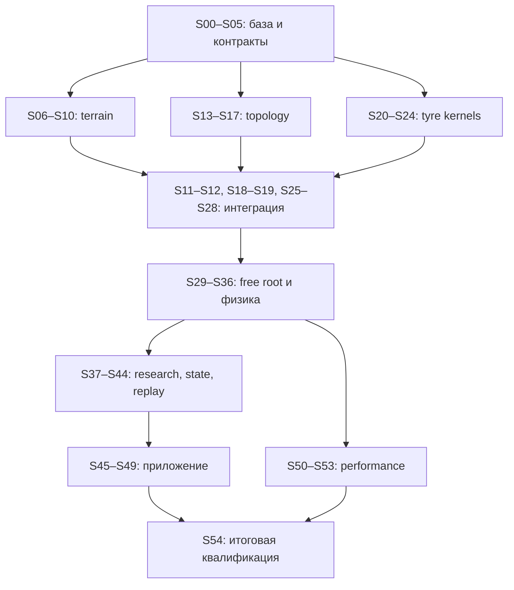

# Переход на 3D поверх незавершённой C++-миграции — Master Implementation Plan

> **For agentic workers:** REQUIRED SUB-SKILL: Use superpowers:subagent-driven-development (recommended) or superpowers:executing-plans to implement this plan task-by-task. Steps use checkbox (`- [ ]`) syntax for tracking. Этот заголовок описывает будущую реализацию. В данной работе выполнено только планирование; запрет пользователя на сборку и запуск сохраняется. Если названного runtime-specific skill нет, используйте эквивалентный task/review workflow с теми же критериями, не устанавливая навыки и не меняя требования.

**Goal:** Создать полноценный native spatial physical mode с terrain, pneumatic_3d, свободным корнем, рулением, райдером, IMU, записью/replay и viewer, сохранив существующие planar/legacy контракты.

**Architecture:** Развивать `impl/python-free-cpp` через отдельную интеграционную spatial-ветку, расширяя уже существующие `BuildRequest -> SetupOwner -> RuntimeBootstrap -> NativeRideRuntime`. Новая физика и tooling — C++; независимые модули могут разрабатываться до завершения PFC, интеграционные capability закрываются только после конкретных producer gates.

**Tech Stack:** C++23, root CMake ≥3.27 и действующие presets; MuJoCo/GLFW/DuckDB и numerical providers из фактических lock-файлов; native CTest/`bt` harness; macOS arm64 и Linux aarch64. Не добавлять новую runtime Python-зависимость, новый numerical provider или общий test framework.

**Spec:** `docs/superpowers/specs/2026-10-22-spatial-3d-native-design.md`. **Contracts:** `2026-10-22-spatial-3d-native-contracts.md`. **Source evidence:** `../audits/2026-10-22-spatial-3d-native-plan-source-audit.md`.

## Global Constraints

- В текущей работе запрещены компиляция, configure, syntax-only, тесты, приложения, контейнеры и benchmarks. Команды в задачах — инструкция для будущей разрешённой реализации; их результатов сейчас нет.
- База: **зафиксированный фактический SHA PFC**, полученный в настоящем Git checkout в S00. `9c08ff1` из аудита — историческая ссылка, не объявление SHA присланного дерева.
- Новая реализация предназначена для no-Python root graph. Удаление Python и общая миграционная квалификация остаются работой PFC, а не spatial workers.
- Planar по умолчанию и legacy сохраняют прежние входы/численное поведение. Переход live oracle → native golden выполняется по ADR-0003 на уровне конкретного файла.
- Все новые physics/generator/state/observation/frontend/test/tool paths — C++; shared planar fixes до соответствующей миграции соблюдают действующее mirrored contract.
- SI, явно объявленные world/body/sensor/patch frames; qpos и qvel адресуются независимо; quaternion updates выполняются на manifold.
- В scored phase отсутствуют bootstrap hold, невидимые world stabilizers и world push. Reaction forces ограничений и шин не считаются запрещёнными внешними поддержками; это реальные физические взаимодействия модели.
- Hot kernels: предварительно выделенная память, ownership, отсутствие name lookup/IO/непроверенных исключений; `noexcept` только для действительно не бросающих границ.
- Same-build determinism и thread-count invariance отделены от cross-platform comparison. Отдельные platform goldens обязательны; `-ffp-contract=off` сохраняется.
- Measurement claim требует итогового source SHA, executable/config/asset/provider identity, команд, exit code и сохранённых результатов.
- Запланированный test, реализованный source и прошедшая проверка — разные состояния. Нельзя заменять отсутствующий fixture нулём, self-generated expected или skip.
- Shared CMake/schema/runtime headers правит назначенный интегратор; phase owners подают ограниченные согласованные изменения.
- Реальная GUI acceptance требует реального display. Xvfb может закрыть smoke, но не качество viewer.
- Каждый task закрывается проверяемым deliverable и review; optional GPU не блокирует основную spatial линию.

---

## 1. Главный ответ: начинать сейчас можно, но от конкретных контрактов

Полное завершение `impl/python-free-cpp`, особенно T63, не является предварительным условием начала 3D. В существующем дереве достаточно native seams, чтобы разрабатывать terrain queries, новую шину, topology descriptors, физические rigs и будущие schema. **Однако знание целевой архитектуры не заменяет наличие и проверку используемого производителя.**

Правило допуска:

```text
leaf source work: source interface exists + interface contract frozen + unit inputs defined
integration work: producer source present + focused executable evidence on accepted baseline
feature supported: public path + meaningful tests + applicable regression gates pass
release qualified: final integrated SHA + required platform/physics/replay/performance evidence
```

Результат текущей работы — подробный план и статическая проверка исходников. Ни одна S-задача, upstream gate или performance target этим документом не объявляется выполненной.

## 2. Что исправлено по сравнению с планом 14 октября

| Старое положение | Новое правило и причина |
|---|---|
| База `main` после merge pneumatic | Отдельная ветка от проверенного PFC snapshot; нужные native ветки по аудиту уже в его истории |
| Python остаётся builder/terrain/research/viewer | Весь новый production путь native; transitional Python нужен только существующим миграционным обязанностям |
| Создать C++ equilibrium в `runtime/` | Расширить существующий `initialization/` и `SetupOwner` |
| Все pytest остаются постоянным gate | ADR-0003: per-file capture на двух платформах → native replacement; удаления не раньше T63 |
| ADR 0002 spatial существует, ADR 0003 зарезервировать GPU | Spatial ADR в архиве нет; 0002/0003 уже заняты. Новый кандидат 0004, номер проверяется в S00 |
| Достаточно удалить `nq == nv` | Нужна полная адресация scalar/free/ball joints и tangent-space solver |
| Руки можно оставить без изменения | Проверить reachability/rank; добавить минимальную spatial shoulder motion для физически возможного хвата |
| Новый tyre обязан быть побитово тем же planar tyre | Старый planar path — bitwise gate; новый физический tyre — численный bridge и независимые физические тесты |
| Catmull–Rom ray intersection по знакам концов | Поиск ближайшего корня внутри ячейки, tangencies, vertical rays и explicit exhaustion |
| `F_gamma <= Fz*tan(gamma)` универсален | Удалён как необоснованный потолок; sign symmetry, измеренные диапазоны и общий friction budget |
| Всегда хватает восьми patches | Формальная ёмкость или явный invalid overflow; сохранение material history при split/merge |
| Meijaard закрывается `knife_edge *= 1000` и fit за 3 s | Сопоставимая benchmark model, проверенный rolling limit/constraint, независимая linearization |
| Круговой тест в коридоре ±1.5 m | Dedicated flat arena достаточного размера |
| Observation v2 означает новый общий schema2 | Независимые версии observation, ABI, checkpoint, recording и replay |
| Snapshot engine достаточно для replay | Состояние шины, тормоза, руления, clocks/queues, sensors и RNG — обязательная часть |
| Камера 3D уже поддерживает движение в Y | Текущий target фиксирует y=0; меняется pose contract и camera tracking |
| Default threads = половина CPU, spin pool заранее | Serial baseline, profiling, затем отдельная измеренная оптимизация с lifecycle tests |
| Linux, standalone CLI, native policy вне scope | Они уже входят в целевую C++ архитектуру; пространственный путь должен их использовать |
| GPU day 1 на критическом пути | Ограниченный отдельный memo, после известных CPU bottlenecks; FP32 experiment не merge prerequisite |

## 3. Карта документов и задач

| Файл | Задачи | Самостоятельный результат |
|---|---|---|
| `2026-10-22-spatial-3d-native-00-foundation.md` | S00–S05 | Зафиксированная база, dependency ledger, корректность/контракты, harness, config capability |
| `2026-10-22-spatial-3d-native-01-terrain.md` | S06–S12 | Native terrain asset/generator/query, extrusion и render projection |
| `2026-10-22-spatial-3d-native-02-topology.md` | S13–S19 | Root/frame/steer/rider/drivetrain/runtime без planar-only assumptions |
| `2026-10-22-spatial-3d-native-03-tyre.md` | S20–S28 | Геометрия, normal law, combined brush, state, writer, тормоз и rigs |
| `2026-10-22-spatial-3d-native-04-startup-balance.md` | S29–S36 | Free-root startup, балансировка, benchmark, convergence и целевые заезды |
| `2026-10-22-spatial-3d-native-05-observation-recording.md` | S37–S44 | IMU V2, policy ABI V2, truth, запись/state/replay и native goldens |
| `2026-10-22-spatial-3d-native-06-application.md` | S45–S49 | CLI, viewer, графики/batch, packages и документация |
| `2026-10-22-spatial-3d-native-07-performance-qualification.md` | S50–S54 | Измерения, необязательные оптимизации и финальная квалификация |
| `2026-10-22-spatial-3d-native-08-gpu-research.md` | S55 | Optional go/no-go memo, не prerequisite основной реализации |

Дополнительно: новая спецификация, contracts, source audit и `migration/spatial3d/task-index.json`. JSON — индекс планируемых задач с зависимостями, не отчёт об их фактическом выполнении.

### Как передавать исполнителю

В context packet включаются: spec, master, contracts, конкретная S-задача, перечисленные исходные файлы, baseline identity, producer evidence и нужные fixture manifests. Не требуется целиком читать старый 5000-строчный completion plan каждой leaf-задаче.

Исполнитель видит свой точный output interface и downstream consumers. До коммита он проверяет scope и подтверждает отсутствие чужих изменений. Одна задача может быть отклонена отдельно от соседней — это граница её размера.

## 4. Upstream gates C++-миграции

Gate — набор конкретных условий производителя, а не требование закончить всю фазу PFC. Во всех строках текущий статус **unverified in this planning run**.

| Gate | Нужный контракт | Связь с миграцией | Что блокирует |
|---|---|---|---|
| G0-source | Фактический PFC SHA, dirty сохранён/разобран, locks/fixtures доступны, scoped interface inventory | PFC T00/T01; completion 1.01; актуальная сверка аудита | Интеграционную базу всех S-задач |
| G1-core | Root bindings-OFF build; owned runtime/bootstrap/Value/numerics; targeted native tests; model identity и failure atomicity; используемые kernels/allocation solvers | T03–T11, потребляемые контракты T26/T28; completion Phase1 и 2.01–2.08 в затронутой части | Компилируемую интеграцию topology/writers/state; не блокирует подготовку source-independent kernels |
| G2-startup | Native config/model/terrain/initialization на fresh cold start, cache import и no-Python construction; выбранные drive/rider/support modes | T12–T25 и потребляемые T27/T29/T30; реальные ошибки config/solver/model из completion исправлены | Fresh free-root startup и end-to-end ride |
| G3-research | Owned control clock, environment lifecycle, noise/policy boundary и evidence | T34–T37; соответствующие тест-порты Phase3 | V2 research episode, policy ABI, research metrics |
| G4-recording | Catalog/source/reader/assets/native golden/checked replay с явной identity | T38–T46; completion 3.03 и профильные test batches | Spatial recording, historical reader compatibility, checked replay |
| G5-gui | Native CLI/viewer/render ownership/input/pacing с реальными GUI assets | T47–T51; completion 2.09–2.10 | Viewer 3D и его desktop acceptance; headless работа продолжается |
| G6-qualification | Native tests/tools, platform numerical provenance, package/install/offline/no-Python audit; сохранность затронутых существующих режимов | T52–T62 и completion Phase3/4; применимые regression obligations T26–T33 | Финальное supported/qualified заявление по spatial product |

T63 не входит в prerequisites S06–S47. После фактического удаления Python необходимо повторить применимые финальные spatial проверки на новом интегрированном SHA. Успешный spatial no-Python executable не означает, что весь репозиторий уже прошёл T63.

T26–T33 нельзя ни пропустить целиком, ни превратить в общее ожидание всех оставшихся режимов PFC. S15 требует реально используемый transmission/drive контракт T27; S16 — allocation T28 и rider/support T29/T30; S21–S28 — квалифицированные переиспользуемые kernels T26. Legacy T31/T32 и stand/playground T33 не являются новыми spatial capabilities. Их существующие обязательства по регрессиям проверяются там, где shared change затрагивает соответствующий consumer. Непотребляемый ещё не реализованный legacy mode сам по себе не блокирует автономный Grid3d или native tyre rig.

### Зависимости от незавершённых работ

- Lane/b numerics/fixtures/codec изменения сначала попадают в PFC через его owner. Spatial не копирует файлы из старого worktree поверх текущего.
- Изменения terrain task/t20 сверяются с настоящим `terrain/` producer; новый Grid3d не используется для сокрытия незакрытого 1D port.
- Brake/energy поправки из dirty PFC выделяются как upstream contract. Spatial wire должен содержать нужное состояние независимо от того, каким коммитом оно стабилизировано.
- `wip/merge-lmp` переносится только по конкретному отсутствующему требованию root graph/numerics; это не обязательный merge 3D.
- FP32 и unrelated root histories не входят в основной dependency graph.

## 5. Стратегия веток и интеграции

### 5.1 Создание базы

S00 выполняется в настоящем Git checkout. Сначала сохранить tracked/untracked содержимое затронутых worktree и их происхождение; одна JSON-инвентаризация не резервная копия. Затем выбрать коммит PFC с нужными producer interfaces. Если обязательный producer ещё dirty, его owner фиксирует отдельный reviewable commit; «мы знаем, что он будет» не даёт оснований называть его зависимостью завершённой.

Рабочая схема:

- `impl/python-free-cpp` — upstream migration integration.
- `impl/spatial-3d-native` — общий spatial integration branch от записанного SHA.
- `spatial/sXX-<topic>` — короткие leaf/task branches от согласованной spatial integration точки.

Это **предлагаемые имена новых веток**, а не ветки, найденные в архиве. Они не создавались при планировании.

### 5.2 Направление переносов

Из PFC принимаются завершённые целевые изменения в spatial integration с очередным записанным merge SHA. Shared generic fixes, обнаруженные 3D, сначала возвращаются отдельным изменением владельцу PFC; последующий merge переносит их обратно как единое происхождение. Избегать многократных cherry-pick одного и того же большого файла в обе стороны.

Task branches сливаются в spatial integration после focused gate. Не merge каждой фазы прямо в старый `main`: это заставило бы повторно собирать давно объединённые линии и усложнило бы откат.

При завершении PFC повторно сверяется final merge-base, только потом пространственная ветка проходит G6/S54 на общей базе. Направление финального merge определяется текущим принятым integration branch проекта, а не названием `main` из документа от 14 октября.

### 5.3 Conflict protocol

1. Для конфликта записать producer contract и обе версии поведения.
2. В общих headers/schema/CMake решение принимает owner этого seam.
3. Выбирать конкретные hunks; не заменять целый файл вариантом «более новым по timestamp».
4. Сверить все callers, wire versions, fixture identities, CMake source lists и no-Python closure.
5. После семантического изменения повторить покрывающий focused gate и итоговый gate затронутой фазы.
6. Не менять goldens, чтобы скрыть конфликт; применять ADR-0003 review procedure.

Удаление worktree, удаление старых веток и cleanup outputs не являются задачами этого плана.

## 6. Владелец каждого общего seam

| Область | Owner | Правило |
|---|---|---|
| Root/native CMake, presets, deps/numerics | PFC integrator + spatial integrator | Один изменяющий shared graph; workers предоставляют список source/test edges |
| `spatial/types`, config, capability, topology descriptors | S02/S05/S13 owner | Изменение контракта сначала в contract ledger, затем все consumers |
| Builder/SetupOwner | Topology/startup owner | Terrain owner предоставляет immutable asset; не свой новый startup |
| `PhysicalStep`, samples, accounting, bootstrap codecs | Runtime integrator | Tyre/rider tasks реализуют focused modules и ограниченные hooks |
| Terrain queries/assets | Terrain owner | Никаких runtime mutations immutable grid |
| Tyre kernels/state | Tyre owner | Версии layout и numerical profile фиксируются до downstream capture |
| Sensor/policy ABI | Research owner | V1 layout immutable; V2 distinct, named frames |
| Catalog/database/replay | Recording owner | Независимые versions; совместимость проверяется историческими fixtures |
| Viewer/Input/Camera | Application owner | Render copy, без вызова физического stepping из UI |
| Goldens/benchmark manifests | Validation owner + reviewer | Автор новой физики не единолично утверждает её expected data |

## 7. Порядок реализации и параллельность

### Волна 0 — общая база

S00–S05. Здесь фиксируются источники, interfaces, fixture policy и validation matrix. S03 external data и S04 harness можно готовить одновременно после определения состава. Контракты не оформляются вечными failing stubs в основной ветке.

### Волна 1 — три параллельных направления

| Направление | Задачи | Обмен |
|---|---|---|
| Terrain | S06–S10 | Grid3d/analytic test assets → tyre; extrusion → topology bridge |
| Topology | S13–S17 | Root/BodyPose/Jacobian/runtime seams → tyre/startup/research |
| Tyre kernels | S20–S24 | Pure geometry/contact/brush/state на аналитических входах → writer |

Внутри направлений сохраняются dependencies конкретных tasks. «Волна» не означает запуск всех перечисленных задач одновременно.

### Волна 2 — constrained integration

S11–S12, S25–S28, затем S18–S19. Проверяется полноценный constrained path с настоящим tyre writer и state, terrain asset, торможением и recording-independent snapshots. Dummy flat tyre допустим только как local test fixture, не как completed capability.

### Волна 3 — free-root и ранний sensor/recording work

S29–S36. S37/S38 и подготовка S41 могут идти по замороженным model/sample interfaces, но end-to-end V2 закрывается только с реальным free-root state. Cold start, hold release, steering и хват — обязательные интеграционные узлы.

### Волна 4 — исследование и приложение

S39–S49 с их точными dependencies. Сначала полные state и schemas, затем checked replay и GUI. В S45 public CLI не рекламирует незавершённую capability. Source snapshots могут проверяться без окна; display acceptance оформляется отдельно.

### Волна 5 — скорость и итоговая квалификация

S50 начать сразу после первого валидного free-root fast episode. S51–S53 выполняются только если оправданы измерениями; отказ от параллельной оптимизации — допустимое решение, если S54 performance targets достигнуты serial. Если targets не достигнуты, «пул не окупился» не закрывает performance gap.



Диаграмма агрегированная; машинный индекс и task dependencies точнее. Критический путь включает **terrain + tyre integration + free-root startup/steering + research/replay + qualification**. Старая оценка `P0 -> P1 -> P4 -> P6` пропускала реальные prerequisites шины. Календарный срок до получения upstream evidence и первых dt/RTF измерений не обещается.

## 8. Milestones, которые можно продемонстрировать

| Milestone | Демонстрация | Что ещё не обещает |
|---|---|---|
| M0 — база | Привязанные source/dependency/fixture manifests и contract review | Работоспособность 3D |
| M1 — компоненты | C++ analytic terrain/tyre/topology tests, state roundtrip | Устойчивый велосипед |
| M2 — constrained | Native prepared/fresh constrained ride и numeric planar bridge | Свободный roll/yaw/steer |
| M3 — свободная механика | Free-root cold start, no hold, steering/grip, dt convergence, independent benchmark | Завершённые record/replay/UI |
| M4 — исследовательский стенд | IMU V2, policy isolation, full recording и checked replay | Низкодавленную MTB calibration без данных |
| M5 — приложение | Нативный CLI/viewer/batch/plots, historical reader, packages | Performance без измерений |
| M6 — квалифицированный профиль | Final integrated SHA, platforms, physics, replay, realtime, caveat ledger | Anti-wheelie алгоритм, GPU acceleration и все возможные режимы |

Профиль может иметь корректно реализованную механику и при этом `tyre_calibration = provisional`. В таком случае итог называется exploratory spatial profile, а требование валидированной MTB модели остаётся открытым. Никакие красивые графики и self-goldens этот статус не меняют.

## 9. Verification ladder будущей реализации

**L0 — source-only.** Interface inventory, call-site review, diff/schema/DAG/fixture manifest checks без выполнения проекта. Результат: `source-reviewed`, не `verified`.

**L1 — task.** Минимальный C++ test target и covering static check, затем relevant unchanged planar regressions. Для новой физики meaningful cases включают отрицательные/positive controls, а не только constructor success. Конкретные test names заданы в phase docs; CMake errors и отсутствие fixtures не становятся skips.

**L2 — milestone.** Integrated CTest subset и соответствующие platform/RTSan/ASan controls, whole-state snapshots, source identity. Heavy tests запускаются на checkpoint, не после каждой правки комментария.

**L3 — final S54.** Обе квалифицированные платформы, финальные migrated regressions, slow physics/convergence, no-Python installed/source closure, historical replay, real display/performance. Test presets исключают `slow|audit|package`; их зелёный exit сам по себе L3 не закрывает.

В текущем launcher `full` уже включает native preflight. Не запускать `native` и `full` дважды из-за устаревшего текста; при смене launcher проверить действующую логику и фактический coverage. Это правило экономии дублей не разрешает пропускать самостоятельные package/audit/display gates.

### Что записывать в evidence

`task_id`, baseline/implementation/integration SHA; dirty status; test/executable hashes; compiler/stdlib/MuJoCo/provider/lock identities; platform/CPU/thread count; physics dt/grid/tier; config/terrain/coefficient/noise hashes; exact command/exit; check counts; log/artifact hashes; comparison rule; observed residuals/RTF; reviewer; limitations.

У каждого task состояния `planned -> source_ready -> in_progress -> source_implemented -> verified -> merged`. `blocked` хранится с причиной и конкретным producer ID. `source_implemented` без запуска — законный промежуточный результат, но не закрытая задача. Optional задачи могут быть `not_selected` по зафиксированному решению; обязательные так не закрываются.

## 10. Незакрытые факты преобразованы в конкретную работу

| Неопределённость | Как разрешается |
|---|---|
| Какой SHA соответствует присланным dirty bytes | S00 inventory в настоящем checkout; archive digest сохраняется как отдельная identity |
| Какие PFC gates реально прошли после аудита | S01 producer evidence, привязанное к actual final SHA |
| Где потерян spatial ADR | S02 восстанавливает новое содержательное решение; missing file не считается accepted |
| Какие coefficients применимы к low-pressure MTB | S03/S28 provenance + validity; provisional profile явно ограничен |
| Может ли хват работать на ±60° | S16 kinematic/rank/reaction rig до заявления supported range |
| Какой dt достаточен | S35/S36 convergence на реальных пространственных заездах |
| Окупится ли thread pool | S50–S52 измерения, serial fallback |
| Пройдёт ли native C++ application на Linux | G1–G6 + S48/S54, не наличие #ifdef и файлов |
| Совпадёт ли replay после всех переносов | S27/S42/S43 на полном state, exact version/identity dispatch |

## 11. Правило завершения

Переход на 3D завершён, когда обязательные S00–S50 и S54 закрыты на финальной интеграционной базе, S51–S53 имеют выполненный результат либо документированный выбор serial, выполнены соответствующие G0–G6, а каждый объявленный профиль имеет evidence по физике, reproducibility, input/output, платформам и скорости.

Если измерения не подтверждают реализм конкретного tyre profile или realtime на конкретной машине, это остаётся открытым критерием соответствующего профиля. План не требует маскировать провал изменением допусков, уменьшением модели или пропуском интервалов симуляции. Коррекция спецификации возможна отдельным обоснованным решением с до/после evidence.

S55 не является условием завершения. Anti-wheelie controller не входит в определение done.

## 12. Состояние этого пакета

- [x] Распакован пользовательский Repomix; рассмотрены указанные документы и релевантные native источники.
- [x] Разделены source facts, исторические audit claims и предложенные изменения.
- [x] Подготовлены новая спецификация, contracts, phase tasks и dependency index.
- [x] Выполнена статическая редакционная сверка пакета; ни один проектный gate не выполнялся.
- [ ] Начата реализация S-задач.
- [ ] Получена runtime qualification любого spatial milestone.

Последние две строки намеренно остаются открытыми: пользователь запросил план, а не реализацию.
