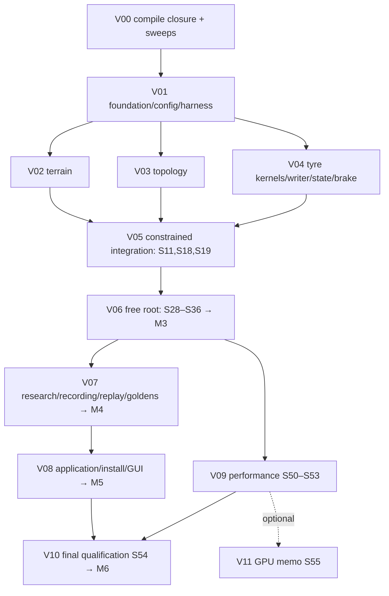

# Переход на 3D поверх незавершённой C++-миграции — Master Implementation Plan (W/V-редакция)

> **For agentic workers:** REQUIRED SUB-SKILL: Use superpowers:subagent-driven-development (recommended) or superpowers:executing-plans to implement this plan task-by-task. Steps use checkbox (`- [ ]`) syntax for tracking. План разделён на две фазы с разными правилами исполнения: **W (write)** — one-shot написание исходников без сборки, запуска и перепроверки; **V (verify & fix)** — единственная фаза, где разрешены configure/build/tests/measurements и все доработки. Если названного skill нет, используйте эквивалентный task/review workflow с теми же критериями.

**Goal:** Создать полноценный native spatial physical mode с terrain, pneumatic_3d, свободным корнем, рулением, райдером, IMU, записью/replay и viewer, сохранив существующие planar/legacy контракты.

**Architecture:** Развивать `impl/python-free-cpp` через отдельную интеграционную spatial-ветку, расширяя существующие `BuildRequest -> SetupOwner -> RuntimeBootstrap -> NativeRideRuntime`. Вся новая физика и tooling — C++. Порядок работ: сначала **W00** замораживает все новые публичные headers (declarations only), затем W01–W55 пишут реализации, тесты, CMake-регистрацию, fixtures и документы строго против этих headers; затем V00–V11 собирают, запускают, измеряют и доводят до acceptance.

**Tech Stack:** C++23, root CMake ≥3.27 и действующие presets; MuJoCo/GLFW/DuckDB и numerical providers из фактических lock-файлов; native CTest/`bt` harness; macOS arm64 и Linux aarch64. Не добавлять новую runtime Python-зависимость, новый numerical provider или общий test framework.

**Spec:** `docs/superpowers/specs/2026-10-22-spatial-3d-native-design.md`. **Contracts:** `2026-10-22-spatial-3d-native-contracts.md` (C0–C10). **Source evidence:** `../audits/2026-10-22-spatial-3d-native-plan-source-audit.md`. **Verification phase:** `2026-10-22-spatial-3d-native-09-verification.md`.

## Global Constraints

**Последняя поставка исходников 2026-10-24:** W50–W55 написаны поверх
присланного snapshot W00–W49.
[Source report](../audits/2026-10-24-spatial-w50-w55-source.md) и
`migration/spatial3d/task-index.json` фиксируют `source_written`, без
execution claims. V09/V10/V11 и все предшествующие V-gates остаются pending;
GPU остаётся optional. История W37–W49 сохранена в
[предыдущем source report](../audits/2026-10-24-spatial-w37-w49-source.md).

- База: **зафиксированный фактический SHA PFC**, полученный в настоящем Git checkout в S00. `9c08ff1` из аудита — историческая ссылка, не объявление SHA присланного дерева.
- Новая реализация предназначена для no-Python root graph. Удаление Python и общая миграционная квалификация остаются работой PFC, а не spatial workers.
- Planar по умолчанию и legacy сохраняют прежние входы/численное поведение. Переход live oracle → native golden выполняется по ADR-0003 на уровне конкретного файла.
- Все новые physics/generator/state/observation/frontend/test/tool paths — C++; shared planar fixes до соответствующей миграции соблюдают действующее mirrored contract.
- SI, явно объявленные world/body/sensor/patch frames; qpos и qvel адресуются независимо; quaternion updates выполняются на manifold.
- В scored phase отсутствуют bootstrap hold, невидимые world stabilizers и world push. Reaction forces ограничений и шин — реальные физические взаимодействия модели.
- Hot kernels: предварительно выделенная память, ownership, отсутствие name lookup/IO/непроверенных исключений; `noexcept` только для действительно не бросающих границ.
- Same-build determinism и thread-count invariance отделены от cross-platform comparison. Отдельные platform goldens обязательны; `-ffp-contract=off` сохраняется.
- Measurement claim требует итогового source SHA, executable/config/asset/provider identity, команд, exit code и сохранённых результатов.
- Нельзя заменять отсутствующий fixture нулём, self-generated expected или skip. Поля manifests, требующие выполнения (hashes, SHA, measured numbers), в W-фазе записываются как `null` со статусом `pending_verification`; соответствующие checks fail-closed до V.
- Shared CMake/schema/runtime headers правит назначенный интегратор; W00 — единственная задача, которая создаёт новые публичные headers; остальные W-задачи добавляют в них только то, что явно разрешено их разделом «Files».
- Реальная GUI acceptance требует реального display. Xvfb может закрыть smoke, но не качество viewer.
- Optional GPU (W55/V11) не блокирует основную spatial линию.

---

## 1. Две фазы и их правила

### 1.1 Фаза W — one-shot write

Правила исполнителя W-задачи:

1. Прочитать: свою W-секцию, W00 (frozen headers), нужные разделы contracts (C0–C10), перечисленные существующие файлы (`Modify`) целиком и упомянутые строки соседних файлов.
2. Написать все файлы из `Files` целиком за один проход: production source, тесты, CMake-регистрацию, fixtures (аналитические/data-only), документы.
3. **Запрещено:** `cmake` configure/build, компиляция одного TU, syntax-only, `ctest`, запуск приложений, генерация fixtures прогоном кода, измерения, review-итерации «запустил–поправил». Единственные разрешённые внешние действия — чтение файлов репозитория и `git add/commit` своих файлов.
4. Тест пишется как полноценный TU: includes, `bt::run`, fixture construction, реальные API из W00. Числовые допуски берутся из V-таблиц acceptance и переписываются в тест как есть — они не «подгоняются», потому что результата ещё нет.
5. Поля, которые невозможно знать без выполнения (digest payload, measured RTF, SHA базы, platform identity), пишутся как `null` + `"status":"pending_verification"`. Тест на такое поле обязан падать до заполнения.
6. Коммит одной W-задачи: `feat|test|docs(<area>): W<NN> <title>` с трейлером `Verification: pending V<k>`. Коммит не означает `verified`.
7. Если исполнитель видит, что frozen header из W00 не позволяет реализовать требование, он **не меняет header**, а записывает расхождение в `migration/spatial3d/contract-deviations.md` (создаёт W00) и реализует по header. Расхождение разбирает V00/V-владелец через C10.

Статусы задач W: `planned -> source_written -> handed_to_V`. Статус `verified` недостижим в W.

### 1.2 Фаза V — verify & fix

V-фаза — единственное место, где код собирается и исполняется. Она организована по модулям (V00–V11), каждая V-задача: build → targeted CTest → анализ → fix в owner-модуле → re-run → acceptance → evidence → commit. Все численные критерии приёмки из прежних S-задач перенесены в V-таблицы. Контрактные изменения, обнаруженные в V, проходят C10 и обновляют W00-headers вместе с consumers.

Статусы V: `blocked_on_W -> in_progress -> verified -> merged`; `blocked(<producer id>)`, `not_selected` только для optional.

### 1.3 Правило соответствия S → W/V

Каждая прежняя задача S01–S55 разделена: **W<NN>** = её authoring-часть (все файлы, формулы, layouts, тесты как код), **V<k>** = её execution-часть (запуск, acceptance numbers, measurement, capture, evidence). Номер W совпадает с номером S. S00 остаётся единственной задачей до W-фазы (read-only git inventory, см. §5). Старая нумерация S сохраняется в task-index как `source_sections` для трассировки.

## 2. Что исправлено по сравнению с планом 14 октября

| Старое положение | Новое правило и причина |
|---|---|
| База `main` после merge pneumatic | Отдельная ветка от проверенного PFC snapshot; нужные native ветки по аудиту уже в его истории |
| Python остаётся builder/terrain/research/viewer | Весь новый production путь native; transitional Python нужен только существующим миграционным обязанностям |
| Создать C++ equilibrium в `runtime/` | Расширить существующий `initialization/` и `SetupOwner` |
| Все pytest остаются постоянным gate | ADR-0003: per-file capture на двух платформах → native replacement; удаления не раньше T63 |
| ADR 0002 spatial существует, ADR 0003 зарезервировать GPU | Spatial ADR в архиве нет; 0002/0003 заняты. Новый кандидат 0004, номер проверяется в S00 |
| Достаточно удалить `nq == nv` | Нужна полная адресация scalar/free/ball joints и tangent-space solver |
| Руки можно оставить без изменения | Проверить reachability/rank; добавить минимальную spatial shoulder motion для физически возможного хвата |
| Новый tyre обязан быть побитово тем же planar tyre | Старый planar path — bitwise gate; новый физический tyre — численный bridge и независимые физические тесты |
| Catmull–Rom ray intersection по знакам концов | Поиск ближайшего корня внутри ячейки, tangencies, vertical rays и explicit exhaustion |
| `F_gamma <= Fz*tan(gamma)` универсален | Удалён как необоснованный потолок; sign symmetry, измеренные диапазоны и общий friction budget |
| Всегда хватает восьми patches | Формальная ёмкость или явный invalid overflow; сохранение material history при split/merge |
| Meijaard закрывается `knife_edge *= 1000` и fit за 3 s | Сопоставимая benchmark model, проверенный rolling limit/constraint, независимая linearization |
| Круговой тест в коридоре ±1.5 m | Dedicated flat arena достаточного размера |
| Observation v2 означает новый общий schema2 | Независимые версии observation, ABI, checkpoint, recording и replay |
| Snapshot engine достаточно для replay | Состояние шины, тормоза, руления, clocks/queues, sensors и RNG — обязательная часть |
| Камера 3D уже поддерживает движение в Y | Текущий target фиксирует y=0; меняется pose contract и camera tracking |
| Default threads = половина CPU, spin pool заранее | Serial baseline, profiling, затем отдельная измеренная оптимизация с lifecycle tests |
| Linux, standalone CLI, native policy вне scope | Они уже входят в целевую C++ архитектуру; пространственный путь должен их использовать |
| GPU day 1 на критическом пути | Ограниченный отдельный memo, после известных CPU bottlenecks; FP32 experiment не merge prerequisite |
| **Задачи перемежают write/run/fix (редакция 22.10 утро)** | **W-задачи только пишут против frozen headers W00; весь run/fix/measure — в V00–V11** |

## 3. Карта документов и задач

| Файл | W-задачи | V-задача | Самостоятельный результат |
|---|---|---|---|
| `2026-10-22-spatial-3d-native-00-foundation.md` | S00 (pre-W), **W00**, W01–W05 | V00, V01 | Frozen headers, registry/contracts/ADR, harness, config |
| `2026-10-22-spatial-3d-native-01-terrain.md` | W06–W12 | V02, V05 (S11) | Native terrain asset/generator/query, extrusion, render projection |
| `2026-10-22-spatial-3d-native-02-topology.md` | W13–W19 | V03, V05 | Root/frame/steer/rider/drivetrain/runtime без planar-only assumptions |
| `2026-10-22-spatial-3d-native-03-tyre.md` | W20–W28 | V04, V06 (S28) | Геометрия, normal law, combined brush, state, writer, тормоз, qualification rig |
| `2026-10-22-spatial-3d-native-04-startup-balance.md` | W29–W36 | V06 | Free-root startup, балансировка, benchmark, convergence, целевые заезды |
| `2026-10-22-spatial-3d-native-05-observation-recording.md` | W37–W44 | V07 | IMU V2, policy ABI V2, truth, запись/state/replay, golden registry |
| `2026-10-22-spatial-3d-native-06-application.md` | W45–W49 | V08 | CLI, viewer, графики/batch, install, документация |
| `2026-10-22-spatial-3d-native-07-performance-qualification.md` | W50–W54 | V09, V10 | Measurement tooling, pool contract, qualification validator |
| `2026-10-22-spatial-3d-native-08-gpu-research.md` | W55 | V11 | Optional memo skeleton + decision helper |
| **`2026-10-22-spatial-3d-native-09-verification.md`** | — | **V00–V11** | Build closure, все запуски, acceptance, measurements, evidence, fixes |

Дополнительно: спецификация, contracts, source audit и `migration/spatial3d/task-index.json` (W/V задачи, зависимости, `source_sections`). JSON — индекс планируемых задач, не отчёт об их выполнении.

### Как передавать исполнителю W-задачи

Context packet: contracts, W00 (frozen headers), конкретная W-секция, перечисленные существующие файлы, V-таблица acceptance соответствующего модуля (для переноса допусков в тест). Не требуется ни build directory, ни toolchain, ни fixture payloads.

### Как передавать исполнителю V-задачи

Context packet: V-секция, список W-коммитов модуля, build preset/manifest базы, platform identity, producer evidence upstream gates, `contract-deviations.md`. V-исполнитель имеет право править любой файл модуля; shared headers — через интегратора и C10.

## 4. Upstream gates C++-миграции

Gate — набор конкретных условий производителя. Во всех строках текущий статус **unverified in this planning run**. W-фаза gates не требует (пишется против headers); gates нужны V-фазе.

| Gate | Нужный контракт | Связь с миграцией | Что блокирует в V |
|---|---|---|---|
| G0-source | Фактический PFC SHA, dirty сохранён/разобран, locks/fixtures доступны | PFC T00/T01 | V00 (сборка на зафиксированной базе) |
| G1-core | Root bindings-OFF build; owned runtime/bootstrap/Value/numerics; targeted native tests; model identity | T03–T11, T26/T28 | V00–V04 компиляция и unit-запуски |
| G2-startup | Native config/model/terrain/initialization fresh cold start, cache import, no-Python construction | T12–T25, T27/T29/T30 | V05, V06 |
| G3-research | Owned control clock, environment lifecycle, noise/policy boundary | T34–T37 | V07 (S38–S40) |
| G4-recording | Catalog/source/reader/assets/native golden/checked replay | T38–T46 | V07 (S41–S44) |
| G5-gui | Native CLI/viewer/render ownership/input/pacing | T47–T51 | V08 |
| G6-qualification | Native tests/tools, platform provenance, package/install/offline/no-Python audit | T52–T62 | V10 |

T63 не входит в prerequisites. T26–T33: W15 пишет против transmission/drive контракта T27; W16 — allocation T28 и rider/support T29/T30; W21–W28 — переиспользуемые kernels T26. Их фактическая готовность проверяется в V03/V04, не в W.

### Зависимости от незавершённых работ

- Lane/b numerics/fixtures/codec изменения сначала попадают в PFC через его owner. Spatial не копирует файлы из старого worktree поверх текущего.
- Изменения terrain task/t20 сверяются с настоящим `terrain/` producer.
- Brake/energy поправки из dirty PFC выделяются как upstream contract (W26 пишет state independent от того, каким коммитом они стабилизированы).
- `wip/merge-lmp` переносится только по конкретному отсутствующему требованию root graph/numerics.

## 5. Стратегия веток и интеграции

### 5.1 S00 — единственная задача до W-фазы

S00 выполняется интегратором в настоящем Git checkout (read-only git inventory, без сборки): фиксируется `base_sha`, сохраняются WIP, создаётся `impl/spatial-3d-native`. Без S00 W-задачи, модифицирующие существующие файлы, не имеют определённой базы. Полное описание — в 00-foundation.

### 5.2 Ветки

- `impl/python-free-cpp` — upstream migration integration.
- `impl/spatial-3d-native` — spatial integration branch от `base_sha`.
- `spatial/w00-headers` — W00; merge в integration до любой другой W.
- `spatial/wNN-<topic>` — одна ветка на W-задачу; merge в integration **без сборки** после source review (scope, соответствие W00, отсутствие чужих правок).
- `spatial/vNN-<module>` — V-задачи; merge после зелёных gates.

Это предлагаемые имена; они не создавались при планировании.

### 5.3 Порядок записи в общие файлы (W-фаза)

Несколько W-задач правят одни и те же существующие файлы. Без компиляции конфликт обнаруживается только при чтении, поэтому W-задачи, перечисленные в одной строке, **исполняются последовательно в порядке номеров**, и каждая следующая читает файл в состоянии после предыдущей:

| Файл | W-задачи в порядке записи |
|---|---|
| `CMakeLists.txt` (root) | W04, W05, W06–W10, W13–W17, W20–W27, W29–W34, W37–W43, W45–W47, W50–W52, W54 |
| `native/tests/spatial/CMakeLists.txt` | W04 создаёт; далее каждая W с тестом добавляет одну строку `bike_add_spatial_test(...)` |
| `native/src/runtime/step.{hpp,cpp}` | W15, W17, W25, W26, W27, W32, W37 |
| `native/src/runtime/accounting.{hpp,cpp}` | W15, W26, W30, W32 |
| `native/src/runtime/bootstrap{,_io}.{hpp,cpp}` | W17, W27, W31, W42 |
| `native/src/initialization/setup_owner.cpp` | W17, W11, W31 |
| `native/src/initialization/capture.cpp` | W17, W27, W30, W31 |
| `native/src/model/builder.{hpp,cpp}` | W14, W11, W34 |
| `native/src/model/physical_topology.cpp` | W14, W15, W25 |
| `native/src/spatial/bootstrap_state.{hpp,cpp}` | W00 (hpp), W17 (cpp), W30/W32/W33 (active-state validation только в cpp) |
| `native/src/pneumatic3d/state.hpp` | W00 создаёт полностью; W21–W27 **не меняют** |
| `native/src/configuration/{physical_config.hpp,validate.cpp,schema.cpp}` | W05, W16, W28, W32 |
| `native/src/cli/{argument_contracts.inc,configuration.cpp}` | W45, W52 |
| `docs/TESTING.md` | W12, W44, W49, W54 |

### 5.4 Направление переносов и conflict protocol

Из PFC принимаются завершённые изменения в spatial integration с записанным merge SHA. Shared generic fixes, обнаруженные в V, сначала возвращаются владельцу PFC отдельным изменением. Conflict protocol: записать producer contract и обе версии; решение owner seam; выбирать hunks, не файл целиком; сверить callers/wire versions/fixture identities/CMake lists; повторить covering gate; не менять goldens ради сокрытия конфликта.

## 6. Владелец каждого общего seam

| Область | Owner | Правило |
|---|---|---|
| Все новые публичные headers | W00 owner (= spatial integrator) | Единственный автор declarations; изменения после W00 только через C10 в V |
| Root/native CMake, presets, deps/numerics | PFC integrator + spatial integrator | Один изменяющий shared graph |
| `spatial/types`, config, capability, topology descriptors | W05/W13 (cpp), W00 (hpp) | Изменение контракта сначала в contract ledger |
| Builder/SetupOwner | Topology/startup owner | Terrain owner предоставляет immutable asset |
| `PhysicalStep`, samples, accounting, bootstrap codecs | Runtime integrator | Tyre/rider tasks реализуют focused modules и ограниченные hooks |
| Terrain queries/assets | Terrain owner | Никаких runtime mutations immutable grid |
| Tyre kernels/state | Tyre owner | Layout и numerical profile заморожены в W00 `state.hpp` |
| Sensor/policy ABI | Research owner | V1 layout immutable; V2 distinct |
| Catalog/database/replay | Recording owner | Независимые versions |
| Viewer/Input/Camera | Application owner | Render copy, без физического stepping из UI |
| Goldens/benchmark manifests | Validation owner + reviewer (V07/V10) | Автор новой физики не единолично утверждает expected data |

## 7. Порядок исполнения

### Фаза W

```text
S00 ──> W00 ──> { W01..W05 } ──> параллельные дорожки:
          terrain  W06..W12
          topology W13..W19
          tyre     W20..W28
          startup  W29..W36
          research W37..W44
          app      W45..W49
          perf     W50..W55
```

Внутри дорожки — порядок номеров (из-за общих файлов §5.3). Между дорожками параллельность допустима с учётом строк §5.3: задачи из одной строки таблицы не исполняются одновременно. Никакая W-задача не ждёт V.

### Фаза V



## 8. Milestones

| Milestone | Демонстрация | Закрывается |
|---|---|---|
| M0 — база | `base_sha`, headers W00, contracts/ADR, harness controls | V01 |
| M1 — компоненты | Analytic terrain/tyre/topology tests, state roundtrip | V02–V04 |
| M2 — constrained | Native prepared/fresh constrained ride и numeric planar bridge | V05 |
| M3 — свободная механика | Free-root cold start, no hold, steering/grip, dt convergence, Meijaard | V06 |
| M4 — исследовательский стенд | IMU V2, policy isolation, full recording, checked replay, goldens | V07 |
| M5 — приложение | Native CLI/viewer/batch/plots, historical reader, install | V08 |
| M6 — квалифицированный профиль | Final SHA, platforms, physics, replay, realtime, caveat ledger | V10 |

Профиль с `tyre_calibration = provisional` называется exploratory spatial profile.

## 9. Verification ladder (внутри V)

**L0 — source-only** (единственный уровень, доступный W): interface inventory, соответствие W00, diff/schema/DAG review. Результат `source_written`.

**L1 — task** (V01–V04, части V05–V09): минимальный C++ test target + covering static sweep + relevant unchanged planar regressions. CMake errors и отсутствие fixtures не становятся skips.

**L2 — milestone** (V05–V09): integrated CTest subset, platform/RTSan/ASan controls, whole-state snapshots, source identity.

**L3 — final** (V10): обе платформы, migrated regressions, slow physics/convergence, no-Python closure, historical replay, real display/performance. Test presets исключают `slow|audit|package`; их зелёный exit L3 не закрывает.

`tools/run_tests.sh full` уже включает native preflight; `native` и `full` не запускать дважды.

### Evidence record (V)

`task_id`, baseline/implementation/integration SHA; dirty status; test/executable hashes; compiler/stdlib/MuJoCo/provider/lock identities; platform/CPU/thread count; physics dt/grid/tier; config/terrain/coefficient/noise hashes; exact command/exit; check counts; log/artifact hashes; comparison rule; observed residuals/RTF; reviewer; limitations.

## 10. Незакрытые факты → конкретная работа

| Неопределённость | Где решается |
|---|---|
| Какой SHA соответствует присланным dirty bytes | S00 inventory |
| Какие PFC gates реально прошли | V00/V01 producer evidence |
| Где потерян spatial ADR | W02 пишет ADR-0004 как `proposed`; V01 фиксирует номер по checkout |
| Коэффициенты low-pressure MTB | W03 данные + W28 rig; V06 fit/статус |
| Хват на ±60° | W16 rig; V03 измерение rank/reach |
| Достаточный dt | W35 тесты; V06 convergence |
| Окупится ли thread pool | W51/W52 код; V09 измерения, serial fallback |
| Linux native application | V08/V10 |
| Replay после всех переносов | W27/W42/W43; V07 |
| Расхождения W-кода с frozen headers | `contract-deviations.md` → V00/C10 |

## 11. Правило завершения

Переход на 3D завершён, когда все W00–W50, W54 имеют статус `handed_to_V`, V00–V10 — `verified` на финальной интеграционной базе, V09 (S51–S53) имеет выполненный результат либо документированный `not_selected`, выполнены применимые G0–G6, и каждый объявленный профиль имеет evidence по физике, reproducibility, input/output, платформам и скорости. W55/V11 не являются условием завершения. Anti-wheelie controller не входит в определение done.

Если измерения не подтверждают реализм tyre profile или realtime, это остаётся открытым критерием профиля; план не требует маскировать провал изменением допусков, уменьшением модели или пропуском интервалов.

## 12. Состояние этого пакета

- [x] Рассмотрены исходный Repomix, phase-документы S00–S55, contracts и source audit.
- [x] Пакет переписан в W/V-форму: W00 header freeze, W01–W55 one-shot write, V00–V11 verify & fix.
- [x] `migration/spatial3d/task-index.json` обновлён под W/V с `source_sections`.
- [ ] S00 выполнен на настоящем checkout.
- [ ] W00 написан и слит в `impl/spatial-3d-native`.
- [ ] Начата фаза V.

Последние строки намеренно остаются открытыми: выполнено только планирование; ни сборка, ни запуск, ни тесты не выполнялись.
